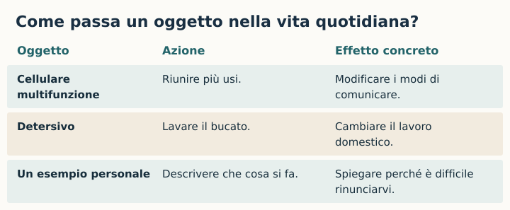

# ENS Rennes · D1 · Italien 2018 — Corrigé brut

*Corrigé rédigé par IA, non officiel. Signalez toute erreur.*

**Rédaction** · GPT-6.2 Astra Ultra · vitesse non renseignée

**Couverture partielle.** Le jury décrit trois paragraphes, donne le titre de la version et en relève quelques expressions précises. L’article intégral de la Repubblica a été retrouvé. Les passages français ci-dessous rendent les éléments repérables, complétés par leur contexte de presse. Le feuillet et ses trois paragraphes exactement délimités manquent. La question de rédaction est donnée intégralement par le jury.

## Traduction des éléments repérables

**Ces objets qui ont changé notre vie.** Le rapport donne ce titre pour l’extrait et indique trois paragraphes. Dans l’article de *la Repubblica*, les téléphones portables à tout faire sont associés aux ordinateurs et aux tablettes. Une traduction telle que « téléphones multifonctions » restitue l’idée qu’un même appareil rassemble plusieurs usages.

**Le travail domestique.** Dans l’entretien de presse, faire la lessive et préparer les repas sont présentés comme des tâches longtemps assignées aux femmes en Italie. Ces travaux demandent désormais moins de temps et d’énergie. Les produits lessiviels ont beaucoup changé les choses par rapport à la cendre dont on se servait au XIXe siècle. La personne interrogée peut lire une partie d’un chapitre pendant que le riz cuit. Cette situation rend concret le gain de temps.

**Les indices de la coupe.** Les cinq expressions que relève le jury se retrouvent dans les passages sur les téléphones multifonctions et les tâches du foyer. Elles autorisent les rapprochements ci-dessus. Les limites du troisième paragraphe du sujet et l’intégralité de sa construction syntaxique restent inconnues.

## Composition en italien

*Quali sono gli oggetti a cui, nella tua vita quotidiana, non potresti mai rinunciare?* Environ 100 mots.

Nella mia vita quotidiana rinuncerei difficilmente alla bicicletta e al piccolo quaderno che porto in tasca. La bicicletta mi permette di raggiungere la biblioteca senza aspettare un autobus e, soprattutto, di fermarmi lungo il percorso quando incontro qualcuno. Il quaderno svolge una funzione diversa. Quando mia nonna mi spiega una ricetta, posso annotare subito un gesto o una quantità e ritrovare l’appunto anni dopo. Potrei usare il telefono per entrambe le cose, per chiamare un taxi o registrare la conversazione. Preferisco però questi oggetti perché mi lasciano decidere con calma dove andare e che cosa conservare.

*96 mots, comptés par espaces.*

[Rapport du jury, partie écrite](https://www.ens-rennes.fr/medias/fichier/rapport-d1-2018-italien-ecrit_1563806943584-pdf) · [La Repubblica, 13 décembre 2016, article et entretien avec Marta Boneschi](https://www.repubblica.it/rubriche/passaparola/2016/12/13/news/i_migliori_oggetti_della_nostra_vita-154026740/)
