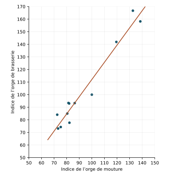
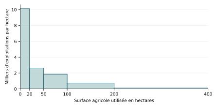
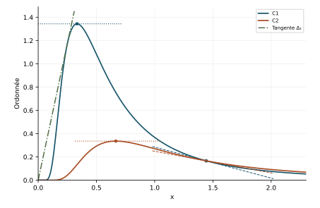

# ENS Rennes D1 — Mathématiques appliquées et statistiques 2018 · Corrigé guidé

*Corrigé rédigé par IA, non officiel. Signalez toute erreur.*

**Rédaction** · GPT-6.2 Astra Ultra · vitesse non renseignée

**Révision (tour 1)** · GPT-6.2 Astra Ultra · vitesse non renseignée · 26 novembre 2026

Épreuve de quatre heures, pages physiques 3 à 10 du fascicule d’options. Le jury relève les difficultés sur la classe de surface ouverte et sur la justification de l’indépendance. Les résultats numériques suivent les arrondis de l’énoncé.

## Exercice 1. Orge et exploitations agricoles

### Question 1.A.1

> [!INDICATION]
> Placer les deux indices de chaque année sur des axes distincts.

#### Solution

On porte l’indice de mouture $y$ en abscisse et celui de brasserie $z$ en ordonnée. Les deux axes commencent à 50 et ont la même échelle, 1 cm pour 10 points sur papier. Par exemple les années 2000 et 2011 fournissent $(86{,}4;93{,}3)$ et $(138{,}5;158{,}2)$. Le tracé comprend la droite calculée en A.3.

### Question 1.A.2

> [!INDICATION]
> Calculer la covariance et les deux variances sur les douze couples.

#### Solution

On trouve $\bar y=93{,}675$, $\bar z\simeq103{,}392$, $V_y\simeq506{,}815$, $V_z\simeq995{,}862$, $C_{yz}=12^{-1}\sum_i(y_i-\bar y)(z_i-\bar z)\simeq692{,}656$. Alors $r=C_{yz}/\sqrt{V_yV_z}\simeq0{,}975$. Le nuage présente une tendance linéaire croissante marquée et un ajustement affine est raisonnable. Cette association statistique ne prouve pas une causalité entre les prix.

### Question 1.A.3

> [!INDICATION]
> Choisir comme variable expliquée l’indice de brasserie.

#### Solution

Pour minimiser les carrés des écarts verticaux en $z$, on prend $a=C_{yz}/V_y\simeq1{,}3666844$ et $b=\bar z-a\bar y\simeq-24{,}6324981$. La droite tracée en A.1 a pour équation $\widehat z\simeq1{,}367y-24{,}632$ aux arrondis demandés.

### Question 1.A.4

> [!INDICATION]
> Identifier ce qui intervient comme entrée de la régression.

#### Solution

L’année 2017 seule ne fournit aucune abscisse dans cette régression entre deux prix. Il faudrait connaître ou prévoir l’indice de mouture de 2017, puis l’introduire dans $\widehat z(y)$, ou construire et justifier un modèle temporel spécifique à la brasserie.

### Question 1.A.5

> [!INDICATION]
> Distinguer lecture inverse de la droite et régression prédictive dans l’autre sens.

#### Solution

Sur la droite obtenue en A.3, imposer $\widehat z=110$ donne $y=(110-b)/a\simeq98{,}510$. Si l’on veut minimiser directement les erreurs de prédiction en mouture, la régression de $y$ sur $z$ fournit $\widehat y=\bar y+(C_{yz}/V_z)(110-\bar z)\simeq98{,}271$. Les deux valeurs diffèrent légèrement car les régressions minimisent des écarts mesurés sur des axes différents.

### Question 1.A.6

> [!INDICATION]
> Mesurer l’éloignement de la nouvelle valeur par rapport au nuage.

#### Solution

Pour $y=300$, la droite estimée donne $\widehat z=300a+b\simeq385{,}373$. Les valeurs de mouture observées vont seulement de $72{,}5$ à $138{,}5$. Il s’agit d’une extrapolation lointaine ; le bon coefficient de corrélation dans l’échantillon ne garantit pas cette prévision.

### Question 1.B.1

> [!INDICATION]
> Distinguer les exploitations du caractère mesuré.

#### Solution

La population est celle des exploitations et le caractère est leur surface agricole utilisée en hectares. C’est une série quantitative continue groupée en classes, avec effectifs en milliers.

### Question 1.B.2

> [!INDICATION]
> Utiliser les surfaces totales données, y compris pour la classe ouverte.

#### Solution

La SAU cumulée vaut $1164+2655+6751+10191+6978=27739$ milliers d’hectares. Les effectifs totalisent $472{,}2$ milliers d’exploitations. Ainsi la surface moyenne vaut $27739/472{,}2\simeq58{,}744$ ha.

### Question 1.B.3

> [!INDICATION]
> Repérer le passage par cinquante pour cent dans la fréquence cumulée.

#### Solution

Les exploitations de moins de 20 ha forment $42{,}8\,\%$ du total, celles de moins de 50 ha $42{,}8+16{,}7=59{,}5\,\%$. La médiane appartient donc à $[20,50[$ ha. Le groupement ne donne pas sa valeur exacte.

### Question 1.B.4

> [!INDICATION]
> Relier le centre de la dernière classe à sa moyenne observée.

#### Solution

La surface moyenne dans la classe des 200 ha ou plus est $6978/23{,}6$ ha. Sous une loi uniforme entre $200$ et $M$, cette moyenne est $(200+M)/2$. Donc $M=2(6978/23{,}6)-200\simeq391{,}356$ ha.

### Question 1.B.5

> [!INDICATION]
> Diviser les effectifs par les amplitudes inégales des classes.

#### Solution

Avec les bornes $0,20,50,100,200,400$, les hauteurs successives sont $10{,}115$, $2{,}633$, $1{,}866$, $0{,}740$, $0{,}118$ en milliers d’exploitations par hectare. Les rectangles ont pour aires les effectifs en milliers. L’hypothèse de 400 ha est propre à ce tracé.

### Question 1.B.6

> [!INDICATION]
> Comparer les hauteurs des rectangles.

#### Solution

La densité maximale est $202{,}3/20=10{,}115$ dans la classe de moins de 20 hectares. Cette classe est l’unique classe modale.

## Exercice 2. Probabilités, gains et rendement

### Question 2.I.1

> [!INDICATION]
> Lire les trois probabilités de situation, puis celles du déclassement dans chaque situation.

#### Solution

Les événements $N,E,I$ forment une partition de probabilités $0{,}90$, $0{,}09$ et $1-0{,}90-0{,}09=0{,}01$. Dans cet ordre, $P(D\mid N)=0{,}10$, $P(D\mid E)=0{,}01$ et $P(D\mid I)=0{,}91$.

### Question 2.I.2

> [!INDICATION]
> Multiplier la probabilité marginale par le risque conditionnel.

#### Solution

$P(N\cap D)=P(N)P(D\mid N)=0{,}90\times0{,}10=0{,}090$.

### Question 2.I.3

> [!INDICATION]
> Additionner les trois contributions d’une partition.

#### Solution

$P(D)=0{,}90(0{,}10)+0{,}09(0{,}01)+0{,}01(0{,}91)=0{,}09+0{,}0009+0{,}0091=0{,}100$.

### Question 2.I.4

> [!INDICATION]
> Vérifier l’égalité caractéristique de l’indépendance.

#### Solution

Les événements sont indépendants : $P(N\cap D)=0{,}09=P(N)P(D)$. De manière équivalente, le risque sachant un test négatif vaut précisément le risque global.

### Question 2.I.5

> [!INDICATION]
> Conditionner sur les seuls lots déclassés.

#### Solution

Par Bayes, $P(I\mid D)=0{,}01\times0{,}91/0{,}10=0{,}091$.

### Question 2.I.6

> [!INDICATION]
> Normaliser la somme des intersections correspondant aux deux tests positifs.

#### Solution

$P(D\mid E\cup I)=[P(E)P(D\mid E)+P(I)P(D\mid I)]/[P(E)+P(I)]=(0{,}0009+0{,}0091)/0{,}10=0{,}100$.

Sur 10 000 récoltes aux proportions indiquées, les contributions des trois branches sont les suivantes.

| Résultat du test | Déclassées | Non déclassées | Ensemble |
|---|---:|---:|---:|
| N | 900 | 8 100 | 9 000 |
| E | 9 | 891 | 900 |
| I | 91 | 9 | 100 |

Parmi les $900+100$ résultats E ou I, il y a $9+91$ déclassements. Ce décompte donne $100/1000$. Dans la seule branche I, la proportion de déclassements monte à $91/100$.

### Question 2.I.7

> [!INDICATION]
> Utiliser la loi du gain fournie dans le texte.

#### Solution

$\mathbb EG=700(0{,}81)+500(0{,}09)+300(0{,}09)+100(0{,}01)=640$ euros par hectare. Le second moment vaut $427600$, d’où $\operatorname{Var}G=427600-640^2=18000$ en unités de gain au carré.

### Question 2.II.1

> [!INDICATION]
> Identifier les dix essais indépendants.

#### Solution

Chaque parcelle a probabilité $0{,}02$ d’être déclassée. Les dix essais indépendants donnent $X\sim\operatorname{Bin}(10,0{,}02)$.

### Question 2.II.2

> [!INDICATION]
> Additionner le cas zéro et le cas un.

#### Solution

$P(X\le1)=0{,}98^{10}+10(0{,}02)0{,}98^9\simeq0{,}984$.

### Question 2.II.3

> [!INDICATION]
> Calculer une moyenne par hectare sur dix parcelles de même surface.

#### Solution

$H=[600(10-X)+200X]/10=600-40X$. Comme $\mathbb EX=0{,}2$ et $\operatorname{Var}X=10(0{,}02)(0{,}98)=0{,}196$, on trouve $\mathbb EH=592$ et $\operatorname{Var}H=313{,}600$. La première stratégie donne 48 euros de plus par hectare en moyenne, avec variance 18000. Pour privilégier l’espérance on choisit la première ; pour limiter fortement les fluctuations on choisit la seconde. La préférence dépend de la tolérance au risque de l’exploitant.

### Question 2.II.4

> [!INDICATION]
> Traduire attentivement l’inégalité stricte en un seuil entier.

#### Solution

$600-40X>520$ équivaut à $X<2$, donc $P(H>520)=P(X\le1)\simeq0{,}984$.

### Question 2.III.1

> [!INDICATION]
> Utiliser les moments de la loi de Poisson.

#### Solution

La loi de Poisson de paramètre cinq donne $\mathbb EA=5$ et $\operatorname{Var}A=5$.

### Question 2.III.2

> [!INDICATION]
> Évaluer la masse en cinq.

#### Solution

$P(A=5)=e^{-5}5^5/5!\simeq0{,}175$.

### Question 2.III.3

> [!INDICATION]
> Passer par la probabilité complémentaire.

#### Solution

$P(A\ge3)=1-e^{-5}(1+5+25/2)\simeq0{,}875$.

### Question 2.III.4

> [!INDICATION]
> Standardiser le rendement dans le modèle normal.

#### Solution

Le seuil réduit est $(7{,}25-6{,}5)/1{,}5=0{,}5$. Donc $P(R>7{,}25)=1-\Phi(0{,}5)\simeq0{,}309$.

### Question 2.III.5

> [!INDICATION]
> Répartir le risque hors de l’intervalle entre les deux queues.

#### Solution

La condition donne $\Phi(a/1{,}5)=0{,}975$, donc $a=1{,}5\Phi^{-1}(0{,}975)\simeq2{,}940$ tonnes par hectare. L’intervalle va approximativement de $3{,}560$ à $9{,}440$ ; un rendement de 9 est dans la norme définie par le sujet.

## Exercice 3. Variations, tangentes et intégrales

### Question 3.I.1

> [!INDICATION]
> Dériver le produit de la puissance et de l’exponentielle.

#### Solution

Sur $x>0$, $f_n(x)=nx^{-3}e^{-n/x}$. Sa dérivée vaut $n e^{-n/x}[-3x^{-4}+nx^{-5}]=n(n-3x)e^{-n/x}/x^5$.

### Question 3.I.2

> [!INDICATION]
> Isoler le facteur qui peut changer de signe.

#### Solution

La dérivée est positive avant $\alpha_n=n/3$, nulle en ce point, puis négative. Ainsi $f_n$ croît strictement de zéro à $f_n(\alpha_n)$ puis décroît strictement vers zéro, en utilisant les deux limites du sujet.

| $x$ | $0^+$ |  | $n/3$ |  | $+\infty$ |
| --- | --- | --- | --- | --- | --- |
| $f_n'(x)$ |  | $+$ | $0$ | $-$ |  |
| $f_n(x)$ | $0$ | $\nearrow$ | $27e^{-3}/n^2$ | $\searrow$ | $0$ |

### Question 3.I.3

> [!INDICATION]
> Évaluer la fonction au sommet de sa courbe.

#### Solution

Le maximum est atteint uniquement en $n/3$ et vaut $n e^{-3}/(n/3)^3=27e^{-3}/n^2$.

### Question 3.I.4

> [!INDICATION]
> Comparer le quotient des valeurs successives à un.

#### Solution

$f_{n+1}-f_n=f_n[(1+1/n)e^{-1/x}-1]$. Le facteur entre crochets est strictement croissant de $-1$ vers $1/n$. Il s’annule en $\beta_n=1/\ln(1+1/n)$. Ainsi $C_{n+1}$ est sous $C_n$ avant $\beta_n$ et au-dessus après. Leur unique intersection est $(\beta_n,n\beta_n^{-3}e^{-n/\beta_n})$.

### Question 3.I.5

> [!INDICATION]
> Introduire le logarithme de deux et utiliser la valeur commune des deux courbes.

#### Solution

Posons $L=\ln2$. Alors $\beta_1=1/L$, $f_1(\beta_1)=f_2(\beta_1)=L^3/2$ car $e^{-1/\beta_1}=1/2$. La formule de 3.I.1 donne $f'_1(\beta_1)=L^4(L-3)/2$, $f'_2(\beta_1)=L^4(2L-3)/2$.

### Question 3.I.6

> [!INDICATION]
> Placer d’abord les maxima et le point de rencontre.

#### Solution

Les sommets sont $(1/3,27e^{-3})$ et $(2/3,27e^{-3}/4)$. On y trace des tangentes horizontales. Au point $(1/L,L^3/2)$, les deux tangentes sont $y=L^3/2+f'_k(\beta_1)(x-1/L)$ pour $k=1,2$ avec les pentes de 3.I.5. Le dessin utilise un repère orthonormé ; sur papier, 5 cm représentent une unité. La droite $\Delta_1$ de la partie suivante est également représentée.

### Question 3.II.1

> [!INDICATION]
> Utiliser le point de contact et le nombre dérivé.

#### Solution

La tangente en $a$ a pour équation $y=f_n(a)+f'_n(a)(x-a)$.

### Question 3.II.2

> [!INDICATION]
> Annuler l’ordonnée à l’origine de la tangente.

#### Solution

En $x=0$ son ordonnée est $f_n(a)-a f'_n(a)$. La tangente passe donc par l’origine si et seulement si $af'_n(a)=f_n(a)$.

### Question 3.II.3

> [!INDICATION]
> Diviser l’équation par la valeur strictement positive de la fonction.

#### Solution

Comme $f'_n/f_n=n/x^2-3/x$, l’équation devient $n/a-3=1$. Elle admet l’unique solution $a_n=n/4>0$. La pente vaut $f_n(a_n)/a_n=256e^{-4}/n^3$.

### Question 3.II.4

> [!INDICATION]
> Relier l’origine au point de contact du premier graphe.

#### Solution

Pour $n=1$, $\Delta_1$ a pour équation $y=256e^{-4}x$ et passe par $(1/4,64e^{-4})$. Elle apparaît en vert sur le dessin de la question 3.I.6.

### Question 3.III.1

> [!INDICATION]
> Dériver le produit après avoir simplifié le premier facteur.

#### Solution

Pour $x\ne0$, $\phi_n(x)=(1+n/x)e^{-n/x}$. Par dérivation, $\phi_n'=e^{-n/x}[-n/x^2+(1+n/x)n/x^2]=n^2 e^{-n/x}/x^3$. La formule imprimée comporte une division par $x$ et définit la fonction sur $\mathbb R\setminus\{0\}$ ; le calcul de primitive demandé porte sur $x>0$.

### Question 3.III.2

> [!INDICATION]
> Comparer la dérivée obtenue à la fonction à intégrer.

#### Solution

$\phi_n'=n f_n$, donc $F_n(x)=(1+n/x)e^{-n/x}/n$ est une primitive de $f_n$ sur $(0,+\infty)$.

### Question 3.III.3

> [!INDICATION]
> Évaluer aux deux abscisses et convertir l’aire à l’échelle du dessin.

#### Solution

Comme $\alpha_n=n/3$ et $\alpha_1=1/3$, l’intégrale vaut $[4e^{-3}-(1+3n)e^{-3n}]/n$. La fonction est positive et $\alpha_n\ge\alpha_1$ ; cette quantité est donc l’aire en unités d’aire (zéro si $n=1$). Avec 5 cm par unité sur les deux axes, l’aire sur papier est $25[4e^{-3}-(1+3n)e^{-3n}]/n$ cm carrés.

Pour vérifier les bornes et le facteur $1/n$, faisons le changement $u=n/x$. On a $dx=-n\,du/u^2$ et $f_n(x)\,dx=-(u/n)e^{-u}du$. Les abscisses $1/3$ et $n/3$ correspondent à $3n$ et $3$. Ainsi l’aire en unités du repère est aussi $n^{-1}\int_3^{3n}ue^{-u}\,du$. L’intégrande est positive et les bornes coïncident pour $n=1$.
