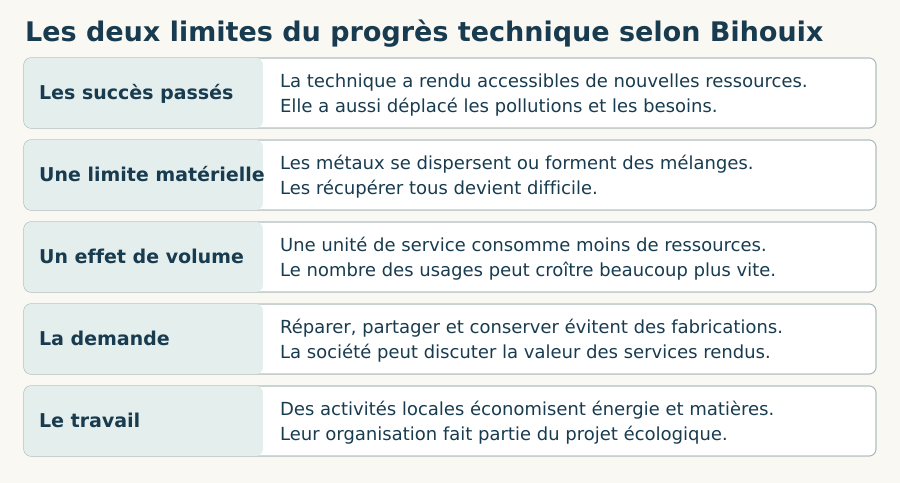

# ENS · Cycle master mathématiques — Français et culture générale 2018 · Corrigé brut

*Corrigé rédigé par IA, non officiel. Signalez toute erreur.*

**Rédaction** · GPT-6.2 Astra Ultra · vitesse non renseignée

**Autocontrôle** · GPT-6.2 Astra Ultra · vitesse non renseignée

Les deux ENS donnent trois heures pour un résumé de 360 mots, avec une tolérance de 324 à 396 mots, et un commentaire à choisir entre deux propositions. Chaque exercice vaut dix points. Les deux choix sont développés ici.

## 1. Résumé

Quelques améliorations locales ne démentent pas la dégradation écologique mondiale. Le débat porte surtout sur la rapidité et les moyens de la transition. Les scénarios de croissance supposent pourtant déjà disponibles des techniques encore incertaines. Les succès passés semblent autoriser cette confiance dans une nouvelle abondance.

Les pénuries ont souvent stimulé les inventions, comme les conflits. Les sociétés dépendaient naguère de la surface nécessaire pour produire leurs matières premières. Face au manque de bois, les machines à vapeur ont rendu accessibles des réserves profondes de charbon. La chimie puis les matériaux synthétiques ont multiplié les ressources disponibles. La mécanisation a réduit le travail nécessaire à chaque produit, permettant la consommation de masse. Mais chaque solution suscitait des besoins et des risques nouveaux. Les rejets industriels ont atteint les campagnes, les plastiques persistent dans les océans et les gains de rendement agricole ont dégradé les eaux.

Ces conséquences deviennent moins perceptibles lorsque les faibles coûts de transport éloignent les usines des consommateurs. Une ville peut ainsi paraître propre tout en faisant produire ailleurs les biens ou même le courant dont elle dépend. Le numérique aussi mobilise des mines, des usines, des réseaux et des centrales. Les déchets électroniques sont mal recyclés, parfois au prix de graves contaminations. Pourtant ses promoteurs lui prêtent le pouvoir de réparer les dommages écologiques déjà visibles.

Cette promesse néglige deux obstacles. La complexité des équipements appelle des métaux rares dont les mélanges et la dispersion compliquent la récupération. Une réduction des émissions peut ainsi aggraver une autre pression. Ensuite, le développement des usages dépasse souvent les gains techniques par unité consommée. Aucune progression indéfinie des volumes ne saurait respecter les limites planétaires.

Orientons donc aussi les inventions vers une diminution des besoins. Le désir de rivaliser rend délicate la distinction entre nécessaire et superflu. Des changements concrets restent possibles. Renonçons aux produits jetables, préférons des objets robustes et réparables, acceptons parfois moins de commodité. Des ateliers locaux associant réparation, partage et réemploi pourraient économiser des ressources en donnant davantage de place au travail humain. Ces emplois répondraient aux suppressions annoncées ailleurs. Une telle transition paraît ambitieuse, mais croire durable la trajectoire présente est tout aussi aventureux.

**360 mots.**

## 2a. La « religion exclusive du techno-solutionnisme »

Une municipalité connaît les pertes considérables de son réseau d’eau. Elle peut installer des capteurs pour mieux localiser les fuites. Elle pourrait aussi présenter cette installation comme la solution au manque d’eau sans avoir prévu de réparer les conduites ou de discuter la répartition des prélèvements. Le même appareillage relève dans un cas d’un moyen d’enquête et dans l’autre d’une promesse qui dispense de décider. En parlant de « religion exclusive », Bihouix vise cette confiance qui attribue d’avance à l’invention suivante le pouvoir de résoudre les difficultés de la précédente. Que perd-on à attendre ce salut, et comment juger les inventions à leur juste portée ?

L’attente d’une solution à venir procure dès maintenant un avantage. Elle permet de reporter des arbitrages difficiles. Si tous les déplacements deviennent supposément propres, la dispersion de l’habitat et la fermeture des services de proximité cessent de poser problème. Or même un véhicule dont la propulsion émet moins laisse entières la place occupée par la voirie, les inégalités d’accès et la demande de matières. La promesse devient exclusive lorsqu’elle élimine du débat d’autres manières de formuler le besoin. Elle dissimule aussi des décisions présentes sous un futur incertain. La route construite aujourd’hui pour un trafic promis engagera des fonds et des usages pour des décennies.

Il serait néanmoins peu raisonnable de tenir toute espérance technique pour une croyance aveugle. Un dispositif de potabilisation, associé à un service qui peut l’entretenir, réduit une exposition à des agents pathogènes. On peut en éprouver l’efficacité par la qualité de l’eau et par des résultats de santé, puis examiner son coût, ses consommations et la conduite à tenir en cas de panne. Ce qui caractérise une enquête sérieuse est la possibilité que l’équipement échoue au regard des critères établis. Une promesse de salut, elle, répond souvent à l’échec d’une invention par l’annonce d’une invention plus puissante.

Une décision collective peut donc accueillir l’innovation tout en mettant ses usages en concurrence avec d’autres réponses. Pour l’eau, comparer la réparation du réseau, la protection des nappes et une nouvelle usine oblige à raisonner sur la même quantité de service effectivement rendu et sur la durée. Il faut aussi demander qui bénéficie du service et qui supporte les effets ailleurs. L’engagement scientifique n’a rien à perdre à cette comparaison. Il y gagne la possibilité de distinguer un progrès vérifié d’une manière séduisante de différer les choix.

## 2b. La sobriété entre besoins fondamentaux et superflu

Un téléphone portable pouvait passer pour un luxe tant que les guichets, les horaires et les démarches ordinaires demeuraient accessibles à tous sur papier. À mesure qu’ils migrent vers des applications, la personne qui garde le même appareil peut gagner en sobriété matérielle et perdre la possibilité de prendre son train ou de faire valoir un droit. La frontière entre le nécessaire et le superflu est donc aussi une affaire d’organisation collective. Comment la discuter sans transformer l’exigence écologique en jugement porté sur les plaisirs des autres ?

La rivalité mimétique permet de comprendre pourquoi le sentiment de manquer ne diminue pas nécessairement quand l’équipement général augmente. L’automobiliste qui acquiert une voiture plus imposante pour se sentir en sécurité incite d’autres usagers à en faire autant. La généralisation de la solution individuelle peut dégrader la sûreté des piétons et augmenter la consommation du parc, sans procurer durablement le gain de position recherché. Une publicité qui identifie le dernier modèle à une réussite personnelle entretient ce mécanisme. Dans un tel cas, des règles communes sur le gabarit ou la vitesse peuvent préserver les possibilités de tous plus efficacement qu’une exhortation adressée à chaque acheteur isolé.

Toute dépense qui dépasse la survie n’entre pourtant pas dans cette compétition. Un repas de fête ou une répétition musicale mobilisent davantage de ressources qu’une alimentation minimale ou le silence. Ils peuvent aussi constituer l’occasion autour de laquelle un groupe se forme et se souvient. Décréter ces activités superflues de l’extérieur reviendrait à diviser entre personnes le droit de choisir ce qui donne du prix à leur vie. La même prudence vaut pour les contraintes inégales. Baisser le chauffage dans un appartement mal isolé peut signifier avoir froid, alors que supprimer le chauffage d’une terrasse abritée préserve beaucoup mieux le confort à dépense évitée comparable.

La sobriété devient défendable quand la délibération compare des services rendus, des effets et des solutions accessibles. Prêter des outils de bricolage peu utilisés permet de conserver un résultat tout en réduisant le nombre d’objets. Encore faut-il un lieu de prêt, des horaires commodes et des outils en bon état. Permettre la réparation oblige aussi le producteur à garantir des pièces et des informations. La distinction décisive porte moins sur une liste éternelle de besoins que sur les conditions auxquelles chacun peut vivre, participer et choisir dans des limites matérielles communes. Le plaisir peut faire partie de ce choix et justifie qu’on en discute le partage.

[Sujet officiel](https://ens-paris-saclay.fr/sites/default/files/CONCOURS/ANNALES_2C/2C_Math/2018_SE_2C_Maths_Francais.pdf)
