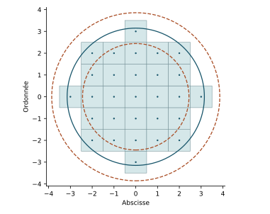
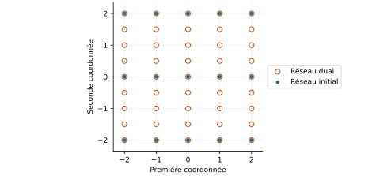

# ENS Paris-Saclay et ENS de Rennes — Cycle master, Mathématiques 1, 2018 · Corrigé brut

*Corrigé rédigé par IA, non officiel. Signalez toute erreur.*

**Rédaction** · GPT-6.2 Astra Ultra · vitesse non renseignée

**Révision** · GPT-6.2 Astra Ultra · vitesse non renseignée · 26 novembre 2026

Le problème relie le comptage des points entiers et primitifs au calcul de la série thêta d’un réseau. On note $V$ le covolume du réseau et on utilise la transformée de Fourier de noyau $e^{-2\pi i\langle x,y\rangle}$.

## I. Produits infinis et fonction zêta

### Question I.1

Pour $a_n\ge0$, $\log P_N=\sum_{n\le N}\log(1+a_n)$. Une convergence vers une limite finie positive équivaut à la convergence de ces sommes. Si $\sum a_n$ converge, $0\le\log(1+a_n)\le a_n$ assure la convergence. Inversement, si la série des logarithmes converge, ses termes tendent vers zéro, donc $a_n\to0$ et $\log(1+a_n)\sim a_n$ sur les termes non nuls. La comparaison des séries positives conclut.

### Question I.2.a

Sur un compact $K$, posons $b_n=\sup_K|f_n|$, $B=\sum b_n<\infty$. Le produit $P_N=\prod_{n=1}^N(1+f_n)$ vérifie $|P_N|\le\prod(1+b_n)\le e^B$. Alors $\|P_{N+1}-P_N\|_{\infty,K}\le e^B b_{N+1}$, et la série télescopique des accroissements converge normalement. Ceci assure la convergence uniforme du produit sur $K$.

### Question I.2.b

Pour $n$ assez grand, $b_n\le1/2$ et $(1+f_n)^{-1}=1+h_n$ avec $|h_n|\le2b_n$ sur $K$. Les produits de ces inverses de queue convergent par I.2.a. En multipliant les deux limites de queue point par point, on obtient un. La limite de la queue directe ne s’annule donc pas. Les facteurs initiaux sont non nuls par hypothèse, ce qui donne la convergence stricte sans supposer leur inverse borné sur $K$.

### Question I.3

Pour un compact non vide $K\subset\{\Re z>1\}$, on a $\sigma=\min_K\Re z>1$. Alors $\sup_K|n^{-z}|\le n^{-\sigma}$ et la série majorante converge. Cela donne la convergence normale.

### Question I.4.a

Sur le même compact, $\sum_{p\ {\rm premier}}\sup_K|p^{-z}|\le\sum_{n\ge2}n^{-\sigma}<\infty$. I.2 appliquée aux $-p^{-z}$ donne la convergence normale du produit, stricte puisque $|p^{-z}|<1$.

### Question I.4.b

Comme $|p^{-z}|<1$, chaque facteur inverse vaut $\sum_{j\ge0}p^{-jz}$. Le produit porte sur un nombre fini de séries absolument convergentes. L’unicité de la factorisation identifie les choix d’exposants aux entiers de $E(N)$, y compris $1$ ; ainsi $\prod_{p\le N}(1-p^{-z})^{-1}=\sum_{n\in E(N)}n^{-z}$.

### Question I.4.c

Tout entier appartient à $E(N)$ pour $N$ assez grand, et $\sum n^{-\Re z}<\infty$. Par convergence dominée, I.4.b tend vers $\zeta(z)$. Le produit direct tend vers une limite non nulle par I.4.a, donc $\zeta(z)=\bigl(\prod_p(1-p^{-z})\bigr)^{-1}=\prod_p(1-p^{-z})^{-1}$. En particulier, il n’y a pas de zéro dans $\Re z>1$.

### Question I.5

Pour $f(x)=x$ sur $[0,T[$, $c_0=T/2$. Une intégration par parties donne $c_n=-T/(2\pi i n)$ pour $n\ne0$ dans la convention $e^{-2\pi inx/T}$. Sa norme au carré est $T^{-1}\int_0^T x^2dx=T^2/3$. Parseval donne $T^2/3=T^2/4+2T^2\zeta(2)/(4\pi^2)$, d’où $\zeta(2)=\pi^2/6$.

## II. Cercle de Gauss et points primitifs

### Question II.1

On utilise la norme euclidienne $\sqrt{a^2+b^2}$, conformément aux disques de la suite. Soit $h=\sqrt2/2$, distance maximale au centre d’un carré unité. La réunion des carrés centrés aux points de norme $\le R$ est contenue dans le disque de rayon $R+h$. Elle contient celui de rayon $R-h$ pour $R\ge h$, car tout point appartient à un carré dont le centre est distant d’au plus $h$. Les intérieurs des carrés sont disjoints, donc $\pi(R-h)^2\le N(R)\le\pi(R+h)^2$. On obtient $N(R)=\pi R^2+O(R)$.

### Question II.2

Les quatre quadrants ouverts contiennent chacun $N^+(R)$ points. Les axes en apportent $4\lfloor R\rfloor+1$ pour $R\ge0$. Donc $N=4N^++O(R)$. Pour les points primitifs, seuls $(\pm1,0),(0,\pm1)$ se trouvent sur les axes pour $R\ge1$ ; ainsi $N_{\rm prim}=4N_{\rm prim}^++4$, ce qui donne la seconde relation.

### Question II.3

La somme géométrique des $n$ racines vaut zéro si $n>1$, un si $n=1$. La racine $e^{2\pi i k/n}$ a pour ordre $n/\gcd(k,n)$, car c’est le plus petit entier $j>0$ tel que $n\mid kj$. Les racines se répartissent donc, sans répétition, en racines primitives d’ordres $d\mid n$. Leur somme vaut $\sum_{d\mid n}\mu(d)=\mathbf1_{\{n=1\}}$. En prenant $n=\gcd(a,b)$, les diviseurs de $n$ sont exactement les diviseurs communs, d’où l’indicatrice annoncée.

### Question II.4

On a $\mu(1)=1$ puis $1+\mu(p)=0$. Pour $s\ge2$, soustraire $\sum_{d\mid p^{s-1}}\mu(d)=0$ de la même égalité pour $p^s$ donne $\mu(p^s)=0$. La multiplicativité admise donne $\mu(n)=(-1)^k$ si $n$ est le produit de $k$ premiers distincts, et zéro dès qu’un exposant est au moins deux.

### Question II.5

Pour $s\ge2$, développer $\prod_{p\le N}(1-p^{-s})$ revient à choisir un sous-ensemble de premiers, donc un entier sans facteur carré, avec le signe de II.4. On obtient $\sum_{n\in E(N)}\mu(n)n^{-s}$. Comme $|\mu(n)|\le1$, la limite vaut $\sum_{n\ge1}\mu(n)n^{-s}$ par domination. I.4.c identifie le produit à $1/\zeta(s)$.

### Question II.6

La somme des indicatrices de II.3 dans le quadrant ouvert vaut $N_{\rm prim}^+(n)$. Échanger les sommes et poser $(a,b)=d(k,l)$ donne $\sum_{d\le n}\mu(d)N^+(n/d)$. Par II.1 et II.2, $N^+(r)=\pi r^2/4+O(r)$ uniformément pour $r\ge1$. L’erreur totale est $O(n\sum_{d\le n}1/d)=O(n\log n)$. Le terme principal est $\frac{\pi n^2}{4}\sum_{d\le n}\mu(d)/d^2$. Prolonger cette série à l’infini coûte $O(n)$, car $\sum_{d>n}d^{-2}\le1/n$. Avec II.5 et la symétrie, $N_{\rm prim}(n)=\pi n^2/\zeta(2)+O(n\log n)$. Pour tout rayon réel, encadrer entre les valeurs aux deux entiers voisins, dont les termes principaux diffèrent de $O(R)$.

## III. Sommation de Poisson et réseau dual

### Question III.1

En dimension un, $g(x)=e^{-\pi x^2}$ vérifie $g'=-2\pi x g$. La domination par $2\pi|x|g(x)$ donne $\widehat g'(y)=i\int e^{-2\pi ixy}g'(x)dx=-2\pi y\widehat g(y)$ par intégration par parties sans terme de bord. Avec $\widehat g(0)=1$, la solution est $e^{-\pi y^2}$. En dimension $d$, la gaussienne est produit de $d$ facteurs intégrables ; Fubini donne $\widehat f(y)=e^{-\pi\|y\|^2}$.

### Question III.2

Toute dérivée $D^\beta f$ est un polynôme multiplié par $e^{-\pi\|x\|^2}$, par récurrence. Après multiplication par $x^\alpha$, cette expression continue tend vers zéro à l’infini et reste donc bornée. Toutes les semi-normes sont finies.

### Question III.3.a

Les semi-normes impliquent, pour tout $m$ et toute dérivée $D^\beta$, $|D^\beta f(y)|\le C_{\beta,m}(1+\|y\|)^{-m}$ (utiliser une coordonnée de taille au moins $\|y\|/\sqrt d$). Pour $x$ dans un compact et $m>d$, la somme sur $n$ est normalement convergente, car les couronnes de norme maximale entière $k$ contiennent $O((1+k)^{d-1})$ points. Cela vaut aussi pour les dérivées premières, d’où $F\in C^1$ par dérivation terme à terme. Une translation entière réindexe la somme absolument convergente, ce qui donne la périodicité.

### Question III.3.b

La convergence normale sur le cube permet l’échange. En posant $y=x+m$ dans chaque intégrale, $e^{-2\pi i\langle n,x\rangle}=e^{-2\pi i\langle n,y\rangle}$ pour $m,n$ entiers. Les cubes pavent l’espace à leurs frontières près, donc $c_n(F)=\int_{\mathbb R^d}e^{-2\pi i\langle n,y\rangle}f(y)dy=\widehat f(n)$.

### Question III.3.c

Le théorème admis appliqué à $F$ et III.3.b donnent $F(0)=\sum_{n\in\mathbb Z^d}\widehat f(n)$. Par définition $F(0)=\sum_n f(n)$. Les justifications s’appliquent également aux parties réelle et imaginaire d’une fonction complexe de Schwartz.

### Question III.4

Si $A$ a pour colonnes les $e_i$, alors $\Lambda=A\mathbb Z^d$. La condition duale équivaut à $A^{\mathsf T}y\in\mathbb Z^d$. Donc $\Lambda'=A^{-\mathsf T}\mathbb Z^d$, et les colonnes de $A^{-\mathsf T}$ forment la base duale. Réappliquer l’opération ramène à $A$, donc $\Lambda''=\Lambda$.

### Question III.5.a

Le réseau $\mathbb Z\times2\mathbb Z$ est engendré par les colonnes de $\operatorname{diag}(1,2)$, inversible. Son dual est $\mathbb Z\times\tfrac12\mathbb Z$, de base $(1,0),(0,1/2)$ par III.4.

Le rectangle fondamental du réseau a une aire de $2$, contre $1/2$ pour son dual. En effet, si $y=(u,v)$, les deux générateurs imposent $u\in\mathbb Z$ et $2v\in\mathbb Z$. Ces conditions suffisent puisque tout vecteur du réseau est une combinaison entière des deux générateurs.

### Question III.5.b

Posons $D=\{z\in\mathbb Z^8:\sum z_i\text{ est pair}\}$ et $e=(1/2,\ldots,1/2)$. Puisque $2e\in D$, $\Lambda_8=D\cup(D+e)$ est un sous-groupe discret, contenant $2\mathbb Z^8$, donc un réseau. Si $y\in D'$, les vecteurs $2e_i$ et $e_i-e_j$ (ici $e_i$ canoniques) imposent $2y_i\in\mathbb Z$ et $y_i-y_j\in\mathbb Z$. Réciproquement ces conditions donnent $D'=\mathbb Z^8\cup(\mathbb Z^8+e)$ car tout $z\in D$ a somme paire. Reste $\langle y,e\rangle\in\mathbb Z$. Pour $y=m$ c’est la parité de $\sum m_i$ ; pour $y=m+e$, on ajoute $\langle e,e\rangle=2$, donc la même condition. Ainsi $\Lambda_8'=\Lambda_8$.

### Question III.6

Écrivons $\phi(x)=f(A^{-1}x)$ et $V=|\det A|$. Alors $\widehat\phi(y)=V\widehat f(A^{\mathsf T}y)$ par $x=Au$. D’autre part $\phi(An)=f(n)$. Par III.3.c et III.4, $\sum_{x\in\Lambda}\phi(x)=\sum_n f(n)=\sum_n\widehat f(n)=V^{-1}\sum_{y\in\Lambda'}\widehat\phi(y)$. Les changements linéaires inversibles préservent l’espace de Schwartz.

## IV. Transformation de la fonction thêta

### Question IV.1

Pour tout compact $K\subset\mathbb H$, $b=\min_K\Im\tau>0$. Les termes pour $x=An$ sont majorés en module par $e^{-\pi b\|An\|^2}\le e^{-\pi b c^2\|n\|^2}$ avec $c=1/\|A^{-1}\|>0$. Cette série converge comme produit de séries gaussiennes. La somme normalement convergente de fonctions holomorphes définit donc une fonction holomorphe. Si $\|x\|^2$ est un entier pair, $e^{i\pi\|x\|^2}=1$, ce qui donne $\Theta_\Lambda(\tau+1)=\Theta_\Lambda(\tau)$.

### Question IV.2

Pour $f_t(x)=e^{-\pi t\|x\|^2}$, le changement $u=\sqrt t\,x$ et III.1 donnent $\widehat f_t(y)=t^{-d/2}e^{-\pi\|y\|^2/t}$. III.6 entraîne $\Theta_\Lambda(it)=V^{-1}t^{-d/2}\Theta_{\Lambda'}(i/t)$. Or $i/t=-1/(it)$ ; la formule s’ensuit.

### Question IV.3

Les deux fonctions $\Theta_{\Lambda'}(-1/\tau)$ et $V(\tau/i)^{d/2}\Theta_\Lambda(\tau)$ sont holomorphes sur le demi-plan supérieur. En particulier $\Re(\tau/i)>0$, ce qui fixe le logarithme principal. Elles coïncident pour $\tau=it$, $t>0$, par IV.2. Le principe d’identité les identifie sur tout le domaine connexe.

### Question IV.4

Sur une colonne $(a,c)^{\mathsf T}$ avec $c\ne0$, choisir $k$ tel que $a=kc+r$, $0\le r<|c|$. La multiplication à gauche par $ST^{-k}$ donne $(-c,r)^{\mathsf T}$. La valeur absolue de l’entrée inférieure décroît strictement jusqu’à zéro. Une suite finie des facteurs demandés rend donc $M$ triangulaire supérieure (sans même devoir commencer par $SM$). Les entrées diagonales entières de produit un valent toutes deux $\epsilon=\pm1$. La triangulaire est $\epsilon T^{\epsilon b}$ si $b$ est son entrée supérieure droite, et $-I=S^2$. En inversant les opérations on exprime $M$ dans le groupe engendré par $S,T$.

### Question IV.5

Le dénominateur $c\tau+d$ ne s’annule pas dans $\mathbb H$ : pour $c\ne0$ son zéro est réel, et pour $c=0$, $d=\pm1$. Alors $\Im((a\tau+b)/(c\tau+d))=(ad-bc)\Im\tau/|c\tau+d|^2>0$.

### Question IV.6

Pour un réseau pair autodual de dimension $d$ multiple de huit, $V=1$ et $i^{-d/2}=1$. IV.1 et IV.3 donnent donc les lois voulues pour $T$ et $S$, de poids $d/2$. Elles se composent car $j(M,\tau)=c\tau+d$ vérifie $j(MN,\tau)=j(M,N\tau)j(N,\tau)$. IV.4 conclut. En regroupant les vecteurs de norme carrée $2n$, on obtient la série en $e^{2\pi i n\tau}$ dont le coefficient est leur nombre, fini par discrétion. Pour $\Lambda_8$ de III.5.b, si $m\in D$, $\|m\|^2\equiv\sum m_i\equiv0\bmod2$ ; pour $m+e$, on ajoute $\sum m_i+2$, encore pair. Sa thêta est donc modulaire de poids quatre.

Ces conditions se retrouvent si la thêta est modulaire au sens de l’énoncé. À $\tau=it$, la périodicité en $1$ impose l’égalité réelle entre une somme de masses strictement positives et la somme de ces masses multipliées par $e^{i\pi\|x\|^2}$. Chacune de ces phases vaut un, car les pertes en partie réelle sont positives ou nulles. Le réseau est pair, donc entier par polarisation et $\Lambda\subset\Lambda'$. Si le poids est $w=2k$, appliquer IV.2 au paramètre $1/t$ pour écrire $\Theta_\Lambda(i/t)=t^{d/2}V^{-1}\Theta_{\Lambda'}(it)$ et comparer à $(it)^w\Theta_\Lambda(it)$. Quand $t\to\infty$, les deux thêtas de droite tendent vers un par domination. D’où $w=d/2$ puis $V^{-1}=i^w$, donc $V=1$ et $w$ est divisible par quatre. L’inclusion dans le dual est alors une égalité, car leurs covolumes coïncident.
