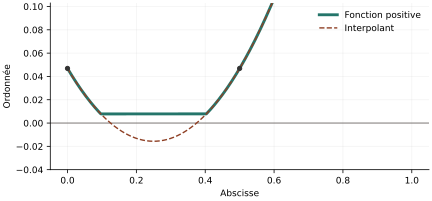
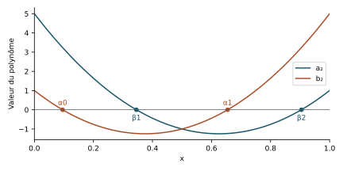

# ENS Paris-Saclay et ENS de Rennes — Cycle master, Mathématiques 2, 2018 · Corrigé guidé

*Corrigé rédigé par IA, non officiel. Signalez toute erreur.*

**Rédaction** · GPT-6.2 Astra Ultra · vitesse non renseignée

**Révision** · GPT-6.2 Astra Ultra · vitesse non renseignée · 26 novembre 2026

Les candidats choisissaient un des deux sujets. La première option étudie des urnes renforcées et les mesures de mélange. La seconde construit des interpolants polynomiaux positifs. Les préfixes P et N distinguent leurs numérotations.

## Probabilités. Premières propriétés des urnes

### Question P.1.1

> [!INDICATION]
> Les deux couleurs reçoivent le même nombre de boules à chaque étape.

#### Solution

Avec $a=b\ge1$, le nombre de vertes est $v+na$ et le total $v+r+2na$. Le quotient tend donc vers $1/2$.

### Question P.1.2

> [!INDICATION]
> Mettre à jour le numérateur et le dénominateur séparément.

#### Solution

Posons $D_n=v+r+n(a+b)$. Au pas suivant le total augmente de $a+b$, et les vertes augmentent de $a\xi_{n+1}+b(1-\xi_{n+1})$. Ainsi $V_{n+1}=[D_nV_n+b+(a-b)\xi_{n+1}]/D_{n+1}$.

### Question P.1.3

> [!INDICATION]
> Conditionner l’indicatrice du tirage vert.

#### Solution

$V_n$ est $\mathcal F_n$-mesurable et $U_{n+1}$ indépendant de $\mathcal F_n$. Ainsi $\mathbb E(\xi_{n+1}\mid\mathcal F_n)=V_n$ et $\mathbb E(V_{n+1}\mid\mathcal F_n)=[(D_n+a-b)V_n+b]/D_{n+1}=V_n+b(1-2V_n)/D_{n+1}$.

### Question P.1.4

> [!INDICATION]
> Chercher quand la dérive conditionnelle s’annule à toute date.

#### Solution

Les $V_n$ sont adaptés et bornés. Si $b=0$, P.1.3 donne une martingale. Si $b>0$, cela imposerait $V_n=1/2$ presque sûrement pour tout $n$. Si $v\ne r$, cela échoue à $n=0$. Si $v=r$, au premier tirage les nombres ajoutés diffèrent puisque $a\ne b$, d’où $V_1\ne1/2$.

### Question P.1.5.a

> [!INDICATION]
> Utiliser la convergence des martingales bornées.

#### Solution

Pour $b=0$, la martingale à valeurs dans $[0,1]$ converge presque sûrement vers une variable $V_\infty\in[0,1]$. Puis $|V_n-V_\infty|^p\le1$ pour tout $p\ge1$, d’où la convergence dans $L^p$ par domination.

### Question P.1.5.b

> [!INDICATION]
> Passer à la limite dans l’espérance constante.

#### Solution

La convergence $L^1$ donne $\mathbb EV_\infty=\lim\mathbb EV_n=V_0=v/(v+r)$.

## Probabilités. Martingales et urnes de Friedman

### Question P.2.1.1.a

> [!INDICATION]
> Passer à la limite dans l’inégalité maximale à horizon fini.

#### Solution

Doob donne $\mathbb E\max_{m\le n}|X_m|^2\le4\mathbb E X_n^2=4\mathbb E A_n$ car $M_0=0$. Les deux côtés ont des intégrandes croissants, donc la convergence monotone donne $\mathbb E\sup_m|X_m|^2\le4\mathbb EA_\infty$, éventuellement infinie.

### Question P.2.1.1.b

> [!INDICATION]
> Identifier les événements qui déclenchent l’arrêt.

#### Solution

La suite $A$ est prévisible et croissante. Ainsi $\{N\le n\}=\{A_{n+1}>C\}\in\mathcal G_n$. Cela couvre aussi le cas $N=\infty$.

### Question P.2.1.1.c

> [!INDICATION]
> Identifier le compensateur du carré de la martingale arrêtée.

#### Solution

Les accroissements arrêtés valent $\mathbf1_{\{m\le N\}}(X_m-X_{m-1})$ avec indicatrice $\mathcal G_{m-1}$-mesurable. Leur somme de variances conditionnelles est $A_{n\wedge N}\le C$ par la définition du premier franchissement. Appliquer P.2.1.1.a à la martingale arrêtée donne la borne $4C$.

### Question P.2.1.1.d

> [!INDICATION]
> Appliquer la convergence des martingales dans un espace de carré intégrable.

#### Solution

La martingale arrêtée est bornée dans $L^2$ par la majoration précédente. Le théorème de convergence des martingales $L^2$ donne une limite dans $L^2$ et presque sûrement, finie presque sûrement.

### Question P.2.1.1.e

> [!INDICATION]
> Épuiser l’événement par des bornes entières.

#### Solution

Pour tout entier $C\ge1$, sur $\{A_\infty\le C\}$ l’arrêt vaut l’infini, donc $X_n=X_{n\wedge N}$ converge sauf sur un ensemble nul. L’union dénombrable en $C$ donne la conclusion sur $\{A_\infty<\infty\}$.

### Question P.2.1.2.a

> [!INDICATION]
> Vérifier que le poids est connu avant l’accroissement.

#### Solution

$A_m$ est $\mathcal G_{m-1}$-mesurable. Le poids $1/f(A_m)$ est borné par un, donc la somme finie $Y_n=\sum_{m=1}^n(X_m-X_{m-1})/f(A_m)$ est adaptée et de carré intégrable ; chaque accroissement est d’espérance conditionnelle nulle. C’est une martingale.

### Question P.2.1.2.b

> [!INDICATION]
> Calculer la variance conditionnelle après pondération.

#### Solution

Le carré du poids sort de l’espérance conditionnelle. Ainsi $B_{n+1}-B_n=(A_{n+1}-A_n)/f(A_{n+1})^2$.

### Question P.2.1.2.c

> [!INDICATION]
> Comparer les rectangles à l’aire sous une fonction décroissante.

#### Solution

La fonction $f^{-2}$ est décroissante. On a $(A_{n+1}-A_n)/f(A_{n+1})^2\le\int_{A_n}^{A_{n+1}}f(t)^{-2}dt$. La somme positive est bornée trajectoire par trajectoire par $\int_0^\infty f(t)^{-2}dt<\infty$.

### Question P.2.1.2.d

> [!INDICATION]
> Appliquer le cas d’un compensateur fini.

#### Solution

La somme des accroissements est $B_\infty$, finie par P.2.1.2.c. P.2.1.1.e appliquée à $Y$ donne sa convergence presque sûre vers une variable finie.

### Question P.2.1.2.e

> [!INDICATION]
> Utiliser le lemme de Kronecker sur chaque trajectoire convergente.

#### Solution

Sur $\{A_\infty=\infty\}$, $f(A_n)\to\infty$ car $f$ est croissante et l’intégrabilité de $f^{-2}$ exclut une borne supérieure finie. La série de termes $(X_m-X_{m-1})/f(A_m)$ converge par la question précédente. Kronecker ramène sa somme non pondérée à $X_n/f(A_n)\to0$.

### Question P.2.2.1

> [!INDICATION]
> Centrer chaque résultat du tirage par sa probabilité conditionnelle.

#### Solution

Les accroissements $\xi_{n+1}-V_n$ sont bornés, adaptés et d’espérance conditionnelle nulle. Avec $X_0=0$, leur somme est une martingale de carré intégrable à toute date.

### Question P.2.2.2

> [!INDICATION]
> Utiliser la variance d’une variable de Bernoulli.

#### Solution

Conditionnellement à $\mathcal F_n$, $\xi_{n+1}$ suit une Bernoulli de paramètre $V_n$. Ainsi $A_{n+1}-A_n=\mathbb E[(\xi_{n+1}-V_n)^2\mid\mathcal F_n]=V_n(1-V_n)$.

### Question P.2.2.3

> [!INDICATION]
> Conserver seulement les boules vertes initiales.

#### Solution

L’urne garde au moins $v$ vertes, donc $V_m\ge v/D_m$. La série de ces minorants diverge par comparaison à la série harmonique, ce pour toute trajectoire.

### Question P.2.2.4.a

> [!INDICATION]
> Comparer le numérateur à une limite finie.

#### Solution

Quand $A_\infty<\infty$, $X_n$ converge presque sûrement par P.2.1.1.e. Le dénominateur $S_n=\sum_{m<n}V_m$ tend vers l’infini, donc $X_n/S_n\to0$.

### Question P.2.2.4.b

> [!INDICATION]
> Choisir un poids croissant linéaire à partir de un.

#### Solution

Avec $f(t)=\max(1,t)$, $\int_0^\infty f^{-2}=2$. P.2.1.2.e donne $X_n/\max(1,A_n)\to0$ sur $\{A_\infty=\infty\}$. Comme $A_n=\sum_{m<n}V_m(1-V_m)\le S_n$, on en déduit $X_n/S_n\to0$ sur le même événement.

### Question P.2.2.4.c

> [!INDICATION]
> Reconstituer le nombre de boules vertes tirées.

#### Solution

$Y_n=\sum_{m=1}^n\xi_m=X_n+S_n$. Les deux cas précédents couvrent l’espace à un ensemble négligeable près, donc $Y_n/S_n\to1$ presque sûrement.

### Question P.2.2.5

> [!INDICATION]
> Séparer un préfixe fini de la moyenne de Cesàro.

#### Solution

Pour toute borne $b>\limsup a_n$, à partir d’un rang $k$ on a $a_j\le b$. Alors $n^{-1}\sum_{j=1}^na_j\le n^{-1}\sum_{j<k}a_j+(n-k+1)b/n$. Prendre la limite supérieure puis laisser descendre $b$. Le cas $+\infty$ est immédiat et le cas $-\infty$ suit pour toute borne réelle.

### Question P.2.2.6

> [!INDICATION]
> Remplacer le rapport des tirages par la moyenne des proportions.

#### Solution

Comme $0<S_n/n\le1$, P.2.2.4.c entraîne $Y_n/n-S_n/n\to0$ presque sûrement. Par P.2.2.5 appliquée trajectoire par trajectoire, $\limsup Y_n/n\le\limsup V_n\le x$.

### Question P.2.2.7.a

> [!INDICATION]
> Lire le signe du coefficient de la fréquence empirique.

#### Solution

Pour $a>b$, $V_n=(v+bn+(a-b)Y_n)/D_n$. Diviser par $n$ et employer P.2.2.6, avec coefficient $a-b>0$, donne $\limsup V_n\le\rho(x)=[b+(a-b)x]/(a+b)$.

### Question P.2.2.7.b

> [!INDICATION]
> Itérer l’application affine en partant de la borne un.

#### Solution

La pente $c=(a-b)/(a+b)$ appartient à $[0,1[$ et $\rho(1/2)=1/2$. La borne initiale $1$ donne successivement $\rho^k(1)=1/2+c^k/2$. Une intersection dénombrable donne presque sûrement $\limsup V_n\le1/2$.

### Question P.2.2.7.c

> [!INDICATION]
> Échanger les deux couleurs.

#### Solution

Le même raisonnement vaut pour $R_n=1-V_n$, après échange de $v,r$. Donc $\limsup R_n\le1/2$, soit $\liminf V_n\ge1/2$. La limite vaut $1/2$ presque sûrement.

### Question P.2.2.8.a

> [!INDICATION]
> Compter les ajouts rouges suivant la couleur tirée.

#### Solution

Les rouges ajoutées sont $a(n-Y_n)+bY_n$. Donc $R_n=[r+an+(b-a)Y_n]/D_n$.

### Question P.2.2.8.b

> [!INDICATION]
> Appliquer les fréquences empiriques aux deux couleurs.

#### Solution

Posons $\eta(z)=[a+(b-a)z]/(a+b)$. Puisque $b-a>0$, P.2.2.8.a et P.2.2.6 donnent $\limsup R_n\le\eta(x)$. En échangeant les couleurs on obtient $\limsup V_n\le\eta(y)$.

### Question P.2.2.8.c

> [!INDICATION]
> Vérifier la pente de l’itération, y compris lorsque a est nul.

#### Solution

Si $0<a<b$, les deux bornes initiales égales à un se remplacent simultanément par $\eta^k(1)$, qui tend vers $1/2$ car la pente $(b-a)/(a+b)<1$. Comme $V_n+R_n=1$, cela donne (4).

Le cas $a=0$, autorisé, demande un argument supplémentaire car $\eta$ est alors l’identité. Posons $W_n=V_n-1/2$. P.1.3 donne $\mathbb E(\Delta W_n\mid\mathcal F_n)=-2bW_n/D_{n+1}$ et P.1.2 donne $|\Delta W_n|\le C/D_{n+1}$. Donc $\mathbb E(W_{n+1}^2\mid\mathcal F_n)\le W_n^2-4bW_n^2/D_{n+1}+C^2/D_{n+1}^2$. La suite $W_n^2+C^2\sum_{k>n}D_k^{-2}$ est une surmartingale positive, donc converge presque sûrement. En sommant les espérances de l’inégalité, $\mathbb E\sum_n W_n^2/D_{n+1}<\infty$. Comme $\sum1/D_{n+1}=\infty$ et $W_n^2$ a une limite, celle-ci est nulle. On obtient aussi $V_n\to1/2$ dans ce cas.

## Probabilités. Échangeabilité et problème des moments

### Question P.3.1

> [!INDICATION]
> Conditionner par le paramètre commun à tous les tirages.

#### Solution

À $\Theta=x$ fixé, les indicatrices sont indépendantes de loi Bernoulli$(x)$. Toute configuration de longueur $n$ à $k$ uns a donc probabilité $\int x^k(1-x)^{n-k}\nu(dx)$, invariante par permutation. La mesure mélange est $\mu=\nu$. Avec $\nu=\delta_p$, on retrouve une suite de Bernoulli$(p)$ indépendantes, y compris pour $p=0,1$.

### Question P.3.2

> [!INDICATION]
> Compter les dispositions de k succès.

#### Solution

L’événement $S_n=k$ réunit $\binom nk$ configurations disjointes de même probabilité par échangeabilité. Multiplier (5) par ce nombre donne (6).

### Question P.3.3.a

> [!INDICATION]
> Appliquer Bienaymé–Tchebychev à la fréquence binomiale.

#### Solution

Pour $B\sim\operatorname{Bin}(n,x)$, $\mathbb E(B/n)=x$ et $\operatorname{Var}(B/n)=x(1-x)/n\le1/(4n)$. D’où $\mathbb P(|B/n-x|>\delta)\le1/(4n\delta^2)$.

### Question P.3.3.b

> [!INDICATION]
> Partager l’intégrale selon l’écart à sa moyenne.

#### Solution

La différence $|B_{n,u}(x)-u(x)|$ est au plus $\omega_u(\delta)+2\|u\|_\infty/(4n\delta^2)$, où $\omega_u$ est le module de continuité. Cette borne est uniforme. Faire d’abord tendre $n$ vers l’infini puis $\delta$ vers zéro donne la convergence voulue.

### Question P.3.4.a

> [!INDICATION]
> Développer la différence comme une puissance de l’opérateur de translation.

#### Solution

Si $(Ea)_i=a_{i+1}$, on a $\Delta=E-I$. Les deux opérateurs commutent, donc $\Delta^ra_i=\sum_{j=0}^r\binom rj(-1)^{r-j}a_{i+j}$. C’est aussi la récurrence de Pascal à partir de $r=0$.

### Question P.3.4.b

> [!INDICATION]
> Regrouper les termes suivant l’indice de a.

#### Solution

Dans $\sum_{r=0}^p b_r\binom pr(\Delta^ra)_i$, le coefficient de $a_{i+j}$ est $\sum_{r=j}^p b_r\binom pr\binom rj(-1)^{r-j}=\binom pj\sum_{\ell=0}^{p-j}\binom{p-j}{\ell}(-1)^\ell b_{j+\ell}=\binom pj(-1)^{p-j}(\Delta^{p-j}b)_j$. C’est l’inversion annoncée.

### Question P.3.5

> [!INDICATION]
> Interpréter les différences à l’intérieur de l’intégrale.

#### Solution

Par P.3.4.a, $(-1)^r(\Delta^rb)_k=\int_0^1 x^k(1-x)^r\mu(dx)\ge0$. On a aussi $b_0=\int1\,d\mu=1$.

### Question P.3.6

> [!INDICATION]
> Développer l’exponentielle sur le support compact.

#### Solution

La série de $e^{itx}$ converge absolument et uniformément pour $x\in[0,1]$, dominée en valeur absolue terme à terme par la série de $e^{|t|}$. Ainsi $\phi_\mu(t)=\sum_{k\ge0}(it)^k b_k/k!$. La fonction caractéristique et donc la loi sont déterminées par les moments.

### Question P.3.7.a

> [!INDICATION]
> Spécialiser la formule d’inversion aux indices de la grille.

#### Solution

Appliquer P.3.4.b avec $p=n$ et $i=0$. Le coefficient de $a_j$ est précisément $p_j^{(n)}=\binom nj(-1)^{n-j}(\Delta^{n-j}b)_j$, d’où la formule.

### Question P.3.7.b

> [!INDICATION]
> Tester les masses sur la constante puis sur les valeurs de u.

#### Solution

Les masses sont positives ou nulles par monotonie complète. Pour $a_j=1$, toutes les différences d’ordre positif sont nulles, donc leur somme vaut $b_0=1$. Cela définit la probabilité discrète $\mu_n$ aux nœuds $j/n$. Choisir $a_j=u(j/n)$ dans P.3.7.a donne exactement l’identité intégrale demandée.

### Question P.3.8.a

> [!INDICATION]
> Examiner le terme dominant de la différence d’un monôme.

#### Solution

$(i+1)^p-i^p=pi^{p-1}+$ termes de degré inférieur. Chaque différence abaisse donc le degré d’une unité en multipliant le coefficient dominant par l’ancien degré. Après $r\le p$ étapes il vaut $c_p p!/(p-r)!$, et au-delà de $p$ la différence est nulle.

### Question P.3.8.b

> [!INDICATION]
> Comparer les puissances de n dans la formule de P.3.7.b.

#### Solution

Pour $u(x)=x^p$, on a $u_j^{(n)}=j^p/n^p$. Les termes d’indices $r>p$ sont nuls. Pour $r<p$, $\binom nr/n^p\to0$ ; pour $r=p$, $\binom np p!/n^p\to1$. Comme $(\Delta^p j^p)_0=p!$, la limite vaut $b_p$.

### Question P.3.8.c

> [!INDICATION]
> Approcher une fonction continue par un polynôme fixé.

#### Solution

P.3.3.b fournit un polynôme $P$ à distance uniforme $<\varepsilon$ de $u$. Les intégrales de $P$ convergent par linéarité et P.3.8.b, constante comprise. Les intégrales de $u$ diffèrent de celles de $P$ d’au plus $\varepsilon$, donc forment une suite de Cauchy. Sa limite $E(u)$ est linéaire, positive et $|E(u)|\le\|u\|_\infty$.

### Question P.3.9.a

> [!INDICATION]
> Utiliser translation et pente de la rampe tronquée.

#### Solution

La rampe $u_{t,\varepsilon}$ est la translatée d’une fonction de pente en valeur absolue au plus $1/\varepsilon$. Pour $s<t$, $0\le u_{t,\varepsilon}-u_{s,\varepsilon}\le(t-s)/\varepsilon$. Par positivité de $E$, il en est de même des $U_{t,\varepsilon}$ ; ils sont croissants et continus en $t$. À $t$ fixé, diminuer $\varepsilon$ diminue la rampe point par point et donc son image par $E$.

### Question P.3.9.b

> [!INDICATION]
> Prendre l’infimum des approximations continues par excès.

#### Solution

$F(t)=\inf_{\varepsilon>0}U_{t,\varepsilon}$ existe, est croissante et entre zéro et un. Pour $s\downarrow t$, $\limsup F(s)\le\lim U_{s,\varepsilon}=U_{t,\varepsilon}$ pour chaque $\varepsilon$ ; prendre l’infimum donne la continuité à droite. On a $F(t)=0$ pour $t<0$ et $F(t)=1$ pour $t\ge1$. Une masse en zéro est possible : la borne correcte à gauche pour une loi générale sur $[0,1]$ est $t<0$, pas $t\le0$ comme l’indique le rappel imprimé.

### Question P.3.9.c

> [!INDICATION]
> Encadrer l’indicatrice par deux rampes.

#### Solution

Pour $\delta>\varepsilon$, $u_{t-\delta,\varepsilon}\le\mathbf1_{(-\infty,t]}\le u_{t,\varepsilon}$. Intégrer par $\mu_n$ donne les bornes de la question. À la limite, puis pour $\varepsilon\downarrow0$, on obtient $F(t-\delta)\le\liminf F_n(t)\le\limsup F_n(t)\le F(t)$. Faire $\delta\downarrow0$ conclut aux points de continuité.

### Question P.3.10

> [!INDICATION]
> Écrire une puissance comme intégrale de sa dérivée.

#### Solution

Par Tonelli, pour $X\sim\mu_n$, $\mathbb E X^p=\int_0^1 p x^{p-1}\mathbb P(X>x)dx=\int_0^1 p x^{p-1}(1-F_n(x))dx=1-p\int_0^1x^{p-1}F_n(x)dx$.

### Question P.3.11

> [!INDICATION]
> Passer à la limite aux points de continuité de F.

#### Solution

$F$ est la fonction de répartition d’une probabilité $\mu$ portée par $[0,1]$. Une fonction monotone n’a qu’un ensemble dénombrable de discontinuités ; P.3.9.c et la domination par $p x^{p-1}$ donnent la convergence de l’intégrale de P.3.10 à celle avec $F$. La même identité pour $\mu$ et P.3.8.b donnent $\int x^p d\mu=b_p$ pour $p\ge1$, et la masse totale donne $b_0$.

### Question P.3.12.a

> [!INDICATION]
> Décomposer un événement selon le dernier tirage.

#### Solution

Posons $p_{0,0}=1$. Décomposer puis permuter les positions par échangeabilité donne $p_{k,n}=p_{k,n-1}-p_{k+1,n}$. Pour $k=n-1$, cela donne $b_{n-1}-b_n=-(\Delta b)_{n-1}$. Pour $k=n-2$ et $n\ge2$, on obtient $-(\Delta b)_{n-2}+(\Delta b)_{n-1}=(\Delta^2 b)_{n-2}$.

### Question P.3.12.b

> [!INDICATION]
> Itérer la récurrence en fonction du nombre de zéros.

#### Solution

Pour $r=0$, $p_{k,k}=b_k$. Si $p_{k,k+r}=(-1)^r(\Delta^r b)_k$ pour tout $k$, alors $p_{k,k+r+1}=p_{k,k+r}-p_{k+1,k+r+1}=(-1)^{r+1}(\Delta^{r+1} b)_k$. Ces probabilités sont positives ou nulles, donc $b$ est complètement monotone.

### Question P.3.13

> [!INDICATION]
> Identifier les différences des moments et les probabilités de configurations.

#### Solution

La loi unique de P.3.6 et P.3.11 a pour moments $b_k$. P.3.5 et P.3.12.b donnent $p_{k,n}=\int x^k(1-x)^{n-k}\mu(dx)$, et P.3.2 donne la loi de la somme. Toute autre mesure satisfaisant la représentation aurait les mêmes moments en prenant $k=n$, ce qui assure l’unicité.

## Probabilités. Urne de Pólya

### Question P.4.1

> [!INDICATION]
> Multiplier les probabilités successives d’une configuration ordonnée.

#### Solution

Les tirages verts successifs ont pour numérateurs $v,v+1,\ldots,v+k-1$, et les rouges $r,\ldots,r+n-k-1$. Les dénominateurs sont $v+r,\ldots,v+r+n-1$. La probabilité du mot prescrit est donc $v^{(k)}r^{(n-k)}/(v+r)^{(n)}$, indépendamment de l’ordre.

### Question P.4.2

> [!INDICATION]
> Reconnaître une suite échangeable.

#### Solution

La formule de P.4.1 est invariante par permutation de tout préfixe. Le théorème démontré en partie 3 fournit la mesure $\mu_\infty$ et la représentation intégrale demandée.

### Question P.4.3

> [!INDICATION]
> Prendre uniquement des tirages verts.

#### Solution

Pour tout $p\ge1$, le moment d’ordre $p$ du mélange vaut $v^{(p)}/(v+r)^{(p)}$. Ce sont les moments de la loi $\operatorname{Beta}(v,r)$ donnés dans le préambule. L’unicité sur le compact identifie $\mu_\infty$.

### Question P.4.4

> [!INDICATION]
> Regrouper selon le nombre total de vertes.

#### Solution

Par (6), $\mathbb Ef(Y_n/n)=\sum_{k=0}^n f(k/n)\binom nk\int x^k(1-x)^{n-k}\mu_\infty(dx)=\int B_{n,f}(x)\mu_\infty(dx)$ par échange avec une somme finie.

### Question P.4.5

> [!INDICATION]
> Appliquer l’approximation uniforme de Bernstein.

#### Solution

P.3.3.b donne $\mathbb Ef(Y_n/n)\to\int f\,d\mu_\infty$ pour toute fonction continue sur le compact. Ainsi $Y_n/n$ converge en loi vers $\mu_\infty$. Comme $V_n=(v+Y_n)/(v+r+n)$ et $0\le Y_n\le n$, $|V_n-Y_n/n|=O(1/n)$ uniformément, donc $V_n$ a la même limite en loi.

### Question P.4.6

> [!INDICATION]
> Utiliser l’unicité de la limite en loi.

#### Solution

P.1.5.a donne la convergence presque sûre vers $V_\infty$, donc aussi la convergence en loi. Par unicité et P.4.3, $V_\infty\sim\operatorname{Beta}(v,r)$.

## Analyse numérique. Interpolation de Lagrange et polynômes positifs

### Question N.1

> [!INDICATION]
> Construire des polynômes qui sélectionnent chacun une valeur.

#### Solution

Les polynômes $\ell_i(x)=\prod_{j\ne i}(x-\xi_j)/(\xi_i-\xi_j)$ sont de degré au plus $n$ et vérifient $\ell_i(\xi_j)=\mathbf1_{\{i=j\}}$. Donc $p_n=\sum_i f(\xi_i)\ell_i$ convient. Deux solutions auraient une différence de degré au plus $n$ avec $n+1$ racines distinctes, donc nulle.

### Question N.2

> [!INDICATION]
> Appliquer Rolle plusieurs fois à une fonction qui s’annule aussi en x.

#### Solution

Pour $x$ distinct des nœuds, posons $w(t)=\prod_i(t-\xi_i)$ et $\mu=(f(x)-p_n(x))/w(x)$. La fonction $f-p_n-\mu w$ a $n+2$ zéros distincts. Sous la continuité de $f$ aux extrémités utilisées, $n+1$ applications du théorème de Rolle donnent un $y_x\in(0,1)$ tel que $f^{(n+1)}(y_x)=\mu(n+1)!$. On obtient la formule ; si $x$ est un nœud, les deux membres sont nuls. L’hypothèse imprimée $C^{n+1}$ sur le seul intervalle ouvert doit être complétée par la continuité aux bornes lorsqu’elles interviennent. Changer la valeur en zéro d’une fonction nulle sur $(0,1]$ fournit un contre-exemple sans cette condition.

### Question N.3

> [!INDICATION]
> Appliquer la formule à la fonction dilatée.

#### Solution

Le polynôme concerné est $q_n$, interpolant $f_h$ (désigné $p_n$ dans la norme imprimée). Comme $f_h^{(n+1)}(x)=h^{n+1}f^{(n+1)}(hx)$, on obtient $\|f_h-q_n\|_\infty\le h^{n+1}M_{n+1}\|\prod_i(x-\xi_i)\|_\infty/(n+1)!\le h^{n+1}M_{n+1}/(n+1)!$ sous les hypothèses de N.2.

### Question N.4

> [!INDICATION]
> Chercher deux racines entre les mêmes nœuds et modifier la fonction entre ces nœuds.

#### Solution

Prenons $p(x)=(x-1/8)(x-3/8)$. Il est positif aux nœuds $0,1/2,1$ et négatif entre ses racines. La fonction $f(x)=\max(p(x),1/128)$ est strictement positive et prend les mêmes valeurs que $p$ aux trois nœuds, où le minimum vaut $3/64$. Par unicité son interpolant est $p$.

### Question N.5

> [!INDICATION]
> Écrire un polynôme affine à partir de ses deux extrémités.

#### Solution

Pour $p\ge0$ sur le segment, $p(x)=xp(1)+(1-x)p(0)=x(\sqrt{p(1)})^2+(1-x)(\sqrt{p(0)})^2$. La réciproque résulte de la positivité des deux coefficients.

### Question N.6.a

> [!INDICATION]
> Factoriser en un facteur d’extrémité et une fonction affine positive.

#### Solution

Si $p(0)=0$, écrivons $p=x\ell$ avec $\ell$ affine non négative sur $[0,1]$ par continuité. Alors $p=x^2\ell(1)+x(1-x)\ell(0)$ a la forme voulue. Si $p(1)=0$, écrire $p=(1-x)\ell$ donne $p=(1-x)^2\ell(0)+x(1-x)\ell(1)$. Le polynôme nul est inclus.

### Question N.6.b.i

> [!INDICATION]
> Les valeurs absolues de la partie affine sont imposées aux deux extrémités.

#### Solution

Posons $s=\sqrt{p(0)}>0$, $t=\sqrt{p(1)}>0$. Une affine changeant de signe, de valeurs absolues $s,t$ aux bornes, est au signe près $a(x)=(s+t)x-s$. Elle s’annule en $x^*=s/(s+t)$ et la forme recherchée impose $b_0^2=p(x^*)/[x^*(1-x^*)]$.

### Question N.6.b.ii

> [!INDICATION]
> Factoriser le défaut entre p et le carré construit.

#### Solution

Le polynôme $p-a^2$ de degré au plus deux s’annule en zéro et en un, donc vaut $c x(1-x)$. L’évaluation en $x^*$ donne la constante positive ou nulle de N.6.b.i. Prendre $b_0=\sqrt c$ conclut.

### Question N.7.a

> [!INDICATION]
> Classer les facteurs réels par leur comportement sur le segment.

#### Solution

Pour $p\ne0$, les paires de racines complexes conjuguées fournissent des quadratiques positives. Les racines réelles intérieures ont multiplicité paire, donc fournissent des carrés. Toute autre racine réelle donne un facteur affine qu’on peut orienter pour être positif ou nul sur $[0,1]$. Le scalaire restant est positif en évaluant hors des racines à l’intérieur. Grouper les facteurs affines deux par deux, laisser éventuellement une affine seule : le nombre de facteurs de degré au plus deux est au plus $\lceil\deg(p)/2\rceil\le m$. Compléter par des constantes un et absorber le scalaire. Pour $p=0$, prendre un facteur nul lorsque $m\ge1$ ; le cas constant $m=0$ du théorème est immédiat.

### Question N.7.b

> [!INDICATION]
> Multiplier les représentations quadratiques dans les complexes.

#### Solution

Écrivons les facteurs de N.7.a sous la forme $|a_1+i\sqrt{x(1-x)}b_0|^2$ par N.6. Le produit après $j$ facteurs s’écrit $|A_j+i\sqrt{x(1-x)}B_{j-1}|^2$. Au facteur suivant les deux composantes deviennent $A_ja_1-x(1-x)B_{j-1}b_0$ et $A_jb_0+B_{j-1}a_1$, de degrés au plus $j+1$ et $j$. La récurrence donne $p=A_m^2+x(1-x)B_{m-1}^2$. La réciproque est immédiate sur le segment.

### Question N.8

> [!INDICATION]
> Élever le degré en multipliant par x.

#### Solution

Appliquer le cas pair à $xp$, de degré au plus $2m+2$. On a $xp=A_{m+1}^2+x(1-x)B_m^2$. À zéro, $A_{m+1}(0)=0$, donc $A_{m+1}=xC_m$. Diviser l’identité polynomiale par $x$ donne $p=xC_m^2+(1-x)B_m^2$. Cela prouve le cas impair, la réciproque étant immédiate.

## Analyse numérique. Interpolant cubique positif

### Question N.9.a

> [!INDICATION]
> Interpréter les deux égalités comme des conditions sur des pentes affines.

#### Solution

Écrivons $\alpha=\alpha^*$ et $\beta=\beta^*$. Pour une fonction affine $a$, la valeur en $\beta$ est l’interpolation entre $a(\alpha)$ et $a(1)$ ; elle est nulle exactement si $(\beta-\alpha)a(1)=-(1-\beta)a(\alpha)$. Pour $b(\alpha)$ interpolée entre $b(0)$ et $b(\beta)$, l’équation est $\alpha b(\beta)=-(\beta-\alpha)b(0)$. Diviser par les longueurs positives donne les conditions imprimées.

### Question N.9.b

> [!INDICATION]
> Écarter les fonctions constantes avant de lire les signes.

#### Solution

Comme $f(1)=a(1)^2>0$ et $a(\beta)=0$, l’affine croissante $a$ est strictement croissante. Donc $a(\alpha)<0<a(1)$. Comme $f(0)=b(0)^2>0$ et $b(\alpha)=0$, l’affine décroissante $b$ est strictement décroissante, d’où $b(0)>0>b(\beta)$.

### Question N.9.c

> [!INDICATION]
> Évaluer la représentation de Lukács aux quatre nœuds.

#### Solution

Compte tenu des zéros et des signes, $a(\alpha)=-\sqrt{f(\alpha)/\alpha}$, $a(1)=\sqrt{f(1)}$, $b(0)=\sqrt{f(0)}$ et $b(\beta)=-\sqrt{f(\beta)/(1-\beta)}$.

### Question N.9.d

> [!INDICATION]
> Isoler séparément la position de chacun des deux zéros.

#### Solution

Posons $\theta(z)=\sqrt{f(z)/f(0)}$ et $\eta(z)=\sqrt{f(z)/f(1)}$. La condition sur $b$ donne $(\beta-\alpha)\sqrt{1-\beta}=\alpha\theta(\beta)$, donc $\alpha=K(\beta,\theta(\beta))$. La condition sur $a$ donne $(\beta-\alpha)\sqrt\alpha=(1-\beta)\eta(\alpha)$, donc $1-\beta=K(1-\alpha,\eta(\alpha))$. Ici $K(z,r)=z\sqrt{1-z}/(r+\sqrt{1-z})$.

### Question N.9.e

> [!INDICATION]
> Éliminer la seconde inconnue et prolonger par continuité aux bornes.

#### Solution

Posons $\psi(x)=1-K(1-x,\eta(x))$, $F(x)=x-K(\psi(x),\theta(\psi(x)))$. Alors le système est exactement $\beta=\psi(\alpha)$, $F(\alpha)=0$. Les dénominateurs restent positifs. Les fonctions sont continues sur $[0,1]$ et $C^1$ à l’intérieur. Comme $\psi(0)=\psi(1)=1$ et $K(1,r)=0$, $F(0)=0$ et $F(1)=1$.

### Question N.10.a

> [!INDICATION]
> Utiliser la quatrième racine comme variable près de zéro.

#### Solution

Écrivons $x=t^4$, $t\ge0$. Alors $1-\psi(t^4)=t^2B(t)$ avec $B(t)=(1-t^4)/(\eta(t^4)+t^2)$, de classe $C^1$ près de zéro et $B(0)=1/\eta(0)>0$. Ainsi $K(\psi(t^4),\theta(\psi(t^4)))=t C(t)$ avec $C(t)=\psi(t^4)\sqrt{B(t)}/[\theta(\psi(t^4))+t\sqrt{B(t)}]$ de classe $C^1$ et $C(0)>0$. La dérivée de $F(t^4)=t^4-tC(t)$ tend vers $-C(0)<0$ par rapport à $t$. Comme $4t^3>0$ pour $t>0$, $F'(x)<0$ près de zéro à droite.

### Question N.10.b

> [!INDICATION]
> Comparer le numérateur de la fraction au dénominateur.

#### Solution

Pour $0<x<1$ et $r>0$, $0<\sqrt{1-x}/(r+\sqrt{1-x})<1$. Multiplier par $x$ donne $0<K(x,r)<x$.

### Question N.10.c

> [!INDICATION]
> Utiliser le changement de signe à l’intérieur du segment.

#### Solution

Par N.10.a et $F(0)=0$, $F<0$ juste à droite de zéro, tandis que $F(1)=1$. Il existe donc une racine $\alpha\in(0,1)$. N.10.b avec $1-\alpha$ donne $\alpha<1-K(1-\alpha,\eta(\alpha))=\beta<1$, d’où la solution ordonnée.

### Question N.10.d

> [!INDICATION]
> Reconstruire les deux fonctions affines à partir de la solution.

#### Solution

Prendre l’affine $a$ nulle en $\beta$ avec $a(1)=\sqrt{f(1)}$ et l’affine $b$ nulle en $\alpha$ avec $b(0)=\sqrt{f(0)}$. Les deux équations de N.9.d garantissent les valeurs de N.9.c aux nœuds intérieurs. Alors $xa^2+(1-x)b^2$ est positif ou nul et interpole $f$ aux quatre nœuds. Son degré est au plus trois, donc c’est l’interpolant recherché.

## Analyse numérique. Construction de degré impair

### Question N.11.a

> [!INDICATION]
> Additionner les formules du cosinus aux angles voisins.

#### Solution

$\cos((m+1)t)+\cos((m-1)t)=2\cos t\cos(mt)$. Donc $T_{m+1}(z)=2zT_m(z)-T_{m-1}(z)$ pour tout $z\in[-1,1]$.

### Question N.11.b

> [!INDICATION]
> Initialiser la récurrence du cosinus.

#### Solution

$T_0=1$ et $T_1(z)=z$. La récurrence de N.11.a donne par induction un polynôme de degré au plus $m$ pour $T_m$.

### Question N.11.c

> [!INDICATION]
> Faire la même opération sur les sinus.

#### Solution

Diviser $\sin((m+1)t)+\sin((m-1)t)=2\cos t\sin(mt)$ par $\sin t$ fournit $U_{m+1}=2zU_m-U_{m-1}$. La continuité prolonge aux bornes. Avec la convention de l’énoncé $U_0=0$, $U_1=1$, donc $U_m$ a degré au plus $m-1$ pour $m\ge1$.

### Question N.12

> [!INDICATION]
> Développer la combinaison pondérée des carrés.

#### Solution

Avec $z=2x-1=\cos t$, posons $T=T_m(z)$ et $U=U_m(z)$. Les termes croisés s’annulent, laissant $T^2+4x(1-x)U^2=\cos^2(mt)+\sin^2(t)U^2=1$. Les bornes suivent par continuité.

### Question N.13.a

> [!INDICATION]
> Utiliser le demi-angle dans la définition de a.

#### Solution

Posons $s=t/2$, $x=\cos^2s$. Pour $0<x<1$, $2(1-x)/\sin t=\tan s$. Alors $a_m(x)=\cos(mt)-\tan(s)\sin(mt)=\cos((2m+1)s)/\cos s$. À $x=1$ la formule suit par continuité.

### Question N.13.b

> [!INDICATION]
> Énumérer les zéros du cosinus dans son intervalle angulaire.

#### Solution

Pour $0<s<\pi/2$, les solutions sont $s=(2k+1)\pi/(2(2m+1))$, $k=0,\ldots,m-1$. Donc les $m$ racines sont $x=\cos^2((2k+1)\pi/(4m+2))$. Elles sont distinctes et simples puisque le cosinus a un zéro simple et $dx/ds\ne0$ à ces points.

### Question N.13.c

> [!INDICATION]
> Réécrire b avec le sinus du multiple impair.

#### Solution

Comme $2x/\sin t=\cot s$, on obtient $b_m(x)=\cos(mt)+\cot(s)\sin(mt)=\sin((2m+1)s)/\sin s$. Ses racines intérieures, simples, sont $x=\cos^2(k\pi/(2m+1))$, $1\le k\le m$.

### Question N.13.d

> [!INDICATION]
> Classer les angles en ordre inverse des abscisses.

#### Solution

Sur $(0,\pi/2)$, $s\mapsto\cos^2s$ est strictement décroissante. En ordre croissant des abscisses, l’angle de $\alpha_i$ est $(m-i)\pi/(2m+1)$ et celui de $\beta_i$ est $(2m-2i+1)\pi/(4m+2)$ pour les indices intérieurs respectifs. Les angles utiles sont des multiples successifs d’un même demi-pas en alternant parité. D’où $0<\alpha_0<\beta_1<\alpha_1<\cdots<\alpha_{m-1}<\beta_m<1$ (pour $m=1$, seulement $\alpha_0<\beta_1$).

### Question N.14

> [!INDICATION]
> Lire les signes aux angles spéciaux puis dériver l’identité de N.12.

#### Solution

Aux $\alpha_i$, $\cos((2m+1)s)=(-1)^{m-i}$ et $\cos s=\sqrt{\alpha_i}$, y compris $\alpha_m=1$. Aux $\beta_i$, $\sin((2m+1)s)=(-1)^{m-i}$ et $\sin s=\sqrt{1-\beta_i}$, y compris $\beta_0=0$. On obtient $a_m(\alpha_i)=(-1)^{i+m}/\sqrt{\alpha_i}$ et $b_m(\beta_i)=(-1)^{i+m}/\sqrt{1-\beta_i}$. À une racine intérieure de $b_m$, la dérivée de N.12 réduit à $a_m^2+2x a_ma_m'=0$, soit $a_m'(\alpha_i)=(-1)^{i+m+1}/(2\alpha_i^{3/2})$. À une racine intérieure de $a_m$, elle donne $-b_m^2+2(1-x)b_mb_m'=0$, soit $b_m'(\beta_i)=(-1)^{i+m}/(2(1-\beta_i)^{3/2})$.

### Question N.15

> [!INDICATION]
> Construire le polynôme positif avec les deux interpolants auxiliaires.

#### Solution

Si $\Phi_{m,h}=0$, notons $a=a_{m,h}[\alpha]$ et $b=b_{m,h}[\beta]$. Le polynôme $p(x)=xa(x)^2+(1-x)b(x)^2$ est positif ou nul, de degré au plus $2m+1$. Aux $\alpha_i$ intérieurs $b=0$ et $xa^2=f_h$, aux $\beta_i$ intérieurs $a=0$ et $(1-x)b^2=f_h$ ; en zéro et en un seules les valeurs d’extrémité interviennent. Un $\alpha_i$ intérieur ne peut être un $\beta_j$ car $b(\alpha_i)=0$ et $b(\beta_j)\ne0$. Les $2m+2$ nœuds sont donc distincts et l’interpolant unique est $p$.

### Question N.16

> [!INDICATION]
> Comparer les valeurs aux nœuds pour une donnée constante.

#### Solution

Pour $h=0$, $f_h(x)=f(0)$. Aux nœuds construits en N.13, N.14 montre que les polynômes $\sqrt{f(0)}a_m$ et $\sqrt{f(0)}b_m$ ont les valeurs imposées. Par unicité ils sont $a_{m,0}[\alpha]$ et $b_{m,0}[\beta]$. Leurs zéros intérieurs réciproques donnent $\Phi_{m,0}=0$ en ce point.

### Question N.17.a

> [!INDICATION]
> Ne dériver que le point d’évaluation dans chacun des blocs diagonaux.

#### Solution

Au couple de référence de N.16, $b_{m,0}[\beta](\alpha_i)$ ne dépend de $\alpha$ que par son argument $\alpha_i$. Le premier bloc diagonal a pour entrées $\sqrt{f(0)}b_m'(\alpha_i)$, toutes non nulles car ces racines sont simples. Le second a pour entrées $\sqrt{f(0)}a_m'(\beta_j)$ pour la même raison. Les entrées hors diagonale de ces blocs sont nulles. La conclusion s’applique au couple de référence : pour des nœuds arbitraires, la simplicité en ces points d’évaluation n’est pas assurée.

### Question N.17.b.i

> [!INDICATION]
> Identifier les racines conservées, puis évaluer au seul nœud mobile.

#### Solution

Notons $z$ la nouvelle valeur du seul nœud $\alpha_0$ du couple de référence. Le polynôme différence $q$ s’annule aux $m$ nœuds fixes $\alpha_i$ pour $1\le i\le m$. À $z$, sa valeur est $\sqrt{f(0)}[(-1)^m/\sqrt z-a_m(z)]$. Il s’ensuit $q(x,z)=\sqrt{f(0)}[(-1)^m/\sqrt z-a_m(z)]\prod_{i=1}^m(x-\alpha_i)/(z-\alpha_i)$.

### Question N.17.b.ii

> [!INDICATION]
> Comparer en valeur et en dérivée les données d’interpolation au point de référence.

#### Solution

Par N.14 la différence $(-1)^m/\sqrt z-a_m(z)$ s’annule en $\alpha_0$ et sa dérivée y est également nulle. Les dénominateurs restent non nuls près de ce point. Dériver la formule précédente en $z=\alpha_0$ donne zéro pour tout $x$, donc la dérivée partielle demandée est le polynôme nul.

### Question N.17.b.iii

> [!INDICATION]
> Reprendre la variation d’un seul nœud pour chacun des autres paramètres.

#### Solution

Pour un autre $\alpha_i$ mobile, les autres nœuds restent fixes, et le facteur variable est $(-1)^{i+m}/\sqrt z-a_m(z)$. Pour un $\beta_i$ mobile, il est $(-1)^{i+m}/\sqrt{1-z}-b_m(z)$. En chaque nœud de référence ces différences et leurs dérivées s’annulent par N.14. La même factorisation montre que toutes les dérivées des polynômes par rapport à leurs nœuds sont nulles, donc les blocs croisés $M_1,M_2$ sont nuls.

### Question N.17.c

> [!INDICATION]
> Réassembler la jacobienne à partir de ses blocs.

#### Solution

Au point construit en N.16, la matrice est diagonale par blocs, avec deux blocs diagonaux inversibles d’après N.17.a et les blocs croisés nuls. Son déterminant est donc non nul.

### Question N.18

> [!INDICATION]
> Prolonger f en préservant la positivité près du segment.

#### Solution

Prolongeons $f$ de classe $C^1$ hors de $[0,1]$, par ses tangentes aux deux extrémités sur de petits intervalles. La stricte borne inférieure permet de garder le prolongement positif sur $(-\delta,1+\delta)$. Pour $h$ dans ce même intervalle et $z\in[0,1]$, le produit $hz$ y reste. Les données de Lagrange, leurs racines carrées et les facteurs $1/\sqrt{\alpha_i}$ et $1/\sqrt{1-\beta_i}$ varient en classe $C^1$ dans le domaine des nœuds libres. Les dénominateurs des bases de Lagrange ne s’annulent pas. Leur formule explicite prolonge donc $\Phi$ en une application $C^1$ sur l’ouvert annoncé.

### Question N.19

> [!INDICATION]
> Appliquer le théorème des fonctions implicites au couple de référence.

#### Solution

Au point $(0,X_*)$, N.16 donne $\Phi=0$ et N.17.c l’inversibilité de la dérivée en $X$. N.18 permet d’appliquer le théorème des fonctions implicites. Pour $|h|$ assez petit, il existe $X(h)$ de classe $C^1$ avec $X(0)=X_*$ et $\Phi(h,X(h))=0$. L’ordre strict des nœuds persiste par continuité. Choisir $0<h_0\le1$ dans ce voisinage ; N.15 fournit, pour chaque $0\le h\le h_0$, un interpolant positif de $f_h$ aux $2m+2$ nœuds, ce qui résout le problème dans le degré impair étudié. Pour $m=0$, l’interpolant affine aux deux bornes suffit directement.

On peut aussi vérifier l’existence dans le Problème 1 pour tout degré fixé $n$, y compris pair. Choisissons $n+1$ nœuds distincts fixes et notons $\ell_i$ leurs polynômes de Lagrange. Comme $\sum_i\ell_i=1$, l’interpolant $q_h$ de $f(h\,\cdot)$ satisfait
$$\|q_h-f(0)\|_\infty\le\left(\max_{x\in[0,1]}\sum_i|\ell_i(x)|\right)\sup_{0\le t\le h}|f(t)-f(0)|.$$
La constante entre parenthèses est finie et indépendante de $h$. Par continuité en zéro, le membre de droite est inférieur à $f(0)/2$ pour tout $h$ assez petit. Cela donne un interpolant strictement positif. La construction de la partie 4 fournit en plus les nœuds et les deux carrés de la représentation demandée.
