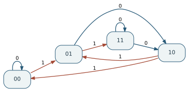
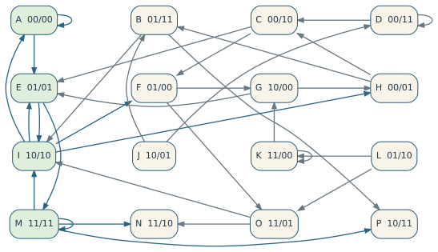
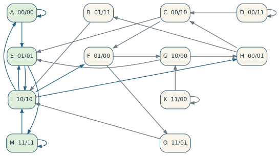

# ENS MP · Informatique-mathématiques 2018 · Corrigé guidé

*Corrigé rédigé par IA, non officiel. Signalez toute erreur.*

**Rédaction** · GPT-6.2 Astra Ultra · vitesse non renseignée · 25 novembre 2026

On note $\sigma$ le décalage et $\Phi,\Psi$ les deux morphismes de la question 11. La distance de deux configurations distinctes est $2^{-k}$, où $k$ est la plus petite valeur absolue d’un indice de désaccord.

## Repères

En partie I, une boule fixe une fenêtre autour de zéro, tandis qu’un motif peut apparaître en toute position. En partie III, suivre simultanément deux fenêtres permet de comparer deux configurations entières. Un chemin bi-infini conserve une information qu’un parcours fini peut perdre aux extrémités.

## I · Configurations, topologie et sous-décalages

### Question 1 · Occurrence et cylindre du mot 1100

**Indication.** Pour le cylindre, la première lettre doit être en position zéro. Une occurrence peut commencer ailleurs.

#### Solution

La configuration $x$ est constamment nulle. Dans $y$, la transition de 1 vers 0 a lieu entre $-1$ et $0$. Dans $z$, elle a lieu entre $1$ et $2$.

| Configuration | Occurrence de $1100$ | Appartenance au cylindre de support $[0,3]$ |
|---|---|---|
| $x$ | non | non, le bloc est $0000$ |
| $y$ | oui, sur $[-2,1]$ | non, le bloc est $0000$ |
| $z$ | oui, sur $[0,3]$ | oui |

### Question 2 · Première différence depuis l’origine

**Indication.** Vérifier d’abord l’indice zéro, puis les deux indices de valeur absolue un.

#### Solution

Les configurations $x$ et $y$ coïncident en zéro et diffèrent en $-1$, donc $d(x,y)=2^{-1}=1/2$. Les couples $(y,z)$ et $(x,z)$ diffèrent en zéro, d’où $d(y,z)=d(x,z)=1$.

### Question 3 · Intersections quelconques de fermés

**Indication.** Partir d’un point du complément de l’intersection et choisir un seul fermé qui l’exclut.

#### Solution

Soit $F=\bigcap_{i\in I}F_i$ avec tous les $F_i$ fermés. Si $x\notin F$, il existe $i$ tel que $x\notin F_i$. L’ouvert $F_i^c$ contient une boule centrée en $x$. Cette boule est aussi contenue dans $F^c$. Ainsi $F^c$ est ouvert. Pour la famille vide, l’intersection est l’espace entier et son complément vide est ouvert par définition.

### Question 4 · Les cylindres sont ouverts et fermés

**Indication.** Fixer un rayon qui impose l’accord sur tout le support du motif.

#### Solution

Soit $p$ de support $[\ell,r]$ et $M=\max(|\ell|,|r|)$. Si $d(x,y)<2^{-M}$, les configurations coïncident sur $[-M,M]$, donc ont le même statut vis-à-vis du cylindre $[\![p]\!]$. La boule de ce rayon reste dans le cylindre lorsque $x$ y appartient et dans son complément dans l’autre cas. Les deux ensembles sont ouverts.

### Question 5 · Inverser le décalage

**Indication.** Composer deux translations de sens contraires et lire la lettre d’indice $j$.

#### Solution

Avec $(\sigma x)_j=x_{j+1}$, poser $(\tau x)_j=x_{j-1}$. Pour tout $j$, $(\sigma\tau x)_j=x_j=(\tau\sigma x)_j$. Ainsi $\sigma$ est bijective et $\sigma^{-1}=\tau$.

### Question 6 · Trois candidats sous-décalages

**Indication.** Séparer l’invariance par translation et la stabilité par passage à la limite.

#### Solution

1. $X_1$ n’est pas invariant. La configuration toute à 1 sauf un zéro en $0$ lui appartient. Sa translatée a son zéro en $-1$ et en sort.
2. $X_2$ est invariant mais non fermé. La configuration portant un seul 1 en $n$ appartient à $X_2$ et tend vers $0^{\mathbb Z}$ lorsque $n\to+\infty$.
3. $X_3$ est invariant, puisque translater conserve le nombre de 1. Si $x\notin X_3$, deux coordonnées distinctes de $x$ valent 1. Un cylindre fixant la portion d’intervalle qui les contient est un voisinage de $x$ disjoint de $X_3$. Cet ensemble est donc fermé et constitue un sous-décalage.

### Question 7 · Extraction diagonale sur des fenêtres emboîtées

**Indication.** Choisir successivement des sous-suites constantes sur chaque fenêtre, puis prendre la diagonale en indices croissants.

#### Solution

Par finitude de $A$, il existe un ensemble infini $I_0$ d’indices donnant la même lettre centrale. Dans $I_{m-1}$, les restrictions à $[-m,m]$ ne prennent qu’un nombre fini de valeurs. Choisir un ensemble infini $I_m\subseteq I_{m-1}$ où cette restriction est constante, égale à $p_m$. Les $p_m$ se prolongent les uns les autres et définissent une configuration $x$. Choisir $n_m\in I_m$ avec $n_m>n_{m-1}$. Pour $m\ge k$, $s(n_m)$ et $x$ coïncident sur $[-k,k]$, donc $d(s(n_m),x)\le 2^{-(k+1)}$. Cela assure la convergence.

### Question 8 · Propriétés nécessaires d’un langage

**Indication.** Choisir une configuration réalisant le motif à l’emplacement prescrit.

#### Solution

Soit $p=x_{[a,b]}$ avec $x\in X$. Toute restriction de $p$ est une restriction de $x$. Le bloc $x_{[a-1,b+1]}$ prolonge $p$ des deux côtés. Enfin, les motifs translatés sont obtenus en restreignant $\sigma x$ et $\sigma^{-1}x$ aux supports translatés. Ces deux configurations appartiennent à $X$. On obtient les trois propriétés demandées.

### Question 9 · Décrire un sous-décalage par ses motifs interdits

**Indication.** Une occurrence interdite se détecte sur une fenêtre finie et constitue un ouvert.

#### Solution

1. Le complément de $X_E$ est la réunion des cylindres de tous les translatés de tous les motifs $p\in E$. Ces cylindres sont ouverts par 4. L’évitement est invariant par toute translation car celle-ci déplace seulement les occurrences. Ainsi $X_E$ est un sous-décalage.
2. Toute configuration de $X$ évite les motifs de $\overline{L(X)}$, car $X$ est invariant. Inversement, si $x$ évite ce complément, chacun de ses blocs centraux appartient à $L(X)$. Pour chaque $m$ il existe donc $x^{(m)}\in X$ qui coïncide avec $x$ sur $[-m,m]$. Ces configurations tendent vers $x$, qui appartient donc au fermé $X$. Ainsi $X=X_{\overline{L(X)}}$.
3. Le premier point donne une implication, le deuxième fournit l’ensemble interdit pour l’autre.

### Question 10 · Réaliser un langage prolongeable

**Indication.** Étendre un motif donné sur les deux côtés indéfiniment et vérifier toutes les restrictions de la configuration obtenue.

#### Solution

Prenons $X=X_{\overline L}$. On a $L(X)\subseteq L$. Pour $p\in L$, construire par prolongements successifs une suite de motifs emboîtés de $L$ commençant par $p$, grandissant d’au moins une case de chaque côté. Leur réunion définit $x\in A^{\mathbb Z}$. Toute restriction finie de $x$ est sous-motif d’un de ces prolongements et appartient à $L$. Tout translaté d’une telle restriction appartient encore à $L$. Aucun motif interdit n’apparaît donc dans $x$. Ainsi $x\in X$ et $p\in L(X)$. Cela donne l’égalité. Si $L$ est vide, $X$ est vide et l’égalité vaut encore.

## II · Morphismes

### Question 11 · Tester les deux règles locales et le décalage

**Indication.** Pour la parité, deux bits initiaux suffisent à reconstruire un antécédent. Pour la seconde règle, chercher quatre sorties 1 consécutives.

#### Solution

1. Pour $\Phi$, fixer une sortie $y$ arbitraire et deux bits $x_0,x_1$. L’équation $y_i=x_{i-1}+x_i+x_{i+1}\pmod2$ détermine d’abord $x_2,x_3,\ldots$ puis, en sens inverse, $x_{-1},x_{-2},\ldots$. Les quatre choix du couple initial donnent quatre antécédents distincts de tout $y$. Ainsi $\Phi$ est surjectif et non injectif.
2. Pour $\Psi$, les deux constantes $0^{\mathbb Z}$ et $1^{\mathbb Z}$ ont l’image $0^{\mathbb Z}$. Pour obtenir 1, les seuls triples permis sont $001,011,100,101$. En les raccordant par chevauchement de deux lettres, deux sorties 1 exigent l’un de $0011,1001,1011$, et trois sorties 1 exigent $10011$. Ce dernier ne s’étend pas à droite, car aucun triple commençant par $11$ ne donne 1. Ainsi $1111$ n’apparaît jamais. En particulier $1^{\mathbb Z}$ est sans antécédent. Le morphisme n’est ni injectif ni surjectif.
3. Pour $\sigma$, choisir le voisinage $[0,1]$ et la fonction locale $(a,b)\mapsto b$.

### Question 12 · Continuité et commutation avec la translation

**Indication.** Pour retrouver une règle locale à partir de la continuité, il suffit de fixer la lettre centrale de l’image.

#### Solution

1. Si deux configurations coïncident sur $[-m-1,m+1]$, leurs translatées coïncident sur $[-m,m]$. En choisissant $m$ tel que $2^{-(m+1)}<\varepsilon$, cela donne la continuité, uniformément en la configuration.
2. Une règle de voisinage $[-\ell,r]$ lit, pour les sorties dans $[-m,m]$, seulement les entrées dans $[-m-\ell,m+r]$. Cela donne la continuité. Calculer en $i$ la règle sur $\sigma x$ revient à la calculer en $i+1$ sur $x$, d’où la commutation.

Réciproquement, par Heine, la continuité de $F$ est uniforme. Pour $\varepsilon=1$, choisir $\delta>0$ tel que $d(x,y)<\delta$ impose $(Fx)_0=(Fy)_0$. Prendre $R$ tel que $2^{-(R+1)}<\delta$. Pour chaque mot $u$ sur $[-R,R]$, définir $\varphi(u)=(Fx)_0$ en choisissant un prolongement $x$ de $u$. Deux prolongements sont à distance au plus $2^{-(R+1)}$, donc la définition est indépendante du choix. Par commutation, aussi pour les puissances négatives, $(Fx)_i=(F\sigma^i x)_0=\varphi(x_{[i-R,i+R]})$. C’est la règle locale cherchée.

### Question 13 · Identifier les motifs orphelins

**Indication.** Réutiliser les deux conclusions de la question 11.

#### Solution

Pour $\Phi$, tout motif se prolonge en une configuration de sortie et celle-ci a un antécédent. Il n’y a aucun motif orphelin. Pour $\Psi$, le mot $1111$ est orphelin, par l’énumération des triples en 11.2.

### Question 14 · Surjectivité des applications locales étendues

**Indication.** Des antécédents sur des fenêtres de plus en plus grandes ne sont pas nécessairement compatibles. Extraire une sous-suite convergente.

#### Solution

1. Si $F$ est surjectif, prolonger tout mot de sortie sur $[-m,m]$ en une configuration $y$, prendre $x$ tel que $Fx=y$, puis restreindre $x$ à $[-m-r,m+r]$. On obtient un antécédent par $\varphi_m$. Réciproquement, pour chaque $m$, prolonger en $x^{(m)}$ un antécédent local du bloc $y_{[-m,m]}$. Les images $F(x^{(m)})$ tendent vers $y$. Par 7, une sous-suite des entrées tend vers $x$. Par continuité, ses images tendent vers $Fx$, donc $Fx=y$.
2. Soit $p$ sur $[-m,m]$ absent de l’image de $\varphi_m$. Une occurrence de $p$ en décalage $i$ dans une image fournirait, en lisant l’entrée sur $[i-m-r,i+m+r]$, un antécédent local de $p$. Ainsi $p$ est orphelin à toute position.
3. Si $F$ n’est pas surjectif, les deux points précédents donnent un motif orphelin. S’il est surjectif, tout prolongement d’un motif de sortie est une image, donc il n’y a aucun motif orphelin.

## III · Algorithmes par les graphes

### Question 15 · Graphe étiqueté de la seconde règle

**Indication.** L’arête allant de $ab$ à $bc$ lit le triple $abc$.

#### Solution

Le dessin se lit avec le mot de deux lettres pour sommet et le bit produit pour étiquette. Voici ses huit arêtes, y compris les deux boucles.

| Départ | En ajoutant 0 : arrivée, étiquette | En ajoutant 1 : arrivée, étiquette |
|---|---|---|
| $00$ | $00,0$ | $01,1$ |
| $01$ | $10,0$ | $11,1$ |
| $10$ | $00,1$ | $01,1$ |
| $11$ | $10,0$ | $11,0$ |



### Question 16 · Graphe des couples et élagage

**Indication.** Associer deux arêtes de même étiquette, puis chercher les sommets traversés par une marche bi-infinie.

#### Solution

Les dessins utilisent les seize emplacements de la figure 1 du sujet. Pour lire aussi toutes les flèches sans superposition, le tableau donne les noms des emplacements, le couple de mots correspondant et tous les successeurs dans $H_\psi$.

| Nom et couple | Successeurs | Nom et couple | Successeurs |
|---|---|---|---|
| A = 00/00 | A, E | I = 10/10 | A, E, F, H |
| B = 01/11 | I, P | J = 10/01 | B, D |
| C = 00/10 | E, F | K = 11/00 | G, K |
| D = 00/11 | C, D | L = 01/10 | K, O |
| E = 01/01 | I, M | M = 11/11 | I, M, N, P |
| F = 01/00 | G, O | N = 11/10 | aucun |
| G = 10/00 | E, H | O = 11/01 | I, N |
| H = 00/01 | B, C | P = 10/11 | aucun |

Par exemple, pour C, les arêtes sortant de $10$ portent toutes deux 1. Il faut les associer à $00\to01$ d’étiquette 1, ce qui donne F et E. Dans $H_\psi$, J et L n’ont aucun prédécesseur, N et P n’ont aucun successeur. On retire ces quatre sommets et toutes les arêtes incidentes. Tous les sommets restants ont au moins une entrée et une sortie restantes. Dans un graphe fini, cela permet de prolonger une marche indéfiniment des deux côtés. On obtient donc $D_\psi$ avec A, B, C, D, E, F, G, H, I, K, M, O. Les boucles en D et K représentent notamment les deux configurations constantes distinctes ayant la même image.





### Question 17 · Chemins, isolement et élagage

**Indication.** Distinguer la présence d’une boucle, l’existence d’un autre sommet mutuellement accessible et la possibilité de prolonger un chemin dans les deux sens.

#### Solution

**1. Chemin.** On donne du Caml proche de Caml Light, avec la syntaxe OCaml pour les listes. Un sommet présent est accessible depuis lui-même en zéro étape. Le test d’appartenance préalable traite un sommet demandé mais absent.
```ocaml
type sommet = int * int
type graphe = (sommet * sommet list) list

let chemin (g : graphe) u v =
  let rec visite vus = function
    | [] -> false
    | x :: suite when List.mem x vus -> visite vus suite
    | x :: suite ->
        x = v || visite (x :: vus) (List.assoc x g @ suite)
  in
  List.mem_assoc u g && List.mem_assoc v g && visite [] [u]
```
Chaque sommet exploré l’est au plus une fois. Après son exploration, tous ses successeurs sont en attente ou déjà vus. Tout sommet atteint provient d’un chemin issu de $u$. Cela assure la correction et la terminaison.

**2. Isolement au sens de la question.**
```ocaml
let isole g u =
  List.mem_assoc u g &&
  not (List.exists (fun (v, _) ->
    u <> v && chemin g u v && chemin g v u) g)
```
Une boucle seule ne suffit pas à rendre un sommet non isolé au sens de 17.2, qui impose $v\ne u$.

**3. Lecture de l’énoncé.** Si, comme le suggère l’enchaînement avec 17.2, « appartient à une composante fortement connexe » signifie ici « appartient à une composante ayant au moins deux sommets », on obtient le sous-graphe induit suivant.
```ocaml
let induit g garde =
  List.filter_map (fun (u, voisins) ->
    if garde u then Some (u, List.filter garde voisins)
    else None) g

let elagage g = induit g (fun u -> not (isole g u))
```
Le prédicat est calculé dans le graphe initial comme le demande 17.3. Avec la définition usuelle des composantes fortement connexes, les singletons sont aussi des composantes et **tout sommet appartient à une composante**. Pris littéralement sous cette convention, le résultat de 17.3 est simplement $g$.

Pour les questions 16 et 18 à 22, on a besoin du graphe $D$ spécifié page 8, qui conserve les sommets **situés sur un chemin bi-infini**, y compris ceux situés entre deux cycles différents et les boucles seules. Voici la fonction correspondante.
```ocaml
let rec coeur g =
  let a_une_entree u =
    List.exists (fun (_, voisins) -> List.mem u voisins) g
  in
  let garde u = List.assoc u g <> [] && a_une_entree u in
  let h = induit g garde in
  if List.length h = List.length g then g else coeur h
```
Un sommet sans entrée ou sans sortie ne peut appartenir à une marche bi-infinie. Le supprimer conserve donc toutes ces marches. Au point fixe, tout sommet a une entrée et une sortie et peut être prolongé dans les deux sens. La distinction compte, par exemple, pour un graphe à un seul sommet muni d’une boucle.

### Question 18 · Connexité forte de la diagonale

**Indication.** Dans le graphe des fenêtres, ajouter une à une les lettres du mot de destination.

#### Solution

Posons $m=\ell+r$. Depuis tout mot $u$ de longueur $m$, ajouter successivement les $m$ lettres de $v$ et décaler d’une case à chaque étape. On obtient un chemin $u\to v$. Il se relève en un chemin diagonal de $(u,u)$ à $(v,v)$ dans $H_\varphi$, chaque arête étant appariée avec elle-même. En échangeant $u,v$, on a le retour. Les sommets et les arêtes de ces chemins se prolongent dans les deux sens en chemins diagonaux. Ils restent donc dans $D_\varphi$ et appartiennent à une seule composante $G'_\varphi$.

La représentation par fenêtres de la partie III suppose $m\ge1$, de façon à pouvoir lire la première lettre d’une fenêtre. Pour une règle ponctuelle, on peut toujours élargir le voisinage à $[0,1]$ et ignorer la lettre supplémentaire. Les algorithmes n’ont besoin que de la même numérotation des mots dans les deux coordonnées.

### Question 19 · Reconnaître la bijectivité

**Indication.** Chaque sommet du graphe élagué figure sur une paire de chemins bi-infinis de même image.

#### Solution

Si $D_\varphi$ contient un sommet $(u,v)$ hors diagonale, prolongeons-le en chemin bi-infini. Les deux suites de fenêtres qui en résultent se recouvrent correctement d’un pas au suivant. Chacune définit donc une configuration. Les deux configurations diffèrent puisque $u\ne v$, et leurs images sont égales, par construction des arêtes appariées. Le morphisme n’est pas injectif. Réciproquement, deux configurations distinctes de même image fournissent un chemin bi-infini apparié et, au niveau d’une fenêtre qui diffère, un sommet hors diagonale de $D_\varphi$.

L’injectivité équivaut donc à l’absence de sommet hors diagonale dans $D_\varphi$. Si le morphisme est injectif, il est pré-injectif, donc surjectif par le théorème admis. L’injectivité équivaut ici à la bijectivité. Enfin, par 18 tous les sommets diagonaux sont dans $G'_\varphi$. Dire que $D_\varphi$ est entièrement diagonal revient à dire que $G'_\varphi$ est diagonal et qu’il est la seule composante fortement connexe de $D_\varphi$, chaque sommet appartenant à une composante (éventuellement singleton).

### Question 20 · Décision de la bijectivité

**Indication.** Après l’élagage des préfixes et suffixes sans prolongement, tester l’égalité des deux codes en chaque sommet restant.

#### Solution

```ocaml
let bijectif g =
  List.for_all (fun ((a, b), _) -> a = b) (coeur g)
```
Les codes des fenêtres sont injectifs. Le test d’égalité sur les entiers est donc équivalent à celui sur les mots. La correction est l’équivalence de 19, avec le graphe $D$ construit par `coeur`.

### Question 21 · Reconnaître la surjectivité par la composante diagonale

**Indication.** Une excursion qui part de la diagonale et y revient peut être encadrée par des queues de configurations identiques.

#### Solution

Si $G'_\varphi$ contient un sommet hors diagonale, prendre un chemin d’un sommet diagonal vers lui puis vers un sommet diagonal. Prolonger les deux extrémités avec des chemins diagonaux, à gauche et à droite. Les deux configurations codées coïncident hors d’un intervalle fini, diffèrent à l’intérieur et ont la même image. Cela contredit la pré-injectivité.

Réciproquement, supposons qu’il existe des configurations distinctes asymptotiques ayant la même image. Leur chemin apparié est diagonal suffisamment loin à gauche et à droite, puisque les fenêtres sont de taille finie. Il passe par un sommet hors diagonale. Par 18 les deux extrémités diagonales de l’excursion sont dans la même composante, donc tout sommet de cette excursion y appartient. Ainsi $G'_\varphi$ n’est pas entièrement diagonal. Par le théorème admis, pré-injectivité et surjectivité coïncident, d’où l’équivalence demandée.

### Question 22 · Décision de la surjectivité

**Indication.** Choisir un seul sommet diagonal et vérifier qu’aucun sommet non diagonal n’est accessible depuis lui dans les deux sens.

#### Solution

```ocaml
let surjectif g =
  let d = coeur g in
  let diagonale = List.find (fun ((a, b), _) -> a = b) d in
  let origine = fst diagonale in
  List.for_all (fun ((a, b), _) ->
    a = b ||
    not (chemin d origine (a, b) && chemin d (a, b) origine)) d
```
Sur une entrée du type promis, l’alphabet non vide fournit un sommet diagonal, et 18 assure sa présence dans $d$. Les deux appels à `chemin` testent exactement l’appartenance à la composante de ce sommet. La conclusion découle de 21.
