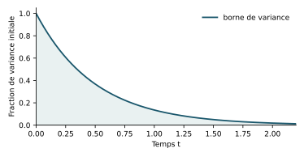

# ENS · MP · Mathématiques C 2018 · Corrigé guidé

*Corrigé rédigé par IA, non officiel. Signalez toute erreur.*

**Rédaction** · GPT-6.2 Astra Ultra · vitesse non renseignée

**Révision** · GPT-6.2 Astra Ultra · vitesse non renseignée · 26 novembre 2026

Le sujet compare la convergence vers l’équilibre pour une chaîne de Markov réversible et pour le semi-groupe d’Ornstein–Uhlenbeck. [Sujet officiel](https://www.ens.psl.eu/sites/default/files/2018_mpi_sujet_mathc.pdf) · [Rapport du jury](https://www.ens.psl.eu/sites/default/files/18_mp_rap_emathc.pdf)

## I. Noyaux de transition et convergence vers l’équilibre

### Question 1.1a

> [!INDICATION]
> Sommer d’abord sur l’état d’arrivée.

#### Solution

Les termes de $PQ$ sont positifs ou nuls et $\sum_z(PQ)(x,z)=\sum_y P(x,y)\sum_z Q(y,z)=1$ par sommation de termes positifs. Chaque coefficient est alors au plus un, donc $PQ$ est une matrice de transition.

### Question 1.1b

> [!INDICATION]
> Développer les deux produits en choisissant deux états intermédiaires.

#### Solution

Au coefficient $(x,w)$, les deux parenthésages donnent $\sum_{y,z}P(x,y)Q(y,z)R(z,w)$. La sommation positive autorise les deux ordres et établit l’associativité, y compris si $E$ est dénombrable.

### Question 1.1c

> [!INDICATION]
> Initialiser avec la matrice identité puis utiliser la stabilité par produit.

#### Solution

La matrice $I$ a des termes positifs ou nuls et une unique unité sur chaque ligne. Si $P^n$ est une transition, $P^{n+1}=P^nP$ l’est par 1.1a. La récurrence couvre tous les $n\ge0$.

### Question 1.2a

> [!INDICATION]
> Vérifier la masse totale avant de permuter les deux sommations.

#### Solution

Par positivité, $\sum_y(\mu P)(y)=\sum_x\mu(x)\sum_yP(x,y)=1$. C’est donc une probabilité. En chaque $z$, $\sum_{x,y}\mu(x)P(x,y)Q(y,z)$ donne indifféremment $((\mu P)Q)(z)$ ou $(\mu(PQ))(z)$ par sommation positive.

### Question 1.2b

> [!INDICATION]
> Dominer les termes signés par la fonction constante égale à la norme uniforme.

#### Solution

La série qui définit $Pf(x)$ converge absolument et $|Pf(x)|\le\|f\|_\infty\sum_yP(x,y)=\|f\|_\infty$. La somme double des $|\mu(x)P(x,y)f(y)|$ est au plus $\|f\|_\infty$. On peut la réordonner sans les modules, d’où $(\mu P)[f]=\mu[Pf]$.

### Question 1.2c

> [!INDICATION]
> Contrôler la série double à partir de la somme de chaque ligne.

#### Solution

Pour $x$ fixé, $\sum_{y,z}P(x,y)Q(y,z)|f(z)|\le\|f\|_\infty$. En regroupant la série absolument convergente avec les signes, on trouve $((PQ)f)(x)=\sum_yP(x,y)(Qf)(y)$.

### Question 1.3a

> [!INDICATION]
> Exprimer le chemin imposé comme une intersection d’événements indépendants portant sur les innovations.

#### Solution

Pour $x$ fixé, les événements $F(x,U_1)=y$ partitionnent l’espace lorsque $y$ parcourt $E$, ce qui donne une ligne de transition. L’événement du chemin $(x_0,\ldots,x_n)$ est exactement $\{X_0=x_0\}\cap\bigcap_{i=1}^n\{F(x_{i-1},U_i)=x_i\}$. Ces événements sont indépendants. Comme les $U_i$ ont la même loi, la probabilité est $\mu_0(x_0)\prod_{i=1}^nP(x_{i-1},x_i)$, avec produit vide au rang zéro.

### Question 1.3b

> [!INDICATION]
> Diviser la probabilité du chemin prolongé par celle de son préfixe.

#### Solution

Si le chemin initial a une probabilité strictement positive, 1.3a donne pour le rapport des deux probabilités exactement le dernier facteur $P(x_n,x)$. C’est la probabilité conditionnelle demandée.

### Question 1.3c

> [!INDICATION]
> Sommer sur le dernier état avant la transition.

#### Solution

La formule des chemins, sommée sur les états antérieurs, donne $\mu_{n+1}(y)=\sum_x\mu_n(x)P(x,y)$. Par récurrence et associativité $\mu_n=\mu_0P^n$. Si $\mu_0P=\mu_0$, la récurrence donne $\mu_n=\mu_0$ pour tout $n$.

### Question 1.3d

> [!INDICATION]
> Identifier la somme sur les chemins à une puissance de la matrice.

#### Solution

Pour $n\ge1$, 1.3a sommée sur les $n-1$ états intermédiaires donne $\mathbb P(X_0=x,X_n=y)=\mu_0(x)P^n(x,y)$. Diviser par $\mu_0(x)>0$. Au rang zéro le résultat est $\mathbf1_{x=y}=I(x,y)$.

### Question 1.3e

> [!INDICATION]
> Faire porter la puissance du noyau sur la fonction test.

#### Solution

La définition de l’espérance discrète et 1.3c donnent $\mathbb Ef(X_n)=(\mu_0P^n)[f]$. Par 1.2b appliquée à $P^n$, c’est $\mu_0[P^nf]$.

### Question 1.4

> [!INDICATION]
> Sommer la balance détaillée en l’état de départ.

#### Solution

Pour chaque $y$, $(\pi P)(y)=\sum_x\pi(x)P(x,y)=\pi(y)\sum_xP(y,x)=\pi(y)$. La réversibilité implique ainsi l’invariance.

### Question 1.5a

> [!INDICATION]
> Renverser les chemins sans diviser par une masse éventuellement nulle.

#### Solution

Par récurrence, supposons $\pi(x)P^n(x,z)=\pi(z)P^n(z,x)$. Dans l’expression de $\pi(x)P^{n+1}(x,y)$, le terme d’indice $z$ devient $\pi(z)P^n(z,x)P(z,y)=\pi(y)P(y,z)P^n(z,x)$. Sa somme vaut $\pi(y)P^{n+1}(y,x)$ par associativité. L’initialisation est la réversibilité de $P$.

### Question 1.5b

> [!INDICATION]
> Utiliser la stricte positivité du produit d’un côté de l’égalité.

#### Solution

On a $\pi(x)P^n(x,a)=\pi(a)P^n(a,x)>0$. Les deux facteurs du membre gauche sont donc strictement positifs.

### Question 1.5c

> [!INDICATION]
> Appliquer l’hypothèse d’accessibilité à un état arbitraire.

#### Solution

Pour chaque $x$ un entier $n\ge1$ rend $P^n(a,x)>0$. Ainsi $\pi(x)>0$ par 1.5b.

### Question 1.5d

> [!INDICATION]
> Relier deux états par l’état de référence.

#### Solution

Pour $x,y$, choisissons $k,\ell\ge1$ tels que $P^k(a,x)>0$ et $P^\ell(a,y)>0$. Par 1.5b, $P^k(x,a)>0$. Le terme passant par $a$ donne $P^{k+\ell}(x,y)\ge P^k(x,a)P^\ell(a,y)>0$. C’est l’irréductibilité.

### Question 1.6a

> [!INDICATION]
> Développer le carré en utilisant les deux marginales de la mesure sur les transitions.

#### Solution

Comme $f$ est bornée, la somme est absolument convergente. La mesure $\pi(x)P^n(x,y)$ a pour marginales $\pi(x)$ par somme des lignes et $\pi(y)$ par invariance. Les deux termes carrés donnent donc ensemble $\pi[f^2]$, après multiplication par $1/2$. Le terme croisé vaut $-\sum_x\pi(x)f(x)P^nf(x)$. Ainsi $E_n(f)=\langle f-P^nf,f\rangle_\pi$.

### Question 1.6b

> [!INDICATION]
> Utiliser toutes les puissances du noyau pour comparer deux états quelconques.

#### Solution

Si $Pf=f$, alors $P^nf=f$ et $E_n(f)=0$ pour tout $n$. Pour $x,y$, l’irréductibilité donne $P^n(x,y)>0$ pour un $n$, et $\pi(x)>0$. Le terme positif correspondant du carré doit être nul, donc $f(x)=f(y)$.

### Question 1.6c

> [!INDICATION]
> Pour un espace dénombrable, tronquer la fonction harmonique par une transformation strictement concave et bornée.

#### Solution

Comme $\pi(x)>0$, $f(x)=\mu(x)/\pi(x)$ est positive ou nulle et finie. Par balance détaillée, $Pf(x)=\pi(x)^{-1}\sum_y\mu(y)P(y,x)=f(x)$. Si $E$ est fini, $f$ est bornée et 1.6b conclut directement, comme le précise le rapport.

Sur un ensemble dénombrable, le quotient peut a priori être non borné. Posons $\phi(t)=1-e^{-t}$ pour $t\ge0$. La concavité et $Pf=f$ donnent $P(\phi(f))\le\phi(f)$. La différence, positive et bornée, a moyenne nulle sous $\pi$ par invariance. Elle s’annule partout grâce à 1.5c. Il y a donc égalité dans Jensen sous chaque ligne de transition. La stricte concavité impose que $f(y)$ soit constant pour les $y$ tels que $P(x,y)>0$, et leur moyenne est $f(x)$. Par irréductibilité, $f$ est constante sur $E$. Comme $\sum_x\pi(x)f(x)=1$, la constante est un et $\mu=\pi$.

### Question 1.7a

> [!INDICATION]
> Garder le chemin qui boucle en b et le terme qui y passe aux deux temps intermédiaires.

#### Solution

Le chemin restant $n$ fois en $b$ donne $P^n(b,b)\ge P(b,b)^n>0$. Dans le développement de $P^kP^nP^\ell(x,y)$, conserver seulement les deux états intermédiaires égaux à $b$ donne le minorant $P^k(x,b)P^n(b,b)P^\ell(b,y)$.

### Question 1.7b

> [!INDICATION]
> Ajuster la parité de la longueur en ajoutant des boucles.

#### Solution

L’irréductibilité de $P$ donne $k,\ell\ge1$ avec $P^k(x,b)P^\ell(b,y)>0$. Choisir $n=1$ ou $2$ de sorte que $k+n+\ell=2m$ soit pair. Par 1.7a, $(P^2)^m(x,y)>0$. Ainsi $P^2$ est irréductible.

### Question 1.7c

> [!INDICATION]
> Passer au carré du noyau puis aux fonctions constantes.

#### Solution

Si $Pf=-f$, alors $P^2f=f$. Le noyau $P^2$ est réversible, irréductible et conserve $\pi$. La preuve de 1.6b s’applique et donne $f=c$ constante. Mais $Pc=c=-c$, donc $c=0$.

### Question 1.8a

> [!INDICATION]
> Vérifier la séparation coordonnée par coordonnée.

#### Solution

La forme $\langle f,g\rangle_\pi=\sum_i\pi(i)f(i)g(i)$ est bilinéaire symétrique. Les masses $\pi(i)$ sont toutes strictement positives, donc $\sum_i\pi(i)f(i)^2=0$ impose $f=0$. C’est un produit scalaire réel.

### Question 1.8b

> [!INDICATION]
> Permuter les deux indices à l’aide de la balance détaillée.

#### Solution

L’opérateur $f\mapsto Pf$ est linéaire et $\langle Pf,g\rangle_\pi=\sum_{x,y}\pi(x)P(x,y)f(y)g(x)=\sum_{y,x}\pi(y)P(y,x)g(x)f(y)=\langle f,Pg\rangle_\pi$. Il est donc symétrique.

### Question 1.8c

> [!INDICATION]
> Combiner le théorème spectral, la contraction uniforme et l’exclusion de moins un.

#### Solution

Le théorème spectral réel donne une diagonalisation à spectre réel, ce qui exclut aussi toute valeur propre complexe non réelle. Si $Pf=\lambda f$ avec $f\ne0$, $\|Pf\|_\infty\le\|f\|_\infty$ par 1.2b, donc $|\lambda|\le1$. Par 1.7c, $-1$ est exclu.

### Question 1.8d

> [!INDICATION]
> Caractériser l’espace propre puis utiliser la diagonalisabilité.

#### Solution

Les lignes somment à un, donc $P\mathbf1=\mathbf1$. Par 1.6b, cet espace propre est exactement $\mathbb R\mathbf1$. La diagonalisabilité identifie la multiplicité algébrique à cette dimension, égale à un.

### Question 1.8e

> [!INDICATION]
> Projeter sur l’orthogonal des constantes dans une base propre.

#### Solution

Comme $\|\mathbf1\|_\pi=1$, la projection sur les constantes est $\pi[f]\mathbf1$. Dans l’orthogonal, toutes les valeurs propres ont un module strictement inférieur à un par 1.8c–d. Soit $\lambda$ le plus grand de ces modules, ou zéro si l’orthogonal est nul. En écrivant $f-\pi[f]\mathbf1$ dans une base propre orthonormée, chaque coordonnée est multipliée par une puissance de module au plus $\lambda^n$. D’où $\|P^nf-\pi[f]\mathbf1\|_\pi\le\lambda^n\|f-\pi[f]\mathbf1\|_\pi$.

### Question 1.8f

> [!INDICATION]
> Tester sur les indicatrices et représenter la loi initiale par sa densité.

#### Solution

Posons $h=\mu_0/\pi$ sur cet espace fini, et $f_x=\mathbf1_{\{x\}}$. Alors $\mu_n(x)-\pi(x)=\langle h,P^nf_x-\pi(x)\mathbf1\rangle_\pi$. Par Cauchy–Schwarz et 1.8e, son module est au plus $\|h\|_\pi\lambda^n\sqrt{\pi(x)(1-\pi(x))}\le\|h\|_\pi\lambda^n$. La constante est indépendante de $x,n$.

## II-A. Semi-groupe de la chaleur

### Question 2.1

> [!INDICATION]
> Traiter la valeur absolue avant le changement de variable.

#### Solution

Si $g$ est intégrable, $\int|f(x-y)g(y)|dy\le\|f\|_\infty\|g\|_1$. Si c’est $f$ qui est intégrable, le changement $u=x-y$ donne la borne $\|g\|_\infty\|f\|_1$. L’intégrale est donc absolument convergente dans les deux cas et le même changement donne $f*g=g*f$.

### Question 2.2

> [!INDICATION]
> Compléter le carré dans le produit des deux densités.

#### Solution

On vérifie $\frac{(x-y)^2}{s}+\frac{y^2}{t}=\frac{x^2}{s+t}+\frac{s+t}{st}(y-\frac{tx}{s+t})^2$. Ainsi le produit $\gamma_s(x-y)\gamma_t(y)$ est $\gamma_{s+t}(x)$ fois la densité gaussienne de variance $st/(s+t)$ centrée en $tx/(s+t)$. Celle-ci s’intègre à un, ce qui donne $\gamma_s*\gamma_t=\gamma_{s+t}$.

### Question 2.3

> [!INDICATION]
> Dériver la densité une fois en temps et deux fois en espace.

#### Solution

On a $\partial_t\gamma_t=(x^2/(2t^2)-1/(2t))\gamma_t$ et $\partial_x\gamma_t=-(x/t)\gamma_t$, d’où $\partial_x^2\gamma_t=(x^2/t^2-1/t)\gamma_t=2\partial_t\gamma_t$.

### Question 2.4a

> [!INDICATION]
> Utiliser une densité indépendante du paramètre jusque sur la frontière t égal zéro.

#### Solution

Le changement de variable donne $P_tf(x)=\int f(x-\sqrt t\,z)\gamma_1(z)\,dz$, valable aussi à $t=0$. Pour toute suite $(t_j,x_j)\to(t,x)$ dans $[0,\infty)\times\mathbb R$, l’intégrande converge en chaque $z$, et son module est dominé par $\|f\|_\infty\gamma_1(z)$. La convergence dominée donne la continuité conjointe et la même borne donne $\|P_tf\|_\infty\le\|f\|_\infty$.

### Question 2.4b

> [!INDICATION]
> Laisser tendre successivement x ou t dans la même représentation.

#### Solution

Pour $t$ fixé et $|x|\to\infty$, $f(x-\sqrt t\,z)\to0$ pour tout $z$. Le majorant de 2.4a s’applique, donc $P_tf\in C_0$. Pour $x$ fixé et $t\to\infty$, l’argument tend vers une extrémité de la droite pour tout $z\ne0$. Le point exceptionnel est de mesure nulle et la même domination donne $P_tf(x)\to0$.

### Question 2.5

> [!INDICATION]
> Séparer le changement d’échelle et la dérivée de la gaussienne standard.

#### Solution

On a $\gamma_t(x)=t^{-1/2}\gamma_1(x/\sqrt t)$. Par récurrence, $\gamma_1^{(n)}(u)=H_n(u)\gamma_1(u)$, où $H_0=1$ et $H_{n+1}=H_n'-uH_n$ est de degré $n+1$. Avec $|H_n(u)|\le c_n(1+|u|)^n$ il vient $|\partial_x^n\gamma_t(x)|\le c_nt^{-n/2}(1+|x|/\sqrt t)^n\gamma_t(x)$.

### Question 2.6a

> [!INDICATION]
> Dériver le noyau et construire un majorant local commun en espace et en temps.

#### Solution

Écrivons $P_tf(x)=\int f(y)\gamma_t(x-y)dy$. Sur $|x|\le R$, $0<a\le t\le b$, 2.5 et $(y-x)^2\ge y^2/2-R^2$ majorent toute dérivée spatiale d’ordre $n$ de l’intégrande par $C_{n,R,a,b}\|f\|_\infty(1+|y|)^n e^{-y^2/(4b)}$. Le majorant est intégrable et indépendant des paramètres. La dérivée temporelle bénéficie de la même borne d’ordre deux par 2.3. La dérivation sous l’intégrale et la convergence dominée donnent les dérivées demandées et leur continuité conjointe pour $t>0$.

### Question 2.6b

> [!INDICATION]
> Prendre la norme intégrale de la dérivée du noyau.

#### Solution

La masse unité de $\gamma_t$ donne la contraction uniforme. Pour les dérivées, $\|\partial_x^nP_tf\|_\infty\le\|f\|_\infty\int|\gamma_t^{(n)}(u)|du$. Par l’échelle gaussienne cette intégrale est $t^{-n/2}\int|H_n(z)|\gamma_1(z)dz$. Le dernier facteur est fini et ne dépend que de $n$.

### Question 2.6c

> [!INDICATION]
> Intégrer l’équation de la chaleur du noyau contre la fonction bornée.

#### Solution

Les dérivations étant justifiées par 2.6a, $\partial_t P_tf=\int f(y)\partial_t\gamma_t(x-y)dy=\tfrac12\int f(y)\partial_x^2\gamma_t(x-y)dy=\tfrac12\partial_x^2P_tf$ par 2.3.

## II-B. Équilibre gaussien et décroissance de la variance

### Question 3.1

> [!INDICATION]
> Appliquer la représentation à densité fixe avec le temps et la position modifiés.

#### Solution

En notant $a=e^{-t}$, $s=1-e^{-2t}$, la définition est $Q_tf(x)=(P_sf)(ax)$. Par 2.4a,
$$Q_tf(x)=\int_{\mathbb R}f(ax-\sqrt s\,y)\gamma_1(y)dy.$$
La même formule donne $f(x)$ pour $t=0$ puisque $a=1$ et $s=0$.

### Question 3.2a

> [!INDICATION]
> Composer les fonctions déjà régularisées avec les deux changements de variable.

#### Solution

Pour $t>0$, $s=1-e^{-2t}>0$. Les dérivées conjointement continues de 2.6a et la régularité de $a(t),s(t)$ donnent toutes les dérivées spatiales de $Q_tf$. La règle de la chaîne donne à $x$ fixé la dérivabilité temporelle pour $t>0$.

### Question 3.2b

> [!INDICATION]
> Conserver le facteur de contraction spatiale à chaque dérivation.

#### Solution

Par 2.6b, $\|Q_tf\|_\infty\le\|f\|_\infty$. Les dérivées spatiales sont $a^n(\partial_x^nP_sf)(ax)$. Leur norme uniforme est donc majorée par
$$C_n\|f\|_\infty\frac{e^{-nt}}{(1-e^{-2t})^{n/2}}
=C_n\|f\|_\infty(e^{2t}-1)^{-n/2}\le C_n\|f\|_\infty(2t)^{-n/2}.$$
Cela fournit une constante indépendante de $t,f$.

### Question 3.2c

> [!INDICATION]
> Différencier la variance gaussienne et le centre, puis appliquer l’équation de la chaleur.

#### Solution

La règle de la chaîne et 2.6c donnent $\partial_t Q_tf=2a^2(\partial_sP_sf)(ax)-ax(\partial_xP_sf)(ax)=a^2(\partial_x^2P_sf)(ax)-ax(\partial_xP_sf)(ax)$. Autrement dit $\partial_tQ_tf=(Q_tf)''-x(Q_tf)'=L(Q_tf)$.

### Question 3.3

> [!INDICATION]
> Mettre le générateur sous la forme d’une dérivée multipliée par la densité.

#### Solution

Comme $\gamma_1'=-x\gamma_1$, $(f'\gamma_1)'=(f''-xf')\gamma_1=(Lf)\gamma_1$. Les intégrandes sont dominés par un multiple de $(1+|x|)\gamma_1$ en vertu des bornes sur les fonctions et dérivées. Sur $[-R,R]$, intégrons $(f'\gamma_1)'g$ par parties, puis faisons $R\to\infty$. Le terme de bord $f'g\gamma_1$ tend vers zéro aux deux infinis, donc $-\langle (Lf)g\rangle=\langle f'g'\rangle$.

### Question 3.4

> [!INDICATION]
> Justifier localement la dérivée du moment avant d’utiliser la constante comme fonction test.

#### Solution

Sur tout compact de temps de $(0,\infty)$, 3.2b–c majorent $|\partial_tQ_tf(x)|$ par $C(1+|x|)$. Ce majorant est intégrable contre $\gamma_1$. La dérivée sous l’intégrale vaut $\langle LQ_tf\rangle=0$ par 3.3 avec $g=1$. Ainsi la moyenne est constante pour $t>0$. Par 3.1 et convergence dominée, $Q_tf(x)\to f(x)$ lorsque $t\downarrow0$. La borne uniforme redonne $\langle Q_tf\rangle=\langle f\rangle$ jusque pour $t=0$.

### Question 3.5a

> [!INDICATION]
> Majorer l’écart par deux fois la borne de la fonction.

#### Solution

L’intégrande double est mesurable et positif. Comme $|f(x)-f(y)|^2\le4\|f\|_\infty^2$ et que $\gamma_1(x)\gamma_1(y)dxdy$ est une probabilité, l’intégrale $I(f)$ est finie.

### Question 3.5b

> [!INDICATION]
> Développer le carré sous deux variables indépendantes de même loi.

#### Solution

Par le théorème de Fubini, les deux termes carrés de $I(f)$ apportent $2\langle f^2\rangle$ et le terme croisé $-2\langle f\rangle^2$. Donc $I(f)/2=\langle f^2\rangle-\langle f\rangle^2=\operatorname{Var}(f)$.

### Question 3.6

> [!INDICATION]
> Dériver la densité normale et vérifier que les termes aux extrémités disparaissent.

#### Solution

Comme $-\gamma_1'=x\gamma_1$, intégrons $-f\gamma_1'$ par parties sur $[-R,R]$. Les bords $f\gamma_1$ tendent vers zéro puisque $f$ est bornée. Les deux intégrales convergent absolument grâce aux bornes sur $f,f'$, d’où $\int xf(x)\gamma_1(x)dx=\int f'(x)\gamma_1(x)dx$.

### Question 3.7a

> [!INDICATION]
> Majorer une primitive sur un intervalle par la longueur de cet intervalle.

#### Solution

Le premier intégrande sans densités est majoré en module par $\|f\|_\infty |x|(|x|+|y|)$, le second par $\|f\|_\infty |y|(|x|+|y|)$. Les moments gaussiens d’ordre un et deux sont finis. Les deux intégrales doubles sont donc absolument convergentes et Fubini s’applique.

### Question 3.7b

> [!INDICATION]
> L’intégration par parties de la question précédente vaut aussi pour une primitive à croissance au plus linéaire.

#### Solution

Pour $y$ fixé, $F_y(x)=\int_y^x f(u)du$ a pour dérivée $f(x)$ et satisfait $|F_y(x)|\le\|f\|_\infty(|x|+|y|)$. Le produit $F_y(x)\gamma_1(x)$ tend vers zéro aux deux infinis. La même intégration par parties qu’en 3.6 donne $\int xF_y(x)\gamma_1(x)dx=\langle f\rangle$. En intégrant en $y$, il vient $I_1(f)=\langle f\rangle$. Par échange des variables, autorisé en 3.7a, $I_2(f)=I_1(f)$.

### Question 3.8a

> [!INDICATION]
> Appliquer Cauchy–Schwarz sur le segment non orienté puis rétablir l’orientation.

#### Solution

Pour $x>y$, $[f(x)-f(y)]^2=(\int_y^x f')^2\le(x-y)\int_y^x(f')^2$. Pour $x<y$, échanger les bornes change les deux signes dans le membre de droite, donc le produit reste identique. Pour $x=y$ les deux membres sont nuls.

### Question 3.8b

> [!INDICATION]
> Écrire la moyenne du majorant à l’aide des deux intégrales de la question 3.7.

#### Solution

Avec $h=(f')^2\in C_b$, l’intégrale double du membre droit de 3.8a vaut $I_1(h)+I_2(h)=2\langle h\rangle$ par 3.7b. Celle du membre gauche vaut $2\operatorname{Var}(f)$ par 3.5b. Après division, $\operatorname{Var}(f)\le\langle(f')^2\rangle$, l’inégalité de Poincaré gaussienne.

### Question 3.9a

> [!INDICATION]
> Calculer la dérivée de la norme au carré et appliquer Poincaré à la fonction centrée.

#### Solution

Posons $u_t=Q_tf$ pour $\langle f\rangle=0$ et $V(t)=\langle u_t^2\rangle$. Sur un compact de $t>0$, $2|u_t\partial_tu_t|$ est majoré par $C(1+|x|)$ grâce à 3.2b–c, ce qui justifie la dérivation sous l’intégrale gaussienne. Comme $\langle u_t\rangle=0$ par 3.4, les questions 3.3 et 3.8b donnent
$$V'(t)=2\langle u_tLu_t\rangle=-2\langle(u_t')^2\rangle\le-2\operatorname{Var}(u_t)=-2V(t).$$

### Question 3.9b

> [!INDICATION]
> Centrer la donnée initiale et intégrer l’inégalité différentielle depuis un temps positif.

#### Solution

Pour $h=f-\langle f\rangle$, on a $Q_th=Q_tf-\langle f\rangle$ par 3.1 et $\operatorname{Var}(Q_tf)=\langle(Q_th)^2\rangle$ par 3.4. Selon 3.9a, $e^{2t}\langle(Q_th)^2\rangle$ est décroissante sur $(0,\infty)$. Sa limite à droite en zéro est $\langle h^2\rangle$ par continuité ponctuelle et domination uniforme. Ainsi, pour tout $t>0$,
$$\operatorname{Var}(Q_tf)\le e^{-2t}\operatorname{Var}(f).$$

Pour le test borné $f(x)=\sin x$, posons $a=e^{-t}$. La formule gaussienne de 3.1 donne $Q_tf(x)=e^{-(1-a^2)/2}\sin(ax)$. Cette fonction est centrée par imparité. Comme $\langle\cos(2ax)\rangle=e^{-2a^2}$, sa variance vaut $e^{-1}\sinh(a^2)$. Le rapport à la variance initiale est $\sinh(e^{-2t})/\sinh(1)$, bien inférieur ou égal à $e^{-2t}$ par convexité de $\sinh$ sur $[0,1]$.

