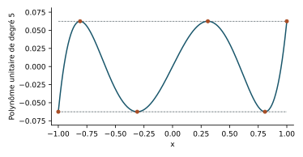

# ENS · MP · Mathématiques D 2018 · Corrigé brut

*Corrigé rédigé par IA, non officiel. Signalez toute erreur.*

**Rédaction** · GPT-6.2 Astra Ultra · vitesse non renseignée

Sur quels intervalles une fonction continue peut-elle être approchée par des polynômes à coefficients entiers ? Le sujet relie la meilleure approximation uniforme, la capacité de l’intervalle et les conjugués d’entiers algébriques. [Sujet officiel](https://banques-ecoles.fr/cms/wp-content/uploads/2018/05/2018_MPI_sujet_MathD.pdf) · [Rapport du jury](https://www.ens.psl.eu/sites/default/files/18_mp_rap_emathd.pdf)

## 1. Existence et unicité de la meilleure approximation

### Question 1.1

L’infimum $m$ est fini car le polynôme nul est admissible. Par définition il existe $g$ tel que $\|f-g\|_I<m+1$, donc $C$ est non vide. Cette partie est fermée par continuité de $g\mapsto\|f-g\|_I$ et bornée car $\|g\|_I\le\|f\|_I+1+m$. La norme uniforme est bien une norme sur les polynômes (l’intervalle est infini). En dimension finie, $C$ est compact.

### Question 1.2

La fonction continue $g\mapsto\|f-g\|_I$ atteint son minimum sur $C$. Les éléments hors de $C$ ont une erreur strictement supérieure à $m+1$ tandis qu’une suite minimisante finit dans $C$. Ce minimum est donc $m$. Si $m=0$, le polynôme ainsi obtenu coïncide avec $f$ en tout point de $I$.

### Question 1.3

Les points $x_i$ sont distincts et il en existe au moins un par compacité. Le polynôme de Lagrange interpolant les $k$ valeurs $f(x_i)$ a degré au plus $k-1\le n$. Il convient pour $q$.

### Question 1.4

Comme $(f-q)(x_i)=0$, il existe pour chaque $i$ un rayon $\delta_i>0$ où $|f-q|<\varepsilon$ sur $I$. Le minimum des $k$ rayons convient simultanément à tous les points de $U_\delta$.

### Question 1.5

Dans $U_\delta$, $f-p_t=(1-t)(f-p)+t(f-q)$ donne $|f-p_t|\le(1-t)m+t\varepsilon$. Sur $I\setminus U_\delta$, $f-p_t=f-p+t(p-q)$ donne $|f-p_t|\le\sup_{I\setminus U_\delta}|f-p|+t\ell$, où $\ell=\|p-q\|_I$.

### Question 1.6

Prenons $\varepsilon=m/2$. Sur $U_\delta$ la première borne est strictement inférieure à $m$ pour tout $t>0$. Si le complément est non vide, il est compact et ne contient aucun des points de contact, donc $M=\max_{I\setminus U_\delta}|f-p|<m$. Choisir $0<t<1$ tel que $t\ell<m-M$ donne aussi une borne stricte sur le complément (vide, il ne demande aucun choix). Ainsi $\|f-p_t\|_I<m$, contradiction. Il y a donc au moins $n+2$ contacts distincts.

### Question 1.7

Le milieu $p=(p_1+p_2)/2$ a erreur au plus $m$ par convexité et au moins $m$ par définition. En tout contact, la moyenne des deux erreurs réelles comprises entre $-m$ et $m$ atteint une extrémité. Les deux erreurs y coïncident donc, et $p_1-p_2$ s’y annule. Par 1.6 il y a au moins $n+2$ points distincts, ce qui impose $p_1=p_2$. Le cas $m=0$ était déjà traité.

## 2. Deux définitions de la capacité

### Question 2.1

Un polynôme unitaire de degré $n$ s’écrit $X^n-r$, $\deg r<n$. Le compact infini $K$ définit une norme sur cet espace de polynômes. Le même argument de compacité qu’en 1.1–2 donne un minimiseur. Sa norme est strictement positive car un polynôme unitaire non nul ne s’annule pas sur tout $K$. Si $K=[a,b]$, l’unicité vient de 1.7 (ou de 1.2 si l’erreur est nulle).

### Question 2.2

Posons $a_n=n\ell_n$, de sorte que $a_{m+n}\le a_n+a_m$. Pour $h\ge1$ fixé, écrivons $n=qh+r$, $0\le r<h$, et posons $a_0=0$. Alors $\ell_n\le(q a_h+\max_{0\le r<h}a_r)/n$, d’où $\limsup\ell_n\le\ell_h$. Comme toutes les valeurs sont au moins leur infimum, on obtient $\ell_n\to\inf_h\ell_h$. Si l’infimum vaut $-\infty$, le majorant du limsup peut être pris arbitrairement négatif, ce qui donne la même conclusion.

### Question 2.3

Le produit de minimiseurs des degrés $m,n$ est unitaire de degré $m+n$ et de norme au plus $t_mt_n$. Puisque tous les $t_j$ sont strictement positifs, appliquer 2.2 à $\ell_n=(\log t_n)/n$ donne une limite réelle ou $-\infty$. En exponentiant (avec $e^{-\infty}=0$), on obtient la limite $d_1(K)$.

### Question 2.4

Le produit de Vandermonde en valeur absolue atteint le maximum $w_n$ par compacité et $w_n>0$ car $K$ contient $n$ points distincts. Pour un $(n+1)$-uplet maximisant le produit, les $n+1$ produits obtenus par suppression d’un point sont tous au plus $w_n$. Chaque paire figure dans exactement $n-1$ de ces produits. Ainsi $w_{n+1}^{n-1}\le w_n^{n+1}$. Prendre les puissances adéquates montre la décroissance de $w_n^{2/[n(n-1)]}$ pour $n\ge2$. La suite positive admet une limite $d_2(K)\ge0$.

### Question 2.5

Prenons $x_1,\ldots,x_n$ réalisant $w_n$ et $p(X)=\prod_{j=1}^n(X-x_j)$. Un point $x_{n+1}$ réalise $\|p\|_K$. Le produit de toutes les distances du $(n+1)$-uplet vaut $w_n\|p\|_K\le w_{n+1}$. Comme $p$ est unitaire, $t_n\le w_{n+1}/w_n$.

### Question 2.6

Ordonnons en croissant les points d’un $(n+1)$-uplet maximal. Le déterminant de Vandermonde est alors $w_{n+1}>0$. Remplacer la colonne des puissances $n$ par celle de $p(x_i)$ revient à ajouter une combinaison des colonnes précédentes. Le déterminant est inchangé pour tout $p$ unitaire de degré $n$. En développant selon cette colonne, chaque mineur de Vandermonde a module au plus $w_n$, donc $w_{n+1}\le(n+1)w_n\|p\|_K$. Choisir un minimiseur donne la borne demandée.

### Question 2.7

Si $|u_j-u|<\varepsilon$ pour $j>J$, alors pour $n>J$, $|z_n-u|\le n^{-1}\sum_{j\le J}|u_j-u|+\varepsilon$. Le premier terme tend vers zéro. Comme $\varepsilon$ est arbitraire, $z_n\to u$.

### Question 2.8

Par 2.5–6, $\prod_{j=1}^{n-1}t_j\le w_n\le n!\prod_{j=1}^{n-1}t_j$. Les logarithmes des bornes après normalisation diffèrent d’au plus $2\log(n!)/[n(n-1)]\to0$. Pour $a_j=\log(t_j)/j$, le reste est la moyenne pondérée $\sum_{j<n}j a_j/\sum_{j<n}j$. Comme en 2.7, tout préfixe fixe a un poids relatif tendant vers zéro. La moyenne tend donc vers $\log d_1$ si $d_1>0$ et vers $-\infty$ si $d_1=0$ (majorer toute la queue par un nombre négatif arbitraire). Après exponentiation, $d_2=d_1$.

## 3. Polynômes de Tchebychev et seuil de longueur

### Question 3.1

Avec $T_0=1$, $T_1=X$, posons $T_{j+1}=2XT_j-T_{j-1}$. L’identité des cosinus montre par récurrence que $T_j(\cos\theta)=\cos(j\theta)$. Le degré est $j$ et le coefficient dominant est $2^{j-1}$ pour $j\ge1$. La valeur sur tout $[-1,1]$ détermine le polynôme, d’où l’unicité.

### Question 3.2

Par 3.1, $C=2^{1-n}T_n$ est unitaire et $|C|\le2^{1-n}$ sur l’intervalle. Aux $n+1$ points distincts $x_j=\cos(j\pi/n)$, $0\le j\le n$, $C(x_j)=2^{1-n}(-1)^j$. On y atteint alternativement le maximum et le minimum, extrémités comprises.

### Question 3.3

Si $\|X^n-q\|_I<2^{1-n}$, la différence $C-(X^n-q)$ a le signe de $C$ en chacun des $x_j$. Le théorème des valeurs intermédiaires fournit au moins $n$ racines distinctes entre les points successifs. La différence est de degré au plus $n-1$ car les deux polynômes soustraits sont unitaires. Elle ne peut être nulle identiquement vu les signes stricts. Contradiction. $C$ réalise donc le minimum et l’unicité de 2.1 donne $T_n^I=C$.

### Question 3.4

La bijection $u=(2x-a-b)/(b-a)$ de $[a,b]$ sur $[-1,1]$ transforme les polynômes unitaires par re-normalisation du coefficient dominant. Ainsi
$$T_n^{[a,b]}(x)=2\left(\frac{b-a}{4}\right)^n T_n\!\left(\frac{2x-a-b}{b-a}\right).$$
Sa norme vaut $2((b-a)/4)^n$, puisque $T_n$ a norme un. En prenant la racine $n$-ième puis la limite, on obtient $d_1([a,b])=(b-a)/4$.

### Question 3.5

Si $p$ a pour degré $n\ge1$ et coefficient dominant $c\in\mathbb Z\setminus\{0\}$, $p/c$ est unitaire. D’où $\|p\|_I\ge|c|\,2((b-a)/4)^n\ge2$ si $b-a\ge4$.

### Question 3.6

Une suite de polynômes entiers uniformément convergente est de Cauchy. Deux termes suffisamment éloignés dans la suite ont une différence de norme strictement inférieure à un. Elle ne peut être non constante par 3.5, ni constante entière non nulle. La suite est donc stationnaire et sa limite est un polynôme entier. Réciproquement la suite constante convient pour tout tel polynôme.

## 4. Approximation par des polynômes entiers sur un intervalle court

### Question 4.1

Pour $b-a<4$, $2((b-a)/4)^n\to0$. Choisissons $n\ge1$ tel que cette expression soit inférieure à un. Le polynôme unitaire $T_n^{[a,b]}$ a les propriétés demandées.

### Question 4.2

Par division euclidienne $s=b_0+rs_1$ avec $\deg b_0<d$. Si $s_1\ne0$, on recommence avec $s_1$. Le degré baisse d’au moins $d$ à chaque division non triviale, donc l’algorithme se termine et donne la décomposition finie $\sum_\ell b_\ell r^\ell$. Le polynôme nul s’obtient avec tous les coefficients nuls.

### Question 4.3

Posons $m=\ell_0d$. Initialisons $z_k=X^{kd}$ et le reste $p^k-X^{kd}$ de degré inférieur à $kd$. Descendons de $j=kd-1$ à $m$. Écrivons $j=d\ell+i$ avec $0\le i<d$, et soit $c$ le coefficient de $X^j$ dans le reste courant. Ajoutons $\lfloor c\rfloor X^j$ à $z_k$ et $\{c\}X^ip^\ell$ à $r_k$, initialement nul. Ces deux termes soustraits annulent le coefficient courant puisque $X^ip^\ell$ est unitaire. Aucun coefficient déjà traité ne change. Pour les degrés $j<m$, ajoutons simplement à $z_k$ la partie entière du coefficient restant. Le reliquat $p_k$ a degré $<m$ et coefficients dans $[0,1[$. On a bien $p^k=r_k+z_k+p_k$, avec $b_{i,\ell}\in[0,1[$ et seulement un nombre fini de termes non nuls. Le coefficient dominant de $z_k$ est resté un.

### Question 4.4

Écrivons $\rho=\|p\|_I<1$ et $B=\sum_{i=0}^{d-1}\|X^i\|_I$. Pour tout $k\ge\ell_0$, la construction donne $\|r_k\|\le B\rho^{\ell_0}/(1-\rho)$. Choisissons $\ell_0$ pour que cette borne soit $<1/8$. Les $p_k$ sont dans un compact de dimension $m$, car leurs coefficients sont dans $[0,1]$. Deux indices arbitrairement grands $k'>k$ peuvent donc être choisis avec $\|p_{k'}-p_k\|_I<1/4$ et $\rho^k,\rho^{k'}<1/8$. La décomposition de 4.3 donne $\|z_{k'}-z_k\|_I<3/4<1$. La différence est unitaire de degré $k'd>kd$, et à coefficients entiers.

### Question 4.5

Tout entier de $I$ appartient à $J(I)$ puisque la valeur entière d’un petit polynôme a module $<1$. Si $I\subset(-1,1)$ est compact, $X$ a norme $<1$ et il impose $J(I)\subset\{0\}$. Ainsi $J(I)=I\cap\{0\}$. Pour $I=[-1,1]$, $X(X^2-1)$ a norme $2/(3\sqrt3)<1$ et pour seuls zéros $-1,0,1$. On obtient $J(I)=\{-1,0,1\}$.

### Question 4.6

Si $p_j\in\mathbb Z[X]$ tend uniformément vers $f$, alors $\|p_j-p_k\|_I<1$ pour $j,k\ge N$ avec $N$ convenable. Par définition de $J(I)$, toutes ces différences y sont nulles. Ainsi la suite y coïncide exactement avec $p_N$ à partir du rang $N$, puis $f=p_N$ sur $J(I)$.

### Question 4.7

Soit $z$ un petit polynôme unitaire non constant fourni par 4.4. Ses zéros dans $I$ hors de $J(I)$ forment une liste finie $t_1,\ldots,t_h$. Pour chacun, il existe $r_i\in\mathbb Z[X]$ avec $\|r_i\|_I<1$ et $r_i(t_i)\ne0$. Choisissons $N$ tel que $\sum_i\|r_i\|^{2N}<1/2$, puis $M$ assez grand pour que $\|z\|^{2M}<1/2$ et $2M\deg z>2N\deg r_i$ pour tout $i$. Alors $q=z^{2M}+\sum_i r_i^{2N}$ est unitaire entier, de norme $<1$. Ses zéros réels sont les zéros communs de tous les termes. Sur $I$, tous les $t_i$ sont donc éliminés. Les points de $J(I)$ restent des zéros par définition.

### Question 4.8

Par 4.2, écrivons $p=\sum_{\ell,i}c_{i,\ell}X^iq^\ell$ avec $0\le i<n=\deg q$. Arrondir chaque $c_{i,\ell}$ à un entier fournit $\tilde p\in\mathbb Z[X]$, car $q$ est entier. L’erreur uniforme est au plus
$$M=\frac{\sum_{i=0}^{n-1}\|X^i\|_I}{2(1-\|q\|_I)},$$
par somme géométrique. Cette constante ne dépend pas de $p$.

### Question 4.9

Pour tout $k$, $f/q^k$ se prolonge continûment par zéro aux zéros de $q$, puisque $f$ est nulle sur leurs voisinages. Choisir $k$ tel que $\|q\|_I^k(M+1)<\varepsilon$. Par Weierstrass, il existe un polynôme réel $r$ approchant ce quotient à moins de un. Par 4.8 on l’approche à distance au plus $M$ par $\tilde r\in\mathbb Z[X]$. Alors le polynôme entier $q^k\tilde r$ vérifie $\|f-q^k\tilde r\|_I<\varepsilon$.

### Question 4.10

Notons $Z$ l’ensemble fini des zéros de $q$ sur $I$. Pour tout $\varepsilon>0$, la continuité et $f|_Z=0$ fournissent un voisinage de $Z$ où $|f|<\varepsilon/2$. Choisissons une coupure continue $0\le\chi\le1$, nulle près de $Z$ et valant un hors de ce voisinage (par exemple une fonction affine par morceaux de la distance à $Z$). Alors $\|f-\chi f\|<\varepsilon/2$. La fonction $\chi f$ satisfait 4.9 et s’approche par un polynôme entier à moins de $\varepsilon/2$. Si $Z$ est vide, 4.9 s’applique directement.

### Question 4.11

La nécessité est 4.6. Pour la réciproque, si $f=p$ sur $J(I)$ avec $p\in\mathbb Z[X]$, $f-p$ s’annule sur les zéros de $q$ grâce à 4.7. Appliquer 4.10 à $f-p$ puis rajouter $p$ aux polynômes approchants.

### Question 4.12

Tout $p\in\mathbb Z[X]$ prend des valeurs entières en $-1,0,1$ et $p(1)\equiv p(-1)\bmod2$. Réciproquement, notons $A=f(-1),B=f(0),C=f(1)$ des entiers avec $A\equiv C\bmod2$. Le polynôme $B+(C-A)X/2+[(A+C)/2-B]X^2$ est entier et donne les trois valeurs. Le résultat suit de 4.5 et 4.11.

## 5. Polynômes symétriques à coefficients entiers

### Question 5.1

Si les poids $|i|=\sum i_h$ et $|j|$ diffèrent, leur ordre fixe la comparaison. S’ils sont égaux, les deux multi-indices distincts ont une première coordonnée différente. L’ordre usuel des entiers en cette coordonnée fixe exactement l’une des deux relations. La transitivité découle de celle de la comparaison lexicographique à poids fixé et de l’ordre des poids.

### Question 5.2

Si $j<i$, alors $|j|\le|i|$ et donc $0\le j_h\le|i|$ pour tout $h$. Ces $j$ appartiennent à un ensemble de cardinal au plus $(|i|+1)^n$, fini.

### Question 5.3

Si $i_h<i_{h+1}$ pour deux coordonnées adjacentes, la symétrie produit avec le même coefficient non nul le monôme où elles sont échangées. Son poids est le même mais il est plus grand à la première coordonnée modifiée. Cela contredit la maximalité de $i$. Ainsi $i_1\ge\cdots\ge i_n$.

### Question 5.4

Le monôme dominant de $S_j$ est $T_1\cdots T_j$, de coefficient un. L’ordre par poids puis lexicographique est compatible avec l’addition des multi-indices. Le monôme dominant d’un produit est donc le produit des monômes dominants, aucun autre choix n’atteignant son degré. Avec les $d_j$ imprimés, l’exposant de $T_h$ dans ce produit est $\sum_{j\ge h}d_j=i_h$. Ainsi la soustraction de $\operatorname{dom}(p)\prod S_j^{d_j}$ annule exactement le terme dominant, donnant soit zéro, soit un degré strictement plus petit.

### Question 5.5

Le reste de 5.4 est encore symétrique entier. En répétant l’opération, le degré strictement décroissant ne peut parcourir qu’un ensemble fini par 5.2. Le dernier reste est zéro. La somme des produits des $S_j$ soustraits, à coefficients entiers, donne $p=q(S_1,\ldots,S_n)$. Le cas $p=0$ prend $q=0$.

## 6. Entiers algébriques et inclusion du noyau de Fekete

### Question 6.1

Si $x=a/b$, $b>0$, $\gcd(a,b)=1$, satisfait une équation unitaire de degré $n$, sa multiplication par $b^n$ implique $b\mid a^n$. Donc $b=1$. Tout entier $a$ est réciproquement racine du polynôme unitaire $X-a$.

### Question 6.2

Pour $a,b$ non nuls, écrivons $a=c(a)a_0$, $b=c(b)b_0$ avec $a_0,b_0$ primitifs. Si un premier $p$ divisait tous les coefficients de $a_0b_0$, ses réductions non nulles auraient produit nul dans $\mathbb F_p[X]$, anneau intègre. Donc $a_0b_0$ est primitif. On conclut $c(ab)=c(a)c(b)$. Si un facteur est nul, la convention $c(0)=0$ donne l’égalité.

### Question 6.3

Soit $m$ le générateur unitaire non constant de l’idéal des polynômes de $\mathbb Q[X]$ qui annulent $x$, obtenu par division euclidienne par celui de plus petit degré. Ce $m$ est irréductible car un produit annulant $x$ a un facteur annulant $x$. Il divise un polynôme unitaire entier $F$ avec quotient unitaire $h\in\mathbb Q[X]$. Écrivons $m=A/u$, $h=B/v$ avec $A,B$ entiers primitifs, de coefficients dominants $u,v>0$. De $AB=uvF$, prendre les contenus par 6.2 donne $1=uv$. Donc $m\in\mathbb Z[X]$. Tout autre polynôme unitaire irréductible qui annule $x$ est divisible par $m$ et lui est égal. Enfin $m'$ est non nul de degré inférieur en caractéristique zéro. Le pgcd de $m,m'$ vaut donc un et Bézout exclut une racine multiple.

### Question 6.4

Si $p_x$ ne divisait pas $r$, les deux seraient premiers entre eux dans $\mathbb Q[X]$. Une relation de Bézout évaluée en leur racine commune $x_i$ donnerait $1=0$. Ainsi $p_x\mid r$, y compris pour $r=0$.

### Question 6.5

Le produit formel $\prod_{j=1}^m p_x(X-T_j)$ a des coefficients en $X$ qui sont des polynômes symétriques entiers en les $T_j$. Par 5.5, ce sont des polynômes entiers en les fonctions symétriques élémentaires. En $T_j=y_j$ celles-ci sont les coefficients signés de $p_y$, donc entières. Le produit spécialisé est ainsi unitaire entier et s’annule en $x+y$ par le facteur où $y_j=y$. La somme est un entier algébrique.

### Question 6.6

Si $p_x$ a degré $n$, $G(X,T)=T^n p_x(X/T)$ désigne après développement un polynôme de $\mathbb Z[X,T]$ unitaire en $X$, défini aussi en $T=0$. Pour les conjugués $y_j$ de $y$, le produit $\prod_jG(X,y_j)$ est unitaire entier par le même argument de symétrie qu’en 6.5. Si $y\ne0$, le facteur correspondant s’annule en $xy$. Pour $y=0$, le produit $xy=0$ est déjà entier. Cela prouve la stabilité par produit.

### Question 6.7

Le produit $\prod_i q(x_i)$ est la valeur d’un polynôme symétrique entier des conjugués de $x$. Les fonctions symétriques élémentaires sont entières, donc le produit est entier. Tous les $x_i$ étant dans $I$, chaque facteur a module $<1$. Cet entier a donc module $<1$ et vaut zéro. Le polynôme $q$ s’annule en un conjugué et 6.4 donne $p_x\mid q$, donc $q(x)=0$. Cela vaut pour chaque petit polynôme entier, d’où $F(I)\subset J(I)$.

### Question 6.8

Posons $H(x)=x(x^2-1)(x^2-2)$ et $t=|x|$. Pour $0\le t\le1$, $|H(x)|\le2t(1-t^2)\le4/(3\sqrt3)<1$. Pour $1\le t\le\sqrt2$, $(t^2-1)(2-t^2)\le1/4$ et $t\le3/2$. Pour $\sqrt2\le t\le3/2$, les trois facteurs en module sont croissants et $|H(3/2)|=15/32<1$. Ainsi $H$ a norme $<1$ sur tout $I=[-a,a]$ considéré. Ses seuls zéros sont $0,\pm1,\pm\sqrt2$. Ceux qui appartiennent à $I$ appartiennent à $F(I)$, car les entiers ont eux-mêmes pour seul conjugué et $\sqrt2,-\sqrt2$ sont conjugués et entrent dans $I$ simultanément. Par 6.7 et la définition de $J(I)$, on a exactement $J(I)=I\cap\{0,-1,1,-\sqrt2,\sqrt2\}$.

## 7. Caractérisation par les conjugués

### Question 7.1

Le pavé compact rencontre seulement un nombre fini de cubes semi-ouverts $k+[0,1)^n$, $k\in\mathbb Z^n$. Translatons l’intersection avec chaque cube par $-k$ dans $[0,1)^n$. La somme des volumes de tous ces morceaux est $\operatorname{vol}(P)>1$. Deux morceaux translatés d’indices différents se rencontrent donc. Leurs antécédents $w,w'\in P$ diffèrent de $k-k'\in\mathbb Z^n\setminus\{0\}$.

### Question 7.2

La dernière ligne de $M$ est celle du nœud $1$ dans la matrice de Vandermonde. Aucun $x_i$ ne vaut $1$, car l’irréductible unitaire de degré $m\ge2$ serait sinon divisible par $X-1$. Les $x_i$ sont distincts par 6.3, donc $M$ est inversible. Le pavé $P=\frac12 f^{-1}(B(r))$ a volume $2r/(2^n|\det M|)$, puisque $B(r)$ a volume $2r$. Prenons $r$ assez grand pour dépasser un. Par 7.1, deux éléments de $P$ diffèrent d’un entier non nul $h$. Comme $B(r)$ est symétrique et convexe, $P-P=f^{-1}(B(r))$, donc $h$ convient.

### Question 7.3

Les $n-1$ premières composantes de $Mh$ sont $s(x_i)$, donc $|s(x_i)|\le1/2$ pour $i<n$. Le polynôme $s$ est non nul car $h\ne0$ et $\deg s\le n-1<m$. S’il s’annulait en l’un des $x_i$, 6.4 imposerait que le polynôme minimal de degré $m$ divise $s$. C’est impossible.

### Question 7.4

Pour chaque $k$, la non-nullité des $s(x_i)$ permet d’interpoler par un polynôme réel $R_k$ de degré $\le n-2$ les $y_i/s(x_i)^k$, $i<n$. En arrondissant chaque coefficient on obtient $Z_k\in\mathbb Z[X]$ avec $|Z_k(x_i)-R_k(x_i)|\le C$, où $C=\frac12\max_{i<n}\sum_{j=0}^{n-2}|x_i|^j$ est indépendant de $k$ et des valeurs interpolées. Le polynôme entier $p=s^kZ_k$ vérifie donc $|p(x_i)-y_i|\le C2^{-k}<\varepsilon$ pour $k$ assez grand.

### Question 7.5

Regroupons les éléments de $S$ selon leur polynôme minimal, avec classes $S_j$ et polynômes distincts $m_j$. Pour chaque classe de cardinal $r$, tous ses points sont réels et au moins un conjugué manque. Ainsi $r<\deg m_j$ et 7.4 s’applique aux $r$ points, en prenant $n=r+1$ et en les numérotant d’abord. Posons $D_j=\prod_{h\ne j}m_h$. Ce polynôme entier s’annule sur les autres classes et jamais sur $S_j$ par 6.4. Par 7.4, on peut choisir $P_j$ entier approchant $y_i/D_j(x_i)$ sur $S_j$ à moins de $\varepsilon/(1+\max_{x\in S_j}|D_j(x)|)$. En chaque $x_i\in S_j$, la somme $\sum_hD_hP_h$ se réduit à $D_jP_j$ et fournit l’approximation demandée.

### Question 7.6

L’ensemble $Z$ des zéros de $q$ dans $I$ contient $F(I)$ par 6.7 et est fini. Tous ses éléments sont des entiers algébriques car $q$ est unitaire. Chaque point de $S=Z\setminus F(I)$ a un conjugué hors de $I$, donc hors de $S$. Soit $D$ le produit des polynômes minimaux distincts des éléments de $F(I)$, avec produit vide égal à un. Il s’annule sur $F(I)$ et jamais sur $S$, puisque les conjugués d’un élément de $F(I)$ appartiennent tous à $F(I)$. Par 7.5, pour tout $\eta>0$ on trouve $R\in\mathbb Z[X]$ tel que $p=DR$ satisfasse $|f-p|<\eta$ sur $S$ (appliquer 7.5 à $f/D$ avec tolérance adaptée). Sur $F(I)$ l’écart est nul. Si $S$ est vide, prendre simplement $p=0$.

Interpolons sur $Z$ les écarts $f(z)-p(z)$ par une fonction continue $h$ affine par morceaux, constante au-delà des nœuds extrêmes. Sa norme est au plus $\eta$ (prendre $h=0$ si $Z$ est vide). Alors $f-p-h$ s’annule sur $Z$, donc sur $J(I)\subset Z$. Par 4.11, elle est approchable à moins de $\eta$ par un polynôme entier $r$. Ainsi $\|f-p-r\|_I\le2\eta$. Comme $\eta$ est arbitraire, $f$ est uniformément approchable.

### Question 7.7

L’inclusion $F(I)\subset J(I)$ est établie. Si $x\in J(I)\setminus F(I)$, choisissons une fonction continue qui s’annule sur le fini $F(I)$ et vaut en $x$ une valeur incompatible avec $\mathbb Z[x]$. C’est possible car $\{p(x):p\in\mathbb Z[X]\}$ est dénombrable et $\mathbb R$ ne l’est pas. Une interpolation affine par morceaux réalise ces données. Par 7.6 cette fonction est limite uniforme de polynômes entiers. Par 4.6 ses valeurs sur $J(I)$ doivent coïncider avec celles d’un seul polynôme entier, contradiction au point $x$. Ainsi $F(I)=J(I)$.
