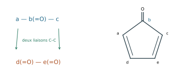
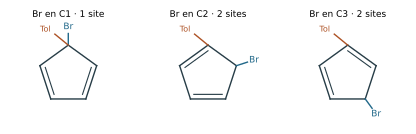
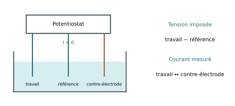
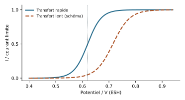
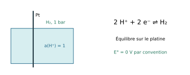
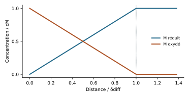
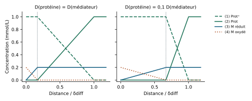
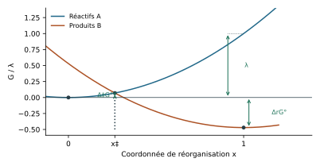
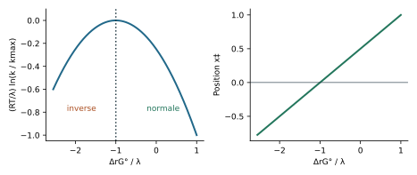
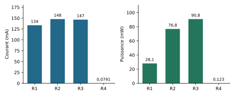

# ENS Ulm — PC, Chimie B 2018 · Corrigé brut

*Corrigé rédigé par IA, non officiel.*

**Rédaction (tour 1)** · GPT-6.2 Astra Ultra · vitesse non renseignée

Sur les 83 questions de l’épreuve, 78 sont entièrement corrigées. Les deux éditions comprennent l’intégralité des parties sur l’électrochimie de la centrine humaine et sur la cellule photovoltaïque à colorant (Q39 à Q83). Q22 ne traite que le bilan théorique en hydrures et Q23 la demi-équation organique. Le montage de préparation de Q5 et les étapes de Q19 et Q20 relatives aux intermédiaires de la cyclisation restent hors couverture. Les résultats, spectres et figures ont été confrontés aux vingt pages de l’original et au rapport du jury de chimie Ulm 2018.

## 1.1. Squelette et symétrie du rotor

### Question 1 — Protons acides de la cétone

En notant Ar le 4-bromophényle, la cétone est $\mathrm{ArCH_2{-}CO{-}CH_2Ar}$. Les **quatre hydrogènes des deux méthylènes** sont en position α du carbonyle et en position benzylique. Les deux côtés sont équivalents. L’anion se délocalise en particulier entre le carbone α et l’oxygène du carbonyle. Une petite concentration d’énolate suffit s’il est consommé dans la condensation, qui régénère la base. La formation quantitative d’énolate par l’hydroxyde n’est donc pas requise.

### Question 2 — Construction du cycle à cinq carbones

Notons $a,c$ les deux carbones α et $b$ le carbone carbonylé de la cétone $a{-}b{-}c$, puis $d,e$ les carbones de $\mathrm{ArCO{-}COAr}$. La base arrache $H_a$. Les électrons C–H forment la liaison π $a=b$ et la liaison $b=O$ se déplace sur O. Les écritures $a^-{-}b(=O)\leftrightarrow a=b(-O^-)$ représentent un seul énolate. Le doublet sur $a$ attaque $d$ et les électrons π de $d=O$ gagnent l’oxygène. La protonation de cet alcoolate donne le premier cétol.

Une énolisation analogue en $c$ puis l’attaque intramoléculaire de $c$ sur le carbonyle $e$ ferment le cycle $a{-}b{-}c{-}e{-}d$. Après protonation, $d$ et $e$ portent chacun OH. Sur chacun des deux côtés, la base arrache le dernier H en α de $b$, puis le doublet de l’énolate forme $a=d$ ou $c=e$ avec départ de $\mathrm{HO^-}$. Le carbonyle $b=O$ est conservé. Les deux condensations libèrent au total deux molécules d’eau. Dans ces écritures, chaque oxygène neutre a deux doublets libres, chaque $O^-$ en a trois et un carbone énolate figuré $C^-$ en a un.

### Question 3 — Quantité de base

La base est régénérée après les transferts de protons et les éliminations. Une quantité **catalytique** suffit en théorie. L’hydroxyde de sodium fournirait la même base active en milieu hydroalcoolique.

### Question 4 — Bandes infrarouges du rotor

La bande à **$1703\ \mathrm{cm^{-1}}$** est attribuée à l’élongation du carbonyle de la cyclopentadiénone conjuguée. Celle à **$1463\ \mathrm{cm^{-1}}$** est compatible avec les élongations du squelette aromatique des quatre groupes phényle. La conjugaison et la taille du cycle influencent la fréquence du carbonyle.

*Question 5 hors couverture.*

### Question 6 — Structure et spectres de l’alcool 5

Le carbone qui portait le carbonyle du cycle porte désormais **OH et un groupe para-tolyle**. Les deux doubles liaisons du cycle et ses quatre groupes para-bromophényle sont conservés. L’IR large à $3500\ \mathrm{cm^{-1}}$ et le singulet échangeable à 2,59 ppm appuient l’attribution d’un alcool. Le méthyle du tolyle donne le singulet de trois protons à 2,33 ppm. Les deux doublets de 2 H à 7,45 et 7,15 ppm ($J=8{,}1\ \mathrm{Hz}$) viennent des deux paires de H ortho et méta du para-tolyle. Les doublets de 4 H à 7,36 et 6,90 ppm forment une paire ($J=8{,}5$), ceux à 7,22 et 6,94 une autre ($J=8{,}6$). Ils décrivent les deux familles de deux bromophényles équivalents par symétrie. Les intégrales et les $J$ seuls ne fixent pas sans ambiguïté toutes les identités ortho/méta à l’intérieur de ces familles.

### Question 7 — Régiosélectivité de l’addition

Le carbone du carbonyle porte une forte charge partielle positive. Le nucléophile carboné magnésien, dur, privilégie ici l’addition directe **1,2** au carbonyle de la diénone plutôt qu’une addition conjuguée. L’alcool tertiaire observé et la conservation des deux C=C vérifient ce diagnostic.

### Question 8 — Flèches de l’addition au carbonyle

Dans le modèle polarisé $\mathrm{Tol^{\delta-}{-}Mg^{\delta+}Br}$, la liaison C–Mg fournit la liaison entre le carbone ipso du tolyle et le carbone carbonylé. Simultanément les électrons π de C=O se déplacent vers O. On obtient le squelette de Q6 avec $\mathrm{C{-}O^-}$ associé au magnésium. L’oxygène de l’alcoolate (trois doublets libres) capte ensuite un proton de l’espèce protique, dont la liaison O–H se rompt vers son oxygène. L’oxygène de l’alcool neutre conserve deux doublets.

### Question 9 — Ordre d’élution sur silice

À polarité d’éluant fixée, le composé le moins fortement adsorbé passe le premier. On attend généralement **4 puis 5** sur silice en dichlorométhane. Le carbonyle de 4 accepte des liaisons hydrogène avec les silanols. L’alcool de 5 peut en donner et en accepter, ce qui favorise une rétention accrue. Le para-tolyle supplémentaire et l’encombrement de l’alcool jouent en sens inverse. Le contrôle expérimental est l’ordre des $R_f$ en CCM dans le même éluant, l’espèce de plus grand $R_f$ sortant la première.

### Question 10 — Trois positions distinctes du brome

Fixons le para-tolyle en C1 et un para-bromophényle sur chacun des quatre autres carbones du cycle. Les produits sont des cyclopentadiènes portant **Br sur le carbone saturé**. Ce carbone peut être C1 (doubles liaisons C2=C3 et C4=C5), C2 (C3=C4 et C5=C1), ou C3 (C4=C5 et C1=C2). Les cas C5 et C4 se ramènent respectivement à C2 et C3 par réflexion. Aucun substituant aryle ne change de carbone.

### Question 11 — Proportions lues en RMN

Chaque produit possède un seul méthyle aromatique de trois protons. Les trois singulets entre 2,2 et 2,4 ppm ont donc des intégrales directement proportionnelles aux quantités des trois espèces. Les proportions relatives sont **20 %, 40 %, 40 %**. L’hypothèse de sites de capture voisins en réactivité associe 20 % à l’occupation unique en C1 et 40 % à chacune des deux paires, sans identifier par le seul ordre des déplacements les deux pics de même intégrale.

### Question 12 — Délocalisation et multiplicité des sites

Un doublet de l’oxygène de l’alcool capte un proton pour donner $\mathrm{C{-}OH_2^+}$ (un doublet libre sur O). Le départ de l’eau, le doublet de la liaison C–O revenant sur O, donne un cation à cinq carbones conjugués. Dans les écritures limites, une liaison π voisine se rabat vers le centre cationique et la lacune se retrouve sur l’autre extrémité de cette liaison. On peut ainsi placer la lacune sur chacun des cinq carbones. Cela ne suppose pas une stabilisation aromatique d’un cycle à quatre électrons π. Un des quatre doublets de $\mathrm{Br^-}$ forme la liaison C–Br au site cationique, le brome neutre conservant trois doublets. Les classes de sites de Q10 ont pour multiplicités 1, 2, 2. Des probabilités de capture voisines par site rendent compte du rapport observé.

### Question 13 — État d’oxydation du ruthénium

Dans $\mathrm{Ru_3(CO)_{12}}$, CO est neutre et les trois Ru ont le degré d’oxydation zéro. Dans 7, le cyclopentadiényle porte formellement $-1$, le bromure $-1$ et les deux CO zéro. L’ensemble étant neutre, **Ru passe de 0 à +II**. Ce changement correspond formellement à une addition oxydante de la liaison C–Br au centre métallique.

### Question 14 — Convergence des régioisomères

La liaison C–Br qui distinguait le carbone saturé des trois diènes a disparu au profit d’un bromure coordonné. Le même cycle aromatique cyclopentadiényle substitué se lie au métal par ses cinq carbones ($\eta^5$). Pour les trois précurseurs, l’arrangement relatif des quatre para-bromophényles et du para-tolyle est identique. Ils convergent vers le même rotor.

## 1.2. Formation du stator

### Question 15 — Transformation d’un acide en ester éthylique

Il s’agit d’une estérification de Fischer de la fonction carboxylique par l’éthanol sous catalyse acide. L’équilibre donne l’ester éthylique et l’eau. Un excès d’éthanol déplace l’équilibre du côté de l’ester. Le groupement amino de l’anneau peut se trouver protoné en milieu acide, puis retrouver sa forme neutre.

### Question 16 — Intermédiaires de l’estérification

Notons $R$ le noyau 3-amino-4-méthylphényle. Le doublet du O carbonylé de $R{-}C(=O){-}OH$ capte un proton. Les écritures $R{-}C(=OH^+){-}OH\leftrightarrow R{-}C^+(OH)_2$ décrivent l’activation électrophile. Le doublet de l’éthanol attaque C, le doublet π repart sur O. L’adduit tétraédrique $R{-}C(OH)_2(O^+H{-}Et)$ subit des transferts de proton via le solvant pour donner $R{-}C(OH)(OH_2^+)(OEt)$. Un doublet du premier OH reforme C=O pendant que la liaison à $OH_2^+$ se rompt vers O. L’eau part. La déprotonation de l’ester protoné donne $R{-}C(=O){-}OEt$ et régénère le catalyseur. Les oxygènes neutres portent deux doublets et les oxygènes à trois liaisons portant $+$ en ont un. Le centre $C^+$ de l’écriture limite porte une lacune.

### Question 17 — Acylation de l’amine aromatique

Le groupe du 3-amino-4-méthylbenzoate d’éthyle devient $-NH{-}C(=O)CH_3$ et l’ester demeure inchangé. Un doublet de $RNH_2$ attaque le carbone carbonylé de l’anhydride et les électrons π gagnent O. L’intermédiaire tétraédrique est $CH_3C(O^-)(OAc)(NH_2^+R)$. Le doublet de $O^-$ reforme C=O et la liaison C–OAc se rompt sur l’oxygène du groupe partant. L’acétate déprotone le cation amide, donnant $RNHC(O)CH_3$ et l’acide acétique. Les deux oxygènes de l’acétate sont équivalents par mésomérie. Dans les écritures de Lewis, O neutre porte deux doublets, $O^-$ trois, N amine ou amide neutre un et le N tétracoordonné positif aucun. L’amide présente aussi la forme limite $RNH^+=C(O^-)CH_3$.

### Question 18 — Lewis du nitrite organique

L’écriture neutre est $\mathrm{(CH_3)_2CHCH_2CH_2{-}O{-}N{=}O}$. Chaque O possède deux doublets libres et N un. En attribuant à l’oxygène alkoxy les deux électrons de la liaison O–N et en complétant la liaison N–O terminale, le bilan formel donne $\mathrm{RO^-}$ et $\mathrm{[N{\equiv}O]^+}$, avec un doublet libre sur chaque atome de ce dernier ion. C’est en ce sens que le réactif peut transférer un équivalent nitrosonium. Ce bilan formel n’implique pas une forte concentration d’ions libres.

*Question 19 hors couverture.*

*Question 20 hors couverture.*

### Question 21 — Produit de réduction de la fonction ester

Le carbone carbonylé devient le carbone du groupe $\mathrm{-CH_2OH}$ porté à la position 6 de l’indazole. Le produit 11 est donc le **(1H-indazol-6-yl)méthanol** dans la représentation de l’énoncé. Le noyau bicyclique et le N–H y sont conservés après traitement.

### Question 22 — Bilan formel en hydrures (partie traitée)

La réduction du groupe ester en alcool primaire requiert deux transferts formels d’hydrure, de l’ester à l’aldéhyde puis de l’aldéhyde à l’alcoolate. Quatre hydrures par unité de tétrahydruroaluminate correspondent à une demi-unité par ester pour la seule réduction. Si l’on comptabilise aussi la déprotonation du N–H de l’indazole, le bilan idéal atteint trois hydrures par substrat, soit trois quarts d’unité. Ce compte d’électrons et de protons ne suffit pas à prédire l’utilisation effective du réactif. Seul le bilan théorique est inclus.

### Question 23 — Demi-équation de transformation de l’ester (partie traitée)

Pour $R=$ indazol-6-yle, la transformation globale des espèces organiques se représente par $RCO_2Et+4H^++4e^-\longrightarrow RCH_2OH+EtOH$. Carbone, oxygène, hydrogène et charge sont conservés. Cela correspond à la diminution de quatre unités du degré d’oxydation du carbone carbonylé. Cette écriture est la demi-équation formelle du substrat. Les conditions de traitement du réactif et la spéciation de l’aluminium restent hors couverture.

### Question 24 — Substitution sur le carbone benzylique

Avec $R=$ 1H-indazol-6-yle, 12 est $R{-}CH_2Br$. Un doublet de l’oxygène de $R{-}CH_2OH$ capte un proton pour donner $R{-}CH_2OH_2^+$, dont O porte un doublet libre. Dans un chemin de substitution au carbone primaire benzylique, un doublet de $Br^-$ attaque $CH_2$ pendant que le doublet C–O revient sur O, et l’eau est libérée. Le Br lié porte trois doublets. Un caractère cationique benzylique à l’état de transition est compatible avec la stabilisation par le noyau aromatique.

### Question 25 — Rôle de la DBU et liaison carbone–soufre

Un doublet de la base DBU capte le proton de $EtSH$ et les électrons de S–H passent sur S. Le thiolate $EtS^-$ a trois doublets libres sur S. L’un attaque le carbone benzylique primaire de $R{-}CH_2Br$ pendant que C–Br se rompt vers Br, donnant le thioéther $R{-}CH_2{-}SEt$ (deux doublets sur S) et $Br^-$ (quatre doublets). C’est une substitution nucléophile bimoléculaire. La DBU fournit le nucléophile par transfert acido-basique.

### Question 26 — Bilan de formation du ligand scorpionate

Notons $HZ$ l’indazole 13. Le bilan de substitution des liaisons B–H par les azolyles est $\mathrm{KBH_4+3\,HZ\longrightarrow K[HB(Z)_3]+3\,H_2}$. Le produit secondaire est le dihydrogène. Trois des quatre H du borohydrure et les trois H initialement portés par les azotes se retrouvent dans le gaz, le quatrième H demeure sur le bore.

### Question 27 — Suivi de l’avancement

Le bilan donne $n(H_2)=3\xi$ si tous les réactifs suivent cette voie. Une mesure de quantité de gaz constitue donc un suivi indirect. On peut aussi suivre la disparition de 13 et la formation de 14 sur des analyses successives, ce qui distingue la transformation recherchée d’un dégagement gazeux parasite.

## 1.3. Assemblage et mouvement du moteur

### Question 28 — Bilan d’échange des ligands

Notons Cp le cycle substitué et $T^-$ le ligand tridentate. Le bilan est $\mathrm{CpRuBr(CO)_2+KT\longrightarrow CpRuT+KBr+2\,CO}$. Le ligand tridentate remplace deux ligands carbonyle et le bromure. Le sel $KT$ apporte aussi le contre-ion du bromure libéré.

### Question 29 — Effet entropique de la chélation

La coordination d’un ligand multidentate remplace plusieurs ligands monodentates. La libération de deux molécules de CO et du bromure accroît les possibilités de translation des espèces libérées. L’effet chélate et l’éventuelle répartition du CO dans une phase gazeuse font **attendre $\Delta_r S^\circ>0$**. Le signe exact en solution dépendrait aussi des états standard et de la solvatation.

### Question 30 — Degré d’oxydation après la chélation

Cp et le scorpionate portent chacun $-1$, les CO partis sont neutres et le bromure porte $-1$. Le complexe 15 est neutre, donc Ru y est **+II**, comme dans 7. La variation du degré d’oxydation est nulle.

### Question 31 — Activation du précatalyseur palladié

Une équation équilibrée en milieu aqueux est $\mathrm{Pd(OAc)_2+3\,PPh_3+H_2O\longrightarrow Pd(PPh_3)_2+OPPh_3+2\,HOAc}$. Deux phosphines coordonnent le palladium et une est oxydée en oxyde de phosphine. En milieu basique les deux acides acétiques se trouvent essentiellement sous forme d’acétate. L’équation est un bilan, sans préjuger des espèces successives.

### Question 32 — Rôle de l’atmosphère et du mélange

L’atmosphère inerte limite l’oxydation du palladium(0) et de la phosphine par le dioxygène. La phase organique et la phase aqueuse basique sont peu miscibles. Leur brassage accroît l’aire de contact et le transfert de matière entre les réactifs portés par les deux phases.

### Question 33 — Quatre étapes du cycle de Suzuki

1. Addition oxydante de Ar–Br sur $L_2Pd(0)$ pour former $L_2Pd^{II}(Ar)(Br)$. 2. Échange du ligand bromure contre hydroxyle pour donner $L_2Pd^{II}(Ar)(OH)$. 3. Transmétallation, le groupe $R$ passe du bore au palladium et il se forme $B(OH)_3$. 4. Élimination réductrice de Ar–R, qui régénère le palladium(0).

### Question 34 — Stœchiométrie par site de couplage

Chaque molécule de 15 comporte quatre sites, soit $80\times10^{-6}\ \mathrm{mol}$ de liaisons à faire réagir dans le bilan donné. Il y a donc cinq équivalents de partenaire boronique et dix équivalents d’hydroxyde par site. Cet excès favorise l’achèvement des quatre couplages et la base permet la conversion en espèce hydroxo. Le palladium représente 12,5 % molaires par site et peut être régénéré. Les trois équivalents de phosphine par Pd sont cohérents avec le bilan de Q31.

### Question 35 — Rotation en solution vue par RMN

À 298 K, les protons de bras du stator qui devraient percevoir différemment la pale courte donnent des environnements moyennés. La rotation est rapide à l’échelle de leur discrimination RMN et sa période est courte devant la seconde indiquée. Plus précisément, le critère de coalescence fait intervenir l’écart des fréquences des sites, inaccessible sur ce seul spectre moyenné. En refroidissant, on attend un élargissement dans le régime intermédiaire puis, si la rotation devient assez lente, des signaux distincts pour les environnements figés.

### Question 36 — Images à 77 K et 4 K

À 77 K, le rotor explore plusieurs orientations pendant l’image et son contour apparaît moyenné. À 4 K, des pales sont résolues, signe que l’orientation persiste assez longtemps pendant le balayage. Le stator demeure fixé sur l’or. Le ralentissement avec la température indique une barrière de rotation qu’une agitation thermique plus forte permet de franchir plus souvent. Deux images, sans fréquence de tentative ni mesure de durée de séjour, ne donnent pas une hauteur de barrière précise.

### Question 37 — Périodes des profils de rotation

Avec cinq ferrocényles identiques et trois bras de stator équivalents, les orientations séparées de $360^\circ/15=24^\circ$ ont la même énergie. Le tracé rouge montre **15 minima et 15 barrières équivalentes** sur un tour. La pale raccourcie enlève la symétrie d’ordre cinq, mais le stator conserve la répétition tous les $120^\circ$. Le tracé bleu conserve environ cinq puits par secteur, soit quinze sur le tour, mais leurs profondeurs et les barrières successives ne sont plus identiques. Le motif compte cinq franchissements distincts par période, répétés trois fois pour un sens de rotation choisi.

### Question 38 — Origine d’un sens de rotation privilégié

La pale raccourcie rend les interactions rotor–stator inégales selon la position, et les versants des barrières sur le tracé bleu peuvent être dissymétriques. Une excitation localisée par la pointe, placée relativement à cette pale, peut favoriser le franchissement d’une barrière dans un sens, suivi d’une relaxation vers le puits suivant. L’apport d’énergie par le courant place le système hors équilibre. Une simple asymétrie statique à l’équilibre thermique ne suffirait pas à soutenir un courant de rotation.

## 2.1. Vague du médiateur seul

### Question 39 — Montage à trois électrodes

Le potentiostat impose $E_{\rm travail}-E_{\rm référence}$ et fait circuler le courant entre l’électrode de travail et la contre-électrode. La référence est reliée à une entrée de très grande impédance et ne débite pratiquement pas. On relève le courant stationnaire pour chaque valeur du potentiel, à transport de matière reproductible, par exemple avec agitation ou rotation fixée. La courbe porte le courant d’oxydation positif en ordonnée et le potentiel par rapport à la référence en abscisse.

### Question 40 — Origine de la vague d’oxydation

À bas potentiel le médiateur, initialement tout réduit, reste essentiellement réduit à la surface et le courant est voisin de zéro. Autour de $E_M^\circ=0{,}62\ \mathrm V$, le rapport superficiel $[M_{ox}]/[M_{red}]$ augmente rapidement selon Nernst. L’écart de concentration de $M_{red}$ entre solution et électrode crée un flux croissant. À fort potentiel $[M_{red}]_{el}\simeq0$, le gradient atteint sa valeur maximale et le **transport de matière** limite le courant. Le plateau n’est pas une saturation électronique du potentiostat.

### Question 41 — Transfert électronique plus lent

Sur l’électrode lente une **surtension anodique** est nécessaire pour obtenir le même courant. La vague est repoussée vers les potentiels plus positifs et peut être plus étalée. Si la surface et la couche de diffusion sont identiques et si le domaine de potentiel permet d’y parvenir, la hauteur limite de diffusion reste identique. Le potentiel standard thermodynamique du couple n’a pas changé.

### Question 42 — Trois modes de transport

La **diffusion** provient du gradient de concentration, la **migration** du champ électrique et la **convection** du mouvement collectif du liquide. L’électrolyte support en large excès porte l’essentiel du courant ionique et accroît la conductivité. La migration du médiateur et la chute ohmique deviennent faibles, ce qui permet de relier le courant à la diffusion dans la couche de Nernst.

### Question 43 — Électrode standard à hydrogène

L’ESH se note $\mathrm{Pt\,|\,H_2}(p^\circ)\,|\,\mathrm{H^+}(a=1)$. Le platine conducteur, souvent platiné, catalyse l’équilibre $2H^++2e^-\rightleftharpoons H_2$. À l’état standard, la fugacité du gaz rapportée à 1 bar et l’activité des protons valent un. On assimile la fugacité à la pression pour le gaz idéal et l’activité à $c/c^\circ$ dans l’approximation idéale. Son potentiel standard est fixé conventionnellement à $0\ \mathrm V$. L’électrode Ag/AgCl à activité de chlorure fixée est une autre référence.

### Question 44 — Profils linéaires dans la couche de Nernst

Dans une zone sans réaction homogène ni convection, la stationnarité impose $dJ_i/dx=0$. Avec $J_i=-D_i\,dc_i/dx$ et $D_i$ constant, $d^2c_i/dx^2=0$. Le profil est affine entre l’électrode et le bord de la couche. Au-delà de $\delta_{diff}$, les concentrations sont uniformes. Une réaction localisée à l’intérieur de la couche peut séparer plusieurs portions affines.

### Question 45 — Profils sur le plateau anodique

À $0{,}80\ \mathrm V$, environ 0,18 V au-dessus de $E_M^\circ$, le rapport de Nernst dépasse $10^3$. À la précision du dessin, $[M_{red}]_{el}=0$ et $[M_{ox}]_{el}=c_M$. Pour $0\le x\le\delta_{diff}$, $[M_{red}]=c_Mx/\delta_{diff}$ et $[M_{ox}]=c_M(1-x/\delta_{diff})$, avec $c_M=2{,}0\times10^{-4}\ \mathrm{mol\,L^{-1}}$. Au-delà, les valeurs sont respectivement $c_M$ et zéro.

### Question 46 — Conservation du médiateur

Un $M_{red}$ consommé à l’électrode donne un $M_{ox}$. Les flux vérifient donc $J_{red}=-J_{ox}$, avec $J_{red}<0$ lors de l’oxydation. Comme les deux coefficients de diffusion sont égaux, la somme des gradients est nulle. La somme des concentrations vaut partout sa valeur en solution, d’où **$[M_{red}]_{el}+[M_{ox}]_{el}=[M_{red}]_S$** quand aucun oxydant n’est présent au loin.

### Question 47 — Courants limites du médiateur seul

Avec $c_M=0{,}200\ \mathrm{mol\,m^{-3}}$, $S=10^{-6}\ \mathrm{m^2}$, $D_M=10^{-9}\ \mathrm{m^2\,s^{-1}}$ et $\delta=5\times10^{-6}\ \mathrm m$, $I_{l,ox}=FSD_Mc_M/\delta=\mathbf{3{,}86\times10^{-6}\ \mathrm{A}}$. Au loin il n’y a aucune forme oxydée pour alimenter durablement une réduction. Le courant limite de réduction du médiateur est **nul** dans ces conditions stationnaires.

### Question 48 — Partage superficiel à 0,67 V

La loi de Nernst donne $r=[M_{ox}]_{el}/[M_{red}]_{el}=\exp[F(E-E_M^\circ)/(RT)]\simeq7{,}01$. Il vient $[M_{red}]_{el}=c_M/(1+r)\simeq2{,}50\times10^{-5}\ \mathrm{mol\,L^{-1}}$ et $[M_{ox}]_{el}=r c_M/(1+r)\simeq1{,}75\times10^{-4}\ \mathrm{mol\,L^{-1}}$.

### Question 49 — Courant au milieu de la vague

$I=FSD_M(c_M-[M_{red}]_{el})/\delta=I_{l,ox}r/(1+r)$. À $0{,}67\ \mathrm V$, $I\simeq\mathbf{+3{,}38\times10^{-6}\ \mathrm{A}}$, soit environ 87,5 % du courant limite. Le signe positif correspond à une oxydation.

## 2.2. Catalyse redox et centrine

### Question 50 — Les quatre profils de la figure 17

**(1) représente $Prot^+$, (2) $Prot$, (3) $M_{red}$, (4) $M_{ox}$.** Au loin, seules les formes réduites ont été introduites et la protéine est la plus concentrée des deux. À l’électrode sur le plateau, $M_{red}$ est consommé et $M_{ox}$ produit. La forme $Prot^+$ diffuse depuis le front de réaction vers la solution, tandis que $Prot$ y est consommée.

### Question 51 — Profil de la protéine à travers le front

Dans $\delta_R<x<\delta_{diff}$, $Prot$ diffuse depuis la solution vers le front, où sa concentration devient quasi nulle à cause de la réaction supposée instantanée. $Prot^+$ y est produite et diffuse vers le volume, avec un profil décroissant. En deçà du front, l’oxydation directe de la protéine à l’électrode étant négligeable, aucun flux protéique stationnaire ne traverse cette région. Les profils sont donc plats, $[Prot]\simeq0$ et $[Prot^+]\simeq c_P$ pour les coefficients de diffusion retenus.

### Question 52 — Continuité des débits au front

$M_{ox}$ arrive du côté de l’électrode, $Prot$ du côté du volume. Chaque événement produit un $M_{red}$ repartant vers l’électrode et un $Prot^+$ repartant vers le volume. En notant $-$ et $+$ les limites gauche et droite en $\delta_R$, **$J_{M_{ox}}^-=-J_{Prot}^+=-J_{M_{red}}^-=J_{Prot^+}^+>0$**. Une inégalité entre leurs modules entraînerait une accumulation à un front supposé stationnaire.

### Question 53 — Position du front

Sur le plateau, le médiateur parcourt $\delta_R$ avec un écart de concentration $c_M$ et la protéine parcourt $\delta_{diff}-\delta_R$ avec un écart $c_P$. Ainsi $D_Mc_M/\delta_R=D_Pc_P/(\delta_{diff}-\delta_R)$, soit **$\delta_R/\delta_{diff}=D_Mc_M/(D_Mc_M+D_Pc_P)$**. Avec $D_M=D_P$ et $c_P=5c_M$, le front est à un sixième de la couche, soit $0{,}833\times10^{-6}\ \mathrm{m}$ pour $5\times10^{-6}\ \mathrm{m}$.

### Question 54 — Augmentation du courant limite

La réaction homogène régénère $M_{red}$ au front. La même variation $c_M$ se fait sur $\delta_R<\delta_{diff}$, ce qui accroît le flux vers l’électrode. Le facteur d’amplification est $\delta_{diff}/\delta_R=1+D_Pc_P/(D_Mc_M)$, soit **6** pour les coefficients identiques et les concentrations indiquées.

### Question 55 — Valeur et sens de la catalyse redox

$I_{l,ox}=FS(D_Mc_M+D_Pc_P)/\delta_{diff}=6\times3{,}86=\mathbf{23{,}2\times10^{-6}\ \mathrm{A}}$. L’électrode oxyde rapidement le médiateur et la protéine le réduit de nouveau. Le bilan supplémentaire est $Prot\longrightarrow Prot^++e^-$, dont la voie directe est lente. Le médiateur est régénéré et accélère la transmission des électrons. Le courant inclut aussi l’apport du médiateur réduit venu du volume.

### Question 56 — Diffusion de la centrine et du complexe

À température et viscosité fixées, $D\simeq k_BT/(6\pi\eta r_h)$. La centrine humaine est une protéine globulaire dont le rayon hydrodynamique et le frottement sont plus grands que ceux du petit complexe tris(bipyridine) d’osmium. Sa diffusion est donc plus lente. La masse seule ne détermine pas le coefficient de diffusion.

### Question 57 — Front et courant avec une protéine moins mobile

Avec $D_P=0{,}1D_M$ et $c_P=5c_M$, $D_Pc_P=0{,}5D_Mc_M$. Alors $\delta_R=(2/3)\delta_{diff}=\mathbf{3{,}33\times10^{-6}\ \mathrm{m}}$ et $I_{l,ox}=1{,}5I_{l,ox}^{M\ seul}=\mathbf{5{,}79\times10^{-6}\ \mathrm{A}}$. Le front s’éloigne de l’électrode et l’amplification diminue. Les profils de Q50 conservent leurs concentrations extrêmes, mais les deux rampes du médiateur s’étalent sur les deux premiers tiers et celles de la protéine occupent le dernier tiers. La figure compare les deux situations sur les mêmes échelles.

### Question 58 — Sélectivité d’un capteur de centrine

Tout composé cellulaire capable de réduire le médiateur peut contribuer au courant. L’encrassement de la surface et les variations locales de transport compliquent aussi l’étalonnage. Une reconnaissance sélective de la centrine, par exemple par un élément d’affinité immobilisé, doit être couplée à la détection électrochimique. Le potentiel de mesure, la réponse d’un témoin sans reconnaissance et la comparaison avec des interférents permettent de vérifier la sélectivité. Une surface limitant l’adsorption non spécifique et une géométrie compatible avec le milieu observé sont également nécessaires. Le modèle idéal du front de diffusion ne suffit pas pour convertir un courant cellulaire brut en concentration de centrine.

## 3.1. Composants de la cellule à colorant

### Question 59 — Sens du courant et rôle des électrodes

L’électrode 1 porte $TiO_2$ et le colorant. Après excitation, elle reçoit l’électron du colorant et le fournit au circuit extérieur. C’est la **photoanode**, où se produit l’oxydation du colorant dans le cycle. À l’électrode 2, $R_{ox}$ capte un électron et donne $R_{red}$, c’est la **cathode**. Dans la résistance les électrons circulent de 1 vers 2 et le courant conventionnel de 2 vers 1. Le circuit intérieur se ferme par le transport ionique et le médiateur.

### Question 60 — Lewis du thiocyanate

Deux écritures principales sont $\mathrm{^{-}S{-}C{\equiv}N}\leftrightarrow\mathrm{S{=}C{=}N^-}$. Dans la première, S a trois doublets libres et N un. Dans la seconde chacun en a deux. Le carbone central n’a aucun doublet libre et l’ion est linéaire. Les deux extrémités possèdent un doublet donneur, ce qui permet l’ambidentation. Dans le colorant du sujet, la liaison au ruthénium se fait par N.

### Question 61 — Titane atomique et titane(IV)

Pour $Z=22$, le titane neutre a la configuration **$[Ar]\,3d^2\,4s^2$**. Dans $TiO_2$, deux oxygènes à $-II$ imposent Ti à **+IV** dans le bilan neutre. Le comptage ionique conduit à un centre $d^0$.

### Question 62 — Apport du colorant au spectre d’action

Le dioxyde de titane seul possède une bande interdite assez large, de l’ordre de 3 eV, et son efficacité tombe presque à zéro au-delà du proche UV. L’ion Ti(IV) $d^0$ ne dispose pas de transitions $d$–$d$ de valence capables de couvrir le visible. Le colorant élargit la réponse dans le visible, à près de 75–80 % dans une partie du domaine, avec une décroissance vers le proche infrarouge. Un bon sensibilisateur doit absorber intensément une large fraction du flux solaire, rester fixé et photostable, injecter rapidement l’électron depuis l’état excité et être régénéré efficacement.

### Question 63 — Ancrage du colorant

Les groupes acide carboxylique/carboxylate du ligand polypyridinique servent d’ancrage. Après déprotonation, un oxygène donne un doublet à un site superficiel Ti(IV), acide de Lewis. Un carboxylate peut se fixer par une liaison ou par ses deux oxygènes, éventuellement en pont entre deux Ti. Des liaisons hydrogène avec les hydroxyles de surface peuvent aussi contribuer. Le dessin du complexe seul ne fixe pas une géométrie interfaciale unique.

## 3.2. Vitesse de transfert et théorie de Marcus

### Question 64 — Constante du pseudo-équilibre

Pour des activités rapportées à l’état standard, $\Delta^\ddagger G^\circ=-RT\ln K^\ddagger$, donc **$K^\ddagger=\exp[-\Delta^\ddagger G^\circ/(RT)]$**. La constante de pseudo-équilibre est sans dimension.

### Question 65 — Vitesse de formation des produits

Le pseudo-équilibre est supposé établi entre les réactifs et le complexe activé. Avec $a_i=[i]/c^\circ$, $K^\ddagger=a_{AB^\ddagger}/(a_Aa_B)$ implique $[AB^\ddagger]=K^\ddagger[A][B]/c^\circ$. Sa conversion en produits est de premier ordre, $v=
u^\ddagger[AB^\ddagger]$. On trouve **$k=(
u^\ddagger/c^\circ)\exp[-\Delta^\ddagger G^\circ/(RT)]$** et $v=k[A][B]$. Pour des concentrations en mol/L, $k$ s’exprime en $\mathrm{L\,mol^{-1}\,s^{-1}}$.

### Question 66 — Deux paraboles près de l’équilibre

Au voisinage d’un minimum stable $x_0$, $G(x)\simeq G(x_0)+\tfrac12G''(x_0)(x-x_0)^2$ puisque $G'(x_0)=0$ et $G''(x_0)>0$. On modélise la réorganisation de la structure et du solvant par deux telles paraboles. Le choix d’une même courbure $2\lambda$ pour les deux états est une hypothèse supplémentaire, utile tant que l’approximation harmonique reste acceptable.

### Question 67 — Écart entre minima

Les réactifs équilibrés occupent le minimum de A à $x=0$ et les produits équilibrés celui de B à $x=1$. Dans les états standard choisis, **$\Delta_rG^\circ=G_B(1)-G_A(0)=G_B^{eq}-G_A^{eq}$**. Une différence mesurée à une abscisse imposée à la fois à A et B comprendrait un terme de réorganisation.

### Question 68 — Énergie libre et potentiels redox

Le donneur $Red_1$ s’oxyde et l’accepteur $Ox_2$ se réduit. La tension standard de la réaction écrite est $E_2^\circ-E_1^\circ$. Pour un électron, **$\Delta_rG^\circ=-F(E_2^\circ-E_1^\circ)$**. Un accepteur de potentiel plus haut rend donc le transfert favorable dans le sens indiqué.

### Question 69 — Lire les quatre grandeurs de Marcus

L’intersection $G_A(x^\ddagger)=G_B(x^\ddagger)$ fixe l’abscisse de transition. La barrière est $G_A(x^\ddagger)-G_A(0)$, la variation réactionnelle $G_B(1)-G_A(0)$ et la réorganisation $\lambda=G_A(1)-G_A(0)=G_B(0)-G_B(1)$. Le dessin indique séparément les différences d’ordonnées et leur origine. Une valeur absolue d’ordonnée à l’intersection dépendrait du choix du zéro.

### Question 70 — Relations de Marcus

L’égalité $G_A^{eq}+\lambda (x^\ddagger)^2=G_B^{eq}+\lambda(x^\ddagger-1)^2$ donne $\lambda(2x^\ddagger-1)=\Delta_rG^\circ$. Ainsi **$x^\ddagger=(\lambda+\Delta_rG^\circ)/(2\lambda)$** et **$\Delta^\ddagger G^\circ=\lambda(x^\ddagger)^2=(\lambda+\Delta_rG^\circ)^2/(4\lambda)$**. L’énergie de réorganisation est positive et les deux énergies doivent être exprimées dans la même unité.

### Question 71 — Variation de la barrière

À $\lambda$ fixée, $d\Delta^\ddagger G^\circ/d\Delta_rG^\circ=(\lambda+\Delta_rG^\circ)/(2\lambda)=\mathbf{x^\ddagger}$. La dérivée s’annule pour $\Delta_r G^\circ=-\lambda$ et change alors de signe.

### Question 72 — Courbe de vitesse

À température et préfacteur fixes, $\ln[k/(
u^\ddagger/c^\circ)]=-(\lambda+\Delta_rG^\circ)^2/(4\lambda RT)$. La courbe de $\ln k$ est donc une parabole tournée vers le bas, centrée en $-\lambda$. Au sommet $k=
u^\ddagger/c^\circ$. La figure utilise une vitesse normalisée pour prendre le logarithme d’un rapport sans dimension.

### Question 73 — Région normale et région inverse

Pour $\Delta_rG^\circ>-\lambda$ (région normale), rendre la réaction plus favorable abaisse sa barrière et augmente $k$. Pour $\Delta_rG^\circ<-\lambda$ (région inverse), la même évolution éloigne du sommet et ralentit le transfert. À la frontière **$\Delta_rG^\circ=-\lambda$**, la barrière du modèle s’annule. La thermodynamique et la cinétique répondent donc différemment au-delà de la frontière.

### Question 74 — Position de l’état de transition et postulat de Hammond

$x^\ddagger=1/2+\Delta_rG^\circ/(2\lambda)$ est une droite de pente positive. Elle passe par $(-\lambda,0),(0,1/2),(\lambda,1)$. Dans la partie normale où l’intersection se situe entre les minima, une réaction plus exergonique a un état de transition plus précoce et plus proche des réactifs. Une réaction endergonique le rapproche des produits. C’est l’analogie avec Hammond. À l’extrême du modèle, une intersection peut se trouver en dehors de l’intervalle $[0,1]$.

## 3.3. Courant, tension et puissance

### Question 75 — Forces motrices des cinq transferts

$\Delta_rG^\circ=F(E_D^\circ-E_C^\circ)$ pour le donneur D. En $\mathrm{kJ\,mol^{-1}}$, on trouve respectivement **$-149{,}55$** pour $TiO_{2,red}$, **$-129{,}29$** pour R1, **$-99{,}38$** pour R2, **$-89{,}73$** pour R3 et **0** pour R4. Dans le dernier cas les potentiels standard des deux couples sont égaux.

### Question 76 — Vitesses de recombinaison et de régénération

Avec $\lambda=100\ \mathrm{kJ\,mol^{-1}}$ et $RT=2{,}478\ \mathrm{kJ\,mol^{-1}}$, les barrières dans l’ordre Ti, R1, R2, R3, R4 valent $6{,}14$, $2{,}145$, $0{,}00096$, $0{,}264$ et $25{,}0\ \mathrm{kJ\,mol^{-1}}$. Pour $c^\circ=1\ \mathrm{mol\,L^{-1}}$, **$k_4=8{,}39\times10^{10}$** et les quatre **$k_5=(4{,}21\times10^{11},1{,}00\times10^{12},8{,}99\times10^{11},4{,}15\times10^7)$** en $\mathrm{L\,mol^{-1}\,s^{-1}}$. Le médiateur R2 a la plus petite barrière de régénération et fournit le courant maximal à activités égales.

### Question 77 — Lecture indépendante du graphe des croisements

Sur le détail de la figure 22, le croisement avec la courbe du médiateur **R2** est pratiquement au minimum de la parabole des réactifs. Celui de R3 est proche mais un peu plus haut, celui de R1 plus haut encore. R4 présente une barrière beaucoup plus grande. La recombinaison étant commune, la plus petite barrière de régénération favorise la collecte de courant.

### Question 78 — Efficacité de la régénération

L’efficacité $\eta=v_5/(v_4+v_5)$ vaut $k_5[R_{red}]/(k_4[TiO_{2,red}]+k_5[R_{red}])$ dans la représentation bimoléculaire du sujet. Les états standard rendent les facteurs de concentration réduite égaux, d’où $\eta=k_5/(k_4+k_5)$. Pour R1, R2, R3, R4, **$\eta=0{,}834;\ 0{,}923;\ 0{,}915;\ 4{,}94\times10^{-4}$**. Ces grandeurs sont des fractions entre zéro et un.

### Question 79 — Courants obtenus sous irradiation

Lorsque $k_2\ll k_3$, l’injection suit pratiquement chaque photon absorbé. Le débit collecté est $\eta\Phi S$ électrons par seconde. Le courant vaut $I=e\Phi S\eta=0{,}1602\eta\ \mathrm A$. Pour R1 à R4, **$I=133{,}6;\ 147{,}8;\ 146{,}5;\ 0{,}0791\ \mathrm{mA}$** pour $1\ \mathrm{cm^2}$. Le flux donné est déjà un flux de photons absorbés.

### Question 80 — Tensions de la cellule idéale

Le côté où se réduit le médiateur est au potentiel $E_R^\circ$, celui du semi-conducteur au potentiel $E_T^\circ$. La tension du modèle standard vaut donc $U=E_R^\circ-E_T^\circ$. Pour R1 à R4, **$U=0{,}21;\ 0{,}52;\ 0{,}62;\ 1{,}55\ \mathrm V$**. Les pertes sous charge et les surtensions ne sont pas prises en compte.

### Question 81 — Puissances et compromis entre I et U

Dans les hypothèses du sujet, $P=UI$ donne **28,0 mW pour R1, 76,9 mW pour R2, 90,8 mW pour R3, 0,123 mW pour R4**. R2 maximise le courant mais R3 donne la plus grande puissance grâce à sa tension plus élevée pour un courant voisin. L’avantage de tension de R4 est largement annulé par son très faible courant. Ces puissances représentent le modèle simplifié du problème.

### Question 82 — Critères pour le couple colorant–médiateur

Le colorant doit absorber une large part de la lumière incidente, être solidement ancré et injecter son électron avant désexcitation. Son potentiel après excitation doit permettre l’injection. Le médiateur doit le régénérer assez vite pour concurrencer la recombinaison, tout en conservant une tension utile. La réorganisation et la force motrice déterminent ensemble la vitesse. La stabilité des deux composants pendant de nombreux cycles est indispensable.

### Question 83 — Passage du rendement de laboratoire au module

Il faut considérer la durée de fonctionnement sous lumière, chaleur, humidité et cycles thermiques, l’étanchéité du module, la stabilité du colorant et de l’électrolyte, ainsi que la tenue des contacts. Comptent aussi la disponibilité et le prix des métaux et des matériaux, l’énergie de fabrication, le rendement sur grande surface, la cadence industrielle et le recyclage. Un rendement de conversion ponctuel ne donne pas à lui seul le coût par kilowattheure produit sur la durée de vie. Les pourcentages de rendement cités dans la question sont ceux de l’énoncé de 2018.
