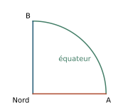
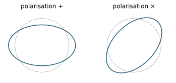
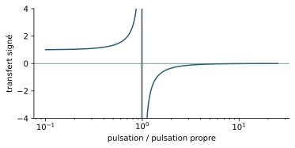
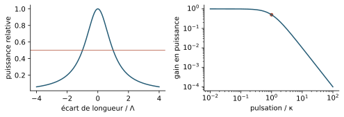
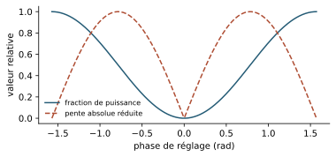
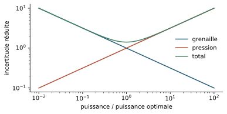

# ENS Ulm PC 2018 — Physique C · Corrigé guidé

*Corrigé rédigé par IA, non officiel. Signalez toute erreur.*

**Lecture du rapport du jury** · GPT-6.2 Astra Ultra · vitesse non renseignée

**Rédaction** · GPT-6.2 Astra Ultra · vitesse non renseignée

## Détection interférométrique d’ondes gravitationnelles

## Géométrie et moments d’une source

### Question 1 — Triangle de grands cercles

**Indication.** Identifier d’abord la latitude atteinte au premier virage.

Le premier arc de $10\,000\,\mathrm{km}$ est un quart du périmètre terrestre. Le marcheur atteint l’équateur. Après le virage, il suit l’équateur sur un quart de tour et peut regagner le pôle par un autre méridien de $10\,000\,\mathrm{km}$, distance minimale. Sur le plan, les deux étapes orthogonales donneraient une diagonale de retour de $10\,000\sqrt2\simeq14\,100\,\mathrm{km}$.

### Question 2 — Élément de longueur sur la sphère

**Indication.** Le rayon du parallèle de colatitude donnée vaut le sinus de cette colatitude.

À rayon unité constant, $d\mathbf r=\mathbf e_\theta d\theta+\mathbf e_\varphi\sin\theta\,d\varphi$. Les vecteurs de base sont orthogonaux, donc $dl^2=d\theta^2+\sin^2\theta\,d\varphi^2=d\mathbf v^{\mathsf T}g\,d\mathbf v$ avec $g=\operatorname{diag}(1,\sin^2\theta)$. Intégrer la racine le long de la courbe donne sa longueur.

### Question 3 — Exemple transverse

**Indication.** Préciser quelle grandeur oscille et par rapport à quelle direction.

Une onde électromagnétique plane dans le vide possède des champs électrique et magnétique tous deux perpendiculaires à son vecteur d’onde. Une onde sur une corde tendue, dans l’approximation des petits déplacements normaux, en est un autre exemple.

### Question 4 — Développement de la distance

**Indication.** Développer une racine de scalaire après avoir formé le produit quadratique.

Posons $s=dx^2+dy^2$ et $u=h_{xx}dx^2+(h_{xy}+h_{yx})dx\,dy+h_{yy}dy^2$. Le scalaire $u/s$ est de l’ordre de $h$ pour un déplacement non nul. Alors $dl=\sqrt s(1+u/s)^{1/2}=\sqrt s+u/(2\sqrt s)+O(h^2\sqrt s)$, où $u=d\mathbf r^{\mathsf T}h\,d\mathbf r$.

### Question 5 — Mesure le long de x

**Indication.** Projeter la métrique sur le déplacement réel des deux points.

Pour $dy=0$ on trouve $dl=(1+h_{xx}/2)|dx|$ au premier ordre. La composante étant uniforme le long du trajet, $L=L_0(1+h_{xx}/2)$. Une mesure selon $x$ ne sonde directement que cette composante.

### Question 6 — Propagation plane

**Indication.** Distinguer pulsation et fréquence dans la conversion en longueur d’onde.

L’équation de d’Alembert donne $\Omega^2=c^2k^2$. Les vitesses de phase et de groupe valent $\Omega/k=d\Omega/dk=c$ sur la branche positive. La longueur d’onde est $\lambda=2\pi/k=2\pi c/\Omega$.

### Question 7 — Signification des moments

**Indication.** Interpréter la moyenne des positions pondérée par les masses.

$M=\sum m_n$ est la masse totale et $\mathbf D/M$ est le vecteur position du centre de masse. Les composantes de $Q$ sont des moments de masse du second ordre, homogènes à un moment d’inertie, de dimension $\mathrm{kg\,m^2}$.

### Question 8 — Développement du champ exact

**Indication.** Garder le produit du terme linéaire du dénominateur par celui du numérateur au second ordre.

Le champ vaut $\mathbf g=-G\sum_n m_n(\mathbf R-\mathbf r_n)/|\mathbf R-\mathbf r_n|^3$. Notons $\mathbf u=\mathbf R/R$ et $z_n=\mathbf u\cdot\mathbf r_n$. Le développement du facteur sans dimension du dénominateur donne $1+3z_n/R+(15z_n^2-3r_n^2)/(2R^2)$. En regroupant après multiplication, $\mathbf g=-G\sum_n(m_n/R^2)[\mathbf u+(3z_n\mathbf u-\mathbf r_n)/R+((15z_n^2-3r_n^2)\mathbf u/2-3z_n\mathbf r_n)/R^2]+O(GMr^3/R^5)$ pour une taille caractéristique $r$.

### Question 9 — Composantes des multipôles

**Indication.** Projeter chaque ordre sur les trois axes, puis identifier la définition d’un élément du quadrupôle.

Pour $\mathbf u=\mathbf e_z$ on lit $g_x=GD_x/R^3+3GQ_{xz}/R^4$ puisque $Q_{xz}=\sum m_nx_nz_n$. De même $g_y=GD_y/R^3+3GQ_{yz}/R^4$. Dans la composante axiale, le coefficient du second ordre est $\sum m_n(9z_n^2-3r_n^2)/2=9Q_{zz}/2$. Ainsi $g_z=-GM/R^2-2GD_z/R^3-9GQ_{zz}/(2R^4)$.

### Question 10 — Hiérarchie à grande distance

**Indication.** Comparer des contributions avec les mêmes unités en prenant leurs rapports.

À des facteurs géométriques près, $D\sim Mr$ et $Q\sim Mr^2$. Les termes dipolaire et quadrupolaire sont donc relativement au monopôle de l’ordre de $r/R$ et $(r/R)^2$, tous deux petits. Au centre de masse pris comme origine le dipôle de masse s’annule exactement.

### Question 11 — Puissance du rayonnement dipolaire

**Indication.** Obtenir les dimensions de la permittivité à partir d’une loi indépendante.

La propagation retardée introduit $c$ et le couplage entre charges et champ introduit $\epsilon_0$. Par la loi de Coulomb, $[1/\epsilon_0]=\mathrm{kg\,m^3/(C^2s^2)}$ et $[\ddot D_q]=\mathrm{C\,m/s^2}$. Le produit $|\ddot{\mathbf D}_q|^2/(\epsilon_0c^3)$ a donc pour unité $\mathrm{kg\,m^2/s^3}$, celle d’une puissance.

### Question 12 — Champ rayonné au loin

**Indication.** Relier la conservation de puissance au flux moyen sur une sphère.

Le flux d’une onde localement plane est d’ordre $\epsilon_0cE^2$. À facteur angulaire près, sa puissance à rayon $R$ est donc d’ordre $R^2\epsilon_0cE^2$. L’identification à la puissance dipolaire donne $E\sim|\ddot{\mathbf D}_q|/(\epsilon_0 c^2 R)$, avec la dérivée évaluée au temps retardé.

### Question 13 — Disparition des deux premiers termes

**Indication.** Appliquer le théorème du centre d’inertie à la distribution entière.

Les masses individuelles étant constantes, $M$ est constant et $\ddot M=0$. De plus $\mathbf D=M\mathbf r_G$. L’isolement impose $M\ddot{\mathbf r}_G=0$, donc $\ddot{\mathbf D}=0$, même si chaque masse est accélérée par les autres. Aucune de ces conservations n’impose $\ddot Q=0$.

### Question 14 — Grandeurs physiques pertinentes

**Indication.** Transposer séparément le rôle de la source, du couplage et de la propagation.

Le quadrupôle est le premier moment dont la dérivée seconde peut varier pour cette source isolée. $G$ mesure l’interaction de la matière avec le champ, $c$ fixe la propagation et les échelles relativistes, et la dilution du rayonnement en champ lointain introduit le facteur géométrique $1/R$ en amplitude. Les composantes observées dépendent également de la direction.

### Question 15 — Amplitude sans dimension

**Indication.** Imposer la décroissance en distance du champ rayonné avant d’équilibrer les dimensions.

$[G\ddot Q]=\mathrm{m^5/s^4}$ tandis que $[Rc^4]=\mathrm{m^5/s^4}$. Le rapport $G\ddot Q/(Rc^4)$ est donc sans dimension comme une variation relative de métrique. Le facteur numérique et la projection transverse demandent les équations du rayonnement.

## Binaire et signal GW150914

### Question 16 — Rotation des deux masses

**Indication.** Utiliser le rayon pour la cinématique et le diamètre pour la force mutuelle.

La distance entre les masses est $2r$. L’accélération centripète vérifie $m\Omega^2r=Gm^2/(2r)^2$. Ainsi $r=(Gm/(4\Omega^2))^{1/3}$ et $v=r\Omega=(Gm\Omega/4)^{1/3}$. Le calcul newtonien exige $Gm\Omega/(4c^3)\ll1$.

### Question 17 — Énergie orbitale

**Indication.** Compter chaque corps pour l’énergie cinétique et la paire une seule fois pour l’énergie d’interaction.

$E_c=2mv^2/2=Gm^2/(4r)$, tandis que l’unique paire possède $E_p=-Gm^2/(2r)=-2E_c$ avec origine à l’infini. Le système est lié, $E_c+E_p=-Gm^2/(4r)$. Les rapports à $2mc^2$ sont $v^2/(2c^2)$ et $-v^2/c^2$, petits en régime non relativiste.

### Question 18 — Quadrupôle tournant

**Indication.** Utiliser les formules d’angle double avant de dériver.

Notons $C=\cos(2\Omega t)$ et $S=\sin(2\Omega t)$. La somme des deux dyadiques est le double de celui d’une masse. On obtient $Q=mr^2\begin{pmatrix}1/3+C&S&0\\S&1/3-C&0\\0&0&-2/3\end{pmatrix}$. Une double dérivation donne $\ddot Q=-4mr^2\Omega^2\begin{pmatrix}C&S&0\\S&-C&0\\0&0&0\end{pmatrix}$. Les traces des deux matrices sont nulles.

### Question 19 — Deux polarisations

**Indication.** Projeter la dérivée seconde du quadrupôle perpendiculairement à la direction d’observation.

Posons $H=8Gmr^2\Omega^2/(Rc^4)$ et $u=2\Omega(t-R/c)$. Alors $h_+=-H\cos u$ et $h_\times=-H\sin u$. Les éléments transverses sont $h_{xx}=-h_{yy}=h_+$ et $h_{xy}=h_{yx}=h_\times$, ce qui donne la décomposition sur les deux matrices du sujet.

### Question 20 — Fréquence gravitationnelle

**Indication.** Repérer la plus petite rotation qui reproduit le quadrupôle.

La pulsation du rayonnement est $2\Omega$, donc $\nu=\Omega/\pi$, deux fois la fréquence orbitale. Une rotation des masses de $\pi$ laisse inchangée la distribution de masse de cette binaire égale.

### Question 21 — Amplitudes égales

**Indication.** Exploiter la symétrie de rotation autour de la ligne de visée.

Les deux composantes sont de même amplitude $H$ et en quadrature temporelle. Vue selon l’axe de l’orbite circulaire, la source n’a aucune direction transverse privilégiée après changement de phase orbitale. Une rotation de la base transverse de $45^\circ$ échange les deux motifs de polarisation à un signe près, d’où l’égalité attendue.

### Question 22 — Propagation à travers la source

**Indication.** Former un rapport de longueurs qui fasse apparaître la vitesse orbitale.

$\lambda=c/\nu=\pi c/\Omega$, donc $r/\lambda=v/(\pi c)\ll1$. Le temps de traversée de la source est très court devant la période orbitale. Le champ interne qui détermine les trajectoires peut ainsi être traité au premier ordre comme instantané, comme dans l’approximation des régimes quasi stationnaires en électrocinétique.

### Question 23 — Évolution du signal

**Indication.** Ne pas traiter le rayon et la pulsation comme deux paramètres indépendants.

À masse fixée, $r\propto\Omega^{-2/3}$ et $H\propto r^2\Omega^2\propto\Omega^{2/3}$. L’augmentation conjointe de la fréquence et de l’amplitude est donc cohérente avec une orbite qui se resserre et tourne plus vite. L’énergie orbitale $-Gm^2/(4r)$ diminue, les ondes emportant de l’énergie. La fusion puis la relaxation du trou noir final font rapidement disparaître cette modulation binaire.

### Question 24 — Amplitude de GW150914

**Indication.** Utiliser la plus grande fréquence mesurée pour évaluer le maximum du modèle orbital.

À $\nu=150\,\mathrm{Hz}$, $\Omega=\pi\nu$, $m=30\times1{,}99\times10^{30}\,\mathrm{kg}$ et $R=440\times3{,}09\times10^{22}\,\mathrm m$. On trouve $r=1{,}65\times10^5\,\mathrm m$ puis $\bar h_{+,\max}=\bar h_{\times,\max}=1{,}75\times10^{-21}$. Ce modèle idéal rend l’ordre de grandeur de la déformation lue sur le signal de la figure 3.

### Question 25 — Variation de longueur

**Indication.** Employer la composante de la métrique dans la direction de chacun des bras.

Les bras axiaux mesurent $\delta L_x=L_0h_+/2$ et $\delta L_y=-L_0h_+/2$. Le terme croisé ne contribue pas sur ces axes. Pour $4000\,\mathrm m$, l’extension maximale calculée est $3{,}49\times10^{-18}\,\mathrm m$, quelques centaines de fois plus petite qu’une longueur nucléaire typique de $10^{-15}\,\mathrm m$.

## Suspension et cavité optique

### Question 26 — Miroir suspendu et force externe

**Indication.** Écrire la projection horizontale de la dynamique avec l’angle du fil.

Pour un petit angle $x/\ell$, la composante de rappel est $-Mgx/\ell$. Avec $\omega_0^2=g/\ell$, $\ddot x+\omega_0^2x=Fe^{i\omega t}/M$ et $x_0=F/[M(\omega_0^2-\omega^2)]$. À haute fréquence $x_0\simeq-F/(M\omega^2)$, la réponse d’une masse libre. À résonance idéale le modèle sans amortissement n’admet pas de solution stationnaire bornée.

### Question 27 — Excitation par le support

**Indication.** Exprimer l’angle par le déplacement relatif au support et l’accélération par la position absolue.

Dans le référentiel du laboratoire la position absolue reste $x$, mais l’inclinaison du fil est $(x-x_f)/\ell$. Sans force externe on obtient $M\ddot x=-M\omega_0^2(x-x_f)$. Le forçage équivalent dans l’équation du pendule à support fixe est donc $M\omega_0^2 a e^{i\omega t}$.

### Question 28 — Filtre mécanique

**Indication.** Examiner le signe et la puissance de la fréquence de part et d’autre de la résonance.

$H_1=x_0/a=1/[1-(\omega/\omega_0)^2]$. Il vaut 1 à basse fréquence, diverge à la résonance idéale et tend vers zéro par valeurs négatives comme $-(\omega_0/\omega)^2$. C’est un passe-bas du deuxième ordre. La pulsation propre doit être bien inférieure aux vibrations à filtrer. Pour $N$ étages idéalisés, le gain asymptotique en module décroît en $\omega^{-2N}$.

### Question 29 — Porteuse monochromatique

**Indication.** Distinguer la variation rapide de porteuse de celle de son enveloppe.

L’enveloppe incidente est constante, si bien que l’onde est monochromatique. Dans le vide, $k=2\pi/\lambda$, $\mathbf k=k\mathbf e_x$ pour le faisceau incident et $\omega=2\pi c/\lambda$.

### Question 30 — Superposition au miroir d’entrée

**Indication.** Pour chaque côté, identifier l’onde transmise et l’onde réfléchie.

Les deux champs incidents contribuent indépendamment à chacun des champs sortants. À $x=0$, $E_o=\rho E_i+\tau' E_b$ et $E_c=\tau E_i+\rho'E_b$. Ce sont des amplitudes complexes, à sommer avant de prendre une intensité.

### Question 31 — Miroir sans pertes

**Indication.** Faire varier la phase relative des deux ondes incidentes pour isoler le terme croisé.

L’identité $|E_i|^2+|E_b|^2=|E_o|^2+|E_c|^2$ doit être vraie pour toute amplitude et toute phase relative. Les termes carrés imposent $\rho^2+\tau^2=1$ et $\rho'^2+\tau'^2=1$. Le terme d’interférence impose $\rho\tau'+\tau\rho'=0$. Les colonnes de cette matrice réelle sont orthonormées. Avec les transmissions positives, et pour le miroir non dégénéré considéré, $\tau'=\tau$ et $\rho'=-\rho$. Le cas sans réflexion suit par continuité.

### Question 32 — Aller-retour dans la cavité

**Indication.** Écrire d’abord la relation entre les champs complets évalués à leurs instants respectifs.

Le champ physique de retour à l’entrée au temps $t+t_L$ est l’opposé du champ parti au temps $t$, car le miroir final a le coefficient $-1$. Le délai est $t_L=2L(t)/c$. En divisant par les porteuses respectives on obtient $E_b(t+t_L)e^{-i\omega(t+t_L)}=-E_c(t)e^{-i\omega t}$, soit $E_c(t)=-E_b(t+t_L)e^{-i\omega t_L}$.

### Question 33 — Approximation de délai court

**Indication.** La résonance annule la phase due à la longueur nominale modulo un tour.

Posons $t_0=2L_0/c$. L’enveloppe après un tour vaut $E_b(t+t_L)\simeq E_b+t_0\dot E_b$ à l’ordre retenu. Par ailleurs $2kL_0=2\pi n$, donc $e^{-i\omega t_L}=e^{-2ikx}\simeq1-2ikx$. En omettant le produit de corrections, $E_c=-E_b-t_0\dot E_b+2ikxE_b$.

### Question 34 — Paramètres du résonateur

**Indication.** Regrouper le terme d’amortissement et le terme proportionnel au déplacement.

Égalons Q33 à $\tau E_i-\rho E_b$. Après réarrangement, $\dot E_b=-\kappa[\tau E_i/(1-\rho)+(1-ix/\Lambda)E_b]$, où $\kappa=(1-\rho)c/(2L_0)$ et $\Lambda=(1-\rho)/(2k)$. Comme $\rho=\sqrt{1-T}\simeq1-T/2$, $\kappa\simeq cT/(4L_0)$ et $\Lambda\simeq T\lambda/(8\pi)$. Le premier est une pulsation, le second une longueur.

### Question 35 — Puissance à la résonance

**Indication.** Annuler la dérivée de l’enveloppe et prendre le carré du rapport de champs.

À $x=0$ et en régime permanent, $E_b=-\tau E_i/(1-\rho)$. La puissance intracavité vaut $P_{b,\max}=T P_i/(1-\sqrt{1-T})^2\simeq4P_i/T$. Pour $T=0{,}014$ et $P_i=100\,\mathrm W$, on obtient $2{,}84\times10^4\,\mathrm W$ avec la formule non développée. L’énergie circule plusieurs fois dans la cavité.

### Question 36 — Extinction du faisceau

**Indication.** Distinguer le temps de décroissance de l’amplitude de celui de l’énergie.

La condition initiale est l’amplitude stationnaire de Q35. Après coupure, l’équation homogène donne $E_b(t)=E_b(0)e^{-\kappa t}$, donc $P_b(t)=P_{b,\max}e^{-2\kappa t}$. Le temps caractéristique en puissance est $1/(2\kappa)$.

### Question 37 — Résonance en longueur

**Indication.** Se souvenir que le module carré d’un dénominateur complexe est une somme de carrés.

À déplacement constant, $E_b=-\tau E_i/[(1-\rho)(1-ix_0/\Lambda)]$ et $P_b=P_{b,\max}/[1+(x_0/\Lambda)^2]$. Les demi-hauteurs sont à $x_0=\pm\Lambda$. Avec les valeurs du sujet $\Lambda=5{,}95\times10^{-10}\,\mathrm m$, soit une tolérance d’environ $0{,}6\,\mathrm{nm}$ pour rester près du maximum.

### Question 38 — Bandes latérales

**Indication.** Décomposer le cosinus en deux exponentielles avant d’identifier leurs coefficients.

On a $x_0/\Lambda\simeq4\times10^{-18}/(5{,}95\times10^{-10})=6{,}73\times10^{-9}$. Dans le produit $xE_b$ il suffit donc de garder la porteuse $E_b^{(0)}=-\tau E_i/(1-\rho)$. Le terme forcé à chacun des deux signes vaut $i\kappa x_0 E_b^{(0)}/(2\Lambda)$. En divisant par $\kappa\mp i\Omega$, on trouve $E_b^{(\pm)}=-i[\tau E_i/(1-\rho)](x_0/(2\Lambda))/(1\mp i\Omega/\kappa)$ pour les composantes en $e^{\mp i\Omega t}$.

### Question 39 — Pulsation de coupure

**Indication.** Identifier le dénominateur qui double la valeur de la puissance relative.

La puissance de chaque bande latérale est multipliée par $1/[1+(\Omega/\kappa)^2]$. Le tracé logarithmique présente un plateau puis une pente de $-2$ en $\log_{10}\Omega$. À $\Omega_c=\kappa$ le rapport tombe de moitié, soit environ $-3\,\mathrm{dB}$. Numériquement $\kappa=263\,\mathrm{s^{-1}}$, ou $41{,}9\,\mathrm{Hz}$ en fréquence ordinaire.

### Question 40 — Champ réfléchi

**Indication.** Additionner la réflexion directe et la fuite de la cavité avant de prendre la limite lente.

La relation $E_o=\rho E_i+\tau E_b$ donne une porteuse $-E_i$, car $\tau^2/(1-\rho)=1+\rho$. La correction est $-i(1+\rho)E_ix_0/(2\Lambda)$ fois la somme $e^{-i\Omega t}/(1-i\Omega/\kappa)+e^{i\Omega t}/(1+i\Omega/\kappa)$. Pour $\Omega\ll\kappa$ et $T\ll1$, $E_o\simeq-[1+2ix_0\cos(\Omega t)/\Lambda]E_i$. À cet ordre il s’agit d’une modulation de phase.

## Interféromètre de Michelson

### Question 41 — Champs incidents dans les bras

**Indication.** Calculer la phase pour un aller simple sur chaque longueur donnée.

Après la séparation, les deux champs valent $E_0e^{-i\omega t}/\sqrt2$ à l’origine. La propagation dans le bras $x$ multiplie par $e^{ik l_x}=e^{i\theta/2}$ et dans le bras $y$ par $e^{ik l_y}=e^{-i\theta/2}$. À l’entrée des résonateurs, les champs sont donc $E_0e^{-i\omega t}e^{\pm i\theta/2}/\sqrt2$, le signe supérieur désignant $x$.

### Question 42 — Retour aux miroirs d’entrée

**Indication.** Appliquer la réponse réfléchie de la cavité séparément aux deux déplacements signés.

Notons $x(t)=x_0\cos\Omega t$. Au miroir du bras $x$, $E_{ox}=-E_0e^{-i\omega t}e^{i\theta/2}(1+2ix(t)/\Lambda)/\sqrt2$. Au miroir du bras $y$, $E_{oy}=-E_0e^{-i\omega t}e^{-i\theta/2}(1-2ix(t)/\Lambda)/\sqrt2$. Les signes du déplacement sont opposés parce que la perturbation étire un bras en contractant l’autre.

### Question 43 — Champ sur le détecteur

**Indication.** Le trajet de retour ajoute la même phase optique que le trajet aller.

Le retour apporte encore $e^{ik l_x}$ ou $e^{ik l_y}$, avec un retard d’enveloppe négligeable. Ainsi à O $E_{ox}=-E_0e^{-i\omega t}e^{i\theta}(1+2ix/\Lambda)/\sqrt2$ et $E_{oy}=-E_0e^{-i\omega t}e^{-i\theta}(1-2ix/\Lambda)/\sqrt2$. La différence prescrite donne $E_D=i E_0e^{-i\omega t}[\sin\theta+(2x/\Lambda)\cos\theta]$ dans l’approximation du champ au premier ordre.

### Question 44 — Puissance et bande passante

**Indication.** Comparer la dépendance de l’amplitude et de la fréquence de coupure envers la longueur et la transmission.

La formule de champ donne $P_D\simeq P_0[\sin\theta+(2x/\Lambda)\cos\theta]^2$. Sur frange noire cette forme fournit le premier terme non nul en puissance, quadratique. Hors frange noire elle est à lire à l’ordre contrôlé du développement du champ. La modulation $2x_0/\Lambda=L_0 h_G/\Lambda$ croît comme $L_0/T$. Allonger les bras ou diminuer $T$ amplifie donc le signal lent. La bande passante $\kappa\propto T/L_0$ diminue dans la même proportion inverse.

### Question 45 — Flux à la frange noire

**Indication.** Diviser la puissance optique par l’énergie d’un photon de la porteuse.

Pour $\theta=0$, $P_{\max}=P_0(L_0h_G/\Lambda)^2$. Avec $P_0=200\,\mathrm W$, $L_0h_G=4{,}00\times10^{-18}\,\mathrm m$ et la valeur de Q37, $P_{\max}=9{,}05\times10^{-15}\,\mathrm W$. Chaque photon ayant $hc/\lambda=1{,}87\times10^{-19}\,\mathrm J$, $\Phi_{\max}=4{,}84\times10^4\,\mathrm{s^{-1}}$ dans ce modèle quasi statique.

## Bruit photonique et sensibilité

### Question 46 — Moyenne et variance poissonniennes

**Indication.** Simplifier le facteur factoriel dans les moments d’ordre un et deux.

Le flux moyen vaut $\Phi=P\lambda/(hc)$. Posons $\mu=\Phi t$. Avec $Q_m=e^{-\mu}\mu^m/m!$, la somme $\sum mQ_m=\mu e^{-\mu}\sum_{j\ge0}\mu^j/j!=\mu$ et de même $\sum m(m-1)Q_m=\mu^2$. Donc $\langle m^2\rangle=\mu^2+\mu$, $\operatorname{Var}(m)=\mu$ et $\Delta m=\sqrt{\Phi t}$.

### Question 47 — Partition des photons

**Indication.** Distinguer la répartition conditionnelle à total fixé de la loi obtenue en laissant fluctuer ce total.

Les flux sont $T\Phi$ et $(1-T)\Phi$. À total fixé $k+l$, la probabilité conditionnelle est $\binom{k+l}{k}T^k(1-T)^l$. Multiplions-la par $Q_{k+l}$. On trouve $P(k,l)=[e^{-T\mu}(T\mu)^k/k!][e^{-(1-T)\mu}((1-T)\mu)^l/l!]$. La factorisation prouve l’indépendance des deux comptages poissoniens, bien qu’ils soient liés si on fixe le nombre incident.

### Question 48 — Fluctuations de la racine

**Indication.** Appliquer la linéarisation à la variable aléatoire centrée avant de calculer sa variance.

Pour $\mu\gg1$, $\Delta m/\mu=1/\sqrt\mu\ll1$. Au premier ordre, $\sqrt m\simeq\sqrt\mu+(m-\mu)/(2\sqrt\mu)$. La correction a une moyenne nulle, d’où $\langle\sqrt m\rangle\simeq\sqrt\mu$. La variance du terme fluctuant vaut $\mu/(4\mu)=1/4$, soit $\Delta\sqrt m\simeq1/2$.

### Question 49 — Michelson simple

**Indication.** Décomposer les deux trajets aller-retour en phase moyenne et demi-différence.

Notons $\phi=\theta+kL_0h_G$ avec $k=2\pi/\lambda$. Les champs de retour portent la phase $e^{2ikL_x}$ ou $e^{2ikL_y}$ et un signe de réflexion négatif. Par combinaison, $E_D(0,t)=iE_0(0,t)e^{2ikL_0}\sin\phi$, donc $P_D=P_0\sin^2\phi$. Le facteur de phase commun disparaît de la puissance.

### Question 50 — Comptages au détecteur

**Indication.** Relier la fraction de flux au rapport des puissances optiques.

Avec $\Phi_0=P_0/(\hbar ck)$, le port détecté reçoit $\Phi_D=\Phi_0\sin^2\phi$. D’où $\langle m_D\rangle=\Phi_0t\sin^2\phi$ et $\Delta m_D=\sqrt{\Phi_0t}\,|\sin\phi|$ d’après la loi de Poisson.

### Question 51 — Pente maximale du signal

**Indication.** Dériver le sinus au carré par rapport au signal gravitationnel via sa phase.

La sensibilité en valeur absolue est $\Phi_0t\,kL_0|\sin(2\phi)|$. Pour $h_G\to0$, ses maxima satisfont $\theta_1=\pi/4$ modulo $\pi/2$, donc $\langle m_D\rangle\to\Phi_0t/2$. Le point de pente maximale est à mi-hauteur de frange.

### Question 52 — Pente rapportée au bruit

**Indication.** Simplifier le rapport avant de prendre la limite de faible flux transmis.

En divisant par $\Delta m_D$, la valeur absolue devient $2kL_0\sqrt{\Phi_0t}|\cos\phi|$ par prolongement à proximité d’un zéro de $\sin\phi$. L’expression signée y porte en outre le signe de $\sin\phi\cos\phi$. Dans la limite d’un petit signal positif le choix $\theta_2=0$ modulo $\pi$ maximise cette pente rapportée au bruit. Ce critère mesure la variation distinguable, car les fluctuations comptées sont elles-mêmes plus faibles près de la frange noire.

### Question 53 — Incertitude de grenaille

**Indication.** Choisir le signe de la racine imposé par le sujet avant de propager sa fluctuation.

À $\theta=0$ et pour $0<kL_0h_G\ll1$, $m_D\simeq\Phi_0t(kL_0h_G)^2$. En inversant sur la branche positive, on estime $h_G=\sqrt{m_D}/(kL_0\sqrt{\Phi_0t})$. Pour de grands comptages, Q48 donne $\Delta h_G^{(D)}=1/(2kL_0\sqrt{\Phi_0t})$. Plus de lumière réduit ce bruit.

### Question 54 — Nombre de photons par bras

**Indication.** Traiter la séparatrice comme une division poissonnienne avec probabilité un demi.

La séparatrice à intensités égales envoie en moyenne $\Phi_0t/2$ photons vers chaque miroir au cours de la fenêtre. D’après Q47, les deux comptages sont indépendants et chacun a l’écart-type $\sqrt{\Phi_0t/2}$. La réflexion terminale parfaite conserve leur nombre.

### Question 55 — Impulsion transférée

**Indication.** Calculer la variation de quantité de mouvement du photon et prendre l’opposé.

Un photon incident porte $\hbar\mathbf k$. Sa rétroréflexion inverse cette quantité de mouvement et le miroir reçoit $2\hbar\mathbf k$. Pour chacun des bras, le débit de photons est $\Phi_0/2$, donc la force moyenne est dirigée le long du bras, de norme $\hbar k\Phi_0=P_0/c$.

### Question 56 — Fluctuation des déplacements

**Indication.** Multiplier la vitesse acquise sur la première fenêtre par la durée de propagation libre ultérieure.

Dans un bras, $\Delta p=2\hbar k\sqrt{\Phi_0t/2}$, donc $\Delta v=\Delta p/M$. Sur la fenêtre suivante de durée $t$, cette variation initiale de vitesse produit $\Delta L_x=\Delta L_y=(2\hbar kt/M)\sqrt{\Phi_0t/2}$. Le sujet sépare le temps où l’impulsion a été reçue de celui où le déplacement est lu.

### Question 57 — Bruit de pression différentielle

**Indication.** Pour une différence de variables indépendantes, additionner les variances.

Les deux comptages indépendants donnent $\Delta(L_y-L_x)=\sqrt2\Delta L_x=2\hbar kt\sqrt{\Phi_0t}/M$. Or la différence de longueurs due au signal varie en valeur absolue de $L_0 h_G$. Il s’ensuit $\Delta h_G^{(P)}=2\hbar kt\sqrt{\Phi_0t}/(ML_0)$, qui augmente avec le flux.

### Question 58 — Bruit total

**Indication.** Écrire les deux variances avec le même flux avant de remplacer les photons par des watts.

Les effets sont indépendants entre fenêtres et leurs variances s’ajoutent. Avec $\Phi_0=P_0/(\hbar ck)$, on trouve
$$
(\Delta h_G)^2=\frac{1}{L_0^2}\left(\frac{\hbar c}{4k P_0t}+\frac{4\hbar k P_0t^3}{M^2c}\right),\qquad k=\frac{2\pi}{\lambda}.
$$
Le premier terme décroît avec la puissance et le second croît. La racine du membre de droite est l’incertitude demandée.

### Question 59 — Échantillonnage et ordres de grandeur

**Indication.** Employer les valeurs réelles puis les deux valeurs effectives ensemble.

Le critère de Nyquist donne $t\le1/(2\times250)=2{,}00\,\mathrm{ms}$ comme borne théorique. À cette valeur, pour $L_0=4000\,\mathrm m$, $P_0=20\,\mathrm W$ et $M=40\,\mathrm{kg}$, les deux écarts-types valent $4{,}58\times10^{-20}$ et $7{,}21\times10^{-27}$. Leur somme quadratique dépasse $10^{-21}$. Avec $L'_0=10^6\,\mathrm m$ et $P'_0=10^5\,\mathrm W$, ils valent $2{,}59\times10^{-24}$ et $2{,}04\times10^{-27}$. Le bruit combiné $2{,}59\times10^{-24}$ est alors inférieur au signal dans ce modèle.

### Question 60 — Limite quantique standard

**Indication.** Minimiser la variance et vérifier que les deux sources de bruit contribuent à égalité à l’optimum.

Écrivons $L_0^2(\Delta h_G)^2=A/P_0+BP_0$ avec les coefficients de Q58. Le minimum est atteint quand les termes sont égaux, soit $P_{\rm opt}=\sqrt{A/B}=Mc/(4kt^2)$. La valeur minimale est $\Delta h_{G,\min}=\sqrt{2\hbar t/M}/L_0$, indépendante de la longueur d’onde et de la puissance du laser. Pour $t=1\,\mathrm{ms}$ et $L'_0=1000\,\mathrm{km}$, elle vaut $7{,}26\times10^{-26}$. La puissance optimale du modèle est $5{,}08\times10^8\,\mathrm W$, environ 5000 fois la puissance effective de $100\,\mathrm{kW}$. À cette puissance effective le bruit de grenaille domine encore.

