# ENS de Lyon — PC, Physique-chimie 2018 · Corrigé guidé

*Corrigé rédigé par IA, non officiel.*

**Rédaction (tour 1)** · GPT-6.2 Astra Ultra · vitesse non renseignée

## Physique. Une période de ferrofluide

### Question P1 — Petites pentes

> [!INDICATION]
> Cherchez la valeur maximale de la dérivée spatiale.

#### Solution

Comme $u'=ak\cos(kx)$, l’approximation exige $|ak|\ll1$, soit $a\ll\lambda/(2\pi)$. La longueur d’onde est positive, on prend $k>0$ dans les bilans.

### Question P2 — Décomposition d’une perturbation

> [!INDICATION]
> Il faut à la fois une décomposition géométrique et une propriété de l’équation d’évolution.

#### Solution

Une petite perturbation peut être décomposée en modes de Fourier. À l’ordre retenu, l’équation du mouvement est linéaire en u et les coefficients ne dépendent pas de x. Chaque mode évolue indépendamment et leurs réponses se superposent. Une translation de l’origine permet de représenter un mode par le sinus choisi.

### Question P3 — Flux dans une période

> [!INDICATION]
> La surface se déplace verticalement mais l’alimentation d’une bosse exige aussi un flux horizontal.

#### Solution

Le fluide descend sous le creux, s’écoule horizontalement vers les bosses voisines et remonte sous celles-ci. Les deux faces latérales du domaine dessiné sont homologues par périodicité. Le flux qui sort par l’une est compensé par celui qui entre par l’autre, avec les mêmes grandeurs transportées. Les bilans sur une période se ferment. Un décalage du domaine d’un quart de longueur d’onde place les bords sur des axes de symétrie à flux horizontal nul.

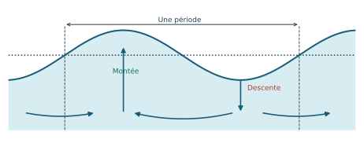

### Question P4 — Surface supplémentaire

> [!INDICATION]
> Retranchez à l’aire courbe l’aire de la surface de référence.

#### Solution

L’énergie de la surface courbe vaut $\gamma L\int_0^\lambda\sqrt{1+u'^2}\,dx$. La surface plane avait l’aire $L\lambda$. Ainsi $E_\gamma=\gamma L\int_0^\lambda(\sqrt{1+a^2k^2\cos^2kx}-1)\,dx$.

### Question P5 — Développement au second ordre

> [!INDICATION]
> La moyenne de cos² sur une période vaut 1/2.

#### Solution

En développant la racine, $E_\gamma\simeq(\gamma L/2)a^2 k^2(\lambda/2)=(\pi/2)\gamma Lka^2$. La convention du sujet remplace le préfacteur numérique par un, d’où $E_\gamma\sim\gamma Lka^2$.

### Question P6 — Masse transférée

> [!INDICATION]
> Évaluez l’aire d’un demi-lobe avant de la multiplier par la largeur et la masse volumique.

#### Solution

Pour créer un creux et une bosse, on transporte la masse qui occupait le demi-lobe sous le niveau de référence vers le demi-lobe opposé, au-dessus de ce niveau. Sa section est d’ordre $a\lambda$ et sa largeur vaut L. Il vient $\delta m\sim\rho La/k$.

### Question P7 — Élévation des centres de masse

> [!INDICATION]
> Comparez les altitudes moyennes du déficit et de l’excès de fluide.

#### Solution

Le centre de masse du demi-lobe creux se situe à une distance d’ordre a sous le plan et celui de la bosse à la même distance au-dessus. Le transfert s’accompagne d’une élévation $\delta z\sim a$, positive.

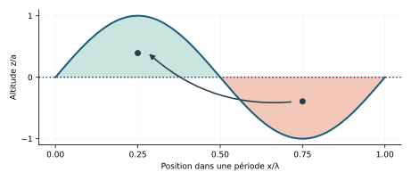

### Question P8 — Travail contre la pesanteur

> [!INDICATION]
> Utilisez la masse déplacée et la montée de son centre.

#### Solution

L’augmentation d’énergie de pesanteur est $E_g=\delta m\,g\,\delta z\sim\rho gLa^2/k$. Elle est positive quel que soit le signe choisi pour la phase du sinus.

## Énergie et dynamique de l’interface

### Question P9 — Deux contributions concurrentes

> [!INDICATION]
> Rassemblez les deux énergies relativement au même état plan.

#### Solution

La somme donne $E_p\sim La^2(\gamma k+\rho g/k)$. Pour une amplitude fixée, les grandes longueurs d’onde coûtent surtout en pesanteur, les petites en aire interfaciale.

### Question P10 — Longueur capillaire

> [!INDICATION]
> Tension superficielle et poids volumique ont pour unités N/m et N/m³.

#### Solution

Le rapport $\gamma/(\rho g)$ a la dimension d’une aire. La longueur cherchée est $\ell=\sqrt{\gamma/(\rho g)}$. Les contributions de pesanteur et de surface ont le même ordre pour $k\ell=1$.

### Question P11 — Réduction à une fonction sans dimension

> [!INDICATION]
> Utilisez γ/ℓ = ρgℓ pour factoriser la même échelle dans les deux termes.

#### Solution

En posant $K=k\ell$, on obtient $E_p\sim E^*F(K)$ avec $E^*=La^2\sqrt{\rho g\gamma}$ et $F(K)=K+1/K$. L’échelle est positive pour une déformation non nulle et $F(1)=2$.

### Question P12 — Minimum du coût énergétique

> [!INDICATION]
> Étudiez les limites, la dérivée première et la nature du point stationnaire.

#### Solution

Sur $K>0$, $F'(K)=1-1/K^2$. La fonction décroît de l’infini à 2 entre 0 et 1 puis croît vers l’infini. $F''(K)=2/K^3>0$ confirme le minimum unique en K=1.

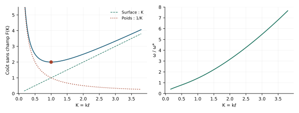

### Question P13 — Stabilité statique

> [!INDICATION]
> Le minimum par rapport à K est à comparer à l’énergie de l’état plan.

#### Solution

Pour tout mode et toute amplitude non nulle, $E_p>0$, tandis que la surface plane a une énergie nulle. Le coût quadratique en amplitude est toujours positif. Le plan est stable, même pour le mode le moins coûteux.

### Question P14 — Vitesse du retour horizontal

> [!INDICATION]
> Reliez les flux volumiques des deux portions du canal par incompressibilité.

#### Solution

Dans une des colonnes verticales, le débit est d’ordre $L(\lambda/3)|\dot a|$. La section du courant horizontal vaut environ $L\lambda$. Ainsi $|V_x^*|\sim|\dot a|$ après suppression des facteurs géométriques. Son sens est du creux vers la bosse pendant la croissance de a.

### Question P15 — Énergie cinétique verticale

> [!INDICATION]
> Tenez compte de la profondeur sur laquelle le fluide participe, d’ordre λ.

#### Solution

Les colonnes mobiles occupent un volume d’ordre $L\lambda^2$. Avec $|V_z^*|\sim|\dot a|$, leur énergie cinétique vérifie $E_{c,v}\sim\rho L\dot a^2/k^2$.

### Question P16 — Énergie cinétique horizontale

> [!INDICATION]
> Comparez les ordres de grandeur du volume et de la vitesse de chaque région.

#### Solution

Le canal a lui aussi un volume d’ordre $L\lambda^2$ et une vitesse d’ordre $|\dot a|$. Donc $E_{c,h}\sim\rho L\dot a^2/k^2\sim E_{c,v}$. Les deux mouvements contribuent au même ordre.

### Question P17 — Équation de l’amplitude

> [!INDICATION]
> Divisez l’énergie mécanique par le coefficient de la vitesse au carré et dérivez dans le temps.

#### Solution

La conservation de $E_c+E_p$ donne $\dot a^2+[(\gamma/\rho)k^3+gk]a^2=\mathrm{cste}$ à la convention numérique de l’épreuve. Par dérivation et prolongement aux points où $\dot a=0$, $\ddot a+\omega_*^2K^2F(K)a=0$ avec $\omega_*^2=g/\ell$ et $\omega_*=(\rho g^3/\gamma)^{1/4}$.

### Question P18 — Relation de dispersion

> [!INDICATION]
> Appliquez l’équation différentielle linéaire à la représentation harmonique.

#### Solution

En substituant $\exp(i\omega t)$, $\omega^2=\omega_*^2K^2F(K)=\omega_*^2(K^3+K)$. Les deux racines sont $\omega=\pm\omega_*\sqrt{K^3+K}$. Pour une fréquence positive on retient le signe plus.

### Question P19 — Oscillations libres

> [!INDICATION]
> Identifiez l’origine du signe de ω² et la propriété physique qui permet la conservation d’énergie.

#### Solution

Le terme de rappel est positif pour tout $K>0$ et l’inertie est positive. La pulsation est donc réelle. En l’absence de dissipation dans le modèle, chaque amplitude reste bornée et oscille sans amortissement. La dépendance de la fréquence en k traduit la dispersion des ondes gravito-capillaires.

## Champ magnétique et instabilité de Rosensweig

### Question P20 — Dimension du coefficient magnétique

> [!INDICATION]
> B²/µ₀ est une pression magnétique. Multipliez-la par la dimension de a²k.

#### Solution

Comme $[B^2/\mu_0]=\mathrm{J\,m^{-3}}$ et $[a^2k]=\mathrm m$, le produit a déjà la dimension d’une énergie surfacique. Le coefficient α est sans dimension.

### Question P21 — Énergie paire en amplitude

> [!INDICATION]
> Comparez les profils a et −a dans un champ uniforme.

#### Solution

Changer a en −a revient à déplacer la sinusoïde de $\lambda/2$. Dans un milieu horizontalement uniforme l’énergie par période reste donc la même. La correction magnétique est nulle à a=0 et son développement régulier ne contient que des puissances paires. Le premier terme possible est proportionnel à $a^2$.

### Question P22 — Énergie magnétique d’une période

> [!INDICATION]
> L’énergie surfacique donnée est rapportée à l’aire projetée du domaine.

#### Solution

$E_B=e_BL\lambda\sim-w_B L a^2$, avec $w_B=\alpha B^2/\mu_0$. On en déduit $E'_p\sim La^2(\gamma k+\rho g/k-w_B)$. Le champ favorise la déformation.

### Question P23 — Force du champ sous forme réduite

> [!INDICATION]
> Factorisez l’énergie E* utilisée sans champ.

#### Solution

Le coefficient du terme magnétique, après division par $La^2\sqrt{\rho g\gamma}$, vaut $\beta=w_B/\sqrt{\rho g\gamma}$. Alors $E'_p\sim E^*G(K)$ avec $G(K)=K+K^{-1}-\beta$.

### Question P24 — Signification de β

> [!INDICATION]
> Le dénominateur peut aussi s’écrire γ/ℓ ou ρgℓ.

#### Solution

β est le rapport d’une pression d’origine magnétique à la pression capillaire ou hydrostatique à la longueur capillaire. À K=1, son rapport au coût total de rappel vaut β/2. L’augmentation du champ accroît β proportionnellement à $B^2$.

### Question P25 — Trois régimes statiques

> [!INDICATION]
> Le champ translate toute la courbe vers le bas sans déplacer son minimum.

#### Solution

Pour β=1, G reste positive, de minimum 1. Pour β=2 la courbe touche l’axe en K=1. Pour β=3 elle le coupe en $(3\pm\sqrt5)/2$ et devient négative entre ces valeurs. Les extrémités tendent toujours vers l’infini.

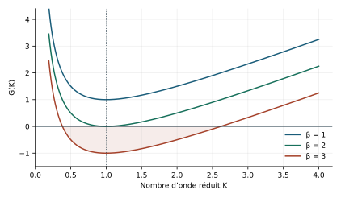

### Question P26 — Champ critique

> [!INDICATION]
> Le premier zéro de l’énergie de rappel apparaît au minimum de G.

#### Solution

Le minimum vaut $2-\beta$. La limite est $\beta_c=2$. Pour $\beta>2$ un intervalle de nombres d’onde abaisse l’énergie de l’interface et le plan est instable. À la valeur critique le rappel quadratique s’annule pour un seul mode.

### Question P27 — Premier mode sélectionné

> [!INDICATION]
> Recherchez l’abscisse du minimum au seuil.

#### Solution

La tangence se produit en $K_c=1$. Le nombre d’onde dimensionné est $k_c=1/\ell=\sqrt{\rho g/\gamma}$.

### Question P28 — Conservation de l’énergie avec champ

> [!INDICATION]
> La géométrie de l’écoulement et son inertie restent celles des questions 15 et 16.

#### Solution

$E'_m\sim\rho L\dot a^2/k^2+La^2\sqrt{\rho g\gamma}\,G(K)$. Cette énergie se conserve pour le champ constant du modèle. En divisant par $\rho L/k^2$, on obtient $\dot a^2+\omega_*^2K^2G(K)a^2=\mathrm{cste}$.

### Question P29 — Dispersion en présence du champ

> [!INDICATION]
> Dérivez l’intégrale première en temps comme à la question 17.

#### Solution

L’équation devient $\ddot a+\omega_*^2K^2G(K)a=0$, donc $\omega^2=\omega_*^2(K^3-\beta K^2+K)$. Le signe du facteur G décide de la nature temporelle du mode.

### Question P30 — Bande de modes instables

> [!INDICATION]
> Cherchez les racines du polynôme K²−βK+1.

#### Solution

Pour $\beta<2$, tous les modes oscillent. À $\beta=2$ le mode K=1 a $\omega=0$ et son équation linéaire est $\ddot a=0$. Pour $\beta>2$, $K_\pm=(\beta\pm\sqrt{\beta^2-4})/2$. Dans $K_-<K<K_+$, ω est imaginaire pure. Une combinaison de deux exponentielles comprend en général une composante croissante. Au-delà des bornes les oscillations persistent, et aux bornes le rappel s’annule.

### Question P31 — Ralentissement au seuil

> [!INDICATION]
> Regardez ce que devient le taux de croissance, inverse du temps caractéristique.

#### Solution

Pour K=1 et $\delta=\beta-2>0$, le taux vaut $\sigma=\omega_*\sqrt\delta$. Ainsi $\tau_c=1/(\omega_*\sqrt\delta)$ diverge au seuil. Très près de la transition, une instabilité peut donc mettre longtemps à devenir visible.

## Des échelles à la saturation

### Question P32 — Distance entre pointes

> [!INDICATION]
> Reliez la périodicité spatiale du mode critique à celle de la structure.

#### Solution

Deux maxima consécutifs sont séparés par $d_c=2\pi/k_c=2\pi\sqrt{\gamma/(\rho g)}$. Transposer ce résultat unidimensionnel au réseau de pointes donne une distance caractéristique, avec un facteur géométrique possible.

### Question P33 — Ordre de grandeur pour l’eau

> [!INDICATION]
> Reliez la transition de forme aux tailles usuelles des gouttes.

#### Solution

De très petites gouttes restent bombées, tandis qu’une flaque d’extension centimétrique s’aplatit. Le changement intervient pour des tailles millimétriques. Avec $\gamma\simeq0,07$ N·m⁻¹, $\rho\simeq10^3$ kg·m⁻³ et $g\simeq10$ m·s⁻², on trouve $\ell\simeq2,6$ mm pour l’eau dans l’air.

### Question P34 — Confronter le modèle à l’image

> [!INDICATION]
> Comparez l’intervalle entre plusieurs voisins dans la partie observable à la barre de 1 cm.

#### Solution

La photographie donne quelques intervalles par centimètre, soit un pas de l’ordre de 3 à 4 mm suivant la ligne et la perspective. Le modèle prévoit une échelle millimétrique à centimétrique : $2\pi\ell$ vaut environ 6 mm pour $\ell\sim1$ mm, et 16 mm si l’on prend précisément la valeur de l’eau. Il fournit l’échelle sans accord quantitatif précis. Les propriétés du ferrofluide, la perspective et les hypothèses du calcul limitent la comparaison.

### Question P35 — Saturation non linéaire

> [!INDICATION]
> Un équilibre stable minimise le potentiel en amplitude. Ne fixez pas arbitrairement la constante d’énergie.

#### Solution

À K fixé, le potentiel réduit est proportionnel à $K^2[G\theta^2-\tfrac A2K^3\theta^4+\tfrac B3K^5\theta^6]$ avec $\theta=a/\ell$. Sa dérivée s’annule si $\theta=0$ ou $G-AK^3\theta^2+BK^5\theta^4=0$. Pour $K\to1$ et $G\to0^-$, la racine physique non nulle donne $\theta_{\rm eq}^2\to A/B$. La dérivée seconde y est positive et $a_{\rm eq}\to\ell\sqrt{A/B}$. Dans le modèle strictement conservatif, c’est une position stable. La convergence effective nécessite une dissipation faible.

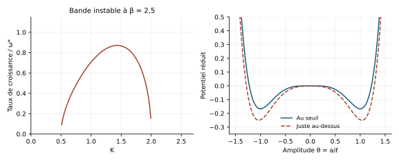

### Question P36 — Ajouter une force volumique

> [!INDICATION]
> Comparez les directions de la force magnétique supplémentaire et du poids.

#### Solution

Les deux forces sont dirigées vers le bas. Le poids volumique effectif devient $\rho g+f$. Il en résulte $\ell'=\sqrt{\gamma/(\rho g+f)}$ et $k'_c=\sqrt{(\rho g+f)/\gamma}$. La longueur d’onde critique diminue.

### Question P37 — Mesure sur la goutte fractionnée

> [!INDICATION]
> Utilisez le quadrillage millimétrique et plusieurs espacements de centre à centre.

#### Solution

La distance moyenne entre centres est de l’ordre de 0,6 à 0,8 mm sur la figure 5, pour une division de 1 mm. Ainsi $k'_c\simeq2\pi/d'_c$ est d’ordre $10^4$ m⁻¹. La géométrie irrégulière des pics ne justifie pas davantage de chiffres.

### Question P38 — Rapport des forces

> [!INDICATION]
> Éliminez γ entre les deux nombres d’onde critiques, puis utilisez les distances mesurées dans les deux configurations.

#### Solution

On obtient $1+\phi=(k'_c/k_c)^2=(d_c/d'_c)^2$. Les lectures centrales $d_c\sim3,5$ mm et $d'_c\sim0,7$ mm donnent $\phi\sim25-1\sim2\times10^1$. L’incertitude sur l’échelle et la perspective conduit à retenir quelques dizaines. Utiliser la longueur capillaire exacte de l’eau à la place de la photo du ferrofluide donnerait une estimation beaucoup plus élevée, comme l’écart constaté en P34 le laisse prévoir.

## Chimie. Phases et sites dans les nitrures de fer

### Question C1 — De la fraction atomique à la formule

> [!INDICATION]
> Calculez le rapport entre le nombre d’atomes de fer et celui d’atomes d’azote.

#### Solution

Pour une fraction $x_N$, le rapport Fe/N vaut $(1-x_N)/x_N$. La phase γ′ est voisine de 20 % atomiques en N, d’où Fe₄N. La phase ζ est voisine de 33,3 %, d’où Fe₂N. Ce sont des rapports de nombres d’atomes.

### Question C2 — Décomposition eutectoïde

> [!INDICATION]
> Identifiez le domaine monophasé juste au-dessus de A et les deux phases qui l’encadrent juste au-dessous.

#### Solution

Au refroidissement, vers 650 °C, $\varepsilon_{(s)}\rightarrow\gamma_{(s)}+\gamma'_{(s)}$. Ce bilan désigne des phases de compositions différentes. Des proportions compatibles avec la composition de A se déterminent sur l’horizontale d’équilibre par la règle du levier. Un eutectoïde transforme une phase solide en deux solides. Un eutectique transforme au refroidissement une phase liquide en deux solides.

### Question C3 — Reconstituer la composition par chauffage

> [!INDICATION]
> Pour une puissance fixée, un maximum du temps nécessaire à gagner 2 °C signale une absorption supplémentaire d’énergie.

#### Solution

Les anomalies vers 590 et 650 °C recoupent les deux horizontales invariantes du diagramme. Une verticale de composition doit rencontrer les deux, ce qui situe $x_N$ dans leur intervalle commun, environ 10–20 % atomiques, avec la borne inférieure voisine de 10,5 %. Des quantités mesurables des phases en transformation impliquent une composition intérieure à l’intervalle. L’accident voisin de 900 °C dépasse la plage dessinée et ne permet pas de resserrer cette lecture.

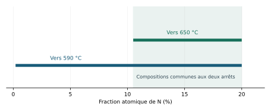

### Question C4 — Sites dans la maille CFC

> [!INDICATION]
> Appliquez le partage des sommets, faces et arêtes avec les mailles voisines.

#### Solution

Le fer occupe les huit sommets et les six centres de faces, soit $8/8+6/2=4$ Fe par maille. Les sites octaédriques sont au centre et aux milieux des douze arêtes, soit $1+12/4=4$ sites. Les sites tétraédriques sont les huit positions dont les trois coordonnées fractionnaires valent chacune 1/4 ou 3/4, soit huit sites intérieurs.

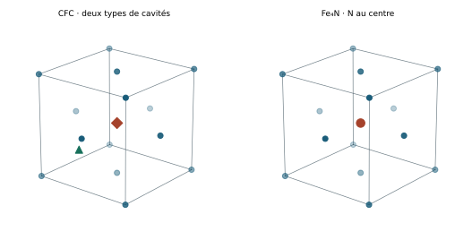

### Question C5 — Rayons des cavités

> [!INDICATION]
> Soustrayez le rayon atomique du fer de la distance entre le site et le centre de Fe le plus proche.

#### Solution

Pour un site octaédrique au centre de la maille, le centre de face voisin est à $a/2$, d’où $r_O=190-126=64$ pm. De (1/4,1/4,1/4) au sommet le plus proche la distance est $a\sqrt3/4$, d’où $r_T\simeq660/4-126=39$ pm. Les valeurs utilisent le rayon atomique de Fe indiqué dans l’annexe.

### Question C6 — Localisation de l’azote

> [!INDICATION]
> Le nombre de fer par maille est connu. Interrogez la stœchiométrie et la taille des cavités.

#### Solution

L’azote est en insertion, le sous-réseau CFC des quatre Fe étant conservé. Fe₄N exige un azote par maille, soit le quart des quatre sites octaédriques. On peut choisir le centre du cube pour N et laisser vides les milieux d’arêtes. Le rayon de N, 71 pm, est un peu supérieur au rayon octaédrique idéal et bien supérieur au rayon tétraédrique. Relaxation du réseau et nature des liaisons expliquent les limites du modèle de sphères rigides.

## Équilibres et diagramme de Lehrer

### Question C7 — Mélange idéal de sites

> [!INDICATION]
> Il y a deux états par site : occupé ou vacant.

#### Solution

Dans le modèle idéal $\mu_{N;\alpha}=\mu_{N;\alpha}^\circ+RT\ln x_{N;\alpha}=\mu_{N;\alpha}^\circ+RT\ln y$, et $\mu_V=\mu_V^\circ+RT\ln x_V=\mu_V^\circ+RT\ln(1-y)$. Les fractions se rapportent aux sites interstitiels.

### Question C8 — Équilibre d’insertion

> [!INDICATION]
> Écrivez l’enthalpie libre de réaction à partir des coefficients stœchiométriques.

#### Solution

Pour le transfert $\tfrac12\mathrm{N_2}+V\rightleftharpoons N;\alpha$, on a à l’équilibre $\mu_{N;\alpha}-\mu_V-\tfrac12\mu_{\rm N_2}=0$. Cette égalité ne vaut qu’entre des phases en équilibre.

### Question C9 — Potentiel requis dans le gaz

> [!INDICATION]
> Éliminez le potentiel des sites vacants avec l’équation d’équilibre.

#### Solution

Par définition $\mu_{N(g)}=\tfrac12\mu_{\rm N_2}$. L’équilibre donne $\mu_{N(g)}=\mu_{N;\alpha}^\circ-\mu_V^\circ+RT\ln[y_{eq}/(1-y_{eq})]$. C’est l’occupation relative aux places libres qui fixe ce potentiel.

### Question C10 — Gaz en équilibre chimique

> [!INDICATION]
> Conservez un atome d’azote dans l’équation si vous utilisez le potentiel défini par demi-mole de N₂.

#### Solution

L’équation est $\tfrac12\mathrm{N_2}+\tfrac32\mathrm{H_2}\rightleftharpoons\mathrm{NH_3}$. À l’équilibre, $\mu_{N(g)}=\mu_{\rm NH_3}-\tfrac32\mu_{\rm H_2}$.

### Question C11 — Grandeur standard et pressions

> [!INDICATION]
> Introduisez la pression standard avant de prendre le logarithme.

#### Solution

Pour des gaz parfaits $\mu_i=\mu_i^\circ+RT\ln(p_i/p^\circ)$. Ainsi $\mu_{N(g)}=\mu_{\rm NH_3}^\circ-\tfrac32\mu_{\rm H_2}^\circ+RT\ln(K_N\sqrt{p^\circ})$ où $K_N=p_{\rm NH_3}/p_{\rm H_2}^{3/2}$. La grandeur logarithmée est sans dimension.

### Question C12 — Fraction de sites occupés

> [!INDICATION]
> Égalisez vos deux expressions du potentiel puis isolez le rapport y/(1−y).

#### Solution

Avec $D=\mu_{\rm NH_3}^\circ-\tfrac32\mu_{\rm H_2}^\circ-\mu_{N;\alpha}^\circ+\mu_V^\circ$, on trouve $y_{eq}/(1-y_{eq})=K_N\sqrt{p^\circ}\exp(D/RT)=q$. Donc $y_{eq}=q/(1+q)$, valeur comprise entre 0 et 1.

### Question C13 — Limite du modèle de sites

> [!INDICATION]
> Quand de nombreux sites proches sont occupés, quel terme le modèle idéal néglige-t-il ?

#### Solution

À plus forte teneur en N, les interactions entre interstitiels occupés, la déformation du réseau et l’ordre éventuel des sites modifient leur énergie. Les activités ne sont plus bien décrites par les seules fractions molaires. On ne peut donc extrapoler directement la loi du fer α dilué aux phases γ, γ′ et ε.

## Profils et cinétique

### Question C14 — Quatre zones dans la plaque

> [!INDICATION]
> Le profil proche de la surface est en pourcentage atomique. Celui en profondeur est en pourcentage massique.

#### Solution

La surface I contient environ 23 à 26 % atomiques de N, compatible avec ε. Le palier voisin de 20 % en II correspond à γ′ de composition Fe₄N. La zone III est essentiellement le fer α enrichi en azote interstitiel, à concentration décroissante. La zone IV rejoint le cœur de fer α très pauvre en azote. III et IV diffèrent surtout par leur teneur en soluté.

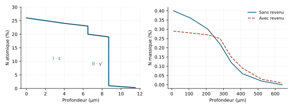

### Question C15 — Vérifier la cohérence du diagramme de Lehrer

> [!INDICATION]
> Convertissez l’abscisse en atm⁻¹ᐟ² avant d’utiliser l’échelle logarithmique.

#### Solution

$6,06\times10^{-3}$ Pa⁻¹ᐟ² correspond à $6,06/3,141\simeq1,9$ atm⁻¹ᐟ². À 570 °C, cette abscisse appartient au domaine ε. Cela concorde avec la couche de surface I directement en contact avec le gaz. La profondeur est soumise à un gradient de concentration.

### Question C16 — Présence de carbone

> [!INDICATION]
> Vérifiez d’abord si α et ε ont une frontière commune dans la région considérée du diagramme binaire.

#### Solution

Aux températures considérées dans le diagramme fer–azote, γ′ s’interpose entre α et ε. Le contact direct α/ε observé pour un acier ne se lit pas comme un équilibre binaire de Fe–N. Le carbone est un troisième constituant qui peut modifier les domaines de phase. Un contact hors équilibre constitue également une possibilité.

### Question C17 — Coefficient de diffusion

> [!INDICATION]
> La distance caractéristique de diffusion croît comme la racine carrée du temps.

#### Solution

Après 24 h, le profil évolue sur quelques centaines de micromètres. En prenant $x\sim3\times10^{-4}$ m et $t\sim9\times10^4$ s, $D\sim x^2/t\sim10^{-12}$ m²·s⁻¹. Un facteur numérique dépend de la définition choisie pour la profondeur et de la forme du profil.

### Question C18 — Effet du revenu

> [!INDICATION]
> Examinez la variation de teneur après revenu près de la surface et plus en profondeur.

#### Solution

L’élévation de température augmente la mobilité de N. La diffusion homogénéise la couche enrichie, abaisse le maximum superficiel et répartit l’azote plus profondément. Elle peut ainsi poursuivre la croissance de la zone de diffusion.

### Question C19 — Demi-temps de dilution

> [!INDICATION]
> La fraction résiduelle de N₂ complète celle de H₂ à un.

#### Solution

$X_{\rm N_2}=1-X_{\rm H_2}=\exp(-t/\tau)$. À $X_{\rm N_2}=1/2$, $t_{1/2}=\tau\ln2$. Il s’agit du renouvellement d’un fluide.

### Question C20 — Volume et mélange

> [!INDICATION]
> Lisez le croisement des courbes à 1/2 plutôt que le temps d’extinction visuelle de N₂.

#### Solution

On lit $t_{1/2}\sim1,3$–$1,5\times10^2$ s, d’où $\tau=t_{1/2}/\ln2\sim2\times10^2$ s. Avec $Q=2,5$ cm³·s⁻¹, $V=Q\tau\sim5\times10^2$ cm³, soit environ 0,5 L. La relaxation proche d’une exponentielle est compatible avec un réacteur continu parfaitement agité dans cette expérience. τ est le temps de séjour moyen.

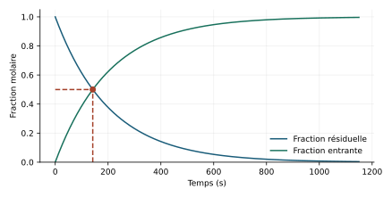

### Question C21 — Trois essais et un état d’équilibre

> [!INDICATION]
> Reportez les trois abscisses à la même température sur le diagramme de Lehrer.

#### Solution

À 570 °C, les abscisses 0,23, 0,43 et 0,88 atm⁻¹ᐟ² se situent dans le domaine γ′, la plus faible près de la limite α/γ′. Les trois prises de masse permettent de comparer des cinétiques sous des potentiels différents pour la même phase finale thermodynamiquement stable.

### Question C22 — Comparer les courbes de gain de masse

> [!INDICATION]
> Une pente mesure une vitesse globale. Un changement de pente peut refléter successivement la formation de germes et le transport dans une couche.

#### Solution

À 0,88, le gain démarre vite. L’adsorption et la dissociation de NH₃ alimentent d’abord l’enrichissement superficiel de α. Une fois la phase γ′ germée et la couche formée, la diffusion à travers la couche explique le ralentissement progressif. À 0,23, proche de la limite du domaine, le départ plus lent et l’épaulement suggèrent une alimentation superficielle plus faible et une germination plus tardive, avant la croissance par incorporation et diffusion. Les tracés de masse ne séparent pas à eux seuls la dissociation et la nucléation. La formation nette de NH₃ n’apporte pas le N à la plaque. La phase stable lue dans le diagramme est γ′, même si la liste des phénomènes de la question écrit γ.

### Question C23 — Trois phases cinétiques

> [!INDICATION]
> La forme sigmoïde de la courbe au plus faible débit sépare induction, accélération et ralentissement.

#### Solution

Au très faible débit, le départ montre un temps d’induction avec faible prise de masse, compatible avec l’arrivée du réactif, sa dissociation et l’enrichissement de α. La pente croît ensuite à mesure que des germes de nitrure apparaissent et que les surfaces de croissance se multiplient. Enfin la prise de masse continue plus lentement lorsque le transport de N dans la couche formée devient limitant. Cette succession interprète la courbure, elle n’identifie pas séparément chacune des étapes élémentaires.

## Diagramme électrochimique

### Question C24 — Attribuer les domaines redox

> [!INDICATION]
> L’axe pN³⁻ décroît vers la droite. Le domaine du métal est le plus réducteur.

#### Solution

A est Fe(s), B le nitrure Fe₄N(s), C Fe²⁺ et D Fe³⁺. Dans Fe₄N, l’azote a le nombre d’oxydation −III, soit +3/4 par Fe en moyenne. Le nitrure est favorisé aux fortes activités de N³⁻ et à un potentiel supérieur à celui du domaine métallique.

### Question C25 — Potentiel standard du couple de nitruration

> [!INDICATION]
> Additionnez les enthalpies libres standard des demi-équations, qui sont proportionnelles à nE°.

#### Solution

Notons $E_1^\circ=E^\circ(\mathrm{Fe^{2+}},\mathrm{N^{3-}}/\mathrm{Fe_4N})$ et $E_2^\circ=E^\circ(\mathrm{Fe^{2+}}/\mathrm{Fe})$. La première réduction est $4\mathrm{Fe^{2+}}+\mathrm{N^{3-}}+5e^-\rightarrow\mathrm{Fe_4N}$. En y ajoutant $\mathrm{Fe_4N}+3e^-\rightarrow4\mathrm{Fe}+\mathrm{N^{3-}}$, on retrouve la réduction de quatre Fe²⁺, soit huit électrons. Il vient $E^\circ=(8E_2^\circ-5E_1^\circ)/3\simeq0,46$ V par rapport à Li⁺/Li.

### Question C26 — Frontière entre deux solides

> [!INDICATION]
> L’activité de chaque solide pur vaut un. Conservez la température de travail.

#### Solution

Avec $p\mathrm N^{3-}=-\log_{10}a_{\rm N^{3-}}$, Nernst appliquée à la réduction du nitrure donne $E=E^\circ-(RT/3F)\ln a_{\rm N^{3-}}=E^\circ+[RT\ln10/(3F)]\,p\mathrm N^{3-}$. La pente par rapport à pN³⁻ est positive bien que le trait descende vers la droite du diagramme imprimé.

### Question C27 — Pente à 723 K

> [!INDICATION]
> Relevez deux points distants et tenez compte du sens des abscisses.

#### Solution

La frontière passe approximativement par (0,0,46 V) et (30,1,9 V). Sa pente vaut $(1,9-0,46)/30\simeq+0,048$ V par unité de pN³⁻. À 723 K, on attend $(0,060/3)(723/298)\simeq0,049$ V par décade. L’accord est compatible avec les incertitudes de lecture.

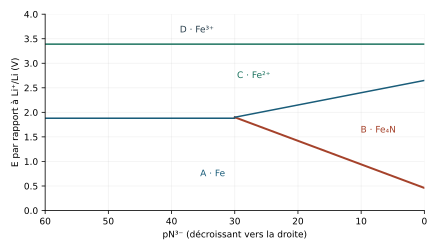

### Question C28 — Changer de référence

> [!INDICATION]
> Exprimez tous les potentiels par rapport à la même ancienne référence avant la soustraction.

#### Solution

$E_{/\rm Li}=E_{/\rm H}-E_{\rm Li/H}$. C’est une translation verticale constante de toutes les frontières, qui conserve pentes et intersections en abscisse. Avec −3,04 V à 298 K on ajouterait 3,04 V. Une conversion numérique à 723 K nécessiterait la valeur de référence à cette température et dans les conditions considérées.

### Question C29 — Choisir un milieu non aqueux

> [!INDICATION]
> L’eau est à la fois un solvant, un donneur de protons et une espèce électroactive.

#### Solution

L’absence d’eau permet de conserver le nitrure, base très forte qui serait protonée en milieu aqueux. Le sel fondu conduit les ions et offre une fenêtre électrochimique différente de celle de l’eau. En contrepartie, la mesure dépend fortement de la température, des activités et de la stabilité des matériaux de cellule. L’anhydricité du milieu et la référence de potentiel deviennent des contraintes de l’interprétation expérimentale.

## Électrodes et couches superficielles

### Question C30 — Montage de voltampérométrie

> [!INDICATION]
> Prévoyez trois connexions différentes et précisez entre quelles électrodes circulent courant et mesure de potentiel.

#### Solution

Dans une cellule aqueuse, on immerge l’électrode de travail, une contre-électrode inerte et la jonction ionique d’une électrode de référence. Le potentiostat impose $E_{\rm travail}-E_{\rm ref}$ en ajustant le courant entre travail et contre-électrode. Le courant dans la référence est négligeable. On enregistre I ou la densité I/S en fonction de la différence de potentiel mesurée. Le schéma illustre ce principe de mesure.

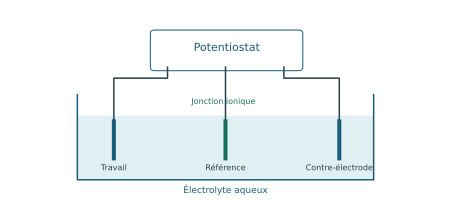

### Question C31 — Attribution des branches anodiques

> [!INDICATION]
> Confrontez la courbe avec et sans nitrure aux domaines accessibles sur le diagramme.

#### Solution

Sans ajout de nitrure, le courant anodique reste faible jusqu’aux potentiels élevés où commence la dissolution $\mathrm{Fe}\rightarrow\mathrm{Fe^{2+}}+2e^-$. En présence de N³⁻ apparaît auparavant la branche de formation de Fe₄N, $4\mathrm{Fe}+\mathrm{N^{3-}}\rightarrow\mathrm{Fe_4N}+3e^-$. Une oxydation concurrente de N³⁻ en N₂ est thermodynamiquement envisageable selon les activités, mais la seule courbe ne suffit pas à partager le courant. À potentiel plus grand, la dissolution du fer peut se superposer. L’oxydation du chlorure est hors de la fenêtre tracée.

### Question C32 — Électrodes et polarités

> [!INDICATION]
> La plaque de fer doit porter la transformation qui libère des électrons.

#### Solution

Le fer est l’anode, reliée au pôle positif du générateur. L’aluminium sert de cathode, reliée au pôle négatif. Le circuit extérieur retire des électrons à la première électrode et les fournit à la seconde.

### Question C33 — Bilan électrolytique

> [!INDICATION]
> Associez à la demi-équation de formation du nitrure une réduction de cations du bain, puis égalisez les électrons.

#### Solution

À l’anode $4\mathrm{Fe}+\mathrm{N^{3-}}\rightarrow\mathrm{Fe_4N}+3e^-$. Le couple de référence du bain conduit à représenter la cathode par $3\mathrm{Li^+}+3e^-\rightarrow3\mathrm{Li}$, le lithium pouvant être incorporé à l’aluminium. Le bilan formel est $4\mathrm{Fe}+\mathrm{Li_3N}\rightarrow\mathrm{Fe_4N}+3\mathrm{Li}$. Le tracé anodique fourni ne mesure pas la composition exacte de la phase cathodique.

### Question C34 — Épaisseur et profil de phases

> [!INDICATION]
> Convertissez le temps de décapage en profondeur, puis utilisez la teneur atomique plutôt que le seul contraste de la micrographie.

#### Solution

Le profil débute avec une très mince zone superficielle enrichie, autour de 25–30 % de N, compatible avec ε, puis atteint en quelques $10^3$ s la zone proche de γ′/Fe₄N (environ 17–20 %). Avec 0,1 nm·s⁻¹, la première région est de l’ordre de 0,1–0,3 µm. La forte chute vers $30\times10^3$ s situe la fin de la couche riche à environ 3 µm, γ′ occupant donc environ 3 µm à cette précision. Au-delà domine le fer pauvre en N de la zone de diffusion puis du cœur. Les teneurs intermédiaires autorisent des mélanges locaux.

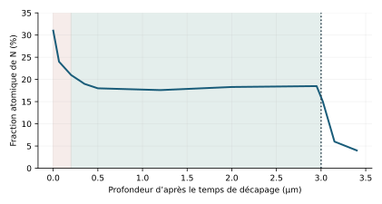

### Question C35 — Comparer deux micrographies

> [!INDICATION]
> Tenez compte de la topographie et du temps total de traitement avant de comparer les épaisseurs.

#### Solution

La couche pulsée atteint l’ordre d’une dizaine à quelques dizaines de micromètres, au lieu de quelques micromètres. Elle est aussi plus rugueuse, poreuse et irrégulière. La durée a doublé, ce qui ne ferait croître une épaisseur purement diffusive que d’un facteur $\sqrt2$. Le changement de morphologie et de grandeur dépasse cette seule correction.

### Question C36 — Origine microscopique du contraste

> [!INDICATION]
> Appuyez-vous sur la branche supplémentaire de dissolution du fer et sur la présence de pores.

#### Solution

L’excursion vers des potentiels plus élevés rend possible une dissolution partielle de Fe en Fe²⁺. Au transport de N vers l’intérieur s’ajoute alors un transport de fer vers l’extérieur. Leur rencontre et la formation de nitrure à davantage d’interfaces peuvent épaissir la couche. Une dissolution locale et une croissance non uniforme sont compatibles avec les pores et les irrégularités. Il s’agit d’une interprétation croisant polarisation, profil et micrographie.
