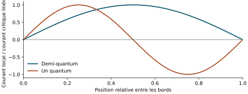
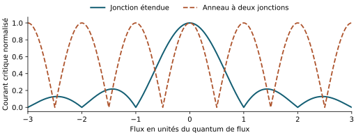
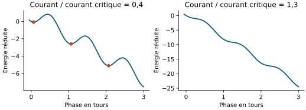
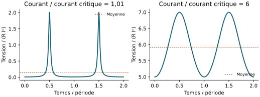
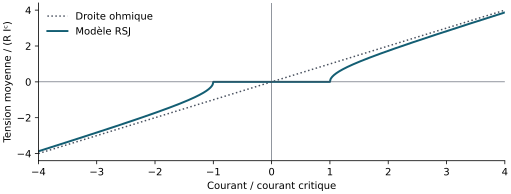
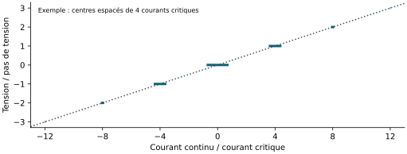
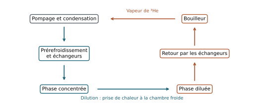

# ENS Ulm PSI 2018 — Physique U · Corrigé guidé

*Corrigé rédigé par IA, non officiel. Signalez toute erreur.*

**Lecture du rapport du jury** · GPT-6.2 Astra Ultra · vitesse non renseignée

**Rédaction** · GPT-6.2 Astra Ultra · vitesse non renseignée

## Jonctions Josephson et cryogénie

## I. Phase et supercourant

### Question 1 — Conservation de la charge

**Indication.** Commencer par le courant de probabilité, puis lui attribuer la charge d’une paire et préciser son orientation.

$|\Psi|^2$ est la densité de paires dans la normalisation adoptée, donc $\rho=-2e|\Psi|^2$. En multipliant l’équation de Schrödinger par $\Psi^*$ et en soustrayant la conjuguée multipliée par $\Psi$, on obtient $\partial_t|\Psi|^2=-\partial_x j_p$, où $j_p=(\hbar/m)\operatorname{Im}(\Psi^*\partial_x\Psi)$. Le courant électrique orienté vers $+x$ vaut $j_q=-2e j_p$ et vérifie $\partial_t\rho+\partial_xj_q=0$. Le courant $I$ affiché dans l’énoncé vaut au contraire $+2e j_p$, c’est donc le courant compté vers $-x$, avec $\partial_t\rho-\partial_x I=0$. Nous conservons cette convention pour obtenir la relation courant-phase du sujet. Une section constante est comprise dans la normalisation unidimensionnelle.

### Question 2 — Séparation du temps

**Indication.** Pour un état d’énergie fixée, intégrer d’abord l’équation temporelle à position fixée.

$\partial_t\Psi=-iE\Psi/\hbar$ donne $\Psi(x,t)=\psi(x)e^{-iEt/\hbar}$. Dans la région normale de potentiel $U$, la substitution dans l’équation complète donne $-(\hbar^2/2m)\psi''+(U-E)\psi=0$.

### Question 3 — Onde dans la barrière

**Indication.** Examiner le signe du coefficient qui multiplie la fonction d’onde.

Pour $E<U$, $\psi''=\kappa^2\psi$, avec $\kappa=\sqrt{2m(U-E)}/\hbar>0$. Les deux exponentielles réelles de paramètres $\pm\kappa$ sont indépendantes. Une base équivalente, adaptée aux deux interfaces symétriques, donne $\psi=A\cosh(\kappa x)+B\sinh(\kappa x)$.

### Question 4 — Raccord aux électrodes

**Indication.** Additionner puis soustraire les valeurs aux deux extrémités.

Posons $u_j=\sqrt{n_j}\,e^{i\theta_j}$. La continuité impose $\psi(-d)=u_1$, $\psi(d)=u_2$. Les parités de $\cosh$ et $\sinh$ donnent $A=(u_2+u_1)/[2\cosh(\kappa d)]$ et $B=(u_2-u_1)/[2\sinh(\kappa d)]$.

### Question 5 — Première équation de Josephson

**Indication.** Le courant stationnaire est constant. Au centre de la barrière, la dérivée et la fonction ont une forme simple.

En $x=0$, $I_s=(2e\hbar\kappa/m)\operatorname{Im}(A^*B)$. Seuls les produits croisés de $u_1,u_2$ contribuent. On trouve $\operatorname{Im}(A^*B)=\sqrt{n_1n_2}\sin(\theta_2-\theta_1)/\sinh(2\kappa d)$. Ainsi $I_s=I_c\sin\phi$, avec $I_c=2e\hbar\kappa\sqrt{n_1n_2}/[m\sinh(2\kappa d)]$. Une barrière épaisse atténue exponentiellement le couplage.

### Question 6 — Seconde équation de Josephson

**Indication.** Appliquer l’équation temporelle à chaque électrode en conservant sa densité.

$\Psi_j=\sqrt{n_j}e^{i\theta_j(t)}$ donne $\hbar\dot\theta_j=-E_j$. Par différence, $\hbar\dot\phi=E_1-E_2=2eV$, soit $\dot\phi=2eV/\hbar$ dans la convention de tension choisie.

### Question 7 — Régimes continu et alternatif

**Indication.** Une fréquence en hertz se déduit de la variation de phase par tour complet.

À tension nulle, $\phi$ est constante. Le courant peut prendre toute valeur entre $-I_c$ et $+I_c$ et sa puissance $VI_s$ est nulle. Sous tension constante, $\phi(t)=\phi(0)+(2eV/\hbar)t$ et le courant devient sinusoïdal. Sa fréquence positive est $f_J=2e|V|/h$, où $h=2\pi\hbar$. Le coefficient $2e/h\simeq4{,}8\,10^{14}\,\mathrm{Hz/V}$ donne environ $0{,}5\,\mathrm{GHz}$ par microvolt.

### Question 8 — Énergie de couplage

**Indication.** Écrire le travail reçu comme une puissance électrique intégrée pendant le déplacement de phase.

$\delta W=VI_s\,dt=(\hbar I_c/2e)\sin\phi\,d\phi$. Ce travail réversible est un différentiel exact. Avec $E_J(0)=0$, on obtient $E_J=E_c(1-\cos\phi)$, où $E_c=\hbar I_c/(2e)$, en joules.

### Question 9 — Inductance différentielle

**Indication.** Dériver le courant avant d’utiliser la relation tension-phase.

En convention récepteur, une bobine linéaire vérifie $V=L\,dI/dt$. Ici $\dot I_s=I_c\cos\phi\,\dot\phi=(2eI_c/\hbar)\cos\phi\,V$. Localement $V=L_J(\phi)\dot I_s$, avec $L_J=L_c/\cos\phi$, $L_c=\hbar/(2eI_c)$. Il s’agit d’une relation différentielle qui devient singulière aux extrema du courant.

### Question 10 — Gradient de phase transversal

**Indication.** Intégrer le gradient constant de la phase entre le bord inférieur et un point de la jonction.

Écrivons $F=\Phi_B/\Phi_0$ avec $\Phi_B=2dWB$. Alors $\phi(y)=\phi(-W/2)+2\pi F(y+W/2)/W$. Le déphasage cumulé entre les deux bords vaut $2\pi F$.

### Question 11 — Courants locaux et annulation

**Indication.** Compter les périodes parcourues par la phase entre les bords.

Pour $u=(y+W/2)/W$ et $\phi(-W/2)=0$, $j_s/j_c=\sin(\pi u)$ à demi-quantum et $\sin(2\pi u)$ à un quantum. La première courbe reste positive, la seconde a des aires opposées égales. À $F=n$ entier non nul, l’intégrale porte sur $|n|$ périodes complètes, donc elle s’annule quelle que soit la phase de départ.

### Question 12 — Intégration sur la largeur

**Indication.** Centrer la phase pour utiliser la symétrie de la barrière.

Avec $\phi_a=\phi(-W/2)$, $I_s=j_cW\int_0^1\sin(\phi_a+2\pi Fu)\,du=j_cW[\sin(\pi F)/(\pi F)]\sin(\phi_a+\pi F)$. En choisissant la phase de façon à maximiser le courant, $I_c(F)=j_cW|\sin(\pi F)/(\pi F)|$ et $I_c(0)=j_cW$ par continuité.

### Question 13 — Figure de diffraction

**Indication.** Repérer l’origine, les zéros et l’enveloppe avant de tracer.

Le courant critique est pair et positif, maximal en zéro. Il s’annule aux entiers non nuls de $F$. Le lobe central s’étend de $-1$ à $1$, les lobes secondaires sont plus étroits et leur enveloppe décroît comme $1/(\pi|F|)$. L’espacement des zéros est constant mais les hauteurs des pics diminuent.

### Question 14 — Interférence des deux branches

**Indication.** Additionner les deux sinus avant d’optimiser la phase commune.

Comme $\phi_2=\phi_1+2\pi F$, $I=2I_{c,0}\cos(\pi F)\sin(\phi_1+\pi F)$. Le maximum est $2I_{c,0}|\cos(\pi F)|$. Sur le tracé de la question 13, les maxima de l’anneau sont tous égaux et reviennent à chaque quantum de flux. Les minima nuls se situent aux demi-entiers.

### Question 15 — Anneau très asymétrique

**Indication.** Quelle branche fixe le maximum à l’ordre dominant ?

Avec $\gamma=I_{c,2}/I_{c,1}\ll1$, la contribution de JJ2 est d’ordre $\gamma I_{c,1}$. À l’ordre zéro, on maximise simplement $I_{c,1}\sin\phi_1$, donc $\phi_1^{(0)}=\pi/2$ modulo $2\pi$ et $I_c^{(0)}=I_{c,1}$.

### Question 16 — Mesure de la petite jonction

**Indication.** Écrire la condition d’extremum, puis développer autour de la phase dominante.

Posons $\phi_{c,1}=\pi/2+\delta$, $\chi=\pi/2+2\pi F$. La dérivée du courant total donne $0=I_{c,1}\cos(\pi/2+\delta)+I'_{s,2}(\chi+\delta)$. Si la petite contribution est régulière, $\delta=I'_{s,2}(\chi)/I_{c,1}+O(\gamma^2)$. Dans le courant lui-même le changement de $\sin\phi_1$ commence en $\delta^2$, donc $I_c(F)=I_{c,1}+I_{s,2}(\chi)+O(\gamma^2 I_{c,1})$. Balayer le flux permet ainsi de lire la relation courant-phase.

### Question 17 — Jonction à phase décalée

**Indication.** Identifier le flux qui correspond à une phase nulle dans JJ2, en tenant compte du décalage vertical des tracés.

$\chi=0$ modulo $2\pi$ pour $F=-1/4$ modulo 1. On peut donc lire la courbe près de $F=1{,}75$, en la rapportant à son propre niveau moyen. Pour le tracé supérieur ce point est proche de la mi-hauteur, ce qui donne un courant anomal proche de zéro pour une forme sinusoïdale. Sur les traces du bas il se rapproche d’un maximum, ce qui indique un $I_{s,2}(0)$ appréciable et positif dans la convention tracée. Les extrema se déplacent horizontalement jusqu’à environ $0{,}35$ période, soit $0{,}7\pi$. Une loi $I_{s,2}\simeq I_*\sin(\phi_2-\phi_0)$ exprime ce déplacement du zéro de courant. Le signe de $\phi_0$ dépend de la convention adoptée. Les décalages verticaux empêchent de lire un courant absolu directement sur la figure.

## II. Phase dynamique et marches de Shapiro

### Question 18 — Loi des nœuds du modèle RCSJ

**Indication.** Additionner les courants de trois éléments en parallèle.

$I=I_c\sin\phi+V/R+C\dot V$. La relation $V=(\hbar/2e)\dot\phi$ donne $C(\hbar/2e)\ddot\phi+(\hbar/2eR)\dot\phi+I_c\sin\phi=I$.

### Question 19 — Analogie mécanique

**Indication.** Multiplier l’équation des courants par le coefficient qui convertit le supercourant en dérivée de l’énergie.

En posant $a=\hbar/(2e)$, l’équation prend la forme $m_{\rm eff}\ddot\phi+k\dot\phi+U'(\phi)=0$, avec $m_{\rm eff}=Ca^2$, $k=a^2/R$ et $U'=E_c\sin\phi-aI$. À une constante près $U=E_c[1-\cos\phi-(I/I_c)\phi]$. La phase est une coordonnée angulaire, donc $m_{\rm eff}$ a l’unité d’une inertie et non d’une masse ordinaire.

### Question 20 — Potentiel incliné

**Indication.** Tester si la dérivée peut s’annuler au cours d’une période.

Pour $0<I<I_c$, la pente $U'/E_c=\sin\phi-I/I_c$ change de signe. Le potentiel descend en moyenne mais conserve des puits séparés par des barrières. Quand $I>I_c$, $U'<0$ partout et ces barrières disparaissent. La pente moyenne vaut $-E_c I/I_c$.

### Question 21 — Petites oscillations de plasma

**Indication.** Évaluer la courbure du potentiel au fond d’un puits.

À $I=0$, les minima stables vérifient $\phi=2\pi n$. Pour $\eta=\phi-2\pi n$ petit, $U\simeq E_c\eta^2/2$. En l’absence de frottement, $\ddot\eta+(E_c/m_{\rm eff})\eta=0$. La tension $V=a\dot\eta$ oscille à la même fréquence $f_p=(2\pi)^{-1}\sqrt{2eI_c/(\hbar C)}=1/(2\pi\sqrt{L_c C})$.

### Question 22 — Branche à tension nulle

**Indication.** Suivre une phase initialement piégée quand le frottement dissipe son énergie.

Pour $|I|<I_c$ il existe une position stable telle que $\sin\phi=I/I_c$ et $\cos\phi>0$. Une phase piégée s’y amortit, donc $\langle V\rangle=0$ sur cette branche. Dans un RCSJ sous-amorti à capacité finie, un état courant issu d’une polarisation plus forte peut aussi subsister selon l’histoire. La caractéristique sans hystérésis obtenue ensuite est celle de la limite RSJ.

### Question 23 — Forme d’onde dans le modèle RSJ

**Indication.** La tension instantanée mesure la pente descendante du potentiel lorsque l’inertie est négligeable.

Pour $C=0$, $V(t)=R[I-I_c\sin\phi(t)]$. Juste au-dessus de $I_c$, la phase passe longtemps près de $\sin\phi=1$, avec une tension très faible, puis traverse rapidement une période en donnant un pic de hauteur proche de $2RI_c$. Pour $I\gg I_c$, la phase tourne presque uniformément. La tension présente une faible modulation quasi sinusoïdale d’amplitude $RI_c$ autour de $RI$.

### Question 24 — Courant élevé

**Indication.** Comparer le courant imposé au maximum du courant Josephson.

Puisque $|I_s|\le I_c$, le courant supplémentaire passe presque entièrement dans $R$. Ainsi $I_R\simeq I$ et $\langle V\rangle\simeq RI$.

### Question 25 — Période de rotation de la phase

**Indication.** Intégrer le temps de parcours d’un intervalle de phase de longueur $2\pi$.

Pour $I>I_c$, $\dot\phi=(R/a)(I-I_c\sin\phi)>0$. La période vaut $T=(a/R)\int_0^{2\pi}d\phi/(I-I_c\sin\phi)$. Le formulaire donne $T=2\pi a/[R\sqrt{I^2-I_c^2}]=h/[2eR\sqrt{I^2-I_c^2}]$. Elle diverge à l’approche du seuil par valeurs supérieures.

### Question 26 — Tension moyenne

**Indication.** Intégrer la seconde équation Josephson sur une période.

Le défilement de phase vaut $2\pi\operatorname{sgn}I$ par période. D’où $\langle V\rangle=(h/2eT)\operatorname{sgn}I$, compatible avec $f_J=2e|\langle V\rangle|/h$. En combinant avec la période, $\langle V\rangle=R\operatorname{sgn}(I)\sqrt{I^2-I_c^2}$ pour $|I|>I_c$.

### Question 27 — Caractéristique courant-tension

**Indication.** Raccorder les deux branches de part et d’autre du seuil.

La courbe, impaire, comporte un segment horizontal nul entre $-I_c$ et $+I_c$, puis les deux branches de Q26. Elles démarrent avec une tangente verticale au raccord et s’approchent de la droite $\langle V\rangle=RI$ aux grands courants.

### Question 28 — Émission à 3 GHz

**Indication.** À quelle tension la fréquence propre de la jonction atteint-elle celle de l’instrument ?

La condition $f_J=f_d$ sélectionne $|\langle V\rangle|=hf_d/(2e)\simeq6{,}2\,\mu\mathrm V$. Les pics de la figure 5a à environ $\pm6\,\mu\mathrm V$ correspondent aux deux signes de polarisation et à la même fréquence d’émission.

### Question 29 — Émission fractionnaire

**Indication.** Chercher une période de phase double qui divise par deux la fréquence du courant.

Une composante $I_{4\pi}\sin(\phi/2)$ est $4\pi$-périodique. Avec la même loi $\dot\phi=2eV/\hbar$, elle émet à $e|\langle V\rangle|/h=f_J/2$. À 3 GHz il faut alors environ $\pm12\,\mu\mathrm V$, comme sur la figure 5b. Il peut aussi subsister une composante ordinaire à $2\pi$. La fréquence a été divisée par deux.

### Question 30 — Verrouillage de phase

**Indication.** Compter le déplacement net de phase sur une période de l’excitation.

Sur $1/f$, $\Delta\phi=2\pi n$. La moyenne de la tension vaut donc $\langle V\rangle=(\hbar/2e)f\,2\pi n=n\Delta V$, $\Delta V=hf/(2e)$. La particule fictive passe au minimum décalé de $n$ périodes du potentiel à même phase de l’excitation. Pour $n<0$, elle les parcourt en sens inverse.

### Question 31 — Variables réduites

**Indication.** Choisir l’échelle de temps qui donne le coefficient unité à la dérivée de la phase.

En divisant la loi des nœuds sans capacité par $I_c$, on obtient $t_c\dot\phi+\sin\phi=i_{\rm dc}+i_{\rm ac}\sin(2\pi ft)$ avec $t_c=\hbar/(2eRI_c)$. Posons $\tau=t/t_c$ et $\xi=2\pi ft_c=hf/(2eRI_c)$. La dérivée devient $d\phi/d\tau$ et le forçage $\sin(\xi\tau)$.

### Question 32 — Régime de forte fréquence

**Indication.** Comparer les impédances des branches pour le courant alternatif.

Pour $R\ll2\pi f|L_J|$ la majeure partie du courant alternatif traverse la résistance. La réponse alternative est donc presque ohmique et sinusoïdale. Le supercourant peut encore transporter une partie importante du courant continu, en particulier sur une marche.

### Question 33 — Décomposition harmonique

**Indication.** Écrire le sinus de la phase comme partie imaginaire d’une exponentielle avant d’appliquer Jacobi–Anger.

Notons $\bar v=\langle v\rangle$ et $z=v_0/\xi$. Avec $d\phi/d\tau=v$, la loi réduite donne $\bar v+v_0\cos(\xi\tau+\theta)+\sin[\phi_0+\bar v\tau+z\sin(\xi\tau+\theta)]=i_{\rm dc}+i_{\rm ac}\sin(\xi\tau)$. Le dernier sinus du membre de gauche se développe en $\sum_{k\in\mathbb Z}J_k(z)\sin[\phi_0+k\theta+(\bar v+k\xi)\tau]$.

### Question 34 — Composante continue du courant

**Indication.** Dans la somme, seule une fréquence exactement nulle peut survivre à la moyenne.

Si $\bar v/\xi$ n’est pas entier, toutes les harmoniques oscillent et $\bar v=i_{\rm dc}$ dans cette approximation. Si $\bar v=n\xi$, le terme $k=-n$ subsiste et $J_{-n}=(-1)^nJ_n$. On trouve $\langle V\rangle=RI_{\rm dc}-(-1)^nRI_cJ_n(2eRI_cv_0/(hf))\sin(\phi_0-n\theta)$, avec $\langle V\rangle=nhf/(2e)$.

### Question 35 — Intervalle d’existence d’une marche

**Indication.** En faisant varier la phase, quelles valeurs peut prendre le terme en sinus ?

Pour une excitation alternative fixée, $v_0$ et $z$ sont fixés. Un verrouillage à $n\Delta V$ est compatible avec $n\Delta V/R-I_c|J_n(z)|\le I_{\rm dc}\le n\Delta V/R+I_c|J_n(z)|$. La largeur en courant vaut $2I_c|J_n(z)|$.

### Question 36 — Marches pour un argument de Bessel unité

**Indication.** Identifier la hauteur commune des pas et la largeur propre de chaque plateau.

À $z=1$, $J_0\simeq0{,}77$, $J_1\simeq0{,}44$, $J_2\simeq0{,}11$ et $J_3\simeq0{,}020$. Les plateaux horizontaux sont à $0,\pm\Delta V,\pm2\Delta V,\ldots$ et centrés aux courants $n\Delta V/R$. Leurs largeurs valent environ $1{,}53$, $0{,}88$, $0{,}23$ et $0{,}04$ fois $I_c$ pour $|n|=0,1,2,3$. Les ordres positifs et négatifs ont la même largeur. La droite ohmique fournit la tendance entre plateaux dans l’approximation de Q34.

### Question 37 — Espacement fractionnaire

**Indication.** Quelle avance de phase reproduit une oscillation entière si la loi est en $\sin(\phi/2)$ ?

Le verrouillage d’une composante purement $4\pi$-périodique demande $\Delta\phi=4\pi n$ sur un cycle. Les tensions de marche deviennent $\langle V\rangle=nhf/e$, espacées du double de la valeur habituelle. En unités $hf/(2e)$ seules les marches paires restent.

### Question 38 — Marche manquante sur les données

**Indication.** Examinez d’abord le voisinage de la marche zéro et la présence des plateaux de rang impair.

La trace gris moyen à 2 GHz passe de 0 à un long plateau de rang 2, puis vers 4, avec forte suppression des rangs 1 et 3 aux faibles courants. C’est sur cette courbe que le doublement de l’espacement ressort le plus nettement. La trace claire montre au contraire des plateaux à 1, 2 et 3. Sur la trace noire les plateaux sont moins marqués. Les marches supérieures ne suivent pas toutes la règle des seuls ordres pairs, compatible avec une contribution ordinaire coexistante. La légende dans le PDF comporte des inscriptions superposées sur les deux fréquences extrêmes, tandis que l’identification de la courbe médiane à 2 GHz est lisible.

## III. Prérefroidissement par évaporation

### Question 39 — Abaissement de la température du bain

**Indication.** Suivre la courbe de coexistence liquide-vapeur dans le plan pression-température.

En pompant lentement, on diminue la pression au-dessus du liquide en restant au voisinage de la saturation. La pression de vapeur saturante croît avec la température, donc le nouveau point d’équilibre est plus froid. L’énergie nécessaire aux molécules qui quittent le bain est prélevée dans le liquide restant.

### Question 40 — Bilan sur le bain isolé

**Indication.** Distinguer les moles vaporisées de la variation du stock liquide.

Si $dn_{\rm vap}>0$ s’évapore, la chaleur latente requise est $L_4\,dn_{\rm vap}$. Dans le modèle où le liquide est quasi incompressible, le bain isolé la fournit par son refroidissement, soit $nC_4\,dT=-L_4\,dn_{\rm vap}$. La variation algébrique de la quantité de liquide vaut $dn=-dn_{\rm vap}$.

### Question 41 — Quantité liquide restante

**Indication.** Intégrer une équation différentielle où la capacité thermique du bain diminue elle aussi.

La relation précédente donne $dn/n=(C_4/L_4)dT$. Ainsi $n/n_0=\exp[C_4(T-T_4)/L_4]$. À 1 K, l’exposant est $12(1-4{,}2)/92\simeq-0{,}42$, donnant environ $0{,}66$, soit deux tiers du liquide initial.

### Question 42 — Relation de Clapeyron

**Indication.** Le long de la coexistence les potentiels chimiques restent égaux lorsque pression et température varient ensemble.

De $d\mu_G=d\mu_L$, on tire $(v_{4G}-v_{4L})dP_s=(s_{4G}-s_{4L})dT$. À la transition réversible, $s_{4G}-s_{4L}=L_4/T$. Donc $dP_s/dT=L_4/[T(v_{4G}-v_{4L})]\simeq L_4/(T v_{4G})$, positif.

### Question 43 — Pression de vapeur saturante

**Indication.** Remplacer le volume molaire de la vapeur par sa valeur dans le modèle du gaz parfait.

$v_{4G}=RT/P_s$ donne $d\ln P_s/dT=L_4/(RT^2)$. Avec $L_4$ supposée constante et $P_s(T_4)=P_0$, $P_s(T)=P_0\exp[(L_4/R)(1/T_4-1/T)]$. À plus basse température, l’exposant devient négatif.

### Question 44 — Débit molaire de vapeur

**Indication.** Convertir le volume de gaz aspiré en nombre de moles à l’endroit où ce débit volumique est mesuré.

Pour une aspiration au bain de débit volumique $D_v$, $\dot n=D_v/v_{4G}=D_vP_s(T)/(RT)$. Au point stationnaire considéré, $T$ et $D_v$ sont fixes, donc le débit molaire est proportionnel à $P_s$. Si le débit est mesuré dans la pompe à une autre température, utiliser cette température pour la conversion et la pression locale correspondante.

### Question 45 — Puissance frigorifique par évaporation

**Indication.** Quelle énergie est emportée pour chaque mole vaporisée ?

La puissance positive absorbée vaut $\dot Q_4=L_4\dot n=L_4D_vP_s(T)/(RT)$ pour le modèle précédent. Au refroidissement la chute exponentielle de $P_s$ domine le facteur $1/T$, ce qui réduit rapidement la puissance disponible.

### Question 46 — Température limite du pot à hélium 4

**Indication.** Inverser la loi de vapeur saturante à la pression minimale accessible.

$1/T_{\rm lim}=1/T_4+(R/L_4)\ln(P_0/P_{\rm lim})$. Avec $P_0/P_{\rm lim}=10^3$, on trouve $T_{\rm lim}\simeq1{,}2\,\mathrm K$, soit environ 1 K. Pour aller sensiblement au-dessous, la pression et le débit évaporé deviendraient encore plus faibles. Le prérefroidissement du pot atteint ici sa limite.

### Question 47 — Comparaison isotopique

**Indication.** Utiliser la même équation de coexistence avec les données du second isotope.

Pour $^3\mathrm{He}$, $T_{\rm lim}=[1/(3{,}2\,\mathrm K)+(8{,}31/21)\ln(10^3)]^{-1}\simeq0{,}33\,\mathrm K$. Le pompage permet donc d’atteindre environ $0{,}3\,\mathrm K$ dans le modèle à chaleur latente constante.

## IV. Réfrigération par dilution

### Question 48 — État initial du mélange

**Indication.** Placer le point de coordonnées $(0{,}2,1\,\mathrm K)$ sur le diagramme de phase du sujet.

Ce point se situe au-dessus du domaine biphasé et du côté superfluide de la ligne lambda. Le mélange forme une phase liquide homogène superfluide contenant les deux isotopes.

### Question 49 — Séparation des deux phases

**Indication.** Suivre une verticale à composition globale constante puis lire les intersections avec une horizontale de coexistence.

En descendant à $x_3=0{,}2$, on entre dans le domaine biphasé vers $0{,}5\,\mathrm K$. Une phase concentrée en $^3\mathrm{He}$ apparaît et la composition de chacune suit un bord du domaine. À 10 mK, le liquide supérieur a $x_3\simeq1$ et peut être traité comme de l’hélium 3 pur. Le liquide inférieur superfluide a $x_3\simeq0{,}06$, donc environ 94 % d’hélium 4. La fraction globale reste 0,2. La règle du levier donnerait environ $(0{,}2-0{,}06)/(1-0{,}06)\simeq0{,}15$ des moles dans la phase concentrée.

### Question 50 — Énergie des compartiments

**Indication.** Quels échanges la membrane modèle laisse-t-elle effectivement se produire ?

Dans chaque compartiment $i=M,B$, $dU_i=T_i dS_i-P_i dV_i+\mu_{3,i}dn_{3,i}+\mu_{4,i}dn_{4,i}$. Les hypothèses $dS_i=dV_i=dn_{3,i}=0$ donnent $dU_M=\mu_{4,M}dn_{4,M}$ et $dU_B=\mu_{4,B}dn_{4,B}$. L’échange admissible est un transfert de $^4\mathrm{He}$.

### Question 51 — Équilibre du solvant

**Indication.** Écrire les variations pour un même transfert virtuel de part et d’autre de la membrane.

Le système global isolé conserve son énergie et sa quantité de $^4\mathrm{He}$. L’énergie est stationnaire à l’équilibre pour tout transfert virtuel compatible avec les entropies et volumes fixés. Ainsi $0=dU_M+dU_B=(\mu_{4,M}-\mu_{4,B})dn_{4,M}$ car $dn_{4,B}=-dn_{4,M}$. Cette égalité doit tenir pour une variation admissible quelconque, d’où $\mu_{4,M}=\mu_{4,B}$.

### Question 52 — Potentiel chimique du solvant dilué

**Indication.** Dans une solution idéale l’activité du solvant est sa fraction molaire.

Dans chacun des compartiments $i$, $\mu_{4,i}=\mu_4^\circ(T_i,P_i)+RT_i\ln(1-x_{3,i})\simeq\mu_4^\circ(T_i,P_i)-RT_i x_{3,i}$. À $T_i,P_i$ fixés, l’ajout de $^3\mathrm{He}$ abaisse le potentiel chimique de $^4\mathrm{He}$.

### Question 53 — Dérivées du potentiel chimique

**Indication.** Identifier les coefficients de $dP$ et $dT$.

Pour l’hélium 4 pur, $(\partial\mu_4^\circ/\partial P)_T=v_4^S$ et $(\partial\mu_4^\circ/\partial T)_P=-s_4^S$. Dans le modèle du superfluide qui ne transporte pas d’entropie, on pose $s_4^S\simeq0$.

### Question 54 — Pression osmotique de dilution

**Indication.** Compenser l’abaissement du potentiel chimique par la différence de pression.

Le développement donne $\mu_{4,M}^\circ-\mu_{4,B}^\circ\simeq v_4^S(P_M-P_B)-s_4^S(T_M-T_B)$. L’égalité des potentiels dans le mélange impose que cette différence vaille $R(T_Mx_{3,M}-T_Bx_{3,B})$. Lorsque $s_4^S$ est négligeable, $\Pi=P_M-P_B=(R/v_4^S)(T_Mx_{3,M}-T_Bx_{3,B})$. Une énergie molaire divisée par un volume molaire donne bien une pression.

### Question 55 — Sans extraction du bouilleur

**Indication.** Annuler la différence de pression osmotique et convertir les deux températures dans la même unité.

Sans pompage, après relaxation via le tube perméable au soluté, il n’y a plus de force motrice osmotique dans ce modèle et $\Pi=0$. Alors $x_{3,B}=(T_M/T_B)x_{3,M}$. Avec $T_M=10\,\mathrm{mK}$, $T_B=700\,\mathrm{mK}$ et $x_{3,M}\simeq0{,}06$, cela donne $8{,}6\,10^{-4}$, soit $0{,}0009$. La valeur $0{,}009$ annoncée dans la question correspondrait à $T_M\simeq100\,\mathrm{mK}$. La question 57 demande explicitement cette seconde température pour son estimation.

### Question 56 — Pompage maximal

**Indication.** Identifier la limite inférieure de la concentration dans le bouilleur.

L’extraction complète du soluté du bouilleur correspond à $x_{3,B}\to0$. À concentration fixée dans M, $\Pi_{\max}=RT_Mx_{3,M}/v_4^S$. Le mélange dilué dans la chambre reste un réservoir de $^3\mathrm{He}$ même à très basse température.

### Question 57 — Comparaison à la colonne de liquide

**Indication.** Convertir le volume molaire en mètres cubes par mole avant d’évaluer les deux pressions.

Avec la température effective de $0{,}1\,\mathrm K$ prescrite, $\Pi_{\max}\simeq8{,}31(0{,}1)(0{,}06)/(27{,}6\,10^{-6})\simeq1{,}8\,10^3\,\mathrm{Pa}$. La masse volumique vaut $M_4/v_4^S\simeq145\,\mathrm{kg/m^3}$, donc $\rho g l\simeq7{,}1\,10^2\,\mathrm{Pa}$ sur 50 cm. La pression osmotique maximale dépasse la charge hydrostatique d’un facteur d’environ 2,5, suffisant dans ce modèle pour contribuer à la circulation ascendante.

### Question 58 — Rôle des deux chambres

**Indication.** Distinguer le lieu de la prise de chaleur de celui où la vapeur est extraite.

Dans M, le passage de $^3\mathrm{He}$ concentré dans la phase diluée absorbe de la chaleur prélevée à l’échantillon. Dans B, plus chaud, le pompage retire préférentiellement $^3\mathrm{He}$ et entretient son retour depuis la phase diluée. Le circuit condense et refroidit le gaz avant de le réinjecter vers M. Le débit n’est donc plus fixé par la très faible pression de vapeur saturante à la température de l’échantillon. La solubilité finie de $^3\mathrm{He}$ dans le liquide froid permet la continuité du cycle.

### Question 59 — Bilan de la chambre de mélange

**Indication.** Passer du premier principe du système fermé au bilan en enthalpie en incluant les forces de pression.

Sur $dt$, le contenu permanent de la chambre ne change pas d’énergie. Pour le système fermé indiqué, la variation d’énergie interne vaut $dn_3(u_{\rm sort}-u_{\rm entr})$. Le travail reçu aux frontières est $dn_3(P_{\rm entr}v_{\rm entr}-P_{\rm sort}v_{\rm sort})$, la chaleur reçue vaut $P_{\rm ext,M}dt$. Regrouper les termes en $u+Pv$ donne $P_{\rm ext,M}+\dot n_3H_3(T_E)=\dot n_3H_{3,d}(T_M)$, en négligeant les variations d’énergie cinétique et de pesanteur.

### Question 60 — Capacité frigorifique des échangeurs idéaux

**Indication.** Comparer les deux enthalpies au même point de température.

Si $T_E=T_M$ et que les lois quadratiques s’appliquent, la puissance thermique admissible est $P_{\rm ext,M}=\dot n_3(h_{3,d}-h_3)T_M^2$. Le coefficient est positif. À débit fixé, la capacité frigorifique diminue comme le carré de la température.

### Question 61 — Température minimale à charge imposée

**Indication.** Égaler la charge parasite à la puissance frigorifique disponible.

$T_{\min}=\sqrt{P_{\rm ext,M}/[\dot n_3(h_{3,d}-h_3)]}$. Avec $0{,}3\,10^{-6}$ W, $30\,10^{-6}\,\mathrm{mol/s}$ et $84\,\mathrm{J/(mol\,K^2)}$, on trouve $1{,}1\,10^{-2}\,\mathrm K$, soit environ 10 mK. Cette valeur se situe dans le domaine inférieur à 40 mK des lois utilisées.

### Question 62 — Effet d’une injection trop chaude

**Indication.** Supprimer la charge parasite tout en gardant le flux d’atomes entrants.

À $P_{\rm ext,M}=0$, $h_{3,d}T_M^2=h_3T_E^2$, donc $T_M=\sqrt{h_3/h_{3,d}}\,T_E\simeq0{,}35T_E$ dans le domaine quadratique. Une température d’entrée finie fixe déjà un plancher. De bons échangeurs récupèrent le froid du courant sortant et diminuent l’enthalpie que la chambre doit absorber.

### Question 63 — Bilan du bouilleur

**Indication.** Comptabiliser à la fois la vaporisation et le refroidissement du courant entrant.

À débit $\dot n_3$, la vaporisation reçoit $\dot n_3 L_{3,d}$. Une partie de la chaleur nécessaire provient du circuit entrant qui se refroidit de $T_P$ à $T_B$ et cède $\dot n_3[H_3(T_P)-H_3(T_B)]$. Le bilan stationnaire donne donc $P_{\rm ext,B}=\dot n_3[L_{3,d}+H_3(T_B)-H_3(T_P)]$. Le prérefroidissement réduit la puissance disponible pour une charge extérieure.

### Question 64 — Puissance du bouilleur

**Indication.** Estimer d’abord la puissance latente puis isoler le coût du prérefroidissement.

La puissance latente seule vaut $(30\,10^{-6})(31)=9{,}3\,10^{-4}\,\mathrm W$. Si l’on prolonge pour cette estimation $H_3(T)\simeq12T^2$ jusqu’à $0{,}7$ et $1{,}3\,\mathrm K$, le prérefroidissement coûte $12(1{,}3^2-0{,}7^2)\simeq14\,\mathrm{J/mol}$. On obtient alors $P_{\rm ext,B}\simeq5\,10^{-4}\,\mathrm W$, environ 1 700 fois les $0{,}3\,\mu\mathrm W$ de la chambre de mélange. La loi d’enthalpie donnée n’est garantie que sous 40 mK. Ce chiffre est une estimation par extrapolation. Pour le confirmer à la précision du bilan de Q63, il faudrait les enthalpies de l’hélium 3 entre 0,7 et 1,3 K.
