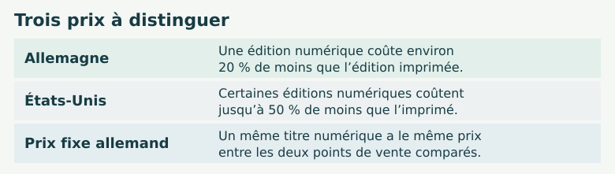

# X-ENS · MP-PC-PSI · Allemand 2018 — Corrigé guidé

*Corrigé rédigé par IA, non officiel. Signalez toute erreur.*

**Rédaction** · GPT-6.2 Astra Ultra · vitesse non renseignée

Garde XEULCR, filières MP, PC et PSI. Les deux exercices se rédigent en allemand en quatre heures. A demande une synthèse des quatre documents, sans commentaire personnel, avec un titre et 600 à 675 mots. B demande un texte d’opinion de 500 à 600 mots qui répond aux arguments de l’éditorial.

## A. Synthèse de documents

> [!INDICATION]
> **Différencier personnes, appareils et titres.** L’enquête de 2017 trouve 23 % de lecteurs de livres numériques parmi les répondants âgés d’au moins 14 ans, contre 35 % parmi les 14–29 ans. Les 67 % d’utilisateurs de liseuses se calculent sur les seuls lecteurs de livres numériques. Une proportion presque stable de lecteurs peut coexister avec une progression des liseuses dans ce groupe. L’expert du Goethe-Institut décrit, lui, les usages qui gagnent la chambre et le salon.

> [!INDICATION]
> **Relier deux signes matériels.** Sur le timbre suisse de 2009, l’arobase rouge et le caractère d’imprimerie figurent côte à côte sur un support postal. Le soin apporté aux titres, aux couvertures et à la mise en marché par Julia Eisele montre ce que le métier garde de matériel et de relationnel. Le rapport insiste sur le contresens fréquent concernant les prix. « Zwanzig Prozent unter dem Ladenpreis » signifie une réduction d’environ 20 % par rapport à l’imprimé.

**Ein Buch, zwei Arten, es in die Hand zu nehmen**

Auf einer Schweizer Briefmarke von 2009 begegnen sich ein Druckbuchstabe und das Zeichen einer elektronischen Adresse. Selbst die Geschichte des Übergangs von Gutenberg zum Internet lässt sich also auf Papier erzählen. Für den deutschen Buchmarkt beschreiben eine Befragung von Lesern, ein Gespräch über das elektronische Buch und ein Bericht von der Frankfurter Buchmesse eine vergleichbare Gleichzeitigkeit. Digitale Ausgaben verändern die Umstände des Lesens und Verkaufens, ohne dass der Erfolg eines Formats notwendig das Verschwinden des anderen bedeutet.

Wie weit die Veränderung reicht, hängt zunächst davon ab, was man misst. In der von Bitkom in Auftrag gegebenen Befragung von Menschen ab vierzehn Jahren liest 2017 knapp ein Viertel elektronische Bücher; dieser Anteil ist seit mehreren Jahren nahezu gleich geblieben. Zwischen den Altersgruppen bestehen erhebliche Unterschiede. Unter den Vierzehn- bis Neunundzwanzigjährigen nutzen 35 Prozent digitale Bücher, unter den Menschen ab 65 Jahren nur acht Prozent. Innerhalb der Gruppe, die bereits elektronisch liest, gewinnen dagegen spezielle Lesegeräte an Bedeutung. Wenn mehr Menschen mit einem Reader statt mit einem anderen Gerät lesen, muss deshalb die Zahl der digitalen Leser insgesamt nicht steigen. Auch die wachsende Nutzung von Hörbüchern beschreibt zunächst einen anderen Umgang mit Texten und mit den vorhandenen Abspielgeräten.

Im Interview des Goethe-Instituts erklärt der Fachmann diese Entwicklung über das Zusammenspiel von Geräten und Titeln. Je mehr geeignete Geräte vorhanden sind, desto eher lohnt es sich für Verlage, ein größeres Programm bereitzustellen. Das wiederum macht die Geräte attraktiver. Die Gründe der Nutzer passen zu dieser Erklärung: Eine ganze Reisebibliothek wiegt kaum etwas, verbraucht keinen Platz im Regal und lässt sich unterwegs rasch ergänzen. Nach und nach zieht der Reader jedoch auch ins Schlafzimmer oder auf den Balkon ein. Er wird an Orten benutzt, an denen bisher das gedruckte Buch selbstverständlich war. Ein begrenzter Zuwachs bei den Nutzerzahlen kann daher mit einer erheblichen Veränderung der Lesegewohnheiten einzelner Personen einhergehen.

Dem stehen Eigenschaften gegenüber, die sich nicht ohne Weiteres in einer Datei abbilden lassen. Viele Befragte schätzen Papier, Einband und das Gefühl, tatsächlich einen Gegenstand zu besitzen. Wer ein gedrucktes Buch einem Freund leiht, braucht sich weder über dessen Lesegerät noch über Nutzungsrechte Gedanken zu machen. In Deutschland ist zudem der Weg zur nächsten Buchhandlung häufig kurz. Dem Interview zufolge kostet eine elektronische Ausgabe hier ungefähr zwanzig Prozent weniger als die gedruckte; in den USA kann der Abstand bis zur Hälfte des Preises betragen. Die deutsche Buchpreisbindung macht das jeweilige E-Book bei verschiedenen Händlern gleich teuer. Sie besagt nicht, dass die elektronische und die gedruckte Ausgabe denselben Preis haben.

Die Arbeit der Verlegerin Julia Eisele verdeutlicht schließlich, was jenseits des Formats auf dem Spiel steht. Obwohl Umsätze sinken und Verlage schließen, gründet sie nach über zwanzig Jahren Branchenerfahrung ein eigenes Unternehmen. Vier Titel pro Saison erlauben es ihr, Bücher zu betreuen, die bei großen Häusern kaum unterkämen, und über Gestaltung, Titel und Pressearbeit selbst zu entscheiden. Der Auftritt am Stand eines größeren Verlags spart ihr auf der gut besuchten Frankfurter Messe Kosten. Unabhängige Auswahl und wirtschaftliche Abhängigkeit können somit zum selben Geschäftsmodell gehören. Dass ein Text digital verbreitet werden kann, hebt die Arbeit an seiner Auswahl und Vermittlung nicht auf.

Der fortbestehende Zuspruch zum gedruckten Buch schützt daher nicht automatisch jeden einzelnen Betrieb. Umgekehrt folgt aus dem Scheitern eines Verlags nicht, dass seine Leser überhaupt kein Interesse mehr an gedruckten Büchern hätten.

Die drei Berichte geben der Begegnung auf der Schweizer Marke damit einen konkreten Sinn. Über die Zukunft des Buches entscheiden zugleich die Bindung an vertraute Gegenstände, der praktische Nutzen neuer Geräte und die Möglichkeit, verlegerische Arbeit zu finanzieren. Bei einem Taschenbuch für unterwegs kann das Gewicht ausschlaggebend sein, bei einem sorgfältig gestalteten Geschenk seine materielle Form. Welche Ausgabe Leser erreichen wird, ist auch eine Frage der Wege, auf denen sie überhaupt von einem Titel erfahren.

*622 Wörter.*

## B. Texte d’opinion

> [!INDICATION]
> **Préciser le désaccord.** Wolter voit dans le journal que l’on consulte à table, le bref message que l’on reçoit et le livre que l’on lit au lit des usages susceptibles de se compléter. Examinez une même situation à deux échelles. À l’échelle d’une journée, une carte trouvée en ligne peut faciliter la lecture d’un roman. Au milieu d’une phrase, une alerte peut accaparer l’attention dont cette lecture a besoin.

> [!INDICATION]
> **Tester une affirmation sur les compétences.** La journaliste attribue une valeur au tri rapide des informations. L’exemple d’une classe qui vérifie l’origine de deux nouvelles contradictoires permet de dire en quoi consiste cette compétence. Le moment de lecture à voix haute rapproche enfin le débat des relations entre adultes et enfants évoquées dans l’éditorial.

Frauke Wolter widerspricht der Vorstellung, der Bildschirm mache den Büchern den Garaus. Ich glaube ebenfalls, dass beide Formen des Lesens einander bereichern können. Doch wenn Wolter aus der anhaltenden Liebe der Deutschen zum Buch folgert, die Medien machten einander kaum Konkurrenz, würde ich genauer hinsehen. Zwei Tätigkeiten können sich im Leben eines Menschen ergänzen und dennoch in einer bestimmten halben Stunde um seine Aufmerksamkeit konkurrieren.

Man denke an einen Leser, der im Internet einen Bericht aus einer Stadt findet, deren Geschichte er kaum kennt. Über eine Empfehlung gelangt er zu einem Roman, der dort spielt. Während der Lektüre sucht er eine Landkarte, später vergleicht er die Schilderung des Romans mit einem Interview. Ohne die kurzen Texte hätte er das Buch vielleicht nie aufgeschlagen. Auch das rasche Auswählen im Netz ist eine anspruchsvolle Tätigkeit. Wer eine Behauptung prüfen will, muss erkennen, wer sie aufgestellt hat, wie alt sie ist und ob sich die zweite Fundstelle wirklich auf eine unabhängige Quelle stützt. Hier hat Wolter recht: Langsamkeit allein macht eine Lektüre noch nicht gründlich.

Am selben Gerät kann der Ablauf aber ganz anders aussehen. Während der Leser nach der Karte sucht, erscheint eine Nachricht, darunter eine Empfehlung und kurz darauf eine Erinnerung an einen Termin. Nach einer Viertelstunde kennt er die Lage des Ortes immer noch nicht und erinnert sich kaum, an welcher Stelle die Romanfigur eigentlich steht. Damit ist weder seine Konzentrationsfähigkeit verloren noch der Roman überholt. Es ist aber ein Unterschied, ob der Leser selbst zwischen Texten wechselt oder ob andere ständig den Anlass dazu liefern. Die Zahl der gelesenen Wörter sagt wenig darüber, wer das Tempo und die Richtung bestimmt.

Wolters Hinweis auf die Möglichkeit, sich im Netz in Debatten einzuschalten, scheint mir deshalb besonders wichtig. Wer einen Fehler in einem Artikel bemerkt, kann die Zeitung heute auf eine Quelle aufmerksam machen. Der Einwand wird womöglich schon vor Erscheinen der nächsten Druckausgabe sichtbar. Allerdings verdient nicht jeder Kommentar gleiches Vertrauen, und auch eine sorgfältig gesetzte Buchseite kann einen Irrtum enthalten. In der Schule könnten Schüler zwei widersprüchliche Darstellungen desselben Ereignisses prüfen und anschließend erklären, warum sie einer davon mehr Gewicht geben. Dafür braucht man eine Begründung, kein Bekenntnis zu Papier oder Bildschirm.

Am deutlichsten zeigt sich die Grenze einer reinen Medienrechnung beim Vorlesen. Ein Kind, das sich abends ein weiteres Kapitel wünscht, bittet seine Eltern oft auch um gemeinsame, ungeteilte Zeit. Ob der Vater eine Seite umblättert oder die Schrift auf einem Reader vergrößert, ist dafür zweitrangig. Entscheidend ist, dass beide bei einem Satz verweilen und über dieselbe Figur lachen können. Ein Gerät, dessen Nachrichten währenddessen schweigen, kann diese Erfahrung durchaus ermöglichen.

Vielleicht erklärt das auch, weshalb das Verschenken eines gedruckten Buches seinen Reiz behält. Mit der Auswahl eines bestimmten Exemplars zeigt jemand, dass er über die Vorlieben des anderen nachgedacht hat. Eine gute elektronische Empfehlung kann dieselbe Aufmerksamkeit ausdrücken.

Die Frage lautet für mich also nicht, welches Medium künftig gewinnt. Sie lautet, welche Gewohnheiten wir einüben: einen Hinweis schnell verfolgen, eine Quelle kritisch prüfen und manchmal einen langen Text gegen Unterbrechungen schützen. Ergänzung ist unter diesen Bedingungen möglich und wertvoll. Sie entsteht aber erst, wenn Leser über ihre Zeit und ihre Aufmerksamkeit tatsächlich verfügen können.

*527 Wörter.*

Le rapport porte sur MP et PC. La garde du sujet inclut également PSI.

[Cahier d’allemand, A1–A3 p. 2–6, timbre p. 7, B p. 8–9](https://banques-ecoles.fr/cms/wp-content/uploads/2018/05/2018_MPPC_sujet_All.pdf) · [Rapport de l’écrit, p. 1–2](https://banques-ecoles.fr/cms/wp-content/uploads/2018/11/18_MPPC_rapport_eAll.pdf)
