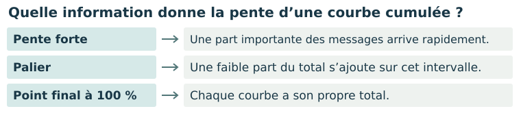
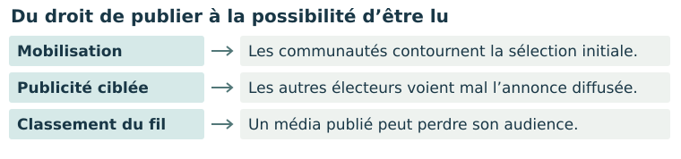
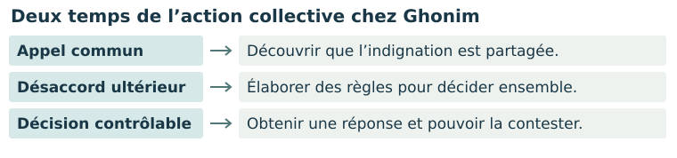

# X-ENS · MP-PC-PSI · Anglais 2018 — Corrigé brut

*Corrigé rédigé par IA, non officiel. Signalez toute erreur.*

**Rédaction** · GPT-6.2 Astra Ultra · vitesse non renseignée

Le cahier XEULCR prévoit quatre heures pour les deux parties. Aucun document autorisé. La partie A demande une synthèse en anglais de 600 à 675 mots, précédée d’un titre, qui croise les documents 1 à 4 dans leur contexte géographique, sans commentaire personnel. La partie B demande un texte d’opinion en anglais de 500 à 600 mots en réaction au document de la seconde partie. Les décomptes portent sur le corps du texte, hors titre.

## A. Synthèse de documents

**When the New Town Square Has a Landlord**

An American teenager once dependent on a newspaper editor can now help put police conduct on the political agenda. A Guatemalan editor who has built an audience online can lose much of it when an American company changes a menu. Research by Matthew Luttig and Cathy Cohen in the Washington Post, an Economist graphic and two Guardian reports on Twitter and Facebook illuminate both possibilities. Lowering the cost of political speech has widened participation, yet the power to determine who actually encounters that speech has become extraordinarily concentrated.

For some groups the new access is substantial. Luttig and Cohen's survey of young Americans shows that those from less advantaged households are particularly likely to use new online sources for political information. Young people of colour can encounter issues in communities whose priorities differ from those of established news organisations. Traditional news consumption is more strongly associated with reporting a vote, whereas social media use is associated with activities such as protesting against a company's practices. Defining participation solely by the ballot would therefore conceal some of the change. A follow-up also found that young people discussing politics most actively online were among those whose participation subsequently grew most.

The Economist charts show how quickly a shared vocabulary can gather momentum. The cumulative percentages of messages using terms associated with Ferguson, Michael Brown, Eric Garner and Black Lives Matter rise especially steeply during particular intervals on Facebook and Twitter. The curves follow related but not always identical paths across the platforms. Because each records the proportion of its own eventual total, reaching the same endpoint says nothing about which service carried more messages. The graphic gives a timescale to the mobilisation described by Luttig and Cohen. It cannot determine how many of the people posting attended a protest or whether the people seeing the messages changed their minds.

The same capacity to reach a particular audience can make persuasion less visible to everyone else. A Guardian report describes Twitter's proposed advertising centre after revelations about Russian activity during the 2016 American election. Voters would be able to identify the funder of candidate advertisements and inspect their cost and intended demographics. A message delivered privately to a particular group would thereby become open to wider examination. Senators nevertheless questioned the adequacy of the company's earlier investigation. The prospect of legislation illustrates the distance between a platform's promise of transparency and an enforceable public obligation.

Visibility can also disappear without any speaker being formally excluded. Facebook's experiment in six countries separated public posts from the main feed while keeping personal posts and paid advertisements there. In the other Guardian report, a journalist at Guatemala's Soy502 describes losing about two thirds of its traffic. In Slovakia, interactions on a selection of media pages fell approximately sixty per cent overnight. A subscription-funded newspaper with loyal direct readers has some insulation. Smaller outlets and civic groups may lack the resources to buy distribution or bring people to an independent website. The consequences are especially acute where journalists face pressure for reporting on corruption or approach an election with few established alternatives.

The American survey and the international reporting thus describe successive stages of the same political process. Citizens can organise without first winning over the old gatekeepers, yet sustaining the resulting conversation requires routes to the audience which neither citizens nor newsrooms necessarily control. Disclosure of sponsors may help voters judge a message once it reaches them. Understanding a platform's distribution decisions matters equally for judging why another message never arrived. The democratic significance of social media rests both on whose voices are newly audible and on who retains the power to turn the volume down.

*610 mots hors titre.*

## B. Texte d’opinion

**After the Crowd Has Gathered**

Wael Ghonim achieved something most editorial writers can only imagine. A page he created for Khaled Said helped Egyptians discover that their anger at police brutality was widely shared. Thomas Friedman is right to give that achievement its due, and to listen when its author describes the bitterness that followed. But I hesitate over the neatness of the question in Friedman's title. A tool that can summon a crowd has already done one difficult thing. Asking it to turn the crowd into a democracy asks it to do a different job.

Consider the initial appeal. A man had died, a photograph circulated and Egyptians recognised somebody whose fate might have been their own. People could join the page without first agreeing about who should govern Egypt. That low threshold made rapid solidarity possible. It also meant that apparent agreement on the page answered very few questions about the day after a change of government. Which rules should competing parties accept? What should happen when a majority takes a decision that frightens a minority? Sharing indignation gives people a reason to meet. It gives them no automatic procedure for disagreeing once they have met.

I nevertheless take Ghonim's account of design seriously. A platform which makes an angry remark instantly visible to thousands while burying its subsequent correction puts a price on changing one's mind. A writer who already fears being branded a traitor has another reason to resist an opponent's good argument. The ability to leave an abusive discussion is valuable, especially to people routinely targeted. Yet a system that rewards only the swiftest, loudest reply makes walking away attractive even to participants genuinely trying to listen. These outcomes are choices about design which a company could change.

Friedman points to Parlio, where a carefully framed question can support a civil exchange. I would welcome that experiment while asking who can afford to join and whose decisions will be affected. Imagine a town debating the closure of its only evening bus route. A moderated online discussion can gather testimony from workers unable to attend a daytime meeting. If the council never answers those contributors, however, their mutual courtesy will do little for the last bus. Publishing the council's reasoning and allowing the residents to challenge its assumptions would connect conversation to an institution able to act.

That distinction matters especially in Egypt. An army with the power to arrest organisers is hardly the equivalent of an angry commenter. The fact that competing forces could all use Facebook does not make them equal in resources or coercive power. Blaming the feed for a political defeat would let those who deployed that power disappear from the story.

I would judge a democratic platform by what its participants can do after their moment of common attention. Can they examine a claim, revise a proposal, obtain a reply and organise again without fear? Better design can help with each of those tasks. Courts, independent newsrooms and associations that outlast a burst of attention must help too. I would keep Ghonim's invitation to improve the internet and add a second one. Build places where the people it brings together can actually share power.

*528 mots hors titre.*

Le sujet et le rapport annuel ont été consultés. Les 66 % de trafic perdus à Soy502 et les 60 % d’interactions perdues sur des pages slovaques portent sur des mesures différentes.

[Sujet officiel](https://banques-ecoles.fr/cms/wp-content/uploads/2018/05/2018_MPPC_sujet_Angl.pdf) · [Rapport du jury](https://banques-ecoles.fr/cms/wp-content/uploads/2018/10/18_MPPC_rapport_eAng.pdf)
