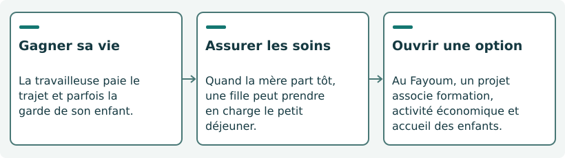

# X-ENS · MP-PC-PSI · Arabe 2018 — Corrigé brut

*Corrigé rédigé par IA, non officiel. Signalez toute erreur.*

**Rédaction** · GPT-6.2 Astra Ultra · vitesse non renseignée

Écrit commun de quatre heures, code XEULCR. La partie A croise les trois articles et l’image du dossier. La partie B répond à l’éditorial séparé. Le rapport de l’écrit porte sur les filières MP et PC, et la garde du sujet inclut également la PSI. La synthèse compte 619 mots hors titre et l’opinion 519, en comptant les unités séparées par des espaces.

## A. Synthèse du dossier

نساء يعملن ويبقين فقيرات: أين تتعطل سبل الاستقلال في المجتمعات العربية والإفريقية؟

في صورة نشرها موقع البديل المصري تتقدم امرأة محاطة بستة أوعية كبيرة يكاد حجمها يحجب جسدها. يظهر خلفها جدار قديم وشارع لا يكاد يتميز فيه موضع للمشاة. ومن الصعب أن ينظر المرء إلى هذا المشهد ثم يرد فقر النساء إلى قلة ما يبذلنه من جهد. تنطلق وثائق الملف من هذه المفارقة لتسأل عما يحول دون تحول العمل إلى دخل مستقر وقدرة على القرار. وتصل بين تنظيم الوقت داخل الأسرة، وشروط الوصول إلى التعليم والعمل في مجتمعات عربية وإفريقية مختلفة، وتجربة محلية تحاول أن تقطع الصلة بين فقر الأمهات وتضاؤل فرص أبنائهن.

تستعيد يمينة حمدي يوميات نساء مغاربيات يعملن لقاء أجور محدودة في ظروف تتداخل فيها المسؤوليات العائلية والمهنية. فمن مدينة ماطر تتجه زبيدة إلى محطة القطارات في العاصمة التونسية لتبدأ التنظيف في الخامسة صباحا، بعد أن تعهد بابنتها إلى جارة تدفع لها مقابلا. وحين ترجع إلى البيت ينتظرها إعداد الطعام والعناية بالطفلة. وفي فاس تجمع أرملة بين إعداد المأكولات والتجارة في الأشياء المستعملة والعمل الموسمي في الحقول إذا وقع عليها الاختيار. وبينما تبدأ يومها فجرا تتولى ابنتها ذات الثماني سنوات إعداد الفطور لإخوتها. وهكذا لا يبين الأجر المدفوع لقاء ساعات في المحطة أو الحقل كل العمل الذي استلزمه الحصول عليه، ولا كيف انتقل بعض هذا العبء إلى امرأة أو طفلة أخرى.

وتنقل الصورة جانبا من ذلك العمل إلى واجهة المشهد. تبدو الأوعية ثقيلة على الكتفين والصدر والظهر، وتقطع المرأة الطريق بوجه ساكن، من غير أن يظهر من يساعدها أو ما يعود عليها من هذا الجهد. ويتصل هذا التفاوت بين وضوح الحمل وغموض المقابل بما تعرضه خديجة مقدم في قراءتها لأبحاث عن المرأة الإفريقية والتنمية. فالنساء يسهمن في إعالة الأسر وفي الإنتاج، لكن إشراكهن في صياغة السياسات والوصول إلى المعرفة والموارد لا يوازي بالضرورة حجم هذه المساهمة. وتختلف الحالات باختلاف البلدان، فلا يمكن حمل تجارب النساء في إفريقيا جنوب الصحراء كلها على مثال واحد، ولا تفسير أوضاع النساء العربيات جميعا بحكاية عاملة واحدة.

وتلتقي الأبحاث والشهادات عند عوامل تتجاوز ضعف الدخل الفردي. فالتمييز في السوق يحصر بعض النساء في أنشطة شاقة قليلة الضمان، وتحد قلة التعليم من إمكان التفاوض على عمل آخر. وتلقي الأعراف التي تحصر القرار في يد الرجل بتبعاتها كذلك على من تعول أسرتها فعليا، كما قد تعرقل وصول النساء إلى الرعاية الصحية والمشاركة في الشأن العام. وترى حمدي أن السياسات العامة لمكافحة الفقر تغفل في بلدان عربية كثيرة ما تعنيه هذه الفوارق بين الجنسين. وإذا بقيت الفتاة في المنزل لتسد نقصا في الرعاية، أمكن أن تتكرر في جيلها الشروط التي ضيقت الخيارات المتاحة لأمها.

وتعرض أمينة خيري في المقابل تجربة من الفيوم المصرية تجمع وزارة التضامن الاجتماعي وجمعية معنية بالطفولة وشركة من القطاع الخاص. تراعي المبادرة دخل الأسر وعدد أفرادها ومستوى التعليم والمهارات المطلوبة، وتستهدف في بدايتها ثمانمئة امرأة في مركزي أبشواي ويوسف الصديق، فضلا عن فئات من الأبناء والصغار. وتربط التدريب على إدارة مشروعات صغيرة بتعليم المهارات الحياتية وبإقامة ثماني دور للحضانة. وفي محافظة تضم أيضا خريجات جامعيات يبحثن عن مورد، يتبين سبب الجمع بين هذه الجوانب. فالتعلم لا ينتهي بمجرد تقديم شهادة، مثلما لا تستفيد الأم من دورة مهنية إذا لم تجد مكانا آمنا لطفلها خلال ساعات التدريب.

ولا يقع عبء التغيير في تلك التجربة على الأمهات وحدهن، إذ تسند إلى الجمعيات مهمة الوصول إلى الأسر، وإلى الوزارة والجهات الممولة مسؤولية إتاحة خدمة تتجاوز قدرة الأسرة منفردة.

وتكشف هذه المبادرة عن فرق بين مساعدة أسرة على عبور ضائقة طارئة وتوسيع مجال الاختيار المتاح للمرأة فيها. فالتعاون بين قطاعات مختلفة يمكن أن يبلغ قرى تفتقر إلى الخدمات وأن يجمع في مكان واحد فرصا كانت في السابق متفرقة. لكنه يظل تجربة محددة الموقع والنطاق، بينما ترد المعوقات في الوثائق على مستويات تمتد من توزيع الواجبات المنزلية إلى القوانين والتمثيل في مواقع القرار. ومن ثم تتحدد العلاقة بين مشاركة النساء وتنمية المجتمع بما تحصل عليه العاملات من وقت وحقوق ومعرفة وقدرة على تقرير وجهة ثمار عملهن، وبما تستطيع الفتيات أن يتعلمنه دون أن يرثن الأعباء نفسها منذ الصغر.

## B. Texte d’opinion

أجد في عنوان مقال العرب عن تكافؤ فرص الاختيار تحديا مفيدا. فهو يستبعد أن يكون نجاح المجتمع رهنا بأن تعمل النساء والرجال جميعا في المهن نفسها وبالنسب نفسها. لو اختارت شابة أن تعتني بوالدتها المسنة مع توافر عمل لائق وإمكان الرجوع إليه، فمن حقها أن تعد ذلك قرارا يوافق رغبتها. لكن كيف نميز مثل هذا القرار من قرار امرأة تركت العمل لأن كلفة الرعاية تتجاوز أجرها كله؟ أرى أن قيمة كلمة الاختيار تقاس بوجود بديل يمكن تحمله وبقدرة صاحبة القرار على مراجعته لاحقا، لا بعدد الأبواب التي تبدو مفتوحة من بعيد.

يقول المقال إن التعليم يهيئ المرأة لتحقيق ما تختاره، ويورد ما تزامن مع توسع مصانع الملابس في بعض قرى بنغلاديش من ارتفاع التحاق الفتيات بالمدارس. أتصور أن الأهل يفكرون بطريقة مختلفة في مواصلة ابنتهم الدراسة متى رأوا أمامهم امرأة تكسب عيشها بما تعلمته. لكن وجود مصنع أو ارتفاع نسبة المسجلات لا يكفيان للحكم على اتساع فرصها. هل تستطيع أن تتعلم تخصصا آخر إذا رغبت فيه؟ وهل يمكنها أن ترفض عملا غير مأمون من دون أن تفقد كل سبيل إلى الكسب؟ هنا يصبح تنويع الوظائف وتيسير التنقل إليها مكملا لازما للتعليم، وخاصة في منطقة قد تحمل فيها الشابة شهادة جامعية ولا تجد ما يناسبها من عمل قريب.

وأحسب أن أقوى ما في المقال مقارنته بين أحوال أساتذة جامعة واحدة قبل دخول رعاية الأطفال في الحساب وبعده. فحين تظهر فجوة تقارب عشرين ساعة أسبوعيا في أعباء البيت ورعاية الأبناء بين الأستاذة والأستاذ، لا تكون المساحة الباقية لتحضير درس أو كتابة بحث متكافئة ولو تساوى راتباهما. يستطيع قسم جامعي أن يحدد اجتماعاته في وقت لا يصادف إغلاق دور الحضانة، وأن يتيح إجازة والدية فعلية للآباء أيضا. وعند النظر في الترقية يستطيع أن يراعي مدة التوقف التي قضيت في الرعاية. هذه تعديلات صغيرة قياسا ببناء جامعة، لكنها تغير معنى الفرصة التي تعلنها الجامعة للجميع.

كما أن تقديم حضانة قريبة من مكان العمل لا يغني عن الاستماع إلى من ينتهي دوامهن بعد إغلاقها. فتصميم الخدمة مع المستفيدات منها يوفر على المؤسسة كلفة حل جميل في الإعلان عسير الاستعمال في الحياة اليومية.

وقد يقال إن العمل الجزئي يحل المشكلة لأنه يخفف ساعات الحضور. وأنا أدافع عن حق من يرغب فيه، لكن بشرط أن يكون قابلا للرجوع عنه وأن تعرف العاملة أثره على معاشها قبل أن تختاره. فإذا كان الزوج يستطيع خفض ساعات عمله باليسر نفسه وقد اختارت الأسرة ترتيبا مؤقتا من بين صيغتين قابلتين للتطبيق، كان القرار أقرب إلى الحرية. أما أن يتوقع مدير الرجل بقاءه في المكتب دائما، ويسأل مدير المرأة مسبقا عمن سيرعى أبناءها، فسيبدو اختيارها طوعيا على الورق فقط. وقد تظهر كلفته الحقيقية بعد عقود حين يحين موعد التقاعد.

وتلفتني أخيرا تجربة الشابات اللواتي تغيرت تصوراتهن عن الزواج والإنجاب حين أتيح لهن عمل في مراكز الاتصال الهندية. لا أرى في تأخير الزواج ثمنا طبيعيا للترقي، ولا في كثرة الأبناء أو قلتهم مقياسا لنجاح سياسة التشغيل. ما يعنيني هو أن تملك المرأة وقتا وموردا تتخذ بهما القرار الذي يلائمها، وأن يكون للرجل نصيب معلوم في تبعات الحياة المشتركة. ولذلك لو سئلت إدارة مؤسسة عن تقدمها نحو المساواة لطلبت منها خبرين صغيرين إلى جانب نسب التوظيف: كم أبا استفاد من حقه في الرعاية، وكم امرأة عادت بعد انقطاع إلى مسار يتيح لها التقدم؟ بهذين السؤالين نقترب من معنى الاختيار الذي يستحق الدفاع عنه.

[Synthèse p. 2–8. Texte d’opinion p. 9–10.](https://banques-ecoles.fr/cms/wp-content/uploads/2018/05/2018_MPPC_sujet_Arabe.pdf) · [Rapport du jury de l’écrit.](https://banques-ecoles.fr/cms/wp-content/uploads/2018/10/18_MPPC_rapport_eArabe.pdf)
