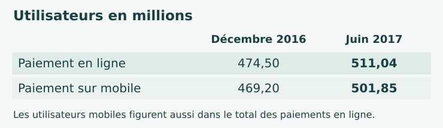

# X-ENS · MP-PC-PSI · Chinois 2018 — Corrigé guidé

*Corrigé rédigé par IA, non officiel. Signalez toute erreur.*

**Rédaction** · GPT-6.2 Astra Ultra · vitesse non renseignée

**Révision (tour 1)** · GPT-6.2 Astra Ultra · vitesse non renseignée

Les index identifient le chinois MP, PC et PSI (XEULCR dans la banque). La notice 2018, p. 14 et 18, fixe quatre heures et deux textes en chinois. A demande une synthèse de 600 à 675 mots des documents 1 à 4, avec titre et sans opinion personnelle. B demande une réaction à l’éditorial 5 en 500 à 600 mots.

## A. Synthèse de documents

> [!INDICATION]
> **Lire des situations différentes.** Pour le voyageur du premier article, transporter des espèces ou retirer de l’argent en déplacement a un coût. Dans A2, Wang Xia a les 18 yuans demandés mais le livreur refuse les espèces. Le paiement par téléphone facilite les transactions quand on peut le choisir. Lorsqu’il devient la seule possibilité, la liberté d’agir de certains usagers se réduit. A3 met en scène les propos d’un voleur de Jinan sur les portefeuilles désormais souvent vides. Cette anecdote renseigne sur la perception de la dématérialisation sans mesurer l’évolution de la délinquance.

> [!INDICATION]
> **Décoder les deux axes du graphique.** Les barres comptent des personnes en dizaines de milliers. Ainsi, 50 185 万人 correspondent à 501,85 millions de personnes. Les taux se lisent à droite. En juin 2017, 68,0 % des internautes utilisent le paiement en ligne, tandis que 69,4 % des internautes sur mobile utilisent le paiement mobile. Les deux populations de référence diffèrent. Additionner les deux effectifs reviendrait à compter certains internautes deux fois. L’illustration du corrigé conserve les effectifs et leurs dates.

**手机成了钱包，谁的生活更方便了？**

在中国城市的商店里，收银台上并排放着微信和支付宝的收款码，这样的场景在二〇一七年已很常见。一篇谈出差经历的文章、一则关于收快递的报道、一篇转述小偷自述的网文和中国互联网络信息中心的统计图，从不同方面说明了同一个变化。出门还要不要带钱包，表面上是个人习惯，实际上也取决于提供服务的一方愿意用什么方式收钱。

对经常到外地工作的人来说，现金和银行卡都有不方便的时候。身上带的钱太多是个负担，钱带少了，在外地取款又可能要付手续费。商店也未必能刷卡。手机支付把原来需要好几个步骤的事合在了一个动作里。大商场和小店都可以挂出收款码，骑车的人也能用手机扫码用车。介绍这些好处的文章还希望扫码所需的几秒钟能进一步缩短，这样乘地铁和公共汽车也会更方便。这里既有已经进入日常生活的做法，也有作者对下一步变化的期待。

统计图给这些街头见闻提供了一个参照。二〇一六年十二月，使用网上支付的有四亿七千四百五十万人，其中用手机进行网上支付的规模为四亿六千九百二十万人。半年后，两项数字分别超过五亿一千万和五亿。图中的两条线也都在上升，但各有自己的比较对象：一条表示网上支付用户占全体网民的比例，另一条表示手机网上支付用户占手机网民的比例。两个系列所涉及的人也有重合，不能把手机用户和网上支付用户相加来估算人数。换言之，这些数据说明采用新方式的人越来越多，却不能据此断言所有居民都已经在用手机付款。

一名在济南被抓的小偷从另一个角度谈到这种变化。他声称人们的钱包里普遍没有多少现金，连买烧饼这样的小额消费也能扫码。他的说法受到网友关注，正因为钱包和手机在日常生活中的地位确实发生了改变。不过，关于有多少钱包是空的，这是一个人的说法；统计图真正衡量的是使用支付服务的人数。网文具体写出的消费场景能帮助读者理解数字的含义，并不能替代对支付习惯的调查。

对一位六十岁的北京居民来说，同样的变化却让一笔小交易变得十分麻烦。王霞替女儿收快递，要付十八元，手头有现金，快递员却只收微信或支付宝。她不会用手机付钱，只好提议让快递员等女儿下班后再来。一个出差的人看重随时都能用手机解决问题，一个原本能够自行付款的人却因为对方只接受手机支付而不得不找家人帮忙。他们觉得方便还是费劲，既同自己会不会用有关，也同原有的办法还能不能用有关。

由此可见，支付工具的普及改变了顾客、商户和服务人员之间的配合方式。用户数字的增长、街头收款习惯的变化和部分居民遇到的阻碍同时存在。正是当一种新办法从多一个选择变成只剩这一个选择时，人们对这场变化的感受才显出如此大的差别。

Le découpage lexical indicatif donne 616 mots hors titre et ponctuation.

## B. Texte d’opinion

> [!INDICATION]
> **Distinguer l’opération et ses traces.** Le texte de Dong Yunfeng part des campagnes de WeChat Pay et d’Alipay. La succession des repas et des déplacements donne aux plateformes des informations sur les habitudes des clients. L’article redoute aussi le pouvoir d’un superviseur capable de concentrer encore plus de données. On peut admettre l’intérêt d’un reçu pour obtenir un remboursement, puis demander quelles réutilisations réclament une décision distincte de l’usager.

> [!INDICATION]
> **Éprouver le raisonnement.** Une commande passée pour un voisin peut conduire à un profil erroné. La distinction entre trace exacte et déduction incertaine permet de discuter la formule selon laquelle les plateformes connaîtraient mieux les personnes que celles-ci ne se connaissent elles-mêmes. La copie discute ensuite les conditions d’un recours et l’accès à d’autres moyens de paiement. Aucun rôle journalistique ou administratif particulier n’est assigné au candidat dans la notice.

“无现金城市周”这个口号让人想到的是少排队、少找零。董云峰却提醒读者，商家少收一张钞票，平台就多得到一笔记录。我认同他把目光从收银台移到后台。判断这种服务是否值得欢迎，不能只看付款要几秒钟，还得看付完款以后，谁有权决定那些记录以后拿来做什么。

一个人早上坐车、在地铁口买早餐，中午点外卖，傍晚回家又买了水果。单独看，每笔交易只说明一件小事，可同一个账号把它们连起来，就有可能勾画出他的作息、常去的地方和消费能力。平台为核对一笔订单而保存金额和时间是有理由的，由此推断顾客愿意花多少钱，再把推断交给其他公司，却是另外一件需要单独说明的事。同意付款，不能等于同意别人随意解释自己一天的生活。

不过，社论说平台甚至比我们自己还了解我们，我觉得需要追问，这种了解究竟准到什么程度。给邻居代买药、替同事订餐，都会留下属于这个账号的消费记录，买东西的人和最后使用东西的人却可能不同。如果一家公司拿这样的推断给顾客贴上标签，却不给当事人看到和纠正的机会，问题就不仅在于别人知道得太多，还在于别人可能把猜测当成事实。即使没有发生资料泄露，也有充分理由要求平台解释自己的决定。

一种具体的办法，是让用户在账单里看见商家收到的资料和平台另外留下的资料各有多少。碰到一笔退款，保留必要的记录当然有利于消费者举证；退款处理结束以后，那笔记录还有没有其他用途，就应该有清楚的答案。能够问出这些问题的人，应当包括每一个普通用户。

作者也担心，监管数据的人可能成为一个更加庞大的系统。这种担心值得重视，但并非只有让一个机构集中掌握所有记录才叫监管。可以要求平台事先说清哪些数据是完成支付所必需的，需要保留多久，哪些用途允许用户拒绝。处理投诉时，由独立机构核查与那笔争议有关的记录，并让用户知道核查结果。这样做，监督者也须对自己为什么查看信息作出说明。

对于小店来说，这个区别同样重要。如果只许顾客用一家平台结账，店主为了做成生意，就不得不接受那家公司的条件。他也应当能够保留另一种收款办法。

此外，选择只有在拒绝之后仍然能正常生活时才算数。一个人如果不用指定软件就连车票也买不了，屏幕上的“同意”很难代表真正的意愿。保留现金和其他付款办法，让不会用手机或不愿交出更多资料的人照样能够办事，同改善软件本身一样重要。少带一个钱包确实是进步，让人们在享受便利以后仍能决定自己的行踪由谁知晓，才会使这种进步值得信任。

Le découpage lexical indicatif donne 548 mots hors titre et ponctuation.

Le cahier chinois commence au document A1. Les quatre gardes conservées pour la même épreuve XEULCR 2018 donnent mot pour mot les mêmes consignes de rédaction, explicitement communes aux langues proposées. Elles demandent une synthèse titrée des documents 1 à 4, puis une prise de position sur le document 5. La notice de la session confirme ces deux travaux en MP et PC et étend leurs modalités à PSI. Les cinq documents chinois et les deux réponses sont complets. La garde propre au chinois reste introuvable.

[Cahier de chinois, p. 1–6](https://banques-ecoles.fr/cms/wp-content/uploads/2018/05/2018_MPPC_sujet_Chinois.pdf) · [Copie ENS du cahier](https://www.ens.psl.eu/sites/default/files/2018_mppc_sujet_chinois.pdf) · [Notice ENS 2018, p. 14 et 18](https://www.ens.psl.eu/sites/default/files/notice_ENS_2018.pdf) · [Arrêté du 5 janvier 2018, annexe, A, 2, § 2.1](https://www.legifrance.gouv.fr/jorf/article_jo/JORFARTI000036484682)

[Consigne commune sur la garde allemande](https://banques-ecoles.fr/cms/wp-content/uploads/2018/05/2018_MPPC_sujet_All.pdf#page=1) · [Consigne commune sur la garde espagnole](https://banques-ecoles.fr/cms/wp-content/uploads/2018/05/2018_MPPC_sujet_Esp.pdf#page=1)
