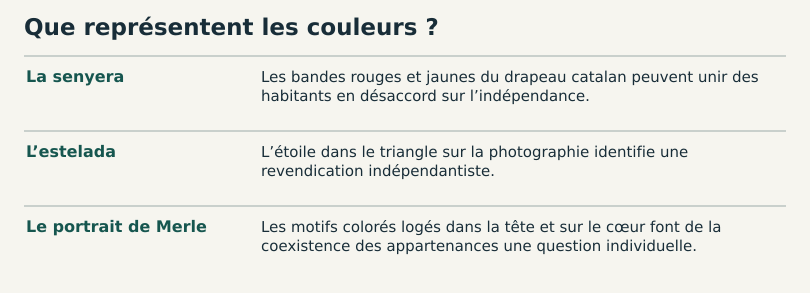

# X-ENS MP-PC-PSI — Espagnol 2018 · Corrigé guidé

*Corrigé rédigé par IA, non officiel. Signalez toute erreur.*

**Rédaction** · GPT-6.2 Astra Ultra · vitesse non renseignée

Le cahier XEULCR des filières MP, PC et PSI prévoit quatre heures sans document. La partie A demande une synthèse en espagnol de 600 à 675 mots, précédée d’un titre. La partie B demande un texte d’opinion en espagnol de 500 à 600 mots, en réponse au document 5. Le rapport de l’écrit concerne les filières MP et PC. La p. 7 porte la mention « A – Document 5 » pour le document iconographique annoncé en quatrième position. L’éditorial de la partie B se trouve p. 8.

## A. Synthèse de documents

> [!INDICATION]
> Reconstituez les dates avant de bâtir le plan. La photo de septembre précède le vote du 1er octobre et la marche du 8. Le reportage du 28 recueille des voix individuelles. Distinguez les trois drapeaux, les deux images et les deux usages du mot « majorité ». En p. 7, « A – Document 5 » désigne par erreur le document iconographique annoncé en quatrième position sur la garde.

**Cataluña, identidades en disputa**

¿A quién representan las banderas que ocupan los balcones y las calles de Cataluña en el otoño de 2017? Si la defensa de la independencia ha adquirido una extraordinaria visibilidad, la movilización de sus adversarios y los testimonios recogidos en Barcelona revelan una sociedad más diversa de lo que sugiere el enfrentamiento entre dos proyectos nacionales. Los documentos discrepan sobre el alcance de las divisiones y también sobre el valor que se ha de atribuir a los símbolos de pertenencia.

Juancho Dumall explica en El Periódico que hasta un gesto electoral aparentemente sencillo, colocar una bandera española detrás de dos dirigentes socialistas, dejó perplejos a muchos de sus simpatizantes. Para unos, sus colores evocan la apropiación de los símbolos nacionales por el franquismo y la derecha. Para otros, el escudo permite reconocer la pluralidad de los territorios dentro del Estado constitucional. Tampoco el catalanismo se agrupa bajo un único emblema. La estelada, partidaria de la independencia, ha desplazado de numerosos balcones a la senyera, que podría identificar igualmente a ciudadanos con opiniones distintas acerca de la secesión. En la fotografía de Albert Garcia, tomada en septiembre, la estrella blanca sobre fondo azul destaca muy por encima de la multitud, al alcance de la mirada de los agentes situados en primer plano. La imagen registra una presencia pública sin medir por ello la adhesión de toda la población.

Precisamente esa diferencia entre ocupar el espacio público y representar al conjunto es decisiva en el editorial de El Mundo sobre la marcha del 8 de octubre. El diario interpreta la aparición simultánea de banderas catalanas, españolas y europeas como el despertar de una mayoría relegada hasta entonces. Según su lectura, la Constitución y el Estatuto ofrecen garantías de igualdad que la actuación unilateral del gobierno catalán pone en peligro. La intervención del socialista Josep Borrell le permite subrayar la amplitud política de la protesta. Dumall, en cambio, recoge la advertencia del filósofo Reyes Mate sobre la capacidad de cualquier bandera para delimitar un bando. El mismo gesto de sacar una bandera puede así expresar un deseo de convivencia o trazar una frontera entre vecinos. Europa ofrece a ambos periódicos una referencia compartida, aunque el editorial destaca la seguridad económica que procura el euro, mientras que el filósofo invoca el aprendizaje histórico de una convivencia que supere los nacionalismos.

El reportaje de Pablo Ordaz en El País traslada el conflicto al ámbito de las relaciones personales. Jordi, barcelonés que se siente a la vez catalán y español, recuerda el temor a que se cuestionara su pertenencia por discrepar políticamente. En el retrato de Eulogia Merle publicado en el mismo diario, una figura de rasgos recompuestos lleva los colores en la cabeza y en el corazón. Lo que la manifestación del día 8 reunió en una calle cabe aquí dentro de una sola persona. La articulación de estas lealtades, que un sector del socialismo intentó traducir en un proyecto territorial plural, resulta difícil cuando las respectivas causas nacionales exigen una identificación exclusiva.

Al coste afectivo se suman consecuencias materiales. El Mundo señala los traslados de sedes empresariales y el temor de las entidades financieras a quedar fuera de la moneda común. Entre los interlocutores de Ordaz, un comerciante de vinos que se declara nacionalista celebra la calma que le permite vender y reclama políticos capaces de ceder. Elhadjy, que alquila bicicletas, observa que una mañana favorable apenas le ha traído cuatro clientes frente a las decenas de otros sábados. Su experiencia de la migración le hace valorar de otra manera el bienestar amenazado. Tanto las divergencias entre quienes comparten una identidad como esas preocupaciones cotidianas complican la pretensión de hablar por Cataluña en nombre de una sola bandera.

## B. Texte d’opinion

> [!INDICATION]
> L’éditorial de La Vanguardia du 2 octobre doit être lu au lendemain de l’intervention policière. Relevez ce qu’il reproche à chaque exécutif et les trois éléments de sa proposition (commission indépendante, délai, vote sur une solution convenue). Décidez ensuite à quelles conditions chacun pourrait fonctionner.

La imagen de un agente que se lleva una urna tiene la ventaja, para quien la difunde, de que parece explicarse sola. Ahí reside también su peligro. Ni la imagen demuestra que la consulta ofreciera garantías suficientes ni la orden de impedirla justifica cualquier actuación policial. Comparto la desolación que expresa La Vanguardia después del primero de octubre. Creo que su propuesta más valiosa consiste en cambiar la pregunta que se hacen ambos gobiernos. En vez de disputar quién ganó aquella jornada, deberían explicar qué decisión podría reconocer como legítima quien se encontrase en minoría al día siguiente.

El Govern tiene una responsabilidad que el impacto de las imágenes no borra. Convocar a decidir el futuro común exige acordar de antemano las reglas con quienes desean otro resultado. Un censo universal anunciado el mismo día puede facilitar que alguien vote cuando su colegio está cerrado, pero ¿cómo se verifica en tales condiciones la igualdad entre electores? También hubo ciudadanos que se quedaron en casa porque entendían que la convocatoria carecía de validez. Contar su ausencia como indiferencia y después convertir los votos emitidos en un mandato vinculante significaría decidir por ellos. Eso tampoco impide reconocer el significado político de tantas personas dispuestas a esperar durante horas para expresar su voluntad.

Al Gobierno central le correspondía prever que una intervención espectacular acabaría otorgando un reconocimiento simbólico a las mismas urnas a las que negaba valor jurídico. El editorial distingue la contención de algunos agentes de la conducta de otros. Esa distinción debería orientar una investigación con garantías sobre las actuaciones concretas. La confianza pública difícilmente se recupera cuando se califica toda la operación de proporcionada antes de escuchar a quienes estaban allí. Pero pedir explicaciones por el uso de la fuerza apenas servirá si la única respuesta al desacuerdo territorial sigue llegando de los tribunales.

Aceptaría la comisión independiente que propone el diario con dos condiciones. Sus integrantes deberían escuchar también a ciudadanos ajenos a los dos ejecutivos, por ejemplo a alcaldes de municipios socialmente distintos y a asociaciones que discrepan entre sí. Y tendrían que hacer público tanto el calendario como los puntos en los que persiste el desacuerdo. De otro modo, una sucesión de reuniones a puerta cerrada permitiría a cada dirigente presentarse en casa como vencedor de una negociación distinta. Los juristas pueden indicar qué reformas exige cada salida. No pueden elegir en nombre de la población cuánto autogobierno desea ni qué compromisos considera aceptables.

Finalmente, someter una propuesta concreta a los catalanes me parece defendible si antes se precisan sus consecuencias y el procedimiento constitucional para llevarla a efecto. Una consulta sobre un texto conocido permitiría discutir competencias, financiación o garantías lingüísticas y obligaría a defender algo más preciso que un sentimiento. Convendría, además, que quienes perdieran conservaran medios efectivos para defender su posición en el futuro. El primer éxito de una mediación así sería modesto, aunque reconocible. Una familia cuyos miembros hubiesen votado de manera distinta podría seguir discrepando sin que ninguno tuviese que negar al otro su condición de catalán.

[Cahier du concours](https://banques-ecoles.fr/cms/wp-content/uploads/2018/05/2018_MPPC_sujet_Esp.pdf) · [Rapport de l’écrit](https://banques-ecoles.fr/cms/wp-content/uploads/2018/11/18_MPPC_rapport_eEsp.pdf)
