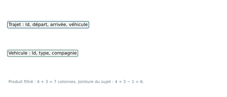
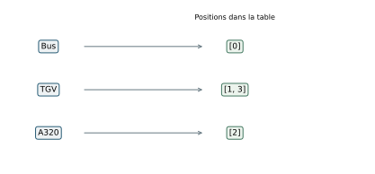

# X-ENS MP-PC-PSI · Informatique B 2018 · Corrigé brut

*Corrigé rédigé par IA, non officiel. Signalez toute erreur.*

**Rédaction** · GPT-6.2 Astra Ultra · vitesse non renseignée · 24 novembre 2026

## I · Algèbre relationnelle

### Question I.1 · Sélection par constante

Le résultat est une nouvelle liste. Chaque occurrence satisfaisante y est placée une fois, dans son ordre de lecture, même si une autre occurrence possède les mêmes valeurs. Les enregistrements eux-mêmes peuvent être partagés.

```python
def SelectionConstante(table, indice, constante):
    r = []
    for e in table:
        if e[indice] == constante:
            r.append(e)
    return r
```

### Question I.2 · Coût de la sélection

Pour $n$ enregistrements, il y a $n$ accès à un attribut et $n$ comparaisons unitaires, puis au plus $n$ ajouts amortis constants dans le modèle du sujet. Le coût est $\Theta(1+n)$ et l'espace du résultat est proportionnel au nombre de lignes retenues.

### Question I.3 · Égalité de deux attributs

La condition applique le test à chaque ligne. Si les indices sont égaux, chaque ligne est retenue. Les multiplicités et les colonnes de la table sont conservées.

```python
def SelectionEgalite(table, indice1, indice2):
    r = []
    for e in table:
        if e[indice1] == e[indice2]:
            r.append(e)
    return r
```

### Question I.4 · Projeter un enregistrement

Le parcours des indices construit une **nouvelle** ligne avec les valeurs demandées, dans l'ordre fourni. Pour $k'$ indices, il prend $\Theta(k')$ opérations.

```python
def ProjectionEnregistrement(enregistrement, listeIndices):
    r = []
    for i in listeIndices:
        r.append(enregistrement[i])
    return r
```

### Question I.5 · Projeter une table

La projection garde le nombre de lignes et peut introduire des répétitions. Elle prend $\Theta(1+nk')$ pour $n$ lignes et $k'$ colonnes conservées.

```python
def Projection(table, listeIndices):
    r = []
    for e in table:
        r.append(ProjectionEnregistrement(e, listeIndices))
    return r
```

### Question I.6 · Produit cartésien

Les boucles ajoutent exactement $n_1n_2$ lignes composées de tous les champs de gauche suivis de tous ceux de droite. Si l'une des tables est vide, le produit est vide.

```python
def ProduitCartesien(table1, table2):
    r = []
    for a in table1:
        for b in table2:
            r.append(a + b)
    return r
```

### Question I.7 · Jointure avec suppression de la clé de droite

Le résultat contient toutes les colonnes de la première table et, dans leur ordre initial, toutes celles de la seconde sauf sa clé de jointure. Chaque couple compatible produit exactement une occurrence. La taille d'une ligne est $a_1+a_2-1$ pour les arités $a_1,a_2$.

```python
def assemble(a, b, j):
    r = []
    for v in a:
        r.append(v)
    for t in range(len(b)):
        if t != j:
            r.append(b[t])
    return r

def Jointure(table1, table2, indice1, indice2):
    r = []
    for a in table1:
        for b in table2:
            if a[indice1] == b[indice2]:
                r.append(assemble(a, b, indice2))
    return r
```

### Question I.8 · Coût de la jointure imbriquée

Avec $m$ couples compatibles, le temps de ce code est $\Theta(1+n_1+n_1n_2+m(a_1+a_2))$. Chaque test de clés est unitaire et l'assemblage recopie les champs par deux boucles. Lorsque toutes les clés sont égales, $m=n_1n_2$ et le pire cas pour des tables non vides est $\Theta(n_1n_2(a_1+a_2))$.

### Question I.9 · Éliminer les répétitions

Après chaque passage, la liste résultat contient exactement une occurrence de chaque ligne déjà rencontrée. L'ajout a lieu seulement si aucune comparaison n'a réussi. Comme les deux lignes viennent de la même table, leurs arités sont égales.

```python
def egaux(a, b):
    for j in range(len(a)):
        if a[j] != b[j]:
            return False
    return True

def SupprimerDoublons(table):
    r = []
    for e in table:
        present = False
        for autre in r:
            if egaux(e, autre):
                present = True
                break
        if not present:
            r.append(e)
    return r
```

### Question I.10 · Coût de la déduplication

Il y en a au plus $0+1+\cdots+(n-1)=n(n-1)/2$ et chacune lit au plus $a$ attributs. Pour des lignes dont les $a-1$ premiers attributs sont identiques et dont le dernier est distinct, la borne est atteinte. Le coût est donc $\Theta(n^2 a)$ dans le pire cas pour $n\ge2$.

## II · Traduction de requêtes SQL

### Question II.1 · Départs de Rennes

La ville de départ est en position 1 dans Trajet. La sélection conserve tous les champs et toutes les occurrences correspondantes.

```python
resultat = SelectionConstante(Trajet, 1, "Rennes")
```

### Question II.2 · Toutes les combinaisons trajet-véhicule

Le produit émet les quatre colonnes de Trajet suivies des trois colonnes de Vehicule. Le schéma de la partie II donne bien quatre attributs à Trajet.

```python
resultat = ProduitCartesien(Trajet, Vehicule)
```

### Question II.3 · Produit filtré avec toutes les colonnes

L'identifiant du véhicule de Trajet est en position 3. Celui de Vehicule a pour position $4+0=4$ dans le produit. La sélection conserve ainsi les sept colonnes imposées, y compris les deux occurrences de la clé.

```python
produit = ProduitCartesien(Trajet, Vehicule)
resultat = SelectionEgalite(produit, 3, 4)
```



### Question II.4 · Disponibilités de chambres

Après jointure sur les identifiants d'hôtel, la ligne est $(\mathrm{IdHotel},\mathrm{Classe},\mathrm{Ville},\mathrm{IdReservation},\mathrm{Date},\mathrm{Prix})$. Les indices requis sont donc $1,2,4,5$.

```python
disponibilites = Jointure(Hotel, Chambre, 0, 1)
resultat = Projection(disponibilites, [1, 2, 4, 5])
```

### Question II.5 · Hôtels reliés à un ticket à 50

Dans Ticket, Prix est en position 5 et IdTrajet en 1. La table voyages commence par les quatre champs de Trajet. Sa ville d'arrivée se trouve donc toujours en position 2. La seconde jointure compare cette ville à la ville de l'hôtel, elle aussi en position 2. La projection garde l'identifiant de l'hôtel en position 0, sans dédupliquer.

```python
tickets50 = SelectionConstante(Ticket, 5, "50")
voyages = Jointure(Trajet, tickets50, 0, 1)
sejours = Jointure(Hotel, voyages, 2, 2)
resultat = Projection(sejours, [0])
```

### Question II.6 · Sous-requête IN et prix de chambre

La sous-requête est celle de II.5. Dédupliquer sa projection unaire donne un témoin unique par identifiant admissible. On sélectionne les chambres à 100, puis on les joint à cette table unaire. La suppression de l'unique colonne de droite par Jointure restitue exactement les quatre colonnes de Chambre et sa multiplicité initiale.

```python
tickets50 = SelectionConstante(Ticket, 5, "50")
voyages = Jointure(Trajet, tickets50, 0, 1)
sejours = Jointure(Hotel, voyages, 2, 2)
ids = SupprimerDoublons(Projection(sejours, [0]))
chambres100 = SelectionConstante(Chambre, 3, "100")
resultat = Jointure(chambres100, ids, 1, 0)
```

## III · Amélioration des performances

### Question III.1 · Contrôler le tri

Il suffit de tester les paires consécutives avec la relation stricte de décroissance. Une table vide ou une table à une ligne est triée, et les clés égales consécutives sont admises.

```python
def VerifieTrie(table, indice):
    for i in range(1, len(table)):
        if table[i-1][indice] > table[i][indice]:
            return False
    return True
```

### Question III.2 · Sélection dans un intervalle trié

À chaque étape, les indices strictement avant « bas » sont trop petits et ceux à partir de « haut » sont assez grands. Quand les bornes se rejoignent, le bloc recherché débute à cette position s'il existe. La lecture s'arrête à la première autre clé. Le temps est $O(\log(n+1)+1+m)$ si $m$ occurrences sont renvoyées.

```python
def SelectionConstanteTrie(table, indice, constante):
    bas, haut = 0, len(table)
    while bas < haut:
        milieu = (bas + haut) // 2
        if table[milieu][indice] < constante:
            bas = milieu + 1
        else:
            haut = milieu
    r = []
    while bas < len(table) and table[bas][indice] == constante:
        r.append(table[bas])
        bas += 1
    return r
```

### Question III.3 · Jointure par fusion de clés uniques

Deux curseurs parcourent les listes triées. On avance le curseur de la plus petite clé, ou les deux si les clés sont égales. L'unicité des clés dans chacune des deux tables garantit alors que tous les couples concernés par cette égalité ont été émis.

```python
def JointureTrie(table1, table2, indice1, indice2):
    i, j = 0, 0
    r = []
    while i < len(table1) and j < len(table2):
        a, b = table1[i], table2[j]
        x, y = a[indice1], b[indice2]
        if x < y:
            i += 1
        elif x > y:
            j += 1
        else:
            r.append(assemble(a, b, indice2))
            i += 1
            j += 1
    return r
```

### Question III.4 · Coût du parcours par fusion

Il y a au plus $n_1+n_2$ avances. Pour $m\le\min(n_1,n_2)$ correspondances, le coût vaut $O(1+n_1+n_2+m(a_1+a_2))$. Avec deux grandes tables entrelacées sans clé commune, le balayage est linéaire, tandis que la double boucle teste tous les couples. Si une table n'a qu'une ligne et que l'autre doit être parcourue entièrement, les deux méthodes sont du même ordre. Le coût d'écriture des $m$ lignes est commun aux deux méthodes et peut également dominer.

### Question III.5 · Index des positions par valeur

Une clé est créée dès sa première rencontre. Chaque position est ensuite ajoutée exactement une fois à la liste correspondante. L'index nécessite un temps et un espace $O(1+n)$ dans le modèle de dictionnaire du sujet.

```python
def CreerDictionnaire(table, indice):
    dico = {}
    for i in range(len(table)):
        cle = table[i][indice]
        if cle not in dico:
            dico[cle] = []
        dico[cle].append(i)
    return dico
```



### Question III.6 · Sélection avec index

Le dictionnaire est celui de la table pour l'indice fourni. Les positions qu'il contient désignent directement les occurrences à renvoyer. Une clé absente rend une nouvelle liste vide. L'argument indice fait partie de la garantie de cohérence de l'index.

```python
def SelectionConstanteDictionnaire(table, indice, constante, dico):
    r = []
    if constante in dico:
        for i in dico[constante]:
            r.append(table[i])
    return r
```

### Question III.7 · Comparer l'index au balayage

Index disponible, la sélection prend $\Theta(1+m)$ pour $m$ résultats au lieu de $\Theta(1+n)$. Une valeur absente ou unique dans une grande table donne un gain important. Si toutes les lignes correspondent, les deux coûts sont linéaires. Si l'on construit l'index pour une seule interrogation, le coût préalable $\Theta(n)$ peut absorber le gain. Des interrogations répétées le répartissent entre les usages.

### Question III.8 · Jointure au moyen d'un index

L'index de droite fournit tous les témoins, occurrences identiques incluses. Chaque témoin est associé à la ligne de gauche par le même assemblage qu'en I.7. L'ordre des champs et la multiplicité de la jointure sont donc conservés.

```python
def JointureDictionnaire(table1, table2, indice1, indice2, dico2):
    r = []
    for a in table1:
        cle = a[indice1]
        if cle in dico2:
            for j in dico2[cle]:
                r.append(assemble(a, table2[j], indice2))
    return r
```

### Question III.9 · Coût selon la fréquence maximale

Notons $k_2$ la longueur maximale d'une liste du dictionnaire et $a_1,a_2$ les arités. Pour $m$ correspondances, le coût de la fonction avec l'index fourni est $\Theta(1+n_1+m(a_1+a_2))$. Comme $m\le n_1k_2$ et $k_2\le n_2$, on obtient $O(1+n_1+n_1k_2(a_1+a_2))$. Si l'index doit être construit, il faut ajouter $\Theta(1+n_2)$.

### Question III.10 · Choisir le côté à indexer

Avec index déjà disponibles, parcourir la plus petite table extérieure réduit le nombre de sondages. Le nombre exact de couples $m=\sum_v f_1(v)f_2(v)$ et leur coût d'écriture sont identiques dans les deux sens. Si l'on raisonne seulement avec des majorants de fréquence, comparer $n_1k_2$ à $n_2k_1$ affine l'estimation de pire cas. Si aucun index n'existe, construire l'un et sonder avec l'autre donne dans les deux sens $O(n_1+n_2+m(a_1+a_2))$. Indexer la petite table réduit alors la mémoire auxiliaire. Un index déjà construit ou réutilisable peut changer le choix. Quel que soit le sens de parcours, assembler les champs dans l'ordre contractuel gauche-droite.
