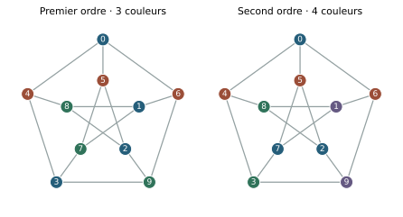
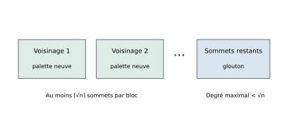

# X-ENS MP · Informatique A 2018 · Corrigé brut

*Corrigé rédigé par IA, non officiel. Signalez toute erreur.*

**Rédaction** · GPT-6.2 Astra Ultra · vitesse non renseignée · 24 novembre 2026

## 1 · Coloriage

### Question 1 · Vérifier les deux étiquetages

À gauche, le segment horizontal joint les deux sommets rouges : l’étiquetage proposé ne définit pas un coloriage. À droite, les arêtes du cycle étoilé relient successivement, en partant du sommet supérieur et en descendant à gauche, rouge, bleu, vert, rouge, vert puis rouge au retour ; les couleurs consécutives sont différentes. Cet étiquetage est un coloriage. Les croisements de segments sans sommet dessiné ne créent aucune nouvelle contrainte.

### Question 2 · Nombre chromatique du graphe de Petersen

Le cycle périphérique $0,4,3,9,6,0$ a longueur cinq, donc il ne peut être colorié en alternant seulement deux couleurs. Trois couleurs suffisent : les classes $\{0,1,2,3\}$, $\{4,5,6\}$ et $\{7,8,9\}$ sont indépendantes d’après les arêtes de la figure 2. Ainsi $\chi(G)=3$.

### Question 3 · Tester un étiquetage

Si le tableau comporte moins de $n$ cases, répondre faux. La matrice étant symétrique, le triangle supérieur, **diagonale incluse**, contient un représentant de chaque contrainte. La fonction vérifie que les deux étiquettes diffèrent sur chacune des arêtes. Les cases éventuelles d’étiquette au-delà de $n-1$ sont ignorées. Le coût est $O(n^2)$, au pire quadratique, et l’espace auxiliaire est constant.

```ocaml
let est_col gphe etiq =
  let n = vect_length gphe in
  if vect_length etiq < n then false
  else begin
    let correct = ref true in
    for i = 0 to n - 1 do
      for j = i to n - 1 do
        if gphe.(i).(j) & (etiq.(i) = etiq.(j)) then
          correct := false
      done
    done;
    !correct
  end;;
```

### Question 4 · Calcul exact par énumération

Pour un graphe sans boucle à $n\ge1$ sommets, attribuer une couleur distincte à chaque sommet prouve $\chi(G)\le n$. Pour $k=1,\ldots,n$, énumérer les $k^n$ applications $S\to\{0,\ldots,k-1\}$ et tester chacune par Q3. Le premier $k$ qui réussit est le minimum. Le temps est $O(n^2\sum_{k=1}^n k^n)\subseteq O(n^{n+3})$, donc $2^{O(n\log(n+1))}$ et, en particulier, au plus $2^{O(n^2)}$ au sens de la définition de l’énoncé. Une boucle est détectable d’abord sur la diagonale et entraîne l’absence de coloriage. Pour le graphe vide, la palette vide suffit si l’on autorise zéro couleur.

## 2 · Deux couleurs

### Question 5 · Bipartition et deux couleurs

Si $S=T\sqcup U$ est une bipartition, affecter 0 sur $T$ et 1 sur $U$ rend les couleurs distinctes aux extrémités de toute arête. Réciproquement, les préimages des couleurs 0 et 1 d’un coloriage à au plus deux couleurs forment la partition voulue. Une classe peut être vide, par exemple sur un graphe sans arêtes.

### Question 6 · Colorier en profondeur

La valeur $-1$ signifie « non visité ». Depuis un sommet arbitrairement colorié 0, chaque arête vers un sommet neuf impose la couleur opposée et lance la visite. Une arête vers un sommet déjà colorié permet de vérifier la compatibilité. Dans une composante bipartie, fixer la couleur de son premier sommet impose les couleurs des deux parts, donc aucun conflit ne survient. En cas de conflit, le code signale un échec, permis par la spécification. Chaque sommet est visité une fois et sa ligne de $n$ cases est parcourue, soit $O(n^2)$ en temps et $O(n)$ en espace, pile comprise.

```ocaml
let deux_col gphe =
  let n = vect_length gphe in
  let etiq = make_vect n (-1) in
  let rec visite s =
    for t = 0 to n - 1 do
      if gphe.(s).(t) then begin
        if etiq.(t) = -1 then begin
          etiq.(t) <- 1 - etiq.(s);
          visite t
        end else if etiq.(t) = etiq.(s) then
          failwith "graphe non biparti"
      end
    done
  in
  for s = 0 to n - 1 do
    if etiq.(s) = -1 then begin etiq.(s) <- 0; visite s end
  done;
  etiq;;
```

## 3 · Algorithmes gloutons

### Question 7 · Deux parcours gloutons de Petersen

Voici les couleurs finales **indexées par sommet**. L’algorithme choisit à chaque pas le plus petit entier naturel libre.

| Sommet | 0 | 1 | 2 | 3 | 4 | 5 | 6 | 7 | 8 | 9 | Nombre |
|---|---:|---:|---:|---:|---:|---:|---:|---:|---:|---:|---:|
| Premier ordre | 0 | 0 | 0 | 0 | 1 | 1 | 1 | 2 | 2 | 2 | 3 |
| Second ordre | 0 | 3 | 0 | 2 | 1 | 1 | 1 | 0 | 2 | 3 | 4 |

Dans le premier ordre, les couleurs successivement affectées sont $0,0,1,0,0,1,1,2,2,2$. Dans le second, elles sont $0,0,0,1,1,1,2,3,2,3$. Par exemple, à l’arrivée de 1 dans le second ordre, ses voisins 7, 6, 8 portent déjà respectivement 0, 1, 2 : la couleur 3 est nécessaire à cet instant.



### Question 8 · Plus petite couleur disponible

Balayer la ligne du sommet et marquer les couleurs non négatives de ses voisins. Il y a $n+1$ cases pour les couleurs $0,\ldots,n$. Les étiquettes d’entrée étant au plus $n-1$, la case $n$ reste toujours libre, même avec des entrées aux limites de la spécification. Le premier indice non marqué est précisément le minimum demandé. Initialisation et deux balayages ont un coût total $O(n)$ en temps et en espace.

```ocaml
let min_couleur_possible gphe etiq s =
  let n = vect_length gphe in
  let prise = make_vect (n + 1) false in
  for t = 0 to n - 1 do
    if gphe.(s).(t) & (etiq.(t) >= 0) then
      prise.(etiq.(t)) <- true
  done;
  let c = ref 0 in
  while prise.(!c) do incr c done;
  !c;;
```

### Question 9 · Coloriage glouton

Initialiser toutes les couleurs à $-1$ et, au rang $k$, colorier le sommet $s=\mathrm{num}[k]$ par Q8. Chaque appel coûte $O(n)$, soit $O(n^2)$ pour l’algorithme complet. La correction et la garantie de palette sont détaillées à Q10.

```ocaml
let glouton gphe num =
  let n = vect_length gphe in
  let etiq = make_vect n (-1) in
  for k = 0 to n - 1 do
    let s = num.(k) in
    etiq.(s) <- min_couleur_possible gphe etiq s
  done;
  etiq;;
```

### Question 10 · Invariant et borne du glouton

Sur un graphe sans boucle, l’étiquetage du sous-graphe des $k$ premiers sommets est propre après $k$ tours. C’est vrai au départ. Au tour suivant les arêtes anciennes gardent leurs couleurs, et toute arête reliant le nouveau sommet à un ancien a deux couleurs distinctes par le choix de Q8. Cela prouve l’invariant jusqu’à $n$. Le nouveau sommet a au plus $d$ voisins, qui interdisent au plus $d$ valeurs. Au moins une des $d+1$ couleurs $0,\ldots,d$ est donc libre. Tous les choix restent dans cette palette. Un graphe avec boucle ne peut admettre le coloriage demandé.

### Question 11 · Un ordre glouton optimal existe

Supposons les couleurs témoins numérotées par des entiers naturels, selon la convention de l’algorithme. Ordonner les sommets par $L$ croissante et prouver $L'(s)\le L(s)$ par récurrence sur le rang. Tout voisin déjà traité de $s$ a une couleur témoin strictement inférieure à $L(s)$, puisque $L$ est propre. Par récurrence sa couleur gloutonne est également strictement inférieure à $L(s)$. La couleur $L(s)$ est donc disponible, et le minimum choisi est au plus cette valeur. Pour un coloriage optimal, numéroter ses classes de 0 à $\chi(G)-1$ : la sortie utilise au plus $\chi(G)$ couleurs et, étant propre, exactement $\chi(G)$.

Si l’on autorise des étiquettes entières négatives comme dans les préliminaires généraux, l’inégalité numérique suppose ce réétiquetage préalable : un singleton étiqueté $-1$ serait sinon un contre-exemple littéral. La conclusion sur le nombre de couleurs est indépendante des noms des classes.

### Question 12 · Tri par degrés et Welsh–Powell

Remplir le tableau des degrés en $\Theta(n^2)$ en parcourant la matrice. Un tri par sélection en ordre décroissant échange ensuite seulement les indices des sommets : il fait $O(n^2)$ comparaisons à coût constant et préserve donc la borne totale quadratique. Tout ordre parmi les sommets de même degré convient. Welsh–Powell exécute Q9 sur cette permutation. L’espace supplémentaire hors matrice est $O(n)$.

```ocaml
let tri_degre gphe =
  let n = vect_length gphe in
  let degre = make_vect n 0 and ordre = range n in
  for i = 0 to n - 1 do
    for j = 0 to n - 1 do
      if gphe.(i).(j) then degre.(i) <- degre.(i) + 1
    done
  done;
  for i = 0 to n - 1 do
    let meilleur = ref i in
    for j = i + 1 to n - 1 do
      if degre.(ordre.(j)) > degre.(ordre.(!meilleur)) then
        meilleur := j
    done;
    let tmp = ordre.(i) in
    ordre.(i) <- ordre.(!meilleur);
    ordre.(!meilleur) <- tmp
  done;
  ordre;;

let welsh_powell gphe = glouton gphe (tri_degre gphe);;
```

## 4 · Algorithme de Wigderson

### Question 13 · Colorier le voisinage

Soit $L$ un coloriage avec au plus $k+1$ couleurs. Aucun voisin de $s$ ne porte $L(s)$. La restriction de $L$ aux voisins de $s$ reste un coloriage de leur sous-graphe induit et emploie au plus $k$ couleurs. Cette borne porte sur les couleurs et laisse le nombre de voisins arbitrairement grand.

### Question 14 · Validité et nombre de couleurs de Wigderson

Chaque bloc est un sous-ensemble du voisinage d’un sommet. Par Q13 il est 2-coloriable ; il reçoit une palette neuve d’au plus deux couleurs. Deux sommets voisins appartenant à des blocs différents ont donc des couleurs distinctes. Chaque bloc consomme au moins $\lceil\sqrt n\rceil$ sommets encore sans couleur. Les blocs étant disjoints, il y en a au plus $\lfloor n/\lceil\sqrt n\rceil\rfloor$ si $n>0$.

Le nombre de voisins non coloriés d’un sommet ne peut que décroître. Après le passage sur les sommets, tout sommet résiduel a donc strictement moins de $\sqrt n$ voisins résiduels : soit il était sous le seuil lors de son examen, soit ses voisins alors non coloriés ont tous reçu une couleur à cet examen. Le glouton sur le résidu utilise au plus $\lceil\sqrt n\rceil$ couleurs par Q10, dans une palette disjointe des précédentes. Toute arête, y compris entre le résidu et un bloc, est correctement coloriée. Au total, la borne est $2\lfloor n/\lceil\sqrt n\rceil\rfloor+\lceil\sqrt n\rceil=O(\sqrt n)$.



### Question 15 · Extraire une matrice induite

Allouer séparément chaque ligne et poser la case $(i,j)$ à l’adjacence entre les sommets d’origine correspondants. On respecte l’ordre fourni par le tableau, même s’il n’est pas croissant. Pour $m$ sommets retenus, temps et espace $\Theta(m^2)$ hors cas vide.

```ocaml
let sous_graphe gphe sg =
  let m = vect_length sg in
  let h = make_vect m [||] in
  for i = 0 to m - 1 do
    h.(i) <- make_vect m false;
    for j = 0 to m - 1 do
      h.(i).(j) <- gphe.(sg.(i)).(sg.(j))
    done
  done;
  h;;
```

### Question 16 · Voisins encore non coloriés

Un balayage décroissant et une insertion en tête produisent les indices en ordre croissant, quoique l’ordre soit libre. La longueur de cette liste est le degré demandé. Les deux fonctions prennent $O(n)$ en temps et au plus $O(n)$ en espace.

```ocaml
let voisins_non_colories gphe etiq s =
  let voisins = ref [] in
  for t = vect_length gphe - 1 downto 0 do
    if gphe.(s).(t) & (etiq.(t) = -1) then
      voisins := t :: !voisins
  done;
  !voisins;;

let degre_non_colories gphe etiq s =
  list_length (voisins_non_colories gphe etiq s);;
```

### Question 17 · Sommets encore non coloriés

Parcourir tous les indices et conserver ceux d’étiquette $-1$. Le test porte sur les sommets eux-mêmes ; un sommet isolé non colorié est ainsi bien inclus. Temps et espace $O(n)$.

```ocaml
let non_colories gphe etiq =
  let libres = ref [] in
  for s = vect_length gphe - 1 downto 0 do
    if etiq.(s) = -1 then libres := s :: !libres
  done;
  !libres;;
```

### Question 18 · Construire et reporter les colorations locales

Traiter seulement les sommets encore non coloriés. Pour $d>0$ et $n>0$, le test $d\ge 1+\lfloor(n-1)/d\rfloor$ équivaut à $d^2\ge n$ ; il évite les flottants et le produit. Dans chaque bloc, Q6 utilise les valeurs 0 et éventuellement 1. L’auxiliaire reporte le coloriage aux bons sommets en le décalant et avance le début de palette de la quantité effectivement utilisée. Le centre du bloc pourra rester non colorié jusqu’à la phase finale. Après Q17 appliquer le glouton sur le résidu, dans ses indices locaux, puis effectuer le même report.

Le passage extérieur et la collecte des listes coûtent $O(n^2)$ au total. Pour les blocs de tailles $m_i$, l’extraction et le 2-coloriage coûtent $O(\sum_i m_i^2)\le O(n^2)$ par disjonction. La copie des couleurs prend $O(n)$ en tout. Le traitement final est quadratique lui aussi. Le temps est donc $O(n^2)$ et l’espace maximal $O(n^2)$. Le programme suit les deux phases de Q14 et en conserve la garantie ; si le graphe est vide, il rend un vecteur vide.

```ocaml
let wigderson gphe =
  let n = vect_length gphe in
  let etiq = make_vect n (-1) and base = ref 0 in
  let reporte sg couleurs =
    let nombre = ref 0 in
    for i = 0 to vect_length sg - 1 do
      let c = couleurs.(i) in
      etiq.(sg.(i)) <- !base + c;
      if c + 1 > !nombre then nombre := c + 1
    done;
    base := !base + !nombre
  in
  for s = 0 to n - 1 do
    if etiq.(s) = -1 then begin
      let voisins = voisins_non_colories gphe etiq s in
      let d = list_length voisins in
      if d > 0 then
        if d >= 1 + (n - 1) / d then begin
          let sg = vect_of_list voisins in
          reporte sg (deux_col (sous_graphe gphe sg))
        end
    end
  done;
  let sg = vect_of_list (non_colories gphe etiq) in
  reporte sg (glouton (sous_graphe gphe sg) (range (vect_length sg)));
  etiq;;
```

### Question 19 · Généralisation à un nombre chromatique connu

Pour $k\ge4$ fixé, un graphe $k$-coloriable a des voisinages $(k-1)$-coloriables par Q13. Fixer un seuil $T$, extraire par blocs disjoints les voisinages non coloriés de taille au moins $T$ et colorier chaque bloc par la version récursive pour $k-1$, en lui réservant une palette neuve. Terminer par le glouton sur le reste, de degré strictement inférieur à $T$. Le cas de base $k=2$ est Q6. On n’a besoin d’aucun coloriage témoin concret.

On peut prendre $T=\lceil n^{(k-2)/(k-1)}\rceil$. En effet, supposons qu’un bloc $(k-1)$-coloriable de taille $m$ consomme $O(m^{1-1/(k-2)})$ couleurs. Puisque $m\ge T$, ce coût est $O(m/T^{1/(k-2)})$. La somme des tailles des blocs étant au plus $n$, leur coût total en couleurs est $O(n/T^{1/(k-2)})$. Les $O(T)$ couleurs finales équilibrent cette borne : on obtient $O(n^{1-1/(k-1)})$ couleurs, pour $k$ fixé. La récursion a profondeur au plus $k-2$ et les blocs d’un même niveau sont disjoints ; le temps reste polynomial.
