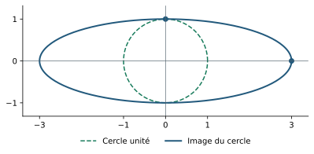
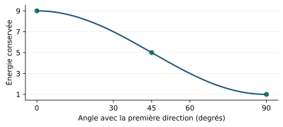
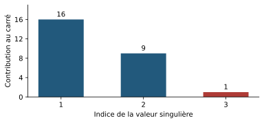
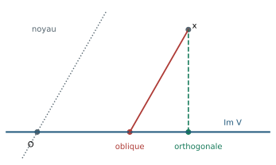
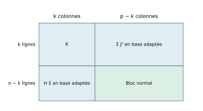
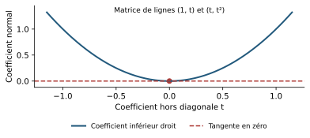

# X-ENS MP — Mathématiques A 2018 · Corrigé guidé

*Corrigé rédigé par IA, non officiel. Signalez toute erreur.*

**Rédaction** · modèle exact non renseigné (famille GPT-6) · effort non renseigné · vitesse non renseignée

**Révision** · modèle exact non renseigné (famille GPT-6) · effort non renseigné · vitesse non renseignée

**Révision (tour 2)** · GPT-6.2 Astra Ultra · vitesse non renseignée

**Révision (tour 3)** · GPT-6.2 Astra Ultra · vitesse non renseignée · 26 novembre 2026

## Présentation du sujet

Les 19 numéros de cette épreuve de quatre heures comprennent 36 questions et sous-questions. À partir de la décomposition en valeurs singulières d’une matrice rectangulaire, on détermine sa meilleure approximation de rang inférieur puis les vitesses possibles d’une courbe de rang fixé. [Sujet officiel](https://banques-ecoles.fr/cms/wp-content/uploads/2018/05/2018_MPI_sujet_MathA.pdf)

> [!JURY]
> Le jury relève des confusions entre matrices carrées et rectangulaires et souligne l’importance de caractériser un projecteur par son image et son noyau. [Rapport officiel](https://banques-ecoles.fr/cms/wp-content/uploads/2018/10/18_MP_rap_eMathA.pdf)

## Préliminaire — Norme de Frobenius

On utilise $\langle A,B\rangle_F=\operatorname{tr}(A^{\mathsf T}B)$ pour les matrices rectangulaires réelles de même taille.

### Question 1

> [!INDICATION]
> Où intervient la diagonale dans la définition du produit de Frobenius ?

> [!INDICATION]
> Écrivez le coefficient diagonal d’indice $j$ de la matrice produit.

#### Solution

L’entrée diagonale d’indice $j$ du produit $A^{\mathsf T}B$ vaut $\sum_{i=1}^n a_{ij}b_{ij}$. La trace donne $\langle A,B\rangle_F=\sum_{i=1}^n\sum_{j=1}^p a_{ij}b_{ij}$. En particulier la norme au carré est la somme des carrés de toutes les entrées.

### Question 2

> [!INDICATION]
> Lisez séparément chaque coordonnée du vecteur image.

> [!INDICATION]
> Appliquez Cauchy-Schwarz à chaque produit ligne-colonne puis sommez les carrés.

#### Solution

Pour chaque ligne $i$, Cauchy-Schwarz donne $(\sum_j a_{ij}u_j)^2\leq(\sum_j a_{ij}^2)\|u\|_2^2$. La somme sur les lignes donne $\|Au\|_2^2\leq\|A\|_F^2\|u\|_2^2$. Prendre la racine carrée.

### Question 3

> [!INDICATION]
> Décomposez la norme de Frobenius par colonnes.

> [!INDICATION]
> Chaque colonne du produit est l’image de la colonne correspondante de $C$.

#### Solution

Si $c_j$ est la colonne $j$ de $C$, la colonne correspondante de $AC$ vaut $Ac_j$. Par les questions 1 et 2,
$$\|AC\|_F^2=\sum_{j=1}^q\|Ac_j\|_2^2\leq\|A\|_F^2\sum_{j=1}^q\|c_j\|_2^2=\|A\|_F^2\|C\|_F^2.$$
La racine carrée conserve l’inégalité.

## I — Décomposition en valeurs singulières

La matrice $A$ a $n$ lignes, $p$ colonnes et un rang $k>0$. On pose $S=AA^{\mathsf T}$ et $\widetilde S=A^{\mathsf T}A$.

### Question 4

> [!INDICATION]
> L’image se décrit par une famille de générateurs.

> [!INDICATION]
> Sa dimension est limitée à la fois par le nombre de générateurs et par la dimension de l’espace ambiant.

#### Solution

Les $p$ colonnes engendrent l’image, qui est contenue dans $\mathbb R^n$. Sa dimension $k$ est donc au plus $p$ et au plus $n$. Pour tout réel $\lambda\ne0$, multiplier toutes les colonnes par $\lambda$ conserve l’espace qu’elles engendrent. Ainsi $\lambda A$ a encore rang $k$.

### Question 5a

> [!INDICATION]
> Calculez la forme quadratique associée à $S$.

> [!INDICATION]
> L’identité obtenue permet de relier deux noyaux. Prenez ensuite les orthogonaux.

#### Solution

On a $S^{\mathsf T}=S$ et $x^{\mathsf T}Sx=\|A^{\mathsf T}x\|_2^2\geq0$. Pour un vecteur propre non nul, ceci impose une valeur propre positive ou nulle. Cette identité donne aussi $\ker S=\ker A^{\mathsf T}$. En prenant les orthogonaux, $\operatorname{Im}S=(\ker S)^{\perp}=(\ker A^{\mathsf T})^{\perp}=\operatorname{Im}A$, car $S$ est symétrique.

### Question 5b

> [!INDICATION]
> Commencez par vérifier que le vecteur proposé est non nul.

> [!INDICATION]
> Multipliez l’équation propre par $A^{\mathsf T}$ à gauche.

#### Solution

L’égalité $\|A^{\mathsf T}u\|_2^2=u^{\mathsf T}Su=\lambda\|u\|_2^2$ donne $\|v\|_2=\|u\|_2>0$. De plus,
$$\widetilde S v=\frac{A^{\mathsf T}Su}{\sqrt\lambda}=\lambda v.$$
Ainsi $v$ est bien un vecteur propre de $\widetilde S$.

### Question 6a

> [!INDICATION]
> Appliquez le théorème spectral en tenant compte du rang de $S$.

> [!INDICATION]
> Dans la décomposition spectrale, omettez les contributions de valeur propre nulle.

#### Solution

Le théorème spectral fournit une base orthonormée de vecteurs propres de $S$. Par 5a, $S$ a rang $k$ et toutes ses valeurs propres sont positives ou nulles. Il y a exactement $k$ valeurs propres strictement positives comptées avec multiplicité. Rangeons-les par ordre décroissant au sens large dans $\Lambda$, et mettons les vecteurs propres correspondants en colonnes dans $U$. Les contributions des directions de valeur propre nulle disparaissent, donc $S=U\Lambda U^{\mathsf T}$ et $U^{\mathsf T}U=I_k$.

### Question 6b

> [!INDICATION]
> Comparez les deux images par la factorisation et par le produit $SU$.

> [!INDICATION]
> Pour caractériser une projection orthogonale, identifiez l’image et vérifiez l’orthogonalité du reste.

#### Solution

Les colonnes de $S$ appartiennent à $\operatorname{Im}U$, et $SU=U\Lambda$ montre l’inclusion réciproque puisque $\Lambda$ est inversible. Pour tout $x$, $UU^{\mathsf T}x$ appartient à cet espace et $U^{\mathsf T}(x-UU^{\mathsf T}x)=0$. La décomposition obtenue est celle de la projection orthogonale sur $\operatorname{Im}U$.

### Question 6c

> [!INDICATION]
> Développez les deux produits en remplaçant $V$ par son expression.

> [!INDICATION]
> Utilisez $D\Lambda D=I_k$ et projectez les colonnes de $A$ sur leur propre espace.

#### Solution

Avec $D=\Lambda^{-1/2}$ et $V=A^{\mathsf T}UD$, on calcule $V^{\mathsf T}V=DU^{\mathsf T}SUD=D\Lambda D=I_k$. Réciproquement $D\Lambda D=I_k$ donne $V\Lambda V^{\mathsf T}=A^{\mathsf T}UU^{\mathsf T}A$. Comme toutes les colonnes de $A$ sont dans $\operatorname{Im}U$, on a $UU^{\mathsf T}A=A$ et le produit vaut $\widetilde S=A^{\mathsf T}A$.

### Question 7

> [!INDICATION]
> Comparez la matrice $D$ à la matrice diagonale des valeurs singulières.

> [!INDICATION]
> Substituez $V^{\mathsf T}$ dans le produit et identifiez un projecteur déjà étudié.

#### Solution

Posons $\Sigma=\Lambda^{1/2}=D^{-1}$. En substituant $V^{\mathsf T}=DU^{\mathsf T}A$, on obtient $U\Sigma V^{\mathsf T}=UU^{\mathsf T}A=A$. En particulier $Av_i=\sqrt{\lambda_i}\,u_i$, où $u_i$ et $v_i$ sont les colonnes correspondantes de $U$ et $V$.

## II — Meilleure approximation de rang donné

Les colonnes $v_h$ de $V$ sont les vecteurs singuliers droits. On projette sur les colonnes orthonormées $\widetilde v_m$ de $\widetilde V$, au nombre de $\ell<k$. À la question 9, $\lambda_\ell>\lambda_{\ell+1}$.

### Question 8a

> [!INDICATION]
> Le facteur de droite est un projecteur orthogonal.

> [!INDICATION]
> Décomposez $A$ à l’aide des projecteurs complémentaires et vérifiez l’orthogonalité en permutant la trace.

#### Solution

Notons $P=\widetilde V\widetilde V^{\mathsf T}$. La relation $\widetilde V^{\mathsf T}\widetilde V=I_\ell$ le rend symétrique et idempotent. Les deux termes de $A=AP+A(I-P)$ sont orthogonaux pour le produit de Frobenius, car $\operatorname{tr}(PA^{\mathsf T}A(I-P))=\operatorname{tr}((I-P)PA^{\mathsf T}A)=0$. Pythagore donne $\|A-AP\|_F^2=\|A\|_F^2-\|AP\|_F^2$.

### Question 8b

> [!INDICATION]
> Écrivez le carré de la norme comme une trace ne contenant plus qu’un seul projecteur.

> [!INDICATION]
> Décomposez $A^{\mathsf T}A$ en somme de matrices de rang un, puis développez chaque projection.

#### Solution

Par cyclicité de la trace et $P^2=P$,
$$\|AP\|_F^2=\operatorname{tr}(A^{\mathsf T}AP)=\sum_{h=1}^{k}\lambda_h v_h^{\mathsf T}Pv_h=\sum_{h=1}^{k}\lambda_h\sum_{m=1}^{\ell}\langle v_h,\widetilde v_m\rangle_2^2.$$
La deuxième égalité utilise la décomposition de $A^{\mathsf T}A$ de la question 6c.

### Question 9a

> [!INDICATION]
> Interprétez les nombres proposés comme des carrés de normes de projections.

> [!INDICATION]
> Pour comparer les sommes, appliquez Bessel à chacun des vecteurs de la famille tildée.

#### Solution

Les $a_i=\|Pv_i\|_2^2$ sont positifs ou nuls, comme les $b_j=\|v_j\|_2^2-\|Pv_j\|_2^2=\|(I-P)v_j\|_2^2$. Pour chaque $m$, Bessel appliquée à la famille orthonormée $(v_1,\ldots,v_k)$ donne $\sum_h\langle v_h,\widetilde v_m\rangle_2^2\leq1$. La somme sur $m$ vaut au plus $\ell$, donc $\sum_{i>\ell}a_i+\sum_{j\leq\ell}(1-b_j)\leq\ell$, ce qui donne la comparaison demandée.

### Question 9b

> [!INDICATION]
> Séparez dans la formule de 8b les indices avant et après la coupure.

> [!INDICATION]
> Comparez les poids extrêmes des deux groupes. Quand l’écart spectral est strict, que force une différence nulle ?

#### Solution

La différence entre le maximum annoncé et la quantité de 8b vérifie
$$\sum_{j=1}^{\ell}\lambda_j-\|AP\|_F^2=\sum_{j\leq\ell}\lambda_j b_j-\sum_{i>\ell}\lambda_i a_i\geq (\lambda_\ell-\lambda_{\ell+1})\sum_{j\leq\ell}b_j.$$
On a utilisé 9a et $\lambda_{\ell+1}>0$. Le membre de droite est positif ou nul. Si la différence s’annule, l’écart spectral strict impose $b_j=0$ pour tout $j\leq\ell$. Les $v_j$ correspondants appartiennent à $\operatorname{Im}P$, qu’ils engendrent par égalité des dimensions. Réciproquement, si cet espace est engendré par les $\ell$ premiers $v_j$, leurs projections sont eux-mêmes et celles des $v_i$ restants sont nulles. La formule de 8b donne alors l’égalité.

### Question 9c

> [!INDICATION]
> Projetez orthogonalement sur l’image de la transposée de la matrice concurrente.

> [!INDICATION]
> Séparez l’erreur de projection et la distance entre la concurrente et la matrice projetée, puis étudiez les deux égalités.

#### Solution

Prenons pour $P$ le projecteur orthogonal sur $\operatorname{Im}M^{\mathsf T}$, espace de dimension $\ell$. Ici $M=MP$, car $M$ annule $(\operatorname{Im}M^{\mathsf T})^\perp$. La même orthogonalité qu’en 8a donne
$$\|A-M\|_F^2=\|A(I-P)\|_F^2+\|AP-M\|_F^2
\geq \sum_{h=1}^k\lambda_h-\sum_{h=1}^{\ell}\lambda_h.$$
En effet $\|A\|_F^2=\operatorname{tr}(A^{\mathsf T}A)=\sum_h\lambda_h$. Il y a égalité exactement si $M=AP$ et si l’on a égalité en 9b. Ainsi $P=V_*V_*^{\mathsf T}$ et $M=U_*\Sigma_*V_*^{\mathsf T}$. Cette matrice de rang $\ell$ atteint effectivement la borne. Lorsque $\lambda_\ell=\lambda_{\ell+1}$, la minoration de 9b reste valable et la même troncature l’atteint. La valeur minimale est donc encore la somme des valeurs propres écartées pour l’erreur au carré. Le projecteur optimal peut alors se choisir de plusieurs façons. Pour $A=I_2$ et $\ell=1$, chaque $vv^{\mathsf T}$ avec $\|v\|=1$ approche $I_2$ avec une erreur de Frobenius égale à $1$. L’égalité vient de ce que $I_2-vv^{\mathsf T}$ est un projecteur orthogonal de rang un. La décomposition précédente donne une erreur au moins égale à cette valeur pour tout $M$ de rang un.

## III — Projections obliques

Les matrices $V$ et $W$ ont $p$ lignes et $k$ colonnes, avec $V^{\mathsf T}V=I_k$. On cherche une projection sur $\operatorname{Im}V$ parallèlement à $(\operatorname{Im}W)^\perp$.

### Question 10a

> [!INDICATION]
> Faites agir les blocs sur un couple de vecteurs de tailles adaptées.

> [!INDICATION]
> Cherchez le noyau en éliminant l’une des inconnues dans les deux équations.

#### Solution

Sur $\mathbb R^k\times\mathbb R^p$, la matrice du sujet envoie $(a,b)$ sur $(Va+b,W^{\mathsf T}b)$. Dans son noyau, $b=-Va$ et $W^{\mathsf T}Va=0$, donc $a=0$ par inversibilité de $W^{\mathsf T}V$, puis $b=0$. La matrice carrée est inversible.

### Question 10b

> [!INDICATION]
> Traduisez l’orthogonal par un noyau de transposée.

> [!INDICATION]
> Pour décomposer un vecteur donné, cherchez sa composante sous la forme $Va$ et déterminez $a$.

#### Solution

L’orthogonal de $\operatorname{Im}W$ est $\ker W^{\mathsf T}$. Si $z=Va$ appartient aussi à ce noyau, alors $W^{\mathsf T}Va=0$ et $a=0$, donc l’intersection est nulle. Pour tout $z$, poser $a=(W^{\mathsf T}V)^{-1}W^{\mathsf T}z$ donne $W^{\mathsf T}(z-Va)=0$. Ainsi $z=Va+(z-Va)$ appartient à la somme demandée.

### Question 10c

> [!INDICATION]
> Interprétez la multiplication par l’inverse comme la résolution d’un système.

> [!INDICATION]
> Reprenez la décomposition de 10b et regardez quelle composante conserve le dernier bloc.

#### Solution

L’inverse du bloc de 10a appliqué à $(z,0)$ donne l’unique paire $(a,b)$ vérifiant $Va+b=z$ et $W^{\mathsf T}b=0$. Le bloc à gauche dans la définition conserve seulement $Va$. Par 10b,
$$P_{V,W}=V(W^{\mathsf T}V)^{-1}W^{\mathsf T}.$$
Le vecteur obtenu est bien la composante sur $\operatorname{Im}V$ le long de $\ker W^{\mathsf T}$.

### Question 11

> [!INDICATION]
> Caractérisez l’inversibilité par une seule fonction scalaire continue.

> [!INDICATION]
> Écrivez les entrées de l’inverse à partir des cofacteurs.

#### Solution

Le déterminant est polynomial en les coefficients, donc continu. Son ensemble de non-annulation est ouvert, ce qui prouve l’ouverture de $\mathrm{GL}_q(\mathbb R)$. Sur cet ouvert, chaque entrée de l’inverse est un cofacteur transposé divisé par le déterminant. Le quotient de ces fonctions continues à dénominateur non nul est continu.

### Question 12

> [!INDICATION]
> Que vaut le produit $W^{\mathsf T}V$ quand $W=V$ ?

> [!INDICATION]
> Composez la formule obtenue en 10c avec l’inversion continue de la question 11.

#### Solution

L’application $W\mapsto W^{\mathsf T}V$ est linéaire et continue, et prend en $V$ la valeur $I_k$. L’image réciproque de $\mathrm{GL}_k(\mathbb R)$ est donc un voisinage ouvert de $V$. Sur cet ouvert, la formule de 10c exprime $P_{V,W}$ par composition de fonctions continues, dont l’inversion de 11.

## IV — Espace tangent aux matrices de rang fixé

On fixe $A=U\Sigma V^{\mathsf T}$ de rang $k$. Les lettres $H,K,J$ désignent dans cet ordre les variations des trois facteurs $U,\Sigma,V$ (lettres surlignées dans le sujet). La diagonale de $\Sigma$ est strictement positive.

### Question 13a

> [!INDICATION]
> Pour chacun des trois facteurs, trouvez un mineur maximal qui ne s’annule pas à l’origine.

> [!INDICATION]
> Les mineurs dépendent continûment de $t$ et le nombre de colonnes borne le rang.

#### Solution

À $t=0$, la matrice $U$ possède un mineur d’ordre $k$ non nul. Le même mineur de $U+tH$ est une fonction polynomiale de $t$, donc reste non nul dans un intervalle autour de zéro. Comme il n’y a que $k$ colonnes, le rang reste exactement $k$. Appliquer ce raisonnement à $V+tJ$ et au déterminant de $\Sigma+tK$. L’intersection des trois intervalles convient aux trois matrices.

### Question 13b

> [!INDICATION]
> Interprétez le produit de droite à gauche comme une composition d’applications linéaires.

> [!INDICATION]
> Sur le voisinage obtenu, identifiez une surjection, un automorphisme et une injection.

#### Solution

Sur cet intervalle, $(V+tJ)^{\mathsf T}$ est surjective sur $\mathbb R^k$, $\Sigma+tK$ est un automorphisme de $\mathbb R^k$, et $U+tH$ est injective de $\mathbb R^k$ dans $\mathbb R^n$. L’image de leur produit est donc celle de $U+tH$, de dimension $k$.

### Question 13c

> [!INDICATION]
> Regardez la dépendance de chaque entrée en fonction du paramètre.

> [!INDICATION]
> Le terme de degré un s’obtient en faisant varier un seul facteur à la fois.

#### Solution

Toutes les entrées de $\gamma(t)=(U+tH)(\Sigma+tK)(V+tJ)^{\mathsf T}$ sont polynomiales en $t$. La courbe est donc indéfiniment dérivable. Le coefficient de $t$ dans le produit donne $\gamma'(0)=H\Sigma V^{\mathsf T}+UKV^{\mathsf T}+U\Sigma J^{\mathsf T}$.

### Question 14a

> [!INDICATION]
> La courbe de 13 réalise les vecteurs annoncés comme vitesses.

> [!INDICATION]
> Pour compter les paramètres sans les compter deux fois, retrouvez les trois variations par multiplication par $U,V$ et leurs projecteurs.

#### Solution

Pour $U^{\mathsf T}H=0$ et $V^{\mathsf T}J=0$, la matrice $\Delta$ donnée par 13c est la vitesse d’une courbe de rang $k$ passant par $A$ en zéro. Ces vitesses forment l’image d’une application linéaire du triplet $(H,K,J)$, donc un sous-espace $T_A$. L’application est injective. En effet, on retrouve
$$K=U^{\mathsf T}\Delta V,\quad H\Sigma=(I-UU^{\mathsf T})\Delta V,\quad \Sigma J^{\mathsf T}=U^{\mathsf T}\Delta(I-VV^{\mathsf T}).$$
Les colonnes de $H$ appartiennent à $(\operatorname{Im}U)^\perp$, celles de $J$ à $(\operatorname{Im}V)^\perp$, et $K$ est libre. Ainsi $\dim T_A=k(n-k)+k^2+k(p-k)=k(n+p-k)$.

### Question 14b

> [!INDICATION]
> Adaptez deux bases orthonormées aux espaces des colonnes de $U$ et de $V$.

> [!INDICATION]
> Repérez le seul bloc que les vitesses de 14a doivent laisser nul.

#### Solution

Complétons les colonnes de $U$ et de $V$ en bases orthonormées de leurs espaces respectifs. Dans ces bases, toute matrice de $T_A$ a un bloc inférieur droit nul. Les trois autres blocs sont arbitraires, par les expressions de 14a et l’inversibilité de $\Sigma$. Le produit de Frobenius, invariant sous ces changements orthogonaux par cyclicité de la trace, est la somme des produits entrée par entrée. L’orthogonal est constitué des matrices dont seul le bloc inférieur droit peut être non nul. Cela équivaut à $U^{\mathsf T}N=0$ et $NV=0$, soit précisément $N\in N_A$.

La condition (C) s’écrit $\operatorname{Im}(\widetilde A VV^{\mathsf T})=\operatorname{Im}\widetilde A$ et $\operatorname{Im}(\widetilde A^{\mathsf T}UU^{\mathsf T})=\operatorname{Im}\widetilde A^{\mathsf T}$.

### Question 15a

> [!INDICATION]
> Majorez le rang du produit figurant dans la première égalité de (C).

> [!INDICATION]
> Dans la seconde égalité, prenez les orthogonaux et utilisez la relation avec le noyau.

#### Solution

Par la première égalité de (C), $\operatorname{rg}\widetilde A=\operatorname{rg}(\widetilde A VV^{\mathsf T})\leq k$. La seconde égalité et la relation image-noyau donnent $(\operatorname{Im}(\widetilde A^{\mathsf T}UU^{\mathsf T}))^\perp=(\operatorname{Im}\widetilde A^{\mathsf T})^\perp=\ker\widetilde A$.

### Question 15b

> [!INDICATION]
> Cherchez un bloc carré dont le déterminant est non nul au point de départ.

> [!INDICATION]
> L’inversibilité de ce bloc garantit deux rangs maximaux. Utilisez les dimensions pour obtenir les images demandées.

#### Solution

En $A$, le bloc carré $U^{\mathsf T}AV=\Sigma$ est inversible. Son déterminant dépend continûment des entrées, donc $U^{\mathsf T}\widetilde A V$ reste inversible dans une boule fermée de rayon $\varepsilon>0$ choisie assez petite. Il en résulte que $\widetilde A V$ et $\widetilde A^{\mathsf T}U$ ont rang $k$. Comme $V^{\mathsf T}$ et $U^{\mathsf T}$ sont surjectives sur $\mathbb R^k$, multiplier ces deux matrices à droite respectivement par $V^{\mathsf T}$ et $U^{\mathsf T}$ conserve leurs images. Chacune est incluse dans l’image correspondante de (C), de dimension $k$ puisque $\widetilde A$ a rang $k$. Les inclusions sont donc des égalités.

### Question 16a

> [!INDICATION]
> Qu’entraîne l’annulation du premier produit après multiplication par $V$ à droite ?

> [!INDICATION]
> Traitez de même le second produit et comparez avec la définition de l’espace normal.

#### Solution

Pour $B\in M_{n,p}(\mathbb R)$, $BVV^{\mathsf T}=0$ équivaut à $BV=0$, en multipliant à droite par $V$ dans un sens. De même $B^{\mathsf T}UU^{\mathsf T}=0$ équivaut à $B^{\mathsf T}U=0$. Ce sont exactement les deux conditions définissant $N_A$, donc $\ker\varphi=N_A$.

### Question 16b

> [!INDICATION]
> Décomposez une matrice en sa projection et son reste orthogonal.

> [!INDICATION]
> Utilisez la description du noyau trouvée en 16a.

#### Solution

La projection orthogonale $\pi_A$ sur $T_A$ vérifie $B-\pi_A(B)\in T_A^\perp=N_A$. Par linéarité et 16a, $\varphi(B)-\varphi(\pi_A(B))=0$ pour tout $B$.

### Question 16c

> [!INDICATION]
> Remplacez la matrice $W$ par une matrice à $k$ colonnes engendrant la même image.

> [!INDICATION]
> La composante parallèle au noyau de la matrice tildée disparaît. Comment agit le projecteur orthogonal sur la composante restante ?

#### Solution

Écrivons $W=\widetilde A^{\mathsf T}UU^{\mathsf T}$ et $W_0=\widetilde A^{\mathsf T}U$. Ces matrices de tailles $p\times n$ et $p\times k$ ont même image. Par (C), cette image est $\operatorname{Im}\widetilde A^{\mathsf T}$, donc $\ker W_0^{\mathsf T}=\ker\widetilde A$. Par l’autre égalité de (C), les images de $\widetilde A VV^{\mathsf T}$ et de $\widetilde A$ coïncident. Comme $V^{\mathsf T}$ est surjective sur $\mathbb R^k$, la première image est celle de $\widetilde A V$. L’hypothèse $\operatorname{rg}\widetilde A=k$ donne donc $\operatorname{rg}(\widetilde A V)=k$. Si $W_0^{\mathsf T}Va=0$, alors $\widetilde A Va=0$, puis $a=0$. Ainsi $W_0^{\mathsf T}V$ est inversible. La projection géométrique du sujet est $P_{V,W}=P_{V,W_0}$. Pour tout $x$, la différence $x-P_{V,W}x$ appartient à $\ker\widetilde A$, tandis que $P_{V,W}x$ appartient à $\operatorname{Im}V$ où $VV^{\mathsf T}$ agit comme l’identité. D’où $\widetilde A=\widetilde A VV^{\mathsf T}P_{V,W}$.

### Question 17

> [!INDICATION]
> Des matrices de même projection tangentielle ont la même image par l’application de 16b.

> [!INDICATION]
> Les deux composantes connues déterminent le facteur de gauche et la direction du projecteur de 16c.

#### Solution

Prenons le rayon de 15b. Si deux matrices $B_1,B_2$ de rang $k$ dans la boule ont même projection $\pi_A$, elles ont même image par $\varphi$ d’après 16b. Les deux matrices $B_iVV^{\mathsf T}$ sont donc égales, de même que les deux matrices $W_i=B_i^{\mathsf T}UU^{\mathsf T}$. Le projecteur oblique est le même pour les deux. Comme toutes deux vérifient (C), 16c restitue $B_1=B_2$, d’où l’injectivité. Cette reconstruction se lit aussi dans des bases orthonormées adaptées à $U$ et $V$. Écrivons $\widetilde A=\bigl(\begin{smallmatrix}B&E\\ C&D\end{smallmatrix}\bigr)$, avec $B=U^{\mathsf T}\widetilde A V$ inversible au voisinage de $A$. Soustraire aux lignes du bas $CB^{-1}$ fois les lignes du haut transforme le bloc inférieur droit en $D-CB^{-1}E$ et le bloc inférieur gauche en zéro. Le rang total vaut donc $k+\operatorname{rg}(D-CB^{-1}E)$. À rang $k$ fixé, le bloc caché est nécessairement $D=CB^{-1}E$. Les trois autres blocs, exactement ceux que conserve $\pi_A$, le déterminent.

### Question 18a

> [!INDICATION]
> Reprenez les blocs de 14b pour décrire la projection sur l’espace normal.

> [!INDICATION]
> Comment annuler les premières lignes et les premières colonnes par multiplication ?

#### Solution

Dans les bases orthonormées de 14b, multiplier une matrice $B$ à gauche par $I_n-UU^{\mathsf T}$ annule les $k$ premières lignes. La multiplication à droite par $I_p-VV^{\mathsf T}$ annule les $k$ premières colonnes. L’opération conserve donc exactement son bloc inférieur droit, celui de sa composante orthogonale dans $N_A$. Ainsi $\rho_A(B)=(I_n-UU^{\mathsf T})B(I_p-VV^{\mathsf T})$.

### Question 18b

> [!INDICATION]
> Où se trouvent les colonnes d’un produit dont le facteur de gauche est $A$ ?

> [!INDICATION]
> Le premier projecteur de la formule de 18a annule toutes ces colonnes.

#### Solution

On a $UU^{\mathsf T}A=A$ car les colonnes de $A$ appartiennent à $\operatorname{Im}U$. Pour toute matrice carrée $B$ de taille $p$, le facteur de gauche de 18a annule donc $AB$, ce qui donne $\rho_A(AB)=0$.

### Question 18c

> [!INDICATION]
> Dans 18a, remplacez la matrice du milieu par la reconstruction de 16c.

> [!INDICATION]
> Insérez les deux différences en exploitant les facteurs annulés à gauche et à droite.

#### Solution

Dans la formule de 18a, remplaçons $\widetilde A$ par $\widetilde A VV^{\mathsf T}P_{V,W}$ grâce à 16c. Le facteur de gauche annule $A$, ce qui permet d’écrire $\widetilde A-A$ à la place de $\widetilde A$. Enfin $P_{V,V}=VV^{\mathsf T}$ par 10c et $P_{V,V}(I_p-VV^{\mathsf T})=0$. On obtient donc
$$\rho_A(\widetilde A)=(I_n-UU^{\mathsf T})(\widetilde A-A)VV^{\mathsf T}(P_{V,W}-P_{V,V})(I_p-VV^{\mathsf T}).$$

### Question 18d

> [!INDICATION]
> Calculez la norme de Frobenius d’un projecteur orthogonal en fonction de son rang.

> [!INDICATION]
> Appliquez la sous-multiplicativité au produit de 18c en gardant les trois rangs distincts.

#### Solution

Pour un projecteur orthogonal $P$, $\|P\|_F^2=\operatorname{tr}(P^{\mathsf T}P)=\operatorname{tr}P=\operatorname{rg}P$. Les trois projecteurs orthogonaux explicites de 18c ont rangs respectifs $n-k$, $k$, $p-k$. En appliquant quatre fois l’inégalité de la question 3 on obtient
$$\|\rho_A(\widetilde A)\|_F\leq\sqrt{(n-k)k(p-k)}\;\|\widetilde A-A\|_F\,\|P_{V,W}-P_{V,V}\|_F.$$

### Question 19

> [!INDICATION]
> Il reste à étudier la vitesse d’une courbe arbitraire de rang fixé et sa composante normale.

> [!INDICATION]
> Pour invoquer 12 au voisinage de $V$, normalisez la matrice à $k$ colonnes par $\Sigma^{-1}$. Divisez ensuite la borne normale par $|t|$.

#### Solution

Par 14a, tout élément de $T_A$ est une vitesse de courbe de rang $k$. Pour l’autre inclusion, soit $B(t)$ une telle courbe dérivable en zéro avec $B(0)=A$. Par 15b, (C) vaut près de zéro. Posons $L(t)=B(t)^{\mathsf T}U\Sigma^{-1}$. Ses colonnes engendrent le même espace que celles de $W(t)=B(t)^{\mathsf T}UU^{\mathsf T}$. Or $L(t)\to A^{\mathsf T}U\Sigma^{-1}=V$. La continuité de 12 entraîne donc $P_{V,W(t)}=P_{V,L(t)}\to P_{V,V}$. Enfin $\|B(t)-A\|_F=O(|t|)$ par dérivabilité. La borne de 18d donne $\|\rho_A(B(t))\|_F=o(|t|)$. Comme $\rho_A(A)=0$, la linéarité et la continuité de $\rho_A$ donnent $\rho_A(B'(0))=0$ par passage à la limite dans le taux d’accroissement. Ainsi $B'(0)\in\ker\rho_A=T_A$. En taille deux, $B(t)=\bigl(\begin{smallmatrix}1&t\\ t&t^2\end{smallmatrix}\bigr)=(1,t)^{\mathsf T}(1,t)$ a toujours rang un. Sa vitesse en zéro, $\bigl(\begin{smallmatrix}0&1\\1&0\end{smallmatrix}\bigr)$, a pourtant rang deux. La condition de tangence porte sur le coefficient inférieur droit de la vitesse : il est bien nul, car le coefficient correspondant de la courbe est $t^2$.

## Bilan

Les vecteurs singuliers déterminent l’approximation optimale. Les mêmes bases isolent les trois blocs de la vitesse et le bloc normal. Le contrôle de ce dernier le long d’une courbe prouve que les variations des trois facteurs engendrent toutes les directions tangentes.
