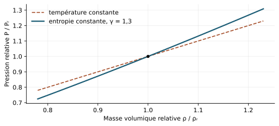

# X-ENS MP 2018 — Physique · Corrigé guidé partiel

*Corrigé rédigé par IA, non officiel. Signalez toute erreur.*

**Lecture du rapport du jury** · GPT-6.2 Astra Ultra · vitesse non renseignée

**Rédaction** · GPT-6.2 Astra Ultra · vitesse non renseignée

**Corrigé partiel — 5 questions sur 41.** Cette édition traite les questions 2, 5, 8, 13 et 26. Les questions 1, 3 à 4, 6 à 7, 9 à 12, 14 à 25 et 27 à 41 restent hors de sa couverture.

## Thermodynamique et bilans d’un gaz parfait

### Question 2 — Vitesse quadratique des molécules de vapeur

**Indication.** Décomposer la vitesse d’agitation sur trois axes et appliquer l’équipartition à une composante. Vérifier si la grandeur demandée possède l’unité d’une vitesse ou de son carré.

Considérons un petit volume de vapeur d’eau à l’équilibre thermique local et plaçons-nous dans le référentiel où sa vitesse d’ensemble est nulle. Notons $m$ la masse d’une molécule, $T$ la température et $\boldsymbol u$ la vitesse d’agitation. Pour un gaz classique idéal, l’équipartition associe une énergie moyenne $k_BT/2$ à chacun des trois termes quadratiques de translation. Par isotropie,
$$
m\langle u_x^2\rangle=m\langle u_y^2\rangle=m\langle u_z^2\rangle=k_BT.
$$
En additionnant et en utilisant $r=R/M_{\mathrm{H_2O}}=k_B/m$, on trouve $\langle |\boldsymbol u|^2\rangle=3rT$, en $\mathrm{m^2\,s^{-2}}$. La vitesse quadratique moyenne au sens usuel est sa racine $u_{\rm rms}=\sqrt{3rT}$, en $\mathrm{m\,s^{-1}}$. Les rotations et vibrations d’une molécule d’eau modifient ses capacités thermiques. Elles n’ajoutent aucun terme à l’énergie cinétique de translation du centre de masse. Dans un référentiel où le gaz se déplace à la vitesse $\boldsymbol V$, on a $\langle|\boldsymbol V+\boldsymbol u|^2\rangle=V^2+3rT$ puisque $\langle\boldsymbol u\rangle=0$.

### Question 5 — Célérité du son dans un gaz parfait

**Indication.** Tracer mentalement deux compressions passant par le même état. La perturbation sonore est assez rapide pour qu’un élément de gaz échange très peu de chaleur.

Une faible compression acoustique évolue de manière adiabatique et réversible. C’est donc l’entropie massique $s$ que l’on garde constante pour calculer $c^2=(\partial P/\partial\rho)_s$. Pour un gaz parfait de capacités massiques constantes, le premier principe sur l’isentrope donne $c_v\,\mathrm dT=-P\,\mathrm d(1/\rho)$. Avec $P=\rho rT$ puis $r/c_v=\gamma-1$, on obtient $\mathrm dT/T=(\gamma-1)\,\mathrm d\rho/\rho$. La différentielle de l’équation d’état fournit alors
$$
\frac{\mathrm dP}{P}=\frac{\mathrm d\rho}{\rho}+\frac{\mathrm dT}{T}
=\gamma\frac{\mathrm d\rho}{\rho},\qquad
c^2=\gamma\frac P\rho=\gamma rT.
$$
La racine physique est $c=\sqrt{\gamma rT}$. À température imposée, la pente aurait valu seulement $rT$. Sur l’isentrope, la compression échauffe le gaz et le supplément de pression rend la pente plus forte.

### Question 8 — Conservation de la masse dans un écoulement stationnaire

**Indication.** Compter les kilogrammes entrés et sortis pendant le même temps. Une grandeur uniforme sur une section pourrait encore varier le long du conduit.

Délimitons un volume de contrôle fixe entre deux sections d’un conduit à paroi imperméable. Soient $A_1,A_2$ leurs aires, et $v_1,v_2>0$ les vitesses normales orientées dans le sens d’écoulement. Le bilan de masse s’écrit
$$
\frac{\mathrm dm_{\rm int}}{\mathrm dt}=\rho_1v_1A_1-\rho_2v_2A_2 .
$$
La stationnarité annule le membre de gauche. Comme la deuxième section peut être choisie en tout point, $\rho vA$ a la même valeur à chaque section. Son unité est $\mathrm{kg\,s^{-1}}$. L’uniformité sur chaque section permet d’écrire le flux comme un produit. C’est le bilan stationnaire sans apport de masse latéral qui en établit la constance.

### Question 13 — Variation relative du nombre de Mach

**Indication.** Exprimer séparément les variations relatives du numérateur et du dénominateur du rapport. Garder le facteur un demi provenant de la racine carrée.

Le nombre de Mach est le rapport $M=v/c$. Pour $v>0$, la différentielle logarithmique est $\mathrm dM/M=\mathrm dv/v-\mathrm dc/c$. À composition et capacités thermiques constantes, $c^2=\gamma rT$ donne $2\,\mathrm dc/c=\mathrm dT/T$. Ainsi
$$
\frac{\mathrm dM}{M}=\frac{\mathrm dv}{v}-\frac12\frac{\mathrm dT}{T}.
$$
Comme contrôle, à vitesse matérielle fixée un gaz plus chaud transmet le son plus vite, de sorte que le nombre de Mach diminue.

### Question 26 — Enthalpie et énergie cinétique d’un écoulement adiabatique

**Indication.** Relier le gradient de pression à l’accélération, puis à la variation d’enthalpie sur l’isentrope. Les deux échanges internes s’annulent dans l’énergie totale.

Pour un gaz parfait, $c_p=\gamma r/(\gamma-1)$ et $\mathrm dh=c_p\,\mathrm dT$. L’identité thermodynamique $\mathrm dh=T\,\mathrm ds+\mathrm dP/\rho$ donne, sur une isentrope, $c_p\,\mathrm dT=\mathrm dP/\rho$. L’équation du mouvement le long d’une ligne de courant, à pesanteur négligeable et en régime stationnaire, donne par ailleurs $v\,\mathrm dv=-\mathrm dP/\rho$. En additionnant,
$$
\frac{\gamma r}{\gamma-1}\,\mathrm dT+v\,\mathrm dv=0,
\qquad \mathrm d(h+v^2/2)=0.
$$
C’est la conservation de l’énergie massique totale d’un écoulement adiabatique sans travail mécanique extérieur, à énergie potentielle constante. L’enthalpie inclut le travail des forces de pression. Une diminution d’enthalpie correspond à une augmentation égale d’énergie cinétique, en joules par kilogramme.
