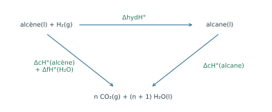
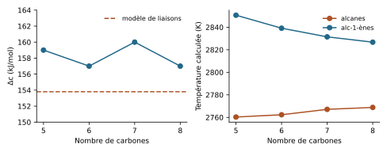
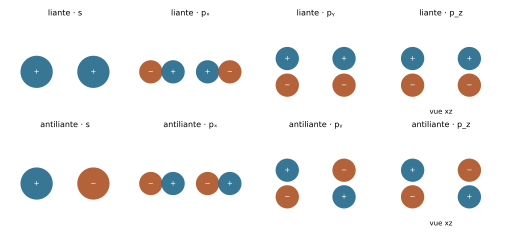
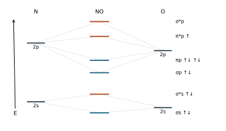
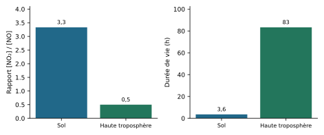
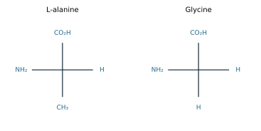
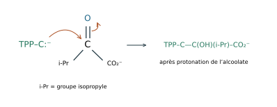
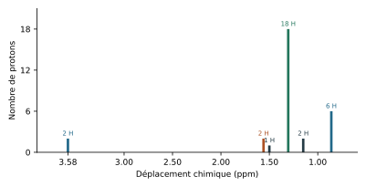

# X–ENS — PC, Chimie A 2018 · Corrigé brut

*Corrigé rédigé par IA, non officiel.*

**Rédaction (tour 1)** · GPT-6.2 Astra Ultra · vitesse non renseignée

Les deux éditions corrigent intégralement 52 questions sur 70. Toute la partie A est traitée sauf A.II.1, sur les protocoles d’obtention des oxydes d’azote. La partie B couvre la biochimie de l’acide gras, sa spectroscopie et des questions autonomes sur les amines et le soufre. B.II.4 traite les données spectroscopiques et B.III.2 le classement et la molécularité. Les 16 questions hors couverture sont indiquées à leur emplacement. La préparation du depsipeptide et de ses intermédiaires avancés reste hors de ce périmètre. Les résultats ont été confrontés aux 16 pages du sujet et au rapport de la commission de chimie A.

## A.I. Enthalpies, température et dépollution des gaz

### Question A.I.1 — Bilans des combustions complètes

Pour une mole d’alcane liquide, $\mathrm{C_nH_{2n+2}(l)}+\tfrac{3n+1}{2}\mathrm{O_2(g)}\to n\mathrm{CO_2(g)}+(n+1)\mathrm{H_2O(l)}$. Pour une mole d’alc-1-ène liquide, $\mathrm{C_nH_{2n}(l)}+\tfrac{3n}{2}\mathrm{O_2(g)}\to n\mathrm{CO_2(g)}+n\mathrm{H_2O(l)}$. L’eau liquide correspond à la convention des enthalpies tabulées à 298 K.

### Question A.I.2 — Différences en série homologue

Pour $n=5,6,7,8$, on trouve respectivement **159, 157, 160 et 157 $\mathrm{kJ\,mol^{-1}}$**. La combustion d’une mole d’alcane est donc plus exothermique que celle de l’alcène homologue. L’écart varie peu avec la longueur de chaîne, car le changement structural comparé reste localisé à une double liaison et deux atomes d’hydrogène.

### Question A.I.3 — Cycle de Hess et dissociation de H₂

Notons $V_e,V_a$ les enthalpies de vaporisation de l’alcène et de l’alcane. En phase gazeuse, l’hydrogénation remplace C=C et H–H par C–C et deux C–H. On obtient $\Delta_{hyd}H_g^\circ\simeq D(C=C)+D(H-H)-D(C-C)-2D(C-H)$ avec des énergies moyennes de liaison. En partant du liquide, il faut vaporiser l’alcène puis condenser l’alcane, donc $\Delta_{hyd}H_l^\circ=V_e+\Delta_{hyd}H_g^\circ-V_a$. Le cycle des combustions donne $\Delta_cH^\circ(e)+\Delta_fH^\circ(H_2O_l)=\Delta_{hyd}H_l^\circ+\Delta_cH^\circ(a)$. Ainsi **$\Delta_c(n)\simeq V_e-V_a+D(C=C)+D(H-H)-D(C-C)-2D(C-H)-\Delta_fH^\circ(H_2O_l)$**.

### Question A.I.4 — Cohésion des liquides hydrocarbonés

Alcanes et alcènes sont très peu polaires et n’établissent pas de liaison hydrogène entre eux. La cohésion vient principalement de la dispersion de London. Quand la chaîne s’allonge, le nombre d’électrons, la polarisabilité et les surfaces de contact augmentent, d’où la hausse des deux enthalpies de vaporisation. À $n$ fixé elles sont proches, l’alcane présentant dans cette table une valeur supérieure de seulement 0,8 à 1,2 $\mathrm{kJ\,mol^{-1}}$. L’écart réduit est compatible avec des tailles, masses et interactions voisines, légèrement affectées par la géométrie et les deux H supplémentaires. La série ne justifie pas de loi générale classant tous les isomères.

### Question A.I.5 — Indépendance approchée vis-à-vis de la longueur de chaîne

Sous $V_e\simeq V_a$, $\Delta_c(n)\simeq D(C=C)+D(H-H)-D(C-C)-2D(C-H)-\Delta_fH^\circ(H_2O_l)$. Le calcul par énergies moyennes porte sur les mêmes liaisons locales pour toutes les chaînes. Les contributions des parties communes sont éliminées et $n$ disparaît.

### Question A.I.6 — Valeur estimée à partir des liaisons

La première vaut $602+436-346-2(412)=-132\ \mathrm{kJ\,mol^{-1}}$ dans le modèle, puis **$\Delta_c\simeq-132-(-285{,}8)=153{,}8\ \mathrm{kJ\,mol^{-1}}$**. L’ordre de grandeur et le signe concordent avec 157 à 160. L’écart de quelques unités est cohérent avec des énergies moyennes et la simplification sur les vaporisations.

### Question A.I.7 — Enthalpie molaire et température finale

$\Delta_c>0$ signifie que l’alcane libère davantage d’énergie par mole. À quantité et capacité thermique de produits identiques, on s’attendrait à une température plus élevée pour l’alcane, à l’inverse du classement indiqué. Mais les quantités de vapeur d’eau et de diazote à réchauffer diffèrent. La chaleur molaire libérée ne suffit pas à comparer les températures finales.

### Question A.I.8 — Bilan adiabatique isobare d’un alcane dans l’air

À pression constante sans échange thermique, l’enthalpie totale est conservée. Posons $T_0=298\ \mathrm K$, $T_v=373\ \mathrm K$, $m=n+1$ moles d’eau et $d=2(3n+1)$ moles de $N_2$ par mole d’alcane. L’échauffement de l’eau liquide puis sa vaporisation et l’échauffement de la vapeur demandent, par mole, $C_{p,l}(T_v-T_0)+L_v+C_{p,v}(T_f-T_v)$. Posons $L_*=L_v+(C_{p,l}-C_{p,v})(T_v-T_0)$. Les autres gaz restent dans leur phase. Le bilan donne **$T_f=T_0+[-\Delta_cH^\circ(a)-mL_*]/[nC_{p,CO_2}+mC_{p,v}+dC_{p,N_2}]$**. Toutes les enthalpies et capacités doivent utiliser la même unité énergétique. Les produits sont supposés idéaux et non dissociés.

### Question A.I.9 — Bilan pour l’alc-1-ène

La combustion de l’alcène forme $n$ moles d’eau et s’accompagne de $6n$ moles de diazote. Avec le même $L_*$ que précédemment, **$T_f=T_0+[-\Delta_cH^\circ(e)-nL_*]/[nC_{p,CO_2}+nC_{p,v}+6nC_{p,N_2}]$**. La température initiale, le rapport indiqué pour l’air et les hypothèses thermiques restent ceux de l’énoncé.

### Question A.I.10 — Pourquoi les deux températures diffèrent

À $n$ égal, l’alcane produit une mole d’eau de plus et fait entrer deux moles supplémentaires de $N_2$. Son mélange final demande donc plus d’énergie pour se réchauffer et pour vaporiser l’eau. Par exemple pour $n=5$, $L_*\simeq43{,}83\ \mathrm{kJ\,mol^{-1}}$. Les capacités totales sont environ 1,318 et 1,227 $\mathrm{kJ\,K^{-1}}$ pour l’alcane et l’alcène. Les deux expressions donnent environ **2 760 K et 2 850 K**. L’effet des produits chauffés l’emporte ici sur le surcroît d’énergie molaire de combustion. Ce sont des températures de modèle à capacités constantes.

### Question A.I.11 — Bilan d’oxydation dans le traitement des effluents

Dans NO, O est à $-II$, donc N est à $+II$. Dans $N_2$, N est à zéro. Le monoxyde d’azote **subit une réduction**. L’azote de $NH_3$ passe de $-III$ à zéro et fournit des électrons, tandis que $O_2$ est aussi réduit dans le bilan global.

### Question A.I.12 — Critère thermodynamique de réduction des NOx

Pour la réaction écrite avec quatre moles de NO, $\Delta_rH^\circ=6(-241{,}8)-4(90{,}3)-4(-45{,}9)=-1628{,}4\ \mathrm{kJ\,mol^{-1}}$. L’annexe donne aussi $\Delta_rS^\circ=4(191{,}5)+6(188{,}8)-4(210{,}7)-4(192{,}8)-205{,}0=+79{,}8\ \mathrm{J\,K^{-1}\,mol^{-1}}$. À 298 K **$\Delta_rG^\circ\simeq-1652\ \mathrm{kJ\,mol^{-1}}$**. La constante standard est immense. Cette conclusion thermodynamique ne fixe pas une vitesse de réaction.

### Question A.I.13 — Effet de la pression totale

Avec des gaz idéaux, $Q=(y_{N_2}^4y_{H_2O}^6)/(y_{NO}^4y_{NH_3}^4y_{O_2})\,(p/p^\circ)^{10-9}$. Comme $\Delta
u_g=+1$, abaisser la pression à fractions molaires initialement inchangées diminue $Q$. À partir d’un état d’équilibre, $Q<K^\circ(T)$ et l’évolution se fait alors vers les produits. La **basse pression** favorise thermodynamiquement ce sens. La constante d’équilibre ne dépend que de $T$.

## A.II. Édifices moléculaires et structure du solide

*Question A.II.1 hors couverture.*

### Question A.II.2 — Lewis des quatre connectivités

Une écriture respectant les octets pour chacune des quatre structures de la figure 2 est donnée ci-dessous. Les parenthèses distinguent les deux branches autour de N.

| Isomère | Formule de Lewis condensée |
|---|---|
| A | $\mathrm{O{=}N^+(-O^-){-}N{=}O}$ |
| B | $\mathrm{O{=}N{-}O{-}N{=}O}$ |
| C | $\mathrm{O{=}N^+(-O^-){-}O^+{=}N^-}$ |
| D | $\mathrm{O{=}N{-}O{-}O^+{=}N^-}$ |

Chaque O neutre a deux doublets libres, $O^-$ trois, $O^+$ un. L’azote neutre à trois liaisons a un doublet, $N^+$ à quatre liaisons aucun, l’azote terminal $N^-$ doublement lié deux. Les deux O terminaux du groupe $NO_2$ dans A et C admettent l’échange des liaisons simple et double dans les formes limites. Les écritures présentant une séparation de charges ne préjugent pas de la stabilité relative.

### Question A.II.3 — Orbitales des fragments O₂ et N

Pour N, $2s$ est sphérique et chaque $2p_i$ a deux lobes de signes opposés dirigés suivant $i=x,y,z$. Pour $O_2$, la paire $2s$ donne $\sigma$ (en phase) et $\sigma^*$ (nœud médian). Les $2p_x$ donnent $\sigma_x$ et $\sigma_x^*$ par recouvrement axial. Les deux $2p_y$ et les deux $2p_z$ donnent respectivement $\pi_y,\pi_y^*$ et $\pi_z,\pi_z^*$ par recouvrement latéral. Dans une combinaison liante les lobes en regard ont même signe, dans une antiliante leurs signes sont opposés. Le schéma illustre les quatre familles des deux atomes d’oxygène.

### Question A.II.4 — Parités par réflexion

En notant S une orbitale inchangée et A un changement global de signe, les parités dans l’ordre $(xOy,yOz)$ se regroupent ainsi.

| Parités | Orbitales du fragment O₂ | Orbitales de N |
|---|---|---|
| S, S | $\sigma(2s),\sigma_x,\pi_y$ | $2s,2p_y$ |
| S, A | $\sigma^*(2s),\sigma_x^*,\pi_y^*$ | $2p_x$ |
| A, S | $\pi_z$ | $2p_z$ |
| A, A | $\pi_z^*$ | aucune |

Par exemple le changement $z\mapsto-z$ inverse l’orbitale $p_z$, et la réflexion échangeant les O laisse inchangée sa combinaison latérale liante $\pi_z$.

### Question A.II.5 — Blocs indépendants du diagramme

Un élément d’interaction entre deux orbitales de parités différentes s’annule par symétrie. Les quatre lignes du tableau donnent donc des blocs de **5, 4, 2 et 1** orbitales. La dernière, $\pi_z^*$, n’a aucun partenaire de même symétrie sur N. Elle reste non liante pour l’interaction **entre les fragments**. Une forte différence d’énergie peut encore rendre faible un mélange autorisé dans le bloc de cinq.

### Question A.II.6 — Orbitale simplement occupée de NO₂

$5+2\times6=17$ électrons remplissent intégralement les OM1 à OM8. **OM9** porte le dix-septième électron. Dans le diagramme simplifié elle appartient au groupe totalement symétrique issu notamment de $2p_y(N)$, de $\pi_y(O_2)$ et de $\sigma_x(O_2)$. Le grand lobe suivant la bissectrice sur N et deux contributions sur les O se retrouvent sur la figure 4. L’écart énergétique de $\sigma_x$ limite son poids par rapport aux composantes proches, mais son mélange explique que les lobes sur O soient inclinés et ne reproduisent pas de simples $p_y$ purs.

### Question A.II.7 — Diagramme d’une diatomique hétéronucléaire

L’oxygène étant plus électronégatif que l’azote, ses niveaux $2s$ et $2p$ sont plus bas. En l’absence de mélange $s$–$p$, les deux $2s$ donnent $\sigma_s,\sigma_s^*$. Les $2p$ axiales donnent $\sigma_p,\sigma_p^*$ et les deux directions transverses donnent deux $\pi_p$ et deux $\pi_p^*$ dégénérées par paire. Dans chaque paire associée, l’OM liante porte plus de poids sur O et l’antiliante sur N. Les lobes liants en regard ont même phase et les antiliants présentent un nœud supplémentaire entre les atomes. Le diagramme complète la construction qualitative.

### Question A.II.8 — Onze électrons de valence dans NO

Dans le modèle précédent, l’occupation est $(\sigma_s)^2(\sigma_s^*)^2(\sigma_p)^2(\pi_p)^4(\pi_p^*)^1$. Les deux partenaires $\pi_p^*$ sont dégénérés, un seul électron occupe cet ensemble. Le poids de l’antiliante est plus important sur **N**, l’atome aux orbitales atomiques plus hautes. L’indice de liaison du modèle est $(8-3)/2=2{,}5$.

### Question A.II.9 — Connexion prédite par le modèle des orbitales simplement occupées

Dans $NO_2$, 0,45 sur N dépasse 0,27 sur chacun des deux O. Dans NO, l’électron impair est aussi majoritairement porté par N. Selon la règle donnée, les deux sites portent donc une connexion **N–N**, qui correspond à la constitution **A** de la figure 2.

### Question A.II.10 — Information apportée par une vibration N–N

Parmi les quatre connectivités proposées, seule **A** contient une liaison directe N–N. L’existence d’une élongation N–N à $253\ \mathrm{cm^{-1}}$ appuie donc l’attribution du constituant majoritaire à A, en accord avec la prédiction précédente dans la comparaison posée par l’énoncé.

### Question A.II.11 — Trois distances N–O dans la structure gazeuse

La distance la plus courte, **114 pm**, correspond à la liaison terminale du fragment nitrosyle $-N=O$, qui possède le caractère multiple le plus marqué. Les deux autres distances, 120 et 122 pm, sont celles du groupe $NO_2$ où la délocalisation rapproche les ordres de liaison. La disposition du nitrosyle rend les deux O géométriquement non équivalents (côtés cis et trans relativement à sa liaison N–O), ce qui permet un petit écart. Les distances seules ne fixent pas l’identité cis/trans de chacun des deux nombres.

### Question A.II.12 — Masse volumique du cristal

Une maille orthorhombique de volume $abc$ contient quatre molécules. Ainsi **$\rho=4M/(N_Aabc)$**. Avec $M=76{,}01\ \mathrm{g\,mol^{-1}}$ et $1\ \mathrm{pm}=10^{-10}\ \mathrm{cm}$, on obtient $\rho\simeq1{,}78\ \mathrm{g\,cm^{-3}}$, conforme à la masse volumique du solide dans l’annexe.

### Question A.II.13 — Nature du cristal et cohésion

Les longueurs de liaison sont très voisines en phase gazeuse et dans le solide, ce qui indique la conservation de molécules individualisées. La faible température de fusion appuie l’attribution à un **cristal moléculaire**. Les forces de dispersion et l’interaction entre dipôles permanents (moment de $2{,}12\ \mathrm D$) assurent sa cohésion. Il n’y a pas de H susceptible d’assurer des liaisons hydrogène classiques.

## A.III. Photochimie de la troposphère

### Question A.III.1 — État photostationnaire du dioxyde d’azote

Le bilan instantané est $d[NO_2]/dt=k_3[NO][O_3]-k_1[NO_2]$. À l’état photostationnaire il s’annule et **$r_{NOx}=[NO_2]/[NO]=k_3[O_3]/k_1$**. La constante $k_1$ est une fréquence de photolyse qui comprend l’éclairement. Le rapport est sans dimension.

### Question A.III.2 — Durée de vie d’une famille de polluants

La perte nette a pour vitesse positive $v_4=k_4[M][HO][NO_2]$. Or $[NO_x]=[NO_2](1+1/r_{NOx})$. La durée caractéristique est donc **$\tau=(1+1/r_{NOx})/(k_4[M][HO])$**. On utilise le module de la vitesse de disparition, ou $-[NO_x]/(d[NO_x]/dt)$ si la dérivée est signée.

### Question A.III.3 — Effet de l’altitude sur les deux constantes

Le coefficient $k_3$ passe de $2\times10^{-14}$ à $5\times10^{-15}$ dans les unités du tableau. Sa diminution est attendue à plus basse température pour un processus activé thermiquement avec énergie d’activation apparente positive. La hausse de $k_1$, de 0,006 à $0{,}010\ \mathrm{s^{-1}}$, est compatible avec un flux de photons UV moins atténué en altitude. Les deux coefficients ne répondent pas à la même variable physique.

### Question A.III.4 — Durées de vie au sol et en altitude

Au sol, $r\simeq(2\times10^{-14})(10^{12})/(6\times10^{-3})=3{,}3$. En altitude, $r\simeq0{,}50$. Avec $k_4[M]=10^{-11}$ dans les deux cas, **$\tau_{sol}\simeq1{,}3\times10^4\ \mathrm s$** (3,6 h) et **$\tau_{alt}\simeq3{,}0\times10^5\ \mathrm s$** (3,5 jours). La baisse des radicaux HO et la moindre fraction de $NO_2$ amplifient toutes deux la durée de vie.

### Question A.III.5 — Pollution des couloirs aériens

Les moteurs d’avion émettent des oxydes d’azote directement dans la haute troposphère. Ils y persistent plus longtemps d’après Q A.III.4, car leur conversion en acide nitrique est moins rapide. Le renouvellement fréquent de ces apports dans les couloirs de circulation et le transport des masses d’air contribuent aux concentrations observées et à la chimie photooxydante régionale.

### Question A.III.6 — Intermédiaires, catalyseurs et troisième corps

Les radicaux carbonés $CH_3$, $CH_3O_2$, $CH_3O$ et l’atome O sont des intermédiaires du bilan global. $HO$ est consommé puis régénéré via $HO_2$. NO, engagé dans les conversions de peroxyles, est régénéré par photolyse de $NO_2$. Les familles $HO_x$ et $NO_x$ effectuent donc des cycles catalytiques. Le statut d’un membre comme $HO_2$ ou $NO_2$ peut aussi être décrit comme celui d’un intermédiaire du cycle considéré à partir de HO et NO. $M$ est un troisième corps de collision qui évacue de l’énergie, sans transformation chimique nette.

### Question A.III.7 — Bilan de la photooxydation du méthane

On additionne une fois chacune des étapes 5 à 9 et deux fois chacune des étapes 1 et 2. Les radicaux et les oxydes d’azote intermédiaires se simplifient. Le bilan de matière est **$CH_4+4O_2\longrightarrow CH_2O+H_2O+2O_3$** sous éclairement. Il y a bien huit atomes d’oxygène de chaque côté.

### Question A.III.8 — Vitesse de formation en milieu atmosphérique

Les étapes 7 et 9 produisent chacune une molécule de $NO_2$. Sa photolyse rapide suivie de la capture de l’atome O fournit une molécule d’ozone par $NO_2$ ainsi recyclé. Sur l’échelle lente, $v_f(O_3)\simeq v_7+v_9=\mathbf{(k_7[CH_3O_2]+k_9[HO_2])[NO]}$. C’est une vitesse de formation, à distinguer d’une variation nette incluant d’autres puits d’ozone.

### Question A.III.9 — Relations de flux pour les intermédiaires

Pour $CH_3$, $v_5-v_6\simeq0$. Pour $CH_3O_2$, $v_6-v_7\simeq0$. Pour $CH_3O$, $v_7-v_8\simeq0$. Le recyclage de $HO_2$ et de HO ferme le cycle avec $v_8\simeq v_9\simeq v_5$. D’où **$v_5\simeq v_6\simeq v_7\simeq v_8\simeq v_9$** dans l’approximation de propagation donnée à ce stade du problème.

### Question A.III.10 — Deux expressions équivalentes du débit de propagation

Avec $v_f=v_7+v_9$ et les égalités précédentes, **$v_f\simeq2k_5[CH_4][HO]\simeq2k_9[HO_2][NO]$**. Le facteur deux correspond aux deux recyclages de $NO_2$ par tour, ce que vérifie le bilan en ozone.

### Question A.III.11 — Régime atmosphérique limité par les NOx

Si la perte par recombinaison des hydroperoxyles domine, $[HO_2]\simeq\sqrt{P(HO_x)/(2k_{10})}$. En reportant dans le débit de propagation, **$v_f\simeq2k_9[NO]\sqrt{P(HO_x)/(2k_{10})}$**. À perte radicalaire fixée, le débit atmosphérique croît avec la disponibilité de NO, ce qui motive le terme « NOx limitant ».

### Question A.III.12 — Régime atmosphérique limité par les composés organiques volatils

Si $P(HO_x)\simeq k_4[NO_2][HO][M]$, alors **$v_f\simeq2k_5[CH_4]P(HO_x)/(k_4[NO_2][M])$**. Dans ce modèle la production est proportionnelle au méthane, le COV considéré, tandis qu’une abondance accrue de $NO_2$ favorise la terminaison des radicaux. Cette relation locale à régime fixé explique l’appellation « COV limitant ».

## B.I. Biochimie et spectroscopie d’un acide gras ramifié

### Question B.I.1 — Chiralité dans la famille des acides aminés

La valine est un **acide α-aminé**. Son carbone α porte $NH_2$, $CO_2H$, H et isopropyle, quatre groupes différents. Une représentation de Fischer de la L-alanine, autre exemple chiral, place $CO_2H$ en haut, $CH_3$ en bas, $NH_2$ à gauche et H à droite (liaisons horizontales vers l’observateur). La glycine $NH_2{-}CH_2{-}CO_2H$ est achirale puisque son carbone α porte deux H.

### Question B.I.2 — Produit de transamination de la valine

L’anion est $\mathrm{(CH_3)_2CH{-}C(=O){-}CO_2^-}$, le **3-méthyl-2-oxobutanoate**. La numérotation commence par le carbone du carboxylate. Le squelette conserve cinq carbones.

### Question B.I.3 — Addition sur le cétoacide dans la poche enzymatique

À l’étape 2, le carbone C2 nucléophile de l’ylure thiazolium engage son doublet vers le carbone de la fonction cétone du 3-méthyl-2-oxobutanoate. Les électrons π de C=O vont sur O. L’alcoolate formé capte un proton, les électrons de la liaison du donneur de proton restant sur ce donneur, d’où le carbinol du schéma. Le carbonyle du carboxylate n’est pas le site de l’addition. La figure représente les déplacements locaux. Un O neutre a deux doublets, un $O^-$ trois, le $C^-$ de départ un, et l’azote $N^+$ du thiazolium ne porte aucun doublet libre. Le soufre divalent a deux doublets. Aucun centre du produit représenté n’a d’octet incomplet.

### Question B.I.4 — Stabilisation des carbanions liés à la thiamine

Aux étapes 1 et 5, on retrouve le carbanion du carbone C2 du thiazolium, un ylure dont le carbone négatif est adjacent à l’azote positif du cycle et au soufre polarisable. À l’étape 3, le carbone porteur de OH acquiert le doublet de la liaison rompue pendant la décarboxylation. Il est conjugué à la partie iminium du thiazolium. Son doublet peut former une double liaison vers C2 tandis que les électrons de $C2=N^+$ reviennent sur N. Cette forme de type énamine délocalise la charge et illustre le rôle électronique du cofacteur.

### Question B.I.5 — Transfert d’acyle entre deux thiols

Le soufre de CoA–SH remplace le soufre du bras de l’enzyme dans le thioester. Il s’agit d’une **substitution nucléophile d’acyle**, ou transthioestérification. L’acyle isobutyryle se trouve ensuite porté par CoA. Le bilan n’est pas une oxydation supplémentaire de l’acyle.

### Question B.I.6 — Comptage de l’élongation d’un acide gras

Chaque cycle décarboxyle le malonyle et ajoute **deux carbones** à la chaîne. L’amorce isobutyryle compte quatre carbones au total, l’acide 14-méthylpentadécanoïque seize en comptant la ramification. Il faut donc $(16-4)/2=\mathbf{6}$ équivalents de malonyl-CoA.

### Question B.I.7 — Rôle du NADPH

NADPH est le **réducteur**, donneur formel d’un hydrure ($H^-$, soit deux électrons et un proton), et devient $NADP^+$. À l’étape d, la cétone est réduite en alcool. À l’étape f, la double liaison de l’énoyl est réduite. Les protonations complémentaires dépendent du milieu.

### Question B.I.8 — Déshydratation du β-hydroxyacyle

L’étape e élimine une molécule d’eau et forme une double liaison entre les carbones α et β. C’est une **déshydratation**, apparentée à la crotonisation d’un β-hydroxycarbonyle. En chimie non enzymatique, une catalyse acide peut rendre l’hydroxyle partant sous forme d’eau. Une catalyse basique est également possible pour un β-hydroxycarbonyle avec proton α suffisamment acide, via un énolate.

### Question B.I.9 — Substitution dans le diol symétrique

Un seul OH terminal est remplacé par Br. Le composé A est $\mathrm{HO{-}(CH_2)_{11}{-}Br}$. Le doublet du O de l’alcool capte un proton, le doublet de la liaison au donneur revenant sur sa base conjuguée. Un doublet de $Br^-$ attaque ensuite par l’arrière le carbone primaire pendant que la liaison C–O revient sur O et libère l’eau. C’est une substitution nucléophile bimoléculaire, favorisée par la faible gêne du centre primaire. Dans la forme protonée $OH_2^+$, O a un doublet libre. L’eau en porte deux, $Br^-$ quatre et le brome lié trois. Les deux extrémités initiales étant équivalentes, leur choix ne donne pas deux produits distincts.

*Question B.I.10 hors couverture.*

### Question B.I.11 — Formule de l’alcool ramifié

Le squelette correspondant est **$\mathrm{HO{-}(CH_2)_{12}{-}CH(CH_3)_2}$**, le **13-méthyltétradécan-1-ol**. L’alcool compte quinze carbones. Le motif terminal $CH(CH_3)_2$ rend équivalents les deux méthyles dans le milieu achiral de mesure.

### Question B.I.12 — Bandes IR et attribution des protons

La bande à $3454\ \mathrm{cm^{-1}}$ correspond à O–H, celles à 2927 et $2855\ \mathrm{cm^{-1}}$ aux élongations C–H aliphatiques, celle à $1466\ \mathrm{cm^{-1}}$ aux déformations des groupes alkyles. Le domaine inférieur à $1400\ \mathrm{cm^{-1}}$, qui contiendrait notamment C–O, n’est pas fourni.

| Déplacement | Attribution et multiplicité |
|---|---|
| 0,86 ppm, 6 H | deux $CH_3$ équivalents, doublet par couplage au seul méthine |
| 1,15 ppm, 2 H | $CH_2$ voisin du méthine dans $-CH_2{-}CH(CH_3)_2$, multiplet |
| 1,26–1,35 ppm, 18 H | neuf méthylènes internes aux déplacements proches, multiplets superposés |
| 1,50 ppm, 1 H | méthine de la ramification, couplé aux méthyles et au $CH_2$ voisin |
| 1,56 ppm, 2 H | $CH_2$ en C2, encore influencé par O et couplé aux méthylènes voisins |
| 3,58 ppm, 2 H | $CH_2OH$ terminal en C1, triplet par C2 |

Le proton OH échangeable n’est pas identifié dans les signaux donnés. Les deux $CH_2$ à 1,15 et 1,56 ppm occupent donc des extrémités différentes de la série de méthylènes.

*Question B.I.13 hors couverture.*

## B.II. Activation et données spectroscopiques

*Question B.II.1 hors couverture.*

### Question B.II.2 — Rôle électronique du trioxyde de soufre

Le soufre électrophile de $SO_3$, acide de Lewis, accepte un doublet de l’oxygène du DMSO. L’activation se fait ainsi **sur l’oxygène du DMSO** et augmente le caractère électrophile de son soufre, qui peut ensuite être attaqué par un nucléophile. Le rôle demandé est une activation par acide de Lewis.

### Question B.II.3 — Acidité en α du soufre cationique

Un substituant alkyle en α d’un **sulfonium** peut perdre un proton plus facilement que l’alcane correspondant. La base conjuguée est un ylure, où le carbanion est adjacent au soufre positif et polarisable. Cette stabilisation rend compte de l’étape acido-basique. Il ne faut pas attribuer uniformément cette acidité à tous les alkyles de tous les thioéthers.

### Question B.II.4 — Lecture indépendante du spectre de l’alcool E (partie traitée)

L’IR large à $3332\ \mathrm{cm^{-1}}$ et la bande à $1036\ \mathrm{cm^{-1}}$ sont compatibles avec un alcool primaire. Les signaux de 1 H à 3,41 et 3,50 ppm forment les deux protons diastéréotopiques de $CH_2OH$. Ils partagent un couplage géminal de 10,5 Hz et présentent des couplages vicinaux distincts de 6,6 et 5,7 Hz. Le doublet de 6 H à 0,86 ppm indique deux méthyles aux signaux confondus voisins d’un méthine. Celui de 3 H à 0,91 ppm correspond à un autre méthyle couplé à un méthine. La couverture se limite aux attributions spectroscopiques indépendantes.

*Question B.II.5 hors couverture.*

*Question B.II.6 hors couverture.*

*Question B.II.7 hors couverture.*

*Question B.II.8 hors couverture.*

*Question B.II.9 hors couverture.*

## B.III. Amines et réactivité

### Question B.III.1 — Amines formées et séparation physique

L’alkylation progressive donne de l’éthylamine $EtNH_2$ puis de la diéthylamine $Et_2NH$, toutes deux susceptibles d’accompagner la triéthylamine. Les températures d’ébullition indiquées, 16,6, 55,5 et 89 °C, permettent de proposer une **distillation fractionnée** du mélange d’amines libres, la triéthylamine correspondant à la fraction la moins volatile des trois.

### Question B.III.2 — Classe de la réaction des amines (partie traitée)

Le transfert du groupe éthyle à l’azote relève d’une substitution nucléophile bimoléculaire $S_N2$ au carbone primaire. L’attaque du doublet de l’amine et le départ du groupe partant se déroulent dans le même acte élémentaire. La première espèce azotée est ammonium avant déprotonation. Le classement et la molécularité constituent la portée de cette réponse.

*Question B.III.3 hors couverture.*

*Question B.III.4 hors couverture.*

*Question B.III.5 hors couverture.*

### Question B.III.6 — Base encombrée et nucléophilie

Les deux groupes isopropyle de la DIPEA protègent stériquement son atome d’azote. Elle peut capter un proton tout en concurrençant peu les nucléophiles dans une substitution ou dans une acylation. La triéthylamine est moins encombrée. L’intérêt de la DIPEA est donc la combinaison d’une basicité suffisante et d’une nucléophilie limitée.

*Question B.III.7 hors couverture.*

*Question B.III.8 hors couverture.*

*Question B.III.9 hors couverture.*

*Question B.III.10 hors couverture.*
