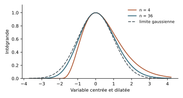

# X–ENS · PC · Mathématiques 2018 · Corrigé brut

*Corrigé rédigé par IA, non officiel. Signalez toute erreur.*

**Rédaction** · GPT-6.2 Astra Ultra · vitesse non renseignée

**Révision** · GPT-6.2 Astra Ultra · vitesse non renseignée

Le sujet compare les extrêmes de la somme des coefficients d’une matrice de signes lorsqu’on inverse des lignes et des colonnes. Les bornes font intervenir des sommes de signes indépendants et le coefficient binomial central. [Sujet officiel](https://banques-ecoles.fr/cms/wp-content/uploads/2018/05/2018_PC_sujet_Maths.pdf) · [Rapport du jury](https://banques-ecoles.fr/cms/wp-content/uploads/2018/10/18_PC_rap_eMath.pdf)

## I. Matrices de signes et cas particuliers

### Question I.1

Les $n^2$ coefficients ont chacun deux choix indépendants, soit $2^{n^2}$ matrices. Pour $n\ge1$ la matrice nulle en est absente. Cet ensemble n’est donc pas un sous-espace vectoriel.

### Question I.2

Pour deux vecteurs de signes $X,Y$, $X^tAY=\sum_{i,j}x_i a_{ij}y_j$ est somme de $n^2$ signes. Avec $r$ termes négatifs, il vaut $n^2-2r$, entier entre $-n^2$ et $n^2$ de la parité de $n^2$. L’entier $n^2-1$ est ainsi exclu. Enfin $(-X)^tAY=-X^tAY$ donne la symétrie de $S(A)$.

### Question I.3

Si $B=CAD$, $X^tBY=(CX)^tA(DY)$ puisque $C$ est diagonale réelle. Les applications $X\mapsto CX$, $Y\mapsto DY$ sont des bijections sur les vecteurs de signes, inverses d’elles-mêmes. Les deux ensembles de valeurs sont donc égaux.

### Question I.4

Pour la matrice $I$ remplie de uns, $X^tIY=(x_1+x_2)(y_1+y_2)$ donne $S(I)=\{-4,0,4\}$. Pour $J$, le vecteur $JY=(y_1+y_2,y_1-y_2)^t$ a une seule composante non nulle, égale à $\pm2$. Donc $S(J)=\{-2,2\}$. Pour toute matrice d’ordre deux, des changements de signes de lignes puis de colonnes rendent sa première colonne et sa première ligne positives. Le dernier signe est alors le produit de ses quatre coefficients initiaux, invariant par ces changements. Produit $+1$ donne $S(I)$, produit $-1$ donne $S(J)$, par I.3.

### Question I.5

L’égalité $X^tAY=n^2$ équivaut à $x_i a_{ij}y_j=1$ pour tout $i,j$, soit $a_{ij}=x_i y_j$. C’est $A=XY^t$. Une telle matrice a rang un puisque les deux vecteurs sont non nuls. Réciproquement, dans une matrice de signes de rang un, chaque colonne est proportionnelle à la première. Le rapport, lu sur la première ligne, vaut $\pm1$. Prendre $X$ égal à la première colonne et les rapports comme coordonnées de $Y$ donne $A=XY^t$.

### Question I.6

Chaque matrice de rang un a une représentation unique avec $X$ égal à sa première colonne et $y_1=1$. Il y a $2^n$ choix pour $X$ et $2^{n-1}$ pour les autres $y_j$. La proportion cherchée est $2^{2n-1}/2^{n^2}=2^{-(n-1)^2}$.

## II. Majoration de la différence maximale

### Question II.1

Comme $U_1$ est un signe uniforme, $\varphi(\lambda)=\log\cosh\lambda$, fonction paire avec $\varphi(0)=\varphi'(0)=0$. Sa dérivée seconde $1/\cosh^2\lambda$ est au plus un. Deux intégrations pour $\lambda\ge0$ donnent $\varphi(\lambda)\le\lambda^2/2$, puis la parité étend l’inégalité à tous les réels.

### Question II.2

Pour $\lambda>0$, $\mathbb P(S_k\ge t)=\mathbb P(e^{\lambda S_k}\ge e^{\lambda t})\le e^{-\lambda t}\mathbb E e^{\lambda S_k}$. Les $U_i$ indépendants de même loi donnent $\mathbb E e^{\lambda S_k}=e^{k\varphi(\lambda)}$. Cette majoration vaut pour tout réel $t$.

### Question II.3

Par II.1–2 l’exposant est au plus $k\lambda^2/2-\lambda t$. Pour $t>0$, choisir $\lambda=t/k>0$ donne $\mathbb P(S_k\ge t)\le e^{-t^2/(2k)}$.

La valeur limite $t=0$ donne simplement $\mathbb P(S_k\ge0)\le1$. Pour un seuil négatif, la même optimisation sur $\lambda>0$ n’autorise pas le choix $t/k$. L’hypothèse sur le signe du seuil est donc utilisée au passage de II.2 à II.3.

### Question II.4

La multiplication de chaque entrée par les signes déterministes $x_i y_j$ est une bijection de l’ensemble des matrices de signes vers lui-même. La matrice transformée a donc encore la loi uniforme. Toute configuration complète des $n^2$ entrées a probabilité $2^{-n^2}$, produit des probabilités $1/2$ de chaque coordonnée prescrite. Cela donne les lois marginales uniformes et l’indépendance mutuelle.

### Question II.5

Pour $X,Y$ fixés, $X^tCY$ est la somme de $n^2$ signes indépendants par II.4, donc $\mathbb P(X^tCY\ge tn^{3/2})\le e^{-t^2n/2}$ pour $t>0$. Il y a $2^{2n}$ couples. L’inégalité de l’union donne $\mathbb P(M(C)\ge tn^{3/2})\le\exp[-n(t^2/2-2\log2)]$. Pour $t=0$ le membre droit vaut $2^{2n}\ge1$.

### Question II.6

Pour tout $t>2\sqrt{\log2}$, la borne de II.5 est $<1$. Il existe donc au moins une matrice $A$ telle que $M(A)<tn^{3/2}$. Par définition, $M(n)\le M(A)$, donc $M(n)\le tn^{3/2}$ pour tous ces $t$. Faire décroître $t$ vers $2\sqrt{\log2}$ donne $M(n)\le2\sqrt{\log2}\,n^{3/2}$.

## III. Minoration par la moyenne des sommes de lignes

### Question III.1

Posons $b_i=\sum_ja_{ij}y_j$. Alors $\sum_i x_i b_i\le\sum_i|b_i|$, avec égalité en choisissant $x_i$ du signe de $b_i$ (arbitraire si $b_i=0$). Ainsi $g_A(Y)=\sum_i|\sum_j a_{ij}y_j|$.

### Question III.2

Pour un indice $i$ fixé, les $a_{ij}Z_j$ sont des signes uniformes indépendants. Le nombre $K$ de signes négatifs a loi binomiale $\mathcal B(n,1/2)$ et leur somme vaut $n-2K$. L’espérance de son module est $2^{-n}\sum_{k=0}^n\binom nk|n-2k|$. Sommer sur les $n$ lignes à l’aide de III.1 multiplie ce résultat par $n$. L’indépendance entre les lignes n’est pas nécessaire.

### Question III.3a

Avec la convention $\binom{n-1}{-1}=0$, les identités $(n-k)\binom nk=n\binom{n-1}{k}$ et $k\binom nk=n\binom{n-1}{k-1}$ donnent $(n-2k)\binom nk=n(\binom{n-1}{k}-\binom{n-1}{k-1})$. En sommant de zéro à $m$ il reste $n\binom{n-1}{m}$.

### Question III.3b

La symétrie $k\leftrightarrow n-k$ donne deux fois la somme des termes non négatifs jusqu’à $\lfloor n/2\rfloor$ (le terme central éventuel est nul). III.2 puis III.3a donnent $\mathbb E g_A(Z)=n^2\,2^{1-n}\binom{n-1}{\lfloor n/2\rfloor}$.

Pour $n=3$, une ligne donne $|3-2K|=3$ avec probabilité $1/4$ et $1$ avec probabilité $3/4$, donc une moyenne $3/2$. Les trois lignes donnent $9/2$, en accord avec $3^2\,2^{-2}\binom21$. Ce contrôle utilise uniquement la linéarité de l’espérance.

### Question III.4a

Pour chaque $A$, $M(A)=\max_Yg_A(Y)\ge\mathbb E g_A(Z)$. Le membre droit de III.3b ne dépend pas de $A$, donc le même minorant vaut pour $M(n)$.

### Question III.4b

Pour $n=2m$ on a $\binom{2m-1}{m}=\tfrac12\binom{2m}{m}$. Pour $n=2m+1$, le coefficient est $\binom{2m}{m}$. Dans les deux cas le facteur $2^{1-n}\binom{n-1}{\lfloor n/2\rfloor}$ est $4^{-m}\binom{2m}{m}\sim1/\sqrt{\pi m}$ par Stirling, donc équivalent à $\sqrt{2/(\pi n)}$. Le minorant est ainsi équivalent à $\sqrt{2/\pi}\,n^{3/2}$, tandis que la majoration de II.6 a le même exposant et la constante $2\sqrt{\log2}$. Ces bornes déterminent l’ordre de grandeur de $M(n)$.

## IV. Formule de Stirling par concentration de l’intégrale

### Question IV.1

On a $I_0=1$. Pour $n\ge1$, l’intégrale converge par décroissance exponentielle à l’infini. L’intégration par parties donne $I_n=[-x^ne^{-x}]_0^\infty+nI_{n-1}=nI_{n-1}$. Donc $I_n=n!$.

### Question IV.2

Dans $I_n$ posons $u=n+\sqrt n\,x$. Les bornes deviennent $-\sqrt n,+\infty$, le jacobien vaut $\sqrt n$ et $u^ne^{-u}=(n/e)^n(1+x/\sqrt n)^n e^{-x\sqrt n}$. On obtient exactement la formule annoncée.

### Question IV.3a

Posons $u=x/t\in(-1,0]$. La fonction $h(u)=\log(1+u)-u+u^2/2$ a pour dérivée $u^2/(1+u)\ge0$ et $h(0)=0$. Donc $h(u)\le0$ et $f(t,x)=t^2[\log(1+u)-u]\le-x^2/2$.

### Question IV.3b

Pour $u=x/t>0$, $\partial_tf=tF(u)$ avec $F(u)=2\log(1+u)-u/(1+u)-u$. Or $F(0)=0$ et $F'(u)=-u^2/(1+u)^2\le0$. Donc $t\mapsto f(t,x)$ est décroissante et $f(t,x)\le f(1,x)$ pour $t\ge1$.

### Question IV.4

Posons $h_n(x)=\mathbf1_{x>-\sqrt n}\exp f(\sqrt n,x)$, avec valeur zéro hors du domaine. Pour $x$ fixé, $n[\log(1+x/\sqrt n)-x/\sqrt n]\to-x^2/2$ par développement limité. Pour $x\le0$, $h_n(x)\le e^{-x^2/2}$ par IV.3a. Pour $x>0$, $h_n(x)\le e^{f(1,x)}=(1+x)e^{-x}$ par IV.3b. Les deux majorants sont intégrables sur leurs demi-droites. Par convergence dominée, $\int h_n\to\sqrt{2\pi}$. IV.1–2 donnent $n!\sim\sqrt{2\pi n}(n/e)^n$.

Au point $x=-\sqrt n$, le facteur polynomial de IV.2 vaut zéro. On peut donc prolonger l’intégrande par zéro à gauche sans changer l’intégrale. Le majorant $(1+x)e^{-x}$ sur la demi-droite positive et la gaussienne sur la demi-droite négative sont indépendants de $n$.

## V. Équilibrage de la différence minimale

### Question V.1

Pour un $Y$ donné, écrivons $b_i=(AY)_i$ et $B=\max_i|b_i|\le n$. À partir de $s_0=0$, choisissons chaque $x_i$ de manière que $x_i b_i$ et $s_{i-1}$ soient de signes opposés, avec choix libre si l’un est nul. Alors $|s_i|=||s_{i-1}|-|b_i||\le B$ par récurrence. Finalement $|X^tAY|\le B\le n$. La symétrie de $S(A)$ transforme si nécessaire le résultat en son opposé positif ou nul. Cela prouve $m(A)\le n$.

### Question V.2

Prenons un vecteur uniforme $Y$. Dans chaque ligne, $(AY)_i$ est somme de $n$ signes indépendants. Par II.3 et symétrie, $\mathbb P(|(AY)_i|\ge t)\le2e^{-t^2/(2n)}$ pour $t>0$. La borne d’union sur les $n$ lignes donne $\mathbb P(\max_i|(AY)_i|\ge t)\le2ne^{-t^2/(2n)}$, sans hypothèse d’indépendance entre ces lignes. Pour $t>\sqrt{2n\log(2n)}$, la probabilité est $<1$. Il existe donc un $Y$ avec toutes les sommes en module $<t$. Le choix des signes de lignes de V.1 produit ensuite $m(A)<t$. En faisant décroître le seuil on obtient $m(A)\le\sqrt{2n\log(2n)}$.
