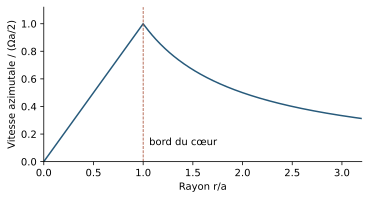
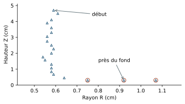
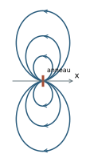
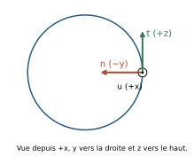
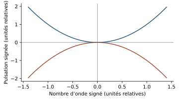
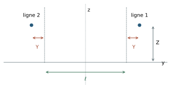
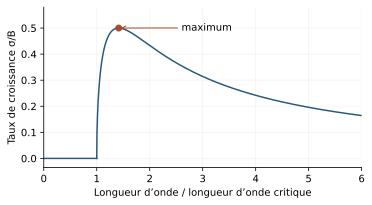

# X, ESPCI et ENS PC 2018 — Physique B · Corrigé brut

*Corrigé rédigé par IA, non officiel. Signalez toute erreur.*

**Lecture du rapport du jury** · GPT-6.2 Astra Ultra · vitesse non renseignée

**Rédaction** · GPT-6.2 Astra Ultra · vitesse non renseignée

## Dynamique de lignes de tourbillon dans les fluides parfaits

## Analogie avec la magnétostatique

### Question 1 — Dictionnaire des champs

Pour un courant stationnaire, Maxwell–Ampère s’écrit $\nabla\times\mathbf B=\mu_0\mathbf j$. Dans le fluide, $\nabla\times\mathbf u=\boldsymbol\omega$. Le champ magnétique correspond ainsi à la vitesse, et la densité de courant multipliée par $\mu_0$ à la vorticité.

### Question 2 — Flux à travers une surface fermée

Maxwell–Gauss pour le magnétisme donne $\nabla\cdot\mathbf B=0$. Son équivalent est $\nabla\cdot\mathbf u=0$, car la continuité impose $D\rho/Dt=-\rho\nabla\cdot\mathbf u$ et l’incompressibilité impose $D\rho/Dt=0$. Les flux de ces deux champs à travers toute surface fermée sont nuls.

### Question 3 — Circulation sur un contour orienté

Si $S$ a pour bord $\mathcal C$ orienté par la règle de la main droite, $\oint_{\mathcal C}\mathbf B\cdot d\boldsymbol\ell=\mu_0\int_S\mathbf j\cdot d\mathbf S=\mu_0 I_{\rm enlacé}$. De même, $\oint_{\mathcal C}\mathbf u\cdot d\boldsymbol\ell=\int_S\boldsymbol\omega\cdot d\mathbf S=\sum_j s_j\Gamma_j$ pour des filaments. Le signe $s_j$ est positif pour une traversée dans le sens de la normale, négatif dans l’autre. Ainsi les contours de la figure 1 donnent respectivement $\Gamma$ et zéro.

### Question 4 — Plans de symétrie

Traitons les flèches de circulation comme les flèches de courant de la distribution analogue. En un point d’un plan de symétrie de cette distribution orientée, le champ induit est normal au plan. Dans un plan d’antisymétrie, il appartient au plan. En effet, pour la réflexion de matrice $S$, le produit vectoriel de Biot–Savart transforme le champ en $-S\mathbf u$ lorsque les flèches sources sont réfléchies comme celles d’un courant. Si l’on inverse de plus ces flèches, le champ devient $S\mathbf u$. Cette convention explicite le sens de « symétrie de la distribution » utilisé dans l’analogie.

### Question 5 — Filament infini

Les translations selon $z$ et rotations autour de $Oz$ rendent les composantes cylindriques indépendantes de $z,\theta$. Le plan contenant $Oz$ et le point d’observation est un plan de symétrie des flèches sources. La vitesse y est donc normale, suivant $\mathbf e_\theta$. Sur un cercle de rayon $r$ orienté directement, Q3 donne $2\pi r u_\theta=\Gamma$. D’où $\mathbf u=\Gamma\mathbf e_\theta/(2\pi r)$, pour $r>0$. La singularité en zéro représente le cœur réduit à une ligne.

## Tube de Rankine, filaments et paroi

### Question 6 — Profil du tube de Rankine

Les mêmes symétries donnent $u_\theta(r)$. Pour $r\le a$, le flux de vorticité sur le disque vaut $\pi r^2\Omega$, donc $u_\theta=\Omega r/2$. Pour $r>a$, toute la vorticité enlacée est concentrée dans le cœur, de flux $\pi a^2\Omega$, donc $u_\theta=\Omega a^2/(2r)$. Le champ est continu à $a$, nul sur l’axe, et la circulation totale est $\Gamma=\pi\Omega a^2$.

### Question 7 — Advection stationnaire

La vitesse est purement azimutale. Chaque parcelle reste sur un cercle à $r,z$ constants. Or tous les points de ce cercle portent la même vorticité, y compris de part et d’autre de la frontière matérielle $r=a$. Le transport permute donc des parcelles de même vorticité, sans déformation ni déplacement du tube. La rotation des parcelles est compatible avec un profil eulérien stationnaire.

### Question 8 — Translation d’une paire contrarotative

De la ligne 1 vers la ligne 2, le rayon pointe selon $-\mathbf e_y$, donc $\mathbf e_x\times(-\mathbf e_y)=-\mathbf e_z$. Inversement $(-\mathbf e_x)\times\mathbf e_y=-\mathbf e_z$. Les deux vitesses induites valent ainsi $-\Gamma_0\mathbf e_z/(2\pi\ell)$. Une ligne droite ne s’auto-déplace pas. Leurs vitesses étant égales, l’écartement reste $\ell$ et la valeur de la vitesse reste constante. Les deux lignes se translatent ensemble vers les $z$ décroissants.

### Question 9 — Condition à la paroi

La paroi fixe est imperméable, donc $\mathbf u\cdot\mathbf e_y=u_y=0$ en $y=0$. Dans le modèle du fluide parfait, un glissement tangent à une paroi fixe est permis.

### Question 10 — Filament image

Au filament réel situé en $y=d$ et orienté vers $+x$, associons en $y=-d$ son image de circulation $-\Gamma_0$ suivant $x$. Le plan est alors un plan d’antisymétrie des flèches de courant équivalentes. Il contient la vitesse, conformément à Q9. La ligne réelle se déplace avec la vitesse de l’image évaluée à distance $2d$, soit $\mathbf u=-\Gamma_0\mathbf e_z/(4\pi d)$ par Q8. Le mouvement est uniforme, parallèle à la paroi, à distance constante.

## Anneaux de vorticité

### Question 11 — Translation d’un anneau

Le plan $yz$ de l’anneau est un plan de symétrie des courants circulaires analogues. Au niveau du filament, la vitesse propre admise dans le modèle est normale à ce plan, donc axiale. L’invariance par rotation autour de $Ox$ impose la même composante $V$ en tout point. L’anneau conserve son rayon et se translate à la vitesse uniforme $V\mathbf e_x$ dans un domaine infini homogène.

### Question 12 — Loi d’échelle

Comme $[\Gamma]=L^2T^{-1}$ et $[V]=LT^{-1}$, l’égalité $V=CR^\alpha\Gamma^\beta$ donne $-\beta=-1$ et $\alpha+2\beta=1$. Donc $\beta=1$, $\alpha=-1$ et $V=C\Gamma/R$. Avec l’orientation de l’énoncé, $V>0$ pour $\Gamma>0$.

### Question 13 — Circulation d’après les dernières positions

Sur la figure 5, les trois derniers points sont à $Z\simeq0,30\ \mathrm{cm}$ et à des rayons voisins de $0,75$, $0,92$ et $1,07\ \mathrm{cm}$. La variation totale couvre deux intervalles de $0,21\ \mathrm s$. La vitesse radiale vaut donc environ $0,32/0,42\simeq0,76\ \mathrm{cm\,s^{-1}}$. Avec $d=Z$, la vitesse du filament près de la paroi est $|\Gamma|/(4\pi Z)$, d’où $|\Gamma|\simeq4\pi(0,30)(0,76)\simeq2,9\ \mathrm{cm^2\,s^{-1}}\simeq3\,10^{-4}\ \mathrm{m^2\,s^{-1}}$. La précision est limitée par la lecture des points et par l’approximation de faible courbure.

### Question 14 — Constante d’autopropulsion

Au début, le nuage quasi vertical de la figure 5 donne $R\simeq0,59\ \mathrm{cm}$. Entre le premier point à $Z\simeq4,7\ \mathrm{cm}$ et le neuvième vers $2,5\ \mathrm{cm}$, il s’écoule huit intervalles. La vitesse verticale a donc pour module environ $2,2/(8\times0,21)\simeq1,3\ \mathrm{cm\,s^{-1}}$. Q12 donne alors $C=|V|R/|\Gamma|\simeq1,3\times0,59/2,9\simeq0,27$, soit environ $0,3$. Les centimètres s’éliminent quand toutes les grandeurs sont exprimées de façon cohérente.

### Question 15 — Lignes du dipôle

Pour une spire de courant, le moment magnétique est $I\pi R^2\mathbf e_x$ et son champ lointain comporte le préfacteur $\mu_0$. En remplaçant $\mu_0 I$ par $\Gamma$, la convention de (4) donne $\mathbf m=\Gamma\pi R^2\mathbf e_x$. Les lignes sortent du côté $+x$, se recourbent vers le côté $-x$ et reviennent par le centre. Dans une coupe méridienne du champ lointain, $dr/(r\,d\theta)=u_r/u_\theta=2\cot\theta$, donc $r=r_0\sin^2\theta$.

### Question 16 — Champ lointain sur l’axe

À l’avant, $\theta=0$, $\mathbf e_r=\mathbf e_x$ et le terme polaire est nul. À l’arrière, $\theta=\pi$ et $\mathbf e_r=-\mathbf e_x$, donc le signe de $\cos\theta$ se compense. Pour $L\gg R$, le champ vaut des deux côtés $\mathbf u\simeq\Gamma R^2\mathbf e_x/(2L^3)$. Il est orienté suivant le moment dipolaire.

### Question 17 — Induction mutuelle à grande distance

À la précision où chaque anneau est vu de loin par l’autre, on évalue Q16 à distance $\xi=x_2-x_1$. Il vient $\mathbf u_{1\to2}=\Gamma_1R_1^2\mathbf e_x/(2\xi^3)$ et $\mathbf u_{2\to1}=\Gamma_2R_2^2\mathbf e_x/(2\xi^3)$. Les deux moments positifs induisent une vitesse positive suivant $x$, d’un côté comme de l’autre de leur centre.

### Question 18 — Équation pour la séparation

Chaque anneau est entraîné par sa vitesse propre et par le champ axial de l’autre. On obtient $\dot x_1=C\Gamma_1/R_1+\Gamma_2R_2^2/(2\xi^3)$ et $\dot x_2=C\Gamma_2/R_2+\Gamma_1R_1^2/(2\xi^3)$. Par soustraction, $\dot\xi=C(\Gamma_2/R_2-\Gamma_1/R_1)+(\Gamma_1R_1^2-\Gamma_2R_2^2)/(2\xi^3)$. Les rayons sont ici constants à l’ordre retenu.

### Question 19 — Séparation critique

Avec les définitions (5), $\dot\xi=(C\epsilon\Gamma_1/R_1)[1-(\xi_c/\xi)^3]$, où $\xi_c=R_1[\delta/(2C\epsilon)]^{1/3}$. Le préfacteur étant positif, si $\xi_0>\xi_c$, la séparation croît et reste au-dessus du seuil. Si $\xi_0<\xi_c$, elle décroît et reste en dessous. À l’égalité, les anneaux ont la même vitesse et gardent leur séparation. Cet équilibre relatif est instable.

### Question 20 — Limite de l’interaction dipolaire

Le calcul exige $\xi\gg R_1,R_2$. Lorsque les anneaux se rapprochent, cette hypothèse cesse bien avant une éventuelle rencontre. Le champ incident varie alors sur un anneau, dont le rayon et la forme peuvent évoluer. Le terme en $\xi^{-3}$ de Q18 ne permet donc pas de décrire une collision.

## Auto-induction et ondes de Kelvin

### Question 21 — Trièdre sur le cercle

Choisissons le point situé en $+R\mathbf e_y$ sur le cercle d’axe $x$. Pour une circulation positive autour de $x$, $\mathbf t=\mathbf e_z$, tandis que la normale intérieure est $\mathbf n=-\mathbf e_y$. Ainsi $\mathbf t\times\mathbf n=\mathbf e_x$. La règle (6) donne $\mathbf u=(C\Gamma/R)\mathbf e_x$. Par rotation autour de l’axe, la même construction s’applique partout et retrouve Q11–12, en direction et en norme.

### Question 22 — Couplage des déplacements transverses

Au premier ordre, le vecteur de courbure est $\mathbf n/R\simeq Y_{xx}\mathbf e_y+Z_{xx}\mathbf e_z$. La tangente peut être remplacée par $\mathbf e_x$ dans (6), car sa correction multiplierait une courbure déjà du premier ordre. Il vient $\mathbf u=C\Gamma_0(Y_{xx}\mathbf e_z-Z_{xx}\mathbf e_y)$. Sans vitesse axiale au premier ordre, $\partial_tY=-C\Gamma_0\partial_x^2 Z$ et $\partial_tZ=C\Gamma_0\partial_x^2 Y$.

### Question 23 — Dispersion d’une ligne isolée

Posons $A=C\Gamma_0>0$. Le mode $e^{i(\omega t-kx)}$ vérifie $i\omega Y_0=Ak^2 Z_0$ et $i\omega Z_0=-Ak^2Y_0$. Une solution non nulle exige $\omega^2=A^2k^4$, d’où $\omega=\pm Ak^2$. Le graphe comporte deux paraboles symétriques. Sur chaque branche, $\omega/k=\pm Ak$ et $d\omega/dk=\pm2Ak$. Elles dépendent du nombre d’onde, donc ces ondes sont dispersives.

### Question 24 — Polarisation et hélice

Pour $k\ne0$, $Z_0=i\omega Y_0/(Ak^2)=isY_0$ avec $s=\operatorname{sgn}\omega$. Choisissons $Y_0=b$ réel par changement d’origine de phase. Alors $Y=b\cos(\omega t-kx)$ et $Z=-sb\sin(\omega t-kx)$. À $x$ fixé, la trajectoire transverse est un cercle de rayon $b$. À $t$ fixé, la ligne est une hélice d’axe $x$, de rayon $b$ et de pas en valeur absolue $2\pi/|k|$. Le signe relatif de $k$ et du sens de rotation fixe son enroulement spatial.

### Question 25 — Petite pente

La tangente exacte est proportionnelle à $(1,\partial_xY,\partial_x Z)$. La linéarisation requiert que les pentes transverses soient très inférieures à un. Pour l’hélice de rayon $b$, $\sqrt{Y_x^2+Z_x^2}=|k|b$. Il faut donc $b\ll1/|k|=\lambda/(2\pi)$, ce qui compare bien deux longueurs.

## Déformations symétriques d’un sillage

### Question 26 — Coupe transversale du sillage

À $x,t$ fixés, les deux points sont $(y,z)=(\ell/2+Y,Z)$ et $(-\ell/2-Y,Z)$. La séparation est purement horizontale dans le plan $yz$ et vaut $d=|\ell+2Y|=\ell+2Y$ pour les faibles déformations considérées. Une déformation positive $Y$ éloigne les deux lignes de leur plan médian.

### Question 27 — Induction de la ligne opposée

Pour $\lambda\gg\ell$, le voisinage qui contribue principalement au champ mutuel est assimilé à deux lignes droites parallèles. La source 2 est orientée suivant $-\mathbf e_x$, et la direction vers la ligne 1 est $+\mathbf e_y$. Par Q5, sa vitesse induite est donc $\mathbf u_{2\to1}=-\Gamma_0\mathbf e_z/[2\pi(\ell+2Y)]$.

### Question 28 — Équations linéarisées de la paire

Pour $|Y|\ll\ell$, $(\ell+2Y)^{-1}=\ell^{-1}(1-2Y/\ell)+O(Y^2/\ell^3)$. La vitesse mutuelle suivant $z$ est donc $-\Gamma_0/(2\pi\ell)+\Gamma_0Y/(\pi\ell^2)$. En y ajoutant l’auto-induction de Q22, on trouve $\partial_tY=-C\Gamma_0 Z_{xx}$ et $\partial_t Z=C\Gamma_0Y_{xx}-\Gamma_0/(2\pi\ell)+\Gamma_0Y/(\pi\ell^2)$. Un écart plus grand atténue la descente.

### Question 29 — Repère en translation

Avec $\zeta=Z+\Gamma_0t/(2\pi\ell)$, les dérivées secondes en $x$ de $\zeta$ et de $Z$ coïncident. Ainsi $Y_t=-A\zeta_{xx}$, $\zeta_t=AY_{xx}+BY$, où $A=C\Gamma_0$ et $B=\Gamma_0/(\pi\ell^2)$. La cote $\zeta$ se mesure dans un repère qui descend avec la paire droite de Q8. La translation uniforme en a été retranchée, de sorte que ces équations décrivent la déformation relative.

### Question 30 — Dispersion et mode croissant

Les amplitudes obéissent à $i\omega Y_0=Ak^2\zeta_0$ et $i\omega\zeta_0=(B-Ak^2)Y_0$. Le déterminant donne $\omega^2=Ak^2(Ak^2-B)$. Pour $0<|k|<\sqrt{B/A}$, $\omega=\pm i\sigma$ avec $\sigma=\sqrt{Ak^2(B-Ak^2)}$. Dans la convention du sujet $e^{i\omega t}$, c’est $\omega=-i\sigma$ qui donne une amplification $e^{\sigma t}$. L’autre racine exprime la décroissance.

### Question 31 — Longueur d’onde critique

Posons $k_c=\sqrt{B/A}=1/(\ell\sqrt{\pi C})$. Les longueurs d’onde finies croissent exponentiellement si $\lambda>\lambda_c=2\pi/k_c=2\pi\ell\sqrt{\pi C}$. Pour $\lambda<\lambda_c$, la pulsation est réelle. À l’égalité, $\omega=0$ et le taux exponentiel s’annule.

### Question 32 — Maximum du taux

Dans le domaine instable, $\sigma^2=ABk^2-A^2k^4$ est une parabole concave en $q=k^2$. Sa dérivée $AB-2A^2q$ s’annule à $q=B/(2A)=k_c^2/2$. Ainsi $\lambda_m=\sqrt2\lambda_c=2\pi\ell\sqrt{2\pi C}$ et $\sigma_{\max}=B/2=\Gamma_0/(2\pi\ell^2)$.

### Question 33 — Graphe des taux de croissance

En posant $s=\lambda/\lambda_c$, $\sigma=0$ pour $s\le1$ et $\sigma/B=s^{-1}\sqrt{1-s^{-2}}$ pour $s>1$. Au départ de la branche instable, $\sigma/B\sim\sqrt{2(s-1)}$ donne une tangente verticale à droite. Le maximum $1/2$ se trouve en $s=\sqrt2$. Ensuite le taux décroît vers zéro comme $1/s$.

### Question 34 — Comparaison avec la photographie

Avec $C\simeq0,27$, la prédiction est $\lambda_m/\ell=2\pi\sqrt{2\pi C}\simeq8$. Sur l’agrandissement inférieur de la figure 8, on peut comparer la distance entre deux crêtes du même filament à l’écartement moyen des deux traces. Une période occupe environ 180 à 210 unités de lecture pour un écartement de l’ordre de 25 à 35 dans la même unité, soit un rapport de l’ordre de 6 à 8. L’accord porte sur l’ordre de grandeur. La perspective et les déformations déjà marquées limitent la précision.

### Question 35 — Polarisations de la paire

La première équation de Q30 donne $\zeta_0/Y_0=i\omega/(Ak^2)$. Pour $s=\lambda/\lambda_c<1$, ce rapport vaut $\pm i\sqrt{1-s^2}$. Les deux déplacements sont en quadrature et le point décrit une ellipse de grand axe $y$ avec rapport des demi-axes $\sqrt{1-s^2}$. À $s=1$, le mode propre de pulsation nulle a $\zeta_0=0$ et une déformation suivant $y$. Avec une condition initiale verticale arbitraire, le système au seuil peut aussi présenter un terme linéaire en temps.

Pour $s>1$, la branche croissante a $\zeta_0/Y_0=+\sqrt{s^2-1}$, la décroissante le signe opposé. Le rapport est réel. Le déplacement d’un mode propre est rectiligne et son amplitude croît ou décroît exponentiellement. Pour le mode le plus instable, $s=\sqrt2$, la direction est à $45^\circ$ des axes. La ligne 2 a pour déplacement $(-Y,\zeta)$, image miroir de la ligne 1, donc son ellipse est parcourue en sens inverse et sa droite instable a la pente opposée. Dans la limite formelle $s\ll1$, le rapport elliptique tend vers un. La courbure propre $Ak^2$ domine alors $B$, ce qui restitue les ondes circulaires de Q24. L’approximation locale de Q27 demande par ailleurs une longueur d’onde grande devant $\ell$.
