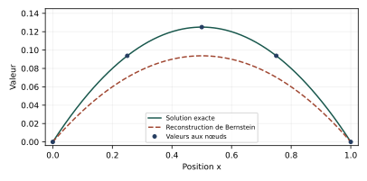
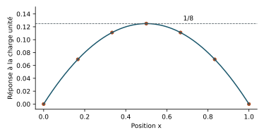

# X–ENS · PSI · Mathématiques 2018 · Corrigé brut

*Corrigé rédigé par IA, non officiel. Signalez toute erreur.*

**Rédaction** · GPT-6.2 Astra Ultra · vitesse non renseignée

**Révision (tour 1)** · GPT-6.2 Astra Ultra · vitesse non renseignée

Le sujet compare la solution d’un problème de Dirichlet, son approximation aux différences finies et une reconstruction par les polynômes de Bernstein. [Sujet officiel](https://www.ens.psl.eu/sites/default/files/2018_psi_sujet_math.pdf)

On étudie $-u^{\prime\prime}+cu=f$ avec $u(0)=u(1)=0$ et $c\geq0$. Le pas du maillage vaut $h=1/(n+1)$. Les $n$ inconnues intérieures ont pour abscisses $x_i=ih$. La vérification suit les questions du sujet officiel. Le rapport écrit de mathématiques de cette session reste introuvable dans les archives consultées.

## 1. Conditions de Dirichlet et principe du maximum

### Question 1

Le vecteur $(v,v')^t$ satisfait $Y'=\begin{pmatrix}0&1\\c(x)&0\end{pmatrix}Y+(0,-f(x))^t$ avec $Y(0)=(0,\lambda)^t$. Les coefficients et le second membre sont continus sur $[0,1]$. Le théorème de Cauchy linéaire donne une unique solution $C^1$ sur tout le segment. Sa première composante appartient à $C^2$ et résout le problème demandé.

### Question 2

Prenons $w_2=v_0$, solution du problème forcé avec $w_2(0)=w_2'(0)=0$. La fonction $\lambda w_1+w_2$ satisfait la même équation et les mêmes données initiales que $v_\lambda$. Par unicité, $v_\lambda=\lambda w_1+w_2$.

### Question 3

Si $w_1(1)=0$, multiplier $-w_1''+cw_1=0$ par $w_1$ et intégrer par parties donne $\int_0^1[(w_1')^2+cw_1^2]dx=0$, les deux termes de bord étant nuls. Comme $c\ge0$, cela impose $w_1'=0$ partout, en contradiction avec $w_1'(0)=1$. Donc $w_1(1)\ne0$.

### Question 4

La condition $v_\lambda(1)=0$ équivaut à $\lambda=-w_2(1)/w_1(1)$, bien définie par 3. Cela construit une solution. Toute solution de Dirichlet possède une pente initiale et coïncide alors avec $v_\lambda$ par 1. L’unicité de la pente donne donc l’unicité de la solution.

### Question 5

Si $u<0$ en un point, la composante de $\{u<0\}$ qui le contient est un intervalle $(a,b)$ dont les deux valeurs au bord sont nulles, grâce aussi aux conditions en $0,1$. Sur cet intervalle, $u''=cu-f\le0$. La fonction est concave et reste au-dessus de la corde de hauteur zéro entre ses extrémités, contradiction. Donc $u\ge0$.

L’argument reste valable quand $f$ ou $c$ s’annulent au point de minimum. La concavité porte sur toute une composante connexe de l’ensemble ouvert où $u$ est strictement négative et se prolonge aux deux extrémités par continuité.

## 2. Spectre du laplacien discret et positivité des inverses

### Question 6

La matrice réelle symétrique $A_n$ a des valeurs propres réelles par le théorème spectral, même si l’on cherche un vecteur propre complexe. La ligne $i$ donne $-v_{i-1}+2v_i-v_{i+1}=\lambda v_i$, valable jusqu’aux extrémités avec $v_0=v_{n+1}=0$. D’où $v_{i+1}-(2-\lambda)v_i+v_{i-1}=0$.

### Question 7

Pour $v\ne0$ avec $v_0=v_{n+1}=0$, $v^*A_nv=\sum_{i=0}^n|v_{i+1}-v_i|^2>0$. De même $v^*(4I-A_n)v=\sum_{i=0}^n|v_{i+1}+v_i|^2>0$. L’égalité imposerait respectivement que tout $v_i$ soit égal au précédent ou à son opposé et donc nul à partir de $v_0=0$. Sur un vecteur propre on obtient $0<\lambda<4$.

### Question 8a

Le discriminant du polynôme caractéristique de la récurrence est $(2-\lambda)^2-4=\lambda(\lambda-4)<0$ par 7. Il a donc deux racines distinctes, complexes conjuguées.

### Question 8b

Le produit des racines étant $1$, leur module commun $\rho$ vérifie $\rho^2=1$ et vaut un. La solution générale s’écrit $v_j=Ae^{ij\theta}+Be^{-ij\theta}$. La condition $v_0=0$ donne $B=-A$. Comme le vecteur propre est non nul, $A\ne0$. La condition $v_{n+1}=0$ impose donc $\sin((n+1)\theta)=0$.

### Question 9

Pour $k=1,\ldots,n$, posons $\theta_k=k\pi/(n+1)$, $\lambda_k=2-2\cos\theta_k$, $v_j^{(k)}=\sin(j\theta_k)$ pour $1\le j\le n$. L’addition des sinus vérifie la récurrence et les deux bords sont nuls. La première composante est non nulle. Les $n$ valeurs propres sont strictement croissantes, donc distinctes. Les $n$ vecteurs associés sont indépendants et fournissent une base de $\mathbb R^n$, ce qui épuise le spectre.

La relation $r+r^{-1}=2-\lambda$ donne $\lambda=2-2\cos\theta=4\sin^2(\theta/2)$. Ainsi pour $n=1$, l’unique mode a pour composante $\sin(\pi/2)=1$ et pour valeur propre $2$, comme la matrice à un seul coefficient.

### Question 10a

Les hypothèses donnent $b_{ii}>\sum_{j\ne i}|b_{ij}|$. Si $Bv=0$ avec $v\ne0$, choisir $i$ tel que $|v_i|=\|v\|_\infty>0$. La ligne $i$ imposerait $b_{ii}|v_i|\le\sum_{j\ne i}|b_{ij}|\,|v_j|<b_{ii}|v_i|$. Donc le noyau est nul et $B$ est inversible.

### Question 10b

Soit $v=B^{-1}F$ et supposons $v_i=\min_jv_j<0$. Comme $b_{ij}\le0$ hors diagonale, $(Bv)_i\le v_i\sum_j b_{ij}<0$, en contradiction avec $F_i\ge0$. Donc toutes les composantes de $v$ sont positives ou nulles, au sens donné dans le sujet.

### Question 10c

Le vecteur $e_j$ a toutes ses composantes positives ou nulles. Par 10b, $B^{-1}e_j$ aussi. Ces vecteurs sont exactement les colonnes de $B^{-1}$.

### Question 11

Pour $\varepsilon>0$, $A_n+\varepsilon I$ satisfait les trois hypothèses de 10, donc son inverse est à coefficients positifs ou nuls. Par 7, $A_n$ est inversible. La continuité de l’inversion, ou la diagonalisation de 9, donne $(A_n+\varepsilon I)^{-1}\to A_n^{-1}$ coefficient par coefficient. La positivité au sens large passe à la limite.

## 3. Construction du schéma aux différences finies

### Question 12

Par Taylor à l’ordre trois avec reste de Lagrange aux points $x_i\pm h$, les termes impairs s’annulent dans la somme. Il reste $h^2v''(x_i)+h^4(v^{(4)}(\xi_+)+v^{(4)}(\xi_-))/24$ pour la différence seconde. Après division par $h^2$, l’erreur est au plus $h^2\|v^{(4)}\|_\infty/12$, uniforme en $i,n$.

### Question 13

Posons $B=h^{-2}A_n+D$ avec $D=\operatorname{diag}(c(x_1),\ldots,c(x_n))$. Le système intérieur est $BU=F$, avec $F_i=f(x_i)$. Par 7, $h^{-2}A_n$ est symétrique définie positive et $D$ est positive au sens large. Leur somme est donc définie positive et inversible. L’intérieur est unique et $u_0=u_{n+1}=0$ fixe les deux autres valeurs.

### Question 14

Pour $c=0$, $f=1$, la fonction $u(x)=x(1-x)/2$ vérifie l’équation et les deux conditions aux extrémités. Sa différence seconde centrée divisée par $h^2$ est exactement $u''=-1$ (le reste de 12 est nul). Les valeurs $u(x_i)$ vérifient donc le système discret. Par 13, $u_i=x_i(1-x_i)/2$ pour chaque $i$.

### Question 15

Pour tout $\varepsilon>0$, $B+\varepsilon I$ avec $B=h^{-2}A_n+D$ a des entrées hors diagonale négatives ou nulles et toutes ses sommes de lignes strictement positives. Par 10 ses inverses ont des entrées positives ou nulles. Comme $B$ est inversible par 13, $B^{-1}$ a aussi cette propriété par passage à la limite. Si $F_i\ge0$, $U=B^{-1}F\ge0$ composante par composante et les deux bords valent zéro.

## 4. Erreur aux nœuds pour des données régulières

### Question 16

Pour $\|x\|_\infty\le1$, chaque composante de $Ax$ est majorée en module par sa somme de ligne absolue. Si $i$ maximise cette somme, choisir $x_j=\operatorname{sgn}(a_{ij})$, avec un signe arbitraire pour les zéros, atteint la borne. Ainsi $N(A)=\max_i\sum_j|a_{ij}|$. Cette expression est positive, homogène en valeur absolue, nulle seulement si $A=0$ et sous-additive par l’inégalité triangulaire sur chaque ligne. C’est donc une norme.

### Question 17a

Posons $T=h^{-2}A_n$. Comme $T^{-1}\ge0$ coefficient par coefficient, $N(T^{-1})=\|T^{-1}\mathbf1\|_\infty$. Par 14, ce vecteur a pour composantes $x_i(1-x_i)/2$, toutes au plus $1/8$. Ainsi $N(((n+1)^2A_n)^{-1})\le1/8$.

Lorsque $n$ est impair, le maillage contient $x_{(n+1)/2}=1/2$ et la constante $1/8$ est atteinte. Pour $n$ pair, ses deux nœuds les plus proches sont à distance $h/2$, donnant la valeur exacte $1/8-h^2/8$ pour la norme de cet inverse.

### Question 17b

Pour toute diagonale $D\ge0$, la preuve de 15 donne $(T+D)^{-1}\ge0$, sans changer lorsqu’on prescrit simplement les $n$ entrées de $D$. Posons $v=(T+D)^{-1}\mathbf1\ge0$, $w=T^{-1}\mathbf1$. Alors $w-v=T^{-1}Dv\ge0$. Ainsi $N((T+D)^{-1})=\|v\|_\infty\le\|w\|_\infty\le1/8$.

### Question 18

Comme $u''=cu-f$ avec $u,c,f\in C^2$, on a $u\in C^4$. Pour $U^*=(u(x_i))_{1\le i\le n}$, 12 donne le résidu $(T+D)U^*-F$ de norme au plus $h^2\|u^{(4)}\|_\infty/12$. Le vecteur discret satisfait $(T+D)U=F$. En appliquant 17b à leur différence, on obtient $\|U^*-U\|_\infty\le h^2\|u^{(4)}\|_\infty/96$. L’erreur est nulle aux deux extrémités et $h^2=(n+1)^{-2}\le n^{-2}$, ce qui fournit la constante indépendante de $n$ (on peut l’augmenter pour la rendre strictement positive).

Vérifions la constante sur $u(x)=x^2(1-x)^2$, avec $c=0$ et $f=-u''$. Alors $u^{(4)}=24$ et la différence seconde centrée divisée par $h^2$ vaut $u''+2h^2$. Par 14, $u(x_i)-u_i=-h^2x_i(1-x_i)$. Si le milieu appartient au maillage, le maximum de l’erreur vaut $h^2/4=h^2\|u^{(4)}\|_\infty/96$.

## 5. Approximation de Bernstein pour une donnée höldérienne

### Question 19a

La somme $nS_n$ a loi binomiale $\mathcal B(n,x)$. Par indépendance, $\mathbb E S_n=x$ et $\operatorname{Var}(S_n)=x(1-x)/n$. En sommant $f(k/n)$ contre la loi binomiale, on obtient $\mathbb E f(S_n)=B_nf(x)$.

### Question 19b

La somme imprimée est $\mathbb E|x-S_n|$. Par Cauchy–Schwarz elle est au plus $\sqrt{\mathbb E(x-S_n)^2}=\sqrt{x(1-x)/n}\le1/(2\sqrt n)$.

### Question 20

Pour $0\le\lambda\le1$, $\lambda^\alpha\le1$ et pour $\lambda\ge1$, $\lambda^\alpha\le\lambda$ puisque $0<\alpha\le1$. D’où $\lambda^\alpha\le1+\lambda$. Prendre $\lambda=\sqrt n\,|x-k/n|$ et diviser par $n^{\alpha/2}$ donne la borne demandée, même si $x=k/n$.

### Question 21

Par 19a, $|f(x)-B_nf(x)|\le\mathbb E|f(x)-f(S_n)|\le K\mathbb E|x-S_n|^\alpha$. Par 19b–20, cette dernière expression est au plus $Kn^{-\alpha/2}(1+\sqrt n/(2\sqrt n))=3K/(2n^{\alpha/2})$. Aux extrémités $B_nf=f$. Le supremum obéit donc à la même borne.

### Question 22

Notons $b_{j,m}(x)=\binom mjx^j(1-x)^{m-j}$ et posons les termes hors indices égaux à zéro. Sa dérivée vaut $m(b_{j-1,m-1}-b_{j,m-1})$. En appliquant deux fois cette relation et en regroupant, on obtient
$$(\widehat B_{n+1}u)''=n(n+1)\sum_{\ell=0}^{n-1}(u_{\ell+2}-2u_{\ell+1}+u_\ell)b_{\ell,n-1}.$$
Par le système discret avec $c=0$, chaque différence seconde vaut $-(n+1)^{-2}f((\ell+1)/(n+1))$. Le coefficient devient $-n/(n+1)$, comme annoncé.

Pour $f=1$, la somme des poids vaut un et $(\widehat B_{n+1}u)''=-n/(n+1)$. Avec les deux valeurs nulles aux bords, cela donne exactement $\widehat B_{n+1}u(x)=\tfrac{n}{n+1}\,x(1-x)/2$. Aux nœuds intérieurs, la solution discrète de 14 est exacte, mais sa reconstruction de Bernstein diffère en général de cette valeur.

### Question 23a

Écrivons $T(x)=\sum_{\ell=0}^{n-1}f((\ell+1)/(n+1))b_{\ell,n-1}(x)$. Alors $\|T\|_\infty\le\|f\|_\infty$ et $\chi_{n+1}''=f-T+T/(n+1)$ par 22 et $u''=-f$. Les points d’évaluation vérifient $|(\ell+1)/(n+1)-\ell/(n-1)|=|n-1-2\ell|/[(n+1)(n-1)]\le1/(n+1)$. Par la condition de Hölder et la somme unité des poids, $\|T-B_{n-1}f\|_\infty\le K/(n+1)^\alpha$. Ainsi $\|\chi_{n+1}''\|_\infty\le\|f-B_{n-1}f\|_\infty+\|f\|_\infty/(n+1)+K/(n+1)^\alpha$.

### Question 23b

Pour $0<x<1$, $\chi=\chi_{n+1}$ est nulle aux extrémités car $u_0=u_{n+1}=u(0)=u(1)=0$. La fonction $h(t)=\chi(t)-\chi(x)t(1-t)/(x(1-x))$ est nulle en $0,x,1$. Deux applications de Rolle donnent un $\xi\in(0,1)$ avec $h''(\xi)=0$. Ainsi $\chi(x)=-x(1-x)\chi''(\xi)/2$. Pour $x=0$ ou $1$ les deux membres sont nuls pour tout $\xi$.

Plus précisément, Rolle sur $[0,x]$ puis $[x,1]$ fournit $s<x<t$ tels que $h'(s)=h'(t)=0$. Appliqué à $h'$ sur $[s,t]$, il fournit $\xi$ et donc le signe négatif du facteur devant $\chi''(\xi)$.

### Question 24

Par 23b, $\|\chi_{n+1}\|_\infty\le\|\chi_{n+1}''\|_\infty/8$. Pour $n\ge2$, utiliser 21 au rang $n-1$ dans 23a et $n-1\ge n/2$. Comme $0<\alpha\le1$, les deux autres termes sont aussi $O(n^{-\alpha/2})$. On peut prendre pour ces rangs
$$M_0=\tfrac18\bigl(3K2^{\alpha/2}/2+\|f\|_\infty+K\bigr).$$
Enfin $M=\max(M_0,\|u-\widehat B_2u\|_\infty)$ inclut $n=1$. Ainsi la majoration uniforme demandée vaut pour tout $n\ge1$.

