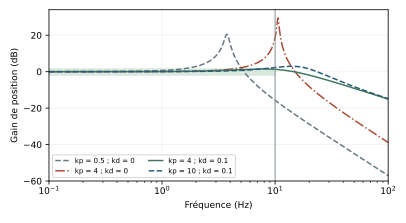
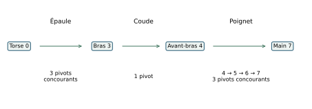
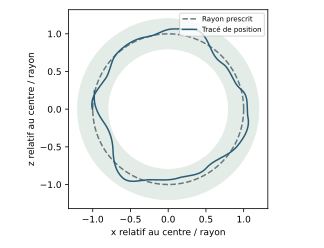
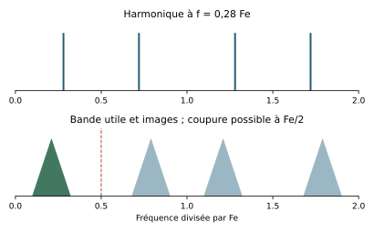
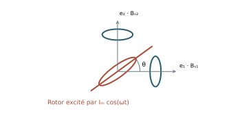

# X-ENS PSI · Modélisation 2018 · Corrigé brut

*Corrigé rédigé par IA, non officiel. Signalez toute erreur.*

**Rédaction** · GPT-6.2 Astra Ultra · vitesse non renseignée · 24 novembre 2026

**Révision (tour 1)** · GPT-6.2 Astra Ultra · vitesse non renseignée · 26 novembre 2026

## Mise en situation

### Question 1 · Un usage du retour d’effort

En télémanipulation dans une cellule de laboratoire confinée, l’opérateur saisit un récipient fragile avec le robot. Le retour d’effort lui fait sentir le contact et l’aide à limiter le serrage sans entrer dans la cellule.

## 1 · Précision du suivi

### Question 2 · Bilans de moments

Le frottement visqueux s’oppose au mouvement. Les bilans maître et esclave donnent $I_m\ddot\theta_m+b_m\dot\theta_m=C_h+C_m$ et $I_s\ddot\theta_s+b_s\dot\theta_s=C_s+C_e$. Lors d’un contact résistant, le signe algébrique de $C_e$ traduit son opposition.

### Question 3 · Matrice pour le ressort de position

Avec les conditions initiales nulles, $C_h=Z_m\theta_m-C_e$. De plus $Z_s\theta_s=K(\theta_m-\theta_s)+C_e$. Dans l’ordre des entrées $(\theta_m,C_e)$ et des sorties $(C_h,\theta_s)$, la matrice est

$$
H=\begin{pmatrix}Z_m&-1\\ K/(Z_s+K)&1/(Z_s+K)\end{pmatrix}.
$$

### Question 4 · Transparence totale

Il faut $\theta_s=\theta_m$ pour tout mouvement et $C_h=-C_e$ pour tout effort de contact. Les deux couples correspondent aux efforts entrants aux deux ports. On obtient $H_{\mathrm{id}}=\left(\begin{smallmatrix}0&-1\\1&0\end{smallmatrix}\right)$.

### Question 5 · Essais libre et bloqué

En mouvement libre de l’esclave, $C_e=0$ : imposer un mouvement au maître et mesurer les deux angles et le couple de main pour obtenir $X_T$ et $Z_{\min}$. Bloquer ensuite l’esclave en $\theta_s=0$ contre un appui rigide, exciter le maître, mesurer les couples de contact et de main et l’angle maître pour déterminer $F_T$ et $Z_{\max}$. Avec une excitation harmonique, répéter les mesures en fréquence.

### Question 6 · Grandeurs d’identification

Pour $C_e=0$, les deux lignes donnent immédiatement $X_T=h_{21}$ et $Z_{\min}=h_{11}$. Pour $\theta_s=0$, $C_e=-h_{21}\theta_m/h_{22}$ puis $C_h=(\det H)\theta_m/h_{22}$. Ainsi $F_T=-C_e/C_h=h_{21}/\det H$ et $Z_{\max}=\det H/h_{22}$ aux fréquences où les rapports sont définis.

### Question 7 · Cinq boîtes de l’asservissement

Les blocs numérotés de 1 à 5 sont respectivement $1/Z_m$, $K_1$, $H_c$, $1/Z_s$, $K_2$. Le premier convertit $C_h+C_m$ en position maître. L’erreur $K_1\theta_m-\theta_s$ commande le couple moteur esclave ; le dernier bloc ramène $C_e$ au maître avec son signe.

### Question 8 · Matrice de la commande force-position

Les équations sont $C_h=Z_m\theta_m-K_2C_e$ et $(Z_s+H_c)\theta_s=K_1H_c\theta_m+C_e$. Par conséquent

$$
H=\begin{pmatrix} Z_m&-K_2\\ K_1 H_c/(Z_s+H_c)&1/(Z_s+H_c)\end{pmatrix}.
$$

### Question 9 · Effort ressenti sans contact

À vide, $C_m=K_2C_e=0$ et $C_h=Z_m\theta_m$. La main perçoit encore l’inertie et le frottement propres du maître : en accélération elle fournit $I_m\ddot\theta_m$ et à vitesse constante $b_m\dot\theta_m$. À l’arrêt, ces deux contributions s’annulent.

### Question 10 · Transfert du suivi de position

Pour $K_1=K_2=1$, en mouvement libre,

$$
X_T(p)=\frac{k_p+k_dp}{I_sp^2+(b_s+k_d)p+k_p}.
$$

Le gain statique vaut 1 si $k_p>0$.

### Question 11 · Lecture du Bode

Toutes les courbes démarrent à 0 dB. Avec $k_d=0$, le numérateur est constant et le dénominateur quadratique : pente asymptotique de −40 dB/décade. Avec $k_d>0$, le zéro réel $-k_p/k_d$ relève la pente finale à −20 dB/décade. Les maxima des courbes noires sont voisins de $\sqrt{k_p/I_s}/(2\pi)$, soit 3,75 Hz pour 0,5 et 10,6 Hz pour 4, conformément à la figure 4.

### Question 12 · Raideur et résonance

Le dénominateur a pour pulsation propre $\omega_n=\sqrt{k_p/I_s}$ et pour amortissement $\zeta=(b_s+k_d)/(2\sqrt{k_p I_s})$. À $k_d=0$, accroître $k_p$ décale le pic vers la droite et, à frottement fixé, le rend plus marqué. À $k_p$ fixé, accroître $k_d$ augmente l’amortissement ; le zéro de la commande intervient aussi dans la hauteur exacte du pic. En posant $u=\omega^2$,

$$
|X_T|^2=\frac{k_p^2+k_d^2u}{(k_p-I_su)^2+(b_s+k_d)^2u}.
$$

Avec les valeurs de la figure, pour $k_p=4$, le pic passe d’environ 30 à 1,5 dB lorsque $k_d$ passe de 0 à 0,1. Pour $k_d=0,1$, relever $k_p$ de 4 à 10 décale et augmente à nouveau le maximum. La formule évite de confondre le pic réel et la pulsation propre.

### Question 13 · Choisir les gains de suivi

Parmi les quatre réglages de la figure 4, retenir $k_p=4$ et $k_d=0,1$ en unités SI : le gain d’amplitude reste entre 1 et environ 1,188, avec un maximum vers 7,8 Hz ; à 10 Hz il vaut 1,159. La déviation en amplitude reste donc inférieure à 20 %. Les réglages sans dérivée ont un pic marqué dans la bande ou à son voisinage et le réglage $(10;0,1)$ atteint déjà 1,30 à 10 Hz. Cette comparaison repose sur le Bode de gain demandé ; une exigence de suivi instantané tenant compte du déphasage demanderait aussi la phase.



## 2 · Stabilité

### Question 14 · Stabilité en l’absence de retard

Pour $I_m>0$, $K_1K_2 k_p>0$ et $b_m+K_1K_2 k_d>0$, le trinôme a deux racines de partie réelle strictement négative. Le système en esclave bloqué est donc asymptotiquement stable pour les paramètres positifs considérés. Une raideur nulle laisserait un pôle en zéro.

### Question 15 · Introduire les délais de transmission

Écrire $K_i(p)=K_{i0}e^{-p\Delta_i}\simeq K_{i0}(1-p\Delta_i)$. Posons $K=K_{10}K_{20}$, $D=\Delta_1+\Delta_2$, $P=\Delta_1\Delta_2$. Le dénominateur devient $I_mp^2+b_mp+K(k_p+k_dp)(1-Dp+Pp^2)$, avec numérateur 1. Les coefficients demandés sont

$$
A_0=Kk_p,\quad A_1=b_m+Kk_d-Kk_pD,\quad A_2=I_m-Kk_dD+Kk_pP,\quad A_3=Kk_dP.
$$

Le terme cubique apparaît lorsqu’on multiplie les deux canaux approchés. Si l’on tronque ensuite au premier ordre **total** en délais, les termes en $P$ disparaissent. Le modèle de retard exact contient $e^{-pD}$.

### Question 16 · Retard et déplacement des pôles

Le retard ajoute un déphasage $-\omega D$, ce qui réduit la marge de phase. Sur la figure 5, à gain proportionnel croissant les pôles s’approchent de l’axe imaginaire puis peuvent passer dans le demi-plan droit. Le passage se produit vers $k_p=110$, 11 et 3,6 pour des retards individuels de 0,1, 1 et 3 ms. Un aller-retour plus long réduit donc le gain admissible.

### Question 17 · Compromis entre rapidité et stabilité

Une hausse du gain proportionnel augmente la pulsation propre et permet de suivre plus vite de petits déplacements. Mais le canal retardé réinjecte alors les informations à des fréquences où leur déphasage est plus grand. Les oscillations s’amortissent moins et peuvent croître. Choisir les gains demande de concilier temps de réponse et marge de stabilité pour le délai réel du dispositif.

### Question 18 · Conditions suffisantes sur les gains

Posons $B=b_m+Kk_d$. Au premier ordre total, $A_2A_1-A_3A_0=I_m B-I_mKk_pD-Kk_dBD+O(D^2)$. Il suffit que chacune des deux corrections négatives soit strictement inférieure à $I_mB/2$, d’où

$$
k_p<\frac{B}{2KD},\qquad k_d<\frac{I_m}{2KD}.
$$

Ces bornes donnent aussi $A_1>B/2$ et $A_2>I_m/2$ aux ordres retenus. Les autres coefficients sont positifs pour les gains et délais positifs. C’est un critère **suffisant dans le modèle linéarisé** ; la répartition par moitiés n’est pas une condition nécessaire.

### Question 19 · Bras sans frottement mécanique

Si $b_m=0$, choisir $0<k_d<I_m/(2KD)$ puis $0<k_p<k_d/(2D)$ satisfait les deux bornes. Le bras peut donc être stable : l’action dérivée apporte un amortissement actif. Un correcteur purement proportionnel et un bras sans frottement n’offriraient pas cette dissipation.

### Question 20 · Application au prototype

$D=0,002$ s, $K=1$ et $B=0,022$. Les bornes suffisantes sont $k_p<5,5$ et $k_d<0,225$. Les choix $k_p=5$ et $k_d=0,02$ satisfont les deux. La figure 5 indique aussi, pour un délai individuel de 1 ms, une perte de stabilité vers $k_p=11$, au-delà de la valeur choisie. Le modèle conclut à la stabilité de cet essai.

## 3 · Compensation dynamique

### Question 21 · Bande passante motrice

Pour piloter la position imposée par le geste volontaire, retenir la bande motrice de quelques hertz, jusqu’à environ 10 Hz selon la borne de Q13. La voie de sensation doit, selon l’effet à restituer, couvrir des fréquences plus élevées : environ 30 Hz pour le retour kinesthésique et jusqu’à 400 Hz pour le tactile. La fréquence d’échantillonnage de cette voie est examinée en Q36.

### Question 22 · Compléter le poignet

À la pièce 4 ajouter successivement les pièces 5, 6 et 7, cette dernière portant la main. Les liaisons 4–5, 5–6 et 6–7 sont trois pivots à axes concourants au centre du poignet et indépendants en posture ordinaire. On retrouve les trois rotations de l’épaule, une au coude et trois au poignet, soit sept coordonnées articulaires.



### Question 23 · Une configuration singulière

Si, lors d’une rotation du pivot médian du poignet, les axes du premier et du troisième pivot deviennent colinéaires, leurs rotations instantanées sont proportionnelles. Une combinaison de vitesses articulaires non nulle peut alors produire une vitesse angulaire terminale nulle. Le rang du mouvement commandable baisse bien que les sept joints mécaniques soient toujours présents. Le même phénomène peut se produire à l’épaule.

### Question 24 · Identifier les quatre frontières du domaine

**(a)** Coude en extension maximale, l’épaule tourne ; lorsque le bras et l’avant-bras sont alignés le rayon extérieur vaut $L_3+L_4$. **(c)** Coude en flexion maximale, l’épaule tourne ; le rayon intérieur vaut $|L_3-L_4|$ au repliement complet. **(b)** Bras en butée basse, le coude reste fixe dans l’espace et l’avant-bras tourne autour de lui sur un arc de rayon $L_4$. **(d)** Même rotation d’avant-bras, le bras étant en butée haute. Les centres des arcs (b) et (d) sont deux positions différentes du coude.

### Question 25 · Choisir une motorisation légère et puissante

Maximiser le **couple par unité de masse**, en N·m/kg. Une masse additionnelle augmente notamment les inerties reportées aux articulations amont et les couples à compenser. Le choix final vérifie aussi l’inertie rotorique et les conditions thermiques du couple continu.

### Question 26 · Compensation statique des poids

Pour expliciter les signes, prendre les moments positifs dans le sens antihoraire du dessin $(x,z)$, soit autour de $-\vec y$. Notons $\alpha,\beta$ les angles absolus des segments 3 et 4, mesurés de $+x$ vers $+z$. Sur la posture dessinée $\alpha=-\theta_3$ et $\beta=\alpha+\theta_4$ avec les sens de flèches. Posons $l_i=L_i/2$. Le bras de levier d’un poids vertical est son déport horizontal. Le couple moteur compense son moment :

$$
\tau_A=m_4g l_4\cos\beta,\qquad
\tau_O=g[(m_3l_3+m_4L_3)\cos\alpha+m_4l_4\cos\beta].
$$

La projection de ces mêmes couples sur $+\vec y$ change les deux signes. En position verticale, le poids du segment vertical ne crée pas de moment autour de sa propre articulation.

### Question 27 · Couple moteur en dynamique

Gardons les angles et le signe de Q26, sans poids. L’inertie de la pièce 4 autour du pivot mobile est $J_A=B_4+m_4l_4^2$. Par le bilan des moments au centre de masse reporté en A, la contribution inertielle vaut $J_A\ddot\beta + (\overrightarrow{AG_4}\wedge m_4\vec a_A)\cdot(-\vec y)$. Ici $\vec a_A=L_3(\ddot\alpha\,\vec e_\perp(\alpha)-\dot\alpha^2\vec e(\alpha))$, avec $\vec e(u)=(\cos u,\sin u)$ et $\vec e_\perp(u)=(-\sin u,\cos u)$ dans le plan $(x,z)$. D’où

$$
D_A=J_A\ddot\beta+m_4l_4L_3[\ddot\alpha\cos(\beta-\alpha)+\dot\alpha^2\sin(\beta-\alpha)].
$$

Le moment de la force à restituer est $M_F=L_4(F_z\cos\beta-F_x\sin\beta)$. Si $\vec F_{ext}$ désigne la force que l’interface doit exercer sur la main, la réaction de la main sur la pièce 4 vaut $-\vec F_{ext}$ ; le bilan donne **$\tau_A=D_A+M_F$**. Si l’on pose au contraire $\vec F_{ext}$ comme charge extérieure effectivement appliquée à la pièce 4, son moment passe du côté opposé et l’écriture est $\tau_A=D_A-M_F$. En statique, on retrouve le moment d’effort pur. L’inertie de la pièce 3 n’intervient pas directement dans le bilan de la pièce 4.

### Question 28 · Lire l’écart radial sur le tracé

La trajectoire prescrite a un rayon d’environ 15 à 16 cm sur la figure 9. L’écart radial le plus marqué, notamment dans le secteur bas-gauche, est de l’ordre de 2 à 3 cm, contre une tolérance de rayon d’environ 3,1 cm à 20 %. Une lecture des courbes vectorielles rapportées au centre du cercle prescrit donne des rayons d’environ 0,84 à 1,11 fois le rayon visé, soit un écart maximal proche de 16 %. La courbe mesurée reste dans la bande sur l’essai représenté. Une distance entre deux points pris à la même abscisse près d’un bord vertical donnerait une autre mesure que l’écart radial demandé.



## 4 · Capteurs du banc

### Question 29 · Jauges en traction et compression

À distance égale de la fibre neutre, les déformations des deux faces d’une lame ont même module en flexion élastique et signes opposés. La fibre à l’extérieur de la courbure s’allonge ($+\epsilon$), la fibre intérieure se comprime ($-\epsilon$). Sur la lame dessinée à gauche de la figure 11(b), la jauge inférieure est en traction et la supérieure en compression. Sur la lame de droite, la jauge supérieure est en traction et l’inférieure en compression. Inverser le couple inverse ces quatre signes. $\epsilon=\Delta L/L$ est sans dimension, éventuellement exprimée en microdéformations.

### Question 30 · Résistance et facteur de jauge

La résistance est $R=L/(CS)$. Si $C$ et $S$ restent constants, $\Delta R/R=\Delta L/L=\epsilon$, donc $G=1$ dans la relation **imprimée** $\epsilon=G\,\Delta R/R$. Usuellement, la notice d’une jauge définit le facteur de jauge par $G_{\mathrm{us}}=(\Delta R/R)/\epsilon$. Pour la suite, nous donnons en premier la valeur résultant de la formule imprimée avec $G=2$, puis la valeur obtenue si le « facteur de jauge 2 » désigne la convention industrielle. Les deux conventions sont réciproques.

### Question 31 · Ordre de grandeur de la variation de résistance

D’après la formule imprimée, $|\Delta R|=350\times 10^{-3}/2=0,175\ \Omega$. Avec le facteur de jauge usuel $G_{\mathrm{us}}=2$, $|\Delta R|=350\times2\times10^{-3}=0,70\ \Omega$. Dans les deux lectures la variation est inférieure à un ohm. Son signe est celui de la déformation.

### Question 32 · Tension du pont complet et amplification

Prendre $V_C=0$, $V_A=E$, $R_2=R_4=R+\Delta R$ et $R_1=R_3=R-\Delta R$, les deux jauges en traction occupant des bras opposés. Alors $V_D=E(R+\Delta R)/(2R)$ et $V_B=E(R-\Delta R)/(2R)$. La flèche donne $U=V_D-V_B=E\,\Delta R/R$. Avec la relation imprimée de Q30, $Q=E/G=5$ V par unité de déformation. Avec le facteur de jauge usuel, $Q=EG_{\mathrm{us}}=20$ V. À $10^{-3}$ cela donne 5 mV ou 20 mV respectivement.

Un amplificateur différentiel à rapports de résistances appariés, ou un amplificateur d’instrumentation à entrées de forte impédance, mesure $V_D-V_B$ et fournit $U_s=A_d U$. Les entrées supportent un mode commun proche de $E/2$ ; choisir le gain compatible avec la plage d’entrée du convertisseur et les tensions d’alimentation.

### Question 33 · Codeur incrémental et réduction

Un disque à traits ou à pôles génère des impulsions au passage d’un repère. Deux voies déphasées d’un quart de période donnent le sens, le comptage fournit le déplacement relatif ; un index ou une prise d’origine fixe la référence. Pour $N_c$ comptes par tour moteur et une réduction $r=\omega_m/\omega_s\simeq10$, un tour de sortie correspond à $rN_c$ comptes. Le pas angulaire équivalent $2\pi/(rN_c)$ favorise donc la pose **avant** réduction pour la résolution. Cette mesure reporte l’angle moteur à travers le modèle de transmission ; la mesure en sortie observerait directement ses écarts.

### Question 34 · Fréquence d’échantillonnage

Pour un échantillonnage périodique, deux acquisitions consécutives sont séparées de $T_e$ secondes et $F_e=1/T_e$ s’exprime en hertz. Les données conservées sont $s(kT_e)$.

### Question 35 · Répétition du spectre et condition de reconstruction

Le spectre d’une harmonique réelle possède deux raies en $\pm f$. L’échantillonnage répète ces raies tous les $F_e$ : dans $[0,2F_e]$ on trouve $f,F_e-f,F_e+f,2F_e-f$, à permutation près selon $f$. À $f=F_e/2$, les deux premières fréquences coïncident, de même que les deux dernières. Les coefficients complexes des raies correspondantes se somment. Une sinusoïde de phase nulle peut ainsi donner des échantillons tous nuls à la limite de Nyquist. Pour un signal réel de bande positive $[f_m,f_M]$, les copies positives proches de $F_e$ occupent $[F_e-f_M,F_e-f_m]$ et $[F_e+f_m,F_e+f_M]$. Pour isoler la bande originale par passe-bas, il suffit d’avoir $f_M<F_e-f_M$, soit $F_e>2f_M$. Choisir par exemple $f_c=F_e/2$ dans l’intervalle libre. L’inégalité $f_M<4F_e$ donnée seule ne garantit pas cette séparation. Au recouvrement, les fréquences deviennent indiscernables : c’est le **repliement spectral** (aliasing).



### Question 36 · Échantillonnage à 1 kHz

À 1 kHz, la fréquence de Nyquist vaut 500 Hz. Les 400 Hz du tactile, les 30 Hz du kinesthésique et les quelques hertz du mouvement sont en dessous. Il faut néanmoins atténuer les composantes hors bande avant la conversion ; entre 400 et 500 Hz la marge du filtre est limitée. Une cadence supérieure élargit la transition disponible et réduit le délai d’actualisation de la boucle, au prix de calculs, de transmissions et de stockage plus importants par seconde.

### Question 37 · Pas et niveaux du quantificateur

Il y a $q=2^N$ niveaux si tous les mots d’un convertisseur à $N$ bits sont utilisés. La plage complète a largeur $2M=qP$. Pour $1\le i\le q/2$, le niveau positif est $x(i)=(i-1/2)P$ et le niveau opposé vaut $-x(i)$. Zéro sépare deux paliers ; aucun niveau central de valeur nulle n’est dessiné.

### Question 38 · Intervalle d’erreur

En l’absence de surcharge, $-P/2\le e=x-x_i\le P/2$. À un seuil commun, le choix du palier fixe l’une des deux valeurs limites. Pour un signal hors plage, la saturation peut donner une erreur plus grande si l’on compare à la tension d’entrée avant écrêtage.

### Question 39 · Moyenne et valeur efficace du bruit

Par symétrie, la moyenne de l’erreur triangulaire est nulle. Sur chaque rampe linéaire, le changement de variable du temps vers $e$ donne une densité uniforme sur $[-P/2,P/2]$. Ainsi $\langle e^2\rangle=P^{-1}\int_{-P/2}^{P/2}e^2\,de=P^2/12$, donc $e_{\rm eff}=P/\sqrt{12}$.

### Question 40 · Rapport signal sur bruit de quantification

Pour une sinusoïde de crête $M$, $S=M/\sqrt2=qP/(2\sqrt2)$ est la **valeur efficace**. Le rapport signal sur bruit de puissance, utilisé avec $10\log_{10}$ en Q41, vaut

$$
R=\frac{S^2}{e_{\rm eff}^2}=\frac{3}{2}q^2.
$$

La formule imprimée $S/e_{\rm eff}^2$, si $S$ est bien la valeur efficace demandée juste avant, donnerait $3\sqrt2\,q/P$, une quantité dimensionnée qui dépend de $P$. La relation ci-dessus restitue le rapport sans dimension demandé en fonction de $q$ seul.

### Question 41 · Décibels et nombre minimal de bits

$R_{\rm dB}=10\log_{10}(3/2)+20N\log_{10}2$. Avec les deux logarithmes **fournis**, la droite est $R_{\rm dB}\simeq 1,8+6,0N$. Elle donne 79,8 dB à 13 bits et 85,8 dB à 14 : **14 bits** est le premier entier qui garantit 80 dB avec cette droite approchée. Avec les logarithmes non arrondis, 13 bits donnent $80,0287$ dB et 12 seulement $74,0081$ dB : **13 bits** est le minimum exact du modèle idéal. L’arrondi demandé suffit ici à changer l’entier retenu.

### Question 42 · Saturer l’entrée

Pour $P>0$, $M=2^{15}P$. La fonction borne l’entrée à $[-M,M]$, avec continuité aux deux extrémités. Les opérations de Q42–45 ont un coût constant pour un format fixé à 16 bits.

```python
def mise_en_forme(X, P):
    M = (1 << 15) * P
    return max(-M, min(M, X))
```

### Question 43 · Numéro du palier signé

Choisir les seuils intérieurs de façon symétrique en arrondissant vers le palier de module supérieur lors d’une égalité. Zéro appartient par convention au palier $+1$. Le numéro en module est $1+\lfloor |X|/P\rfloor$, plafonné à $2^{15}$, car $M$ se trouve à la borne droite du dernier palier. La valeur est donc dans $\{-32768,\ldots,-1,1,\ldots,32768\}$ ; aucune sortie 0 ne représente un palier.

```python
def niveau(X, P):
    valeur = mise_en_forme(X, P)
    indice = min(1 + int(abs(valeur) / P), 1 << 15)
    return indice if valeur >= 0 else -indice
```

### Question 44 · Étiquette entière sur 16 bits

La page 15 et le début de la page 17 donnent $+1\mapsto0$, $-1\mapsto1$, $+2\mapsto2$, $-2\mapsto3$. Le passage « autrement dit » de la page 17 attribue aussi 1 à $+1$ et 2 à $-1$, incompatible avec les chaînes de zéros annoncées. Nous retenons la première convention, cohérente avec les deux premiers octets nuls. Pour $j=|i|$, l’étiquette vaut $2(j-1)$ si $i>0$ et $2(j-1)+1$ si $i<0$. Cela couvre chaque entier de 0 à 65535 une seule fois.

```python
def palier_entier(X, P):
    i = niveau(X, P)
    return 2 * (abs(i) - 1) + int(i < 0)
```

### Question 45 · Représentation binaire de largeur fixe

Formater l’étiquette entière en base deux sur exactement 16 caractères. Avec le choix de Q44, le palier $+1$ donne 0000000000000000, le palier $-1$ donne 0000000000000001, et le palier $-32768$ donne seize 1.

```python
def palier_binaire(X, P):
    return format(palier_entier(X, P), "016b")
```

### Question 46 · Effet d’une erreur binaire

L’étiquette proposée code le signe dans le bit faible. Son inversion transforme $+x(j)$ en $-x(j)$ ; près de la pleine échelle, l’écart est presque $2M$. Une erreur sur un bit fort du module provoque aussi un saut important. Numéroter les paliers par valeur croissante évite cette alternance de signe. Pour une lecture lors d’une transition entre paliers voisins, le code Gray de ce rang ne change qu’un bit par transition. Cela ne garantit pas qu’une inversion arbitraire d’un bit quelconque produise un voisin. Pour détecter toute erreur isolée de transmission, ajouter par exemple un bit de parité ; une correction systématique demande davantage de redondance.

### Question 47 · Mesure continue et mesure incrémentale

Le capteur inductif fournit deux tensions continues liées à l’angle absolu modulo un tour. Il évite la perte de position due à une impulsion manquée et la quantification du disque, mais demande excitation, amplification, démodulation et étalonnage des deux voies. Bruit, dérives et déséquilibres limitent sa résolution pratique. Dans une boucle numérique, ces tensions devront à leur tour être converties. Le codeur incrémental se relie directement à un compteur, au prix d’une référence initiale et d’un pas fini.

### Question 48 · Géométrie du codeur inductif

Placer au stator les deux bobines de mesure ouvertes sur les directions fixes $\vec e_1$ et $\vec e_2$. L’axe de la bobine rotorique fait l’angle $\theta$ depuis $\vec e_1$ vers $\vec e_2$, d’où la direction $\cos\theta\,\vec e_1+\sin\theta\,\vec e_2$. Alimenter cette dernière en $I_M\cos\omega t$. Les deux voies statoriques mesurent les projections en quadrature spatiale.



### Question 49 · Tensions induites

Avec $U_j=-d\Phi_j/dt$ pour les bornes choisies, $\Phi_1=M_LI_M\cos\theta\cos\omega t$ et $\Phi_2=M_LI_M\sin\theta\cos\omega t$. En notant $\dot\theta=\Omega$,

$$
U_1=M_LI_M(\omega\cos\theta\sin\omega t+\Omega\sin\theta\cos\omega t),
$$

$$
U_2=M_LI_M(\omega\sin\theta\sin\omega t-\Omega\cos\theta\cos\omega t).
$$

Pour $\Omega\ll\omega$ les premiers termes dominent en amplitude, donnant une porteuse commune modulée respectivement par le cosinus et le sinus de l’angle. Une inversion des bornes d’une bobine inverse le signe de sa voie et se corrige au calibrage.

### Question 50 · Reconstruire l’angle

Multiplier les deux tensions par une référence synchronisée $\sin\omega t$, puis filtrer en passe-bas sur quelques périodes de porteuse. Les amplitudes lentes deviennent proportionnelles à $\cos\theta$ et $\sin\theta$ ; les termes en $\Omega\cos\omega t$ sont rejetés par la démodulation. On calcule $\theta=\operatorname{atan2}(A_2,A_1)$ modulo $2\pi$. Cette méthode conserve les quatre quadrants et évite une division par une voie proche de zéro.

### Question 51 · Choisir la solution pour le banc d’essai

Pour ce banc à moteur à courant continu, commande numérique et réduction d’environ 10, le codeur incrémental intégré en usine est le choix le plus simple. La réduction améliore la résolution angulaire reportée à la sortie, le compteur suit directement le déplacement et le coût d’intégration est faible. Il faut référencer l’angle et surveiller la perte de comptes. Si l’angle absolu dès l’allumage ou l’environnement mécanique et électrique dominent le choix, la solution inductive en quadrature devient intéressante, moyennant l’électronique de Q49–50. Le choix incrémental du prototype est cohérent avec ses exigences de mesure et de commande.
