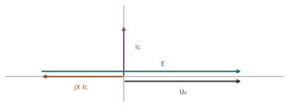
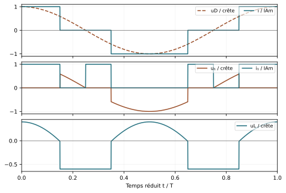
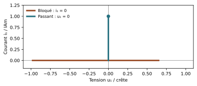
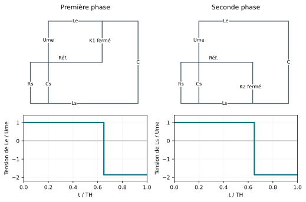

# X–ENS PSI 2018 — Physique (Banque commune X–InterENS) · Corrigé guidé

*Corrigé rédigé par IA, non officiel. Signalez toute erreur.*

**Lecture du rapport du jury** · GPT-6.2 Astra Ultra · vitesse non renseignée

**Rédaction** · GPT-6.2 Astra Ultra · vitesse non renseignée

## Problèmes liés à la distribution filaire de l’énergie électrique

## A.I. Pertes de la ligne de distribution

### Question 1 — Courant quasi uniforme

**Indication.** Comparer le temps de propagation de la ligne à la période la plus courte présente dans les signaux.

Pour un milieu de célérité $v$, on néglige les retards si $2\pi f_{\max}d/v\ll1$, soit une ligne électriquement courte. Pour assimiler aussi les deux courants, il faut que la fuite et le courant de charge des capacités réparties soient négligeables devant le courant de charge utile. Dans ce modèle série quasi stationnaire $i_S\simeq i_D=i$.

### Question 2 — Chute de tension négligeable

**Indication.** Évaluer l’impédance série sur l’aller et le retour et la comparer à la charge.

Aux fréquences utiles on demande $|Z_{\rm ligne}I|\ll|U_D|$, ou $|Z_{\rm ligne}|\ll|Z_D|$ dans le cas sinusoïdal linéaire. On néglige ainsi les chutes résistive et inductive sur les deux fils. On peut alors poser $u_D\simeq u_S$ même en conservant les pertes comme petite correction énergétique.

### Question 3 — Origine des pertes

**Indication.** Identifier l’élément qui dissipe une puissance instantanée proportionnelle à $i^2$.

La résistivité des conducteurs convertit une partie de la puissance électrique en chaleur par effet Joule. La résistance totale des deux fils, $R_{\rm ligne}=Kd$, donne $p_L=R_{\rm ligne}i^2$. Un stockage idéal d’énergie dans un champ ne produit pas une telle perte moyenne.

### Question 4 — Courant efficace

**Indication.** Comparer la moyenne de la formule instantanée à l’expression de $P_L$.

L’identification $Kd\langle i^2\rangle=Kd I^2$ donne $I=\sqrt{T^{-1}\int_0^T i^2(t)dt}$. Il s’agit de la valeur efficace totale, distincte de la valeur moyenne ou de la seule amplitude du fondamental.

### Question 5 — Résistance linéique

**Indication.** Calculer la résistance de deux fils cylindriques identiques et repérer les paramètres indépendants.

Pour des fils de conductivité $\sigma$ et section $S$, $R_{\rm ligne}=2d/(\sigma S)$, donc $K=2/(\sigma S)$. Un métal plus conducteur ou une section plus large réduit les pertes à courant fixé. La résistivité dépend de la température et, si les hautes fréquences sont importantes, l’effet de peau réduit la section utile.

## A.II. Facteur de puissance et compensation

### Question 6 — Courant de même fréquence que la source

**Indication.** Une sinusoïde est une fonction propre d’un dispositif linéaire invariant dans le temps en régime forcé.

Une installation linéaire invariante, après disparition des transitoires, absorbe un courant sinusoïdal à la fréquence de sa tension. Pour le réseau basse tension européen phase-neutre, $U_0\simeq230\ \mathrm V$ efficace et $f=50\ \mathrm{Hz}$. Pour $v\sim2$ à $3\times10^8\ \mathrm{m\,s^{-1}}$, $v/f$ est de l’ordre de $4000$ à $6000\ \mathrm{km}$. Le retard est donc négligeable pour une desserte locale de quelques kilomètres, beaucoup moins pour une liaison à très grande distance.

### Question 7 — Rendement sinusoïdal

**Indication.** Éliminer $I_0$ par la puissance réellement reçue par l’installation.

La moyenne du produit de deux sinusoïdes donne $P=U_0 I_0\cos\varphi$. Alors $P_L=KdP^2/(U_0^2\cos^2\varphi)$ et $\eta=[1+KdP/(U_0^2\cos^2\varphi)]^{-1}$.

### Question 8 — Augmentation du rendement

**Indication.** Raisonner à puissance utile imposée puis comparer les leviers agissant sur le courant ou sur la résistance.

Réduire $d$ quand le tracé ou une production locale le permettent diminue la résistance. Rapprocher $\cos\varphi$ de un évite un courant réactif inutile au transport de puissance. Surtout, élever la tension à puissance fixée divise le courant et fait décroître les pertes comme $1/U_0^2$. En alternatif, des transformateurs élèvent la tension en amont du transport puis l’abaissent près des utilisateurs. Le niveau de tension reste contraint par l’isolation.

### Question 9 — Compensateur sans échange actif

**Indication.** La tension de ligne et le courant du compensateur sont sinusoïdaux.

$P_C=U_0 I_C\cos\varphi_C$. Pour un courant non nul et $P_C=0$, il faut une quadrature, $\varphi_C=\pm\pi/2$ modulo $2\pi$. Le choix du signe doit annuler le courant réactif initial.

### Question 10 — Courant compensateur optimal

**Indication.** À puissance utile donnée, minimiser le module du courant de ligne par addition des phaseurs.

Le courant de l’installation est $I_0(\cos\varphi+j\sin\varphi)$. Sa partie réelle est imposée à $P/U_0$. Le minimum de la norme s’obtient pour $\underline I_C=-jI_0\sin\varphi=-j(P/U_0)\tan\varphi$. Donc $i_C(t)=\sqrt2[-I_0\sin\varphi]\cos(\omega t+\pi/2)$ pour $\varphi\le0$. Le courant de ligne est alors en phase avec la tension.

### Question 11 — Compensation capacitive

**Indication.** Relier la susceptance du condensateur à la partie imaginaire recherchée.

Aux bornes de la charge, un condensateur idéal absorbe $\underline I_C=j\omega C U_0$. Il faut donc $C=-P\tan\varphi/(2\pi f U_0^2)$, positif pour une installation inductive. Pour $\varphi=0$, aucune compensation n’est nécessaire.

### Question 12 — Moteur synchrone à vide

**Indication.** Identifier l’origine physique de la réactance, de la f.é.m. et de sa fréquence.

Les enroulements du stator stockent de l’énergie magnétique et possèdent une réactance inductive $X>0$. L’excitation du rotor modifie son flux et donc le module $E$ de la f.é.m. interne. En régime synchrone, le rotor tourne à la vitesse du champ tournant du réseau, d’où une f.é.m. électrique de même fréquence.

### Question 13 — Réglage de la f.é.m. sans pertes

**Indication.** Écrire la maille sous forme complexe, avec le courant entrant dans le moteur.

La maille donne $\underline U_D=\underline E+jX\underline I_C$. Pour la compensation de la question 10, $\underline I_C=-jP\tan\varphi/U_0$ est purement imaginaire positive. Il faut donc $E=U_0-XP\tan\varphi/U_0$. Pour une charge inductive, le moteur est surexcité et $E>U_0$.

### Question 14 — Construction de Fresnel

**Indication.** Dans le diagramme imprimé, l’angle indiqué entre $jX\underline I_C$ et la verticale est aussi celui entre le courant et la tension.

$\varphi_m=\arg\underline I_C-\arg\underline U_D$ est le déphasage du courant absorbé par le moteur. À pertes nulles il vaut $+\pi/2$ pour la compensation d’une charge inductive. Le courant pointe alors vers le haut et $jX\underline I_C$ vers la gauche. Le segment de f.é.m. qui referme $\underline U_D=\underline E+jX\underline I_C$ est horizontal vers la droite.

### Question 15 — Réglage avec pertes constantes

**Indication.** Le courant doit désormais apporter $P_C$ tout en compensant la même composante réactive.

Au minimum des pertes de ligne $\underline I_C=P_C/U_0-jP\tan\varphi/U_0$. Le courant total est réel et vaut $(P+P_C)/U_0$. La relation de maille donne $\underline E=U_0-XP\tan\varphi/U_0-jXP_C/U_0$. Son module est $E=\sqrt{(U_0-XP\tan\varphi/U_0)^2+(XP_C/U_0)^2}$.

## A.III. Redressement et facteur de forme

### Question 16 — Modèle de l’accumulateur

**Indication.** Comparer la période électrique à la durée de changement notable de l’état de charge.

La tension à vide dépend de l’état de charge de l’accumulateur, qui évolue pendant la charge. Sur une période réseau de $20\ \mathrm{ms}$, cette évolution est généralement négligeable à l’échelle de la capacité de stockage. On remplace donc $E_0(t)$ par une constante sur les périodes étudiées.

### Question 17 — Association des sources

**Indication.** Identifier les types de source vus des deux ports.

Le réseau se comporte comme une source de tension et la charge munie d’une inductance se comporte, à l’échelle d’une commutation, comme une source de courant. Le pont respecte les règles d’association si les états autorisés évitent le court-circuit de la source de tension et l’ouverture du chemin du courant inductif.

### Question 18 — Conduction continue

**Indication.** Le courant d’une inductance varie d’autant moins vite que $L$ est grande.

Sur un intervalle de commutation, $\Delta i_A=L^{-1}\int u_Ldt$. À tension et durée fixées, augmenter $L$ réduit l’ondulation. On choisit $L$ tel que la demi-ondulation reste inférieure à $I_{Am}$, d’où $i_A>0$. En ordre de grandeur $L\gg |u_L|_{\rm typ}T/I_{Am}$ garantit un courant presque constant.

### Question 19 — Paires complémentaires

**Indication.** Deux interrupteurs d’un même bras ne doivent pas relier les deux rails et il faut une voie pour le courant de charge.

Les couples $1/2$ et $3/4$ sont complémentaires dans les états idéaux de conduction continue. Dans chacun de ces deux bras, un seul élément conduit.

### Question 20 — Nombre d’interrupteurs passants

**Indication.** Suivre un chemin de courant de l’entrée de charge jusqu’au retour.

Pour alimenter ou faire circuler le courant dans la charge, une connexion est nécessaire à chaque côté de celle-ci. Fermer les deux d’un même bras court-circuiterait les rails. Un élément par bras doit donc conduire, soit exactement deux au total, y compris dans les états de roue libre.

### Question 21 — Sens des diodes

**Indication.** Au point commun de 3 et 4, le courant de la charge arrive par la gauche.

Les deux diodes doivent laisser repartir ce courant du point commun vers un rail. Leurs anodes sont donc au point droit de la charge, leurs cathodes vers le rail supérieur pour 3 et inférieur pour 4. Lorsque $u_D>0$, le rail inférieur est au potentiel le plus bas et 4 conduit. Pour $u_D<0$, 3 conduit.

### Question 22 — Chronogramme de l’interrupteur 1

**Indication.** Distinguer un courant de ligne nul d’un courant de charge nul pendant la roue libre.

En prenant $i_A\simeq I_{Am}$, pour $u_D>0$, l’état $i=+I_{Am}$ utilise $1,4$ et l’état $i=0$ utilise $2,4$. Pour $u_D<0$, l’état $i=-I_{Am}$ utilise $2,3$ et l’état $i=0$ utilise $1,3$. Avec 1 passant, $u_1=0$, $Ri_1=RI_{Am}$. Avec 2 passant, $u_1=u_D$ et $Ri_1=0$. Le dessin applique ces règles aux intervalles de la figure du sujet.

### Question 23 — Caractéristique de commutation

**Indication.** Repérer dans le plan courant–tension les deux états de l’interrupteur.

À l’état passant les points sont sur $u_1=0$, $i_1\ge0$, près de $I_{Am}$. À l’état bloqué $i_1=0$ et $u_1=u_D$ prend des valeurs des deux signes. La commutation doit être commandée, notamment le blocage avec courant positif, ce qu’une diode seule ne fournit pas. Un interrupteur à transistor commandable est adapté, avec une tenue en tension inverse appropriée à la caractéristique (par exemple une diode série si le transistor choisi l’exige).

### Question 24 — Tension de l’inductance et cohérence de la simulation

**Indication.** La valeur moyenne de $u_L$ doit être nulle en régime périodique.

Pendant le transfert du réseau, la tension redressée appliquée à la charge vaut $|u_D|$, et en roue libre elle vaut zéro. Ainsi $u_L=u_{\rm red}-E_0-Ri_A$. Avec les ordres de grandeur lus, $U_{\rm crête}\simeq10$ divisions, $E_0\simeq5$ et $RI_{Am}\simeq1$. Les fenêtres centrées sur les crêtes ont une demi-largeur proche de $0{,}15T$, donnant $\langle u_{\rm red}\rangle\simeq(2U_{\rm crête}/\pi)\sin(0{,}30\pi)\simeq5$ divisions, inférieure aux six requises. Le modèle tracé n’est donc pas périodique avec ce courant. Il faut réduire $I_{Am}$ jusqu’à $RI_{Am}=\langle u_{\rm red}\rangle-E_0$. Ce faible écart se lit avec une incertitude importante sur le tracé.

### Question 25 — Harmoniques et pertes

**Indication.** La tension sinusoïdale ne fournit de puissance moyenne qu’à la composante de courant de même fréquence.

Le courant à créneaux comporte, outre le fondamental, des harmoniques. Par orthogonalité $I^2=I_{\rm moyen}^2+\sum I_n^2$ alors que $P=U_0I_1\cos\varphi_1$. À puissance active et tension fixées, ces composantes augmentent $I^2$, donc $P_L=KdI^2$, et dégradent le rendement. Le facteur de puissance global vaut $(I_1/I)\cos\varphi_1$.

## A.IV. Conversion continue et élévation de tension

### Question 26 — Moyennes de stockage

**Indication.** Intégrer les lois du condensateur et de la bobine sur un cycle complet.

Avec $i_C=C\dot u_C$ et $u_{L_e}=L_e\dot i_e$, les intégrales sur une période valent respectivement $C[u_C(T_H)-u_C(0)]$ et $L_e[i_e(T_H)-i_e(0)]$. Elles sont nulles en régime périodique, donc les deux moyennes demandées sont nulles.

### Question 27 — Faibles ondulations

**Indication.** Les deux tensions de capacité et les deux courants inductifs doivent évoluer peu pendant chaque phase.

Le temps de commutation $T_H$ doit être court devant les temps propres de chacune des phases. À $\omega_H=2\pi/T_H$, on peut imposer $\omega_H L_e,\omega_H L_s\gg R_{\rm ref}$ et $1/(\omega_H C),1/(\omega_H C_s)\ll R_{\rm ref}$ pour les impédances de charge pertinentes ramenées aux branches. Plus généralement, pour chaque bobine et capacité, demander $T_H|u_L|/L\ll I_{\rm typ}$ et $T_H|i_C|/C\ll U_{\rm typ}$. Les pentes sont alors presque constantes par morceaux.

### Question 28 — Deux schémas équivalents

**Indication.** Repérer les nœuds connectés par chaque interrupteur, puis remplacer l’interrupteur fermé par un fil.

Prenons comme référence le nœud commun de la source, de la sortie haute et du milieu du bras. Pendant $\alpha T_H$, $K_1$ relie le haut de $C$ à ce nœud, $K_2$ est ouvert. Pendant $(1-\alpha)T_H$, $K_2$ y relie le bas de $C$ et $K_1$ est ouvert. Dans les schémas équivalents, $u_C\simeq U_{Cm}$ et $u_s\simeq U_{sm}$ sur une phase, tandis que les courants des deux bobines sont presque constants.

### Question 29 — Tensions des deux bobines

**Indication.** Utiliser les tensions moyennes comme potentiels de nœuds dans chacun des états.

Avec les flèches du sujet, les deux plateaux de $u_{L_e}$ sont $U_{me}$ puis $U_{me}-U_{Cm}$. Ceux de $u_{L_s}$ sont $U_{Cm}-U_{sm}$ puis $-U_{sm}$. Les deux tensions changent à $t=\alpha T_H$ et reviennent à leur première valeur au début du cycle suivant.

### Question 30 — Rapport de conversion

**Indication.** Les moyennes des tensions des deux bobines s’annulent indépendamment.

L’équilibre de $L_e$ impose $U_{me}-(1-\alpha)U_{Cm}=0$. Celui de $L_s$ impose $\alpha U_{Cm}-U_{sm}=0$. Par conséquent $U_{sm}=\alpha U_{me}/(1-\alpha)$. Ce montage idéal est survolteur pour $\alpha>1/2$, abaisseur pour $\alpha<1/2$.

### Question 31 — Courant moyen d’entrée

**Indication.** En régime périodique les éléments idéaux ne dissipent aucune puissance moyenne.

La puissance fournie $U_{me}I_{em}$ égale la puissance dissipée $U_{sm}^2/R_s$ à l’ordre de faible ondulation. Donc $I_{em}=\alpha^2 U_{me}/[(1-\alpha)^2 R_s]$.

### Question 32 — Utilité de l’ondulation

**Indication.** Revenir sur la séparation entre moyennes et écarts utilisée dans le modèle.

L’ondulation permet de vérifier si les grandeurs supposées constantes varient effectivement peu sur une période. Elle permet aussi de dimensionner $L$ et $C$ pour respecter une limite de tension ou de courant autour des valeurs moyennes.

### Question 33 — Ondulation de tension intermédiaire

**Indication.** Suivre le courant du condensateur pendant la première phase et utiliser la variation crête à crête.

Avec $K_1$ fermé le courant entre par le bas du condensateur, donc $i_C\simeq-I_{sm}$ avec $I_{sm}=U_{sm}/R_s$. La chute sur cette phase vaut $U_{C\max}-U_{C\min}\simeq\alpha T_H I_{sm}/C$. En divisant par $2U_{Cm}$ et en utilisant $U_{sm}/U_{Cm}=\alpha$, on obtient $A_c\simeq\alpha^2T_H/(2R_sC)$. Pendant la seconde phase, $i_C\simeq I_{em}$ compense la charge perdue.

### Question 34 — Deux convertisseurs sur la liaison

**Indication.** Conserver la tension demandée par la charge tout en la modifiant sur la seule ligne.

Un premier convertisseur élève la tension de ligne dans le rapport $M=\alpha/(1-\alpha)>1$. Le second la ramène à $U_0$ avec le rapport $1/M$, par exemple avec le rapport cyclique $1-\alpha$ pour le même schéma idéal. À puissance utile donnée, le courant de ligne est divisé par $M$ et les pertes résistives par $M^2$.

### Question 35 — Nouveau rendement

**Indication.** Transformer d’abord le rapport $P_L/P$, puis revenir à la définition exacte de $\eta'$.

Le rendement idéal des convertisseurs donne $\eta'=[1+(1/\eta-1)((1-\alpha)/\alpha)^2]^{-1}$. Avec $\eta=0{,}99$ et $\eta'=0{,}9999$, $M=\sqrt{(1/\eta-1)/(1/\eta'-1)}\simeq10{,}05$ et $\alpha=M/(1+M)\simeq0{,}910$. Les pertes de ligne passent de l’ordre de un pour cent à un centième de pour cent.

## B.I. Analogie mécanique et énergie

### Question 36 — Tension de la corde

**Indication.** Préciser la portion de corde qui exerce l’effort et celle qui le reçoit.

La corde est souple, homogène, tendue, avec petits déplacements transversaux et faibles pentes $|y_x|\ll1$. On néglige pesanteur, dissipation, mouvement longitudinal et rigidité en flexion. Définissons $\mathbf T(x,t)$ comme l’effort de la partie située à droite sur la partie gauche à la coupe $x$. Il est tangent vers $+x$, avec $T_x\simeq T_0$ et $T_y\simeq T_0y_x$.

### Question 37 — Propagation des déformations

**Indication.** Appliquer la dynamique transverse à une tranche de masse $\mu\,dx$.

La résultante vaut $T_y(x+dx)-T_y(x)\simeq T_0 y_{xx}dx$. Donc $\mu y_{tt}=T_0 y_{xx}$, équation de d’Alembert de célérité $c=\sqrt{T_0/\mu}$.

### Question 38 — Nombre d’onde et impédance signée

**Indication.** Définir l’impédance exactement par le rapport de la tension verticale à la vitesse, avec la tension de la question 36.

Pour $\underline y=Y_0e^{j(\omega t-kx)}$, $k^2=\mu\omega^2/T_0$ et $Z=T_y/y_t=-T_0k/\omega$. À $\omega>0$, $k>0$ correspond à une onde vers $+x$ avec $Z=-\sqrt{\mu T_0}$, tandis que $k<0$ correspond à une onde vers $-x$ avec $Z=+\sqrt{\mu T_0}$. Changer la convention sur l’effort inverse ces signes.

### Question 39 — Vitesses de phase et de groupe

**Indication.** Dériver la branche de dispersion correspondant au sens choisi.

Avec $\omega=c|k|$, $v_\phi=\omega/k=\operatorname{sgn}(k)c$ et $v_g=d\omega/dk=\operatorname{sgn}(k)c$. Les crêtes et l’enveloppe avancent à la même vitesse. Le modèle idéal est non dispersif.

### Question 40 — Onde réfléchie sur le point fixe

**Indication.** Inverser la direction du nombre d’onde et imposer une condition locale valable à tout instant.

Avec $k=\omega/c>0$, la réflexion s’écrit $\underline y_r=Y_r e^{j(\omega t+kx)}$ pour $x<0$. La fixation est immobile et la dynamique linéaire. L’annulation permanente du déplacement au bout exige une onde de même pulsation que l’incidente.

### Question 41 — Coefficient de réflexion et onde totale

**Indication.** Imposer la condition $y(0,t)=0$ puis regrouper les deux exponentielles.

Il vient $Y_i+Y_r=0$, donc $\rho=Y_r/Y_i=-1$. L’onde résultante vaut $\underline y=-2jY_i\sin(kx)e^{j\omega t}$. Elle est stationnaire avec un nœud au point fixe et des nœuds de déplacement tous les $\lambda/2$.

### Question 42 — Puissance des actions intérieures

**Indication.** Calculer la puissance des deux efforts de bord en gardant la vitesse propre de chaque bord.

Les actions extérieures fournissent $\partial_x(T_y y_t)dx$. La variation d’énergie cinétique tirée de la dynamique est $\partial_t e_c\,dx=T_0 y_{xx}y_t dx$. Leur différence donne $p_i=\partial_te_c-\partial_x(T_0y_xy_t)=-T_0y_xy_{xt}$. La déformation explique cette puissance intérieure qui ne disparaît pas entre les deux extrémités.

### Question 43 — Énergie potentielle linéique

**Indication.** Reconnaître la dérivée temporelle d’un carré de pente.

Comme $p_i=-\partial_t(T_0y_x^2/2)$, l’énergie potentielle élastique par unité de longueur peut être prise égale à $e_p=T_0y_x^2/2$, nulle pour une corde droite.

### Question 44 — Signe du flux énergétique

**Indication.** Tester le signe du flux pour $y=f(x-ct)$ avant d’identifier une puissance orientée vers la droite.

Le bilan exact est $\partial_t(e_c+e_p)=\partial_x(T_y y_t)$. Le flux orienté vers $+x$, analogue au flux de Poynting, vaut donc $P_{\to}=-T_y y_t$ et vérifie $\partial_t(e_c+e_p)+\partial_xP_{\to}=0$. Le jury signale que le signe de la définition imprimée de $P$ doit être inversé pour l’orientation annoncée. Aucun terme de perte n’apparait dans ce modèle élastique idéal.

### Question 45 — Échanges d’énergie de l’onde stationnaire

**Indication.** Revenir à une solution réelle et différencier en $x$ et en $t$.

Avec $Y_i=Ae^{j\phi}$ on a $y=2A\sin(kx)\sin(\omega t+\phi)$. Le flux orienté vers $+x$ vaut $P_{\to}=-T_0A^2k\omega\sin(2kx)\sin(2\omega t+2\phi)$. Sa moyenne sur un cycle est nulle. Son annulation permanente exige $2kx=n\pi$, soit des points espacés de $\lambda/4$, incluant les nœuds et ventres du déplacement.

## B.II. Propagation sur une ligne sans pertes

### Question 46 — Unités des paramètres caractéristiques

**Indication.** Employer le henry et le farad par unité de longueur avant de former les deux rapports.

$[\Lambda]=\mathrm{H\,m^{-1}}$, $[\Gamma]=\mathrm{F\,m^{-1}}$. Comme $\mathrm{HF}=\mathrm{s^2}$ et $\mathrm{H/F}=\Omega^2$, $1/\sqrt{\Lambda\Gamma}$ est une vitesse en $\mathrm{m\,s^{-1}}$ et $\sqrt{\Lambda/\Gamma}$ une impédance en ohms.

### Question 47 — Correspondances corde–ligne

**Indication.** Partir des deux lois locales électriques et choisir les variables qui conservent le sens du flux.

Les bilans sur $dx$ donnent $u_x=-\Lambda i_t$, $i_x=-\Gamma u_t$. Identifier $i\leftrightarrow y_t$ et $u\leftrightarrow-T_0y_x$ transforme la première équation en dynamique transverse et la seconde en compatibilité des dérivées. On obtient $y_x\leftrightarrow-\Gamma u$, $T_0\leftrightarrow1/\Gamma$, $\mu\leftrightarrow\Lambda$, $e_c\leftrightarrow\Lambda i^2/2$, $e_p\leftrightarrow\Gamma u^2/2$ et $P_{\to}\leftrightarrow ui$. Les énergies électriques sont comptées par unité de longueur.

| Corde | Ligne |
|---|---|
| $y_t$ | $i$ |
| $y_x$ | $-\Gamma u$ |
| $T_0$ et $\mu$ | $1/\Gamma$ et $\Lambda$ |
| $e_c$ et $e_p$ | $\Lambda i^2/2$ et $\Gamma u^2/2$ |
| $P_{\to}$ | $ui$ |

### Question 48 — Adaptation de la charge

**Indication.** Pour supprimer l’onde réfléchie, annuler le numérateur de son amplitude.

Le coefficient à la charge vaut $(Z_D-Z_C)/(Z_D+Z_C)$. Une onde progressive pure allant vers l’installation exige $Z_D=Z_C$ (réel pour la ligne idéale). L’impédance d’entrée vaut alors aussi $Z_C$, quelle que soit la longueur.

### Question 49 — Extrémité ouverte

**Indication.** Imposer le courant nul au bout du segment et la tension de source à son entrée.

La condition $\underline I(a)=0$ suggère $\underline U(x)=\underline U(a)\cos[k(a-x)]$. Les équations de ligne donnent $\underline I(x)=j\underline U(a)\sin[k(a-x)]/Z_C$. Avec $\underline U(0)=U_0$, on obtient $\underline U(a)=U_0/\cos(ka)$ et $\underline I(0)=j(U_0/Z_C)\tan(ka)$ hors résonance.

### Question 50 — Ligne quart d’onde ouverte

**Indication.** Examiner d’abord la limite de l’impédance vue de la source.

Pour $a=\lambda/4$, $ka=\pi/2$ et $Z_{\rm in}=-jZ_C\cot(ka)$ tend vers zéro. La ligne ouverte se comporte ainsi à l’entrée comme un court-circuit pour cette fréquence. La divergence du courant et de la tension terminale dans la formule idéale signifie qu’aucun régime sinusoïdal stationnaire fini n’existe à résonance avec cette source de tension parfaite. L’impédance de source et les pertes d’une ligne réelle limitent les amplitudes.
