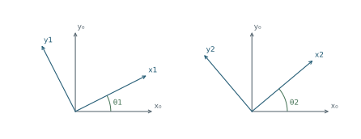
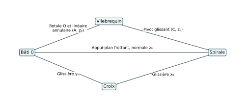
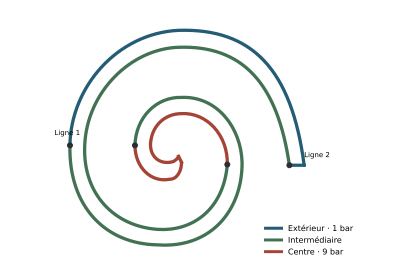
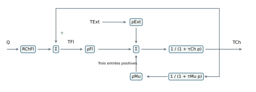
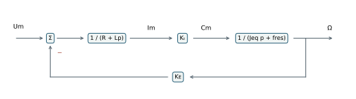
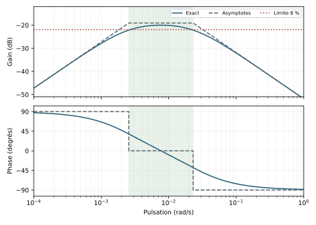

# X-ENS PSI · Sciences industrielles 2018 · Corrigé brut

*Corrigé rédigé par IA, non officiel. Signalez toute erreur.*

**Rédaction** · GPT-6.2 Astra Ultra · vitesse non renseignée · 24 novembre 2026

## 2 · Cinématique du compresseur

### Question 1 · Changement de base

Dans le plan normal à $z_{P0}$, tourner $x_{P0},y_{P0}$ de $+\theta_j$ donne $x_{Pj},y_{Pj}$. Ainsi $y_{P1}=-\sin\theta_1\,x_{P0}+\cos\theta_1\,y_{P0}$ et $x_{P2}=\cos\theta_2\,x_{P0}+\sin\theta_2\,y_{P0}$.

### Question 2 · Orthogonalité des rainures

Le produit des composantes de Q1 donne $0=y_{P1}\cdot x_{P2}=-\sin\theta_1\cos\theta_2+\cos\theta_1\sin\theta_2=\sin(\theta_2-\theta_1)$.

### Question 3 · Rapport des vitesses

L'assemblage fixe $\theta_2-\theta_1=k\pi$ avec un entier $k$ constant. Par dérivation $\omega_2=\omega_1$ à chaque instant, y compris lors d'un arrêt. Le rapport vaut 1 dès que la vitesse d'entrée est non nulle.

### Question 4 · Hyperstatisme du joint idéal

Les deux pivots et les deux glissières donnent quatre paramètres de vitesse dans une boucle indépendante. La seule mobilité est l'angle d'entrée. Les deux courses d'Oldham sont les projections du décalage des axes sur les directions des rainures. Le rang de la fermeture est donc $4-1=3$. Sur les six composantes d'une fermeture spatiale, $h=6-3=3$ sont redondantes.

### Question 5 · Modification des glissières

Chaque pivot transmet cinq composantes et chaque pivot glissant quatre. On compte $2(5)+2(4)=18$ inconnues d'efforts. Trois solides fournissent 18 équations scalaires d'équilibre. La rotation d'entrée reste libre et les deux axes de rainure transverses indépendants empêchent toute rotation parasite de la croix, d'où un rang de $18-1=17$. Ainsi $h=18-17=1$. La contrainte restante est la double reprise de l'effort axial.

### Question 6 · Rendre le joint isostatique

Dans le montage de Q5, remplacer le pivot d'un seul arbre sur le bâti par un pivot glissant de même axe $z_{P0}$. L'autre arbre reste positionné axialement. Les deux rainures à axes horizontaux imposent la même vitesse axiale aux trois mobiles, donc l'arbre modifié reste positionné par la chaîne. La fermeture angulaire projetée sur les deux directions de rainure impose leurs vitesses de rotation relatives nulles. Il subsiste une mobilité et 17 composantes transmissibles, soit $h=0$. Le rapport de rotation reste 1.

### Question 7 · Graphe des liaisons

Le bâti 0 et le vilebrequin $S_1$ sont reliés par une rotule de centre $O$ et une linéaire annulaire de centre $A$, axe $z_0$. $S_1$ et la spirale $S_2$ ont un pivot glissant $(C,z_0)$. $S_2$ et la croix $S_3$ ont une glissière $x_0$. $S_3$ et 0 ont une glissière $y_0$. Enfin $S_2$ porte sur 0 par appui-plan frottant de normale $z_0$. Les cinq premières liaisons sont idéales.

### Question 8 · Pivot équivalent en A

La rotule donne $V_O=0$. Avec $OA=a z_0$, $V_A=\Omega\times a z_0=a(\omega_y x_0-\omega_x y_0)$. La linéaire annulaire impose $V_A\cdot x_0=V_A\cdot y_0=0$. Il vient $\omega_x=\omega_y=0$ et $V_A=0$. Il reste $\Omega=\omega_z z_0$, soit le pivot demandé.

### Question 9 · Mobilité du compresseur

Les deux glissières maintiennent l'orientation de la spirale. L'appui-plan fixe son altitude et la glissière du bâti fixe l'orientation de la croix. Au choix des origines près, les courses sont $x=R_{orb}\cos\theta$, $y=R_{orb}\sin\theta$. La rotation relative dans le pivot glissant de $C$ compense celle du vilebrequin, et sa course axiale est fixée. Toute position locale et toute vitesse dépendent donc de $\theta$ seul, $m=1$. Ces fermetures différentiées donnent $\dot x=-R_{orb}\sin\theta\,\dot\theta$, $\dot y=R_{orb}\cos\theta\,\dot\theta$, y compris aux extrémités d'une course.

### Question 10 · Rotation de la spirale

La croix couple $S_2$ et le bâti 0 homocinétiquement en rotation. La vitesse angulaire du bâti étant nulle, celle de $S_2/0$ est nulle aussi.

### Question 11 · Vitesse du centre du maneton

$OC=(a+d)z_0+R_{orb}x_1$. À altitude constante, $V(C,S_2/0)=R_{orb}\omega y_1$. Avec $3\,600$ tr/min, $\omega=120\pi$ rad/s et $V=0{,}008(120\pi)y_1=3{,}02\,y_1$ m/s.

### Question 12 · Mouvement orbital

La spirale est en translation circulaire uniforme. Chaque point décrit dans un plan horizontal un cercle de rayon 8 mm, de centre décalé de son vecteur de position par rapport à $C$. Tous ont le même vecteur vitesse à un instant donné. La fréquence est 60 Hz, la période 16,7 ms.

## 3 · Guidage de la spirale mobile

### Question 13 · Réaction normale de la couronne

Avec $N=F_{surf}$, $N=p_{surf}\pi(R_{ext}^2-R_{int}^2)=6\cdot10^5\pi(0{,}110^2-0{,}060^2)=1{,}6022\cdot10^4$ N.

### Question 14 · Pressions sur les deux flancs

Sur le DR1, partir de l'extrémité libre à droite et suivre l'enroulement vers le centre. Sur le flanc extérieur, le tronçon jusqu'au premier scellement gauche est à $P_{ext}$. Un tour entre les deux scellements gauches est à $P_{inter}$. Du second scellement gauche à la pointe centrale, la pression est $P_{cent}$. Sur le flanc intérieur, le premier scellement droit est déjà à l'extrémité libre. De là au second scellement droit, la pression est $P_{inter}$, puis $P_{cent}$ jusqu'au centre. La tranche libre communique avec l'extérieur. Les deux segments de même pression sur les flancs opposés délimitent deux poches distinctes. La figure reprend les contacts du DR1, avec les valeurs de 1 et 9 bar aux extrêmes.

### Question 15 · Résultante radiale

Sur un flanc vertical, la composante radiale élémentaire a pour valeur algébrique $\pm P H_{spi}\,dy$. Une paroi reliant deux scellements d'une même ligne a une projection totale nulle. En regroupant les morceaux par poche, la différence d'ordonnées des lignes de scellement donne $2R_g$. Les sauts successifs contribuent $2R_g H_{spi}[(P_{cent}-P_{inter})+(P_{inter}-P_{ext})]$. On trouve $F_R=2(0{,}003)(0{,}050)(9-1)10^5=240$ N, dirigés vers $-x_0$ dans la configuration dessinée.

### Question 16 · Réduction des actions au point C

Dans $B_1$, on écrit chaque torseur $(\mathbf R\,;\mathbf M_C)$. Le poids donne $((0,0,-mg)\,;(0,0,0))$ car $CG$ est vertical. L'entraînement donne $((0,F_V,0)\,;(0,0,0))$. La couronne donne $((0,-fN,N)\,;N(y_H+fh_H,-x_H,-fx_H))$. Le gaz donne $((-F_R,-F_T,-F_A)\,;(h_K F_T,x_K F_A-h_K F_R,-x_K F_T))$ par transport depuis $K$.

### Question 17 · Torseur dynamique de la spirale

La spirale mobile, désignée $S_2$ sur le schéma, est en translation. À vitesse angulaire d'entraînement constante, $a_G=-R_{orb}\omega^2 x_1$, d'où $R_d=-mR_{orb}\omega^2 x_1$. Son moment dynamique en $G$ est nul, son moment en $C$ vaut $CG\times R_d=-mh_G R_{orb}\omega^2 y_1$.

### Question 18 · Effort d'entraînement

Sur $y_1$, la résultante dynamique impose $F_V-fN-F_T=0$. On obtient $F_V=17000+0{,}2(16022)=20204$ N, soit 20,2 kN.

### Question 19 · Pression de palier

Pour une pression uniforme $p_c$, l'intégrale tangentielle s'annule par symétrie et la composante utile vaut $F_V=p_ch_{man}R_{man}\int_{-\pi/2}^{\pi/2}\cos u\,du=2p_c h_{man}R_{man}$. Ainsi $p_c=F_V/(2R_{man}h_{man})$. L'aire efficace est le rectangle projeté de largeur $2R_{man}$.

### Question 20 · Matage

$p_c=20204/(2\times0{,}030\times0{,}060)=5{,}61$ MPa, inférieur au seuil de 30 MPa. Le modèle donne un facteur d'environ 5,35 par rapport au matage.

### Question 21 · Centre de pression

Sur $x_1$, $N(y_H+fh_H)+h_K F_T=0$. Sur $y_1$, $-Nx_H+x_K F_A-h_K F_R=-mh_G R_{orb}\omega^2$. Ainsi $y_H=-fh_H-h_K F_T/N$ et $x_H=(mh_G R_{orb}\omega^2+x_K F_A-h_K F_R)/N$. Ces projections déterminent le centre de poussée pour le calcul de basculement. Si l'on impose aussi l'équilibre en lacet aux quatre seuls torseurs de Q16, on obtient $-fNx_H-x_KF_T=0$, incompatible avec ce $x_H$ pour les données fournies. Le guidage qui immobilise la rotation doit pouvoir reprendre un couple de lacet dans un bilan complet.

### Question 22 · Critère de non-décollement

En unités SI, $x_H=(6\times0{,}050\times0{,}008(120\pi)^2+0{,}004\times3000-0{,}100\times240)/16022=0{,}0205$ m, $y_H=-0{,}010-1700/16022=-0{,}1161$ m. Le rayon projeté vaut 118 mm, au-delà de 110 mm. La composante $|y_H|$ dépasse à elle seule le rayon. Le modèle étudié ne valide pas l'exigence 10.

## 4 · Motorisation

### Question 23 · Inertie du vilebrequin

Le plan $(G_V,x_1,z_1)$ est un plan de symétrie. Les intégrales en $xy$ et $yz$ s'y compensent entre points symétriques. La matrice a donc pour lignes $(A,0,-E)$, $(0,B,0)$, $(-E,0,J_V)$, avec $E=\int xz\,dm$. L'excentration du maneton rompt la symétrie de révolution et permet $A\ne B$.

### Question 24 · Approximation diagonale

Placer approximativement $G_V$ sur l'axe de l'arbre simplifie le bilan statique mais n'annule pas à lui seul $E$. La forme admise néglige aussi le produit d'inertie apporté par le petit cylindre excentré, ou assimile les axes de calcul aux axes principaux. Elle conserve $A_V$ et $B_V$ distincts.

### Question 25 · Inertie équivalente

Le vilebrequin apporte $J_V\omega^2/2$. La spirale est en translation à vitesse $R_{orb}\omega$. Le contrepoids est à distance $R_{orb}$ de l'axe car $OC$ a une composante radiale $+R_{orb}$ et $CG_C$ une composante $-2R_{orb}$. La croix est négligée. Ainsi $E_c=J_{eq}\omega^2/2$, avec $J_{eq}=J_V+(m+m_C)R_{orb}^2=0{,}050832$ kg·m².

### Question 26 · Puissances extérieures et intérieures

La puissance motrice est $C_m\omega$. Le gaz donne $-F_T R_{orb}\omega$, les forces radiale et axiale ayant une puissance nulle. La couronne donne $-fN R_{orb}\omega$ et sa normale a une puissance nulle. Les centres de masse se déplacent horizontalement, donc les poids ont une puissance nulle. Les liaisons idéales avec le bâti ont une puissance nulle. Pour chaque liaison interne parfaite, la somme des deux puissances se réduit à la puissance de la liaison dans le mouvement relatif, nulle. En particulier les deux termes $\pm F_V R_{orb}\omega$ s'annulent.

### Question 27 · Couple au démarrage

$J_{eq}\omega\dot\omega=[C_m-R_{orb}(F_T+fN)]\omega$, donc $C_m=J_{eq}\dot\omega+R_{orb}(F_T+fN)$. Pour $\dot\omega=20\pi$ rad/s², la part d'accélération vaut 3,19 N·m et le couple résistant 161,64 N·m. Il faut environ **164,83 N·m** au démarrage dans le modèle de frottement de l'énoncé.

### Question 28 · Choix dans le catalogue

Le couple visé est 165 N·m au démarrage, 161,6 N·m en régime permanent. À 3 600 tr/min, la puissance permanente correspondante vaut environ 60,9 kW. La ligne **indice 11, version compensée LSK 1324C VL, 61,4 kW, 600 V, 170 N·m, 3 450 tr/min** couvre le couple et la puissance. Pour tenir 3 600 tr/min, elle exige environ 4,35 % d'extension en vitesse. À puissance constante, 61,4 kW à 3 600 tr/min correspondent encore à 162,9 N·m. L'annexe prévoit une consultation pour les plages par désexcitation. Il faut donc faire confirmer cette extension avant validation. L'indice 13 monte le plus près de la cible (3 520 tr/min, 170 N·m affichés), mais la puissance publiée sur cette ligne est 56,7 kW, inférieure aux 60,9 kW requis et incohérente avec le produit du couple par sa vitesse. Aucune ligne imprimée ne garantit directement tous les critères à 3 600 tr/min.

## 5 · Équilibrage des pièces mobiles

### Question 29 · Résultante dynamique

À vitesse constante, $a_{G_1}=-\rho\omega^2 x_{1bis}$ et $a_{G_2}=-R_{orb}\omega^2 x_1$. Le système $S_1+S_2$ a donc $X_{1bis}=-m_1\rho\omega^2$ et $X_1=-m_2 R_{orb}\omega^2$ dans la forme imposée.

### Question 30 · Moment dynamique des mobiles

En $G_1$, $I_1\Omega=\omega(-E_1x_1-F_1y_1+C_1 z_0)$, dont la dérivée galiléenne vaut $\omega^2(F_1x_1-E_1y_1)$. Le transport à $O$ ajoute $-hm_1\rho\omega^2 y_{1bis}$. La spirale en translation apporte seulement $-(a+d)m_2 R_{orb}\omega^2 y_1$. Ainsi $L_1=F_1\omega^2$, $M_1=-[E_1+(a+d)m_2R_{orb}]\omega^2$ et $M_{1bis}=-hm_1\rho\omega^2$.

### Question 31 · Moments des paliers en O

Pour la rotule en $O$, $M_O=0$. Pour le palier en $A$, $M_O=OA\times R_A=a(-Y_A x_0+X_A y_0)$. Sa projection sur $y_0$ est accessible avec le capteur $X_A$.

### Question 32 · Deux équations pour l'essai

Notons $u=\theta+\alpha$ et $R=R_{orb}$. La résultante sur $x_0$ donne $X_O+X_A=-\omega^2[m_1\rho\cos u+m_2R\cos\theta]$. Le moment en $O$ sur $y_0$ donne

$$aX_A+g[m_1\rho\cos u+m_2 R\cos\theta]=L_1\sin\theta+M_1\cos\theta+M_{1bis}\cos u.$$

Le couple moteur axial disparaît de cette projection. Le terme en $g$ vient du moment des poids sur un banc à axe vertical. Si un traitement retire la contribution gravitaire, l'équation des efforts ainsi corrigés s'écrit sans ce terme. Les deux efforts mesurés doivent suivre la convention des actions des paliers sur le rotor.

### Question 33 · Identification harmonique

Ajuster $-(X_O+X_A)/\omega^2=A\cos\theta+B\sin\theta$. Alors $u_c=\rho\cos\alpha=(A-m_2R)/m_1$ et $u_s=\rho\sin\alpha=-B/m_1$. D'où $\rho=\sqrt{u_c^2+u_s^2}$, $\alpha=\operatorname{atan2}(u_s,u_c)$. Dans le moment de Q32 reporter ces valeurs puis retirer $M_{1bis}\cos(\theta+\alpha)$ et la contribution connue de la spirale. À $h$ connu, les coefficients restants de $\omega^2\sin\theta$ et de $-\omega^2\cos\theta$ donnent $F_1$ et $E_1$. Le texte présente aussi $h$ comme inconnu. À une seule configuration de l'essai, son terme est lui-même sinusoïdal aux mêmes phases. Il faut alors une mesure indépendante de la cote axiale du centre de gravité (ou un essai apportant une relation indépendante) pour séparer $h,E_1,F_1$.

### Question 34 · Qualité de l'équilibrage

Le rotor tournant identifié a $G_{bal}=\omega\rho=120\pi\times1{,}50\simeq565$ mm/s. L'exigence 8 fixe 40 mm/s, soit un dépassement d'un facteur 14. La correction est nécessaire. Si l'on désigne par « ensemble » le barycentre du rotor **et** de la spirale en translation, son excentration effective est $\|m_1\rho x_{1bis}+m_2 R x_1\|/(m_1+m_2)$. Le nombre 565 caractérise le rotor dont l'excentration a été identifiée.

### Question 35 · Équilibrage statique à deux masses

Avec $\gamma_j=\beta_j-\theta$ (angles de montage dans le rotor), la condition vectorielle est $m_1\rho x_{1bis}+m_2Rx_1+r(m_3u_3+m_4u_4)=0$. Les deux équations sont

$$m_1\rho\cos\alpha+m_2R+r\sum_{j=3,4}m_j\cos\gamma_j=0,\qquad m_1\rho\sin\alpha+r\sum_{j=3,4}m_j\sin\gamma_j=0.$$

À $\theta=0$, les angles de la figure et les angles de montage coïncident.

### Question 36 · Équilibrage dynamique

Poser $z_3=b,z_4=c$ et $v_j=z_0\times u_j$. La condition est $L_1x_1+M_1y_1+M_{1bis}y_{1bis}-r\omega^2\sum z_jm_jv_j=0$. Ses projections valent

$$L_1-M_{1bis}\sin\alpha+r\omega^2\sum z_jm_j\sin\gamma_j=0,$$

$$M_1+M_{1bis}\cos\alpha-r\omega^2\sum z_jm_j\cos\gamma_j=0.$$

Les deux plans doivent avoir des cotes distinctes pour corriger indépendamment un balourd et un couple.

### Question 37 · Encombrement des masselottes

Les directions $14{,}7°$ et $-158{,}9°$ sont presque diamétralement opposées (écart $173{,}6°$). Aux deux étages, la figure 21 montre des logements annulaires entre l'arbre et les pièces fixes, dont le diamètre extérieur est de l'ordre de 160 mm. Avec un acier à 7,8 g/cm³, les masses de 0,43 et 0,81 kg réclament environ 55 et 104 cm³. À titre de vérification d'échelle, une couronne de rayons 35 et 70 mm et d'épaisseur 20 mm offre 231 cm³ par tour. Des secteurs d'environ 86° et 162° offriraient les volumes requis. Les ordres de grandeur rendent le montage envisageable. Le rayon du centre d'inertie de chaque secteur, la fixation et les jeux réels doivent respecter les paramètres retenus pour les masselottes ponctuelles.

## 6 · Asservissement de température

### Question 38 · Blocs thermiques du DR2

Pour des conditions initiales nulles, $T_{Fl}=T_{Ch}+R_{ChFl}Q$, $T_{Mu}=T_{Ch}/(1+\tau_{Mu}p)$ et

$$T_{Ch}=\frac{\rho_{Fl}T_{Fl}+\rho_{Ext}T_{Ext}+\rho_{Mu}T_{Mu}}{1+\tau_{Ch}p}.$$

Sur le DR2, placer de gauche à droite $R_{ChFl}$, $\rho_{Fl}$ et $1/(1+\tau_{Ch}p)$. La voie extérieure reçoit $\rho_{Ext}$, le retour par les murs reçoit $1/(1+\tau_{Mu}p)$ puis $\rho_{Mu}$. Au premier sommateur, la remontée de $T_{Ch}$ doit être de signe **positif** selon $Q=(T_{Fl}-T_{Ch})/R_{ChFl}$, bien que le document réponse imprime un signe moins. La somme des trois ratios de conductance vaut 1.

### Question 39 · Blocs moteur du DR3

L'entrée électrique est $U_m-E$ avec $E=K_E\Omega$. De gauche à droite, les blocs sont $1/(R+Lp)$ vers $I_m$, $K_T$ vers $C_m$, puis $1/(J_{eq}p+f_{res})$ vers $\Omega$. Le bloc de retour est $K_E$ et le signe au comparateur est négatif.

### Question 40 · Fonction de transfert électromécanique

On trouve $H_m=K_T/[(R+Lp)(J_{eq}p+f_{res})+K_EK_T]$. Posons $D_0=K_EK_T+Rf_{res}$. Alors $k_m=K_T/D_0$ et $\alpha=Rf_{res}/D_0$. Avec $\tau_m=RJ_{eq}/D_0$ et $\tau_e=L/R$, le dénominateur normalisé est $1+(\tau_m+\alpha\tau_e)p+\tau_m\tau_e p^2$.

### Question 41 · Petite chute ohmique

$K_T i_m=f_{res}\omega$ et $e=K_E\omega$. Ainsi $r=Ri_m/e=Rf_{res}/(K_TK_E)$ et $\alpha=r/(1+r)$. Si $Ri_m\ll e$, alors $r\ll1$ et $\alpha\ll1$.

### Question 42 · Valeurs du moteur

$D_0=2{,}50$, $k_m=0{,}60$ (rad/s)/V, $\alpha=0{,}10$, $\tau_m=0{,}020$ s et $\tau_e=0{,}001$ s. Les deux sommes valent respectivement 0,0201 et 0,0210 s. Remplacer la première par la seconde l'augmente de 4,48 %.

### Question 43 · Factorisation approchée

Le produit $(1+\tau_m p)(1+\tau_e p)$ possède exactement le bon terme constant et le bon terme quadratique. Son coefficient linéaire est l'approximation de Q42. On peut écrire $H_m\simeq k_m/[(1+\tau_m p)(1+\tau_e p)]$.

### Question 44 · Transferts de réglage et de perturbation

Notons $R_e=R_{ChExt}$ et $R_q=R_{ChEq}$. Avec $Q=P_{th}H_mU_m$, Q38 donne $[(1-\rho_{Fl}+\tau_{Ch}p)(1+\tau_{Mu}p)-\rho_{Mu}]T_{Ch}=(1+\tau_{Mu}p)(\rho_{Ext}T_{Ext}+R_qQ)$. Après division par $\rho_{Ext}$, posons $\tau_1=\tau_{Ch}/\rho_{Ext}$ et

$$D(p)=1+[\tau_1+(1+\rho_{Mu}/\rho_{Ext})\tau_{Mu}]p+\tau_1\tau_{Mu}p^2.$$

Les transferts exacts sont $H_2=(1+\tau_{Mu}p)/D(p)$ et $H_1=R_eP_{th}H_m H_2$. En négligeant $\rho_{Mu}/\rho_{Ext}$, $D\simeq(1+\tau_1p)(1+\tau_{Mu}p)$. On obtient $H_2\simeq1/(1+\tau_1 p)$ et $H_1\simeq R_eP_{th}H_m/(1+\tau_1p)$.

### Question 45 · Constantes de temps

$R_q=1/(1000+100+200)=1/1300$ °C/W, $\tau_{Ch}=300$ s, $\rho_{Ext}=10/13$, $\tau_{Mu}=1000$ s et $\rho_{Mu}/\rho_{Ext}=0{,}1$. Après la simplification de Q44, $H_1$ contient les temps 390 s, 0,020 s et 0,001 s. Le facteur de 1000 s s'est compensé dans le modèle approché.

### Question 46 · Pôle dominant

Pour des durées de quelques dizaines à quelques milliers de secondes, les deux transitoires du moteur, de l'ordre de la milliseconde à la vingtaine de millisecondes, se sont éteints. Sur cette bande $H_m\simeq k_m$ et $H_1\simeq K_1/(1+390p)$.

### Question 47 · Gains du modèle simplifié

$\tau_1=\tau_{Ch}/\rho_{Ext}=R_{ChExt}C_{Ch}=390$ s. $K_1=R_{ChExt}P_{th}k_m=0{,}001\times36000\times0{,}6=21{,}6$ en gain température/tension, arrondi à **20** pour la suite. La perturbation extérieure est ajoutée à $K_1U_m$ avant le bloc thermique.

### Question 48 · Poursuite et régulation

$(1+\tau_1p)T_{Ch}=K_1U_m+T_{Ext}$ et $U_m=K_{mes}C(p)(T_{Co}-T_{Ch})$. Posons $k=K_1K_{mes}K_i$ et $D=\tau_i p(1+\tau_1p)+k(1+\tau_i p)$. Alors $T_{Ch}=H_{pour}T_{Co}+H_{reg}T_{Ext}$ avec $H_{pour}=k(1+\tau_i p)/D$ et $H_{reg}=\tau_i p/D$.

### Question 49 · Étalonnage de la consigne

Deux gains identiques donnent $\varepsilon=K_{mes}(T_{Co}-T_{Ch})$. L'annulation de l'écart par le correcteur correspond ainsi à l'égalité des températures. Des gains différents induiraient un rapport d'échelle en régime permanent.

### Question 50 · Absence du PI

Avec $C=1$, $H_{pour}=K_1K_{mes}/(1+K_1K_{mes}+\tau_1p)$ et $H_{reg}=1/(1+K_1K_{mes}+\tau_1p)$. Les gains statiques sont $2/3$ et $1/3$. Une consigne constante est suivie avec un écart et un changement permanent de température extérieure se transmet partiellement à la chambre.

### Question 51 · Réglage du temps intégral

Choisir $\tau_i=\tau_1=390$ s. La boucle ouverte se réduit à $k/(\tau_i p)$. La poursuite devient $H_{pour}=1/(1+\tau_2p)$ avec $\tau_2=\tau_i/k$.

### Question 52 · Gain pour 130 secondes

$e^{-130/\tau_2}=0{,}05$ impose $\tau_2=130/\ln20=43{,}40$ s, puis $K_i=390/(20\cdot0{,}10\cdot43{,}40)=4{,}49$. Le temps de réponse de 130 s satisfait la borne de 150 s.

### Question 53 · Commande en poursuite

$U_m=(1+\tau_1p)T_{Ch}/K_1$ donne

$$\frac{U_m}{T_{Co}}=\frac{1+\tau_1p}{K_1(1+\tau_2p)}.$$

### Question 54 · Instant du maximum

Pour un échelon positif d'amplitude $T_0$, $u_m(t)=(T_0/K_1)[1+(\tau_1/\tau_2-1)e^{-t/\tau_2}]$. Comme $\tau_1>\tau_2$, la tension décroît de $T_0\tau_1/(K_1\tau_2)=T_0K_{mes}K_i$ à $T_0/K_1$. Le maximum se produit en $0^+$.

### Question 55 · Consigne à la limite de saturation

$T_{0,max}=4{,}5/(K_{mes}K_i)=4{,}5/(0{,}10\times4{,}49)\simeq10{,}0$ °C. C'est l'amplitude de l'échelon pour les conditions initiales nulles de l'étude.

### Question 56 · Consigne supérieure

La commande demandée dépasse 4,5 V, donc l'actionneur sature initialement. La montée est limitée et le temps de réponse calculé en Q52 n'est plus garanti. L'intégrale peut continuer à croître tant que l'écart persiste. Une fois revenue dans la plage linéaire, la boucle peut atteindre la consigne si la tension permanente nécessaire est disponible.

### Question 57 · Point permanent

$T_{Ch}=T_{Co}=20$ °C et $T_{Ch}=K_1u_m+T_{Ext}$ donnent $u_m=[20-(-4)]/20=1{,}20$ V. Cette tension est disponible sous la limite de 4,5 V.

### Question 58 · Fonction de régulation après réglage

Avec $\tau_i=\tau_1$, $D=(1+\tau_i p)(\tau_ip+k)$. La fonction de transfert en régulation vaut donc

$$H_{reg}(p)=\frac{\tau_2p}{(1+\tau_2p)(1+\tau_i p)}.$$

### Question 59 · Réponse sinusoïdale

$H_{pour}(0)=1$ et $H_{reg}(0)=0$, si bien que $\overline T_{Ch}=T_{Co}$ quelle que soit $\overline T_{Ext}$ dans le domaine linéaire. Pour $\omega=2\pi/\tau_{osc}$,

$$\Delta T_{Ch}=\frac{\tau_2\omega}{\sqrt{1+(\tau_2\omega)^2}\sqrt{1+(\tau_i\omega)^2}}\Delta T_{Ext},\qquad \varphi=\frac{\pi}{2}-\arctan(\tau_2\omega)-\arctan(\tau_i\omega).$$

### Question 60 · Diagramme de Bode du DR4

Les cassures sont $1/\tau_i=2{,}56\cdot10^{-3}$ et $1/\tau_2=2{,}30\cdot10^{-2}$ rad/s. Le module asymptotique vaut successivement $\tau_2\omega$, $\tau_2/\tau_i$ puis $1/(\tau_i\omega)$. Les pentes sont $+20$, 0 et $-20$ dB/décade, le palier vaut $-19{,}1$ dB. Les niveaux asymptotiques de phase sont $+90°$, $0°$, $-90°$. La phase exacte passe par zéro à $\omega=1/\sqrt{\tau_i\tau_2}$.

### Question 61 · Périodes les plus défavorables

La bande comprise entre les deux cassures correspond aux périodes $2\pi\tau_2$ à $2\pi\tau_i$, environ 273 à 2 450 s. L'asymptote donnerait 11,1 %. Le maximum exact du module est obtenu en $\omega=1/\sqrt{\tau_i\tau_2}$ et vaut $\tau_2/(\tau_i+\tau_2)=0{,}100$. La période correspondante est 818 s, environ 13,6 min.

### Question 62 · Cycle journalier

$\omega=2\pi/86400=7{,}27\cdot10^{-5}$ rad/s. Le gain exact vaut $0{,}00315$, proche de $\tau_2\omega$, soit environ **0,315 %** de l'amplitude extérieure.

### Question 63 · Respect de la limite de variation

La composante constante est rejetée et le cycle journalier reste très en dessous de la limite de 8 %. L'exigence toutes périodes confondues échoue toutefois au voisinage de 14 minutes, où 10 % de l'oscillation extérieure se retrouve dans la chambre. Pour localiser le dépassement, l'équation $|H_{reg}(j\omega)|=0{,}08$ délimite une bande entre les deux intersections visibles sur la figure de Q60.

### Question 64 · Marge de phase et stabilité

Après compensation, la boucle ouverte vaut $L(p)=1/(\tau_2 p)$. À la pulsation de gain unité $1/\tau_2$, son argument est $-90°$ et la marge de phase vaut **90°**. Les pôles des transferts fermés, $-1/\tau_i$ et $-1/\tau_2$, sont strictement négatifs. Le système linéaire régulé est stable. La courbe du DR4 en boucle fermée sert à mesurer la transmission de perturbations, et la marge se mesure sur $L$.
