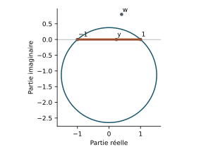

# École polytechnique · MP · Mathématiques B 2018 · Corrigé guidé

*Corrigé rédigé par IA, non officiel. Signalez toute erreur.*

**Rédaction** · GPT-6.2 Astra Ultra · vitesse non renseignée

La composition retenue a eu lieu le samedi 5 mai 2018 de 9 h à 13 h. Elle minimise l’intégrale d’un polynôme positif sur un segment avec ses valeurs aux extrémités imposées. Le rapport du jury, p. 4, décrit le report de près de deux semaines. Le premier sujet, sur les zéros de solutions d’équations différentielles, a été annulé. [Sujet du 5 mai](https://banques-ecoles.fr/cms/wp-content/uploads/2018/10/18_MP_sujet_eMathB_2.pdf) · [Rapport du jury](https://banques-ecoles.fr/cms/wp-content/uploads/2018/11/18_MP_rap_eMathB.pdf) · [Sujet initial annulé](https://banques-ecoles.fr/cms/wp-content/uploads/2018/10/18_MP_sujet_eMathB_1.pdf)

## Préliminaires. Existence d’un minimiseur pair

### Question 1a

> [!INDICATION]
> Vérifier les contraintes point par point sur un segment de polynômes.

#### Solution

Pour $P,Q\in A_N$ et $0\le t\le1$, le polynôme $(1-t)P+tQ$ est de degré au plus $N$, vaut un en $\pm1$ et est positif ou nul en chaque point de $[-1,1]$. Il appartient donc à $A_N$, qui contient par ailleurs $1$.

### Question 1b

> [!INDICATION]
> Utiliser la continuité pour passer de l’intégrale nulle à l’annulation partout.

#### Solution

L’intégrale $\|P\|_1=\int_{-1}^1|P(x)|dx$ est positive ou nulle, homogène en valeur absolue et sous-additive par l’inégalité triangulaire ponctuelle. Si elle est nulle, la fonction continue positive $|P|$ est identiquement nulle sur le segment. Un polynôme s’annulant en une infinité de points est nul. Ces propriétés définissent une norme.

### Question 1c

> [!INDICATION]
> Utiliser la continuité des évaluations en dimension finie.

#### Solution

Pour tout $x$, l’application linéaire $P\mapsto P(x)$ est continue sur l’espace normé de dimension $N+1$. Les contraintes aux extrémités sont donc fermées, ainsi que chaque contrainte $P(x)\ge0$. Leur intersection, même infinie, est fermée. Elle vaut $A_N$.

### Question 2a

> [!INDICATION]
> Borner en norme les éléments d’une suite minimisante grâce à leur signe.

#### Solution

La fonctionnelle $L(P)=\int_{-1}^1P$ est minorée par zéro sur $A_N$ et $L(1)=2$. Sur cet ensemble, $L(P)=\|P\|_1$. Une suite minimisante est donc bornée en norme. En dimension finie une sous-suite converge, sa limite appartient à $A_N$ par 1c et son image par $L$ est $a_N$ par continuité. Le minimum est atteint.

### Question 2b

> [!INDICATION]
> Décrire les minimiseurs comme une section fermée et bornée.

#### Solution

L’ensemble $B_N=A_N\cap L^{-1}(\{a_N\})$ est fermé et convexe par 1a, 1c et linéarité de $L$. Tous ses éléments ont norme $a_N$, il est donc borné. En dimension finie il est compact.

### Question 2c

> [!INDICATION]
> Symétriser un minimiseur.

#### Solution

Si $P\in B_N$, le polynôme $P(-X)$ est également admissible et de même intégrale par le changement $x\mapsto-x$. La convexité de $B_N$ donne $(P(X)+P(-X))/2\in B_N$. Ce polynôme est pair.

## I. Polynômes de Legendre normalisés

### Question 3a

> [!INDICATION]
> Suivre le monôme dominant dans la dérivée de Rodrigues.

#### Solution

La dérivée d’ordre $j$ du terme $X^{2j}$ est $(2j)!X^j/j!$. Avec le facteur de Rodrigues $1/(2^jj!)$, le coefficient dominant de $P_j$ vaut $c_j=(2j)!/[2^j(j!)^2]$, non nul. Le degré est $j$, y compris pour $P_0=1$.

### Question 3b

> [!INDICATION]
> Suivre la parité à chaque dérivation.

#### Solution

Le polynôme $(X^2-1)^j$ est pair et chaque dérivation inverse la parité. Après $j$ dérivations, $P_j(-X)=(-1)^j P_j(X)$.

### Question 3c

> [!INDICATION]
> Isoler le seul terme non nul de la dérivée au point un.

#### Solution

Écrivons $(X^2-1)^j=(X-1)^j(X+1)^j$. En $1$, le seul terme non nul de la formule de Leibniz d’ordre $j$ dérive exactement $j$ fois $(X-1)^j$. Sa valeur est $j!2^j$, donc $P_j(1)=1$. Par parité $P_j(-1)=(-1)^j$.

### Question 4

> [!INDICATION]
> Faire porter toutes les dérivations sur le polynôme de degré inférieur.

#### Solution

Pour $i<j$, intégrons $2^jj!\langle P_i,P_j\rangle$ par parties $j$ fois. Chaque terme de bord contient une dérivée d’ordre inférieur à $j$ de $(x^2-1)^j$, nulle en $\pm1$. Il reste $(-1)^j\int_{-1}^1P_i^{(j)}(x)(x^2-1)^jdx=0$. La symétrie donne l’orthogonalité entre tous les indices distincts.

### Question 5a

> [!INDICATION]
> Répéter les intégrations par parties avec le polynôme de même degré.

#### Solution

Comme en 4, $g_j=(2^jj!)^{-1}\int_{-1}^1 P_j^{(j)}(x)(1-x^2)^jdx$. Or $P_j^{(j)}=j!c_j$. En posant $I_j=\int_{-1}^1(1-x^2)^jdx$, on obtient $g_j=(2j)!\,I_j/[2^{2j}(j!)^2]$.

### Question 5b

> [!INDICATION]
> Intégrer la dérivée d’un produit qui s’annule aux deux extrémités.

#### Solution

Pour $j\ge1$, $[x(1-x^2)^j]_{-1}^1=0$. Après dérivation et intégration, $I_j=2j\int_{-1}^1 x^2(1-x^2)^{j-1}dx=2j(I_{j-1}-I_j)$. D’où $I_j=2jI_{j-1}/(2j+1)$, avec $I_0=2$.

### Question 5c

> [!INDICATION]
> Séparer facteurs pairs et impairs dans le produit.

#### Solution

La récurrence donne $I_j=2\prod_{h=1}^j 2h/(2h+1)=2^{2j+1}(j!)^2/(2j+1)!$. La formule de 5a se simplifie alors en $g_j=2/(2j+1)$.

### Question 6a

> [!INDICATION]
> Comparer le cardinal de la famille libre à la dimension.

#### Solution

Les $P_0,\ldots,P_n$ sont non nuls et orthogonaux, donc linéairement indépendants. Ils sont $n+1$, dimension de $\mathbb R_n[X]$, et forment une base.

### Question 6b

> [!INDICATION]
> Regrouper les composantes de même parité dans cette base.

#### Solution

Par 3b, les indices pairs donnent des polynômes pairs et les indices impairs des polynômes impairs. Dans le développement d’un polynôme pair, la partie impaire est nulle et l’indépendance impose tous ses coefficients nuls. Le raisonnement est symétrique pour un polynôme impair. Les familles demandées sont donc les bases $(P_{2j})_{0\le j\le\lfloor n/2\rfloor}$ et $(P_{2j+1})_{0\le j\le\lfloor(n-1)/2\rfloor}$.

## II. Localisation des racines du minimiseur

### Question 7

> [!INDICATION]
> Grouper les racines avec leurs opposées et leurs conjuguées, puis évaluer chaque facteur en un.

#### Solution

Le polynôme réel pair $R_N$, non nul, se scinde sur $\mathbb C$. Les racines réelles non nulles se groupent en paires $\pm c_j$, les imaginaires pures non nulles en $\pm i\rho_k$. Une racine nulle a un ordre pair et peut être groupée en facteurs $X^2$ avec $c_j=0$. Les autres racines, avec multiplicités, se groupent en quadruplets $\pm w_\ell,\pm\bar w_\ell$. Aucune racine ne vaut $\pm1$. En divisant chaque facteur par sa valeur en $1$, puis en utilisant $R_N(1)=1$, il vient
$$R_N(X)=\prod_j\frac{X^2-c_j^2}{1-c_j^2}\prod_k\frac{X^2+\rho_k^2}{1+\rho_k^2}
\prod_\ell\frac{X^2-w_\ell^2}{1-w_\ell^2}\frac{X^2-\bar w_\ell^2}{1-\bar w_\ell^2}.$$
Les produits peuvent être vides.

### Question 8

> [!INDICATION]
> Exprimer chaque changement comme un multiplicateur entre zéro et un.

#### Solution

Pour $|x|\le1$, $0\le x^2\le (x^2+\rho^2)/(1+\rho^2)$, puisque la différence est $\rho^2(1-x^2)/(1+\rho^2)$. L’ancien facteur est strictement positif. En le remplaçant on multiplie $R_N(x)\ge0$ par un rapport dans $[0,1]$ pour chacun des $k$. Le résultat $S_N$ est positif, de degré permis, vaut un aux extrémités et $S_N\le R_N$. Donc $a_N\le L(S_N)\le L(R_N)=a_N$ et $S_N\in B_N$.

### Question 9

> [!INDICATION]
> Comparer le facteur d’une racine extérieure avec le carré sur tout le segment.

#### Solution

Pour $|c|>1$ et $|x|\le1$, l’ancien facteur $(c^2-x^2)/(c^2-1)$ est au moins $1$, tandis que $0\le x^2\le1$. Le rapport du nouveau facteur sur l’ancien reste donc dans $[0,1]$. On obtient $0\le T_N(x)\le S_N(x)$, avec bonne normalisation, et la même comparaison des intégrales donne $T_N\in B_N$.

### Question 10a

> [!INDICATION]
> Développer l’équation des distances à moins un et un.

#### Solution

Posons $\lambda=|w-1|/|w+1|$. Elle est positive et différente de $1$, car $\Re w\ne0$. Pour $z=u+iv$, l’équation est $(u-1)^2+v^2=\lambda^2((u+1)^2+v^2)$. C’est le cercle de centre réel $(1+\lambda^2)/(1-\lambda^2)$ et de rayon $2\lambda/|1-\lambda^2|$. Il passe par $w$. Pour $-1<y<1$, l’équation se réduit à $(1-y)/(1+y)=\lambda$, d’où l’unique $y=(1-\lambda)/(1+\lambda)$.

### Question 10b

> [!INDICATION]
> Exprimer le rapport par la somme des distances aux deux foyers.

#### Solution

La formule précédente donne $1-y=2\lambda/(1+\lambda)$. D’où
$$K=\frac{|1-w|}{1-y}=\frac{|w-1|+|w+1|}{2}>1.$$
L’inégalité triangulaire est stricte car $w$ n’est pas réel et n’appartient donc pas au segment joignant $-1$ à $1$. De même $K=|w+1|/(y+1)$.

### Question 10c

> [!INDICATION]
> Factoriser la différence des carrés des distances sur l’axe réel.

#### Solution

L’équation est $|z-w|^2=K^2|z-y|^2$. Puisque $K>1$, compléter le carré donne le cercle de centre $(w-K^2y)/(1-K^2)$ et de rayon $K|w-y|/(K^2-1)>0$. Par 10b il passe par $1$ et $-1$. En restriction à l’axe réel, le polynôme $|x-w|^2-K^2|x-y|^2$ est donc de degré deux, de coefficient dominant $1-K^2$ et de racines $\pm1$. Il vaut $(K^2-1)(1-x^2)$. Par conséquent
$$\frac{|w-x|}{|y-x|}>K=\frac{|w-1|}{1-y}=\frac{|w+1|}{1+y}\qquad(-1<x<1,\ x\ne y).$$
Aux deux extrémités le rapport vaut exactement $K$. L’inégalité stricte imprimée sur le segment fermé comporte donc ces deux exceptions.

### Question 11

> [!INDICATION]
> Comparer sur le segment le produit d’un quadruplet de racines et celui de ses remplaçantes réelles.

#### Solution

La relation polynomiale de 10c donne $|x-w|\ge K|x-y|$ pour $|x|\le1$, y compris en $x=y$. En l’appliquant aussi en $-x$ et en utilisant $|1-w||1+w|=K^2(1-y^2)$, on obtient
$$\left|\frac{x^2-w^2}{1-w^2}\right|^2\ge\left(\frac{x^2-y^2}{1-y^2}\right)^2.$$
L’ancien facteur de quadruplet est positif sur le segment. Remplaçons chacun par le carré de droite dans $T_N$. Le nouveau polynôme $U$ est normalisé et satisfait $0\le U\le T_N\le S_N\le R_N$. Il est admissible et a donc la même intégrale minimale que $R_N$. La fonction continue positive $R_N-U$ d’intégrale nulle est identiquement nulle sur le segment, donc les polynômes coïncident. Or par construction $U$ n’a que des racines dans $[-1,1]$. C’est donc le cas de $R_N$.

## III. Valeur du minimum et polynôme extrémal

### Question 12

> [!INDICATION]
> Tester ce qui se passe lorsqu’il reste de la place pour deux degrés.

#### Solution

Avec $n=\lfloor N/2\rfloor$, le degré pair de $R_N$ est au plus $2n$. S’il était inférieur, $X^2R_N$ serait encore admissible et de degré au plus $2n$. Son intégrale serait strictement plus petite puisque $(1-x^2)R_N(x)\ge0$ et cette fonction est strictement positive sur un intervalle intérieur proche de $1$. Contradiction. Donc $\deg R_N=2n$.

### Question 13

> [!INDICATION]
> Préciser la multiplicité des racines intérieures et fixer le signe de la racine polynomiale.

#### Solution

Aucune racine ne vaut $\pm1$. Par 11, toutes sont intérieures, donc d’ordre pair car $R_N$ est positif ou nul de part et d’autre de chacune. Le coefficient multiplicatif dans le produit de facteurs de multiplicité paire est positif, par $R_N(1)=1$. Il existe donc un polynôme réel $U_N$ de degré $n$ avec $R_N=U_N^2$, dont on choisit le signe pour que $U_N(1)=1$. Alors $U_N(-1)=\pm1$. L’identité $U_N(-X)^2=U_N(X)^2$ et l’intégrité de $\mathbb R[X]$ montrent que $U_N$ est pair ou impair. Le terme dominant impose la parité de $n$.

### Question 14a

> [!INDICATION]
> Construire à partir de tout concurrent affine un concurrent du problème initial.

#### Solution

Si $U_N$ est pair, il appartient à $H_n=\{P\in\Pi_n:P(1)=1\}$. Pour $P\in H_n$, $P^2\in A_N$, donc $\|P\|_2^2=L(P^2)\ge a_N=\|U_N\|_2^2$. En prenant les racines carrées, $U_N$ réalise le minimum annoncé.

### Question 14b

> [!INDICATION]
> Faire varier le minimiseur dans une direction dont la valeur en un est nulle.

#### Solution

Pour deux indices pairs admissibles, $V=P_{2j}-P_{2h}$ satisfait $V(1)=0$. La fonction réelle $t\mapsto\|U_N+tV\|_2^2$ est minimale en zéro, donc sa dérivée $2\langle U_N,V\rangle$ s’y annule. Les produits scalaires $\langle U_N,P_{2j}\rangle$ valent tous un même réel $\mu$, y compris lorsqu’il n’y a qu’un indice.

### Question 14c

> [!INDICATION]
> Utiliser les normes au carré des vecteurs de la base orthogonale.

#### Solution

Le coefficient de $P_{2j}$ dans $U_N$ est $\langle U_N,P_{2j}\rangle/g_{2j}=\mu/g_{2j}$. Ainsi $U_N=\mu\sum_{0\le2j\le n}P_{2j}/g_{2j}$. En évaluant en $1$ et en utilisant 3c, $1=\mu\sum_{0\le2j\le n}1/g_{2j}$. En particulier $\mu>0$.

### Question 14d

> [!INDICATION]
> Calculer la norme du développement précédent.

#### Solution

Par orthogonalité, $a_N=\|U_N\|_2^2=\mu^2\sum_{0\le2j\le n}1/g_{2j}=\mu$. D’où $a_N=(\sum_{0\le2j\le n}1/g_{2j})^{-1}$.

### Question 15

> [!INDICATION]
> Appliquer la même variation dans le sous-espace des polynômes impairs.

#### Solution

Pour $P$ impair de degré au plus $n$ normalisé en $1$, $P(-1)=-1$ et $P^2\in A_N$. La même minimisation vaut donc parmi ces polynômes. Les variations $P_{2j+1}-P_{2h+1}$ annulent la valeur en un. Comme en 14, les produits scalaires de $U_N$ contre les $P_{2j+1}$ valent une constante $\mu$, la normalisation donne son inverse et la norme carrée vaut $\mu$. Ainsi $a_N=(\sum_{0\le2j+1\le n}1/g_{2j+1})^{-1}$.

### Question 16

> [!INDICATION]
> Sommer la progression arithmétique correspondant à la parité du degré de la racine.

#### Solution

Par 13, les indices à retenir ont la parité de $n$. Si $n=2m$, leur somme d’inverses est $\tfrac12\sum_{j=0}^m(4j+1)=(m+1)(2m+1)/2$. Si $n=2m+1$, elle vaut $\tfrac12\sum_{j=0}^m(4j+3)=(m+1)(2m+3)/2$. Dans les deux cas elle égale $(n+1)(n+2)/4$. D’où $a_N=4/[(n+1)(n+2)]$.

### Question 17

> [!INDICATION]
> Insérer la normalisation exacte dans le développement de la racine carrée du minimiseur.

#### Solution

La constante $\mu$ du développement de $U_N$ est $a_N$. Avec $1/g_j=(2j+1)/2$ et $U_N(1)=1$,
$$R_N(X)=\left[\frac{2}{(n+1)(n+2)}
\sum_{\substack{0\le j\le n\\j\equiv n\pmod2}}(2j+1)P_j(X)\right]^2.$$
Le membre entre crochets vaut bien un en $1$ d’après la somme calculée en 16. La formule identifie l’unique minimiseur pair sélectionné en 2c.
