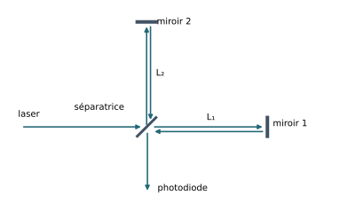
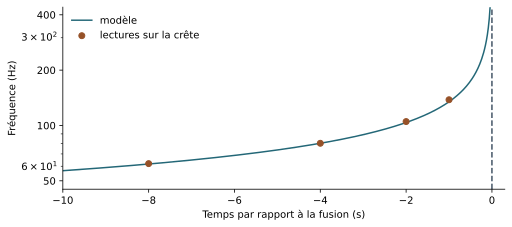
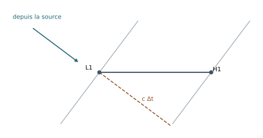

# École polytechnique et ESPCI PC 2018 — Physique A · Corrigé guidé

*Corrigé rédigé par IA, non officiel. Signalez toute erreur.*

**Lecture du rapport du jury** · GPT-6.2 Astra Ultra · vitesse non renseignée

**Rédaction** · GPT-6.2 Astra Ultra · vitesse non renseignée

## Réflexion sur le cuivre et détection des ondes gravitationnelles

## Exercice d’électromagnétisme

### Question Exercice — Réflexion complexe sur le cuivre

**Indication.** Choisir une convention temporelle puis écrire les deux raccords tangentiels. Un indice complexe permet de distinguer l’atténuation dans le métal de la phase à la réflexion.

On place le vide en $z<0$, un bloc de cuivre épais en $z>0$ et la surface plane en $z=0$. Pour la convention $e^{i(kz-\omega t)}$, écrivons $\widetilde n=n+i\kappa$, $\kappa\ge0$, et $k_m=\widetilde n\omega/c$. L’onde dans le métal décroît comme $e^{-\kappa\omega z/c}$. On suppose une réponse linéaire, isotrope et non magnétique, et un bloc assez épais pour négliger tout retour de la face arrière.

Pour une excitation tangente $E_i$, posons $r=E_r/E_i$ et $t=E_t/E_i$ au plan de l’interface. La continuité de $E_\parallel$ impose $1+r=t$. Faraday donne $\mathbf B=\mathbf k\times\mathbf E/\omega$ pour chaque onde. La continuité de $H_\parallel$ sans nappe singulière impose donc $1-r=\widetilde n t$. D’où

$$
r=\frac{1-\widetilde n}{1+\widetilde n},\qquad
t=\frac{2}{1+\widetilde n},\qquad
\mathcal R=|r|^2=\frac{(1-n)^2+\kappa^2}{(1+n)^2+\kappa^2}.
$$

La phase de l’onde réfléchie est déplacée de $\arg r$ et la fraction d’énergie réfléchie est $\mathcal R$. Pour un métal épais passif, la fraction $1-\mathcal R=4n/|1+\widetilde n|^2$ est absorbée. Si $|\widetilde n|\gg1$, $r$ approche $-1$, avec un déphasage voisin de $\pi$.

Pour relier l’indice aux porteurs, Maxwell-Ampère avec $\mathbf j=\widetilde\sigma(\omega)\mathbf E$ donne $\widetilde n^2=\varepsilon_b+i\widetilde\sigma/(\varepsilon_0\omega)$, où $\varepsilon_b$ représente la réponse liée. Le modèle libre de Drude, $m(\dot{\mathbf v}+\mathbf v/\tau)=-e\mathbf E$, donne $\widetilde\sigma=Ne^2/[m(\tau^{-1}-i\omega)]$, donc $\widetilde n^2=\varepsilon_b-\omega_p^2/[\omega(\omega+i/\tau)]$ avec $\omega_p^2=Ne^2/(m\varepsilon_0)$. À la longueur d’onde rouge du laser He–Ne, la conductivité statique ne suffit pas à fournir une valeur chiffrée fiable. L’indice optique mesuré inclut aussi les transitions entre bandes. Le sujet ne fournit pas cet indice.

## Problème — Ondes gravitationnelles de deux astres

### Question 1 — Fréquence orbitale du système binaire

**Indication.** L’orbite de chaque astre autour du barycentre a pour rayon la moitié de la distance des deux masses.

Pour chaque astre, $M\Omega^2(d/2)=GM^2/d^2$. D’où $\Omega^2=2GM/d^3$ et $f_{\rm orb}=\sqrt{2GM/d^3}/(2\pi)$. La fréquence est définie par rapport à un référentiel inertiel lié au barycentre.

### Question 2 — Propagation retardée

**Indication.** Trouver une situation où le déplacement d’une source crée des champs dont les modifications ne sont pas instantanées à distance.

Une charge accélérée produit un champ électromagnétique variable dont les perturbations se propagent à la vitesse de la lumière. Le champ reçu à un instant dépend de l’état retardé de la charge. De façon analogue, une modification de la distribution de masse n’agit pas instantanément sur le champ gravitationnel lointain.

### Question 3 — Fréquence de l’onde

**Indication.** Effectuer mentalement un demi-tour du système formé de deux astres identiques.

Après un demi-tour orbital, les deux masses ont échangé leurs places et la distribution de masse est la même. Le moment quadrupolaire varie par exemple comme $\cos(2\Omega t)$ ou $\sin(2\Omega t)$ puisque ses termes contiennent des produits de coordonnées. Le rayonnement dominant a donc $T=T_{\rm orb}/2$ et $f=2f_{\rm orb}$.

### Question 4 — Michelson et déformation relative

**Indication.** Tenir compte de l’aller-retour de la lumière dans chaque bras et distinguer une frange entière d’une petite fraction de frange.

Une séparatrice semi-réfléchissante partage la lumière cohérente entre deux bras perpendiculaires. Après réflexion sur les miroirs, les faisceaux reviennent et interfèrent au détecteur. Leur différence de phase est $\Delta\phi=4\pi(L_1-L_2)/\lambda+\phi_0$. Une frange entière correspond à une variation différentielle $\lambda/2$, de l’ordre de $10^{-7}$ à $10^{-6}\,\mathrm m$ dans le visible ou le proche infrarouge. La mesure d’une fraction de frange atteint des déplacements bien inférieurs. Une déformation relative $h$ produit $\delta(L_1-L_2)\sim hL$ selon l’orientation. Pour $h\sim10^{-21}$ et $L$ de quelques kilomètres, on vise quelques $10^{-18}\,\mathrm m$. Allonger le bras accroît le déphasage pour une même déformation.

### Question 5 — Perte d’énergie et diminution de distance

**Indication.** Calculer l’énergie cinétique des deux astres, puis utiliser la relation circulaire pour la comparer au potentiel.

Chaque astre a $v^2=GM/(2d)$ d’où $E_c=2Mv^2/2=GM^2/(2d)$. Le potentiel de la paire est $-GM^2/d$ et $E_m=-GM^2/(2d)$. Dans l’approximation d’orbites successives quasi circulaires, $dE_m/dd=GM^2/(2d^2)>0$. Une perte d’énergie conduit donc à $\dot d<0$ et à une augmentation de la vitesse orbitale.

### Question 6 — Loi de montée en fréquence

**Indication.** Intégrer l’équation pour $f^{-8/3}$, dont la dérivée doit être constante.

D’après 1 et 3, $f\propto d^{-3/2}$ augmente, donc $K>0$. On trouve $d(f^{-8/3})/dt=-8K/3$. Si l’on pose $t_c=t_i+3f(t_i)^{-8/3}/(8K)$,

$$
f(t)=\left[\frac{8K}{3}(t_c-t)\right]^{-3/8},\qquad t<t_c.
$$

La courbe est croissante, convexe et tend formellement vers l’infini en $t_c$. Cette divergence du modèle de l’approche est interrompue par la fusion physique.

### Question 7 — Évolution du système

**Indication.** Mettre en relation la décroissance de la séparation et l’augmentation de la vitesse de rotation.

Le rayonnement extrait de l’énergie et du moment cinétique. Les trajectoires s’enroulent vers le barycentre, avec des périodes de plus en plus courtes. L’émission se renforce et sa fréquence augmente plus rapidement à l’approche du rapprochement final. La fusion met fin à la description par deux masses sur des orbites circulaires. Le résidu peut émettre un signal transitoire avant de se stabiliser.

### Question 8 — Vérification quantitative sur la figure 1

**Indication.** Diviser par deux le temps restant plusieurs fois. Sur l’axe logarithmique vertical, les incréments de même hauteur correspondent à des facteurs multiplicatifs.

L’origine graphique est $t_c\simeq0$. Sur la crête du spectrogramme, on lit approximativement aux temps $-8,-4,-2,-1\,\mathrm s$ les fréquences $62,80,105,138\,\mathrm{Hz}$. Les rapports successifs sont $1,29$, $1,31$ et $1,31$ pour un temps restant divisé par deux, à comparer à $2^{3/8}=1,30$. Les extrémités donnent l’exposant $\ln(138/62)/\ln 8\simeq0,38$, proche de $3/8$. L’épaisseur de la piste et la lecture des abscisses limitent la précision. Les points et la loi apparaissent sur la figure 2 du corrigé.

### Question 9 — Analyse dimensionnelle

**Indication.** Trouver la dimension de $K$ dans l’équation différentielle et construire un temps avec $G,M,c$.

$[K]=T^{-2}/(T^{-1})^{11/3}=T^{5/3}$. Le seul temps que l’on peut former avec les trois données est $GM/c^3$, puisque $[GM]=L^3T^{-2}$. Ainsi $K=C(GM/c^3)^{5/3}$ avec $C>0$ sans dimension, inaccessible par cette analyse.

### Question 10 — Échelle de masse

**Indication.** Extraire $K$ d’un point du graphique en tenant compte du facteur $3/8$. Conserver explicitement le coefficient inconnu de la loi dimensionnelle.

À $t_c-t=4\,\mathrm s$ et $f\simeq80\,\mathrm{Hz}$, on trouve $K=3f^{-8/3}/[8(t_c-t)]\simeq8\times10^{-7}\,\mathrm{s^{5/3}}$. Alors $M=(c^3/G)(K/C)^{3/5}\simeq8\times10^{31}C^{-3/5}\,\mathrm{kg}$. En prenant formellement $C=1$, on obtient quelques dizaines de masses solaires ($M_\odot\simeq2\times10^{30}\,\mathrm{kg}$). Cela indique une échelle stellaire, mais surestime la masse typique d’une étoile à neutrons, voisine d’une à deux masses solaires. Une détermination quantitative exige le préfacteur de la théorie radiative, pouvant être bien supérieur à l’unité.

### Question 11 — Comparaison des vitesses de propagation

**Indication.** Sous l’hypothèse d’une émission simultanée, écrire le temps de vol pour les deux messagers avant de prendre leur différence.

Soit $D_s/c\sim10^8\times3\times10^7=3\times10^{15}\,\mathrm s$. Comme la lumière arrive deux secondes après le signal gravitationnel, $\Delta t=D_s/c-D_s/v_g>0$. Pour un petit écart, $(v_g-c)/c\simeq\Delta t/(D_s/c)\sim7\times10^{-16}$. Leur vitesse est donc remarquablement proche dans cette hypothèse. Un délai intrinsèque d’émission contribue également au retard mesuré et empêcherait d’en déduire seul le signe de l’écart des vitesses.

### Question 12 — Fréquence mesurée directement sur le signal L1

**Indication.** Suivre la bande grise du signal reconstruit et mesurer l’intervalle entre des maxima successifs de même signe.

Sur le panneau inférieur central, des sommets se trouvent vers $0,469$ et $0,488\,\mathrm s$, d’où $T\simeq0,019\,\mathrm s$ et $f\sim50\,\mathrm{Hz}$. Plus près de la fusion, les sommets vers $0,503$ et $0,514\,\mathrm s$ donnent $f\sim90\,\mathrm{Hz}$, et les oscillations suivantes raccourcissent encore. La bande lumineuse du panneau supérieur passe d’environ 50 Hz à près de 100 Hz aux époques correspondantes.

### Question 13 — Délai entre deux stations

**Indication.** Représenter une onde plane et projeter la base entre les stations sur la direction de propagation.

La source est assez lointaine pour assimiler le front d’onde à un plan. Prenons $\mathbf b=\overrightarrow{L1\,H1}$ et $\mathbf n$ dans le sens de propagation (la source est en direction opposée). Alors $t_H-t_L=\mathbf b\cdot\mathbf n/c$. Pour $b=3000\,\mathrm{km}$, le délai maximal est $b/c=10\,\mathrm{ms}$. L’enveloppe terminale apparaît plus tôt à L1, d’environ $8$ à $10\,\mathrm{ms}$ à la précision de la figure. Cette valeur fixe $\cos\theta=c(t_H-t_L)/b$ pour $\theta=(\mathbf b,\mathbf n)$, de l’ordre de 0,8 à 1. À titre indicatif, 8 ms correspond à $37^\circ$. Il faut comparer des repères homologues du signal, les réponses d’antenne pouvant différer.

### Question 14 — Ambiguïté de localisation

**Indication.** Une direction dans le ciel a deux paramètres. Examiner les symétries du système formé par les bases de mesure.

Un seul délai impose une projection de $\mathbf n$, donc un cercle sur la sphère des directions, intersection avec un cône d’axe $\mathbf b$. Une troisième station non alignée fournit une deuxième projection indépendante. Les deux projections fixent la composante de $\mathbf n$ dans le plan des stations. La condition $|\mathbf n|=1$ laisse en général deux solutions, symétriques par rapport à ce plan. Une quatrième station hors du plan, ou des informations complémentaires sur les réponses d’antenne, peuvent lever cette ambiguïté.

### Question 15 — Interprétation de la seconde piste

**Indication.** Tester la tendance en fréquence avant la fin, sans confondre l’instant du pic d’amplitude et le temps formel de divergence du modèle.

L1 montre une oscillation qui se resserre, s’amplifie puis s’éteint très vite après un court signal final. Les autres stations montrent le même événement décalé. Par exemple, sur la piste montante, on lit grossièrement $50\,\mathrm{Hz}$ vers $0,46\,\mathrm s$ et $90$ à $100\,\mathrm{Hz}$ vers $0,51$ à $0,515\,\mathrm s$. Si $t_c\sim0,525\,\mathrm s$, la loi $(t_c-t)^{-3/8}$ prédit un facteur voisin de deux dans cet intervalle. Cela est compatible avec une phase d’approche suivie d’une fusion. Le spectrogramme ne permet pas de déterminer finement l’exposant.

### Question 16 — Rapport des masses

**Indication.** À une même fréquence, le temps restant jusqu’à la fusion varie en sens inverse de $K$. Le préfacteur inconnu s’élimine dans le rapport.

Vers 100 Hz, la première piste se trouve environ 2 à 3 secondes avant la fusion. La piste de L1 se trouve de l’ordre de $10^{-2}$ à $2\times10^{-2}\,\mathrm s$ avant la fin. Comme $K\propto M^{5/3}$ et $K(t_c-t)=3f^{-8/3}/8$, le rapport vaut $M_2/M_1=[(t_c-t)_1/(t_c-t)_2]^{3/5}\sim2\times10^1$. La résolution médiocre du second événement limite cette lecture à un ordre de grandeur. Sous l’hypothèse de masses égales, le même rapport vaut pour les masses totales.

### Question 17 — Meilleure quasi-périodicité

**Indication.** Compter approximativement combien de cycles se déroulent avant un changement notable de fréquence, à une même fréquence de référence.

Vers $100\,\mathrm{Hz}$, $\dot f=3f/[8(t_c-t)]$. Pour la figure 1, on trouve de l’ordre de $15\,\mathrm{Hz\,s^{-1}}$. Pour la figure 2, le résultat est de l’ordre de $2\times10^3$ à $4\times10^3\,\mathrm{Hz\,s^{-1}}$. Sur une période de 10 ms, la première fréquence varie d’une fraction de hertz et la seconde de plusieurs dizaines de hertz. La première source est bien plus quasi périodique. Dans le second spectrogramme, la piste large et courte traduit aussi le compromis entre résolution temporelle et fréquentielle.

### Question 18 — Condition quantitative

**Indication.** Calculer le changement de fréquence durant une période locale.

$|\Delta f|\sim|\dot f|/f$ doit être petit devant $f$, donc $|\dot f|/f^2\ll1$. Ce critère est sans dimension.

### Question 19 — Condition sur la vitesse orbitale

**Indication.** Éliminer la séparation entre la loi de Kepler et la vitesse d’un seul astre autour du barycentre.

Avec $v=\Omega d/2$, $v^2=GM/(2d)$ et $f=\Omega/\pi=4v^3/(\pi GM)$. Par conséquent

$$
\frac{\dot f}{f^2}=Kf^{5/3}=C\left(\frac4\pi\right)^{5/3}\left(\frac vc\right)^5.
$$

Aux facteurs numériques près, la quasi-périodicité correspond à une vitesse orbitale petite devant celle de la lumière. Tant que $v/c$ est faible, la perte radiative par cycle reste modeste. En fin de rapprochement, le modèle newtonien et l’hypothèse de variation lente deviennent moins précis.
