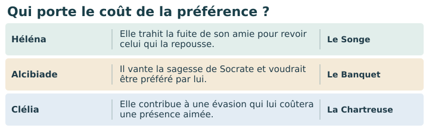

# Banque PT — Français A 2019 · Corrigé brut

*Corrigé rédigé par IA, non officiel. Signalez toute erreur.*

**Rédaction** · GPT-6.2 Astra Ultra · vitesse non renseignée

[Énoncé officiel](https://www.banquept.fr/documents/2019/fr_a_2019_pt.pdf) · [Rapport du jury](https://www.banquept.fr/documents/ecrit/rapport/2019/rapport_fra_a_ecrit_2019.pdf) · [Programme officiel](https://www.education.gouv.fr/bo/18/Hebdo24/ESRS1800091A.htm)

Épreuve de quatre heures. Le thème « L’amour » réunit les œuvres suivantes. Platon, Le Banquet (traduction Luc Brisson) · Shakespeare, Le Songe d’une nuit d’été (traduction Jean-Michel Déprats) · Stendhal, La Chartreuse de Parme.

La Rochefoucauld, Maximes (1664, selon l’énoncé).

## Dissertation

Les trois œuvres donnent-elles raison à La Rochefoucauld quand il affirme que l’amour renforce l’amour de soi et que l’on sacrifie plus volontiers la tranquillité de la personne aimée que la sienne ?

À Athènes, Héléna croit servir son amour en révélant à Démétrius la fuite d’Hermia. Elle voudrait au moins recevoir un remerciement de l’homme qui la repousse. Qu’adviendra-t-il pourtant du repos de son amie, et même de celui du jeune homme qu’elle prétend aimer ? La maxime de La Rochefoucauld oblige à poser les deux questions ensemble. L’amant qui se déclare prêt à tout pour un autre peut se choisir lui-même à travers lui. Il se reconnaîtrait surtout au partage très inégal de l’inquiétude, dont il accepte plus volontiers de charger la personne aimée. Ce diagnostic atteint-il le ressort de tout amour, ou découvre-t-il une tentation que la relation elle-même peut corriger ?

On comprend que l’amour accorde à l’intérêt personnel une puissance que d’autres passions ne lui donnent pas. L’avare possède sa bourse sans en attendre un jugement. L’amant dépend de la parole libre de quelqu’un pour obtenir l’assurance qu’il est aimable. Dans *Le Banquet*, Alcibiade raconte sa tentative pour séduire Socrate. Il croit pouvoir échanger son propre attrait contre la sagesse qu’il admire. Le refus qui lui est opposé atteint à la fois son désir et l’idée avantageuse qu’il se faisait de lui-même. Son discours mêle l’éloge du maître, l’aveu de sa blessure et la jalousie devant Agathon. Sa manière d’admirer Socrate lui donne des raisons de l’aimer tout en l’autorisant, croit-il, à disposer de sa compagnie.

La volonté de sauvegarder son repos apparaît plus clairement encore lorsqu’on la distingue du goût du confort. Obéron peut bien s’agiter une nuit entière. Aussi longtemps que Titania lui refuse le jeune garçon indien qu’elle protège, il entend lui faire perdre à son tour la liberté de choisir et la tranquillité. La magie lui donne le moyen de rendre ses volontés compatibles avec celles de la reine en modifiant les volontés de celle-ci. La réconciliation finale ne saurait faire oublier à quel prix elle a été obtenue. Dans *La Chartreuse de Parme*, Fabrice va jusqu’à préférer sa prison au monde libre dès qu’il y aperçoit Clélia. Cette captivité volontaire a quelque chose de généreux. Elle menace cependant la paix de la fille du gouverneur, qui doit concilier le souci de son père avec la protection du prisonnier. Ce que l’amant célèbre comme le plus beau temps de sa vie peut être, du côté de l’aimée, un temps de déchirement.

Mais la préférence personnelle qui nous fait aimer ne commande pas toujours de transférer le coût du désir. Titania elle-même veille sur le garçon par fidélité à sa mère morte. Elle accepte la querelle avec Obéron pour tenir dans le présent un engagement dont son amie ne peut plus la récompenser. Chez Stendhal, Clélia participe à l’évasion de Fabrice. En lui rendant la liberté, elle se prive précisément de la présence dont elle avait appris à se réjouir. Chez Platon, Phèdre présente Alceste comme celle qui consent à mourir pour Admète alors que ses propres parents à lui reculent. Même si l’éloge prononcé au banquet fait entrevoir une récompense de gloire, l’acte suppose que la conservation de l’être aimé puisse compter davantage que la sécurité de celui qui aime. Ces scènes ébranlent le « toujours » de la maxime.

Il resterait à savoir si le désintéressement doit se prouver par une comptabilité des tourments. Dans l’entretien rapporté par Socrate, Diotime fait du désir de posséder le bien durablement un ressort commun aux hommes. L’amant y est nécessairement intéressé, puisqu’il cherche le bonheur. Mais ce qu’il produit auprès de la beauté, dans l’éducation ou dans l’exercice de la pensée, peut durer et valoir pour d’autres que lui. C’est alors le contenu du bien poursuivi qui change, et pas seulement l’identité de son bénéficiaire. De même, Héléna aurait mieux servi son amour en se demandant ce que Démétrius et Hermia voulaient effectivement. Renoncer au pouvoir de décider du repos de l’autre est une manière plus exigeante d’aimer que se dire disposé à souffrir pour lui.

La Rochefoucauld aide donc à reconnaître une appropriation jusque dans les gestes les plus coûteux. Il mérite d’être suivi tant que l’amant n’admet comme preuve d’amour que la réponse qui le tranquillise. Les œuvres montrent cependant que l’attachement peut rendre sensible à un bien que l’on ne possédera pas et à une liberté dont il faudra respecter les choix.
