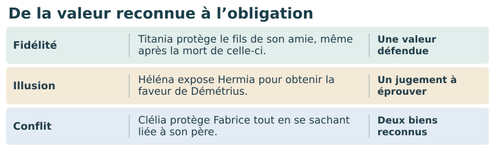

# Banque PT — Français B 2019 · Corrigé guidé

*Corrigé rédigé par IA, non officiel. Signalez toute erreur.*

**Rédaction** · GPT-6.2 Astra Ultra · vitesse non renseignée

[Énoncé officiel](https://www.banquept.fr/documents/2019/fr_b_2019_pt.pdf) · [Rapport du jury](https://www.banquept.fr/documents/ecrit/rapport/2019/rapport_fra_b_ecrit_2019.pdf) · [Programme officiel](https://www.education.gouv.fr/bo/18/Hebdo24/ESRS1800091A.htm)

Épreuve de quatre heures. Le thème « L’amour » réunit les œuvres suivantes. Platon, Le Banquet (traduction Luc Brisson) · Shakespeare, Le Songe d’une nuit d’été (traduction Jean-Michel Déprats) · Stendhal, La Chartreuse de Parme.

Michel Larroque, Esquisse d’une philosophie de l’amour, « Description phénoménologique de l’éros » (L’Harmattan, 2006). Du début de la page 2, « L’exigence totalisante de la passion », à la dernière phrase du texte page 5, « une expérience spirituelle ». Les deux questions suivent sur cette même page.

Le résumé compte pour 8 points et la dissertation pour 12. Le sujet demande 190 mots avec une tolérance de 10 %, soit de 171 à 209 mots.

## Préparer le résumé

Partir de la difficulté de rester fidèle à un être singulier dans un monde où bien d’autres choses sont précieuses. Le discours admiratif de l’amoureux révèle ensuite un jugement présent dès la naissance du sentiment. Distinguer ce jugement d’un calcul préalable. Terminer par ce qu’expliquent ensemble la joie et la peine, toutes deux liées à une valeur considérée comme irremplaçable.

## Résumé

La passion réserve une place unique à la personne aimée. Elle admet que notre affection ou notre amitié se portent ailleurs. Pourtant le monde offre sans cesse des qualités également dignes de nous attacher. Pour contenir cette inquiétude, nous traçons entre nos sentiments des frontières parfois artificielles, dont la nécessité révèle la fragilité de notre préférence exclusive.

Aimer suppose en effet un jugement, même si personne ne tombe amoureux par déduction. Les éloges par lesquels nous justifions ensuite notre choix traduisent une conviction première. La valeur reconnue chez autrui nous semble aussi contraignante que le serait une évidence pour notre intelligence. Une passion peut heurter la prudence, les usages ou la morale. Celui qui la ressent peut en redouter les conséquences tout en estimant légitime de lui rester fidèle.

Pareil consentement rapproche la passion du devoir. Renoncer à notre attachement pour vivre heureux reviendrait à trahir ce qui le justifie. La joie que nous éprouvons parfois en aimant demeure une conséquence de cette admiration. La douleur de perdre un être irremplaçable mesure également notre conviction de tenir à un bien absolu. Même trompeuse, cette certitude spirituelle vise toujours le vrai.

*190 mots.*

## Préparer la dissertation

Les œuvres illustrent-elles le rapprochement de Larroque entre amour et devoir, quand une personne reconnaît une valeur à défendre ou à promouvoir et peut accepter pour elle un sacrifice ?

**Quel est le point de comparaison entre amour et devoir ?**

Larroque écrit que la personne a conscience d’une valeur. Ce jugement peut lui donner une raison de supporter un coût. L’obligation légale, la fidélité à une amie et l’obéissance à un désir ne sont donc pas interchangeables.

**Pourquoi faut-il conserver « parfois » ?**

Un sacrifice peut manifester ce que l’on défend. Le mot « parfois » interdit de définir tout amour par la souffrance. Dans le Songe, comparer ce que Titania préserve en veillant sur le garçon et ce qu’Héléna compromet en dénonçant la fuite. Deux actions onéreuses ne protègent pas nécessairement deux biens comparables.

**Comment passer de « défendre » à « promouvoir » ?**

Défendre conserve ce que l’on juge menacé. Promouvoir contribue à le faire exister dans une forme nouvelle. L’éducation du désir chez Diotime permet de penser comment l’admiration d’un être peut conduire à reconnaître ailleurs la beauté que l’on aimait en lui.

## Dissertation

Dans *La Chartreuse de Parme*, ouvrir un chemin à l’évasion de Fabrice est pour Clélia une manière de le sauver et de le perdre. Il faut que cet homme sorte de la tour, même si son départ met fin à leurs rencontres. Michel Larroque rapproche ainsi l’amour du devoir. Dans les deux cas, quelqu’un reconnaît une valeur assez grande pour prendre sa défense et, s’il le faut, y sacrifier un bien personnel. Mais comment distinguer la valeur qui oblige de la préférence à laquelle un individu veut donner l’autorité d’une obligation ?

L’amour commence par une préférence, mais il se révèle parfois à l’amant sous la forme d’une responsabilité. Titania explique à Obéron pourquoi elle garde auprès d’elle le jeune garçon qu’il convoite. Sa mère lui était chère et est morte en lui donnant naissance. La reine maintient quelque chose de leur lien en veillant sur l’enfant. La querelle lui coûte sa tranquillité et celle de son couple. La peine consentie indique ici que la valeur du lien subsiste au-delà du plaisir de la compagnie. L’éloge de Phèdre au banquet de Platon fait à l’amour un crédit voisin. Lorsqu’il imagine une cité d’amants, il compte sur la honte de s’avilir sous les yeux d’un être admiré. Ce regard peut donner le courage d’accomplir ce que la loi n’aurait pas suffi à obtenir. Le dévouement assure alors la défense de quelque chose que les amants comprennent comme un bien.

Cette conscience peut toutefois se tromper, et le prix payé ne la rend pas infaillible. Héléna expose Hermia en dévoilant sa fuite à Démétrius. Elle consent à son propre abaissement, mais la même action compromet l’amie qu’elle devrait protéger. L’intensité de la souffrance ne décide donc pas de la valeur de l’acte. Alcibiade, dans *Le Banquet*, estime Socrate incomparable. En lui offrant sa beauté, il voudrait pourtant obtenir une sagesse qu’il traite comme une propriété transmissible. Socrate éprouve cette prétention en lui laissant la responsabilité d’apprécier ce qu’il a vraiment à gagner à pareil échange. Un amant peut donc servir son désir sous le nom de devoir et paraître se sacrifier au moment où il cherche en réalité un profit.

Une autre difficulté surgit précisément quand plusieurs valeurs authentiques s’opposent. Clélia peut vouloir à la fois sauver Fabrice et rester fidèle à son père. Son vœu à la Madone rend particulièrement sensible la permanence de ce conflit. À Parme, les rencontres dans l’obscurité lui permettent de tenir à la lettre l’engagement de ne plus voir Fabrice, tout en lui conservant son amour. Le procédé révèle combien l’obligation peut se prêter aux interprétations de celui qu’elle lie. Il serait pourtant réducteur de n’y lire que de l’hypocrisie. Elle n’a cessé d’éprouver deux fidélités que les circonstances l’empêchent d’honorer ensemble. Diotime donne, chez Platon, une autre issue à cette difficulté. La première admiration peut devenir l’occasion d’apprendre à reconnaître la beauté dans des conduites, des connaissances et des êtres qui ne nous appartiennent pas. Promouvoir une valeur, au sens fort du mot, suppose qu’on puisse la laisser croître au-delà de son intérêt particulier.

L’amour et le devoir se ressemblent donc par la question qu’ils adressent à celui qui agit. Que vaut ce à quoi il tient, et qu’est-il prêt à faire pour que ce bien existe encore demain ? Le sacrifice rend cette question visible quand plusieurs biens se disputent une même vie. Il ne fournit à lui seul ni une règle de conduite ni une garantie de vérité.
