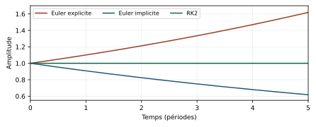
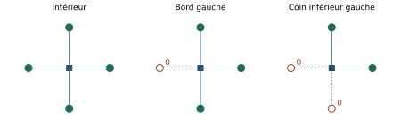
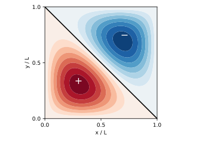

# Banque PT 2019 — Informatique et modélisation · Corrigé guidé

*Corrigé rédigé par IA, non officiel. Signalez toute erreur.*

**Rédaction** · GPT-6.2 Astra Ultra · vitesse non renseignée

**Révision (tour 1)** · GPT-6.2 Astra Ultra · vitesse non renseignée

Figures de Chladni. Épreuve de quatre heures, sans calculatrice. Les pages du sujet sont comptées depuis la couverture. [Sujet et annexe Python, p. PDF 1–25](https://www.banquept.fr/documents/2019/info_mod_2019_pt.pdf) · [Rapport du jury, p. 1–4](https://www.banquept.fr/documents/ecrit/rapport/2019/rapport_info_model_ecrit_2019.pdf)

## I. Du déplacement à l’oscillateur harmonique

### Q1. Équation de propagation

**Piste.** Testez une onde plane et regardez si la vitesse dépend de son vecteur d’onde.

Le déplacement vertical satisfait l’équation de d’Alembert à deux dimensions, $f_{tt}=c^2\Delta f$. Elle est linéaire, homogène, du second ordre en espace et en temps. Les solutions se superposent. Dans le milieu uniforme infini, une onde plane de vecteur d’onde $\mathbf k$ vérifie $\omega^2=c^2|\mathbf k|^2$. Sa vitesse de phase est $c$, indépendante de sa fréquence. Le signal se propage à vitesse finie. Une corde tendue aux petites déformations transversales et le champ électromagnétique dans le vide obéissent à des équations de même type, respectivement à une et à trois dimensions.

### Q2. Bilan d’énergie

**Piste.** Multipliez l’équation par la vitesse verticale. Identifiez un terme stocké et un flux de bord.

En multipliant l’équation par $f_t$ et en intégrant par parties sur la plaque $S$, on trouve

$$
\frac{\mathrm d}{\mathrm dt}\int_S\frac{f_t^2+c^2|\nabla f|^2}{2}\,\mathrm dS
=c^2\int_{\partial S}f_t\,\partial_n f\,\mathrm ds.
$$

L’intégrale positive représente l’énergie à un facteur physique près. Sa variation vient du flux à travers le bord. Pour un bord fixe ($f_t=0$) ou réfléchissant avec $\partial_n f=0$, elle est conservée. Le modèle ne comporte aucun mécanisme intrinsèque de dissipation.

### Q3. Construire une célérité

**Piste.** Posez des puissances inconnues et équilibrez séparément temps, masse et longueur.

Posons $c=K E^a\rho^b e^s L^r$. Avec $[E]=M L^{-1}T^{-2}$ et $[\rho]=M L^{-3}$, les exposants du temps et de la masse donnent $a=1/2$, $b=-1/2$. L’exposant de longueur donne alors $s+r=0$. Une célérité locale indépendante des dimensions de la plaque peut donc s’écrire $c=K\sqrt{E/\rho}$. L’analyse dimensionnelle seule laisse possible un facteur sans dimension fonction de $e/L$. On choisit la proposition matérielle la plus simple et $K=1$ pour l’estimation qui suit.

### Q4. Application à l’aluminium

**Piste.** Convertissez les gigapascals avant de prendre la racine.

Avec $E=69\times10^9$ Pa et $\rho=2{,}70\times10^3$ kg/m³, $c=\sqrt{69\times10^9/(2{,}70\times10^3)}\simeq5{,}1\times10^3$ m/s. Les dimensions du carré n’entrent pas dans cette estimation de la célérité.

### Q5. Effet d’un agrandissement

**Piste.** Commencez par le nouveau bord, puis dérivez deux fois la fonction composée.

**a.** Pour $L'=\gamma L$, le bord $x=L'$ doit être transporté en $x=L$, d’où $\alpha=1/\gamma$ et de même suivant $y$. Pour $g(x,y,t)=f_L(\alpha x,\alpha y,\beta t)$, le Laplacien est multiplié par $\alpha^2$ et la dérivée temporelle seconde par $\beta^2$. À célérité fixée, la même équation impose $\beta^2=\alpha^2$. Pour conserver le sens du temps, $\beta=1/\gamma$.

**b.** Si la solution initiale parcourt un cycle en $\tau$, il faut $\beta\tau'=\tau$. Ainsi $\tau'=\gamma\tau$. Ce résultat suppose la même famille de conditions aux limites et le même mode.

### Q6. Modes propres

**Piste.** Une expression qui dépend seulement du temps doit égaler une expression qui dépend seulement de la position.

**a.** Pour $f=uh$, l’équation donne $h\Delta u=uh''/c^2$. Là où $uh\ne0$, $\Delta u/u=h''/(c^2h)$ égale une constante car les variables sont indépendantes. En la notant $-\lambda$, on obtient $\Delta u+\lambda u=0$ et $h''+c^2\lambda h=0$. Les équations se prolongent par continuité aux zéros.

**b.** Pour des bords homogènes fixes, une intégration par parties donne $\lambda\int u^2=\int|\nabla u|^2$. Un déplacement constant non nul ne satisfait pas ces bords, donc $\lambda>0$ pour un mode non trivial. Le problème aux limites sélectionne les valeurs possibles. La réponse temporelle de chaque mode vibratoire borné est alors sinusoïdale. Un éventuel mode rigide à fréquence nulle requiert d’autres conditions aux limites.

**c.** En posant $h=h_0e^{i\omega t}$, on a $\lambda=\omega^2/c^2$ et $\Delta u+(\omega^2/c^2)u=0$. La combinaison réelle $h=A\cos(\omega t)+B\sin(\omega t)$ vérifie la même équation temporelle et conduit à la même équation spatiale.

## II. Quatre intégrateurs temporels

### Q7. Euler explicite

**Piste.** Choisissez la vitesse comme seconde variable, puis écrivez la dérivée des deux composantes.

**a.** Sur un pas $\tau$, on remplace la variation de la solution par le produit de la longueur du pas et de la dérivée à sa borne gauche. Lorsque la dérivée seconde de cet état est bornée, la tangente approxime localement la trajectoire avec un défaut en $O(\tau^2)$ par pas.

**b.** En temps adimensionné, $h''=-h$. Posons $v=h'$ et $X=(h,v)^T$. Alors $X'=AX$ où

$$
A=\begin{pmatrix}0&1\\-1&0\end{pmatrix}.
$$

**c.** Pour $t_n=n\tau$, $X_{n+1}=(I+\tau A)X_n$. En composantes, $h_{n+1}=h_n+\tau v_n$ et $v_{n+1}=v_n-\tau h_n$. La solution exacte issue de $(1,0)$ est $(\cos t,-\sin t)$.

### Q8. Euler implicite

**Piste.** Regroupez au même membre tout ce qui est évalué au nouvel instant.

**a.** La pente à droite donne $X_{n+1}=X_n+\tau AX_{n+1}$. L’inversion de $I-\tau A$ fournit

$$
X_{n+1}=\frac{1}{1+\tau^2}
\begin{pmatrix}1&\tau\\-\tau&1\end{pmatrix}X_n.
$$

**b.** Dans le code fourni, le facteur ci-dessous change la matrice de mise à jour. La fonction reproduit aussi l’initialisation et propose les deux méthodes pour la comparaison de Q9.

```python
import numpy as np
import numpy.random as rd
import matplotlib.pyplot as plt

def euler(npoints, tporte, implicite):
    t = np.linspace(0, tporte, npoints + 1)
    tau = t[1] - t[0]
    X = np.zeros((2, npoints + 1))
    X[:, 0] = [1.0, 0.0]
    M = np.array([[1.0, tau], [-tau, 1.0]])
    if implicite:
        M = M / (1 + tau**2)
    for i in range(npoints):
        X[:, i + 1] = M.dot(X[:, i])
    return t, X
```

**c.** Le rayon $\sqrt{h^2+v^2}$ est multiplié à chaque pas par $\sqrt{1+\tau^2}$ avec Euler explicite, par son inverse avec Euler implicite. Le premier amplifie l’oscillation et le second la dissipe. Tous deux convergent à l’ordre un pour un horizon fixé et un pas tendant vers zéro. Aucun des deux ne conserve l’énergie de cet oscillateur sur une longue durée.

### Q9. Chronogramme et portrait de phase

**Piste.** Comparez la distance à l’origine au début et à la fin du portrait de phase.

**a.** Le code reproduit les deux tracés de la figure 2 avec les légendes et les titres. Les variables $h$ et $h'$ varient avec le temps sur le premier graphe. Sur le second, chaque date donne un point de coordonnées $(h,h')$.

```python
t, X = euler(2**10, 10 * np.pi, False)
fig, axes = plt.subplots(1, 2, figsize=(9, 3.5))
axes[0].plot(t, X[0], label="h(t)")
axes[0].plot(t, X[1], "--", label="h'(t)")
axes[0].set(xlabel="Temps t", ylabel="Amplitude", title="Chronogramme")
axes[0].legend()
axes[1].plot(X[0], X[1], label="Trajectoire")
axes[1].set(xlabel="h(t)", ylabel="h'(t)", title="Diagramme des phases")
axes[1].set_aspect("equal")
axes[1].legend()
fig.tight_layout()
plt.show()
```

**b.** Les oscillations en quadrature croissent et la trajectoire s’enroule vers l’extérieur, alors que le rayon exact vaut 1. Après 1024 pas couvrant cinq périodes, le rayon numérique atteint environ 1,62. Il s’agit de la croissance artificielle démontrée en Q8.

**c.** À durée affichée identique, augmenter `npoints` réduit $\tau$. Le rayon final vaut $(1+\tau^2)^{T/(2\tau)}$, de logarithme $\sim T\tau/2$ lorsque le pas tend vers zéro. Le tracé devient visuellement très proche du cercle. Le temps de calcul et, ici, la mémoire utilisée augmentent. Pour tout pas non nul, la dérive demeure sur un horizon suffisamment long.



### Q10. Prédicteur-correcteur de Runge-Kutta

**Piste.** Exprimez la seconde pente en fonction de la première puis utilisez le carré de la matrice A.

**a.** L’intégrale de $X'$ est approchée par l’aire du trapèze utilisant les deux pentes aux extrémités du pas. Ce choix intègre exactement une pente affine, ce que la règle du rectangle ne fait en général pas.

**b.** La prédiction d’Euler évite ici une résolution implicite. On calcule les deux pentes avant d’écrire le nouveau vecteur.

```python
def rk2(npoints, tporte):
    t = np.linspace(0, tporte, npoints + 1)
    tau = t[1] - t[0]
    A = np.array([[0.0, 1.0], [-1.0, 0.0]])
    X = np.zeros((2, npoints + 1))
    X[:, 0] = [1.0, 0.0]
    for i in range(npoints):
        courant = X[:, i]
        k1 = A.dot(courant)
        k2 = A.dot(courant + tau * k1)
        X[:, i + 1] = courant + tau * (k1 + k2) / 2
    return t, X
```

**c.** La matrice du pas vaut $I+\tau A+\tau^2A^2/2=(1-\tau^2/2)I+\tau A$. Le carré du facteur d’amplitude est $(1-\tau^2/2)^2+\tau^2=1+\tau^4/4$. Il dépasse 1 pour tout pas non nul. L’amplitude après cinq périodes vaut seulement 1,00011 dans l’essai imprimé, ce qui explique le cercle apparent. Le schéma d’ordre deux est précis sur cet essai et produit une lente dérive énergétique à pas fixé.

### Q11. Euler symplectique

**Piste.** Réécrivez la nouvelle vitesse avec la position déjà mise à jour. Cherchez une forme quadratique conservée.

**a.** La matrice codée donne $h_{n+1}=h_n+\tau v_n$ et $v_{n+1}=-\tau h_n+(1-\tau^2)v_n=v_n-\tau h_{n+1}$. Le second calcul réutilise la nouvelle position.

**b.** La matrice exacte $e^{\tau A}$ contient le terme $-\tau^2I/2$. Celle du schéma diffère déjà à l’ordre $\tau^2$, d’où un défaut local d’ordre deux et un **ordre global un**. Par substitution, $h^2+\tau hv+v^2$ est conservé d’un pas à l’autre. Pour $0<\tau<2$, cette forme quadratique est définie positive, ses courbes de niveau sont des ellipses bornées. Le procédé limite donc les variations d’amplitude, malgré une erreur de phase. Pour les 100 périodes et 1024 pas du code, $\tau\simeq0{,}614<2$. La stabilité constatée dépend du pas.

## III. Discrétiser la plaque

### Q12. Changement d’échelle

**Piste.** La dérivation par rapport à une coordonnée physique fait intervenir l’inverse du pas.

Le pas physique vaut $d=L/N$. Comme $X=x/d$ et $Y=y/d$, on a $u_{xx}=U_{XX}/d^2$ et $u_{yy}=U_{YY}/d^2$. L’équation $\Delta_{x,y}u=-(\omega/c)^2u$ devient

$$
\Delta_{X,Y}U=-\lambda' U,\qquad \lambda'=\left(\frac{\omega L}{cN}\right)^2.
$$

Deux points séparés de $d$ sur la plaque sont distants de **1** en coordonnées adimensionnées.

### Q13. Stencil à cinq points

**Piste.** Développez la fonction lisse aux quatre voisins avant de remplacer les valeurs par leurs approximations numériques.

**a.** On développe la fonction continue $U$ autour de $(X_i,Y_j)$ avant d’introduire ses valeurs tabulées. Pour un incrément $s$, $U(X_i-s,Y_j)=U-sU_X+(s^2/2)U_{XX}+O(s^3)$, les dérivées étant évaluées au centre. On prendra $s=1$ dans les nouvelles coordonnées.

**b.** Les trois autres voisins donnent respectivement $U+sU_X+(s^2/2)U_{XX}$, $U-sU_Y+(s^2/2)U_{YY}$ et $U+sU_Y+(s^2/2)U_{YY}$, aux restes près. L’addition des paires symétriques annule les termes impairs. Pour une fonction suffisamment régulière, la somme des quatre voisins, diminuée de $4U$, vaut $s^2\Delta U+O(s^4)$. Ainsi à pas unité dans le maillage,

$$
U_{i-1,j}+U_{i+1,j}+U_{i,j-1}+U_{i,j+1}-4U_{ij}\simeq-\lambda' U_{ij}.
$$

L’erreur du Laplacien physique centré est d’ordre $d^2$ quand on raffine le maillage d’une même plaque.

### Q14. Bords et coin

**Piste.** Marquez les voisins qui sortent du domaine et gardez le coefficient du point central.

**a.** Sur le bord gauche ($i=0$, hors coin) le voisin d’indice $-1$ est nul, d’où $U_{1j}+U_{0,j-1}+U_{0,j+1}-4U_{0j}=-\lambda' U_{0j}$ dans le système discret.

**b.** Sur le bord inférieur ($j=0$, hors coin), on obtient $U_{i-1,0}+U_{i+1,0}+U_{i,1}-4U_{i0}=-\lambda' U_{i0}$.

**c.** Au coin $(0,0)$ les deux voisins manquants sont nuls, donc $U_{10}+U_{01}-4U_{00}=-\lambda' U_{00}$.

**d.** C’est un prolongement nul sur la couche de voisins extérieurs, analogue à une condition de bord fixe (Dirichlet homogène). Les nœuds périphériques du maillage restent des inconnues et peuvent prendre de petites valeurs. Le zéro est imposé une maille plus loin. Une symétrie miroir qui annulerait la dérivée normale conduirait à d’autres coefficients.



### Q15. Matrice de l’opérateur

**Piste.** Un bloc décrit les voisins en y. Quels blocs doivent relier deux abscisses successives ?

**a.** Les $N+1$ indices dans chaque direction donnent $(N+1)^2$ degrés de liberté et autant de vecteurs propres indépendants pour la matrice symétrique réelle. Certaines valeurs propres peuvent coïncider.

**b.** Pour $N=4$, en empilant les colonnes $F_i=(U_{i0},\ldots,U_{i4})^T$, la matrice de $-\Delta$ est la matrice $25\times25$ ci-dessous, où $I=I_5$, les blancs sont des blocs nuls et $A_5$ est précisée juste après.

$$
M=\begin{pmatrix}
A_5&-I&0&0&0\\
-I&A_5&-I&0&0\\
0&-I&A_5&-I&0\\
0&0&-I&A_5&-I\\
0&0&0&-I&A_5
\end{pmatrix},\qquad
A_5=\begin{pmatrix}
4&-1&0&0&0\\-1&4&-1&0&0\\0&-1&4&-1&0\\0&0&-1&4&-1\\0&0&0&-1&4
\end{pmatrix}.
$$

**c.** Pour $s=N+1$, $A$ est de taille $s\times s$, à diagonale 4, sous-diagonale et surdiagonale $-1$, autres termes nuls. Les blocs $-I_s$ couplent les indices $i$ voisins. Le coefficient central reste 4 sur la périphérie conformément à Q14.

**d.** La fonction suivante copie les blocs diagonaux et les deux diagonales de blocs voisins.

```python
def genereM(A):
    s = A.shape[0]
    M = np.zeros((s * s, s * s))
    moins_I = -np.eye(s)
    for i in range(s):
        bloc = slice(i * s, (i + 1) * s)
        M[bloc, bloc] = A
        if i + 1 < s:
            suivant = slice((i + 1) * s, (i + 2) * s)
            M[bloc, suivant] = moins_I
            M[suivant, bloc] = moins_I
    return M
```

## IV. Vecteurs propres et représentation

### Q16. Norme et normalisation

**Piste.** Essayez une matrice dont le coefficient de plus grande amplitude est négatif.

**a.** La norme demandée est le plus grand **module des coefficients**, y compris pour une matrice rectangulaire. On part de zéro et on met à jour après chaque comparaison.

**b.** Pour une colonne non nulle, diviser tous ses coefficients par ce nombre laisse la forme de la colonne intacte et ramène sa norme à 1.

```python
def normeM(M):
    norme = 0.0
    for i in range(M.shape[0]):
        for j in range(M.shape[1]):
            module = abs(M[i, j])
            if module > norme:
                norme = module
    return norme

def normevecteur(F):
    Fn = F / normeM(F)
    return Fn
```

### Q17. Puissance itérée et critère d’arrêt

**Piste.** Conservez le terme courant et son prédécesseur. Distinguez la preuve de terminaison du seul test d’arrêt.

**a.** On respecte le tirage d’un vecteur colonne de dimension compatible. Pour $p=0$, la fonction rend le tirage initial. Une multiplication suivie d’une normalisation produit chaque terme suivant.

**b.** La comparaison de deux termes consécutifs est faite avant de décider de poursuivre. L’inégalité d’arrêt est stricte.

```python
def puissanceiter(M, p):
    F = rd.rand(M.shape[0], 1)
    for k in range(p):
        F = normevecteur(M.dot(F))
    return F

def iterstabilise(M, er):
    precedent = rd.rand(M.shape[0], 1)
    F = normevecteur(M.dot(precedent))
    while normeM(F - precedent) >= er:
        precedent = F
        F = normevecteur(M.dot(precedent))
    return F
```

**c.** Un invariant est une propriété vraie à l’entrée de la boucle et préservée par son corps. Ici les deux variables représentent deux itérés successifs, $F=MF_{k-1}/\|MF_{k-1}\|$, avec $\|F\|=1$ et `precedent` égal à $F_{k-1}$. Un variant est une quantité dans un ensemble bien fondé, par exemple un entier naturel strictement décroissant à chaque passage. Sous l’hypothèse de convergence, les différences successives tendent vers zéro. Soit $K$ le premier rang où la tolérance est satisfaite : il existe puisque $e_r>0$. Pour l’itéré de rang $k$, $K-k$ est un variant mathématique, sans qu’on ait besoin de le calculer dans la boucle. La simple différence des deux itérés n’est pas nécessairement monotone. La convergence requiert en particulier une composante initiale sur le mode dominant et un comportement compatible avec le test de signe. Pour une matrice générale dont la valeur propre dominante est négative, la direction peut alterner de signe.

### Q18. Valeur propre et fréquence en hertz

**Piste.** Multipliez l’équation propre à gauche par la transposée du vecteur.

**a.** Si $MF=\lambda'F$, le produit à gauche par $F^T$ donne le quotient de Rayleigh $\lambda'=(F^TMF)/(F^TF)$. Il reste utilisable pour un vecteur approché non nul.

```python
def valeur_principale(M, F):
    colonne = F.reshape(-1, 1)
    numerateur = colonne.T.dot(M.dot(colonne))[0, 0]
    denominateur = colonne.T.dot(colonne)[0, 0]
    return numerateur / denominateur
```

**b.** Q12 donne $\omega=cN\sqrt{\lambda'}/L$, donc $\nu=cN\sqrt{\lambda'}/(2\pi L)$. La plus grande valeur propre de la matrice correspond à la fréquence la plus élevée de ce modèle discret.

### Q19. Restituer le tableau spatial

**Piste.** Écrivez les quatre premiers éléments dans le cas d’une grille deux par deux.

L’ordre du vecteur de Q15 est $U_{00},U_{01},\ldots,U_{0N},U_{10},\ldots$. Une ligne du tableau $Z$ voulu contient précisément un bloc $F_i$. La longueur de $F$ est un carré parfait. Le sujet nomme la fonction `transformeF` dans le texte et `transforme` dans le cadre. Les deux noms ci-dessous désignent la même fonction.

```python
def transformeF(F):
    s = int(round(np.sqrt(F.size)))
    Z = F.reshape(s, s)
    return Z

transforme = transformeF
```

Dans le tableau demandé, le premier indice est $i$ et le second $j$. Pour tracer la première coordonnée physique en abscisse avec le comportement usuel de `meshgrid` et `contour`, on peut ensuite fournir $Z^T$ au tracé.

### Q20. Lire les reliefs et les niveaux

**Piste.** Repérez les courbes de niveau zéro et comparez-les aux changements de signe du relief.

Sur la première ligne de la figure 9 (page PDF 17), le mode fondamental est de signe uniforme, maximal en valeur absolue au centre et de faible amplitude sur les bords. Les courbes fermées imbriquées traduisent le même relief que la surface. Sur la deuxième ligne, deux lobes de signes opposés sont séparés par la diagonale montante. La troisième montre une alternance plus serrée de ventres et davantage de lignes nodales. Les modes respectent les symétries du carré, parfois à un changement de signe près. Le prolongement extérieur nul explique la faible amplitude périphérique. La ligne de niveau zéro localise les nœuds où peuvent s’accumuler les grains. Changer le signe d’un vecteur propre échange les hauteurs et les creux en laissant ces nœuds en place.

## V. Rechercher dans le spectre

### Q21. Recherche d’une valeur

**Piste.** Dans un tableau trié, demandez-vous où insérer la cible pour préserver l’ordre.

**a–b.** Dans un tableau quelconque de $n$ valeurs, une absence peut imposer d’examiner tous les éléments. Le pire cas est $\Theta(n)$. La recherche brute accepte un écart absolu au plus égal à $e_r\ge0$.

**c–e.** Pour un tableau trié, maintenir l’intervalle demi-ouvert des indices encore candidats. Comparer au milieu, éliminer la moitié inférieure si sa valeur est trop petite, sinon déplacer la borne haute. Quand les deux bornes se rejoignent, l’indice est celui du premier élément supérieur ou égal à la cible, ou la longueur du tableau si celui-ci n’existe pas. Le test final décide de l’égalité exacte. Le nombre de comparaisons dans le pire cas est $O(\log n)$.

```python
def recherchebrute(valpropre, v, er):
    i = 0
    trouve = False
    while i < len(valpropre) and not trouve:
        trouve = abs(valpropre[i] - v) <= er
        i += 1
    return bool(trouve)

def borne(valpropre, v, apres_egaux=False):
    # Première position >= v, ou > v si apres_egaux est vrai.
    gauche, droite = 0, len(valpropre)
    while gauche < droite:
        milieu = (gauche + droite) // 2
        x = valpropre[milieu]
        if x < v or (apres_egaux and x == v):
            gauche = milieu + 1
        else:
            droite = milieu
    return gauche

def recherchedicho(valpropre, v):
    i = borne(valpropre, v)
    trouve = i < len(valpropre) and valpropre[i] == v
    return bool(trouve)
```

### Q22. Isoler une plage ouverte

**Piste.** Essayez plusieurs valeurs exactement égales à chaque borne avant d’écrire la tranche.

**a.** La borne gauche est le premier indice de valeur strictement supérieure au minimum, la droite le premier de valeur supérieure ou égale au maximum. La tranche entre les deux conserve les multiplicités internes et exclut toutes les occurrences situées exactement aux bornes.

```python
def rechercheplagedicho(valpropre, valmin, valmax):
    debut = borne(valpropre, valmin, apres_egaux=True)
    fin = borne(valpropre, valmax)
    return valpropre[debut:fin]
```

**b.** Dans le code du sujet, la première ligne définit la fonction et ses trois arguments. La seconde réalise deux comparaisons élément par élément. Le produit de ces tableaux booléens vaut vrai là où les deux conditions strictes sont simultanément vérifiées. La troisième ligne utilise ce masque pour renvoyer un tableau unidimensionnel des valeurs sélectionnées, dans leur ordre d’origine.

**c.** Pour $n$ valeurs, construire le masque puis le parcourir coûte $\Theta(n)$ en temps et le masque occupe $O(n)$ en mémoire. Les deux dichotomies coûtent $O(\log n)$, la tranche NumPy contiguë est une vue. En exiger une copie indépendante ajouterait un coût proportionnel au nombre de valeurs rendues.

**d.** Les comparaisons sur tableaux s’exécutent dans des boucles compilées, avec un parcours contigu. Chaque itération de la dichotomie écrite en Python supporte le coût de l’interpréteur et des accès scalaires. Pour un petit tableau et dans les conditions chronométrées du sujet, les constantes peuvent favoriser le masque, même si son coût croît plus vite avec $n$. Le facteur cent annoncé dépend du code, des données et de l’environnement.

## VI. Confronter les modèles aux mesures

### Q23. Fréquences du premier modèle

**Piste.** Testez d’abord le couple (1,1), puis comparez la fréquence de (1,2) à la fondamentale.

**a.** Pour $u=C\sin(m\pi x/L)\sin(n\pi y/L)$, $\Delta u=-k^2u$, avec $k^2=\pi^2(m^2+n^2)/L^2$. Injecter une réponse harmonique dans $f_{tt}=c^2\Delta f$ donne $\omega^2=c^2k^2$, d’où

$$
\nu_{mn}=\frac{c}{2L}\sqrt{m^2+n^2}.
$$

**b.** Les indices les plus petits sont $m=n=1$. Pour $L=0{,}250$ m et $c\simeq5{,}06\times10^3$ m/s, $\nu_{11}\simeq1{,}43\times10^4$ Hz. L’expérience indique une fréquence de l’ordre de la dizaine de hertz, soit environ trois ordres de grandeur de moins.

**c.** Le modèle prévoit des rapports $\sqrt{(m^2+n^2)/2}$. Ainsi pour les modes associés aux nombres 5 puis 8 de la ligne des valeurs propres, les rapports prédits sont $\sqrt{5/2}\simeq1{,}58$ et 2, tandis que le tableau donne 2,5 et 4. La mesure est proportionnelle à la valeur propre spatiale, et non à sa racine.

**d.** Ni l’échelle absolue choisie ni la progression des fréquences ne reproduisent l’expérience. Ajuster $c$ pourrait changer toutes les fréquences ensemble mais laisserait intacte l’erreur de rapports. L’équation de d’Alembert ne modélise donc pas convenablement la vibration de flexion observée.

### Q24. Modèle diffusif

**Piste.** Pour un seul mode spatial, quel est l’ordre de l’équation temporelle obtenue ?

**a.** Avec $\Delta f=\alpha_1 f_t$, un mode de Laplacien $-k^2$ possède une amplitude proportionnelle à $e^{-k^2t/\alpha_1}$ si $\alpha_1>0$. C’est une diffusion, avec relaxation monotone de chaque mode. Si $\alpha_1<0$, on obtient une croissance exponentielle. Aucun de ces deux comportements ne décrit des oscillations libres périodiques.

**b.** Puisque $[\Delta f]=[f]/L^2$ et $[f_t]=[f]/T$, on a $[\alpha_1]=T L^{-2}$, en s/m². Son inverse est un coefficient de diffusion.

### Q25. Équation biharmonique

**Piste.** Appliquez deux fois le Laplacien au même mode et gardez le signe de la dérivée seconde en temps.

**a.** Pour l’équation imprimée $\Delta^2 f=\alpha_2 f_{tt}$, les deux membres ont respectivement les dimensions $[f]L^{-4}$ et $[\alpha_2][f]T^{-2}$. Il vient $[\alpha_2]=T^2 L^{-4}$, en s²/m⁴.

**b.** Le produit $\rho/(Ee^2)$ a cette dimension. Un modèle de flexion local prend $\alpha_2=-K\rho/(Ee^2)$ avec $K>0$ sans dimension, sous la convention de signe imprimée. L’analyse dimensionnelle ne fixe ni le coefficient ni son signe. Un facteur sans dimension supplémentaire peut dépendre du matériau. Le signe résulte du comportement oscillant vérifié ci-dessous.

**c.** Sur la forme sinusoïdale de Q23, $\Delta^2u=k^4u$, tandis que $h''=-\omega^2h$. On a donc $k^4=-\alpha_2\omega^2$, ce qui impose $\alpha_2<0$ pour un mode oscillant non nul. En posant $b=1/\sqrt{-\alpha_2}$, on trouve

$$
\omega=b k^2,\qquad \nu_{mn}=\frac{\pi b}{2L^2}(m^2+n^2).
$$

**d.** La fondamentale correspond à $m^2+n^2=2$. Les treize nombres $2,5,5,8,10,10,13,13,17,17,18,20,20$, divisés par deux, donnent successivement $1$, $2{,}5$ deux fois, $4$, $5$ deux fois, $6{,}5$ deux fois, $8{,}5$ deux fois, $9$ et $10$ deux fois. Ce sont exactement les rapports du tableau expérimental. La comparaison de rapports laisse la constante $b$ indéterminée.

**e.** Si $-\Delta u=\lambda u$, alors $\Delta^2u=\lambda^2u$. Dans la famille de conditions aux limites et de profils sinusoïdaux étudiée, les vecteurs propres du problème spatial déjà résolu sont donc aussi ceux de l’opérateur carré. Le modèle de Q25 attribue à la même forme $\omega=b\lambda$, au lieu de $c\sqrt{\lambda}$. Cette déduction suppose la compatibilité des conditions au bord pour le problème d’ordre quatre, par exemple $u=\Delta u=0$ pour ces sinus. D’autres conditions de flexion exigeraient de les réexaminer.

### Q26. Dégénérescence et ligne nodale

**Piste.** Utilisez la formule du sinus d’un angle double et distinguez l’intérieur des bords.

**a.** La somme $m^2+n^2$ est invariante quand on échange $m$ et $n$. Pour $m\ne n$, les deux profils sont indépendants et ont la même fréquence propre, par symétrie du carré. C’est par exemple le cas de $(1,2)$ et $(2,1)$. Chacune de leurs combinaisons linéaires reste un mode à la même fréquence.

**b.** Posons $a=\pi x/L$, $b'=\pi y/L$. Le facteur spatial de la combinaison donnée devient $2C\sin a\sin b'(\cos a+\cos b')$. Les quatre bords vérifient déjà $\sin a\sin b'=0$. Dans l’intérieur, $\cos b'=-\cos a=\cos(\pi-a)$. La stricte décroissance du cosinus sur $[0,\pi]$ impose $b'=\pi-a$. La ligne nodale intérieure permanente est donc **la diagonale $x+y=L$**. Les instants où $\cos(\omega t)=0$ annulent passagèrement toute la surface et n’ajoutent aucune ligne nodale permanente.


