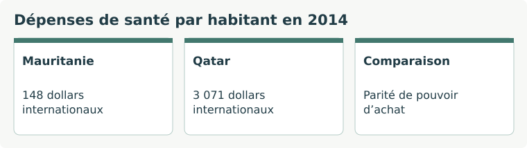

# Banque PT — Langue vivante A 2019 · Corrigé guidé

*Corrigé rédigé par IA, non officiel.*

**Rédaction** · GPT-6.2 Astra Ultra · vitesse non renseignée

L’épreuve dure trois heures. Chaque candidat compose dans la langue choisie à l’inscription. Ce fascicule présente les cinq synthèses de 450 à 500 mots. Le décompte indiqué inclut le titre.

## Allemand

*Eine Zukunft ohne Fleisch?*

### Construire la synthèse

Distinguer remplacer une protéine, conserver la forme d’un plat et continuer de produire un tissu animal. La comparaison des calories éclaire l’usage des ressources, celle des grammes quotidiens éclaire les habitudes.

**Document 1** · Die Zeit présente des aliments issus de cultures cellulaires et les limites économiques et éthiques soulevées par les entreprises.

**Document 2** · La Hannoversche Allgemeine Zeitung explique l’attachement à la forme des plats et le débat sur le nom des produits végétariens.

**Document 3** · GEO compare le rôle nutritionnel des légumineuses à leurs effets sur les sols, l’azote et les pollinisateurs.

**Document 4** · Le schéma sur le blé compare les calories végétales nécessaires par calorie obtenue selon la destination.

**Document 5** · Les extrêmes régionaux de consommation de viande et de charcuterie, en grammes par jour, sont donnés séparément par sexe.

### Proposition rédigée

**Was vom Fleisch bleiben könnte**

Würde eine Zukunft ohne herkömmliche Tierhaltung auch eine Zukunft ohne Wurst, Sonntagsbraten und Fisch bedeuten? Die Dokumente unterscheiden mehrere Veränderungen, die unter dem Begriff Fleischverzicht leicht zusammenfallen. Man kann pflanzliche Lebensmittel anders verwenden, vertraute Gerichte nachbilden oder tierisches Gewebe unabhängig von der Aufzucht ganzer Tiere herstellen. Wie viel sich dadurch ändern würde, hängt sowohl vom Ressourcenverbrauch als auch von den Erwartungen der Menschen an ihre Mahlzeiten ab.

Zunächst spricht die Verwendung landwirtschaftlicher Erträge dafür, mehr Nahrung unmittelbar für Menschen anzubauen. Das Schaubild der Ethikpartei vergleicht den Kalorienertrag von Weizen je nach Verwendung. Beim Brot wird das Verhältnis mit eins zu eins angegeben, beim Rindfleisch mit achtzehn zu eins. Wer Getreide verfüttert, erhält also in diesem Vergleich einen erheblich kleineren Teil seiner Energie als menschliche Nahrung zurück. GEO beschreibt mit Hülsenfrüchten eine Alternative, die auch Eiweiß liefert. Bohnen oder Linsen bereichern die Fruchtfolge, kommen mit weniger mineralischem Stickstoffdünger aus und bieten mit ihren Blüten Insekten Nahrung. Diese Vorteile betreffen den Acker und das Wasser ebenso wie die Zusammensetzung des Essens.

Der Übergang wäre allerdings eine erhebliche Veränderung eingespielter Gewohnheiten. Laut Fleischatlas liegen die angegebenen regionalen Durchschnittswerte für Männer zwischen 147 und 172 Gramm Fleisch und Wurst täglich, für Frauen zwischen 72 und 95 Gramm. Die Unterschiede widersprechen der Vorstellung eines einheitlichen deutschen Verbrauchers. Zugleich erklärt die Hannoversche Allgemeine Zeitung, weshalb manche Menschen, die aus ökologischen oder ethischen Gründen weniger Fleisch essen wollen, weiterhin nach Würstchen verlangen. An die Form eines Gerichts knüpfen Erinnerungen an Familienfeste oder Grillabende an. Der Streit über die Bezeichnung vegetarischer Produkte betrifft deshalb auch die Möglichkeit, vertraute Rituale unter veränderten Bedingungen fortzuführen.

Eine andere Antwort würde die Bedeutung von Fleisch selbst verschieben. Die Zeit berichtet über Unternehmen, die tierisches Gewebe für Lebensmittel kultivieren. Vom frühen, wenig überzeugenden Burger bis zu weiteren Gerichten sind Fortschritte erkennbar, und ein Unternehmen will den Ansatz auf Fisch übertragen. Doch eine gelungene Kostprobe beantwortet noch nicht die Frage, ob ein solches Produkt im Alltag bezahlbar wäre. Zudem steht der Einsatz eines teuren tierischen Serums im Widerspruch zum Anspruch, Tiere zu schonen. Die Unternehmer müssen daher sowohl wirtschaftlich als auch ethisch zeigen, dass ihr Angebot die Versprechen einlösen kann.

Eine Zukunft mit geringerem Verbrauch konventionellen Fleisches erscheint angesichts dieser verschiedenen Wege eher vorstellbar als das vollständige Verschwinden jeder Fleischmahlzeit. Wer Linsen kocht, wer eine vegetarische Wurst kauft und wer künftig kultivierten Fisch wählen würde, trifft jeweils eine andere Entscheidung. Die erste verändert die Wahl der Zutaten, die zweite bewahrt die Gestalt eines vertrauten Essens, die dritte dessen tierischen Ursprung. Welche davon sich verbreitet, entscheidet sich dort, wo Geschmack, kulturelle Bindung, Preis und tatsächliche ökologische Entlastung zusammenkommen. Der geringe bisherige Verbrauch von Hülsenfrüchten in Deutschland zeigt, wie groß der Abstand zwischen ernährungswissenschaftlichem Argument und alltäglicher Praxis sein kann.

**(459 Wörter, einschließlich Titel)**

## Anglais

*Addressing mass incarceration issues in the US: towards a better and fairer system?*

### Construire la synthèse

Suivre la trajectoire de la personne avant, pendant et après la détention. Dater le texte sur la proposition de réforme ; les chiffres décrivant les prisons fédérales ne caractérisent pas tous les établissements.

**Document 1** · Vogue relie une sortie de détention à l’histoire de politiques pénales suivies sous des présidents de différents partis et aux disparités raciales.

**Document 2** · USA Today rend compte des soutiens contradictoires et des critiques du projet de First Step Act au moment de sa discussion.

**Document 3** · CNN distingue les prisons fédérales des prisons des États et des établissements locaux ; les infractions liées aux drogues n’y ont pas le même poids.

**Document 4** · Les taux de chômage sont comparés pour les 35–44 ans selon les antécédents de détention, le sexe et le groupe racial.

**Document 5** · Adam Zyglis transforme les bandes du drapeau américain en barreaux. Le titre emprunté à l’hymne met la promesse de liberté à l’épreuve.

### Proposition rédigée

**What counts as a second chance?**

Outside a Brooklyn detention facility, a young man asks a photographer to record the moment he regains his freedom. The encounter in Vogue raises a question that the national prison count cannot answer. What does release mean if employment and housing remain out of reach? Accounts of American incarceration connect that question to racial inequality, the limits of federal legislation and disagreements about what public safety requires.

Decades of punitive policies helped turn imprisonment into a response to a wide range of offences. Vogue traces their expansion across administrations of both parties. It also points to the striking gap between Black and white Americans’ chances of arrest for drug offences despite comparable levels of drug use. CNN qualifies any explanation based solely on drug sentencing. Drug offences account for a large share of the federal prison population, but the vast majority of incarcerated Americans are held in state prisons or local jails, where that share is considerably smaller. National numbers have begun to fall, and the racial gap has narrowed on some measures, without making either the scale or the unequal distribution of imprisonment disappear.

Zyglis’s cartoon places prisoners behind bars formed by the stripes of the American flag. The national anthem’s celebration of freedom becomes a question about who can claim it. The unemployment figures give that question a life beyond the prison gates. Among people aged 35 to 44, the formerly incarcerated have much higher unemployment rates than the corresponding general population. The figure reaches 43.6 per cent for formerly incarcerated Black women, compared with 18.4 per cent for formerly incarcerated white men. Even the latter group faces a substantial disadvantage. The pattern helps explain why a person who has served a sentence may still struggle to rejoin the economy, and why the effects reach families and communities as well as individuals.

USA Today describes an unusual coalition behind the proposed First Step Act. President Trump, legislators from both parties and civil rights advocates find common ground in giving judges greater discretion in some nonviolent cases and improving rehabilitation. Supporters see job training and treatment as more productive than repeated imprisonment. Yet agreement on a bill does not amount to agreement on the problem. Some conservatives fear that greater leniency could release dangerous offenders. Other critics argue that better prison programmes do too little to address racism, poverty or the decisions that bring people into custody in the first place.

A fairer system would therefore have to be judged at more than one point. Federal sentencing reform can matter to those it reaches while leaving much of the state system untouched. A falling prison population is significant, but the ability to find work after release also measures whether a second chance has become a practical possibility.

**(464 words, title included)**

## Arabe

*انطلاقاً من الوثائق الخمس التالية، ماذا يمكن استنتاجه من طبيعة التحديات التي يواجهها العالم العربي في ميدان الحق في الصحة؟*

### Construire la synthèse

Distinguer moyenne nationale et accès local. Rapprocher la fragilité de l’abri de l’inégale répartition des soins, puis montrer avec la Gezira comment une organisation locale peut modifier l’accès à la maternité.

**Document 1** · Le premier texte présente les obligations et principes internationaux relatifs au droit à la santé et à l’accès aux soins.

**Document 2** · Le diagnostic tunisien oppose la centralisation des ressources aux besoins des habitants des régions périphériques.

**Document 3** · Au Soudan, l’université de la Gezira associe personnels formés, structures locales et suivi de la mortalité maternelle et néonatale.

**Document 4** · Les tableaux de l’OMS comparent dépenses par habitant, part du PIB et résultats de santé au Qatar et en Mauritanie, avec années et unités distinctes.

**Document 5** · Le dessin marocain représente une famille sous la pluie. L’inscription « couverture sanitaire » sur un abri de carton interroge la réalité de la protection.

### Proposition rédigée

**الحق في الصحة بين النص والمسافة إلى العلاج**

قد يقر القانون لكل إنسان حقا في الصحة ويظل الوصول إلى طبيب أو إلى مكان آمن للولادة أمرا بالغ الصعوبة. تجمع الوثائق بين نص يحدد معنى الحق وشهادات وبيانات تكشف ما يلزم لتحويله إلى خدمة يومية. فلا يكفي أن يكون العلاج ممكنا في بلد ما إذا كانت كلفته أو بعد المستشفى أو نقص العاملين فيه يحرم منه بعض السكان. وما يشترك فيه سكان الدول العربية من مطالب إنسانية لا يلغي اتساع الفروق داخل البلد الواحد وبين البلدان.

يربط النص الأول الحق في الصحة بالمبادئ التي أقرتها الهيئات الدولية. والمقصود حماية الإنسان وإتاحة وسائل الوقاية والرعاية له من غير تمييز. وتكشف التجربة التونسية أهمية الشق المتعلق بالتوزيع. فتركيز التجهيزات والخدمات في مناطق معينة يجعل المريض في الجهات الداخلية يواجه عوائق لا تظهر حين ينظر المرء إلى عدد المؤسسات في البلاد كلها. وقد تكون الخدمة موجودة رسميا ومع ذلك تظل بعيدة عن الأسرة التي تحتاج إليها. وفي الرسم المغربي يحمل والدان فوق رأسيهما صندوقا يحمل عبارة التغطية الصحية، فيما ينزل المطر عليهما وعلى طفلهما. يحول الرسام كلمة التغطية إلى سقف واه ليتساءل عما يحصل عليه الفقراء فعلا من حماية.

وتظهر جداول منظمة الصحة العالمية بعدا آخر للتفاوت. ففي موريتانيا تدور توقعات العمر عند الولادة في منتصف الستينات للنساء والرجال، بينما تصل في قطر إلى أواخر السبعينات أو إلى الثمانين تقريبا. ويعرض الجدول كذلك فارقا كبيرا في النفقات الصحية للفرد. لكن ترتيب البلدين بحسب حصة الصحة من الناتج المحلي لا يطابق ترتيبهما بحسب الإنفاق على الفرد. فالنسبة تنسب الإنفاق إلى حجم اقتصاد مختلف في كل حالة. ولا تثبت المقارنة وحدها أن الفارق في مؤشر واحد يفسر كل فارق في النتائج أو أن كل مواطن ينتفع بالمتوسط الوطني نفسه.

وتقدم تجربة جامعة الجزيرة في السودان مثالا على إمكان التحسين حتى في مجال يتطلب متابعة دقيقة. فقد ارتبطت جهود خفض وفيات الأمهات والمواليد بتدريب القابلات ورفع قدرات الطواقم وتحسين التجهيزات والتعاون بين الجامعة والجهات الصحية والمجتمعية. وحين تصل القابلة المدربة إلى قرية بعيدة يتغير معنى توفر الخدمة لسكانها. ويورد التقرير انخفاض عدد وفيات الأمهات بين عامي ألفين وخمسة وألفين وخمسة عشر في التجربة المعروضة. وتظل هذه الأرقام مرتبطة بالمكان والفترة وبطبيعة المؤشر، فلا يصح تعميم النتيجة على السودان كله ولا الخلط بين عدد الحالات ومعدل الوفيات.

يتخذ التحدي إذن أكثر من صورة. فثمة موارد ينبغي تعبئتها، وخدمات ينبغي توزيعها على نحو منصف، ومعلومات يلزم قراءتها بمراعاة الفئات التي قد تحجبها المتوسطات. كما أن مشاركة المؤسسات التعليمية والمجتمع المحلي في السودان تبرز قيمة العمل المنظم، بينما تنبه الحالة التونسية ورسم الأسرة تحت المطر إلى حدود الوعود إذا تركت المناطق والفئات الأضعف من دون رعاية فعلية. وفي النهاية تقاس قيمة الحق بقدرة شخص بعينه على الحصول على الخدمة التي يحتاج إليها في الوقت والمكان المناسبين. ويدخل في هذا التقييم أيضا ما إذا كانت الأسرة مضطرة إلى ترك منطقتها أو تحمل نفقة لا تطيقها لمجرد الوصول إلى الطبيب.

**(458 كلمة، بما فيها العنوان)**

## Espagnol

*¿En qué medida el desarrollo sostenible es un desafío para el siglo XXI?*

### Construire la synthèse

Passer de la définition aux arbitrages concrets entre usages du sol. Vérifier les résultats à plusieurs échelles et distinguer l’objectif annoncé de ce qui a déjà changé.

**Document 1** · El País rapporte l’extension des cultures et des pâturages, les pertes de forêt au Mexique et des engagements régionaux à l’horizon 2030.

**Document 2** · L’entretien d’eldiario.es articule économie, écologie et société et pointe la faiblesse des mécanismes d’application des engagements climatiques.

**Document 3** · Le texte guatémaltèque expose l’Agenda 2030 et relie les décisions publiques aux changements de consommation.

**Document 4** · Le musée imaginé par Forges expose un arbre comme un objet archéologique du XXIe siècle sous les yeux d’un adulte et d’un enfant.

**Document 5** · L’infographie chilienne distingue déchets produits, recyclage et obstacles pratiques, notamment l’insuffisance des conteneurs et des points de collecte.

### Proposition rédigée

**Del árbol en el museo al bosque vivo**

Un niño contempla con un adulto un árbol expuesto en la sala del siglo XXI de un museo arqueológico. La viñeta de Forges imagina el fracaso de una generación que habría conservado un ejemplar como pieza de colección después de perder su entorno. El desarrollo sostenible plantea precisamente la pregunta contraria. ¿Qué decisiones permiten satisfacer las necesidades presentes sin privar a quienes vengan después de los recursos para vivir? Los documentos muestran que la respuesta depende tanto de las prioridades económicas como de la capacidad de gobiernos y ciudadanos para llevarlas a la práctica.

La deforestación mexicana permite observar el conflicto sobre el terreno. El País cifra en unas doscientas cincuenta mil hectáreas la pérdida de bosque en 2016 y señala la expansión de la ganadería y de determinados cultivos. Una superficie dedicada a esas actividades puede generar ingresos inmediatos, pero el bosque que desaparece sostenía la biodiversidad y prestaba servicios a la agricultura y a las ciudades. La entrevista de eldiario.es ayuda a comprender por qué el problema no se resuelve calculando únicamente el rendimiento de la nueva explotación. El bienestar económico, las relaciones sociales y la capacidad de los ecosistemas para seguir funcionando son dimensiones que pueden entrar en tensión.

La Agenda 2030 intenta convertir esa interdependencia en objetivos comunes. El artículo guatemalteco recuerda que sus diecisiete objetivos abarcan también la pobreza, la salud, la educación y el trabajo. Establecer metas y plazos permite pedir cuentas. Sin embargo, el entrevistado subraya la debilidad de los compromisos climáticos asumidos en París y la falta de mecanismos para asegurar su cumplimiento. En México, la promesa de los gobernadores de la península de Yucatán de acabar con la deforestación para 2030 tendrá que juzgarse por la evolución del bosque. Un anuncio político y un resultado ambiental se miden de maneras diferentes.

La infografía chilena lleva esta dificultad a la vida cotidiana. Cada habitante genera, en promedio, más de un kilo de basura al día, y alrededor de ocho de cada diez no reciclan habitualmente. La falta de contenedores y de lugares de recogida aparece por delante de la falta de tiempo entre las explicaciones recogidas. Reducir, reutilizar y reciclar requieren decisiones personales, pero también servicios accesibles. A su vez, la crítica al consumo excesivo de los más acomodados impide asignar idéntica responsabilidad a hogares que apenas cubren sus necesidades.

Así, las decisiones colectivas y las individuales actúan en escalas distintas y se condicionan entre sí. Una infraestructura adecuada facilita que una intención se convierta en hábito, y las políticas económicas determinan si conservar un ecosistema resulta viable para quienes dependen de él. El árbol del museo recuerda qué está en juego cuando se confunde el reconocimiento público de un problema con su solución efectiva.

**(461 palabras, incluido el título)**

## Italien

*In che misura dopo 30 anni e varie evoluzioni Erasmus rimane un’opportunità per i giovani e i meno giovani di tutto il mondo?*

### Construire la synthèse

Distinguer flux entrants et sortants, puis comparer séjour d’études et stage. Séparer statistique d’insertion, promesse individuelle et propositions de réforme.

**Document 1** · Il Sole 24 Ore retrace trente ans d’échanges, l’extension du programme et la formation d’une génération européenne.

**Document 2** · Le Corriere compare les flux d’entrée et de sortie en Italie et analyse les obstacles de langue, de logement et de coût.

**Document 3** · Le débat de Florence juxtapose les partenariats et formations existants avec des propositions pour les jeunes élèves et futurs enseignants.

**Document 4** · Le profil italien distingue mobilités pour études et pour stage : âges, durée, bourses et répartition des participants.

**Document 5** · Le visuel de la Commission européenne relie expérience de mobilité, compétences recherchées et offres d’emploi après le stage.

### Proposition rédigée

**Erasmus oltre il semestre all’estero**

Un periodo di studio in un’altra università è la forma più conosciuta di Erasmus, ma non esaurisce ciò che il programma è diventato in trent’anni. Tra studio, tirocinio e cooperazione fra insegnanti, la mobilità modifica sia le possibilità professionali sia il modo di sentirsi europei. Per valutare a chi sia realmente accessibile questa opportunità occorre tuttavia distinguere l’entusiasmo per il viaggio dalle condizioni che consentono di partire, di essere accolti e di utilizzare l’esperienza al ritorno.

Il Sole 24 Ore ricorda i milioni di studenti che dal lancio del programma hanno studiato oltreconfine. La definizione di una generazione europea riguarda anzitutto incontri concreti. Amicizie, coppie e famiglie collegano luoghi che per i genitori potevano restare lontani, e lo studio di un’altra lingua acquista un significato quotidiano. Il profilo italiano pubblicato dall’Agenzia nazionale distingue però due esperienze. Chi si sposta per studiare ha in media ventitré anni, chi parte per un tirocinio venticinque. Le donne sono la maggioranza in entrambi i gruppi, con il cinquantanove per cento nella mobilità per studio e il sessantatré per cento nei tirocini. Il programma, dunque, interessa fasi e finalità diverse della formazione.

Anche la Commissione europea mette in relazione mobilità e lavoro. Fra le qualità che le aziende apprezzano compaiono curiosità e capacità di affrontare problemi nuovi. Circa un tirocinante europeo su tre riceve un’offerta dall’azienda ospitante. È un possibile ponte verso il lavoro, non la garanzia che ciascun partecipante venga assunto. Analogamente, i confronti sul rischio di disoccupazione descrivono differenze tra gruppi e contesti nazionali. Il valore delle competenze acquisite dipende anche dalle imprese e dall’economia in cui saranno utilizzate.

L’Italia rende visibile la distanza fra il desiderio di muoversi e la scelta della destinazione. Secondo il Corriere, il paese manda all’estero più studenti di quanti ne accolga e figura soltanto al quinto posto tra le mete considerate. Patrimonio e paesaggio non compensano necessariamente il costo della vita, la difficoltà di trovare una stanza e l’ostacolo della lingua dei corsi. Al Politecnico di Milano l’ampliamento dell’offerta in inglese si accompagna a una crescita degli iscritti internazionali. Le decisioni delle università contribuiscono pertanto a determinare chi può approfittare della mobilità.

Il dibattito di Firenze indica infine sviluppi che coinvolgono persone al di fuori del tradizionale semestre universitario. Alla collaborazione tra scuole e alla formazione all’estero dei docenti si affiancano proposte per allargare le opportunità ai più piccoli e ripristinare l’assistentato per futuri insegnanti. Bisogna distinguere questi progetti dalle iniziative già realizzate. Ciò che resta del principio originario è la possibilità di imparare lavorando o studiando con persone di un altro paese. Perché possa estendersi a età e provenienze più varie, alla promessa di partire devono corrispondere sostegno materiale, istituzioni pronte ad accogliere e occasioni per valorizzare l’esperienza acquisita.

**(458 parole, titolo compreso)**
