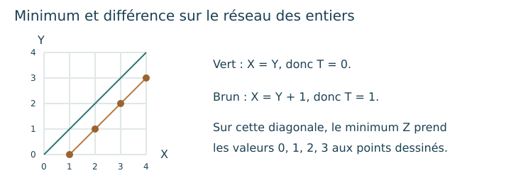

# Banque PT — Mathématiques A · 2019 · Corrigé brut

*Corrigé rédigé par IA, non officiel. Signalez toute erreur.*

**Rédaction** · GPT-6.2 Astra Ultra · vitesse non renseignée

Le problème étudie les matrices réelles antisymétriques, leurs liens avec les rotations et la parité de leur rang. Les questions P portent sur une loi conjointe définie sur les entiers naturels à partir de zéro. Dans la partie II, l’angle nul demande un traitement particulier.

## Algèbre, partie I · Une matrice antisymétrique en dimension trois

### Question I.1

La matrice envoie $e_1$ sur $-e_3$, $e_2$ sur zéro et $e_3$ sur $e_1$. Ainsi $A^2=\operatorname{diag}(-1,0,-1)$ et $A^2+I_3=\operatorname{diag}(0,1,0)$, de rang un. Elle n’est donc pas inversible.

### Question I.2

Le plan $(e_1,e_3)$ est stable, avec pour matrice $\left(\begin{smallmatrix}0&1\\-1&0\end{smallmatrix}\right)$, dont le polynôme caractéristique est $X^2+1$. La droite $\mathbb R e_2$ est annulée. Ainsi le polynôme caractéristique de $A$ est $X(X^2+1)$ et ses racines complexes sont $0,i,-i$.

### Question I.3

Sur $\mathbb R$, le polynôme caractéristique n’est pas scindé, donc $A$ ne se diagonalise pas. Sur $\mathbb C$, ses trois racines distinctes donnent trois vecteurs propres indépendants et une diagonalisation.

### Question I.4

Prenons la base $(e_1,e_3,e_2)$. Les images calculées en I.1 montrent que la matrice y est $B=\left(\begin{smallmatrix}0&1&0\\-1&0&0\\0&0&0\end{smallmatrix}\right)$. Si $P=[e_1\ e_3\ e_2]$, alors $B=P^{-1}AP$. Cela établit la similitude sur $\mathbb R$.

## Algèbre, partie II · Matrices antisymétriques et rotations

### Question II.1

La matrice nulle est antisymétrique. Si $A^T=-A$, $B^T=-B$ et $a,b\in\mathbb R$, alors $(aA+bB)^T=aA^T+bB^T=-(aA+bB)$. L’ensemble est donc un sous-espace vectoriel de $\mathcal M_n(\mathbb R)$.

### Question II.2

La relation $a_{ij}=-a_{ji}$ impose $a_{ii}=0$. En posant $\alpha=a_{32}$, $\beta=a_{13}$ et $\gamma=a_{21}$, on obtient
$$
A=\begin{pmatrix}0&-\gamma&\beta\\\gamma&0&-\alpha\\-\beta&\alpha&0\end{pmatrix}.
$$
Ces trois réels sont arbitraires, et toute matrice ainsi construite est antisymétrique.

### Question II.3

Avec $E_{ij}$ pour les unités matricielles, une base est $E_{32}-E_{23},\, E_{13}-E_{31},\, E_{21}-E_{12}$. La formule de II.2 donne la génération. Les entrées $(3,2),(1,3),(2,1)$ montrent que les trois coefficients d’une combinaison nulle sont nuls. La dimension vaut donc $3$.

### Question II.4

On a $\det A=\det A^T=\det(-A)=(-1)^3\det A=-\det A$. Ainsi $\det A=0$.

### Question II.5

Pour $w=(\alpha,\beta,\gamma)$ et $v=(x,y,z)$, le produit $w\wedge v$ vaut $(\beta z-\gamma y,\gamma x-\alpha z,\alpha y-\beta x)=Av$. Réciproquement les trois coefficients de II.2 se lisent dans la matrice, donc $w$ est unique.

### Question II.6.a

$R$ est orthogonale, donc $R^{-1}=R^T$. On a $(R-R^{-1})^T=R^{-1}-R$, ce qui donne l’antisymétrie.

### Question II.6.b

Par II.5, $w=0$ équivaut à $R=R^{-1}$, donc à $R^2=I$. Une rotation d’angle $\varphi$ vérifie cette condition exactement pour $\varphi=0$ ou $\pi$ modulo $2\pi$. L’introduction de la question II.6 exclut $\pi$ seulement. L’identité, d’angle nul, fournit donc un contre-exemple à la conclusion imprimée. Pour toute rotation **non identique** soumise à l’hypothèse du sujet, on a bien $w\ne0$. Les conclusions qui emploient $w/\|w\|$ se placent dans ce cas.

### Question II.6.c

Si $r(v)=v$, alors $r^{-1}(v)=v$ et $u(v)=r(v)-r^{-1}(v)=0$. Lorsque $w\ne0$, le noyau de $v\mapsto w\wedge v$ est $\mathbb Rw$. La droite des vecteurs fixes de la rotation non identique est donc dirigée par $w$. Pour l’identité, tous les vecteurs sont fixes.

### Question II.6.d.i

Dans la base orthonormée directe $(e_1,e_2,e_3)$ avec $e_3=w/\|w\|$, posons $c=\cos\theta$, $s=\sin\theta$. Les matrices de $r$ et $r^{-1}$ sont respectivement
$$
\begin{pmatrix}c&-s&0\\s&c&0\\0&0&1\end{pmatrix},\qquad
\begin{pmatrix}c&s&0\\-s&c&0\\0&0&1\end{pmatrix}.
$$

### Question II.6.d.ii

Comme $w=\|w\|e_3$, $u(e_1)=\|w\|e_2$, $u(e_2)=-\|w\|e_1$ et $u(e_3)=0$. La matrice de $u$ est donc $\left(\begin{smallmatrix}0&-\|w\|&0\\\|w\|&0&0\\0&0&0\end{smallmatrix}\right)$.

### Question II.6.d.iii

En soustrayant les deux matrices de i et en comparant à ii, on obtient $2\sin\theta=\|w\|>0$. Ainsi $0<\theta<\pi$ et la trace vaut $1+2\cos\theta$ dans toute base. Par conséquent $\theta=\arccos((\operatorname{tr}R-1)/2)$ pour cette orientation.

### Question II.6.e

Posons $e=(1,1,1)^T/\sqrt3$. La matrice imprimée s’écrit $ee^T+K$, où $Kx=e\wedge x$, comme le montre la comparaison des neuf coefficients. Elle fixe $e$ et, sur $e^\perp$, agit par le quart de tour direct $K$ (pour unitaire $u\perp e$, $u\mapsto e\wedge u\mapsto-u$). C’est donc une rotation. De plus $R-R^T=2K$, ce qui donne $w=2e$. Sa trace vaut $1$, donc son angle est $\pi/2$ autour de l’axe orienté $(1,1,1)$.

## Algèbre, partie III · Transformation de Cayley

### Question III.1

Le produit $X^TBX$ est de taille $1\times1$. Sa transposée vaut $X^TB^TX$, d’où l’égalité. Pour $B=A$ antisymétrique, cela donne $X^TAX=-X^TAX$, donc $X^TAX=0$.

### Question III.2

Si $(A+I)X=0$, on a d’une part $X^T(A+I)X=0$, et d’autre part $X^T(A+I)X=X^TAX+X^TX=\|X\|^2$. Donc $X=0$.

### Question III.3

Par III.2 le noyau de $A+I$ est nul. Cette matrice carrée est donc inversible.

### Question III.4

$I-A=(I+A)^T$ est également inversible. Pour $B=(I-A)(I+A)^{-1}$, on obtient $B^T=(I-A)^{-1}(I+A)$. Les matrices $I-A,I+A$ commutent puisqu’elles sont polynomiales en $A$, et leurs inverses commutent aussi avec elles. Ainsi $B^TB=I$, donc $B$ est orthogonale.

### Question III.5

$(I+B)(I+A)=I+A+I-A=2I$. Puisque $I+A$ est inversible, $I+B=2(I+A)^{-1}$ est inversible d’inverse $(I+A)/2$.

### Question III.6

En transposant l’équation, $C^T(I+B^{-1})=I-B^{-1}$. Cela donne d’abord $C^T=I-B^{-1}-C^TB^{-1}$. En multipliant la première égalité à droite par $B$, on obtient $C^T(I+B)=B-I$. Or $C=(I+B)^{-1}(I-B)$ commute avec $B$, de sorte que $C(I+B)=I-B$. Comme $I+B$ est inversible, il vient $C^T=-C$.

## Algèbre, partie IV · Noyau, image et parité du rang

### Question IV.1

$Y^TY=(AX)^TY=X^TA^TY=-X^TAY=0$ puisque $AY=0$. Sur le corps réel cela entraîne $Y=0$.

### Question IV.2

Si $Y\in\operatorname{Im} f\cap\ker f$, on peut écrire $Y=AX$ avec $AY=0$. Par IV.1, $Y=0$. Le théorème du rang donne $\dim\operatorname{Im}f+\dim\ker f=n$. Ainsi $\mathbb R^n=\operatorname{Im} f\oplus\ker f$.

### Question IV.3

L’image est stable car $f(fx)\in\operatorname{Im}f$. La restriction à l’image a pour noyau $\operatorname{Im}f\cap\ker f=0$. Endomorphisme injectif d’un espace fini, elle est inversible. Dans une base de l’image complétée par une base du noyau, la matrice est $\operatorname{diag}(C,0)$, avec $C$ inversible d’ordre $\operatorname{rg}A$. Si $A=0$, la partie image est de dimension zéro et le bloc est vide.

### Question IV.4

Avec $X^*=\overline X^T$, $AX=\lambda X$ donne $X^*AX=\lambda\|X\|^2$. Le même scalaire vaut $-(AX)^*X=-\bar\lambda\|X\|^2$ car $A^*=-A$. Comme $X\ne0$, $\lambda=-\bar\lambda$. Sa partie réelle est nulle.

### Question IV.5

Si $m=\dim\ker f$, la forme par blocs donne $\chi_A(t)=t^m\chi_C(t)$. Pour $\lambda\ne0$, cette expression s’annule si et seulement si $\chi_C(\lambda)=0$. Les valeurs propres non nulles sont donc les mêmes, avec leurs multiplicités.

### Question IV.6

Les valeurs propres de $C$ sont non nulles puisqu’elle est inversible. Par IV.4–5 elles sont imaginaires pures et non réelles. Le polynôme caractéristique de la matrice réelle $C$ a donc des racines formant des paires conjuguées de même multiplicité. Son degré est pair. Il s’agit de l’ordre de $C$, donc aussi du rang de $A$.

## Probabilités · Une loi sur les couples d’entiers naturels

### Question P.1

La somme de la loi vaut $\alpha(\sum_{k\ge0}2^{-k})^2=4\alpha$. Elle doit être égale à un, d’où $\alpha=1/4$.

### Question P.2

En sommant sur $\ell$, $\mathbb P(X=k)=2^{-k-1}$. De même $\mathbb P(Y=\ell)=2^{-\ell-1}$. Leur produit est $2^{-k-\ell-2}$, exactement la probabilité conjointe pour chaque couple. Donc $X,Y$ sont indépendantes.

### Question P.3

Pour $|x|<1$, $\sum_{k\ge0}x^k=(1-x)^{-1}$. La dérivation terme à terme d’une série entière est valable à l’intérieur du disque de convergence. Une puis deux dérivations donnent $\sum_{k\ge1} kx^{k-1}=(1-x)^{-2}$ et $\sum_{k\ge2} k(k-1)x^{k-2}=2(1-x)^{-3}$.

### Question P.4

Avec $x=1/2$, P.3 donne $\mathbb EX=\tfrac12 x/(1-x)^2=1$ et $\mathbb E[X(X-1)]=\tfrac12\,2x^2/(1-x)^3=2$. Ainsi $\mathbb E[X^2]=3$ et $\operatorname{Var}X=2$. Les moments existent et l’indépendance entraîne $\operatorname{Cov}(X,Y)=0$.

### Question P.5

$\mathbb P(X\ge n)=\sum_{k=n}^\infty 2^{-k-1}=2^{-n}$ pour tout $n\ge0$.

### Question P.6

Pour $Z=\min(X,Y)$, $\mathbb P(Z\ge n)=\mathbb P(X\ge n)\mathbb P(Y\ge n)=4^{-n}$. Par différence, $\mathbb P(Z=n)=(3/4)4^{-n}$ pour $n\ge0$.

### Question P.7

On a $\mathbb P(X=Y)=\sum_{j\ge0}4^{-j-1}=1/3$. Par symétrie, $\mathbb P(X<Y)=(1-1/3)/2=1/3$. Pour $r=a/b>0$ irréductible, les couples de l’événement $X=rY$ sont exactement $(aj,bj)$ avec $j\ge0$, origine comprise. Donc
$$
\mathbb P(X=rY)=\frac{1}{4(1-2^{-(a+b)})}.
$$
Si « positif » inclut $r=0$, ce dernier cas donne $\mathbb P(X=0)=1/2$, également obtenu avec $a=0,b=1$.

### Question P.8

Le support de $(Z,T)$ est $\mathbb N\times\mathbb Z$. À $(z,t)$ correspond un unique couple $(X,Y)=(z+\max(t,0),z+\max(-t,0))$. Donc
$$
\mathbb P(Z=z,T=t)=\tfrac14\,4^{-z}2^{-|t|}.
$$
En sommant sur $z$, $\mathbb P(T=t)=2^{-|t|}/3$. Le produit de cette loi et de $\mathbb P(Z=z)=(3/4)4^{-z}$ redonne la loi conjointe. Donc $Z,T$ sont indépendantes.

### Question P.9

Conditionnellement à $X=k$, $Y$ conserve sa loi par indépendance, et $Z=\min(k,Y)$. Pour $0\le j<k$, la probabilité conditionnelle $\mathbb P(Z=j\mid X=k)=2^{-j-1}$. En $j=k$, elle vaut $\mathbb P(Y\ge k)=2^{-k}$. Elle est nulle ailleurs. Cela inclut $k=0$, où $Z=0$ presque sûrement.

## Sources et rapport du jury

Le rapport 2019, p. 1–2, distingue les invariants de similitude d’une preuve de similitude et rappelle la nécessité de vérifier qu’une famille est libre. Sa première rubrique nommée « Partie III » décrit en fait la partie II de l’énoncé. À la p. 3, il relève que deux événements décrivant le minimum peuvent se recouvrir. L’exception de la rotation identité en II.6.b provient de notre lecture du sujet.

[Énoncé de la Banque PT](https://www.banquept.fr/documents/2019/math_a_2019_pt.pdf) · [Rapport du jury](https://www.banquept.fr/documents/ecrit/rapport/2019/rapport_math_a_ecrit_2019.pdf)
