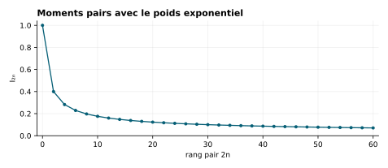
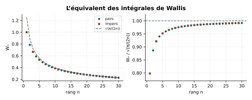

# Banque PT — Mathématiques C · Session 2019 · Corrigé brut

*Corrigé rédigé par IA, non officiel. Signalez toute erreur.*

**Rédaction** · GPT-6.2 Astra Ultra · vitesse non renseignée

Le préambule fixe les identités trigonométriques. La partie I étudie des moments à poids exponentiel. La partie II relie une intégrale paramétrée, une équation différentielle et les intégrales de Wallis.

Écrit de quatre heures, sans calculatrice. La grille d’admissibilité attribue à Math C le coefficient 6 pour l’École polytechnique et 3 pour chacune des ENS Paris-Saclay et Rennes. [Sujet](https://www.banquept.fr/documents/2019/math_c_2019_pt.pdf) · [Livret, p. 12](https://www.banquept.fr/documents/livret/2019/Livret_PT_2019.pdf#page=12)

Le rapport, pages 3–4 et 7–8, demande de justifier les bords des intégrations par parties, d’identifier les deux suites de coefficients et de déduire leur équivalence du quotient établi. [Rapport du jury](https://www.banquept.fr/documents/ecrit/rapport/2019/rapport_math_c_ecrit_2019.pdf)

## Préambule. Arctangente et demi-angle

### Question P.1

Sur $]0,+\infty[$, $h'(x)=1/(1+x^2)-(1/x^2)/(1+1/x^2)=0$. Comme cet ensemble est un intervalle, $h$ y est constante. En $x=1$, $h(1)=2\arctan(1)=\pi/2$.

### Question P.2.a

Pour $0\le t\le\pi/2$, $\cos t=\cos^2(t/2)-\sin^2(t/2)=2\cos^2(t/2)-1$.

### Question P.2.b

Comme $\cos(t/2)\ne0$, on a $1+\tan^2(t/2)=(\cos^2(t/2)+\sin^2(t/2))/\cos^2(t/2)=1/\cos^2(t/2)$. Les deux expressions comparées sont donc égales.

### Question P.2.c

Pour $u=\tan(t/2)$, on obtient $\cos t=2/(1+u^2)-1=(1-u^2)/(1+u^2)$. Lorsque $t$ parcourt $[0,\pi/2]$, $u$ parcourt $[0,1]$.

## I. Moments trigonométriques à poids exponentiel

### Question I.1.a

Avec la convention $\sin^0 x=1$, on a pour tout entier $n\ge0$ la borne $|e^{-x}\sin^n x|\le e^{-x}$. L’intégrande est continu et le majorant est intégrable sur $[0,+\infty[$. Donc $I_n$ converge absolument.

### Question I.1.b

On a $I_0=\int_0^\infty e^{-x}dx=1$.

### Question I.1.c

Une primitive de $e^{(-1+i)x}$ est $e^{(-1+i)x}/(-1+i)$. Comme $1/(-1+i)=(-1-i)/2$, sa partie réelle est $e^{-x}(\sin x-\cos x)/2$. Sa dérivée vaut bien $e^{-x}\cos x$.

### Question I.1.d

Posons $u(x)=\sin^n x$ pour $n\ge2$. On a $u(0)=u'(0)=0$ et $u,u'$ sont bornées à l’infini. Deux intégrations par parties, d’abord sur $[0,B]$ puis en faisant tendre $B$ vers l’infini, donnent
$$
\int_0^\infty e^{-x}u''(x)dx=\int_0^\infty e^{-x}u'(x)dx=\int_0^\infty e^{-x}u(x)dx=I_n ,
$$
les termes de bord $e^{-x}u'$ et $e^{-x}u$ s’annulant. Or $u''=n(n-1)\sin^{n-2}x\cos^2x-n\sin^nx=n(n-1)\sin^{n-2}x-n^2\sin^nx$. Il vient $(n^2+1)I_n=n(n-1)I_{n-2}$.

### Question I.1.e

Pour tout $n\ge1$,
$$
I_{2n}=I_0\prod_{k=1}^n\frac{2k(2k-1)}{4k^2+1}
=\frac{(2n)!}{\prod_{k=0}^n(4k^2+1)}.
$$
Le facteur supplémentaire du dénominateur en $k=0$ vaut 1. La formule inclut donc $n=0$.

### Question I.2.a

L’argument du logarithme est positif et vaut $1-(2n+1)/(4n^2+1)$. La quantité soustraite est équivalente à $1/(2n)$ et tend vers zéro. Par $\log(1-v)\sim-v$, $u_n\sim-1/(2n)$. Les $-u_n$ sont positifs et équivalents aux termes d’une série harmonique divergente. Ainsi $\sum u_n$ diverge vers $-\infty$.

### Question I.2.b

L’expression de I.1.e est un produit de facteurs positifs et $I_0=1$. En prenant le logarithme du produit, on trouve $\log I_{2n}=\sum_{k=1}^n\log(2k(2k-1)/(4k^2+1))=\sum_{k=1}^n u_k$.

### Question I.2.c

Par I.2.a–b, $\log I_{2n}\to-\infty$, donc $I_{2n}=\exp(\log I_{2n})\to0$.

## II. Intégrale à paramètre et équation différentielle

### Question II.1

Dans $F(x)=\int_0^{\pi/2}(1-x\cos t)^{-1}dt$, poser $x=0$ donne $F(0)=\pi/2$.

### Question II.2

Si $0<a<1$ et $|x|\le a$, on a $1-x\cos t\ge1-a>0$. La dérivée en $x$ de l’intégrande vaut $\cos t/(1-x\cos t)^2$, continue et majorée en module sur le segment par $(1-a)^{-2}$, indépendant de $x$ et intégrable en $t$. L’intégrande lui-même est continu et borné par $(1-a)^{-1}$. Le théorème de dérivation sous l’intégrale donne
$$
F'(x)=\int_0^{\pi/2}\frac{\cos t}{(1-x\cos t)^2}dt .
$$
On peut prendre un segment légèrement plus grand pour couvrir également les extrémités $\pm a$.

### Question II.3

Pour tout $|x|<1$, choisissons $a\in(|x|,1)$. II.2 donne la dérivabilité au voisinage de $x$. Ainsi $F$ est dérivable sur $]-1,1[$, avec la même expression de $F'$ partout.

### Question II.4

Avec $u=\tan(t/2)$, on a $dt=2du/(1+u^2)$ et P.2.c donne
$$
F(x)=2\int_0^1\frac{du}{(1-x)+(1+x)u^2}
=\frac2{\sqrt{1-x^2}}\arctan\sqrt{\frac{1+x}{1-x}} .
$$
Pour la dernière égalité, poser $v=u\sqrt{(1+x)/(1-x)}$. Les racines sont réelles strictement positives car $|x|<1$.

### Question II.5

Remplacer $x$ par $-x$ dans II.4 transforme $\sqrt{(1+x)/(1-x)}$ en son inverse strictement positif. P.1 donne donc $F(x)+F(-x)=\pi/\sqrt{1-x^2}$.

### Question II.6.a

On vérifie $(\sqrt{1-x^2}\,y)'=((1-x^2)y'-xy)/\sqrt{1-x^2}$. L’équation homogène équivaut donc à l’annulation de cette dérivée. Ses solutions sont exactement $y=C/\sqrt{1-x^2}$, $C\in\mathbb R$, y compris la solution nulle.

### Question II.6.b

Écrivons $y=C(x)/\sqrt{1-x^2}$. L’identité de II.6.a donne $C'(x)=1/\sqrt{1-x^2}$ pour l’équation avec second membre 1. Donc $C(x)=\arcsin x+K$, $K\in\mathbb R$, et toutes les solutions sont $y(x)=(\arcsin x+K)/\sqrt{1-x^2}$.

### Question II.6.c

On a $y(0)=K$. Le problème $P_0$ a pour unique solution $y_0(x)=\arcsin x/\sqrt{1-x^2}$. Le problème $P_1$ a pour unique solution $y_1(x)=(\pi/2+\arcsin x)/\sqrt{1-x^2}$.

### Question II.6.d

L’identité fournie dans le sujet, $(1-x^2)F'=xF+1$, et II.1 montrent que $F$ résout $P_1$. L’unicité obtenue en II.6.c donne $F(x)=(\pi/2+\arcsin x)/\sqrt{1-x^2}$ pour $|x|<1$.

### Question II.7

Comme $\cos t-x=(1-x^2)\cos t-x(1-x\cos t)$, les formules intégrales de $F'$ et de $F$ donnent
$$
\int_0^{\pi/2}\frac{\cos t-x}{(1-x\cos t)^2}dt=(1-x^2)F'(x)-xF(x)=1 .
$$

## II (suite). Coefficients de Taylor et intégrales de Wallis

### Question II.8.a

On cherche $y=\sum_{n\ge0}a_nx^n$ pour $|x|<R$, avec $a_0=\lambda$. En $x=0$, l’équation donne $y'(0)=1$, donc $a_1=1$.

### Question II.8.b

Pour $n\ge2$, le coefficient de $x^n$ dans $(1-x^2)y'-xy$ est $(n+1)a_{n+1}-(n-1)a_{n-1}-a_{n-1}$. Pour $n=1$, le terme venant de $x^2y'$ est nul, conforme à la même expression. Le second membre n’a aucun coefficient de degré positif, donc $(n+1)a_{n+1}=n a_{n-1}$ pour $n\ge1$.

### Question II.8.c

Les rangs pairs partent de $a_0=\lambda$ et multiplient successivement par $(2j-1)/(2j)$. Les rangs impairs partent de $a_1=1$ et multiplient par $2j/(2j+1)$. En développant les produits, pour $p\ge0$,
$$
a_{2p}=\lambda\,\frac{(2p)!}{4^p(p!)^2},\qquad a_{2p+1}=\frac{4^p(p!)^2}{(2p+1)!} .
$$

### Question II.9.a

Pour une série $\sum u_n$ de termes non nuls à partir d’un certain rang, si $|u_{n+1}/u_n|\to\ell$, la série converge absolument pour $0\le\ell<1$. Pour $\ell>1$ ou $\ell=+\infty$, ses termes ne tendent pas vers zéro et elle diverge. Pour $\ell=1$, le critère de d’Alembert ne tranche pas.

### Question II.9.b

Les coefficients pairs sont nuls. Pour $x\ne0$, le rapport des modules de deux termes impairs consécutifs de $\sum a_nx^n$ vaut $|x|^2(2p+2)/(2p+3)\to |x|^2$. Il y a donc convergence absolue pour $|x|<1$, divergence pour $|x|>1$, et convergence immédiate en zéro. Le rayon est 1.

### Question II.9.c

Sur $]-1,1[$, la série de II.9.b est dérivable terme à terme et la récurrence prouve qu’elle résout $P_0$. L’unicité de II.6.c l’identifie à $\arcsin x/\sqrt{1-x^2}$, égale à la moitié de la dérivée de $(\arcsin x)^2$. En intégrant terme à terme à partir de zéro, on trouve
$$
(\arcsin x)^2=\sum_{p=0}^\infty
\frac{4^p(p!)^2}{(p+1)(2p+1)!}x^{2p+2} .
$$
La primitivation d’une série entière conserve son rayon, donc le rayon est exactement 1.

### Question II.10.a

Prenons $\lambda=\pi/2$ et $W_n=\int_0^{\pi/2}\sin^n t\,dt$. Pour $n\ge1$, intégrer $\sin^nt\cdot\sin t$ par parties donne $W_{n+1}=n\int_0^{\pi/2}\sin^{n-1}t\cos^2t\,dt$, le terme $-\sin^nt\cos t$ étant nul aux deux bornes. Comme $\cos^2t=1-\sin^2t$, on obtient $(n+1)W_{n+1}=nW_{n-1}$, la récurrence de II.8.b.

### Question II.10.b

On a $W_0=\pi/2=a_0$, $W_1=[-\cos t]_0^{\pi/2}=1=a_1$. La récurrence de pas deux et ces deux valeurs initiales impliquent $W_n=a_n$ pour tout $n$.

### Question II.10.c

Sur $]0,\pi/2[$, $0<\sin t<1$, donc $0<\sin^{n+1}t<\sin^nt$. En intégrant sur un intervalle de longueur positive on obtient $0<W_{n+1}<W_n$. Ainsi $0<W_{2p+1}<W_{2p}<W_{2p-1}$ pour $p\ge1$.

### Question II.10.d

Tous les termes étant positifs, chacun des quotients $a_{2n}/a_{2n+1}$ et $a_{2n-1}/a_{2n}$ se trouve entre 1 et $a_{2n-1}/a_{2n+1}=(2n+1)/(2n)$ par la récurrence. Les deux limites valent donc 1.

### Question II.10.e

La récurrence donne $(n+1)a_na_{n+1}=n a_{n-1}a_n$ pour tout $n\ge1$. La suite $((n+1)a_na_{n+1})_{n\ge0}$ est constante, de valeur initiale $a_0a_1=\pi/2$.

### Question II.10.f

Par II.10.d, $a_{n+1}/a_n\to1$ tous rangs confondus. Avec II.10.e, $(n+1)a_n^2(a_{n+1}/a_n)=\pi/2$. D’où $a_n^2\sim\pi/(2n)$ et, puisque $a_n>0$, $a_n\sim\sqrt{\pi/(2n)}$.

### Question II.10.g

Comme $a_{n+1}/a_n\to1$, le quotient des modules des termes $a_nx^n$ tend vers $|x|$ pour $x\ne0$. Le critère de d’Alembert et la définition du rayon donnent $R=1$.

### Question II.10.h

En posant $n=2p$ dans II.10.f, on a $a_{2p}\sim \sqrt{\pi/(4p)}$. Or II.8.c donne $a_{2p}=(\pi/2)(2p)!/(4^p(p!)^2)$. Inverser l’équivalent positif, puis l’élever au carré, fournit
$$
\frac{1}{p}\frac{4^{2p}(p!)^4}{((2p)!)^2}\sim\pi .
$$

### Question II.11

Pour tout $\lambda$, la partie impaire est indépendante de $\lambda$ et a rayon 1 par II.9.b. La partie paire est celle de $\lambda=\pi/2$ multipliée par $2\lambda/\pi$, donc converge absolument pour $|x|<1$ par II.10.g, y compris lorsqu’elle est nulle. La somme converge donc pour $|x|<1$. Pour $|x|>1$, les termes impairs ne tendent pas vers zéro par leur quotient de modules supérieur à 1 à partir d’un certain rang. Le rayon est 1 pour toute valeur de $\lambda$.
