# Banque PT — Physique A 2019 · Corrigé guidé

*Corrigé rédigé par IA, non officiel. Signalez toute erreur.*

**Rédaction** · GPT-6.2 Astra Ultra · vitesse non renseignée · 26 novembre 2026

**Révision** · GPT-6.2 Astra Ultra · vitesse non renseignée · 26 novembre 2026

Épreuve de quatre heures sans calculatrice. Le fascicule attribue environ 35 % à l’électro-oculographie, 35 % à la biométrie par interférométrie et 30 % aux écoulements sanguins. Les valeurs tirées d’un graphe sont accompagnées des repères de lecture.

[Sujet et figures officiels](https://www.banquept.fr/documents/2019/ph_a_2019_pt.pdf) · [Rapport du jury](https://www.banquept.fr/documents/ecrit/rapport/2019/rapport_phys_a_ecrit_2019.pdf)

## A.I — Champ électrique et rotation oculaire

### A-I-1-a — Flux électrostatique

> [!INDICATION]
> Orienter la surface fermée vers son extérieur. Quelle charge figure au second membre ?

Sur une surface fermée $\Sigma$, le flux sortant est $\displaystyle\oint_\Sigma\vec E\cdot{\rm d}\vec S=Q_{\rm int}/\varepsilon_0$. L'élément de surface est orienté vers l'extérieur et $Q_{\rm int}$ est la charge algébrique contenue dans la surface.

### A-I-1-b — Champ d’un plan chargé

> [!INDICATION]
> Tracer un cylindre qui traverse le plan. La paroi latérale contribue-t-elle au flux ?

Les invariances par translation dans le plan et les symétries de réflexion imposent $\vec E=E_y(y)\vec u_y$, avec $E_y(-y)=-E_y(y)$. Sur un cylindre droit de bases $S$ à $\pm y$, $y>0$, le flux est $2S E_y(y)$ et la charge emprisonnée $\sigma S$. Ainsi $\vec E=\operatorname{sgn}(y)\sigma\vec u_y/(2\varepsilon_0)$ pour $y\ne0$. Le modèle à épaisseur nulle donne deux limites différentes sur la nappe.

### A-I-1-cα — Deux nappes opposées

> [!INDICATION]
> Le champ de la nappe négative pointe vers elle. Additionner les contributions dans chacun des trois domaines.

Pour $a>0$, la superposition donne $\vec E=\sigma[\operatorname{sgn}(y)-\operatorname{sgn}(y-a)]\vec u_y/(2\varepsilon_0)$. Entre les plans, les deux contributions s'ajoutent et valent ensemble $\sigma\vec u_y/\varepsilon_0$. À l'extérieur, $\vec E=\vec 0$. Chaque plan est une surface de discontinuité du champ normal.

### A-I-1-cβ — Potentiel entre les nappes

> [!INDICATION]
> Intégrer le champ de la première plaque à une cote quelconque.

$\mathrm dV=-\vec E\cdot\mathrm d\vec r$ donne $V(y)-V(0)=-\sigma y/\varepsilon_0$. La référence imposée fixe $V(y)=-\sigma y/\varepsilon_0$ pour $0\le y\le a$. Le potentiel est plus bas sur la plaque négative.

### A-I-1-cγ — Équipotentielles

> [!INDICATION]
> Quels déplacements laissent le produit scalaire du champ et du déplacement nul ?

Les surfaces $y=\text{constante}$ sont des plans parallèles aux nappes. Deux plans séparés de la même distance portent le même écart de potentiel. Sur la coupe, les traits discontinus sont leurs intersections avec le plan de la feuille. Les flèches leur sont perpendiculaires.

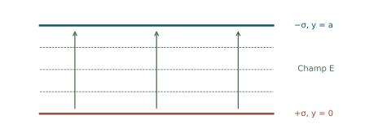

### A-I-2-a — Ligne de champ

> [!INDICATION]
> Suivre la direction locale du vecteur en plusieurs points successifs.

En un point où $\vec E\ne0$, la tangente à la ligne de champ est colinéaire au champ en ce point. La ligne est orientée dans le sens de $\vec E$. La norme du champ peut varier le long de la ligne.

### A-I-2-b — Orientation autour de l’œil

> [!INDICATION]
> Identifier les parties portant la charge positive et la charge négative.

Les lignes sortent de la cornée chargée positivement et aboutissent sur la rétine chargée négativement. Sur les deux flancs du modèle elles se recourbent vers la rétine. Le croquis suit le champ de deux charges ponctuelles opposées pour rendre ce sens visible. La figure 1b du sujet répartit les charges sur des surfaces courbes.

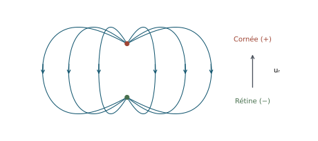

### A-I-3-a — Champ près des électrodes

> [!INDICATION]
> Lire séparément le sens de la flèche attachée à l’œil et celui des lignes sur ses flancs.

L'axe $\vec u_r$ va de la rétine vers la cornée (figures 1 et 11). Sur les flancs, la composante moyenne retenue pour le champ va de la région cornéenne vers la région rétinienne. Ainsi $\vec E=E_0\vec u_r$ exige $E_0<0$. Les lignes réelles sont courbes et leur espacement varie. Un champ uniforme et axial permet un calcul approché dans la zone latérale des électrodes. Il décrit mal le voisinage immédiat des régions chargées.

### A-I-3-b — Projections du potentiel

> [!INDICATION]
> Sur la figure 2, le sens positif de x est vers la gauche. Projeter le vecteur dessiné à droite de Oy.

Dans les axes de la figure 2, $\vec u_r=-\sin\theta\,\vec u_x+\cos\theta\,\vec u_y$. Puisque $\vec E=-\vec\nabla V$, $K=E_0\sin\theta$ et $K'=-E_0\cos\theta$. Avec le zéro en $O$, $V(x,y)=E_0(x\sin\theta-y\cos\theta)$.

### A-I-3-c — Œil aligné

> [!INDICATION]
> À angle nul, comparer les ordonnées des deux électrodes.

Pour $\theta=0$, $V=-E_0y$. Les électrodes ont toutes deux $y=b$, d'où $U=V(A)-V(A')=0$. Une symétrie gauche-droite donne le même résultat.

### A-I-3-d — Tension et rotation

> [!INDICATION]
> Substituer les coordonnées avant de soustraire. Que devient la dépendance en b ?

$V(A)=E_0(a\sin\theta-b\cos\theta)$ et $V(A')=E_0(-a\sin\theta-b\cos\theta)$. Ainsi $U=2aE_0\sin\theta$. La hauteur commune $b$ s'élimine. Pour une petite rotation en radians, $U\simeq 2aE_0\theta$. Dans le sens positif dessiné, la cornée s'approche de $A'$ et le signe obtenu est négatif.

## A.II — Amplification, filtrage et acquisition

### A-II-1-a — ALI réel

> [!INDICATION]
> Distinguer les paramètres en boucle ouverte des valeurs du montage bouclé.

À basse fréquence, un ALI classique à entrées bipolaires peut avoir un gain différentiel en boucle ouverte de l'ordre de $10^5$, une impédance d'entrée de l'ordre du mégaohm et une impédance de sortie de quelques dizaines d'ohms (ordre de $10^2\,\Omega$). Ces valeurs dépendent de la technologie. Des entrées à effet de champ ont une impédance beaucoup plus grande.

### A-II-1-b — ALI idéal

> [!INDICATION]
> Traduire les trois limites idéales en deux règles applicables au fonctionnement linéaire.

Le gain et l'impédance d'entrée tendent vers l'infini, l'impédance de sortie vers zéro. Les courants d'entrée sont nuls. En fonctionnement linéaire sous contre-réaction, la tension différentielle d'entrée est nulle.

### A-II-1-c — Gain du premier étage

> [!INDICATION]
> Identifier le potentiel de chaque entrée inverseuse et suivre le courant dans la résistance commune.

Les résistances aux entrées non inverseuses ne voient aucun courant. Les nœuds inverseurs sont aux potentiels $V_{e1}$ et $V_{e2}$. Le courant du premier vers le second dans $R'$ vaut $(V_{e1}-V_{e2})/R'$. Les lois des nœuds donnent $V_1=V_{e1}+(R/R')(V_{e1}-V_{e2})$ et $V_2=V_{e2}+(R/R')(V_{e2}-V_{e1})$. Par soustraction, $V_2-V_1=(1+2R/R')(V_{e2}-V_{e1})$.

### A-II-1-d — Signe du dernier étage

> [!INDICATION]
> Retracer la liaison qui part de V₁. Elle arrive sur l’entrée positive du troisième ALI.

Le diviseur entre $V_1$ et la masse impose $V_+=V_1/2$. Avec deux résistances égales à l'entrée inverseuse, $V_-=(V_2+V_s)/2$. L'égalité des potentiels impose $V_s=V_1-V_2=-(1+2R/R')(V_{e2}-V_{e1})$.

### A-II-1-e — Valeur du gain différentiel

> [!INDICATION]
> Le dénominateur du gain est écrit dans l’ordre électrode 2 moins électrode 1.

$A_d=-(1+2R/R')=-(1+2\times100/2)=-101$. Le gain est sans dimension. Avec $U=V_{e1}-V_{e2}$ de la partie précédente, la même sortie s'écrit $V_s=101U$.

### A-II-1-f — Amplitude en sortie

> [!INDICATION]
> Utiliser le module du gain pour l’amplitude.

L'amplitude est $101\times100\,\mu{\rm V}=10\,100\,\mu{\rm V}=10{,}1\,{\rm mV}$, de l'ordre de $10^{-2}\,{\rm V}$. Une amplitude est positive même si le gain défini dans l'énoncé est négatif.

### A-II-2-a — Perturbation secteur

> [!INDICATION]
> Situer le secteur sur le spectre utile, limité à 10 Hz.

Le réseau électrique à 50 Hz se couple aux fils et au corps par les champs ambiants. Une réjection étroite préserve les composantes physiologiques situées de part et d'autre du secteur. Ici la bande utile, de 0,002 à 10 Hz, se situe entièrement au-dessous de 50 Hz. Un passe-bas suffit en principe si sa réjection est adaptée au niveau du parasite. Avec le filtre spécifié ensuite, on obtient environ $-21\,{\rm dB}$ à 50 Hz, soit une amplitude résiduelle d'environ 9 %. Un coupe-bande peut donc rester utile si le couplage secteur est fort.

### A-II-2-b — Filtre haute fréquence

> [!INDICATION]
> Repérer la bande à transmettre, y compris le mouvement très lent.

On choisit un passe-bas qui transmet les variations jusqu'à 10 Hz et atténue les parasites à fréquence plus élevée. Placé avant l'échantillonneur, il réduit également le repliement des parasites dans la bande utile.

### A-II-2-cα — Gain de Bode

> [!INDICATION]
> Calculer le carré du module du dénominateur avant de prendre le logarithme.

Pour $x=f/f_0$, $H_0=1$ et $Q=1/\sqrt2$, $|H|^{-2}=(1-x^2)^2+2x^2=1+x^4$. Le gain $G=20\log_{10}|H|=-10\log_{10}(1+x^4)$ décroît dès $x>0$. À basse fréquence son asymptote est $0\,{\rm dB}$, à haute fréquence $-40\log_{10}x$, de pente $-40\,{\rm dB}$ par décade. Il n'y a aucun pic de résonance. Les asymptotes se croisent en $x=1$, où la courbe réelle vaut environ $-3\,{\rm dB}$.

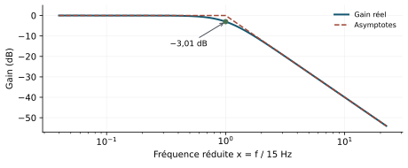

### A-II-2-cβ — Fréquence de coupure

> [!INDICATION]
> À la coupure, la puissance transmise est divisée par deux par rapport à la bande passante.

La coupure conventionnelle à $-3\,{\rm dB}$ donne $|H|=|H(0)|/\sqrt2$, soit une variation de $-10\log_{10}2\simeq-3{,}01\,{\rm dB}$. Ici $1+x^4=2$, donc $x=1$ et $f_c=f_0=15\,{\rm Hz}$.

### A-II-3-a — Échantillonnage

> [!INDICATION]
> Comparer la largeur du spectre et la séparation entre ses répliques.

Pour un signal de spectre limité à $[-f_{\max},f_{\max}]$, la fréquence d'échantillonnage doit dépasser $2f_{\max}$ pour séparer les répliques spectrales. La valeur $2f_{\max}$ est la limite de Nyquist. À l'égalité, une sinusoïde en bord de bande peut devenir indiscernable suivant sa phase.

### A-II-3-b — Durée et nombre de points

> [!INDICATION]
> Convertir la minute en secondes et préciser comment est compté l’instant final.

La limite sur la bande utile est $f_{e,\lim}=2\times10=20\,{\rm Hz}$, donc $T_e=0{,}05\,{\rm s}$. Sur 60 s, $N=60\times20=1\,200$ échantillons, de 0 à 59,95 s. En incluant aussi l'instant 60 s on compterait 1 201 instants. Le filtre analogique réel n'ayant pas de coupure abrupte, on peut prévoir une marge en fréquence.

### A-II-3-c — Retard de l’œil

> [!INDICATION]
> Comparer le même niveau sur deux fronts de même sens, en utilisant la division horizontale de la figure 4.

La cible monte à $t\simeq9{,}0\,{\rm s}$ (courbe 1). Le signal oculaire (courbe 2) franchit le milieu du saut vers $9{,}25\,{\rm s}$. Au front descendant vers 11 s, l'écart est de nouveau environ un quart de division. À 1 s/division, le retard vaut environ $0{,}25\,{\rm s}$, avec des variations de l'ordre du dixième de seconde suivant le front et le point de lecture.

## B.I — Cohérence et interférences

### B-I-1-a — Durée d’un train d’onde

> [!INDICATION]
> Distinguer un cycle de la porteuse et la durée pendant laquelle sa phase est prévisible.

On représente le champ par une succession de sinusoïdes de fréquence voisine de $\nu_0$, dont la phase change aléatoirement d'un train au suivant. Dans un train, deux crêtes successives sont séparées de $T_0=1/\nu_0=\lambda_0/c$. La durée moyenne d'un train est le temps de cohérence $\tau_c$. La figure schématise deux trains, avec une rupture de phase au changement de couleur.

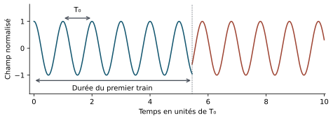

### B-I-1-b — Ordre de grandeur pour un laser

> [!INDICATION]
> Relier une largeur de raie en hertz à une durée en secondes.

On estime $\tau_c\sim1/\Delta\nu$. Pour un laser de laboratoire de largeur effective $10^8\,{\rm Hz}$, on trouve environ $10^{-8}\,{\rm s}$. L'ordre de grandeur dépend des modes et de la stabilisation du laser. Par exemple une raie de $10^6\,{\rm Hz}$ correspond à environ une microseconde.

### B-I-1-c — Temps de cohérence de la source

> [!INDICATION]
> Différencier la fréquence par rapport à la longueur d’onde dans le vide.

Comme $\nu=c/\lambda$, $\Delta\nu\simeq c\Delta\lambda/\lambda_0^2$ pour une largeur spectrale modérée. Avec $\lambda_0=820\,{\rm nm}$ et $\Delta\lambda=50\,{\rm nm}$, $\Delta\nu\simeq2{,}23\times10^{13}\,{\rm Hz}$. Donc $\tau_c\sim\lambda_0^2/(c\Delta\lambda)\simeq4{,}5\times10^{-14}\,{\rm s}$. Le facteur numérique exact dépend de la définition de largeur et du profil spectral.

### B-I-1-d — Longueur de cohérence

> [!INDICATION]
> Pendant la durée d’un train, quelle distance son front parcourt-il dans le vide ?

$L_c=c\tau_c\simeq\lambda_0^2/\Delta\lambda\simeq13{,}4\,\mu{\rm m}$. Cette longueur correspond à un écart de chemin optique. Un miroir mobile d'interféromètre change le chemin optique sur l'aller et le retour.

### B-I-1-e — Limite monochromatique

> [!INDICATION]
> Faire tendre la largeur spectrale vers zéro.

Une source parfaitement monochromatique conserve indéfiniment sa phase. Ainsi $\tau_c$ et $L_c$ sont infinis dans ce modèle idéal.

### B-I-2-a — Différence de marche

> [!INDICATION]
> Écrire chacun des deux chemins optiques avant leur soustraction.

Dans le milieu homogène, les chemins optiques sont $nd_1$ et $nd_2$. Avec le sens onde 2 moins onde 1, $\delta=nd_2-nd_1=n(d_2-d_1)$, en mètres.

### B-I-2-b — Démonstration de la formule de Fresnel

> [!INDICATION]
> Développer le carré de la somme des deux champs puis moyenner sur une période.

Au point $P$, écrivons $s_j=a_j\cos(\omega t-\varphi_j)$ pour deux ondes de même polarisation. L'intensité est $K\langle(s_1+s_2)^2\rangle$. Les termes diagonaux valent $I_j=Ka_j^2/2$. Le produit de cosinus contient la somme des phases à $2\omega$, de moyenne nulle, et leur différence constante. Il reste $2K\langle s_1s_2\rangle=Ka_1a_2\cos(\varphi_2-\varphi_1)$. Les sources étant en phase, $\varphi_2-\varphi_1=2\pi\delta/\lambda_0$. D'où $I(P)=I_1+I_2+2\sqrt{I_1I_2}\cos(2\pi\delta/\lambda_0)$, où $I_1$ et $I_2$ sont les intensités reçues séparément au point considéré.

### B-I-2-c — Phase dans la relation c

> [!INDICATION]
> Identifier l’argument du cosinus en gardant la longueur d’onde dans le vide.

Pour $I_1=I_2=I_0$, $I(P)=2I_0[1+\cos\Phi]$ avec $\Phi=2\pi\delta/\lambda_0$ modulo $2\pi$. Une variation de marche de $\lambda_0$ reproduit le même état interférentiel.

## B.II — Michelson en lame d’air

### B-II-1 — Marche en lame d’air

> [!INDICATION]
> Déplier la séparatrice de façon à comparer deux miroirs plans parallèles. Comparer les rayons sur un même front de sortie.

Après dépliement, le miroir mobile et l'image de l'autre miroir sont distants de $x$. L'angle d'incidence $i$ est mesuré par rapport à leur normale dans l'air d'indice $n_a$. L'aller-retour supplémentaire du rayon profond vaut géométriquement $2x/\cos i$. Pour arrêter les deux rayons sur le même front émergent, il faut retrancher la projection $2x\tan i\sin i$ due au décalage latéral de leurs points d'émergence. On obtient $\delta=n_a(2x/\cos i-2x\tan i\sin i)=2n_a x\cos i$. L'expression algébrique vaut aussi pour $x<0$.

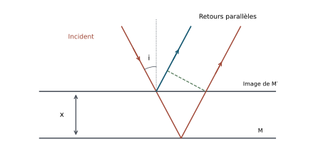

### B-II-2 — Aspect de l’écran

> [!INDICATION]
> À quoi correspondent tous les rayons qui font le même angle avec l’axe ?

Dans le plan focal image, on voit des anneaux alternativement brillants et sombres centrés sur l'axe optique. Un cercle réunit les points de même inclinaison et donc de même intensité. Selon le réglage initial, le centre peut être clair ou sombre.

### B-II-3 — Retour à la teinte plate

> [!INDICATION]
> Suivre un seul ordre entier pendant la diminution de l’épaisseur.

Rapprocher $M$ de la séparatrice pour réduire $x$ jusqu'à zéro. À ordre fixé, $\cos i$ augmente et les anneaux se contractent puis disparaissent au centre. Au contact optique, $\delta=0$ pour toute inclinaison. L'écran est uniformément brillant avec la séparatrice idéale du sujet.

## B.III — Mesure de position

### B-III-1-a — Marche des faisceaux au détecteur

> [!INDICATION]
> Situer les foyers de L₀ et L avant de tracer les rayons.

La source ponctuelle au foyer objet de $L_0$ fournit un faisceau parallèle à l'axe. La séparatrice l'envoie dans les bras 1 vers $M'$ et 2 vers $M$, en incidence normale. Après réflexion, une partie de chaque faisceau repart vers la lentille $L$. Les deux faisceaux parallèles de retour convergent au foyer image $O$. Les deux rayons dans le dessin représentent les bords du faisceau.

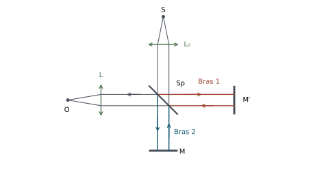

### B-III-1-b — Marche en incidence normale

> [!INDICATION]
> Déduire l’angle d’incidence de la collimation. Déduire les allers-retours des déplacements.

Chaque bras possédait initialement la longueur $d_0$. L'écart optique devient $\delta=2n_a[(d_0+x)-(d_0+x_1)]=2n_a(x-x_1)$. Ici $i=0$, ce qui explique l'absence de facteur angulaire dans le résultat.

### B-III-1-c — Ordre d’interférence

> [!INDICATION]
> Convertir l’écart de chemin optique en nombre de périodes spatiales.

L'ordre est le nombre algébrique $p=\delta/\lambda_0=\Phi/(2\pi)$ avec la phase déroulée, soit $p=2n_a(x-x_1)/\lambda_0$. Un entier correspond à un maximum, un demi-entier à un minimum pour les deux ondes en phase à l'origine.

### B-III-1-d — Mesure par l’ordre zéro

> [!INDICATION]
> Quel déplacement annule la différence de marche ?

L'ordre zéro exige $p=0$ et donc $x_0=x_1$. Identifier cet ordre sur l'enregistrement donnerait le déplacement inconnu du miroir de référence par lecture du déplacement connu $x_0$ du miroir mobile.

### B-III-2-a — Signal monochromatique

> [!INDICATION]
> Substituer la différence de marche dans la relation c.

Le détecteur enregistre $I(O)=2I_0[1+\cos(4\pi n_a(x-x_1)/\lambda_0)]$. L'intensité varie entre 0 et $4I_0$ autour de la moyenne $2I_0$.

### B-III-2-bα — Positions des maxima

> [!INDICATION]
> Deux positions brillantes successives correspondent à une différence d’ordre égale à un.

Les maxima vérifient $x=x_1+k\lambda_0/(2n_a)$, $k$ entier. Si l'origine $x=0$ est elle-même un maximum, $x_1$ est un multiple de $h=\lambda_0/(2n_a)$. L'ensemble des positions brillantes s'écrit donc $x=mh$, $m\in\mathbb Z$.

### B-III-2-bβ — Tracé monochromatique

> [!INDICATION]
> Choisir l’écart de deux maxima comme unité horizontale.

Avec un maximum à l'origine, $I/I_0=2[1+\cos(2\pi x/h)]$. La courbe passe par $4$ pour $x/h$ entier et par zéro pour $x/h$ demi-entier. La translation mécanique entre franges voisines est $h$.

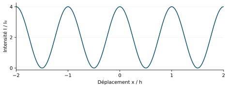

### B-III-2-c — Ambiguïté de l’ordre

> [!INDICATION]
> Chercher l’effet d’une translation de x₁ d’une période entière sur tout l’enregistrement.

Remplacer $x_1$ par $x_1+h$ laisse toute la courbe inchangée. L'ordre zéro a la même intensité et les mêmes voisins que tout autre maximum. On ne peut donc retrouver $x_1$ que modulo $h$.

### B-III-3-a — Centre du paquet de franges

> [!INDICATION]
> Que devient le cosinus lorsque les deux bras ont exactement la même durée de propagation ?

L'ordre zéro est encore obtenu pour $x_0=x_1$. Le retard entre les trains est nul, ils se superposent et $\Phi=0$. Leur addition constructive donne $I=4I_0$, maximum permis par la relation c.

### B-III-3-b — Fenêtre de cohérence

> [!INDICATION]
> Un retard ou une avance de même module produit le même décalage des trains.

La condition physique est $|\delta|<L_c$, en prenant le module de la marche algébrique du sujet. Elle donne $|x-x_1|<L_c/(2n_a)$. Les deux bords sont $x_-=x_1-L_c/(2n_a)$ et $x_+=x_1+L_c/(2n_a)$. Ici ils sont à $0{,}90\,\mu{\rm m}$ de part et d'autre du centre.

### B-III-3-c — Combien de maxima ?

> [!INDICATION]
> Énumérer les ordres entiers compris strictement dans la fenêtre optique.

Un maximum d'ordre $k$ a $\delta=k\lambda_0$. Il faut compter les entiers satisfaisant $|k|<L_c/\lambda_0$, donc $N=2\lceil L_c/\lambda_0\rceil-1$. Ici $1{,}80/0{,}800=2{,}25$, ce qui donne cinq maxima, aux ordres $-2,-1,0,1,2$. Les trois maxima dessinés en figure 7a illustrent le modèle d'enveloppe introduit ensuite.

### B-III-3-d — Tracé à cohérence limitée

> [!INDICATION]
> Reporter la fenêtre et deux prolongements de longueur Lc/nₐ. À l’extérieur, les intensités s’ajoutent.

Posons $u=x-x_1$ en micromètres. Le domaine demandé est $[-2{,}70\,;\,2{,}70]$. Pour $|u|<0{,}90$, $I/I_0=2[1+\cos(2\pi u/0{,}40)]$. Les maxima sont à $u=-0{,}80,-0{,}40,0,0{,}40,0{,}80$. À l'extérieur, $I/I_0=2$. Ici le cosinus vaut zéro aux bords et les deux tracés s'y raccordent.

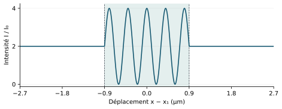

### B-III-3-eα — Encadrement expérimental

> [!INDICATION]
> Distinguer l’identification d’un pic pris isolément de la mesure des deux bords du paquet.

Dans le modèle à visibilité constante, tous les maxima de la fenêtre culminent à $4I_0$. La seule hauteur d'un maximum ne porte donc pas son numéro. En repérant la zone où des franges subsistent, on localise $x_0$ entre $x_-$ et $x_+$. Si l'on connaissait exactement les deux bords d'un modèle parfaitement symétrique, leur milieu donnerait le centre. De même, sur le tracé idéal de la question précédente, le troisième des cinq pics est identifiable si tous les pics sont résolus. Expérimentalement leur détection a une résolution finie.

### B-III-3-eβ — Centre et demi-largeur

> [!INDICATION]
> Quel choix minimise la plus grande erreur possible si l’on connaît seulement un intervalle ?

Le milieu $(x_-+x_+)/2$ minimise la distance maximale à l'une ou l'autre extrémité. La borne conservative associée à la seule localisation dans la fenêtre est $\Delta x_0=(x_+-x_-)/2=L_c/(2n_a)=0{,}90\,\mu{\rm m}$. Dans le modèle affiné du sujet, enlever la composante continue et détecter l'enveloppe donne $I_u\propto V(x)$, dont le sommet sert de repère.

## B.IV — Biométrie de l’œil

### B-IV-1 — Marche optique pour l’interface B

> [!INDICATION]
> Partir de l’équilibre avec l’interface A à x = 0 et compter les deux traversées du milieu entre A et B.

Le parcours de référence dans l'air croît de $2n_a x$. Le parcours de l'onde 1 réfléchie en $B$ augmente de $2n_cD_c$ par rapport au reflet en $A$. Dans le sens $B$ moins faisceau 2 demandé par $\delta_{B/2}$, $\delta_{B/2}=2(n_cD_c-n_ax)$. Dans la convention 2 moins 1 des parties précédentes, $\delta=2(n_ax-n_cD_c)$. L'annulation et l'intensité sont identiques.

### B-IV-2 — Position du pic biologique

> [!INDICATION]
> Le maximum de l’enveloppe correspond à la coïncidence des temps de parcours.

Au centre de l'enveloppe pour le reflet en $B$, la marche s'annule. La translation théorique mesurée depuis $x_A=0$ vaut donc $x_B=n_cD_c/n_a$. L'aller-retour dans le tissu et celui dans l'air portent le même facteur deux.

### B-IV-3 — Épaisseur géométrique

> [!INDICATION]
> Convertir une translation dans l’air en une longueur de tissu au moyen des indices.

Pour l'origine choisie, $D_c=n_a x_B/n_c$. Pour une origine quelconque, $D_c=n_a(x_B-x_A)/n_c$. L'écart de deux pics consécutifs est proportionnel à l'épaisseur optique et dépend ainsi de l'indice du milieu traversé.

## B.V — Lecture des interfaces

### B-V-a — Identification des interfaces

> [!INDICATION]
> Parcourir l’œil d’avant en arrière à partir de l’air et indiquer le milieu compris entre deux échos.

Avec $P_1$ à l'interface air–cornée, les intervalles successifs sont $P_1P_2$ pour la cornée, $P_2P_3$ pour l'humeur aqueuse de la chambre antérieure, $P_3P_4$ pour le cristallin, $P_4P_5$ pour l'humeur vitrée et $P_5P_6$ pour la rétine. On lit l'enregistrement de la figure 10 en page 9 avec la coupe et les indices de la figure 11 en page 10.

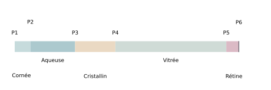

### B-V-b — Épaisseur du cristallin

> [!INDICATION]
> Étalonner la distance horizontale au moyen de l’humeur vitrée. Les indices sont différents dans les deux intervalles.

Sur une même reproduction de la figure 10, les centres des pics $P_3,P_4,P_5$ sont aux abscisses approximatives 245, 410 et 1 045, en unités graphiques arbitraires. Le rapport des intervalles est donc $165/635\simeq0{,}26$. La même échelle vérifie $\Delta x_{34}/\Delta x_{45}=n_{ct}LT/(n_v D_v)$. Ainsi $LT=16{,}14\times(1{,}344/1{,}406)\times(165/635)\ {\rm mm}\simeq4{,}0\,{\rm mm}$. La précision est limitée par la lecture des pics et l'indice théorique du cristallin.

## C.I — Écoulement dans un tube

### C-I-1 — Normalisation du profil parabolique

> [!INDICATION]
> Intégrer la vitesse sur des anneaux de section 2πr dr avant d’isoler B.

Le débit vaut $D_v=\int_0^R B(1-r^2/R^2)2\pi r\,{\rm d}r=\pi B R^2/2$. Ainsi $B=2D_v/(\pi R^2)=2V_m$, en mètres par seconde. Le coefficient est constant, égal à la vitesse axiale au centre. Au bord, le profil s'annule par adhérence.

### C-I-2-a — Effort visqueux sur le tube

> [!INDICATION]
> Évaluer le gradient radial au mur, puis introduire l’aire du cylindre mouillé.

$\partial v_z/\partial r=-2Br/R^2$, donc la contrainte tangentielle en module au mur vaut $\eta|\partial v_z/\partial r|_R=2\eta B/R$. Elle agit sur toute l'aire latérale $2\pi RL$. Ainsi $F=4\pi\eta BL=8\eta LD_v/R^2$, en newtons. Une aire de section droite donnerait ici un effort incorrect.

### C-I-2-b — Sens des efforts

> [!INDICATION]
> Nommer le corps sur lequel agit chacune des deux forces de contact.

Le fluide entraîne la paroi vers l'aval. La force du fluide sur le tube est $+F\vec u_z$. En retour le tube exerce $-F\vec u_z$ sur le fluide. Le schéma distingue les deux corps au contact pour éviter d'inverser les forces.

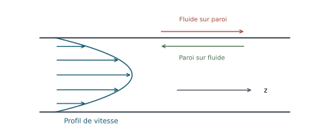

### C-I-3 — Bilan de quantité de mouvement

> [!INDICATION]
> Comparer les flux de quantité de mouvement aux deux sections d’un tronçon identique.

Le profil stationnaire pleinement développé est identique à l'entrée et à la sortie. Les flux axiaux de quantité de mouvement sont donc égaux. Sur le fluide du tronçon horizontal, la pression donne $(P_e-P_s)\pi R^2$ vers l'aval et le mur exerce $F$ vers l'amont. Leur somme est nulle, d'où $P_e-P_s=F/(\pi R^2)>0$.

### C-I-4 — Résistance de Poiseuille

> [!INDICATION]
> Diviser l’effort précédent par la section et isoler le coefficient du débit.

En reportant la force visqueuse, $P_e-P_s=8\eta LD_v/(\pi R^4)=R_hD_v$, avec $R_h=8\eta L/(\pi R^4)$. L'unité de résistance hydraulique est $\mathrm{Pa\,s\,m^{-3}}$. À longueur et viscosité égales, diviser le rayon par deux multiplie cette résistance par seize.

## C.II — Pertes de charge et circulation

### C-II-1-a — Unité de la charge

> [!INDICATION]
> Examiner l’unité du terme cinétique ρv².

La charge définie sur le feuillet est $\mathcal E=P+\rho gz+\rho v^2/2$. Chaque terme est une énergie par volume, en $\mathrm{J\,m^{-3}}=\mathrm{Pa}=\mathrm{kg\,m^{-1}\,s^{-2}}$. On obtiendrait une charge exprimée en mètres en divisant cette grandeur par $\rho g$.

### C-II-1-b — Relation de Bernoulli

> [!INDICATION]
> Énoncer les hypothèses sous lesquelles la charge se conserve le long d’une ligne de courant.

Pour un fluide parfait incompressible en régime stationnaire, soumis à la pesanteur uniforme, sans machine entre les deux points, $P_1+\rho gz_1+\rho v_1^2/2=P_2+\rho gz_2+\rho v_2^2/2$ sur une même ligne de courant. Si l'écoulement est en outre irrotationnel, la constante est commune au domaine connexe.

### C-II-2-a — Dimension du coefficient de Darcy

> [!INDICATION]
> Isoler les facteurs déjà porteurs d’une dimension dans la formule imprimée.

La perte régulière vaut $\mathcal P_c=f[L/(2R)]\rho V_m^2/2$. Le rapport de longueurs est sans dimension et la pression dynamique est en pascals, comme $\mathcal P_c$. Ainsi $f$ est sans dimension. C'est le coefficient de Darcy, défini avec le diamètre $D=2R$.

### C-II-2-b — Perte de charge régulière

> [!INDICATION]
> Quel mécanisme dissipe de l’énergie tout le long d’une conduite uniforme ?

La viscosité et, en régime turbulent, les transferts d'énergie vers les petites échelles dissipent l'énergie mécanique. Dans une conduite de section constante en régime établi, la perte de charge est distribuée le long de la paroi et croît proportionnellement à la longueur parcourue.

### C-II-2-c — Pertes singulières

> [!INDICATION]
> Penser à deux modifications locales de géométrie qui perturbent l’écoulement.

Un coude prononcé et un élargissement brusque du conduit occasionnent chacun une perte de charge singulière, liée à la déviation ou au décollement et au mélange du jet. Elle est localisée à proximité de l'accident géométrique.

### C-II-3-a — Limite de Colebrook

> [!INDICATION]
> Garder la rugosité relative fixée et positive, puis examiner le terme contenant le nombre de Reynolds.

Dans la relation de Colebrook pour le régime turbulent, $1/\sqrt f=-2\log_{10}[\varepsilon/(3{,}71D)+2{,}51/(\mathrm{Re}\sqrt f)]$. À très grand Reynolds pour une rugosité relative $\varepsilon/D>0$ fixée, le second terme devient négligeable. Ainsi $f_\infty=[2\log_{10}(3{,}71D/\varepsilon)]^{-2}$. Les courbes de droite deviennent horizontales et leurs niveaux augmentent avec la rugosité. Pour une paroi idéalement lisse, le terme de rugosité s'annule et ce plateau positif disparaît.

### C-II-3-b — Régimes sur le diagramme de Moody

> [!INDICATION]
> Localiser d’abord la droite unique à gauche puis le faisceau de courbes de rugosité.

$\mathrm{Re}=\rho V_mD/\eta$ compare les effets d'inertie et de viscosité. À gauche, en dessous d'environ 2 000 à 2 300, la droite décrit le régime laminaire. À droite, au-delà d'environ 4 000, les courbes décrivent le régime turbulent. Entre ces valeurs se trouve une zone de transition dont les limites dépendent des perturbations.

### C-II-3-cα — Droite en coordonnées logarithmiques

> [!INDICATION]
> Revenir aux variables physiques après avoir écrit l’équation d’une droite dans les coordonnées tracées.

Posons $X=\log_{10}\mathrm{Re}$ et $Y=\log_{10} f$. Sur la branche de gauche $Y=\alpha X+\beta$. Par exponentiation, $f=10^\beta\mathrm{Re}^{\alpha}=K\mathrm{Re}^{\alpha}$. La pente donne l'exposant, et l'ordonnée à l'origine donne $\log_{10}K$.

### C-II-3-cβ — Lecture de la pente et du coefficient

> [!INDICATION]
> Lire deux couples suffisamment distants sur la droite. Calculer ensuite le coefficient avec un seul des points.

Sur la figure 14, on lit environ $(1\,000\,;\,0{,}065)$ et $(2\,000\,;\,0{,}032)$. Ces lectures utilisent la grille logarithmique de chacun des deux axes. Doubler $\mathrm{Re}$ divise $f$ par deux. $\alpha\simeq\log_{10}(0{,}032/0{,}065)/\log_{10}2\simeq-1$. Avec cette pente, $K\simeq 1\,000\times0{,}065\simeq65$, ou $2\,000\times0{,}032\simeq64$. L'épaisseur du trait limite la précision.

### C-II-4-a — Vitesse moyenne

> [!INDICATION]
> Utiliser la définition de la moyenne dans une section droite.

$V_m=(\pi R^2)^{-1}\int_S v_z\,{\rm d}S$, donc $D_v=\pi R^2V_m$. Pour le profil parabolique déjà étudié, cette vitesse vaut $B/2$.

### C-II-4-b — Pression et coefficient de frottement

> [!INDICATION]
> À quelles conditions les termes de pesanteur et d’énergie cinétique se compensent-ils entre entrée et sortie ?

Sur le tronçon horizontal, les cotes sont identiques. La même section et le même profil développé donnent la même énergie cinétique aux deux extrémités. La chute de pression égale toute la perte régulière, donc $P_e-P_s=f[L/(2R)]\rho V_m^2/2=f\rho LD_v^2/(4\pi^2R^5)$.

### C-II-4-c — Loi laminaire théorique

> [!INDICATION]
> Comparer les deux chutes de pression calculées pour le même tube et le même débit.

L'égalité avec Poiseuille donne $f\rho LD_v^2/(4\pi^2R^5)=8\eta LD_v/(\pi R^4)$. Pour $D_v>0$, $f=32\pi\eta R/(\rho D_v)=32\eta/(\rho R V_m)=64/\mathrm{Re}$ avec $\mathrm{Re}=2\rho R V_m/\eta$.

### C-II-4-d — Comparaison avec la lecture

> [!INDICATION]
> Comparer à la fois la pente et la valeur du préfacteur, avec la précision graphique permise.

Le modèle fournit exactement $\alpha=-1$ et $K=64$, en accord avec les lectures d'environ $-1$ et 64 à 65 sur la branche laminaire. Cette comparaison porte sur une conduite circulaire en régime stationnaire pleinement développé.

### C-II-5-a — Résistance du réseau capillaire

> [!INDICATION]
> Convertir le débit en mètres cubes par seconde avant d’appliquer la relation pression–débit.

De $A$ vers $B$, $P_A-P_B=(4{,}0-1{,}6)\times10^3=2{,}4\times10^3\,{\rm Pa}$. Le débit est $1{,}8\times10^{-3}/60=3{,}0\times10^{-5}\,{\rm m^3\,s^{-1}}$. Le rapport donne $R_{hAB}=(P_A-P_B)/D_{vA}=8{,}0\times10^7\,{\rm Pa\,s\,m^{-3}}$.

### C-II-5-b — Nombre de capillaires du modèle ramifié

> [!INDICATION]
> Ne compter que les traits épais de la figure 17. Suivre un trajet complet du côté artériel au côté veineux.

Le réseau symétrique du dessin possède deux étages successifs. Les traits épais rouges comptent $N_1/2$ capillaires, les bleus autant. Les liaisons fines ont une résistance négligée dans ce modèle. Par symétrie, les nœuds intermédiaires sont à la même pression. Un étage de $N_1/2$ résistances identiques en parallèle vaut $2R_{h\mathrm{cap}}/N_1$. Les deux étages se cumulent, donc $R_{hAB}=4R_{h\mathrm{cap}}/N_1$ et $N_1=4R_{h\mathrm{cap}}/R_{hAB}$. Avec $R_{h\mathrm{cap}}=1{,}2\times10^{19}$ en unités SI, $N_1\simeq6{,}0\times10^{11}$ capillaires dans ce modèle. La résistance unitaire donnée intègre déjà la géométrie du capillaire.

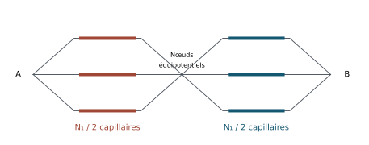
