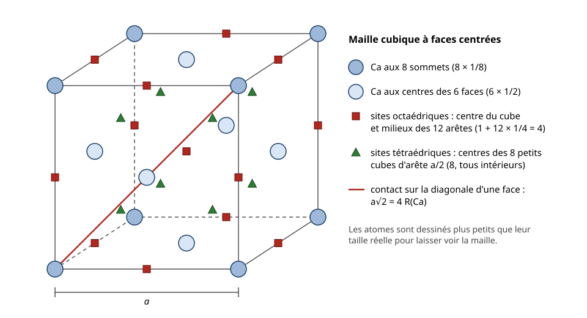
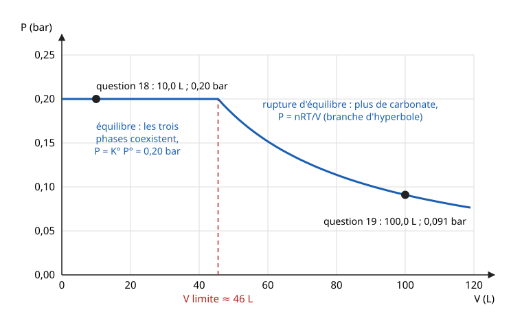
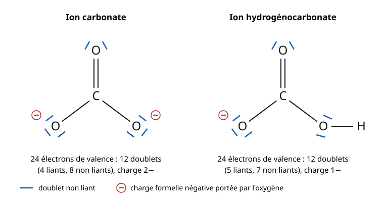
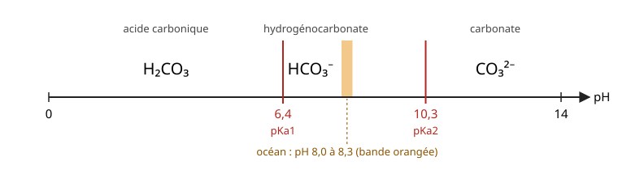

# Banque PT PT — Physique B - Chimie 2019 · Corrigé guidé

*Corrigé rédigé par IA, non officiel. Signalez toute erreur.*

**Rédaction** · modèle exact non renseigné (famille Claude) · effort non renseigné · vitesse non renseignée

## Présentation du sujet

**Thème.** « Autour du calcium » : de l'élément au carbonate de calcium des roches calcaires et des coraux. L'épreuve dure 2 heures, **sans calculatrice**, et comporte 38 questions réparties en quatre parties indépendantes, dont l'énoncé indique le poids dans le barème. Aucun document n'est à rendre.

- *Partie A (questions 1 à 12, environ 30 %)* : configurations électroniques, degré d'oxydation, réaction du calcium avec l'eau, maille cubique à faces centrées et sites interstitiels, alliage, calcium du squelette.
- *Partie B (questions 13 à 20, environ 20 %)* : calcination du carbonate de calcium : variance, grandeurs standard de réaction, optimisation, équilibre hétérogène et rupture d'équilibre.
- *Partie C (questions 21 à 27, environ 20 %)* : schémas de Lewis, diagramme de prédominance, solubilité du carbonate de calcium et influence du pH.
- *Partie D (questions 28 à 38, environ 30 %)* : suivi cinétique par mesure de pression et par pH-métrie, méthode intégrale pour les ordres 0, 1 et 2, exploitation de trois graphes.

**Notions mobilisées.** Règles de remplissage, classification périodique, oxydo-réduction, cristallographie (population, coordinence, sites), loi de Hess, loi de Van't Hoff, variance, équilibres hétérogènes, acides et bases, produit de solubilité, gaz parfait, lois de vitesse et méthode intégrale.

**Difficulté.** Le sujet est long mais proche du cours des deux années, et le rapport souligne qu'il privilégie des notions simples. Les points se gagnent sur la justification (variance, signes, cohérence des hypothèses d'équilibre) et sur les calculs menés à la main avec les valeurs approchées fournies au fil des questions. Les passages les plus discriminants d'après le rapport sont la variance (question 13), la rupture d'équilibre (questions 18 à 20), la fin de la partie C (questions 24 à 27) et l'intégration des lois de vitesse (questions 34 à 37).

**Gestion du temps.** Environ 35 minutes pour la partie A, 25 pour la partie B, 25 pour la partie C et 35 pour la partie D. Les parties sont indépendantes : la partie D, qui pèse près d'un tiers de la note, comporte beaucoup de questions rapides (28 à 33) qu'il serait dommage de ne pas atteindre.

> [!JURY]
> Le rapport 2019 rappelle trois exigences générales. La présentation est appréciée et compte : résultats numériques soulignés, expressions littérales encadrées. Seule une réponse justifiée et argumentée reçoit la totalité des points. Une valeur numérique sans unité n'a pas de sens et n'est pas récompensée. Il insiste aussi sur la lecture attentive de l'énoncé (position du magnésium, caractéristiques de l'indicateur, description du cristal) et sur le bon sens face à un résultat aberrant.

[Sujet officiel](https://www.banquept.fr/documents/2019/ph_b_ch_2019_pt.pdf) · [Rapport du jury](https://www.banquept.fr/documents/ecrit/rapport/2019/rapport_phys_b_ecrit_2019.pdf)

*Mode d'emploi* : chercher chaque question seul, lire la première indication en cas de blocage, réessayer, puis la seconde, et seulement ensuite la solution.

## Partie A — Abondance et propriétés de l'élément calcium

### Question 1

> [!INDICATION]
> Deux règles suffisent quand toutes les sous-couches sont pleines : l'une fixe la capacité d'une orbitale, l'autre l'ordre de remplissage.

> [!INDICATION]
> « Juste au-dessus » signifie même colonne, période précédente : la couche de valence a la même forme $ns^2$ avec $n$ diminué de 1.

#### Solution

Les deux règles générales sont les suivantes.

- **Principe d'exclusion de Pauli** : deux électrons d'un même atome ne peuvent pas avoir leurs quatre nombres quantiques identiques. Une orbitale atomique contient donc au plus deux électrons, de spins opposés ; une sous-couche $s$ en contient au plus 2, une sous-couche $p$ au plus 6, une sous-couche $d$ au plus 10.
- **Règle de Klechkowski** : dans l'état fondamental, les sous-couches se remplissent par valeurs croissantes de $n + \ell$ et, à $n + \ell$ égal, par valeurs croissantes de $n$. L'ordre est $1s$, $2s$, $2p$, $3s$, $3p$, $4s$, $3d$…

(La règle de Hund ne sert que pour répartir les électrons d'une sous-couche incomplète ; elle n'intervient pas ici, toutes les sous-couches occupées étant pleines.)

**Calcium** ($Z = 20$, vingt électrons) :

$$\boxed{\mathrm{Ca} : 1s^2\,2s^2\,2p^6\,3s^2\,3p^6\,4s^2}$$

Sa couche de valence est $4s^2$ : quatrième période, deuxième colonne.

**Magnésium** : situé juste au-dessus du calcium, il appartient à la même colonne (valence $ns^2$) et à la troisième période, donc sa couche de valence est $3s^2$ :

$$\boxed{\mathrm{Mg} : 1s^2\,2s^2\,2p^6\,3s^2}$$

soit $Z = 12$.

> [!JURY]
> Le rapport note que l'énoncé des règles et la configuration du calcium ont parfois posé problème, et que beaucoup de candidats, ayant mal lu l'énoncé, se sont trompés sur le magnésium. Citer **et** nommer chaque règle, puis exploiter la position dans le tableau.

### Question 2

> [!INDICATION]
> Compter les électrons de valence et regarder quelle configuration reste une fois qu'ils sont partis.

#### Solution

Les deux atomes possèdent deux électrons de valence $ns^2$, nettement moins liés que les électrons de cœur. En les perdant, l'atome acquiert la configuration électronique du **gaz noble qui le précède**, à couches complètes, particulièrement stable :

$$\boxed{\mathrm{Ca^{2+}} : 1s^2\,2s^2\,2p^6\,3s^2\,3p^6}$$

C'est la configuration de l'argon. De même, $\mathrm{Mg^{2+}} : 1s^2\,2s^2\,2p^6$ est isoélectronique du néon.

Arracher un troisième électron obligerait à entamer une couche complète de cœur, ce qui coûte beaucoup plus d'énergie : le degré d'oxydation $+\mathrm{II}$ est donc le degré stable de ces éléments (alcalino-terreux).

> [!PIEGE]
> Le rapport relève la confusion entre gaz noble, gaz rare et gaz parfait. Le terme attendu est **gaz noble** (dernière colonne) ; « gaz parfait » est un modèle de thermodynamique, sans rapport avec la classification.

### Question 3

> [!INDICATION]
> Relier le caractère réducteur à l'électronégativité, puis utiliser son évolution dans une colonne.

#### Solution

Un réducteur cède des électrons. Dans une colonne de la classification, l'électronégativité **diminue de haut en bas** : les électrons de valence du calcium ($4s$) sont plus éloignés du noyau et mieux écrantés par les électrons de cœur que ceux du magnésium ($3s$) ; ils sont moins retenus et plus faciles à arracher.

$$\boxed{\text{Le calcium est plus réducteur que le magnésium.}}$$

L'expérience décrite ensuite le confirme : le calcium réagit vivement avec l'eau froide, alors que le magnésium ne la réduit que très lentement.

### Question 4

> [!INDICATION]
> Situer le pH final par rapport à la zone de virage, puis par rapport à 7.

#### Solution

La phénolphtaléine est incolore sous sa forme acide ($\mathrm{pH} < 8$) et rose sous sa forme basique ($\mathrm{pH} > 10$). La solution rosit : la forme basique de l'indicateur apparaît, donc le pH final est supérieur à 8, et supérieur à 10 si la teinte rose est franche. À 25 °C, une solution neutre a un pH de 7.

$$\boxed{\text{La solution finale est basique.}}$$

> [!JURY]
> D'après le rapport, une lecture trop rapide des caractéristiques de l'indicateur et de l'observation a conduit certains candidats à une réponse fausse. La justification tient en deux lignes : couleur observée, forme de l'indicateur, intervalle de pH.

### Question 5

> [!INDICATION]
> Le calcium passe à son degré stable $+\mathrm{II}$ ; le gaz dégagé indique quelle espèce est réduite.

> [!INDICATION]
> En milieu basique, la demi-équation de l'eau s'écrit avec $\mathrm{HO^-}$ et non avec $\mathrm{H^+}$ ; le précipité associe le cation formé à ces ions.

#### Solution

Le milieu final étant basique, on équilibre avec des ions hydroxyde.

Oxydation du calcium (nombre d'oxydation de 0 à $+\mathrm{II}$) :

$$\mathrm{Ca_{(s)}} = \mathrm{Ca^{2+}_{(aq)}} + 2\,e^-$$

Réduction de l'eau (l'hydrogène passe de $+\mathrm{I}$ à 0) :

$$2\,\mathrm{H_2O_{(l)}} + 2\,e^- = \mathrm{H_{2(g)}} + 2\,\mathrm{HO^-_{(aq)}}$$

Il y a transfert de deux électrons du calcium vers l'eau : c'est une réaction d'oxydo-réduction. La somme donne $\mathrm{Ca_{(s)}} + 2\,\mathrm{H_2O_{(l)}} = \mathrm{Ca^{2+}_{(aq)}} + 2\,\mathrm{HO^-_{(aq)}} + \mathrm{H_{2(g)}}$. Les ions calcium et hydroxyde formés précipitent en hydroxyde de calcium, d'où le bilan :

$$\boxed{\mathrm{Ca_{(s)}} + 2\,\mathrm{H_2O_{(l)}} = \mathrm{Ca(OH)_{2(s)}} + \mathrm{H_{2(g)}}}$$

L'hydroxyde de calcium étant légèrement soluble, la solution saturée contient des ions hydroxyde : elle est bien basique, ce qui explique la teinte rose.

> [!PIEGE]
> Écrire $2\,\mathrm{H^+} + 2\,e^- = \mathrm{H_2}$ donnerait un bilan avec des ions $\mathrm{H^+}$, incompatible avec un milieu basique : l'énoncé demande explicitement d'en tenir compte. Le rapport signale que l'écriture des réactions d'oxydo-réduction reste mal maîtrisée.

### Question 6

> [!INDICATION]
> Un cube en perspective, arêtes cachées en pointillés, puis les deux familles de positions : sommets et centres des faces.

#### Solution

La maille conventionnelle est un cube d'arête $a$ : un atome de calcium à chacun des huit sommets et un atome au centre de chacune des six faces.

Sur le dessin, les atomes sont réduits pour la lisibilité ; dans le modèle des sphères dures, ils sont tangents le long de la diagonale de chaque face.

### Question 7

> [!INDICATION]
> La coordinence est le nombre de plus proches voisins d'un atome ; chercher la plus courte distance entre deux atomes de la maille.

> [!INDICATION]
> Le contact a lieu sur la diagonale d'une face, pas sur l'arête.

#### Solution

**Coordinence.** Chaque atome a pour plus proches voisins les atomes situés à la distance $a\sqrt2/2$ (demi-diagonale d'une face) : un sommet en compte 4 dans chacun des trois plans de faces qui le contiennent.

$$\boxed{\text{Coordinence } 12}$$

**Population.** Un atome à un sommet est partagé entre 8 mailles, un atome au centre d'une face entre 2 mailles :

$$N = 8\times\frac18 + 6\times\frac12$$

$$\boxed{N = 4\ \text{atomes par maille}}$$

**Condition de contact.** Les atomes sont tangents le long de la diagonale d'une face, de longueur $a\sqrt2$, qui porte un rayon, un diamètre et un rayon :

$$\boxed{a\sqrt2 = 4\,R_{\mathrm{Ca}}}$$

Vérification : $R_{\mathrm{Ca}} = a\sqrt2/4 \approx 560\times 1{,}4/4 = 196\ \mathrm{pm}$, en accord avec la valeur $R_{\mathrm{Ca}} \approx 200\ \mathrm{pm}$ donnée.

> [!JURY]
> Le rapport juge cette partie souvent bien menée, sauf chez ceux qui ont mal lu la description du cristal, et met en garde contre la confusion fréquente entre **coordinence** (nombre de plus proches voisins, 12) et **compacité** (fraction de volume occupée, 0,74).

### Question 8

> [!INDICATION]
> Un site octaédrique est à égale distance de six atomes, un site tétraédrique de quatre. Chercher les premiers sur les arêtes et au centre, les seconds dans les huitièmes de cube.

> [!INDICATION]
> Pour le décompte, appliquer aux sites les mêmes règles de partage qu'aux atomes : intérieur 1, arête 1/4.

#### Solution

**Sites octaédriques** : au **centre du cube** et au **milieu de chacune des douze arêtes**. Le site central appartient en propre à la maille, un site d'arête est partagé entre 4 mailles :

$$N_O = 1 + 12\times\frac14$$

$$\boxed{N_O = 4\ \text{sites octaédriques par maille}}$$

**Sites tétraédriques** : au **centre de chacun des huit petits cubes d'arête $a/2$** obtenus en coupant la maille en huit, c'est-à-dire aux positions de type $(a/4,\ a/4,\ a/4)$. Chacun est entouré d'un sommet et des trois centres de faces adjacents. Ils sont tous à l'intérieur de la maille :

$$\boxed{N_T = 8\ \text{sites tétraédriques par maille}}$$

Ces sites sont repérés sur la figure 1. On retrouve la règle des empilements compacts : autant de sites octaédriques que d'atomes, deux fois plus de sites tétraédriques.

### Question 9

> [!INDICATION]
> Pour chaque site, repérer la direction selon laquelle la sphère insérée touche les atomes de calcium et écrire l'égalité des longueurs.

> [!INDICATION]
> Octaédrique : le long de l'arête. Tétraédrique : le long de la grande diagonale d'un petit cube d'arête $a/2$. Éliminer ensuite $a$ avec la relation de la question 7.

#### Solution

On utilise $a = 2\sqrt2\,R_{\mathrm{Ca}}$ (question 7).

**Site octaédrique.** Le site au milieu d'une arête est entouré, le long de cette arête de longueur $a$, de deux atomes de sommet. Une sphère de rayon $r_O$ logée dans le site est tangente à ces atomes si

$$2\,R_{\mathrm{Ca}} + 2\,r_O = a$$

$$r_O = \frac a2 - R_{\mathrm{Ca}} = \left(\sqrt2 - 1\right) R_{\mathrm{Ca}}$$

$$\boxed{r_O = \left(\sqrt2 - 1\right) R_{\mathrm{Ca}} \approx 0{,}4\,R_{\mathrm{Ca}} \approx 80\ \mathrm{pm}}$$

**Site tétraédrique.** Le centre d'un petit cube d'arête $a/2$ est à la distance $a\sqrt3/4$ (demi-diagonale du petit cube) du sommet occupé :

$$R_{\mathrm{Ca}} + r_T = \frac{a\sqrt3}{4}$$

$$\frac{a\sqrt3}{4} = \frac{2\sqrt2\,\sqrt3}{4}\,R_{\mathrm{Ca}} = \sqrt{\frac32}\,R_{\mathrm{Ca}}$$

$$\boxed{r_T = \left(\sqrt{\tfrac32} - 1\right) R_{\mathrm{Ca}} \approx 0{,}2\,R_{\mathrm{Ca}} \approx 40\ \mathrm{pm}}$$

Avec les valeurs approchées de l'énoncé ($\sqrt2 \approx 1{,}4$, $\sqrt{3/2} \approx 1{,}2$) et $R_{\mathrm{Ca}} \approx 200\ \mathrm{pm}$. Les valeurs exactes des coefficients sont 0,414 et 0,225, soit 83 pm et 45 pm.

> [!METHODE]
> Sans calculatrice, tout exprimer en fonction de $R_{\mathrm{Ca}}$ avant de passer aux nombres : les coefficients $\sqrt2 - 1$ et $\sqrt{3/2} - 1$ se calculent de tête avec les valeurs fournies. Ces deux rapports (0,414 et 0,225) sont les mêmes pour toute structure cubique à faces centrées.

### Question 10

> [!INDICATION]
> Comparer le rayon du magnésium aux rayons des sites calculés à la question 9.

#### Solution

Un alliage d'insertion exigerait que l'atome de magnésium se loge dans un site interstitiel. Or

$$R_{\mathrm{Mg}} \approx 150\ \mathrm{pm} \gg r_O \approx 80\ \mathrm{pm} > r_T \approx 40\ \mathrm{pm}$$

Le magnésium est presque deux fois trop gros pour le plus grand des sites. En revanche, son rayon est du même ordre que celui du calcium (150 pm contre 200 pm) et les deux éléments, de la même colonne, ont des propriétés chimiques voisines : des atomes de magnésium peuvent remplacer des atomes de calcium aux nœuds du réseau.

$$\boxed{\text{Alliage de substitution}}$$

### Question 11

> [!INDICATION]
> Deux fractions massiques s'enchaînent : la part minérale du squelette, puis la part de calcium dans le phosphate de calcium.

> [!INDICATION]
> La fraction massique de calcium dans $\mathrm{Ca_3(PO_4)_2}$ vaut $3M_{\mathrm{Ca}}/M$ ; ne pas oublier le 3.

#### Solution

Masse de composés minéraux, assimilés au phosphate de calcium :

$$m_{\min} = 0{,}25\,m = 0{,}25\times 12{,}0 = 3{,}0\ \mathrm{kg}$$

Masse molaire du phosphate de calcium $\mathrm{Ca_3(PO_4)_2}$ :

$$M = 3\times 40 + 2\times(31 + 4\times 16) = 120 + 190 = 310\ \mathrm{g\cdot mol^{-1}}$$

Une mole de phosphate contient trois moles de calcium, soit 120 g de calcium pour 310 g de phosphate :

$$m_{\mathrm{Ca}} = m_{\min}\times\frac{3\,M_{\mathrm{Ca}}}{M} = 3{,}0\times\frac{120}{310}$$

Calcul à la main : $120/310 = 12/31 \approx 0{,}39$.

$$\boxed{m_{\mathrm{Ca}} \approx 1{,}2\ \mathrm{kg}}$$

(Valeur plus précise utile pour la suite : 1,16 kg.)

> [!JURY]
> Le rapport signale que des candidats ont confondu calcium et phosphate de calcium : 3,0 kg est la masse du composé minéral, pas celle de l'élément calcium.

### Question 12

> [!INDICATION]
> Passer de la masse totale de calcium à la masse renouvelée par an, puis par jour, puis convertir en volume de lait.

#### Solution

Masse de calcium renouvelée en un an :

$$m_{\mathrm{an}} = 0{,}20\times m_{\mathrm{Ca}} = 0{,}20\times 1{,}16\cdot 10^{3} \approx 232\ \mathrm g$$

Besoin quotidien :

$$m_{\mathrm j} = \frac{m_{\mathrm{an}}}{360} = \frac{232}{360} \approx 0{,}65\ \mathrm{g\ par\ jour}$$

Le lait apporte $c = 1{,}110\ \mathrm{g\cdot L^{-1}}$ de calcium :

$$V = \frac{m_{\mathrm j}}{c} = \frac{0{,}20\,m_{\mathrm{Ca}}}{360\,c} = \frac{0{,}65}{1{,}11}$$

$$\boxed{V \approx 0{,}6\ \mathrm{L\ de\ lait\ par\ jour}}$$

(0,58 L avec les valeurs non arrondies.) L'ordre de grandeur est raisonnable : il correspond à un apport de l'ordre du gramme de calcium par jour, deux à trois grands verres de lait.

> [!JURY]
> Le rapport s'amuse des résultats allant de quelques millilitres à plusieurs dizaines de litres, et valorise les candidats qui commentent une valeur aberrante. Toujours confronter le résultat au bon sens, et garder des unités cohérentes (1110 mg = 1,110 g).

## Partie B — Calcination du carbonate de calcium

### Question 13

> [!INDICATION]
> La variance est le nombre de paramètres intensifs que l'on peut fixer indépendamment sans détruire l'équilibre. Lister ces paramètres, puis les relations qui les lient.

> [!INDICATION]
> Chaque phase est pure : il ne reste que $T$ et $P$, liés par la loi d'action des masses.

#### Solution

À l'équilibre coexistent trois phases : deux solides non miscibles, purs chacun dans sa phase ($\mathrm{CaCO_3}$ et $\mathrm{CaO}$), et un gaz pur ($\mathrm{CO_2}$).

**Dénombrement direct.** Les paramètres intensifs qui décrivent le système sont la température $T$ et la pression $P$ ; chaque phase ne contenant qu'un constituant, aucune fraction molaire n'est à préciser (elles valent toutes 1, et $P_{\mathrm{CO_2}} = P$). Ces deux paramètres sont liés par une relation, la condition d'équilibre chimique $K^\circ(T) = P/P^\circ$ :

$$v = 2 - 1$$

$$\boxed{v = 1}$$

**Vérification par la règle des phases.** Trois constituants, une réaction, donc $C = 3 - 1 = 2$ constituants indépendants ; $\varphi = 3$ phases : $v = C + 2 - \varphi = 2 + 2 - 3 = 1$.

**Conclusion.** Le système est monovariant : l'opérateur ne peut fixer librement qu'un seul paramètre intensif. Si la température est choisie, la pression d'équilibre est imposée, $P_{\text{éq}} = K^\circ(T)\,P^\circ$. Si l'on impose à la fois $T$ et une pression différente de $P_{\text{éq}}(T)$, l'équilibre ne peut pas s'établir : la réaction est totale dans un sens (rupture d'équilibre, disparition d'un solide).

> [!JURY]
> Le rapport qualifie d'incompréhensible une variance obtenue par une suite d'additions et de soustractions sans explication. Nommer chaque paramètre et chaque relation, puis conclure : l'énoncé demande explicitement une conclusion.

### Question 14

> [!INDICATION]
> Loi de Hess : somme des grandeurs des produits moins somme de celles des réactifs, pondérées par les nombres stœchiométriques.

#### Solution

Loi de Hess pour $\mathrm{CaCO_{3(s)}} = \mathrm{CaO_{(s)}} + \mathrm{CO_{2(g)}}$ :

$$\Delta_r H^\circ = \Delta_f H^\circ(\mathrm{CaO}) + \Delta_f H^\circ(\mathrm{CO_2}) - \Delta_f H^\circ(\mathrm{CaCO_3})$$

$$\Delta_r H^\circ = -600 - 350 - (-1\,100)$$

$$\boxed{\Delta_r H^\circ = +150\ \mathrm{kJ\cdot mol^{-1}}}$$

Pour l'entropie :

$$\Delta_r S^\circ = S_m^\circ(\mathrm{CaO}) + S_m^\circ(\mathrm{CO_2}) - S_m^\circ(\mathrm{CaCO_3})$$

$$\Delta_r S^\circ = 105 + 270 - 225$$

$$\boxed{\Delta_r S^\circ = +150\ \mathrm{J\cdot K^{-1}\cdot mol^{-1}}}$$

Les données relatives au dioxygène ne servent pas : il n'intervient pas dans la réaction.

> [!JURY]
> Le rapport relève des grandeurs de réaction affectées d'une mauvaise unité. L'enthalpie est en $\mathrm{kJ\cdot mol^{-1}}$, l'entropie en $\mathrm{J\cdot K^{-1}\cdot mol^{-1}}$ : un facteur 1000 les sépare dès qu'on les combine.

### Question 15

> [!INDICATION]
> Commenter un signe, c'est lui donner un sens physique : échange thermique pour l'enthalpie, évolution du désordre (quantité de gaz) pour l'entropie.

> [!INDICATION]
> Deux leviers : la température, par la loi de Van't Hoff, et la pression de dioxyde de carbone, par comparaison de $Q_r$ et $K^\circ$.

#### Solution

**Signe de $\Delta_r H^\circ$.** $\Delta_r H^\circ > 0$ : la réaction est **endothermique**, elle absorbe de l'énergie thermique (il faut rompre des liaisons de l'ion carbonate). D'après la loi de Van't Hoff,

$$\frac{\mathrm d\ln K^\circ}{\mathrm dT} = \frac{\Delta_r H^\circ}{RT^2} > 0$$

la constante d'équilibre croît avec la température : une **température élevée** favorise la calcination.

**Signe de $\Delta_r S^\circ$.** $\Delta_r S^\circ > 0$ : le désordre augmente, ce qui était prévisible puisque la réaction produit une mole de gaz à partir d'un solide ($\Delta\nu_{\mathrm{gaz}} = +1$).

**Optimisation.**

- *Température.* Dans l'approximation d'Ellingham, $\Delta_r G^\circ(T) = \Delta_r H^\circ - T\,\Delta_r S^\circ = 150\cdot 10^{3} - 150\,T$ (en $\mathrm{J\cdot mol^{-1}}$), qui s'annule à la température d'inversion

$$T_i = \frac{\Delta_r H^\circ}{\Delta_r S^\circ} = \frac{150\cdot 10^{3}}{150} = 1\,000\ \mathrm K$$

Au-dessus de 1000 K, $K^\circ > 1$ : la pression d'équilibre du dioxyde de carbone dépasse 1 bar et la décomposition devient totale dans un four ouvert à l'atmosphère.

- *Pression.* Le quotient de réaction vaut $Q_r = P_{\mathrm{CO_2}}/P^\circ$. Travailler à **basse pression** de dioxyde de carbone, ou l'**évacuer** en continu (four ouvert balayé par un courant de gaz), maintient $Q_r < K^\circ$ : l'équilibre ne peut pas s'établir et la réaction se poursuit jusqu'à disparition du carbonate.

$$\boxed{\text{Haute température (au-delà de 1000 K) et élimination du dioxyde de carbone}}$$

*Remarque.* Avec ces données, $K^\circ = 1$ à 1000 K et $K^\circ$ serait supérieur à 1 à 1100 K. La valeur $K^\circ = 0{,}20$ à 1100 K fournie pour les questions 17 à 20 est une donnée indépendante du tableau ; on l'utilise telle quelle dans la suite.

> [!JURY]
> « C'est positif » n'est pas un commentaire, écrit le rapport. Sont attendus les mots **endothermique** et **augmentation du désordre par formation de gaz**, puis une proposition argumentée de conditions opératoires.

### Question 16

> [!INDICATION]
> Se demander d'où viendrait l'énergie nécessaire pour chauffer le solide de 300 K à 1000 K. Le signe de $\Delta_r H^\circ$ suffit pour conclure.

#### Solution

Une réaction est thermiquement auto-entretenue si l'énergie qu'elle libère suffit à porter les réactifs de leur température d'entrée à la température de réaction. Il faut pour cela qu'elle soit exothermique.

Ici, à pression constante et sans échange thermique avec l'extérieur, le bilan enthalpique par mole de carbonate transformée comporte deux termes :

- l'échauffement du carbonate de 300 K à 1000 K, $\displaystyle\int_{300}^{1000} C_{p,m}^\circ(\mathrm{CaCO_3})\,\mathrm dT > 0$ ;
- la réaction à 1000 K, $\Delta_r H^\circ = +150\ \mathrm{kJ\cdot mol^{-1}} > 0$.

Les deux termes sont positifs : leur somme ne peut pas être nulle. La réaction **consomme** de l'énergie au lieu d'en fournir ; dans un réacteur adiabatique, elle ferait baisser la température et s'arrêterait.

$$\boxed{\text{Non : la calcination, endothermique, ne peut pas être auto-entretenue.}}$$

Un apport d'énergie extérieur est indispensable : dans un four à chaux, il vient de la combustion d'un combustible dans le dioxygène de l'air.

### Question 17

> [!INDICATION]
> Écrire l'activité de chaque constituant : solide pur, gaz parfait.

#### Solution

Les activités des deux solides, purs dans leur phase, valent 1 ; celle du gaz parfait vaut $P_{\mathrm{CO_2}}/P^\circ$. À l'équilibre :

$$\boxed{K^\circ = \frac{P_{\mathrm{CO_2},\,\text{éq}}}{P^\circ}}$$

avec $P^\circ = 1\ \mathrm{bar}$. À 1100 K : $P_{\mathrm{CO_2},\,\text{éq}} = 0{,}20\ \mathrm{bar} = 2{,}0\cdot 10^{4}\ \mathrm{Pa}$. Cette relation n'est valable que si les **trois phases sont présentes**.

### Question 18

> [!INDICATION]
> Supposer l'équilibre atteint : la pression est alors connue. En déduire la quantité de gaz, puis vérifier que cette hypothèse est compatible avec la quantité de carbonate introduite.

> [!INDICATION]
> Convertir : 0,20 bar en pascals, 10,0 L en mètres cubes.

#### Solution

**Hypothèse : l'équilibre est atteint.** La pression vaut alors $P_{\mathrm{CO_2}} = K^\circ P^\circ = 2{,}0\cdot 10^{4}\ \mathrm{Pa}$ et la quantité de gaz formée est donnée par l'équation d'état des gaz parfaits :

$$n_{\mathrm{CO_2}} = \frac{K^\circ P^\circ\,V}{RT}$$

$$n_{\mathrm{CO_2}} = 2{,}0\cdot 10^{4}\times 10{,}0\cdot 10^{-3}\times 1{,}1\cdot 10^{-4} = 2{,}2\cdot 10^{-2}\ \mathrm{mol}$$

**Vérification.** L'avancement $\xi = 0{,}022\ \mathrm{mol}$ est inférieur à la quantité initiale $n = 0{,}10\ \mathrm{mol}$ : il reste du carbonate, les trois phases coexistent, l'hypothèse est validée.

$$\boxed{n(\mathrm{CaCO_3}) = 0{,}078\ \mathrm{mol}\ ;\quad n(\mathrm{CaO}) = 0{,}022\ \mathrm{mol}\ ;\quad n(\mathrm{CO_2}) = 0{,}022\ \mathrm{mol}}$$

$$\boxed{P = 0{,}20\ \mathrm{bar}}$$

> [!METHODE]
> Pour un équilibre hétérogène, raisonner toujours en deux temps : (1) supposer l'équilibre, calculer l'avancement ; (2) le comparer à l'avancement maximal. S'il le dépasse, l'équilibre n'existe pas : c'est la rupture d'équilibre, traitée à la question suivante. Le rapport insiste sur l'attention à porter à la nature des phases.

### Question 19

> [!INDICATION]
> Reprendre la démarche de la question 18 : que vaut la quantité de gaz nécessaire pour atteindre 0,20 bar dans 100 L ?

> [!INDICATION]
> Si elle dépasse 0,10 mol, le carbonate est entièrement consommé et la pression se calcule par l'équation des gaz parfaits, plus par $K^\circ$.

#### Solution

**Hypothèse d'équilibre.** Il faudrait

$$n_{\mathrm{CO_2}} = \frac{K^\circ P^\circ\,V}{RT} = \frac{2{,}0\cdot 10^{4}\times 100{,}0\cdot 10^{-3}}{9{,}1\cdot 10^{3}} = 0{,}22\ \mathrm{mol}$$

soit plus que les 0,10 mol de carbonate disponibles : l'hypothèse est fausse. Il y a **rupture d'équilibre** ; la réaction est totale et le carbonate disparaît.

$$\boxed{n(\mathrm{CaCO_3}) = 0\ ;\quad n(\mathrm{CaO}) = 0{,}10\ \mathrm{mol}\ ;\quad n(\mathrm{CO_2}) = 0{,}10\ \mathrm{mol}}$$

La pression est celle de 0,10 mol de gaz parfait dans 100,0 L :

$$P = \frac{n\,RT}{V} = \frac{0{,}10\times 9{,}1\cdot 10^{3}}{100{,}0\cdot 10^{-3}}$$

$$\boxed{P = 9{,}1\cdot 10^{3}\ \mathrm{Pa} = 0{,}091\ \mathrm{bar}}$$

On vérifie $Q_r = P/P^\circ = 0{,}091 < K^\circ = 0{,}20$ : le système voudrait évoluer dans le sens direct, mais il n'y a plus de réactif.

> [!PIEGE]
> Écrire $P = 0{,}20$ bar dans les deux cas est l'erreur classique : la relation $K^\circ = P_{\mathrm{CO_2}}/P^\circ$ suppose la présence du carbonate solide.

### Question 20

> [!INDICATION]
> Chercher le volume pour lequel la dernière trace de carbonate disparaît : il sépare deux régimes.

> [!INDICATION]
> Avant ce volume la pression est fixée par l'équilibre, après par la quantité totale de gaz.

#### Solution

Le carbonate disparaît exactement quand la quantité de gaz à l'équilibre atteint $n = 0{,}10\ \mathrm{mol}$, c'est-à-dire pour le volume limite

$$V_{\lim} = \frac{n\,RT}{K^\circ P^\circ} = \frac{0{,}10\times 9{,}1\cdot 10^{3}}{2{,}0\cdot 10^{4}} = 4{,}6\cdot 10^{-2}\ \mathrm{m^3} \approx 46\ \mathrm L$$

- Pour $V \leqslant V_{\lim}$ : équilibre, $P = K^\circ P^\circ = 0{,}20\ \mathrm{bar}$, **palier horizontal** (le système est monovariant, $T$ fixée impose $P$).
- Pour $V > V_{\lim}$ : rupture d'équilibre, $P = nRT/V$, **branche d'hyperbole** décroissante.

La courbe est continue en $V_{\lim}$, avec un point anguleux. Les deux états calculés aux questions 18 et 19 se placent sur chacune des deux branches.

## Partie C — Solubilité du carbonate de calcium

### Question 21

> [!INDICATION]
> Compter les électrons de valence en tenant compte de la charge, placer le carbone au centre, puis répartir les doublets pour que chaque atome ait son octet.

> [!INDICATION]
> L'ion hydrogénocarbonate se déduit du carbonate en ajoutant $\mathrm{H^+}$ sur un oxygène porteur d'une charge négative.

#### Solution

**Ion carbonate.** Électrons de valence : $4$ (C) $+\ 3\times 6$ (O) $+\ 2$ (charge) $= 24$, soit 12 doublets. Le carbone est central, lié aux trois oxygènes : une double liaison $\mathrm{C{=}O}$ et deux liaisons simples $\mathrm{C{-}O}$. L'oxygène doublement lié porte deux doublets non liants ; chacun des deux autres porte trois doublets non liants et une charge formelle négative. Tous les atomes vérifient la règle de l'octet. (Trois formes mésomères équivalentes existent : les trois liaisons sont en réalité identiques.)

**Ion hydrogénocarbonate.** On fixe un proton sur l'un des oxygènes chargés : même squelette, $4 + 18 + 1 + 1 = 24$ électrons de valence, une double liaison $\mathrm{C{=}O}$, une liaison $\mathrm{C{-}O^-}$ (oxygène à trois doublets non liants) et un groupe $\mathrm{C{-}O{-}H}$ (oxygène à deux doublets non liants).

> [!JURY]
> Le rapport regrette de trop nombreuses formules ne respectant pas la règle de l'octet (carbone à cinq liaisons, oxygène à trois liaisons sans charge), et note que des candidats ayant le bon schéma du carbonate ne savent pas en déduire celui de l'hydrogénocarbonate. Vérifier : nombre total de doublets, octet de chaque atome, somme des charges formelles égale à la charge de l'ion.

### Question 22

> [!INDICATION]
> Un axe de pH, deux frontières aux valeurs des $\mathrm pK_a$, l'espèce la plus acide du côté des pH faibles.

#### Solution

Les couples sont $\mathrm{H_2CO_3/HCO_3^-}$ ($\mathrm pK_{a1} = 6{,}4$) et $\mathrm{HCO_3^-/CO_3^{2-}}$ ($\mathrm pK_{a2} = 10{,}3$). Pour un couple acide/base, $\mathrm{pH} = \mathrm pK_a + \log\dfrac{[\text{base}]}{[\text{acide}]}$ : l'acide prédomine pour $\mathrm{pH} < \mathrm pK_a$, la base pour $\mathrm{pH} > \mathrm pK_a$.

- $\mathrm{pH} < 6{,}4$ : l'acide carbonique $\mathrm{H_2CO_3}$ prédomine ;
- $6{,}4 < \mathrm{pH} < 10{,}3$ : l'ion hydrogénocarbonate $\mathrm{HCO_3^-}$ prédomine ;
- $\mathrm{pH} > 10{,}3$ : l'ion carbonate $\mathrm{CO_3^{2-}}$ prédomine.

> [!JURY]
> Le rapport s'étonne de diagrammes où des espèces basiques prédominent en milieu acide, et de frontières non chiffrées. L'espèce la plus protonée est à gauche ; les valeurs 6,4 et 10,3 doivent figurer sur l'axe.

### Question 23

> [!INDICATION]
> Écrire la dissolution en ions, puis exprimer la solubilité à l'aide de chacun des deux ions.

> [!INDICATION]
> Pour le calcul : $10^{-4{,}2} = 10^{-0{,}2}\times 10^{-4}$.

#### Solution

Équation de dissolution :

$$\boxed{\mathrm{CaCO_{3(s)}} = \mathrm{Ca^{2+}_{(aq)}} + \mathrm{CO_3^{2-}_{(aq)}}}\qquad K_s = [\mathrm{Ca^{2+}}]\,[\mathrm{CO_3^{2-}}]$$

(concentrations en $\mathrm{mol\cdot L^{-1}}$, rapportées à $c^\circ = 1\ \mathrm{mol\cdot L^{-1}}$). La solubilité $s$ est la quantité de solide dissoute par litre de solution saturée. Chaque mole dissoute libère une mole de chaque ion, et rien ne les consomme dans cette hypothèse :

$$\boxed{s = [\mathrm{Ca^{2+}}] = [\mathrm{CO_3^{2-}}]}$$

D'où $K_s = s^2$ :

$$s = \sqrt{K_s} = 10^{-4{,}2} = 10^{-0{,}2}\times 10^{-4}$$

$$\boxed{s \approx 6{,}3\cdot 10^{-5}\ \mathrm{mol\cdot L^{-1}}}$$

### Question 24

> [!INDICATION]
> Quelle hypothèse a-t-on faite à la question 23 ? Que devient un ion carbonate dans l'eau, compte tenu de son $\mathrm pK_a$ ?

#### Solution

La valeur mesurée, $2\cdot 10^{-4}\ \mathrm{mol\cdot L^{-1}}$, est environ trois fois plus grande que la valeur calculée. Le calcul a négligé le caractère **basique de l'ion carbonate** ($\mathrm pK_{a2} = 10{,}3$) : dans l'eau, une part importante des ions carbonate libérés réagit selon

$$\mathrm{CO_3^{2-}_{(aq)}} + \mathrm{H_2O_{(l)}} = \mathrm{HCO_3^-_{(aq)}} + \mathrm{HO^-_{(aq)}}$$

Cette réaction consomme des ions carbonate : le quotient $[\mathrm{Ca^{2+}}][\mathrm{CO_3^{2-}}]$ repasse sous $K_s$ et du solide supplémentaire se dissout. La solubilité réelle, $s = [\mathrm{Ca^{2+}}]$, est donc supérieure à $\sqrt{K_s}$.

L'hypothèse était d'ailleurs incohérente : le pH d'une solution saturée (voisin de 10) est inférieur à $\mathrm pK_{a2}$, de sorte que l'ion carbonate n'y est pas l'espèce prédominante. S'y ajoute le dioxyde de carbone de l'air dissous dans l'eau, acide, qui accentue encore la dissolution (question 27).

> [!JURY]
> Le rapport attend ici du « bon sens » : l'explication est suggérée par l'énoncé lui-même, qui demandait de négliger les propriétés basiques du carbonate, puis de les prendre en compte à la question 26.

### Question 25

> [!INDICATION]
> Regarder l'effet d'un ajout d'acide sur l'ion carbonate, puis comparer le quotient de réaction de la dissolution à $K_s$.

#### Solution

Quand le pH diminue, la concentration en ions $\mathrm{H_3O^+}$ augmente. Ils réagissent avec la base $\mathrm{CO_3^{2-}}$ :

$$\mathrm{CO_3^{2-}} + \mathrm{H_3O^+} = \mathrm{HCO_3^-} + \mathrm{H_2O}$$

puis, à pH plus faible encore, $\mathrm{HCO_3^-} + \mathrm{H_3O^+} = \mathrm{H_2CO_3} + \mathrm{H_2O}$. La concentration en ions carbonate libres diminue, donc le quotient de réaction de la dissolution, $Q_r = [\mathrm{Ca^{2+}}][\mathrm{CO_3^{2-}}]$, devient inférieur à $K_s$ : l'équilibre de dissolution est déplacé dans le sens direct, du solide se dissout.

$$\boxed{\text{Une diminution du pH augmente la solubilité du carbonate de calcium.}}$$

Le diagramme de la question 22 le montre : plus le pH est bas, plus la forme carbonate est minoritaire parmi les espèces carbonatées.

### Question 26

> [!INDICATION]
> Écrire la conservation de l'élément carbone issu du solide : sous combien de formes se trouve-t-il en solution ?

#### Solution

Le calcium dissous reste sous forme $\mathrm{Ca^{2+}}$. Le carbone dissous se répartit entre l'ion carbonate et ses deux formes protonées. La conservation de la matière donne :

$$\boxed{s = [\mathrm{Ca^{2+}}] = [\mathrm{CO_3^{2-}}] + [\mathrm{HCO_3^-}] + [\mathrm{H_2CO_3}]}$$

*Prolongement.* Avec $h = [\mathrm{H_3O^+}]$, $[\mathrm{HCO_3^-}] = h\,[\mathrm{CO_3^{2-}}]/K_{a2}$ et $[\mathrm{H_2CO_3}] = h^2\,[\mathrm{CO_3^{2-}}]/(K_{a1}K_{a2})$, et comme $[\mathrm{CO_3^{2-}}] = K_s/s$ :

$$s^2 = K_s\left(1 + \frac{h}{K_{a2}} + \frac{h^2}{K_{a1}K_{a2}}\right)$$

Cette expression croît avec $h$ : on retrouve le résultat de la question 25, et $s = \sqrt{K_s}$ seulement en milieu très basique.

### Question 27

> [!INDICATION]
> Placer l'intervalle de pH sur le diagramme de prédominance : sous quelle forme se trouve le carbone dissous ?

> [!INDICATION]
> Le dioxyde de carbone est un acide, le carbonate une base : ils réagissent pour donner l'espèce intermédiaire.

#### Solution

Entre pH 8,0 et 8,3, on se trouve entre $\mathrm pK_{a1} = 6{,}4$ et $\mathrm pK_{a2} = 10{,}3$ : l'espèce carbonatée prédominante est l'ion **hydrogénocarbonate** (figure 4). Le dioxyde de carbone dissous (acide, forme $\mathrm{H_2CO_3}$) et l'ion carbonate du solide (base) se transforment tous deux en cette espèce :

$$\boxed{\mathrm{CaCO_{3(s)}} + \mathrm{CO_{2(aq)}} + \mathrm{H_2O_{(l)}} = \mathrm{Ca^{2+}_{(aq)}} + 2\,\mathrm{HCO_3^-_{(aq)}}}$$

Cette équation est la somme de la dissolution ($K_s$), de la première acidité de l'acide carbonique ($K_{a1}$) et de la protonation du carbonate ($1/K_{a2}$) :

$$K^\circ = \frac{K_s\,K_{a1}}{K_{a2}} = 10^{-8{,}4 - 6{,}4 + 10{,}3} = 10^{-4{,}5}$$

Cette constante est très supérieure à $K_s = 10^{-8{,}4}$ : le carbonate de calcium est bien plus soluble dans une eau chargée en dioxyde de carbone, comme l'annonce l'énoncé.

> [!JURY]
> D'après le rapport, la fin de cette partie a été souvent mal traitée, signe d'une compréhension fragile des phénomènes de dissolution. L'équation attendue ne fait apparaître ni $\mathrm{CO_3^{2-}}$ ni $\mathrm{H^+}$ libres : seules les espèces prédominantes au pH considéré s'écrivent.

## Partie D — Cinétique de la dissolution du carbonate de calcium dans une solution acide

### Question 28

> [!INDICATION]
> L'acide chlorhydrique est un acide fort : quelle est la concentration des ions $\mathrm{H^+}$ ?

#### Solution

Le chlorure d'hydrogène est un acide fort, totalement dissocié dans l'eau : $[\mathrm{H^+_{(aq)}}] = c_a = 0{,}10\ \mathrm{mol\cdot L^{-1}}$ (l'autoprotolyse de l'eau est négligeable).

$$\mathrm{pH} = -\log\frac{c_a}{c^\circ} = -\log(0{,}10)$$

$$\boxed{\mathrm{pH} = 1{,}0}$$

> [!JURY]
> Le rapport rapporte des valeurs allant de 0 à 14 pour cette question de première année. Une solution d'acide fort décimolaire a un pH de 1 ; toute valeur supérieure à 7 doit alerter.

### Question 29

> [!INDICATION]
> Équation d'état des gaz parfaits, appliquée au seul dioxyde de carbone. Attention au volume à utiliser.

#### Solution

Le dioxyde de carbone dégagé est assimilé à un gaz parfait occupant le volume $V = 1{,}0\ \mathrm L$ de la phase gazeuse à la température $T = 298\ \mathrm K$ ; le capteur différentiel mesure la pression $p_{\mathrm{CO_2}}$ due à ce seul gaz :

$$\boxed{n_{\mathrm{CO_2}}(t) = \frac{p_{\mathrm{CO_2}}(t)\,V}{RT}}$$

avec $p_{\mathrm{CO_2}}$ en pascals et $V = 1{,}0\cdot 10^{-3}\ \mathrm{m^3}$.

> [!PIEGE]
> Le volume est celui de la **phase gazeuse** (1,0 L), pas le volume $V_0 = 100$ mL de la solution : le rapport signale cette confusion.

### Question 30

> [!INDICATION]
> Dresser le tableau d'avancement : combien de moles de gaz pour un avancement $x$ ?

> [!INDICATION]
> Unités SI : pascals et mètres cubes donnent des moles ; convertir en millimoles à la fin.

#### Solution

Tableau d'avancement de $\mathrm{CaCO_{3(s)}} + 2\,\mathrm{H^+_{(aq)}} = \mathrm{CO_{2(g)}} + \mathrm{H_2O_{(l)}} + \mathrm{Ca^{2+}_{(aq)}}$ : il n'y a pas de dioxyde de carbone au départ, il s'en forme $x$ mol, et tout le gaz formé se dégage :

$$\boxed{x = n(\mathrm{CO_{2(g)}}) = \frac{p_{\mathrm{CO_2}}\,V}{RT}}$$

À $t = 100\ \mathrm s$, $p_{\mathrm{CO_2}} = 7\,170\ \mathrm{Pa}$ :

$$x = 7\,170\times 1{,}0\cdot 10^{-3}\times 4\cdot 10^{-4} = 2{,}87\cdot 10^{-3}\ \mathrm{mol}$$

$$\boxed{x(100\ \mathrm s) \approx 2{,}9\ \mathrm{mmol}}$$

Contrôle sur une valeur du tableau : à 10,0 s, $1\,250\times 4\cdot 10^{-7} = 0{,}50\ \mathrm{mmol}$, comme indiqué. Les autres valeurs du tableau ont visiblement été calculées avec $1/RT \approx 4{,}04\cdot 10^{-4}\ \mathrm{mol\cdot J^{-1}}$, ce qui donnerait ici 2,89 mmol ; l'écart est inférieur à 1 %.

### Question 31

> [!INDICATION]
> Les ions $\mathrm{H^+}$ sont en solution : quel volume intervient ? Puis lire le nombre stœchiométrique de $\mathrm{H^+}$ dans l'équation.

#### Solution

**Lien entre quantité et concentration.** Les ions $\mathrm{H^+}$ sont dans la solution de volume $V_0$, supposé constant :

$$\boxed{n_{\mathrm{H^+}} = [\mathrm{H^+_{(aq)}}]\,V_0}\qquad\text{avec}\qquad [\mathrm{H^+_{(aq)}}] = c^\circ\,10^{-\mathrm{pH}}$$

**Lien avec l'avancement.** Quantité initiale : $c_aV_0 = 0{,}10\times 0{,}100 = 1{,}0\cdot 10^{-2}\ \mathrm{mol} = 10{,}0\ \mathrm{mmol}$. La réaction consomme deux ions $\mathrm{H^+}$ par unité d'avancement :

$$\boxed{n_{\mathrm{H^+}} = c_aV_0 - 2x\qquad\Longleftrightarrow\qquad x = \frac{c_aV_0 - n_{\mathrm{H^+}}}{2}}$$

À $t = 10{,}0\ \mathrm s$, $n_{\mathrm{H^+}} = 9{,}00\ \mathrm{mmol}$ :

$$x = \frac{10{,}0 - 9{,}00}{2}$$

$$\boxed{x(10{,}0\ \mathrm s) = 0{,}50\ \mathrm{mmol}}$$

Contrôle : à 20,0 s, $(10{,}0 - 8{,}20)/2 = 0{,}90\ \mathrm{mmol}$, valeur du tableau.

> [!PIEGE]
> Ne pas oublier le facteur 2 : deux ions $\mathrm{H^+}$ disparaissent quand l'avancement augmente d'une unité. Ici le volume pertinent est $V_0$ (solution), alors qu'à la question 29 c'était $V$ (gaz).

### Question 32

> [!INDICATION]
> Mettre les deux séries côte à côte et chiffrer l'écart relatif le plus grand.

#### Solution

On compare les avancements (en mmol) obtenus par les deux méthodes, les deux cases manquantes étant complétées par les questions 30 et 31.

| $t$ (s) | 10,0 | 20,0 | 30,0 | 40,0 | 50,0 | 60,0 | 70,0 | 80,0 | 90,0 | 100 |
|---|---|---|---|---|---|---|---|---|---|---|
| Pression | 0,50 | 0,92 | 1,34 | 1,66 | 1,97 | 2,24 | 2,46 | 2,64 | 2,80 | 2,87 |
| pH | 0,50 | 0,90 | 1,35 | 1,65 | 1,95 | 2,25 | 2,45 | 2,65 | 2,80 | 2,90 |

Les écarts ne dépassent pas 0,03 mmol, soit environ 2 % au plus (0,92 contre 0,90 à 20 s), ce qui est de l'ordre de la précision des mesures (les valeurs issues du pH sont arrondies à 0,05 mmol près).

$$\boxed{\text{Les deux méthodes sont cohérentes.}}$$

Cet accord valide aussi l'hypothèse selon laquelle tout le dioxyde de carbone formé se dégage.

### Question 33

> [!INDICATION]
> La vitesse de réaction se rapporte à l'avancement : diviser la vitesse de disparition du réactif par son nombre stœchiométrique.

#### Solution

La vitesse volumique de la réaction est la dérivée temporelle de l'avancement volumique. L'ion $\mathrm{H^+}$ étant un réactif de nombre stœchiométrique 2 :

$$\boxed{v = -\frac12\,\frac{\mathrm d[\mathrm{H^+_{(aq)}}]}{\mathrm dt} = \frac{1}{V_0}\,\frac{\mathrm dx}{\mathrm dt}}$$

en $\mathrm{mol\cdot L^{-1}\cdot s^{-1}}$. Les deux écritures sont équivalentes puisque $[\mathrm{H^+_{(aq)}}] = (c_aV_0 - 2x)/V_0$.

> [!JURY]
> Le rapport note que le facteur 2 était présent ou absent selon les copies. Il est indispensable : c'est lui qui donne les relations à établir aux questions 34 à 36 (sans lui, les facteurs $2k$ ne s'obtiennent pas).

### Question 34

> [!INDICATION]
> Égaler la définition de la vitesse (question 33) et la loi de vitesse avec $\alpha = 0$, puis intégrer.

> [!INDICATION]
> La constante d'intégration vient de $[\mathrm{H^+}](0) = c_a$ ; passer ensuite à $x$ avec la relation de la question 31.

#### Solution

Avec $\alpha = 0$, $v = k$ :

$$-\frac12\,\frac{\mathrm d[\mathrm{H^+}]}{\mathrm dt} = k$$

$$\frac{\mathrm d[\mathrm{H^+}]}{\mathrm dt} = -2k$$

On intègre entre 0 et $t$ avec la condition initiale $[\mathrm{H^+}](0) = c_a$ :

$$\boxed{[\mathrm{H^+_{(aq)}}] = c_a - 2kt}$$

On remplace $[\mathrm{H^+}] = \dfrac{c_aV_0 - 2x}{V_0} = c_a - \dfrac{2x}{V_0}$ :

$$c_a - \frac{2x}{V_0} = c_a - 2kt$$

$$\boxed{x = k\,V_0\,t}$$

Si l'ordre était 0, le graphe de $x$ en fonction de $t$ serait une droite passant par l'origine (graphe 1).

### Question 35

> [!INDICATION]
> Même démarche avec $\alpha = 1$ : équation différentielle à variables séparables.

#### Solution

Avec $\alpha = 1$ :

$$-\frac12\,\frac{\mathrm d[\mathrm{H^+}]}{\mathrm dt} = k\,[\mathrm{H^+}]$$

On sépare les variables :

$$\frac{\mathrm d[\mathrm{H^+}]}{[\mathrm{H^+}]} = -2k\,\mathrm dt$$

et on intègre de $c_a$ (à $t = 0$) à $[\mathrm{H^+}]$ (à $t$) :

$$\ln\frac{[\mathrm{H^+}]}{c_a} = -2kt$$

$$\boxed{[\mathrm{H^+_{(aq)}}] = c_a\,e^{-2kt}}$$

Avec $\dfrac{[\mathrm{H^+}]}{c_a} = \dfrac{c_aV_0 - 2x}{c_aV_0}$ :

$$\boxed{\ln\frac{c_aV_0 - 2x}{c_aV_0} = -2kt}$$

Numériquement, $c_aV_0 = 0{,}010\ \mathrm{mol}$, donc le premier membre vaut $\ln(1 - 200\,x)$ avec $x$ en moles : c'est la grandeur portée sur le graphe 2.

### Question 36

> [!INDICATION]
> Séparer les variables ; la primitive de $-1/u^2$ est $1/u$.

> [!INDICATION]
> Pour retrouver la forme de l'énoncé, exprimer $1/[\mathrm{H^+}]$ en fonction de $x$ et diviser les deux membres par $V_0$.

#### Solution

Avec $\alpha = 2$ :

$$-\frac12\,\frac{\mathrm d[\mathrm{H^+}]}{\mathrm dt} = k\,[\mathrm{H^+}]^2$$

$$-\frac{\mathrm d[\mathrm{H^+}]}{[\mathrm{H^+}]^2} = 2k\,\mathrm dt$$

Une primitive de $-1/u^2$ est $1/u$ ; en intégrant de $c_a$ à $[\mathrm{H^+}]$ :

$$\boxed{\frac{1}{[\mathrm{H^+_{(aq)}}]} - \frac{1}{c_a} = 2kt}$$

Avec $\dfrac{1}{[\mathrm{H^+}]} = \dfrac{V_0}{c_aV_0 - 2x}$ et $\dfrac{1}{c_a} = \dfrac{V_0}{c_aV_0}$, puis en divisant par $V_0$ :

$$\boxed{\frac{1}{c_aV_0 - 2x} - \frac{1}{c_aV_0} = \frac{2kt}{V_0}}$$

Numériquement, le premier membre s'écrit $\dfrac{1}{0{,}01 - 2x} - 100$ (en $\mathrm{mol^{-1}}$) : c'est la grandeur du graphe 3.

> [!JURY]
> Selon le rapport, les équations différentielles ont souvent été bien posées mais leur intégration a souffert d'une constante d'intégration mal déterminée. Écrire explicitement la condition initiale $[\mathrm{H^+}](0) = c_a$, ou intégrer entre deux bornes.

### Question 37

> [!INDICATION]
> Méthode intégrale : la bonne hypothèse est celle dont la représentation est une droite. Comparer l'alignement des points et les coefficients $R^2$.

> [!INDICATION]
> Identifier la pente de la droite retenue avec le coefficient de $t$ dans la relation correspondante ; attention au facteur $2/V_0$ et à l'unité de $V_0$.

#### Solution

Chaque graphe teste une hypothèse : si l'ordre supposé est le bon, les points s'alignent sur une droite passant par l'origine.

| Graphe | Hypothèse | Droite de régression lue sur le sujet | $R^2$ |
|---|---|---|---|
| 1 | ordre 0 | $y = 3\cdot 10^{-5}\,t + 0{,}0003$ | 0,9607 |
| 2 | ordre 1 | $y = -0{,}0089\,t - 0{,}0322$ | 0,9923 |
| 3 | ordre 2 | $y = 1{,}4318\,t - 4{,}2973$ | 0,9976 |

- Graphe 1 : les points dessinent une courbe concave nettement distincte de la droite ; l'ordre 0 est exclu.
- Graphe 2 : l'alignement est meilleur, mais les points s'incurvent et le dernier (100 s) s'écarte nettement de la droite.
- Graphe 3 : les points sont alignés sur toute la durée, avec le coefficient de détermination le plus proche de 1 ; l'ordonnée à l'origine de la régression ($-4{,}3\ \mathrm{mol^{-1}}$) est faible devant l'étendue des valeurs (140 $\mathrm{mol^{-1}}$), compatible avec une droite passant par l'origine.

$$\boxed{\text{La réaction est d'ordre 2 par rapport à } \mathrm{H^+_{(aq)}}.}$$

D'après la relation de la question 36, la pente de la droite du graphe 3 vaut $2k/V_0$. On lit sur le sujet une pente de $1{,}43\ \mathrm{mol^{-1}\cdot s^{-1}}$ :

$$k = \frac{\text{pente}\times V_0}{2} = \frac{1{,}43\times 0{,}100}{2}$$

$$\boxed{k \approx 7{,}2\cdot 10^{-2}\ \mathrm{L\cdot mol^{-1}\cdot s^{-1}}}$$

L'unité est bien celle d'une constante d'ordre 2 : $v$ en $\mathrm{mol\cdot L^{-1}\cdot s^{-1}}$ divisée par une concentration au carré.

> [!JURY]
> Le rapport précise l'attendu : choisir, parmi les trois courbes, celle qui se rapproche le mieux d'une droite, puis en déduire la constante de vitesse **avec la bonne unité**. La pente n'est pas $k$ : elle vaut $2k/V_0$.

### Question 38

> [!INDICATION]
> Évaluer $[\mathrm{H^+}]$ au pH de l'océan et l'injecter dans la loi de vitesse trouvée.

> [!INDICATION]
> Que devient cette vitesse si le pH baisse de quelques dixièmes ? Quel gaz, déjà rencontré à la question 27, provoque cette baisse ?

#### Solution

Dans l'océan, le pH est voisin de 8 : $[\mathrm{H^+}] \approx 10^{-8}\ \mathrm{mol\cdot L^{-1}}$, soit dix millions de fois moins que dans l'expérience. Avec la loi établie (en admettant qu'on puisse l'extrapoler aussi loin) :

$$v = k\,[\mathrm{H^+}]^2 \approx 7\cdot 10^{-2}\times\left(10^{-8}\right)^2 \approx 7\cdot 10^{-18}\ \mathrm{mol\cdot L^{-1}\cdot s^{-1}}$$

L'attaque acide des coraux est donc **extrêmement lente** au pH actuel de l'océan : c'est ce qui permet aux récifs de se construire et de subsister.

Mais l'ordre 2 rend cette vitesse très sensible au pH. Le dioxyde de carbone atmosphérique qui se dissout dans l'océan est un acide : il abaisse le pH. Un passage de 8,3 à 8,0 double $[\mathrm{H^+}]$ ($10^{0{,}3} \approx 2$) et **quadruple** la vitesse de dissolution. À cet effet cinétique s'ajoute l'effet thermodynamique des questions 25 et 27 : le dioxyde de carbone dissous augmente la solubilité du carbonate de calcium. L'augmentation de la teneur de l'atmosphère en dioxyde de carbone (acidification des océans) menace donc les coraux et, plus largement, les organismes à coquille calcaire.

> [!JURY]
> Le rapport indique que l'impact du dioxyde de carbone sur cette dissolution a été bien abordé par certains candidats : c'est le lien attendu entre la cinétique, la partie C et l'enjeu environnemental.

## Bilan

**Ce qu'il faut retenir.**

- *Atomistique* : Pauli fixe la capacité des orbitales, Klechkowski l'ordre de remplissage ; la position dans le tableau se lit sur la couche de valence ; dans une colonne, le caractère réducteur augmente de haut en bas.
- *Cristallographie* : structure cubique à faces centrées, 4 atomes par maille, coordinence 12, contact $a\sqrt2 = 4R$ ; 4 sites octaédriques de rayon $(\sqrt2 - 1)R$ et 8 sites tétraédriques de rayon $(\sqrt{3/2} - 1)R$ ; un atome trop gros pour ces sites donne un alliage de substitution.
- *Équilibre hétérogène* : variance justifiée par le décompte des paramètres intensifs et des relations ; $K^\circ = P_{\mathrm{CO_2}}/P^\circ$ seulement si les trois phases sont présentes ; toujours tester l'hypothèse d'équilibre contre l'avancement maximal (rupture d'équilibre).
- *Solubilité* : $s = \sqrt{K_s}$ ne vaut que si l'anion n'a pas de propriétés acido-basiques ; consommer l'anion (par un acide) augmente la solubilité ; l'équation d'une dissolution s'écrit avec les espèces prédominantes au pH considéré.
- *Cinétique* : $v = -\frac12\,\mathrm d[\mathrm{H^+}]/\mathrm dt$ ; méthode intégrale : $[\mathrm{H^+}]$, $\ln[\mathrm{H^+}]$ ou $1/[\mathrm{H^+}]$ affine du temps selon que l'ordre vaut 0, 1 ou 2 ; la pente donne $k$ au facteur stœchiométrique près.

**Résultats numériques.** $r_O \approx 80$ pm et $r_T \approx 40$ pm ; $m_{\mathrm{Ca}} \approx 1{,}2$ kg ; $V \approx 0{,}6$ L de lait par jour ; $v = 1$ ; $\Delta_r H^\circ = +150\ \mathrm{kJ\cdot mol^{-1}}$ ; $\Delta_r S^\circ = +150\ \mathrm{J\cdot K^{-1}\cdot mol^{-1}}$ ; à 10,0 L, 0,022 mol de gaz sous 0,20 bar ; à 100,0 L, 0,10 mol de gaz sous 0,091 bar ; $V_{\lim} \approx 46$ L ; $s \approx 6{,}3\cdot 10^{-5}\ \mathrm{mol\cdot L^{-1}}$ ; pH = 1,0 ; $x(100\ \mathrm s) \approx 2{,}9$ mmol ; $x(10{,}0\ \mathrm s) = 0{,}50$ mmol ; ordre 2 et $k \approx 7{,}2\cdot 10^{-2}\ \mathrm{L\cdot mol^{-1}\cdot s^{-1}}$.

**Erreurs les plus coûteuses d'après le jury.** Mal lire l'énoncé (magnésium, indicateur coloré, cristal) ; confondre coordinence et compacité ; donner une variance sans explication ; commenter un signe par « c'est positif » ; oublier la nature des phases dans l'étude de l'équilibre ; proposer un schéma de Lewis qui viole la règle de l'octet ; placer une base en milieu acide dans le diagramme de prédominance ; annoncer un pH aberrant pour un acide fort ; oublier le facteur 2 dans la vitesse ; donner une constante de vitesse sans unité.

**Pour s'entraîner.** Refaire sans aide les questions 13, 18 à 20 et 27, puis l'enchaînement 33 à 37 en s'imposant d'écrire chaque condition initiale.
