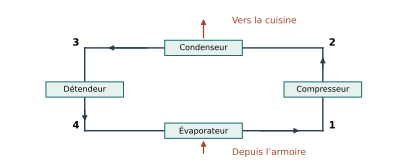
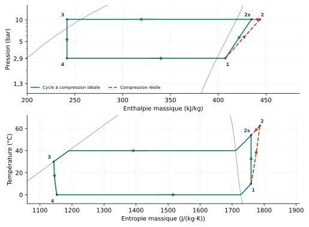
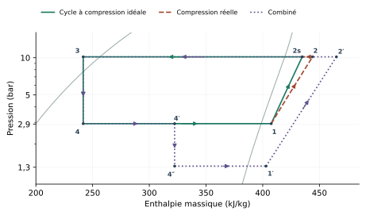
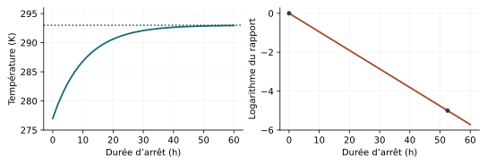

# Banque PT 2019 — Physique B · Thermodynamique · Corrigé brut

*Corrigé rédigé par IA, non officiel. Signalez toute erreur.*

**Rédaction** · GPT-6.2 Astra Ultra · vitesse non renseignée

**Révision (tour 1)** · GPT-6.2 Astra Ultra · vitesse non renseignée

[Sujet et document réponse](https://www.banquept.fr/documents/2019/ph_b_th_2019_pt.pdf) · [Rapport du jury](https://www.banquept.fr/documents/ecrit/rapport/2019/rapport_phys_b_ecrit_2019.pdf) · [Coefficients de la session](https://www.banquept.fr/documents/livret/2019/Livret_PT_2019.pdf#page=12)

**Le réfrigérateur et le combiné réfrigérateur-congélateur.** Les puissances et transferts sont orientés explicitement dans les bilans. Les valeurs relevées graphiquement sont arrondies à la précision des diagrammes du sujet.

## A · Machine réfrigérante ditherme

### Question 1 · Sens des trois échanges

Le réfrigérateur extrait de la chaleur de l’armoire, donc $Q_f>0$. Il rejette de la chaleur dans la cuisine, donc $Q_c<0$. Le compresseur fournit un travail au fluide, donc $W>0$.

### Question 2 · Borne de l’efficacité

L’effet utile est $Q_f$ et l’énergie dépensée est $W$. Ainsi $e_f=Q_f/W$. Comme $Q_c+Q_f+W=0$ et $Q_c/T_c+Q_f/T_f\leq0$, on obtient $W\geq Q_f(T_c-T_f)/T_f$, puis $e_f\leq e_{f,\max}=T_f/(T_c-T_f)$. L’égalité exige la réversibilité du cycle, avec les températures exprimées en kelvins.

## B · Cycle à compression de vapeur

### Question 3 · Schéma de l’installation

Placer 1 entre l’évaporateur et le compresseur, 2 au refoulement vers le condenseur, 3 à l’entrée du détendeur et 4 entre le détendeur et l’évaporateur. La chaleur va de l’armoire froide vers le fluide dans l’évaporateur et du fluide vers la cuisine chaude dans le condenseur. Le sens du fluide est 1→2→3→4→1.

### Question 4 · Cycle à compresseur idéal

Sur la figure 2a, situer 1 sur l’isobare d’évaporation à 10 °C, puis 2s sur son isentrope jusqu’à l’isobare de condensation. Le point 3 se trouve sur cette isobare à 30 °C, à gauche de la branche liquide. Descendre de 3 à enthalpie constante vers 4, puis suivre l’isobare basse jusqu’à 1. Sur la figure 2b, 1→2s est vertical, la condensation et l’évaporation présentent des paliers à 40 et 0 °C. Le sous-refroidissement, la détente et la surchauffe relient leurs extrémités. Le tracé distingue aussi la compression réelle demandée aux questions 9 et 11.

### Question 5 · Colonnes du tableau 3

Les valeurs centrales lues ci-dessous gardent une décimale intermédiaire lorsque c’est utile pour des différences. Pour les bilans à deux chiffres significatifs, on arrondit après avoir formé les différences. Les températures de surchauffe et de sous-refroidissement sont imposées. Les deux dernières colonnes seront utilisées pour le combiné.

| Point | Pression (bar) | Température (°C) | État du fluide | Enthalpie (kJ/kg) |
|:--|--:|--:|:--|--:|
| 1 | 2,9 | 10 | vapeur surchauffée | ≈408 |
| 2s | 10 | ≈54 | vapeur surchauffée | ≈435 |
| 2 | 10 | ≈63 | vapeur surchauffée | ≈444 |
| 3 | 10 | 30 | liquide sous-refroidi | ≈242 |
| 4 | 2,9 | 0 | liquide et vapeur | ≈242 |
| 1′ | 1,3 | 0 | vapeur surchauffée | ≈403 |
| 2′ | 10 | 80 | vapeur sèche | 465 |

À titre de repère pour 2b, les entropies en 1, 2s, 2, 3 et 4 sont environ 1760, 1760, 1790, 1140 et 1150 J/(kg·K).

### Question 6 · Températures de changement d’état

Dans l’évaporateur, la chaleur va de l’armoire vers le fluide. Il faut $T_{\rm évap}\leq T_f$. Au condenseur, le fluide chauffe la cuisine. Il faut $T_{\rm cond}\geq T_c$. Un appareil de taille finie échange une puissance non nulle grâce à des écarts stricts.

### Question 7 · Approximation isobare

On suppose négligeables les pertes de charge du fluide dans les échangeurs, ainsi que les différences de pression hydrostatique. Pour le R134a pur à l’équilibre diphasé, chaque pression de saturation fixe la température du palier.

### Question 8 · Écart au comportement de gaz parfait

Pour un gaz parfait, $h=h(T)$ et une isotherme serait verticale dans le diagramme $P(h)$. Dans la région de compression proche de la saturation, les isothermes sont inclinées. La vapeur sèche présente donc des écarts au gaz parfait, sensibles pour la lecture des températures et des travaux du cycle.

## B · Compression réelle et efficacité

### Question 9 · Compression réelle sur le plan pression-enthalpie

Le saut enthalpique est $(h_{2s}-h_1)/0{,}75\simeq(435-408)/0{,}75=36$ kJ/kg. Placer 2 à $h_2\simeq444$ kJ/kg et 10 bar, à droite de 2s. Le cycle réel utilise 1→2 puis reprend l’isobare haute jusqu’à 3, la détente verticale 3→4 et l’isobare basse 4→1. Les trajets apparaissent aux questions 4 et 25.

### Question 10 · État de refoulement réel

La colonne 2 du tableau 3 contient environ 10 bar, 63 °C, **vapeur surchauffée**, 444 kJ/kg. L’intervalle graphique entre deux isothermes explique qu’une lecture voisine de 60 à 65 °C soit raisonnable.

### Question 11 · Cycle réel dans le plan entropique

Le point 2 se place vers 1790 J/(kg·K) et 63 °C, à droite et au-dessus de 2s. Depuis 1, monter jusqu’à 2. Suivre ensuite l’isobare haute pendant le refroidissement, la condensation à 40 °C et le sous-refroidissement à 30 °C. La détente mène à 4, puis l’isobare basse ramène à 1. Le second panneau de la figure de la question 4 montre ce trajet.

### Question 12 · Entropie de compression

Pour la compression réversible, $s_{2s}=s_1$. Pour la compression réelle adiabatique, $s_2-s_1=s_{\rm créée}>0$ par kilogramme. On obtient ainsi $s_2>s_{2s}$ à la même pression finale.

### Question 13 · Premier principe en écoulement

En régime stationnaire, par unité de masse, $h_j-h_i+(V_j^2-V_i^2)/2+g(z_j-z_i)=q_{ij}+w_{ij}$. Les deux transferts sont comptés positivement vers le fluide. Le travail indiqué exclut le travail des forces de pression aux sections, déjà incorporé dans l’enthalpie.

### Question 14 · Ordre de grandeur gravitationnel

Dans un appareil de l’ordre de 1 à 2 m de hauteur, $|g\Delta z|$ vaut au plus une vingtaine de J/kg. Les écarts d’enthalpie de compression et d’échange sont de l’ordre de $10^4$ à $10^5$ J/kg. Le terme de pesanteur est donc négligeable sur cette échelle.

### Question 15 · Débit massique dans une conduite

Le débit volumique vaut $SV$, donc le débit massique est $D=\rho SV=SV/v$. Ici $V$ désigne la vitesse en m/s et $v=1/\rho$ le volume massique en m³/kg.

### Question 16 · Maximum de volume massique

Le maximum est atteint en 1, à la sortie de l’évaporateur. Sur 4→1, le titre augmente puis la vapeur se dilate par surchauffe. Sur le côté haute pression, la compression réduit fortement le volume et la condensation le réduit encore. Les isochores de l’abaque confirment $v_{\max}\simeq7\times10^{-2}$ m³/kg.

### Question 17 · Vitesse maximale

Avec $S=10^{-4}$ m² et $D=10^{-2}$ kg/s, la vitesse maximale vaut $Dv_{\max}/S=7{,}0$ m/s. Le maximum de vitesse coïncide avec celui du volume massique à section et débit fixés.

### Question 18 · Ordre de grandeur cinétique

L’énergie cinétique massique maximale est $7^2/2\simeq25$ J/kg. Une variation de ce terme ne dépasse donc pas 0,025 kJ/kg, très en dessous des dizaines de kJ/kg de compression et des transferts dans les échangeurs.

### Question 19 · Efficacité exprimée en enthalpies

L’évaporateur est fixe et sans arbre, donc $q_{41}=h_1-h_4$. La compression adiabatique donne $w_{12}=h_2-h_1$ après suppression des termes cinétique et potentiel. Le débit est identique dans les deux organes, donc $e_f=(h_1-h_4)/(h_2-h_1)$.

### Question 20 · Valeur de l’efficacité frigorifique

Les lectures du tableau donnent $e_f\simeq(408-242)/(444-408)\simeq4{,}6$. L’incertitude sur un écart de quelques dizaines de kJ/kg explique la sensibilité du quotient aux arrondis de l’abaque.

### Question 21 · Puissances frigorifique et mécanique

La puissance extraite de la source froide vaut $D(h_1-h_4)\simeq0{,}010\times166\simeq1{,}7$ kW. La puissance du compresseur vaut $D(h_2-h_1)\simeq0{,}010\times36=0{,}36$ kW.

### Question 22 · Rôle de la surchauffe

La surchauffe assure l’entrée de vapeur sèche malgré les fluctuations de température et d’écoulement. Elle prévient l’entraînement de gouttelettes et les coups de liquide dans le compresseur.

### Question 23 · Rôle et limite du sous-refroidissement

Abaisser $h_3$ abaisse aussi $h_4$ puisque la détente est isenthalpique. Chaque kilogramme absorbe alors davantage de chaleur dans l’évaporateur et une moindre part est déjà vaporisée à son entrée. En fin de condenseur, la cuisine est voisine de 20 °C. À mesure que le fluide s’en rapproche, l’écart moteur de température disparaît. Une surface finie ne permet pas d’atteindre exactement cette limite avec un débit fini.

## C · Association réfrigérateur-congélateur

### Question 24 · Partage de la puissance des évaporateurs

À −20 °C, la saturation impose environ 1,3 bar. À cette pression et à 0 °C, la vapeur 1′ a $h_{1'}\simeq403$ kJ/kg. La détente donne $h_{4'}=h_{4''}$. L’égalité des puissances impose $h_{4'}-h_4=h_{1'}-h_{4''}$, donc $h_{4'}=h_{4''}=(h_4+h_{1'})/2\simeq322$ kJ/kg. Situer 4′ sur l’isobare 2,9 bar, puis descendre verticalement à 1,3 bar pour 4″. Chaque évaporateur extrait environ 80 kJ/kg.

### Question 25 · Tracé du combiné

Sur la figure 2a, suivre 3→4 (détente à 242 kJ/kg), 4→4′ (évaporation partielle à 2,9 bar), 4′→4″ (détente à 322 kJ/kg), 4″→1′ (évaporation et surchauffe à 1,3 bar), 1′→2′ (compression), puis 2′→3 à haute pression. L’état 2′ imposé correspond à 10 bar, 80 °C et 465 kJ/kg. Le diagramme réunit les trois tracés demandés. Les branches confondues gardent les mêmes coordonnées, et la seconde détente verticale distingue le combiné.

### Question 26 · Titre de vapeur après la seconde détente

La fraction massique de vapeur augmente pendant 4′→4″. À enthalpie constante, la pression et la température de saturation diminuent, et une partie du liquide se vaporise. Le segment de détente va vers des isotitres supérieurs, d’environ 0,62 à 0,70 pour les lectures centrales.

### Question 27 · Efficacité du combiné

L’efficacité globale vaut $[(h_{4'}-h_4)+(h_{1'}-h_{4''})]/(h_{2'}-h_{1'})$. Avec l’égalité des deux enthalpies de laminage, elle se réduit à $(h_{1'}-h_4)/(h_{2'}-h_{1'})\simeq(403-242)/(465-403)\simeq2{,}6$. Le niveau plus froid exige un travail de compression plus important.

## D · Température de l’armoire

### Question 28 · Signe de la conductance de fuite

La chaleur reçue par l’armoire est positive pour $T_c>T$. Dans $P_{\rm th}=\lambda(T_c-T)$, il faut donc $\lambda>0$. Son unité est le W/K.

### Question 29 · Équation de réchauffement

Le bilan sur l’intérieur de l’armoire donne $C\,dT/dt=\lambda(T_c-T)$. Il s’applique au modèle à température uniforme et capacité constante, avec $T(0)=T_f$.

### Question 30 · Évolution à l’arrêt

En posant $\tau=C/\lambda$, la solution est $T(t)=T_c+(T_f-T_c)e^{-t/\tau}$. Elle vaut initialement $T_f$ et tend vers $T_c$ lorsque la durée d’arrêt devient grande.

### Question 31 · Températures de l’armoire et de la cuisine

À l’instant initial, le graphe coupe l’axe vers $T_f=277$ K, soit environ 4 °C. À long terme, il tend vers $T_c=293$ K, soit environ 20 °C. L’écart utile est voisin de 16 K. Ces lectures gardent le kelvin comme résolution.

### Question 32 · Pente logarithmique et fuite thermique

La solution précédente donne $Y=\ln[(T-T_c)/(T_f-T_c)]=-\lambda t/C$. Le libellé placé à gauche de l’axe du sujet inverse le signe du dénominateur. La formule du texte au-dessus du graphe est correcte. Le rapport des deux différences négatives vaut un à l’origine. La droite passe par $(0,0)$ et environ $(52{,}5\ {\rm h},-5)$. Sa pente vaut $-0{,}095$ h⁻¹, soit $-2{,}65\times10^{-5}$ s⁻¹. Avec $C=3\times10^5$ J/K, cela donne $\lambda\simeq7{,}9$ W/K et $\tau\simeq10{,}5$ h.

### Question 33 · Efficacité au régime régulé

La température intérieure est maintenant $T_f$. Le coefficient de performance est $K T_f/(T_c-T_f)=0{,}25\times277/16\simeq4{,}3$. Le modèle de cette partie repose sur le rapport donné $K=0{,}25$.

### Question 34 · Puissance des infiltrations thermiques

La chaleur entrant à travers les parois correspond à $P_{\rm th}=\lambda(T_c-T_f)\simeq7{,}9\times16\simeq1{,}3\times10^2$ W.

### Question 35 · Puissance nécessaire du compresseur

Le compresseur doit recevoir $P_c=P_{\rm th}/e_f\simeq(7{,}9\times16)/4{,}33\simeq29$ W. La consommation baisse lorsque la conductance des parois diminue.

### Question 36 · Équation de la mise en route

Le bilan est $C\dot T=\lambda(T_c-T)-P_cKT/(T_c-T)$. En comparant avec $\dot T=-AT/(T_c-T)+B(T_c-T)$, on trouve $A=KP_c/C$ en K/s et $B=\lambda/C$ en s⁻¹. Les deux termes ont le signe attendu lorsque l’armoire est plus froide que la cuisine.

### Question 37 · Temps de refroidissement sans fuite

Sans fuite, $B=0$ et $(T_c/T-1)\,dT=-A\,dt$. L’intégrale donne la solution implicite $At=T_c\ln(T_c/T)-(T_c-T)$. Pour atteindre $T_f$, il faut donc $t_f=[T_c\ln(T_c/T_f)-(T_c-T_f)]/A$. La durée est positive car $-\ln(1-u)>u$ pour $0<u<1$. Avec les valeurs précédentes, on retrouve environ cinq heures.

### Question 38 · Influence des fuites pendant le démarrage

Avec les fuites, la courbe est encore proche de 280 K après 5 h, au-dessus de la consigne de 277 K. L’approche se poursuit pendant plusieurs dizaines d’heures. Avec la puissance exactement calculée pour compenser les pertes à 277 K, la dérivée s’annule à cette température. Dans le modèle continu, l’équilibre est atteint asymptotiquement.

## E · Comparaison des fluides

### Question 39 · Condition de surpression

La pression de vapeur saturante augmente avec la température. Si $T_{\rm évap}>T_{\rm eb}$, alors $P_{\rm évap}=P_{\rm sat}(T_{\rm évap})>P_{\rm sat}(T_{\rm eb})=P_{\rm atm}$. La basse pression étant le minimum du cycle dans le modèle, tout le circuit est en surpression. À −20 °C, cela vaut pour le R134a et le R717. Le tableau donne 0,728 bar pour le R600a, dont la température d’ébullition à 1 bar est −11,7 °C.

### Question 40 · Production frigorifique volumique

Un kilogramme absorbe $h_{1'}-h_4$ dans l’évaporateur unique puisque la détente conserve $h_3=h_4$. Son volume à l’aspiration est $v_{1'}$. La production frigorifique volumique vaut $(h_{1'}-h_4)/v_{1'}$, en kJ/m³. Pour le R134a, $(403-242)/0{,}16\simeq1{,}0\times10^3$ kJ/m³, en accord avec le tableau.

### Question 41 · Choix domestique face à l’ammoniac

Trois arguments du tableau favorisent le R600a et le R134a. Leur COP atteint 2,7 et 2,6, contre 2,4 pour le R717. Leur refoulement reste à 70 et 80 °C, contre 210 °C, ce qui réduit les contraintes thermiques. Enfin, leurs pressions de refoulement sont 5,36 et 10,2 bar, inférieures aux 15,5 bar de l’ammoniac. Pour ces données, l’ammoniac garde une forte production frigorifique volumique.

### Question 42 · Pouvoir de réchauffement et inflammabilité

Pour les usages décrits par le sujet de 2019, deux priorités peuvent expliquer les choix indiqués. L’isobutane R600a a un GWP de 3, contre 1300 pour le R134a, et limite donc l’impact climatique direct d’une fuite. Il est inflammable, tandis que le R134a est classé non combustible dans le document 2. Accorder davantage de poids au risque d’incendie peut favoriser ce dernier. L’ODP est nul pour les deux et ne les départage pas.
