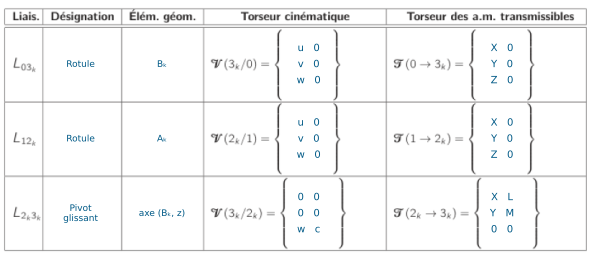
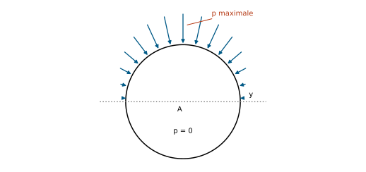
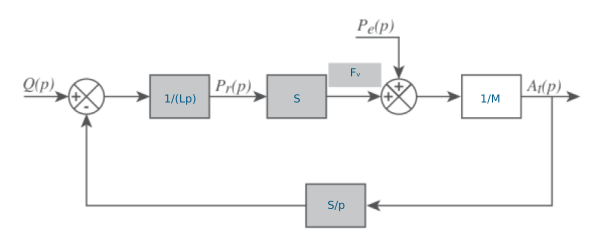
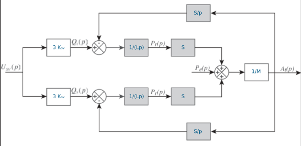
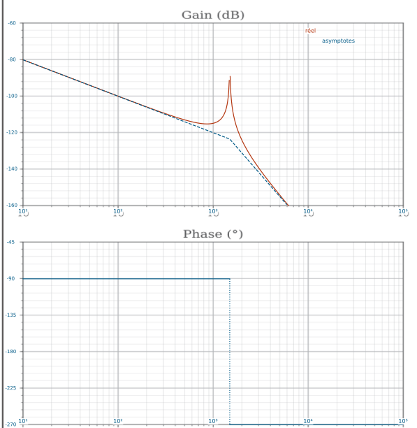
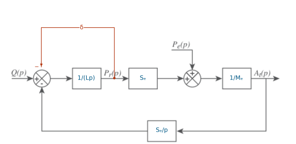
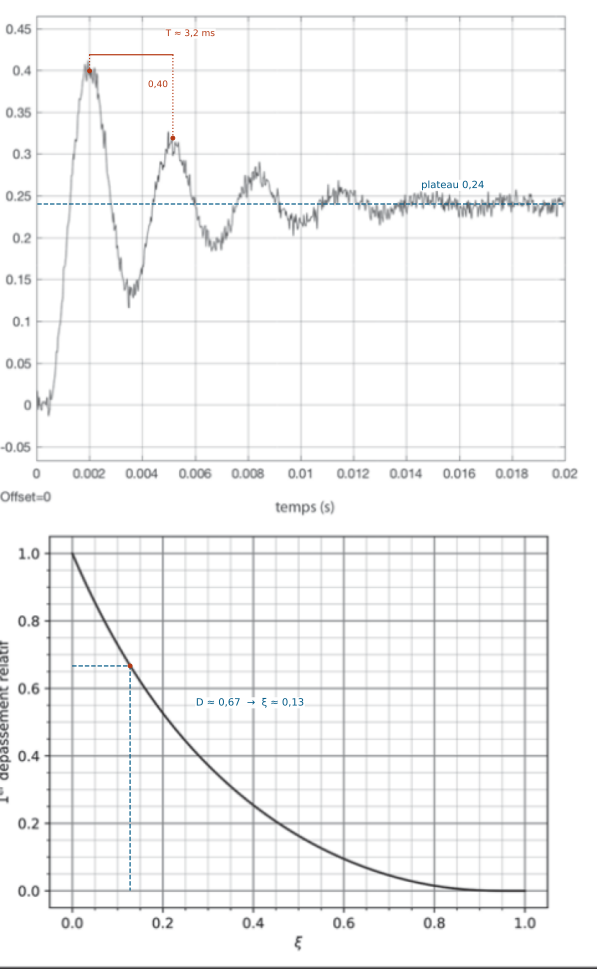
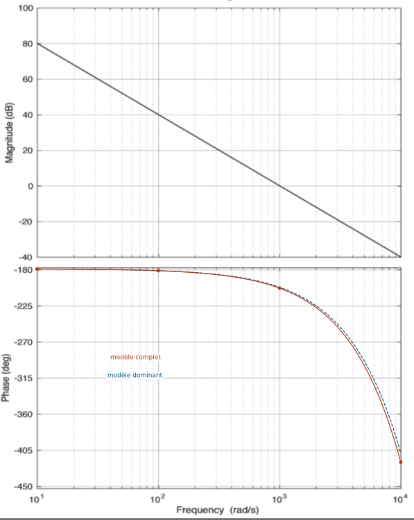
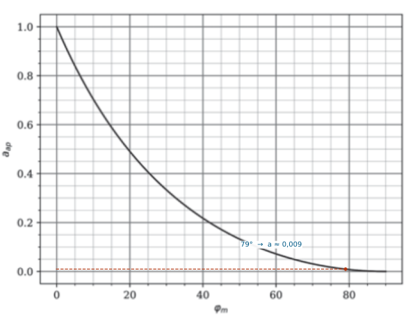
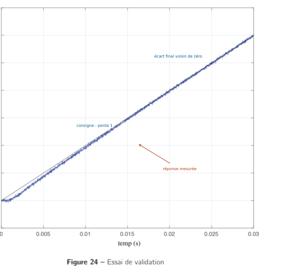

# Banque PT 2019 — Sciences industrielles A · Corrigé brut

*Corrigé rédigé par IA, non officiel. Signalez toute erreur.*

**Rédaction** · GPT-6.2 Astra Ultra · vitesse non renseignée · 26 novembre 2026

**Révision (tour 1)** · GPT-6.2 Astra Ultra · vitesse non renseignée · 26 novembre 2026

**Table sismique AZALÉE.** Épreuve de cinq heures, calculatrice interdite. Le sujet est accompagné des annexes A et B et d’un cahier de réponses. Ses 47 questions se répartissent en trois parties.

[Sujet et cahier officiels](https://www.banquept.fr/documents/2019/si_a_2019_pt.pdf) · [Rapport du jury](https://www.banquept.fr/documents/ecrit/rapport/2019/rapport_si_a_ecrit_2019.pdf)

## I. Mouvements sismiques et architecture mécanique

### Question 1 — Flexion du montant

Le montant est encastré en A et guidé en B. Pour la flèche suivant $y$, $EI v''=F(H-z)+M_B^*$, où $M_B^*$ est le couple terminal compté positivement dans le sens de la courbure choisie. Avec $v'(0)=v'(H)=0$, l'intégration donne $M_B^*=-FH/2$, puis $v'(z)=Fz(H-z)/(2EI)$. Comme $v(0)=0$, $v(H)=FH^3/(12EI)$. Ainsi $k=12EI/H^3=Ea^4/H^3$ avec $I=a^4/12$. Avec la convention de cohésion du feuillet, le moment autour de $x$ est $-EI v''$.

[Sujet p. 7](https://www.banquept.fr/documents/2019/si_a_2019_pt.pdf#page=7) · [Cahier p. 34 du PDF](https://www.banquept.fr/documents/2019/si_a_2019_pt.pdf#page=34)

### Question 2 — Oscillations libres

Le toit de masse $m$ se déplace de $y$ par rapport au sol fixe. La force totale des montants vaut $-4ky$ suivant $y$. Le théorème de la résultante dynamique donne $m\ddot y+4ky=0$, de pulsation propre $\sqrt{4k/m}$.

### Question 3 — Excitation par la base

Le toit a pour déplacement absolu $Y_s+y$ et chaque montant se déforme de $y$. Ainsi $m(\ddot Y_s+\ddot y)=-4ky$. Dans la forme demandée, $\omega=\sqrt{4k/m}$ et $f=-\ddot Y_s=A_s\omega_s^2\sin(\omega_s t)$.

### Question 4 — Adapter la structure au spectre régional

Pour une composante harmonique, hors résonance, l'amplitude relative vaut $A_s\omega_s^2/|\omega^2-\omega_s^2|$. À proximité de $\omega$ les déplacements augmentent ; au modèle non amorti, l'excitation résonante produit une amplitude qui croît dans le temps. On déplace donc les fréquences propres en agissant sur sections, contreventements ou masses, et l'on peut introduire de l'amortissement. Une vérification sur plusieurs enregistrements tient compte des autres modes et de la variabilité du séisme.

### Question 5 — Liaisons d’une branche verticale

Le graphe d'une branche est $0-3_k-2_k-1$. Les composantes sont données dans $(x,y,z)$, pour la position verticale de la figure 8. Au centre $B_k$, la rotule $0/3_k$ admet une rotation $(u,v,w)$ et une vitesse nulle ; son action transmissible est une force $(X,Y,Z)$ et un moment nul. Au centre $A_k$, la rotule $1/2_k$ a les mêmes formes, avec ses propres inconnues. Sur l'axe $(B_k,z)$, le pivot glissant $2_k/3_k$ admet rotation $(0,0,w)$ et vitesse $(0,0,c)$ ; il transmet une force $(X,Y,0)$ et un moment $(L,M,0)$ en tout point de l'axe. Cela complète les trois lignes pour les sens des torseurs préimprimés.



[Sujet p. 8](https://www.banquept.fr/documents/2019/si_a_2019_pt.pdf#page=8) · [Cahier p. 35 du PDF](https://www.banquept.fr/documents/2019/si_a_2019_pt.pdf#page=35)

### Question 6 — Mobilités et hyperstatisme

Les huit vérins à course libre permettent six mouvements indépendants de la table. Dans chaque branche, corps et tige peuvent chacun tourner autour de leur axe sans déplacer la table. D'où $m_i=16$, $m_u=6$, $m_c=22$. Il y a 17 solides mobiles et $8(3+4+3)=80$ contraintes scalaires. La relation $m_c-h=6\times17-80=22$ donne $h=0$ en configuration régulière.

### Question 7 — Effort maximal d’un vérin vertical

À charge maximale centrée et accélération verticale maximale vers le haut, les quatre efforts sont égaux. $4F_{\max}-(M_t+M_s)g=(M_t+M_s)3g$. D'où $F_{\max}=125\,000\times9{,}81=1{,}226\times10^6\ \mathrm N$. La situation combinant accélération vers le bas et poids donne un module plus faible.

### Question 8 — Compression du contact

La translation $U\vec z$ donne $U_n=U\cos\theta$. La loi unilatérale donne $p=KU\max(\cos\theta,0)$. Pour $U>0$, le contact comprimé est la calotte $0\leq\theta<\pi/2$, tous azimuts $0\leq\varphi<2\pi$. La pression s'annule à l'équateur et sur la moitié inférieure.

### Question 9 — Équilibre vertical de la tête

La table exerce $-p\vec e_r\,dS$ sur la tête. En projetant l'équilibre sur $z$, $F_{\max}=KU R^2\int_0^{2\pi}d\varphi\int_0^{\pi/2}\cos^2\theta\sin\theta\,d\theta=(2\pi/3)KUR^2$.

### Question 10 — Pression maximale

$KU=p_{\max}=3F_{\max}/(2\pi R^2)\simeq9{,}37\ \mathrm{MPa}$ pour $R=0{,}25$ m. En fonction de ce maximum, $p=p_{\max}\cos\theta$ en haut et $p=0$ sur la zone décollée.

### Question 11 — Répartition en coupe

Les flèches normales sont radiales vers A, de longueur proportionnelle à $p_{\max}\cos\theta$ sur la demi-circonférence supérieure. Au sommet elles figurent le maximum de Q10 ; elles se raccourcissent jusqu'à zéro à l'équateur. La moitié inférieure est déchargée.



[Sujet p. 11](https://www.banquept.fr/documents/2019/si_a_2019_pt.pdf#page=11) · [Cahier p. 38 du PDF](https://www.banquept.fr/documents/2019/si_a_2019_pt.pdf#page=38)

### Question 12 — Direction de glissement

$\vec V(M,2/1)=\omega R\,\vec x\times\vec e_r$. Puisque $\omega>0$, $\vec t=(\vec x\times\vec e_r)/\|\vec x\times\vec e_r\|$. Aux deux points de l'axe la vitesse est nulle ; ils ne contribuent pas aux intégrales.

### Question 13 — Traction tangentielle

En glissement, la densité de force tangentielle de 1 sur 2 est $-\mu p\vec t$ ; l'élément de force est $d\vec T=-\mu p\vec t\,dS$. Son unité est respectivement le pascal et le newton.

### Question 14 — Résultante de contact

Avec les intégrales données p. 12, $\vec R_{12}=-p_{\max}\int\cos\theta(\vec e_r+\mu\vec t)\,dS$. Cela donne $\vec R_{12}=\pi R^2p_{\max}(\mu\vec y-2\vec z/3)$, donc $Z_{12}=2\pi R^2p_{\max}/3=F_{\max}$ et $Y_{12}=\mu\pi R^2p_{\max}$. Le signe positif de la composante transversale traduit l'opposition au glissement.

### Question 15 — Moment de frottement

Le moment élémentaire est $-\mu pR(\vec e_r\times\vec t)\,dS$. Avec la dernière intégrale fournie, $\vec M_A=-2\pi\mu p_{\max}R^3\vec x$. On trouve $M_{12}=2\pi\mu p_{\max}R^3$ ; son sens s'oppose à la rotation imposée.

### Question 16 — Validité de la rotule parfaite

En utilisant les résultats fournis par le sujet, $\alpha=3\mu/2$ et $\beta=3\mu R/y_{\max}=6\mu$. Les deux rapports doivent être strictement inférieurs à 0,10, donc $\mu<1/60\simeq0{,}0167$. Ce faible frottement impose une lubrification adaptée ; l'hypothèse de rotule parfaite doit être vérifiée en conditions d'essai. Contrôle du feuillet. Les deux intégrales tangentielles imprimées diffèrent de celles du modèle géométrique annoncé. Sur le disque unité projeté, $\cos\theta\,dS=R^2\,dx\,dy$. À $x$ fixé, posons $b=\sqrt{1-x^2}$ ; $t_y=-\sqrt{b^2-y^2}/b$ et $(\vec e_r\times\vec t)_x=b$. En intégrant pour $|y|\leq b$, puis $|x|\leq1$, on obtient respectivement $-\pi^2 R^2/4$ et $8R^2/3$. Avec ces intégrales recalculées, $\alpha=3\pi\mu/8$, $\beta=4\mu R/(\pi y_{\max})$ et la borne devient $\mu<\pi/80\simeq0{,}0393$. Le premier seuil est la réponse suivant les indications du concours.

## II. Transmission hydraulique et comportement en boucle fermée

### Question 17 — Filtre de suivi recherché

On vise un passe-bas de gain statique unitaire, à gain voisin de 1 et faible déphasage entre 1 et 50 Hz. La coupure doit dépasser $2\pi\times50\simeq314\ \mathrm{rad\,s^{-1}}$. La décroissance à plus haute fréquence évite de reproduire le bruit et des sollicitations hors bande.

[Sujet p. 15](https://www.banquept.fr/documents/2019/si_a_2019_pt.pdf#page=15) · [Cahier p. 41 du PDF](https://www.banquept.fr/documents/2019/si_a_2019_pt.pdf#page=41)

### Question 18 — Choix de la pulsation de coupure

Pour un mode dominant intégrateur en boucle ouverte la pulsation à 0 dB et la coupure en boucle fermée coïncident ; plus généralement elles dépendent de la marge et sont du même ordre pour une boucle bien amortie. On choisit la coupure au-dessus de 314 rad/s. Le choix retenu pour la suite, $1000\ \mathrm{rad\,s^{-1}}$ (159 Hz), donne environ 0,41 dB d'atténuation à 50 Hz dans un modèle fermé du premier ordre. L'expression « sans atténuation » ne fixe pas à elle seule une coupure numérique unique.

### Question 19 — Servo-valves par vérin

Une valve fournit nominalement 700 L/min. Il en faut $\lceil2000/700\rceil=3$ par vérin. Excitées par la même tension, les trois branches donnent $H_{sv1}=3K_{sv}=6\times10^{-4}\ \mathrm{m^3\,s^{-1}\,V^{-1}}$.

### Question 20 — Blocs du vérin unique

Avec conditions initiales nulles, $Q=Sp\Lambda+LpP_r$, en posant $L=V_0/(2B)$, $F_v=SP_r$ et $A_t=p^2\Lambda$. Du comparateur de débit à la pression placer $1/(Lp)$, puis $S$ de la pression à la force. Indiquer $F_v(p)$ sur la branche d'effort. Le retour négatif de l'accélération au débit vaut $S/p$.



[Sujet p. 17](https://www.banquept.fr/documents/2019/si_a_2019_pt.pdf#page=17) · [Cahier p. 42 du PDF](https://www.banquept.fr/documents/2019/si_a_2019_pt.pdf#page=42)

### Question 21 — Dynamique de la masse unique

$M=M_t+M_s=125\,000$ kg en charge maximale. Le théorème de la résultante dynamique donne $M a_t=F_v+P_e$, avec $P_e=-Mg$ pour le seul poids, donc $P_e(p)=-Mg/p$ si appliqué en échelon. Une autre force extérieure verticale s'ajouterait algébriquement. Le dernier bloc, entre la somme des forces et l'accélération, vaut $1/M$.

### Question 22 — Transferts débit et perturbation

De $P_r=(MA_t-P_e)/S$ et $Q=SA_t/p+LpP_r$, on tire $(1+LMp^2/S^2)A_t=(p/S)Q+(L/S^2)p^2P_e$. Avec $D_1=1+p^2/\omega_v^2$, il vient $H_{vq}=K_vp/D_1$, $H_{vp}=K_pp^2/D_1$, où $K_v=1/S$, $K_p=L/S^2$ et $\omega_v=S/\sqrt{LM}$. Le coefficient de force tend bien vers $1/M$ à haute fréquence.

### Question 23 — Deux branches hydrauliques

Pour $i=1,2$, le premier comparateur retranche $(S/p)A_t$ au débit $Q_i$ fourni par le groupe de valves. Le résultat traverse $1/(Lp)$, donnant $P_{ri}$, puis $S$, donnant $F_{vi}$. Chaque groupe de valves est représenté par $3K_{sv}$. Les deux forces arrivent avec un signe plus au sommateur mécanique.



[Sujet p. 18](https://www.banquept.fr/documents/2019/si_a_2019_pt.pdf#page=18) · [Cahier p. 44 du PDF](https://www.banquept.fr/documents/2019/si_a_2019_pt.pdf#page=44)

### Question 24 — Somme des efforts sur la table

Le même ensemble $(M_t+M_s)$ subit maintenant les actions des deux vérins : $M a_t=F_{v1}+F_{v2}+P_e$. La sortie du sommateur traverse $1/M$. Le poids conserve $P_e(p)=-(M_t+M_s)g/p$, indépendamment du nombre des vérins.

### Question 25 — Transferts à deux entrées de débit

$Q_1+Q_2=2SA_t/p+Lp(P_{r1}+P_{r2})$ et $S(P_{r1}+P_{r2})=MA_t-P_e$. Posons $D_2=1+LMp^2/(2S^2)$. Alors $A_t=p(Q_1+Q_2)/(2SD_2)+Lp^2P_e/(2S^2D_2)$. On lit $H_{vq1}=H_{vq2}=p/(2SD_2)$ et $H_{vp}=Lp^2/(2S^2D_2)$.

### Question 26 — Modèle équivalent pour deux vérins

Pour le débit commun demandé $Q=Q_1=Q_2$, $H_{2vq}=p/(SD_2)$ et $H_{2vp}=Lp^2/(2S^2D_2)$. Ainsi $K_{2v}=1/S$, $K_{2p}=L/(2S^2)$ et $\omega_{2v}=S\sqrt{2/(LM)}$. À $L$ fixé, les deux identifications demandées donnent $S_{eq2v}=S$, $M_{eq2v}=M/2$. Avec un débit d'entrée **total**, $K_{2v}$ deviendrait $1/(2S)$ ; il faut alors agréger aussi le volume de fluide.

### Question 27 — Gain des groupes de valves

Chaque vérin reçoit $Q_i=3K_{sv}U_{sv}$ et le débit **total** de six valves est $Q_1+Q_2=6K_{sv}U_{sv}$. Le gain du parc vaut donc $6K_{sv}$ pour le débit total. Si la sortie du bloc est le débit **commun par vérin** de Q26, le gain à placer dans la cascade est $H_{sv2}=3K_{sv}$. Les deux descriptions donnent le même transfert tension–accélération, car le gain hydraulique en débit total est divisé par deux.

### Question 28 — Extension à quatre vérins

En coordonnées de Q26, $S_{eq4v}=S=0{,}05\ \mathrm{m^2}$, $M_{eq4v}=M/4=31\,250$ kg et $\omega_{4v}=2\omega_v$. Il faut douze valves ; le gain global de débit total est $H_{sv4}=12K_{sv}=0{,}0024$ en unités SI. Pour une sortie en débit individuel le gain est $3K_{sv}$, associé à $K_{4v}=1/S$. En débit total le gain d'accélération vaut $1/(4S)$, avec la section physique $4S$, le volume $4V_0$ et la masse $M$. Le sujet impose d'autres valeurs numériques pour les questions suivantes.

### Question 29 — Étalonnage du comparateur

$\varepsilon=K_{ae}A_c-CA_t$. Pour que $a_c=a_t$ donne un écart nul pour toute valeur commune, $K_{ae}=C=0{,}2\ \mathrm{V\,s^2\,m^{-1}}$. L'écart électrique est alors $C$ fois l'erreur d'accélération.

### Question 30 — Classe requise

À basse fréquence, le gain de boucle est $L_o\sim A/p^{\alpha-1}$ avec $A=CK_sK_{4v}K_{co}$. Pour une rampe unitaire, il faut au moins la classe un : $\alpha_{\min}=2$. L'erreur de traînage devient $1/A$ ; pour atteindre $5\times10^{-4}$ il faut en plus $A\geq2000$. En perturbation le transfert $H_{4vp}/(1+L_o)$ présente déjà un zéro en continu, d'où une erreur finale nulle sur un échelon de force, sous réserve de stabilité. La classe seule ne garantit pas la valeur numérique de l'erreur.

### Question 31 — Bode asymptotique du modèle sans fuite

Les valeurs imposées donnent $CK_sK_{4v}=10^{-3}$ et $L_o(p)=10^{-3}/[p(1+p^2/1500^2)]$ pour $K_{co}=1$. Le gain asymptotique vaut $-60-20\log_{10}\omega$ avant 1500 rad/s ; après la cassure ajouter $-40\log_{10}(\omega/1500)$. Pentes successives $-20$ et $-60$ dB/décade. Phase $-90^\circ$ avant la pulsation de la paire de pôles conjugués sur l'axe imaginaire, puis $-270^\circ$. La phase est indéfinie en 1500.



[Sujet p. 19](https://www.banquept.fr/documents/2019/si_a_2019_pt.pdf#page=19) · [Cahier p. 47 du PDF](https://www.banquept.fr/documents/2019/si_a_2019_pt.pdf#page=47)

### Question 32 — Gain et pulsation à 0 dB

Sur l'asymptote à 1000 rad/s, le gain vaut $-120$ dB pour $K_{co}=1$. Il faut donc relever l'asymptote de 120 dB, soit $K_{co}=10^6$ au minimum pour la cible asymptotique. Si l'on impose exactement $|L_o(j1000)|=1$, on trouve $K_{co}=1000\,|1-(1000/1500)^2|/10^{-3}=5{,}56\times10^5$. La résonance non amortie engendre plusieurs passages à 0 dB dans ce dernier cas. Il est donc essentiel de préciser le passage visé ; aucun de ces gains ne stabilise le modèle.

### Question 33 — Courbe réelle et stabilité

La courbe réelle monte vers $+\infty$ de part et d'autre de 1500 rad/s et rejoint ensuite l'asymptote haute fréquence. La phase passe de $-90^\circ$ à $-270^\circ$. Le gain modifie seulement l'ordonnée en dB. Le polynôme caractéristique est $p^3+\omega_v^2p+A\omega_v^2$. Pour $A>0$ le terme en $p^2$ est nul, ce qui exclut la stabilité stricte ; le tableau de Routh avec un petit coefficient positif compte deux changements de signe. Le diagramme de Q31 superpose les courbes à gain unitaire, la translation de Q32 s'appliquant aux deux.

### Question 34 — Introduire la fuite

Ajouter un retour négatif de gain $\delta$ de $P_r$ au comparateur d'entrée, en plus du retour $S_e A_t/p$. Avec $S_e=S_{eq4v}$, $M_e=M_{eq4v}$, et sans perturbation, $Q=S_e A_t/p+(Lp+\delta)M_e A_t/S_e$. D'où $H_{4v2}=(p/S_e)/(1+a_1p+p^2/\omega_{4v}^2)$, où $a_1=M_e\delta/S_e^2$, $\omega_{4v}=S_e/\sqrt{LM_e}$ et $\xi_v=\delta\sqrt{M_e}/(2S_e\sqrt L)$.



[Sujet p. 20](https://www.banquept.fr/documents/2019/si_a_2019_pt.pdf#page=20) · [Cahier p. 48 du PDF](https://www.banquept.fr/documents/2019/si_a_2019_pt.pdf#page=48)

### Question 35 — Fuite et marges de stabilité

Posons $r=1000/1500=2/3$. À coupure maintenue, la marge de phase vaut $90^\circ-\arctan[2\xi_v r/(1-r^2)]$. Imposer $55^\circ$ donne la **borne supérieure** $\xi_v\leq0{,}292$. Pour traduire la valeur limite en débit, $\delta=2\xi_v S_e\sqrt{L/M_e}$. Avec les paramètres physiques par vérin de Q28 on obtient $3{,}69\times10^{-10}\ \mathrm{m^3\,s^{-1}\,Pa^{-1}}$, soit environ 266 L/min à 120 bar. Le déplacement seul consomme $Sv_{\max}=2100$ L/min (2000 nominalement dans l'annexe) ; trois valves plafonnent nominalement à 2100 L/min. Ajouter cette fuite excède cette capacité. Les paramètres dynamiques imposés p. 19 diffèrent des constantes déduites de Q28. En les interprétant comme un vérin équivalent avec le même $L$, $1/S_e=2$ et $\omega_{4v}=1500$ donnent $S_e=0{,}50$ et $M_e\simeq22\,222$ en SI. La même borne formelle donne alors $\delta=4{,}38\times10^{-9}$, soit environ 3150 L/min pour ce modèle équivalent. Peut-on satisfaire les deux marges ? À $\omega_{4v}$ la phase vaut $-180^\circ$ et le module vaut $r\sqrt{(1-r^2)^2+4\xi_v^2r^2}/(2\xi_v)>r^2$. La marge de gain est donc inférieure à $-40\log_{10}r=7{,}04$ dB, alors que 12 dB sont requis. Une coupure plus élevée sous la résonance aggrave cette borne ; au-dessus de la résonance la marge de phase est négative. Aucune fuite ne garantit simultanément les deux marges et la coupure spécifiées. Les chiffres précédents sont des limites de phase, pas un réglage réalisable pour tout le cahier des charges.

### Question 36 — Redimensionnement du vérin

Une décennie au-dessus de 1000 signifie $\omega_{4v}\geq10^4\ \mathrm{rad\,s^{-1}}$. En reprenant les caractéristiques physiques par branche, $S_{\min}=10^4\sqrt{(M/4)V_0/(2B)}=3{,}95\ \mathrm{m^2}$, soit $d_{\min}=\sqrt{4S_{\min}/\pi}=2{,}24$ m contre 0,252 m actuellement. Si l'on calibre plutôt la loi $\omega\propto d^2$ sur la pulsation imposée de 1500 au diamètre actuel, il faut encore $0{,}252\sqrt{10000/1500}=0{,}65$ m. Ces deux bases de calcul sont différentes ; dans les deux cas la taille et le débit à fournir pour la même vitesse rendent le choix peu réaliste.

## III. Identification et correction de la table

### Question 37 — Intégrer la tension par trapèzes

Pour des mesures de même longueur et des instants croissants, l'intégration part de zéro, l'essai commençant au repos. Le calcul accepte un pas variable.

```python
def IntTrap(T, Val):
    if len(T) != len(Val):
        raise ValueError("Les séries doivent avoir la même longueur")
    if not T:
        return []
    resultat = [0.0]
    for i in range(1, len(T)):
        dt = T[i] - T[i - 1]
        aire = dt * (Val[i - 1] + Val[i]) / 2
        resultat.append(resultat[-1] + aire)
    return resultat
```

L'appel est `IntTrap(T, Uacc)`. Pour obtenir la vitesse en m/s à partir de tensions, diviser l'intégrale mesurée par la sensibilité $C$ et ajouter la vitesse initiale si elle est connue et non nulle.

[Sujet p. 22](https://www.banquept.fr/documents/2019/si_a_2019_pt.pdf#page=22) · [Cahier p. 50 du PDF](https://www.banquept.fr/documents/2019/si_a_2019_pt.pdf#page=50)

### Question 38 — Limites de la vitesse reconstruite

Un décalage constant $b$ dans l'accélération devient une erreur $bt$ dans la vitesse. Une erreur de condition initiale persiste. Bruit à basse fréquence, projection résiduelle de la pesanteur et dérive de zéro altèrent les mesures longues ; le bruit de mesure rend incertaine la lecture des extrema. Un étalonnage au repos, une référence de vitesse ou de position et un filtrage compatible avec la bande utile réduisent ces erreurs.

### Question 39 — Identifier le second ordre sur la réponse

Le graphe donne un plateau proche de 0,24 et un premier maximum proche de 0,40. Le dépassement relatif est $(0{,}40-0{,}24)/0{,}24\simeq0{,}67$. L'abaque ou $D=\exp[-\pi\xi/\sqrt{1-\xi^2}]$ donne $\xi_v\simeq0{,}13$. Les maxima séparés d'environ 3,2 ms donnent $\omega_{4v}=2\pi/[T_p\sqrt{1-\xi_v^2}]\simeq2{,}0\times10^3\ \mathrm{rad\,s^{-1}}$. On place les zéros du filtre en choisissant $\xi_n=\xi_v$ et $\omega_n=\omega_{4v}$.



[Sujet p. 23](https://www.banquept.fr/documents/2019/si_a_2019_pt.pdf#page=23) · [Cahier p. 51 du PDF](https://www.banquept.fr/documents/2019/si_a_2019_pt.pdf#page=51)

### Question 40 — Robustesse de la compensation

Les zéros du filtre compensent les pôles du vérin pour la charge et les conditions hydrauliques identifiées. Si masse, raideur, température ou amortissement changent, une résonance résiduelle peut amplifier le signal et réduire les marges. Après chaque modification importante de la structure, identifier à faible amplitude, ajuster le filtre et vérifier les marges et la réponse avant l'essai proprement dit.

### Question 41 — Boucle compensée et mode dominant

Avec $\omega_d=10^5$ et $\xi_d=1$, $L_o=CK_sK_{4v}K_{i2}/[p(1+p/\omega_d)^2]$. Le coefficient du numérateur est $10^{-3}K_{i2}$. La coupure à $1000$ donne $K_{i2}\simeq10^6$ (exactement $1\,000\,100$ avec les facteurs rapides). Dans la bande utile le mode dominant est l'intégrateur $1000/p$.

### Question 42 — Critères du modèle dominant

Le modèle dominant donne la réponse fermée $1000/(p+1000)$, une bande à $-3$ dB de $1000$ rad/s et une marge de phase de $90^\circ$. Le modèle complet donne une bande fermée à −3 dB proche de 1021 rad/s, une marge de phase d’environ $89^\circ$ et une marge de gain proche de 46 dB ; ces deux marges dépassent 55° et 12 dB. L'erreur de traînage vaut presque $1/1000=10^{-3}\ \mathrm{m\,s^{-2}}$, deux fois le plafond $5\times10^{-4}$. La bande et les marges sont satisfaites, la précision en rampe reste insuffisante.

### Question 43 — Retard pur et erreur mesurée

La figure 23 montre un écart établi de l'ordre de $10^{-3}\ \mathrm{m\,s^{-2}}$. La figure 19 montre en outre un retard initial $T_r\simeq0{,}4$ ms : le premier pic arrive vers 2 ms pour une demi-pseudo-période proche de 1,6 ms. Acquisition, calcul numérique, transmission et réponse des valves peuvent contribuer à ce délai. Le facteur à ajouter à la chaîne directe est $e^{-T_r p}$ ; sa phase vaut $-\omega T_r$ radians. Son gain en continu reste 1. L'intégrateur unique explique déjà l'erreur de traînage de Q42 ; le retard réduit en plus les marges.

### Question 44 — Gain de l’intégration supplémentaire

Le module est multiplié par $K_{i3}/\omega$ et le retard a un module égal à un. À $1000$ rad/s on impose $K_{i3}/1000=1$, d'où $K_{i3}=1000\ \mathrm{s^{-1}}$. La boucle a maintenant deux intégrations nettes et son erreur asymptotique de rampe est nulle si la boucle fermée est stable.

### Question 45 — Phase déroulée avec retard

Dans le modèle dominant, $\phi=-180^\circ-(180/\pi)\omega T_r$. À 10, 100, 1000 et 10000 rad/s on trouve respectivement $-180{,}2^\circ$, $-182{,}3^\circ$, $-202{,}9^\circ$, $-409{,}2^\circ$. En conservant le double pôle à $10^5$, soustraire également $2\arctan(\omega/10^5)$ ; les quatre phases deviennent $-180{,}2^\circ$, $-182{,}4^\circ$, $-204{,}1^\circ$, $-420{,}6^\circ$. La phase décroît rapidement à droite de l'axe logarithmique.



[Sujet p. 25](https://www.banquept.fr/documents/2019/si_a_2019_pt.pdf#page=25) · [Cahier p. 54 du PDF](https://www.banquept.fr/documents/2019/si_a_2019_pt.pdf#page=54)

### Question 46 — Correcteur à avance de phase

À 1000 rad/s, la phase souhaitée vaut $-125^\circ$. Avec le modèle complet il faut environ $79{,}1^\circ$ d'avance. L'annexe A donne $a=(1-\sin\phi_m)/(1+\sin\phi_m)\simeq0{,}0092$. Puis $\tau=1/(1000\sqrt a)\simeq10{,}4$ ms et $K_{ap}=\sqrt a\simeq0{,}096$, ce qui conserve le module unitaire. Sur le modèle dominant seul on lit environ $78^\circ$, soit $a\simeq0{,}011$, $\tau\simeq9{,}5$ ms et $K_{ap}\simeq0{,}106$. Le réglage demandé impose la coupure et la marge de phase.



[Sujet p. 25](https://www.banquept.fr/documents/2019/si_a_2019_pt.pdf#page=25) · [Cahier p. 55 du PDF](https://www.banquept.fr/documents/2019/si_a_2019_pt.pdf#page=55)

### Question 47 — Validation sur la rampe mesurée

La figure 24 montre un décalage au démarrage, puis une convergence sur la droite de pente unitaire. Vers 20–30 ms, la différence moyenne est voisine de zéro à l'échelle du tracé, compatible avec $5\times10^{-4}\ \mathrm{m\,s^{-2}}$. Le comportement mesuré valide la poursuite sur cet essai. Une rampe seule ne mesure pas les marges fréquentielles. Pour le modèle complet avec le retard lu à 0,4 ms et le réglage de Q46, le passage de phase à $-180^\circ$ se situe près de $3{,}0\times10^3$ rad/s et la marge de gain vaut environ 9,9 dB, inférieure à 12 dB. Un contrôle fréquentiel indépendant est donc nécessaire pour valider toutes les exigences.



[Sujet p. 25](https://www.banquept.fr/documents/2019/si_a_2019_pt.pdf#page=25) · [Cahier p. 55 du PDF](https://www.banquept.fr/documents/2019/si_a_2019_pt.pdf#page=55)
