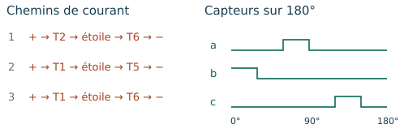
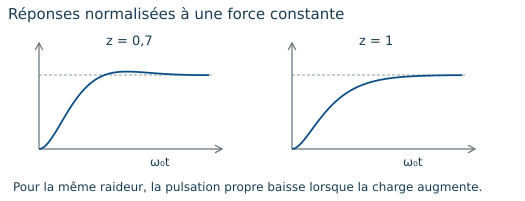
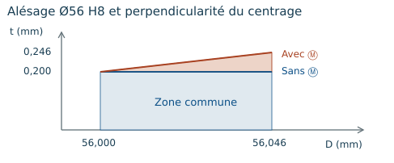
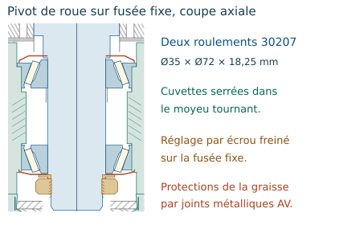

# Banque PT 2019 — Sciences industrielles C · Corrigé brut

*Corrigé rédigé par IA, non officiel. Signalez toute erreur.*

**Rédaction** · GPT-6.2 Astra Ultra · vitesse non renseignée · 26 novembre 2026

**Révision (tour 1)** · GPT-6.2 Astra Ultra · vitesse non renseignée · 26 novembre 2026

**Module de roue eCorner pour une citadine à traction avant.** Épreuve de six heures. Les 47 questions portent sur six parties, dont le jury indique les poids de 20 %, 20 %, 16 %, 13 %, 16 % et 15 %. Les points détaillés par question ne sont pas publiés.

[Sujet et planches](https://www.banquept.fr/documents/2019/si_c_2019_pt.pdf) · [Rapport du jury](https://www.banquept.fr/documents/ecrit/rapport/2019/rapport_si_c_ecrit_2019.pdf)

## I. Moteur et commutation de la roue

### Q1 · Vitesse limite par bilan de puissance

Les deux roues avant disposent ensemble de $P=2\times30=60\,\mathrm{kW}$. À vitesse constante, $P=F_{air}V=\rho S C_xV^3/2$. La racine cubique de $120000/(1,3\times0,8)$ donne $48,7\,\mathrm{m/s}$, soit **175 km/h**. Cette première estimation suppose la puissance maximale effectivement disponible aux deux pneus et la seule résistance aérodynamique.

### Q2 · Écart à l’exigence de vitesse

Les 150 km/h spécifiés sont inférieurs d’environ 25 km/h à ce résultat. La résistance au roulement des pneumatiques et les pertes des moteurs, convertisseurs et paliers réduisent la puissance disponible pour vaincre la traînée. La puissance limite et la vitesse maximale admissible du moteur peuvent aussi être atteintes à des régimes différents. À 150 km/h, la seule traînée demande ici environ 38 kW.

### Q3 · Accélérations de translation et de rotation

Avec $100\,\mathrm{km/h}=27,78\,\mathrm{m/s}$, l’accélération uniforme vaut $a=27,78/13=2,14\,\mathrm{m/s^2}$. Le rayon lu sur le diagramme est $R=0,56\,\mathrm m$. Le roulement sans glissement impose $\dot\omega=a/R=3,82\,\mathrm{rad/s^2}$. Avec l’arrondi à 30 m/s proposé par le sujet, les résultats sont 2,31 m/s² et 4,12 rad/s².

### Q4 · Couple nécessaire sur chaque roue motrice

Le bilan longitudinal donne $2F_t=Ma$. La contribution de traction au couple de chaque moteur vaut donc $C=F_tR=1500\times2,14\times0,56/2\simeq898\,\mathrm{N\,m}$, ou **970 N·m** avec 30 m/s. En incluant la traînée et en maintenant réellement l’accélération jusqu’à 100 km/h, le maximum se produit en fin de phase et vaut $R(Ma+\rho SC_x V_f^2/2)/2\simeq1010\,\mathrm{N\,m}$. L’inertie propre des roues et moteurs augmenterait le couple. Les 60 kW de crête ne permettent d’ailleurs pas de maintenir cette accélération à tous les régimes, l’hypothèse de Q3 caractérise une accélération moyenne.

### Q5 · Énergie récupérable au freinage

Une partie de l’énergie est dissipée mécaniquement par la traînée, les pneus et les plaquettes lorsque le freinage par génératrice est limité par l’adhérence, la vitesse ou le courant de charge admissible. Le reste traverse la machine, l’onduleur, les conducteurs et la batterie avec un rendement global inférieur à un. Le frein à friction et les pertes de conversion ont donc deux causes distinctes.

### Q6 · Choix du moteur-roue

Le moteur **outrunner**, à rotor extérieur, porte les aimants près de la jante sur un grand rayon. Une même force tangentielle engendre ainsi davantage de couple, et l’on peut répartir de nombreux pôles sur la périphérie. Le stator se fixe à la fusée. Cette architecture convient à la vitesse modérée d’une roue de traction directe.

### Q7 · Principe de l’effet Hall

Dans une plaquette parcourue par un courant, un champ magnétique transverse dévie les porteurs par la force de Lorentz. Leur accumulation sur les côtés crée une tension transverse proportionnelle au courant et à la composante normale du champ. Un conditionneur amplifie cette tension et applique un seuil pour livrer un état logique. La convention de détection des deux pôles pendant 30° est celle de l’exercice.

### Q8 · Chemins conducteurs sur les trois positions

Nommons 1, 2, 3 les phases reliées aux points milieux des branches T1/T4, T2/T5 et T3/T6. Avec le courant conventionnel, à la première position le chemin est **plus → T2 → phase 2 → étoile → phase 3 → T6 → moins**. À la deuxième, **plus → T1 → phase 1 → étoile → phase 2 → T5 → moins**. À la troisième, **plus → T1 → phase 1 → étoile → phase 3 → T6 → moins**. Les trois figures montrent des instants qui ne sont pas trois secteurs consécutifs. Chaque paire produit l’orientation de la grande flèche avec le sens de bobinage imprimé. Le troisième bras reste ouvert. Le cahier colorié restitue les chemins sur le dessin p. 34.

### Q9 · Chronogramme des capteurs

Les pôles sont diamétralement opposés. À la rotation horaire indiquée, un pôle passe successivement devant b, a puis c à 0°, 60° et 120°. Chaque impulsion dure 30°. Les états $(a,b,c)$ par tranches de 30° sont donc **010, 000, 100, 000, 001, 000**. À 180° commence une nouvelle impulsion de b. Le maintien des commandes lorsque les trois entrées retombent à zéro est indispensable.

### Q10 · Commande des mémoires de transistors

Sur ce demi-tour, l’impulsion de b donne la paire T2/T6, celle de a la paire T1/T5, celle de c la paire T1/T6. Pour des mémoires de niveau, les demandes (mise à 1, mise à 0) des transistors supérieurs sont donc $T1:(a\lor c,b)$, $T2:(b,a\lor c)$ et $T3:(0,a\lor b\lor c)$. T1 étant déjà passant quand survient c, on peut omettre la remise à 1 redondante à c en régime établi. Entre impulsions, chaque mémoire conserve son état.

Pour une commutation sur le tour mécanique complet avec une paire de pôles, il faut aussi distinguer les deux demi-tours. Les états de capteurs prescrits à Q9 sont identiques après 180°, tandis que le champ statorique doit s’inverser. Si $h=0$ désigne le premier demi-tour et $h=1$ le second, les phases positives au second sont les anciennes négatives, soit 3 à b, 2 à a et 3 à c. Les ensembles de mise à 1 sur le tour deviennent $S_1=\bar h(a\lor c)$, $S_2=\bar h b\lor ha$, $S_3=h(b\lor c)$. À chaque événement $e=a\lor b\lor c$, $R_i=e\land\overline{S_i}$. Le bit de demi-tour peut être mémorisé et initialisé sur un secteur connu. Des capteurs sensibles à la polarité apporteraient directement l’information complémentaire.

## II. Frein électronique à coins EWB

### Q11 · Torseurs du mécanisme vis–écrou

Au point A de l’axe, composantes dans la base 0, on note $[\Omega;V_A]$. La pivot du moteur donne $[p_{10}x_0;0]$. La liaison hélicoïdale donne $[p_{21}x_0;U_{A21}x_0]$, avec $U_{A21}=p_vp_{21}/(2\pi)$ pour un pas signé positif à droite. La glissière du coin donne $[0;U_{A20}x_0]$. Les autres composantes sont nulles.

### Q12 · Rotation de la vis et translation du coin

Par composition $p_{21}+p_{10}=0$ et $U_{A20}=U_{A21}$. Il vient $U_{A20}=-p_vp_{10}/(2\pi)$. Vue depuis l’écrou empêché de tourner, la vis tournant dans le sens positif commande donc une translation négative selon la convention de la base du document.

### Q13 · Torseurs du plateau et du rouleau

En C, le mouvement de 3 sur 2 est la translation suivant $y_0$ de la glissière verticale, soit $[0;V_{C32} y_0]$. Pour 4 sur 3, au point C et dans la base 3, le contact sans glissement donne $[r_{43}z_0;0]$. Pour 4 sur 0, au point B, $[r_{40}z_0;0]$. La planéité élimine les rotations autour de x et y ainsi que la translation suivant z. Les contacts annuleraient seulement la vitesse normale en présence de glissement. Ici ils annulent également la vitesse tangentielle relative.

### Q14 · Fermer la chaîne au contact B

On écrit $\{V_{20}\}+\{V_{32}\}+\{V_{43}\}+\{V_{04}\}=0$ en B. Avec $\overrightarrow{CB}=-d y_3$, le transport du champ de vitesse donne $V_{B43}=d r_{43}x_3$. La fermeture en rotation donne $r_{40}=r_{43}$. La fermeture en translation s’écrit $U_{A20}x_0+V_{C32}y_0+d r_{43}x_3=0$. Sa projection sur $y_3=-\sin\alpha\,x_0+\cos\alpha\,y_0$ donne **$V_{C32}=U_{A20}\tan\alpha$**. Le rouleau annule la vitesse relative tangentielle sans modifier la pente du mouvement du plateau.

### Q15 · Loi entrée–sortie du frein

La substitution de Q12 dans la fermeture donne $V_{C32}=-(p_v/2\pi)\,p_{10}\tan\alpha$. Le pas s’exprime en mètres par tour et $p_{10}$ en radians par seconde. Inverser la rotation inverse la translation de la plaquette.

### Q16 · Régime moyen pendant l’approche

La vitesse d’approche vaut $y_a/t_a=0,5/0,020=25\,\mathrm{mm/s}$. Il faut donc $25/(1/4)=100\,\mathrm{mm/s}$ au coin, soit $100/2=50$ tours de vis par seconde. La fréquence moyenne est $|N_{10}|=60y_a/(t_ap_v\tan\alpha)=\mathbf{3000}\,\mathrm{tr/min}$. Pour une approche vers $+y_0$, son signe est négatif dans la convention de Q12.

### Q17 · Précision et rapidité du frein

L’échelon de 1 400 N·m commence à 100 ms. Le couple réel commence à croître vers 120 ms et atteint la bande de 5 % vers 138–140 ms, soit un temps de réponse d’environ **40 ms**, dont 20 ms de retard. Le palier rejoint sensiblement la consigne. Le petit creux après 140 ms est de l’ordre de quelques pour cent. L’épaisseur de trait ne permet pas une erreur statique plus précise que quelques dizaines de N·m sur l’enregistrement.

### Q18 · Interpréter les trois phases

En P1, le moteur fournit la puissance qui déplace la vis et ferme le jeu. La plaquette n’appuie pas encore, donc le disque ne transmet pas de couple de frottement. En P2, le contact apparaît et la rotation du disque entraîne la plaquette sur les rampes. L’effet de coin amplifie son effort normal alors que la puissance du moteur de commande diminue. En P3, le coin maintient l’effort et le moteur de commande est immobile. Sa puissance mécanique est alors nulle, tandis que le disque freiné continue de dissiper de l’énergie tant qu’il tourne.

### Q19 · Charge linéique sur un rouleau

Les deux faces frottantes donnent $F=C_f/(2fR_{moy})=1400/(2\times(1/3)\times0,10)=21\,000\,\mathrm N$ par face. Les sept rouleaux portant chacun $qH$ selon leur normale produisent au total $7qH\cos\alpha=F$ dans la direction de serrage. D’où $q=C_f/(14fR_{moy}H\cos\alpha)\simeq50\,\mathrm{N/mm}$ pour $H=60\,\mathrm{mm}$ et $\cos\alpha\simeq1$.

### Q20 · Pression maximale de Hertz

Au contact linéique, $p=(1/\pi)\sqrt{q/(k_m d)}$. Avec $q=50\,\mathrm{N/mm}$, $d=10\,\mathrm{mm}$ et $k_m=10^{-6}\,\mathrm{mm^2/N}$, on trouve 712 MPa, ou 745 MPa avec $\pi\simeq3$. Ces deux valeurs sont très inférieures aux **4 000 MPa admissibles** sous l’hypothèse de partage égal entre les sept rouleaux.

## III. Gestion du roulement et de la direction

### Q21 · Vitesse en ligne droite

Le passage de chaque aimant dépend de sa position angulaire initiale sur la roue. Les impulsions peuvent être décalées alors que leurs périodes sont identiques. Avec une impulsion par tour et sans patinage, $V=2\pi R/\Delta t_{d1}=2\pi R/\Delta t_{g1}$. Le rayon d’implantation du capteur ne change pas la distance de roulement par tour.

### Q22 · Corriger le patinage

En configuration 2 les roues sont droites, tandis que les impulsions gauches arrivent plus souvent. La roue gauche tourne trop vite par rapport à la droite, situation compatible avec son patinage. L’antipatinage réduit le couple du moteur gauche jusqu’au rapprochement des périodes. Il peut reporter sur la roue adhérente une partie du couple disponible, en respectant sa propre limite d’adhérence.

### Q23 · Angles de la roue intérieure et de la roue extérieure

Les normales aux deux plans de roues doivent se rencontrer au même centre instantané I sur l’essieu arrière. En virage à gauche, la roue gauche est intérieure, elle doit donc braquer davantage. Ceci donne bien $33°>25°$ sur la ressource 7.

### Q24 · Différence de vitesse en virage

Les deux roues avant ont la même vitesse angulaire de lacet autour de I, mais D décrit un cercle plus grand que G. La roue droite extérieure parcourt davantage de terrain et effectue ses tours plus vite, d’où $\Delta t_{d3}<\Delta t_{g3}$. Un **différentiel** remplit habituellement ce rôle entre les demi-arbres d’une traction avant. Ici les deux moteurs peuvent être pilotés indépendamment.

### Q25 · Tester le roulement sans glissement

La vitesse du point D vaut $\Omega ID=2\pi R/\Delta t_{d3}$ et de même pour G. Ainsi $\Delta t_{d3}/\Delta t_{g3}=IG/ID=\sin\alpha_d/\sin\alpha_g$. La ressource 7 donne des intervalles d’environ 25 et 32 unités graphiques, soit un rapport de 0,78. Les angles donnent $\sin25°/\sin33°=0,776$. Les lectures confirment le roulement sans glissement à la précision des tracés.

### Q26 · Calculer les angles de braquage

Les bases des triangles rectangles de sommet I valent $R_b+a/2$ pour D et $R_b-a/2$ pour G. La hauteur commune est l’empattement E. Ainsi $\alpha_d=\arctan[E/(R_b+a/2)]$ et $\alpha_g=\arctan[E/(R_b-a/2)]$. Ces expressions prennent un rayon défini au milieu J de l’essieu arrière.

### Q27 · Résolution du codeur

Huit voies absolues fournissent $2^8=256$ positions distinctes. Il y a 255 intervalles entre $-64°$ et $+63,5°$. Le pas est donc $127,5°/255=0,5°$ par code.

### Q28 · Passer du code Gray à l’angle

Le bit binaire de poids fort copie le bit Gray, puis chaque bit binaire est le XOR du bit binaire précédent et du bit Gray courant. Le mot Gray 1100 0000 donne ainsi le binaire 1000 0000, soit 128. L’angle est $-64°+128(0,5°)=\mathbf{0°}$. Cette valeur est la consigne donnée dans cette question indépendante du braquage à 33° utilisé auparavant.

## IV. Suspension indépendante

### Q29 · Identifier les paramètres du deuxième ordre

Diviser $H(p)=1/(k+\mu p+Mp^2)$ par k et comparer à $K_S/[1+(2z/\omega_0)p+(p/\omega_0)^2]$. On trouve $K_S=1/k$ en m/N, $\omega_0=\sqrt{k/M}$ en rad/s et $z=\mu/(2\sqrt{kM})$ sans dimension. Ces résultats valent pour une force appliquée à la masse suspendue et une roue immobile.

### Q30 · Réponse indicielle dans la plage demandée

Pour une force constante $F_0$, la position finale est $K_SF_0$. Les deux courbes partent de zéro avec tangente horizontale. À $z=0,7$, la réponse présente un premier dépassement de $\exp[-\pi z/\sqrt{1-z^2}]\simeq4,6\,\%$ puis rejoint le palier. Elle entre très vite dans la bande des 5 %. À $z=1$, elle croît sans dépassement selon $y/(K_SF_0)=1-(1+\omega_0t)e^{-\omega_0t}$. À pulsation propre fixée, la réponse la plus rapide dans la plage demandée se trouve près de sa borne 0,7.

### Q31 · Valeurs théoriques aux deux charges

Pour les deux masses, $K_S=1/12000=8,33\times10^{-5}\,\mathrm{m/N}$. À vide (300 kg), $\omega_0=\sqrt{40}=6,32\,\mathrm{rad/s}$ et $z=3800/(2\sqrt{12000\times300})=1,001$. En charge (600 kg), $\omega_0=\sqrt{20}=4,47\,\mathrm{rad/s}$ et $z=0,708$. Le cas à vide est pratiquement critique à la précision des paramètres, mais sa valeur calculée dépasse de 0,001 la borne 1 prise strictement.

### Q32 · Temps de réponse à 5 %

Sur l’abaque, lire $t_{5\%}\omega_0\simeq4,7$ à $z\simeq1$ et environ 2,9 à 3 pour $z=0,708$. On trouve respectivement **0,75 s à vide** et **0,65 à 0,67 s en charge**. Les deux temps sont inférieurs à une seconde. Le critère d’amortissement est satisfait en charge et pratiquement à sa limite à vide, avec la réserve d’arrondi de Q31.

### Q33 · Vérifier l’ordre sur le diagramme de Bode

À basse fréquence, chaque gain est constant. À haute fréquence, une décennie supplémentaire fait décroître le gain d’environ 40 dB. Cela correspond à un comportement asymptotique en $1/\omega^2$ et donc à deux pôles de plus que de zéros. L’absence de pic marqué est cohérente avec les amortissements trouvés. Une pente de 40 dB par décennie ne suffirait pas, isolément, à exclure des modes hors de la bande mesurée.

### Q34 · Identifier expérimentalement le gain et la pulsation

Le plateau commun se lit à environ $-80\,\mathrm{dB}$. La conversion donne $K_S=10^{-80/20}\simeq10^{-4}\,\mathrm{m/N}$. Prolonger vers la gauche les deux droites de pente −40 dB/décade jusqu’au plateau. La lecture donne de l’ordre de **6 rad/s à vide** et **4 à 5 rad/s en charge**. La courbe chargée décroît plus tôt. Les valeurs théoriques 6,32 et 4,47 rad/s sont compatibles avec la précision du tracé. Le gain théorique vaut −81,6 dB, soit environ 1,6 dB d’écart. Une lecture systématique au point −3 dB serait inexacte pour un amortissement critique.

## V. Fabrication du support mobile

### Q35 · Propriétés recherchées

Le support reprend les charges de roue et de suspension ainsi que les efforts de freinage et de direction. Il faut de la raideur pour tenir la géométrie et les alignements, une limite d’élasticité suffisante, une bonne résistance en fatigue sous chargements alternés et de la ténacité aux chocs. La faible masse volumique limite la masse non suspendue. Le matériau doit accepter le procédé de mise en forme, les reprises et une protection contre la corrosion.

### Q36 · Obtenir le brut en grande série

L’estampage à chaud d’un lopin dans deux matrices (matriçage pour certains alliages non ferreux) permet une forte cadence et un fibrage épousant les contours, favorable à la fatigue. Chauffer le lopin, répartir la matière en ébauche, finir par rapprochement des matrices, puis détourer la bavure, traiter et reprendre les surfaces de précision. Placer le plan de joint pour rendre les deux empreintes démoulables, donner des dépouilles, des congés et des transitions progressives. Laisser du métal sur les portées à usiner et former ou percer les petits passages en reprise. L’outillage coûteux s’amortit sur la série.

### Q37 · Lire la cote 336 ± 0,3 mm

En coupe A–A, la cote sépare les deux faces intérieures en regard des oreilles haute et basse. Leur distance locale mesurée entre points opposés doit rester entre **335,7 et 336,3 mm** sur l’étendue spécifiée. Il s’agit d’une taille intérieure, la plus petite ouverture correspondant au maximum de matière. Cette cote seule ne définit ni une position par rapport à l’alésage du support, ni une tolérance générale de planéité des deux faces.

### Q38 · Interpréter les trois cadres de spécification

**Planéité 0,05.** L’élément extrait est la face réelle C de l’appui central. Tous ses points doivent pouvoir tenir entre deux plans idéaux parallèles distants de 0,05 mm. Les plans sont libres en orientation et en position, sans système de références.

**Perpendicularité Ø0,2 au maximum de matière par rapport à C.** L’élément tolérancé est la ligne médiane extraite de l’alésage Ø56 H8 (repère B). Le plan idéal associé à la face C donne l’orientation de référence. À Ø56,000, la zone est un cylindre de diamètre 0,200 mm, d’axe normal au plan C et libre en position dans ce plan. Le supplément de taille disponible sur l’alésage augmente la tolérance selon Q39. Le contrôle fonctionnel combine taille et orientation par une frontière virtuelle de diamètre 55,800 mm.

**Localisation Ø0,1 | C | B | A.** Les éléments sont les axes associés aux six filetages M6 selon leurs flancs fonctionnels. L’ordre impose le plan primaire C, l’axe secondaire du centrage Ø56 H8 orienté par C, puis la face de calage A pour orienter le motif autour de B. Chaque axe de filetage est contenu dans son cylindre de diamètre 0,1, normal à C. Les axes théoriques se placent sur le cercle R35, avec un premier angle coté à 30° et des pas de 60°. Le groupe doit être conforme dans un même repère.

### Q39 · Diagramme de tolérance dynamique

La taille D de l’alésage s’étend de 56,000 à 56,046 mm. Sans maximum de matière la limite de perpendicularité vaut toujours $t_{max}=0,200\,\mathrm{mm}$. Avec le modificateur, $t_{max}=0,200+(D-56,000)$, d’où **0,246 mm** à 56,046. Dans les deux cas la région admissible est comprise entre $t=0$ et la limite correspondante. Le triangle entre les deux frontières représente le bonus. En interprétation fonctionnelle, la matière de l’alésage doit aussi rester hors du cylindre virtuel Ø55,800 normal à C.

### Q40 · Associer chaque surface à son usinage

La perspective du cahier est repérée par familles. **1. Faces d’appui** des oreilles, dont A et les faces donnant la cote 336, et **2. face centrale C**. Employer sur centre d’usinage une fraise à surfacer, rotation de coupe et balayage rectiligne parallèle au plan, pour un plan obtenu par enveloppe. Atteindre les faces intérieures avec une fraise deux ou trois tailles ou une tête permettant l’accès. Les reliefs extérieurs du brut sans exigence fonctionnelle restent estampés.

**3. Alésage central Ø56 H8.** Aléser avec tête réglable sur centre d’usinage. La pointe de l’outil suit une hélice axiale et engendre le cylindre par enveloppe. **4. Six taraudages M6.** Pointer, percer au diamètre de préparation, puis tarauder aux six positions. Le foret avance suivant l’axe, ses lèvres tournantes donnent le diamètre de forme. Le taraud avance d’un pas par tour, le profil du filet vient de ses dents. Ces opérations s’effectuent en coordonnées sur le même centre.

**5. Passages cannelés des oreilles** visibles en détail D. D’abord percer ou aléser sur l’axe commun. Une broche de profil tirée axialement sur brocheuse génère la forme intérieure par les dents successives. Assurer la coaxialité et le même calage angulaire aux deux oreilles. On peut employer en reprise une tête à mortaiser pour des séries plus modestes. Les surfaces brutes de référence B1, B2, B3 utilisées pour placer les reprises n’imposent pas à elles seules l’usinage intégral des nervures.

### Q41 · Régler l’ébauche du plan C

L’engagement radial est $a_e=0,8\times90=72\,\mathrm{mm}$. À 250 m/min, $N=1000V_c/(\pi D)=884\,\mathrm{tr/min}$ et $v_f=NZf_z=1326\,\mathrm{mm/min}$. La limite de coupe de 12 kW impose $a_p\leq12(6\times10^7)/(72\times1326\times2000)=3,77\,\mathrm{mm}$. Les arrondis à $\pi\simeq3$ donnent 926 tr/min, 1 389 mm/min et 3,60 mm. On doit choisir une profondeur compatible avec la matière laissée en finition.

### Q42 · Partager les 4 mm et contrôler la puissance

Choix de gamme possible, 3,5 mm d’ébauche et 0,5 mm de finition. L’ébauche de Q41 consomme $3,5\times72\times1326\times2000/(6\times10^7)=11,1\,\mathrm{kW}$. En finition, prendre $V_c=300\,\mathrm{m/min}$, $N=1061\,\mathrm{tr/min}$, $f_z=0,15\,\mathrm{mm}$ et $v_f=955\,\mathrm{mm/min}$. On obtient **1,15 kW** avec le même engagement radial. Les deux passes respectent les 12 kW. La faible passe de finition donne de la marge pour la qualité de la face et son état de surface.

## VI. Pivot de roue sur fusée

### Q43 · Diagnostiquer la coupe du montage initial

Sur la ressource 10, le moyeu du disque tourne autour de la fusée 5 fixe. Les bagues extérieures soumises à la charge tournante doivent être serrées dans le moyeu, mais le logement dessiné cylindrique continu ne fournit pas la paire d’épaulements opposés nécessaire pour les positionner. Côté bagues intérieures, l’entretoise immobilisée entre les deux cônes et les appuis tels que tracés ne constituent pas un réglage indépendant du jeu. Exiger simultanément tous ces contacts ferait dépendre la précharge d’un empilement de tolérances. L’étanchéité des deux côtés et son dégagement par rapport au disque et au rotor doivent également être définis. Une portée cylindrique seule n’est pas un arrêt axial.

### Q44 · Justifier le type et l’opposition des roulements

Une roue doit reprendre la charge radiale due au poids et aux réactions de route, des poussées axiales de direction ou de virage dans les deux sens et le moment dû au déport de la roue. Deux roulements à rouleaux coniques se partagent ces efforts et la poussée induite par leur contact oblique. En les disposant en **O**, les lignes d’action s’écartent vers l’extérieur aux centres de pression. L’écartement effectif des appuis augmente la rigidité en basculement.

### Q45 · Ajustements et montage des bagues

La charge principale est radiale et de direction sensiblement fixe par rapport à la fusée. Elle tourne donc par rapport aux bagues extérieures solidaires du disque. Monter celles-ci avec serrage dans le moyeu, une cuvette introduite par chaque face jusqu’à son épaulement. Sur la fusée fixe, les bagues intérieures voient une charge localement fixe et peuvent être montées glissantes pour le réglage et l’entretien. Une bague intérieure possède une butée fixe et l’autre une butée axiale réglable. Pendant l’emmanchement, appliquer l’effort sur la bague serrée, en conservant le dégagement des congés et une voie de démontage.

### Q46 · Garantir le fonctionnement

Régler le jeu axial prescrit, ou une précharge appropriée, à l’aide d’un écrou, de cales ou d’un dispositif équivalent. Le bloquer après réglage. Trop de précharge échauffe les roulements et trop de jeu permet le basculement du disque. Assurer graissage, étanchéité, coaxialité et appuis perpendiculaires, tenir compte de la dilatation et vérifier après assemblage le jeu de moyeu et la libre rotation.

### Q47 · Concevoir le pivot sur le calque pré-imprimé

La portée prétracée du calque à l’échelle 1:1 est proche de Ø37 mm. On garde cette partie comme épaulement et on réduit localement les sièges à Ø35. Une paire de **30207** est compatible avec deux alésages de moyeu Ø72, chacun de largeur totale 18,25 mm, cône de largeur 17 et cuvette de largeur 15 mm (ressource 11). Monter les cuvettes serrées depuis les deux extrémités, contre les ressauts du moyeu. Placer les cônes en opposition en O, la face d’appui du cône intérieur contre la fusée, la face du cône extérieur contre rondelle et écrou freiné accessibles par la roue. Une entretoise rigide ne doit pas court-circuiter le réglage. Graisser le volume entre les deux rangées.

Le calque joint utilise deux protections métalliques de famille **30207 AV**, une de chaque côté des faces protégées, avec leur rondelle immobilisée du côté non tournant et leur bord d’étanchéité en regard de la piste conjuguée. La ressource 12 donne, pour l’AV de cette taille, $a=69,5$, $c=55$, $d=35$, $s=0,3$ et $v=3,6\,\mathrm{mm}$. Laisser le volume libre nécessaire à la tôle sans la pincer entre les deux solides mobiles. Un chapeau démontable facilite la protection extérieure et l’accès à l’écrou. Les dimensions du catalogue sont des dimensions de raccordement. La durée de vie ne peut être certifiée sans spectre de charge.

