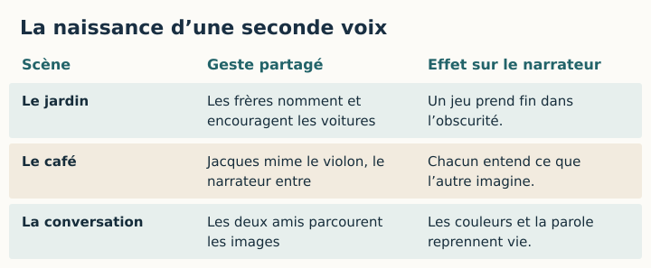

# BEL A/L — Allemand (commentaire et traduction) 2019 · Corrigé brut

*Corrigé rédigé par IA, non officiel. Signalez toute erreur.*

**Rédaction** · GPT-6.2 Astra Ultra · vitesse non renseignée

**Révision (tour 1)** · GPT-6.2 Astra Ultra · vitesse non renseignée

[Sujet officiel](https://www.ens-lyon.fr/sites/default/files/2019-10/2019%20Commentaire%20et%20traduction%20en%20LVE.pdf#page=2) · [Rapport du jury](https://www.ens-lyon.fr/sites/default/files/2019-10/ALLEMAND_2019_0.pdf#page=1)

Peter Weiss évoque dans Abschied von den Eltern (1961) la rencontre du narrateur avec Jacques au temps de l’exil. Le commentaire porte sur l’ensemble de l’extrait. La version commence avec la tombée de la nuit au jardin et se termine lorsque Jacques revient s’asseoir à la table.

## Commentaire

### Eine zweite Stimme für das eigene Leben

In einem russischen Café in London pfeifen zwei junge Männer ein Konzert von Bach. Ein Instrument haben sie nicht. Dennoch nennt der Erzähler das, was sie gerade zustande gebracht haben, rückblickend ein Konzert. An dieser kleinen Verschiebung lässt sich die ganze Begegnung mit Jacques verstehen. Etwas zunächst nur Vorgestelltes wird dadurch wirklich, dass ein Zweiter darauf eingeht. Wie verändert dieser Vorgang die Erinnerung des Erzählers an den Abschied von seiner Kindheit und an seinen Wunsch, Künstler zu werden?

Im Garten ist bereits ein Spiel im Gang. Zwei Brüder geben ihren Rennwagen besonders schöne Namen und spornen sie an. Ihre Rufe können den Modellen keine eigene Bewegung verleihen. Sie gehören dennoch zu dem Vergnügen, einen gewöhnlichen Weg um die Wiese in eine Rennbahn zu verwandeln. Von der Küche her fällt Licht in die Dunkelheit. Während das Kind noch spielt, erkennt der rückblickende Erzähler schon, was mit dieser Szene zu Ende geht. Die letzten Reste seiner Kindheit ertrinken im Dunkel. Das Verb macht aus dem Verlust einen körperlichen Vorgang von einer Heftigkeit, die das kleine Rennen selbst nicht hatte. Anders als ein äußerer Abschied lässt sich das Ende der Kindheit keiner festlichen oder traurigen Handlung genau zuordnen. Man merkt erst im Rückblick, was an jenem Abend mit verschwunden ist.

Nach dem Abschied folgt eine eigenartige Verkürzung der Zeit. Viele Monate im väterlichen Kontor lassen sich durch die immer gleiche Bewegung ausdrücken, dem Vater täglich an denselben Ort zu folgen. Dafür wird eine kurze Regenepisode im Café recht genau erzählt. Der Mantel, den der junge Mann verleiht, und die zerschlissene Tasche, die er als Pfand erhält, stiften eine Verbindung, bevor einer der beiden eine Lebensgeschichte vorgetragen hätte. Doch die Tasche enthält Werkzeuge und keine Noten. Hat der Erzähler also einen Bauarbeiter für einen Musiker gehalten? Die Schilderung des scharf geschnittenen Gesichts verschiebt den Gegensatz schon ein wenig. Dieses Gesicht erscheint ihm wie aus einem Material gemeißelt. Der angehende Maler blickt auf den Fremden mit den Augen eines Gestalters, während die Werkzeuge noch auf die materielle Arbeit verweisen, von der Jacques lebt.

Als Jacques vom Bau erzählt, nimmt er den fragenden Blick seines Gegenübers wahr und antwortet mit einer stummen Vorführung. Eine Hand greift, die andere führt einen unsichtbaren Bogen. Erst das Pfeifen macht das vorgestellte Instrument hörbar, und erst der Einsatz des Erzählers stellt die Zweistimmigkeit von Bachs Doppelkonzert her. In dieser kleinen Szene muss keiner erst beweisen, dass er ein Künstler ist. Entscheidend ist die Genauigkeit, mit der der andere die Geste aufnimmt. Dass der Held mit der zweiten Stimme einfällt, hat Gewicht für alles Weitere. Seinen eigenen Ausdruck findet er zuerst, indem er auf jemanden antwortet.

Nun spricht er von seinen Bildern. Der Text beschreibt keinen fertigen Gegenstand, den er aus einer Mappe zieht und Jacques zeigt. Gerade während er spricht, gewinnen die Bilder ihre Farben zurück. Eine Folge von Sätzen, die sich mit „und“ aneinanderhängen, lässt uns der Entdeckung ihrer Wirkungen Schritt für Schritt beiwohnen. Der Erzähler hatte nicht einmal bemerkt, dass ihm mit den Bildern auch die Stimme abhandengekommen war. Die Farben gehören somit nicht einfach einer privaten Innenwelt an, zu der er nur den richtigen Schlüssel finden müsste. Er braucht jemanden, vor dem er sie entstehen lassen kann. Umgekehrt brauchen die erlöschenden Farben seine Worte. Was das Kontor monatelang voneinander getrennt hat, Bild, Stimme, betrachtenden und sprechenden Menschen, tritt in eine produktive Beziehung.

Das neue Leben bekommt durchaus keine idyllischen Farben. Die Visionen sind von Tieren auf der Flucht, von Untergehenden und von Städten in Auflösung bevölkert. Zu den religiösen Gestalten treten entstellte und verführerische Gesichter, zu den Ruinen die verzauberten Gärten. Das Bemerkenswerte liegt auch hier in den Verben. Die Bilder wachsen vor den beiden, nehmen sie in ihre Tiefe auf, lassen sich durchwandern. „Jacques baute weiter an den Landschaften“: Nun greift das Verb des Bauens die frühere Erwerbsarbeit auf, während sein Gegenstand eine gemeinsam entworfene Landschaft ist. Gerade dem Mann mit den Werkzeugen gibt die Erzählung ein Wort, in dem man den Übergang vom materiellen Herstellen zur gemeinsamen Einbildungskraft noch hören kann. Der Maler wird nicht Künstler, indem er endlich allein über seine Farben verfügt. Er muss hinnehmen können, dass ein anderer an seiner Landschaft mitbaut.

Wie groß der Raum geworden ist, lässt sich an einem einzigen Satz ermessen. Er beginnt am Tisch und führt über Café, Keller, Straße, Stadt und fremdes Land bis in die unendliche Welt. Die beiden Freunde sind die ganze Zeit am selben Platz geblieben. Die Reihe der Ortsangaben hebt ihre tatsächliche Lage im Exil nicht auf, macht aber die Enge des Kellers und die Weite des gemeinsamen Lachens gleichzeitig erfahrbar. Im Lachen kann der Erzähler sogar sein bisheriges Dasein im Elternhaus und im Geschäft schildern. Es wirkt auf einmal unwahrscheinlich. Vor wenigen Absätzen war es noch das einzig mögliche Leben gewesen. Die Kunst hat die Wirklichkeit des Alltags verändert, bevor sie auch nur ein äußeres Hindernis beseitigt hätte.

Auch das abschließende Bild der Befreiung behält seine Widerstände. Jacques hat seine Freiheit erobert, und diese Freiheit zehrt an ihm. Hunger, Not und Verwundbarkeit gehören zu dem Bild, das der Erzähler von ihm entwirft. Ein idealer Führer, der den sicheren Weg in ein besseres Leben vorzeigen könnte, wäre eine bequemere Figur. Tatsächlich sieht der junge Mann in Jacques gerade die Offenheit, die ihn selbst befreit und zugleich gefährden kann. Aus seinem Kokon kriecht er in dessen Gegenwart. Unmittelbar danach spinnen die Freunde wiederum etwas, diesmal ihre Welten voreinander. Das Spinnen führt nicht mehr in eine Hülle zurück. Es bringt etwas hervor, das man miteinander teilen und entziffern kann. Dass die Einblicke am Schluss einem Rebus gleichen, lässt jedem der beiden ein Geheimnis. Erst diese Offenheit macht verständlich, warum das stimmlose Violinspiel zu Beginn tatsächlich der Anfang eines Konzerts sein konnte.

## Version française

Il faisait déjà presque nuit dans le jardin, et de la cuisine où Elfriede préparait le repas du soir, de la lumière nous parvenait. Sur le chemin qui faisait le tour de la pelouse, nous faisions la course avec nos petites voitures, encourageant de nos cris nos favorites, auxquelles nous avions donné des noms fantastiques, et dans l’obscurité toujours plus épaisse se noyaient les derniers vestiges de mon enfance. Désormais, chaque jour, je suivais mon père au bureau, et cela dura des mois. Après la fermeture, j’allais souvent m’asseoir dans un petit café russe près de Hyde Park, un demi-étage en contrebas de la rue. C’est là que je rencontrai Jacques pour la première fois. Je lui prêtai mon manteau alors qu’il s’apprêtait à sortir sous la pluie, le col de sa veste relevé. Il me laissa en gage son porte-documents élimé. J’y jetai un coup d’œil et vis qu’elle contenait quelques outils de menuisier, alors que je me serais plutôt attendu à y trouver des partitions. Son visage était étroit et comme taillé au ciseau, le menton saillant, le nez anguleux et busqué. Ses cheveux étaient touffus et en bataille, et ses yeux, d’un éclat gris acier, étaient profondément enfoncés dans leurs orbites. À son retour, il vint s’asseoir à ma table.

