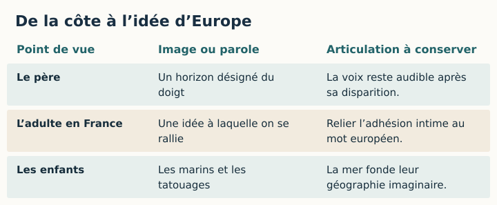

# BEL A/L — Allemand (thème Lyon) 2019 · Corrigé guidé

*Corrigé rédigé par IA, non officiel. Signalez toute erreur.*

**Rédaction** · GPT-6.2 Astra Ultra · vitesse non renseignée

**Révision (tour 1)** · GPT-6.2 Astra Ultra · vitesse non renseignée

[Sujet officiel](https://www.ens-lyon.fr/sites/default/files/2019-10/2019%20Epreuves%20de%20sp%C3%A9cialit%C3%A9.pdf#page=8) · [Rapport du jury](https://www.ens-lyon.fr/sites/default/files/2019-10/ALLEMAND_2019_0.pdf#page=11)

Le thème allemand de quatre heures, sans dictionnaire, est intitulé « Chemin d’Europe ». L’extrait provient du Sanglot de l’homme noir d’Alain Mabanckou (2012).

## Préparer l’épreuve

Attribuer chaque perception à son moment. Der kleine Junge de la première question désigne une expérience générale. Le père parle depuis Pointe-Noire. Puis l’adulte se trouve déjà en France et entend de nouveau la voix de son père défunt. Maintenir l’enchaînement entre sa définition de l’Europe et l’interrogation sur l’Union européenne. Pour l’adhésion, beitreten nomme naturellement l’entrée dans l’Union. Relayer auparavant l’idée abstraite par sich einer Idee anschließen permet de rendre perceptible le jeu.

Dans les deux derniers paragraphes, s’interroger sur le sujet de chaque verbe. Les oiseaux accompagnent les bateaux. Les marins descendent en ville, les enfants imitent leurs tatouages. Les couleurs et les guillemets sur les « gens d’Europe » appartiennent à la vision enfantine de ce qui sort de l’océan.

Le verbe *sich einer Idee anschließen* marque le ralliement à une idée. Le nom *Beitritt* donne ensuite au même geste son sens politique et conserve la question du narrateur sur le mot « adhésion ».

## Proposition de thème

**Der Weg nach Europa**

Werden die Europäer eines Tages verstehen, was im Kopf eines afrikanischen Jungen vorgeht, wenn er sich diesen Kontinent im Norden vorstellt, fest davon überzeugt, dass dort drüben sein Traum in Erfüllung gehen wird? Auch ich habe in diesem ebenso schönen wie trügerischen Traum gelebt.

„Europa“, pflegte mein Vater zu sagen und dabei mit dem Zeigefinger zum Horizont zu deuten, „ist alles, was jenseits des Ozeans liegt.“ Wir Kinder von Pointe-Noire wuchsen mit dieser Überzeugung auf. Erst viel später, ich lebte inzwischen in Frankreich, erkannte ich, dass mein Vater mit seiner naiven Definition seiner Zeit voraus gewesen war. Er war schon tot, doch seine tiefe, beruhigende Stimme klang mir wieder im Ohr. Europa war tatsächlich eine Idee, ein Glaube, eine Überzeugung. Jeder konnte diesen Kontinent auf seine Weise erfinden. Es genügte, daran zu glauben und sich der Idee anzuschließen. Und „Beitritt“ – hört man dieses Wort nicht oft, wenn von der Europäischen Union die Rede ist? Was ist ein menschliches Vorhaben wert, wenn ihm nicht eine gemeinsame Idee zugrunde liegt, die alle miteinander teilen?

Wenn wir vor den Augen der Fischer aus Benin an der Côte sauvage entlangrannten, bis wir völlig außer Atem waren, sagten wir Jungen zueinander:

„Wir fahren nach Europa!“

Jedes Schiff, das im Hafen von Pointe-Noire vor Anker ging, kam ganz bestimmt von jenem fernen Kontinent. Und wir beneideten die stolzen Kormorane, die majestätischen Albatrosse, die sie auf ihrer Fahrt begleiteten. Europa nahm für uns leibhaftig Gestalt an, wenn die Matrosen die Stadt im Sturm eroberten und sich in den Bars des Viertels Trois-Cents herumtrieben, Tätowierungen wie Stempel auf den Muskeln, meist feuerspeiende Drachen.

Wir hatten die unglaublichen Geschichten der Freibeuter gelesen. Trugen wir etwa Ohrringe und malten ihre Tätowierungen auf unseren noch schmächtigen Muskeln nach, weil wir ihnen gleichen wollten? In unseren Augen waren die Matrosen, ob schwarz, gelb oder rot, allesamt „Leute aus Europa“. Das lag am Meer, denn alles, was aus dem Meer „auftauchte“, konnte nur aus Europa kommen.
