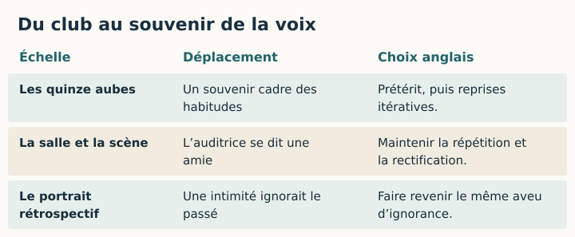

# BEL A/L — Anglais (thème Lyon) 2019 · Corrigé brut

*Corrigé rédigé par IA, non officiel. Signalez toute erreur.*

**Rédaction** · GPT-6.2 Astra Ultra · vitesse non renseignée

[Sujet officiel](https://www.ens-lyon.fr/sites/default/files/2019-10/2019%20Epreuves%20de%20sp%C3%A9cialit%C3%A9.pdf#page=9) · [Rapport du jury](https://www.ens-lyon.fr/sites/default/files/2019-10/Anglais_2019.pdf#page=15)

Le thème de quatre heures, sans dictionnaire, est extrait d’Avec mon meilleur souvenir de Françoise Sagan (1984). La narratrice évoque les nuits new-yorkaises où elle écoutait Billie Holiday.

## Proposition de thème

For fifteen days, or rather fifteen dawns, from four in the morning till eleven or noon, we sat in that club, where the smoke never cleared, listening to Billie Holiday sing. Sometimes Michel accompanied her on the piano, bursting with pride, and when he wasn't playing it was one of the countless musicians, one of Billie Holiday’s worshippers, who heard a thousand jazz drums sending the news through the New York night and all turned up, one after another, at one dawn or another, from one club or another. On the audience side there was just our little French party, two or three friends of Lady Day's and of her husband's, her man at the time, a tall, brooding fellow she spoke to with great vehemence. On the stage side, besides Cozy Cole on drums, there were twenty celebrated jazzmen, each more celebrated than the last. Gerry Mulligan would play a duet with our friend's voice, for our friend she had now become, through a flood of drink, peals of laughter, misunderstandings and sometimes flares of temper as quick to die down as to rise.

Our friend Billie Holiday, who patted our heads as if we were children, and from whom we were divided, without the least inkling of it, by a whole tragic past, a whole terrifying destiny, a whole turbulent and violent life endowed with the gift of gratifying her likes and blotting out her dislikes, simply by shutting her eyes and letting loose from her throat that half-amused moan, cynical and so profoundly vulnerable… inimitable, the cry of a personality triumphant and imperious, regal in its utter naturalness, for there was nothing contrived about her, nothing to outward appearances complicated. I did not know then that a life in and of itself could fill all the labyrinths of the most secretive and perverse of minds. I did not know that she was all raw flesh, almost bleeding, making her way into life amid blows and caresses which she seemed to defy with the very breath she drew. A femme fatale she was, in the sense that fate had fastened on her from the outset and never let her go. After a thousand wounds and a thousand equally violent pleasures, the one defence it had left her was that humorous inflection in her voice, that strangely husky note when she had gone very far away, or very far down, and came abruptly back to us with her little mocking laugh and her eyes at once proud and afraid.

