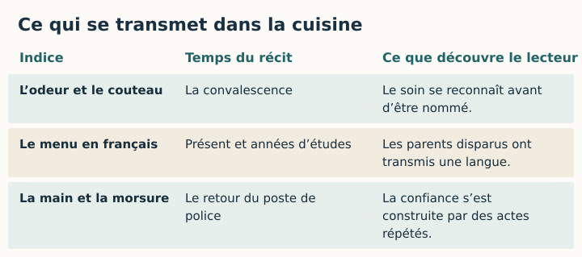

# BEL A/L — Chinois (commentaire et traduction) 2019 · Corrigé guidé

*Corrigé rédigé par IA, non officiel. Signalez toute erreur.*

**Rédaction** · GPT-6.2 Astra Ultra · vitesse non renseignée

[Sujet officiel](https://www.ens-lyon.fr/sites/default/files/2019-10/2019%20Commentaire%20et%20traduction%20en%20LVE.pdf#page=6)

L’épreuve commune présente un extrait de 沉重的翅膀 de Zhang Jie (1981). La version se limite aux lignes 1 à 9, depuis l’odeur de la soupe jusqu’à la discrète sollicitude de Mo Zheng. Le commentaire porte sur l’ensemble du passage.

## Préparer l’épreuve

Dresser une courte chronologie sans modifier l’ordre du récit. Dans le présent, Ye Zhiqiu recommence à avoir de l’appétit. Dans les années 1950, elle a étudié auprès des parents de Mo Zheng. Plus tard, elle a ramené le garçon du poste de police. Le retour à ces événements éclaire le repas sans l’annuler comme scène heureuse.

Dans la version, associer les perceptions à leur source. La lame du couteau frappe une planche, l’odeur arrive de la cuisine et le ciel est vu de la chambre. La liste de petits bonheurs est faite d’exemples possibles. La dernière série désigne ceux de ce jour précis. La fin de ligne 9 est aussi le point où le nom de Mo Zheng reconfigure rétrospectivement les bruits du repas.

## Commentaire

### 一碗汤如何让过去回到眼前

张洁没有从两个人的身世讲起。先到叶知秋身边来的，是厨房里的香气和菜刀落在案板上的声音。读者甚至还不知道谁在做饭，就已经和病后初愈的人一起觉得日子有了滋味。等到结尾，才知道做饭的孩子曾经咬过她，她也曾两次把他从派出所领回来。同一碗汤怎样既是此时此地的一顿饭，又能带出两个家庭的历史？

开头把幸福写成身体重新具备的一种能力。嘴里原先发苦，什么也吃不下。今天空气有了香味，冬日的天空也含着暖意。太阳未必比别的时候暖，改变的是感受它的人。接下来的举例乍看很随意。好天气、久候的信、电影，都可能使人高兴，电车上一个看起来吊儿郎当的青年肯给老太太让座，也算一件。这个例子比直接称赞一个好人更有意思。让座的举动使人重新看待那男青年，又不必把他原来的神气完全抹去。等莫征出场，我们也将看到一个会翻白眼的孩子，正在极细心地服侍病人。他的体贴可贵，正在于他不把关心做给别人看。

叶知秋的快乐也不是毫无阻碍地表达出来的。她想说几句闲话，或是唱一唱，鼻音却还重，唱不起来。这个小小的滑稽场面忽然转成一番自我训诫。连家中也不能太放肆，因为习惯可能带到办公室，招来他人的非议。她身边并没有一个监视的人，外界的目光却早已能够在她心里说话。小说在这里既没有把阴影安置在某个远处，也没有让它完全盖住开头的好天气。它只是插在一个人想哼歌和终于开口之间。这样一来，历史对日常动作的限制有了可以感到的分量。

打破这段犹豫的是一句最普通的话，中午吃什么。用法语来问，厨房里也用法语答，菜名仍然是菜名，并没有突然变成庄严的纪念用语。可是叶知秋为莫征没有忘记法语而高兴，两个声音一来一往，就让读者听到了已经消失的第三种声音，那就是当年教过她的莫征父母。两人同在一所大学教法文，她曾是他们的学生。孩子的答话既是请病人吃饭，也是家庭教育还活着的一个微小证据。这条线索解释了为什么叙述会停下来追问“教养”究竟是什么。同一件事在今天使人珍惜，在某一段年月里却可以被指为奢侈、被说成资产阶级的标记。词语的价值一变，使用它的人甚至可能失去安身之处。

当往事终于出现，莫征的父母在“文化大革命”中双双死于非命，仅仅占了一小句。更长的篇幅给了后来那个在街头流落的孩子。把他比作野狗，起初仿佛是站在旁边描写他的凶狠。紧接着，叙述却试着从挨过打的一方看伸过来的手。别人也许以为手伸出来就是为了抚摸，孩子的经验却告诉他，手也会打他、掐他。这时咬人的动作并没有变，变的是我们判断它所凭的经验。叶知秋第一次把他领回家，受到回报的竟是一口，而她又去领了第二次。两次相似的行动代替了一篇赞美善良的议论。在信任尚未建立的时候再做一遍，才使开头不露痕迹的照料成为可能。

结尾没有把这种关系说成一笔终于还清的恩情。叶知秋自己也不能确定当初为什么这样做。她想到自己从小也是孤儿，知道寄人篱下的滋味。那个带着疑问的猜想保留了两个人经历之间的距离。她理解莫征，并不等于她早就知道孩子所受的一切。小说让今天会给病人准备食物的手与过去防备别人的手同属一人，也让一位曾经照顾孩子的长者坦然成为接受照顾的人。回看最初那阵细碎轻快的刀声，读者所听见的已经多了几层。它仍然只是切菜的声音，正因为这样，失去的家怎样在另一个家里留下活的痕迹，才格外真切。

## Version française

De la cuisine arrivait un parfum de soupe à la betterave à vous mettre l’eau à la bouche. On entendait aussi le rythme allègre du couteau sur la planche à découper.

Peut-être parce qu’elle avait retrouvé la santé, Ye Zhiqiu avait le cœur aussi serein que ce ciel clair qui se laissait si rarement voir en hiver derrière la fenêtre et que baignait la douceur du soleil.

Pendant ces quelques jours de fièvre, elle avait eu le corps tout mou, un goût amer qui ne lui quittait pas la bouche, et rien ne passait.

L’odeur venue de la cuisine mettait Ye Zhiqiu en appétit. Comme bien des gens qui ont bon cœur, il lui suffisait de la moindre petite satisfaction pour goûter deux fois plus vivement le plaisir de vivre. Une belle journée, par exemple, une lettre longtemps attendue, un bon film qu’on venait de voir, un jeune gars à l’allure désinvolte qui cédait sa place à une vieille dame dans le tramway… Et aujourd’hui ? Rien de plus que ce beau ciel, le bon appétit d’après la maladie et la sollicitude de Mo Zheng, attentif au moindre détail sans en rien laisser paraître.
