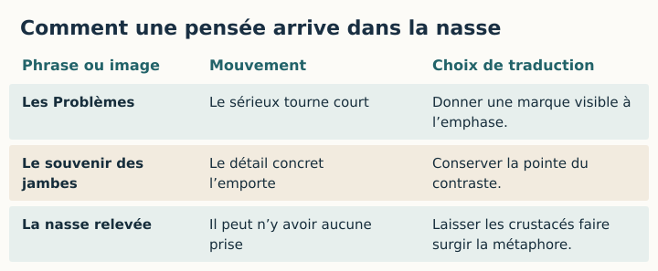

# BEL A/L — Chinois (thème Lyon) 2019 · Corrigé brut

*Corrigé rédigé par IA, non officiel. Signalez toute erreur.*

**Rédaction** · GPT-6.2 Astra Ultra · vitesse non renseignée

[Sujet officiel](https://www.ens-lyon.fr/sites/default/files/2019-10/2019%20Epreuves%20de%20sp%C3%A9cialit%C3%A9.pdf#page=10)

Le thème chinois de quatre heures, avec dictionnaire bilingue autorisé, est un extrait d’Amours au Palais Wilson de Pierre Girard (1942).

## Proposition de thème

这样一来，我能自己支配的时间就多了。总算可以好好研究那些“大问题”了。可我立刻就泄了气。因为我心里清楚，说到底，那些“大问题”根本引不起我的兴趣。有好几回，我跟一些绝顶聪明、浑身上下透着俄国味儿的人讨论了整整一夜，事后却怎么也想不起都说了些什么，倒是躺在长沙发上的那些女人的双腿，我可没忘。念头冒到我的脑子里来，全凭偶然。我想，我的脑子就像本地渔民拿到海湾石崖边、放进海里去捕龙虾的那种笼子。他们把笼子搁上几天，再提上来。有时候里面空空的，可往往也会有一两只模样吓人的甲壳动物。这些“海上武士”挣扎起来，弄得好一阵乒乓乱响，好一派怒不可遏的气势。

