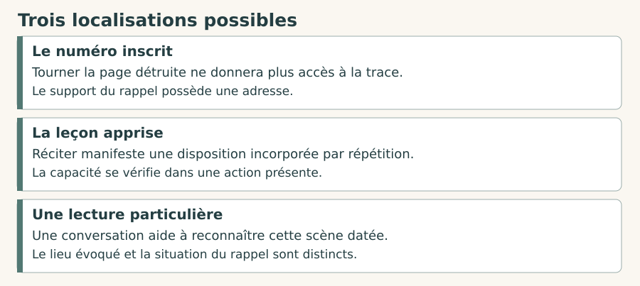

# BEL A/L — Deuxième composition de philosophie (Lyon), 2019 · Corrigé brut

*Corrigé rédigé par IA, non officiel. Signalez toute erreur.*

**Lecture du rapport du jury** · GPT-6.2 Astra Ultra · vitesse non renseignée

**Rédaction** · GPT-6.2 Astra Ultra · vitesse non renseignée

**Autocontrôle** · GPT-6.2 Astra Ultra · vitesse non renseignée

**Révision (tour 1)** · GPT-6.2 Astra Ultra · vitesse non renseignée

**Révision (tour 2)** · GPT-6.2 Astra Ultra · vitesse non renseignée

## Où est la mémoire ?

Une femme retrouve dans une boîte une photographie prise pendant son enfance. Elle reconnaît la cour de l’école et peut même retrouver, sur l’image, l’endroit précis où elle se tenait. Mais elle ne se rappelle plus la scène. Son frère, à qui elle téléphone, se souvient d’un incident survenu ce jour-là. Leur conversation lui rend soudain un détail qui n’était pas visible sur la photo. Où était donc cette mémoire, avant qu’elle ne se souvienne ? Certainement pas tout entière dans le papier, que n’importe qui pouvait regarder. Et pourtant l’image et la parole d’un autre ne sont pas indifférentes à son retour.

Demander « où » engage une hypothèse. Quelque chose demeure quand le souvenir n’est pas présent, et cette permanence devrait avoir un lieu. Mais la mémoire peut désigner la capacité de garder et de rappeler, le souvenir qui revient, le savoir-faire acquis ou les supports grâce auxquels une collectivité rend le passé disponible. Nous chercherons ce qui est localisable et ce qui permet d’attribuer un souvenir à quelqu’un. Si la mémoire a besoin de lieux pour durer et revenir, son mode de présence ne se réduit peut-être pas à la place occupée par une chose.

### I. La recherche d’un lieu répond à une exigence réelle de conservation

Quand quelqu’un perd l’usage d’une capacité après une lésion cérébrale, la question du lieu acquiert une portée précise. Certaines structures cérébrales sont nécessaires à la formation ou au rappel de certaines sortes de souvenirs. Les dissociations observées en neuropsychologie permettent de distinguer des fonctions que l’expérience ordinaire rassemble sous le mot « mémoire ». On peut, dans certaines conditions, progresser dans une tâche par répétition sans conserver le souvenir conscient des séances. Il serait donc déraisonnable de répondre tout de suite que la mémoire se situe « hors de l’espace » parce qu’un souvenir renvoie au passé. Une faculté de cet être vivant a des conditions de réalisation dans son corps, et l’on peut étudier leur distribution.

Le même raisonnement vaut en un autre sens pour un carnet. J’y inscris un numéro que je ne connais pas par cœur. Demain je pourrai le retrouver à une page déterminée. Déchirer cette page peut certes détruire un moyen effectif de rappel. Mais elle porte une suite de signes qu’un inconnu peut déchiffrer aussi bien que moi. Pour comprendre ce qui m’est arrivé lorsque j’ai reçu ce numéro, il faudra encore que j’identifie le nom, la situation et la provenance du document. Le succès d’une localisation du support établit des possibilités de conservation et de perte. Il laisse ouverte la question du rapport au passé propre à un sujet.

L’ancienne métaphore du magasin de souvenirs rend compte de la recherche et de la surprise de la trouvaille. Pourtant, quand on ouvre un tiroir, l’objet y attend sous la même forme qu’au moment du dépôt. Supposer qu’un souvenir inattentif existe en moi sous la forme d’une petite scène actuellement regardée par personne reviendrait à confondre son être conservé avec son retour à la conscience. Il faut distinguer l’acte actuel de se souvenir et la disponibilité qui précède cet acte.

### II. Ce qui se conserve ne se présente pas toujours comme une image située

Dans le deuxième chapitre de *Matière et mémoire*, Bergson compare deux manières de savoir une leçon. Après des répétitions, je peux la réciter. Sa possession se vérifie dans une suite de mouvements articulés que je suis capable d’exécuter. Je peux aussi me rappeler telle lecture particulière, faite hier près d’une fenêtre. Une seule occurrence suffit à donner à cette scène sa date. Répéter la leçon perfectionne le premier savoir et ne transforme pas les lectures successives en une seule scène passée. La distinction entre mémoire-habitude et souvenir d’un événement porte donc sur ce que l’on cherche à retrouver. Dans le premier cas, le corps montre ce qu’il sait faire. Dans le second, je reconnais quelque chose comme ayant eu lieu une fois.

Une leçon peut être récitée après la disparition du cahier où elle était écrite. La perte de ce support empêche un mode de consultation, tout en laissant subsister la disposition acquise par répétition. Demander où se trouve la mémoire requiert alors de préciser quelle opération de rappel on cherche à expliquer.

Dans la théorie de Bergson, la conservation du passé et son actualisation en une image utile à la situation présente ne se confondent pas. Dire le souvenir « virtuel » revient ici à lui attribuer une réalité qui ne se donne pas actuellement sous la forme d’une perception. La chambre de mon enfance peut revenir avec une présence frappante. Je sais pourtant que la pièce où je me trouve aujourd’hui est ailleurs. Une carte des lieux représentés dans mes souvenirs situerait la chambre, la fenêtre et le jardin. Elle ne situerait pas mon acte de me souvenir, encore moins toutes les conditions qui en permettent la reprise. Le cerveau est bien dans la pièce où je parle et la chambre remémorée situe mon enfance. Le mot « où » renvoie ainsi à deux objets distincts.

Si la mémoire n’est que mon acte présent, l’objection renaît cependant sous une autre forme. Qu’est-ce qui distinguerait un souvenir d’enfance d’une invention que je pourrais aujourd’hui produire à partir de la photo ? La reconnaissance d’une expérience passée prétend à une fidélité. Une confidence, une photographie datée ou un carnet peuvent contredire mon impression. Le passé auquel je me rapporte a laissé des traces dont je ne puis disposer à ma guise, même si aucune ne livre seule ce que ce passé a été pour moi.

### III. Des lieux du rappel à la personne qui se souvient

Dans *Les Cadres sociaux de la mémoire*, Maurice Halbwachs montre que le groupe familial, le langage et les repères temporels partagés ne fournissent pas seulement des renseignements supplémentaires à une mémoire privée déjà complète. Ils aident à organiser les conditions de la remémoration. À l’issue de la conversation avec son frère, la femme de l’exemple situe le souvenir parce qu’elle peut l’inscrire dans une suite d’événements et reconnaître la place qu’elle y occupait. Elle peut aussi contester une date donnée par son frère. La mémoire collective ne suppose pas un grand cerveau du groupe où leurs deux souvenirs seraient physiquement déposés. Les cadres communs rendent des récits possibles et contrôlables sans rendre les points de vue identiques.

Un monument aux morts donne à cette idée une forme publique. Il occupe un emplacement identifiable. Ses noms et ses inscriptions peuvent être lus quand aucun témoin ne se trouve présent. L’appel des noms lors d’une cérémonie ou l’enquête d’une descendante font toutefois autre chose que regarder la pierre. Ils reprennent le signe dans une pratique de commémoration ou de connaissance familiale. Le jour où aucune personne présente n’a connu les disparus, on peut encore parler de mémoire publique. On ne prétend pas que chaque participant se rappelle personnellement la scène de leur mort. La transmission exige des objets durables, des institutions qui les conservent et des personnes capables d’en renouveler les usages. Elle peut aussi sélectionner certains noms et en laisser d’autres hors du monument.

Deux sœurs retrouvent une lettre de leur mère qui indique la date d’un déménagement. Toutes deux avaient placé l’événement un an plus tard. Elles rectifient la date. Une seule, pourtant, se souvient de l’écho particulier que faisait sa voix dans la pièce vide. La lettre peut corriger le récit de celle qui se souvient et renseigner celle qui n’a aucun souvenir de la pièce. L’exactitude de la date et la présence du passé à quelqu’un varient donc indépendamment. Ce que l’archive conserve en un lieu demeure précieux, précisément parce qu’elle peut contredire un témoignage sincère. Ce qu’elle ne peut fournir à elle seule, c’est le rapport à l’événement de celle qui dit y avoir été. La personne n’est pas une autre boîte où chercher une seconde copie de la lettre. Elle est celle dont le présent peut être affecté par ce passé, et dont le récit demande parfois à être corrigé.

La question du lieu était donc justifiée lorsque nous cherchions des conditions de persistance et les points par lesquels une mémoire peut être blessée ou soutenue. Elle devient trompeuse lorsqu’elle exige une adresse unique du souvenir. Il y a un lieu pour une trace, un corps pour une habitude, une situation présente pour un rappel et des cadres collectifs dans lesquels un passé devient reconnaissable. Ce qui en fait une mémoire est la relation de reprise et d’attribution par laquelle quelqu’un ou une communauté rapporte ces signes et ces capacités à un passé. Localiser ses conditions aide à comprendre cette relation. Cela ne dispense pas de dire qui se souvient, de quoi, et avec quelle prétention à la fidélité.

[Sujet officiel](https://www.ens-lyon.fr/sites/default/files/2019-10/2019%20Epreuves%20de%20sp%C3%A9cialit%C3%A9.pdf#page=2) · [Rapport du jury](https://www.ens-lyon.fr/sites/default/files/2019-11/PHILO_TC_SP_2019_0.pdf) · [Bergson, Matière et mémoire, chapitre II](https://fr.wikisource.org/wiki/Mati%C3%A8re_et_M%C3%A9moire/Chapitre_II)
