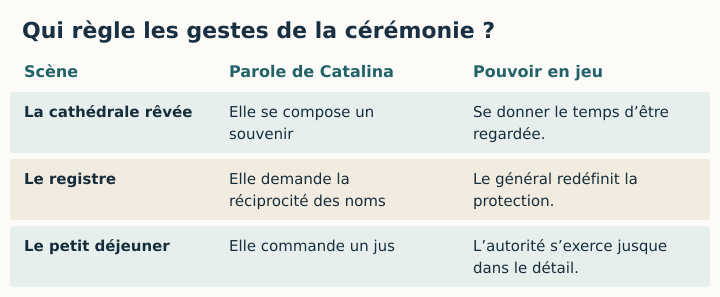

# BEL A/L — Espagnol (commentaire et traduction) 2019 · Corrigé guidé

*Corrigé rédigé par IA, non officiel. Signalez toute erreur.*

**Rédaction** · GPT-6.2 Astra Ultra · vitesse non renseignée

**Révision (tour 1)** · GPT-6.2 Astra Ultra · vitesse non renseignée

[Sujet officiel](https://www.ens-lyon.fr/sites/default/files/2019-10/2019%20Commentaire%20et%20traduction%20en%20LVE.pdf#page=8) · [Rapport du jury](https://www.ens-lyon.fr/sites/default/files/2019-10/ESPAGNOL_2019_0.pdf#page=1)

L’épreuve porte sur Arráncame la vida d’Ángeles Mastretta, dans l’édition datée de 1987 par le sujet. Le commentaire examine toute la scène. La version commence à la première phrase et s’arrête lorsque Andrés demande si les parents de Catalina sont là.

## Préparer l’épreuve

Faire deux colonnes, la cérémonie imaginée et celle du registre civil. Dans la première, Catalina choisit le décor, les vêtements et la durée de son entrée. Dans la seconde, quels mots et quels gestes peut-elle réellement choisir ? Suivre la réponse que le juge lui fait corriger, puis la signature et le jus d’orange. À chaque fois, elle demande ce qui passerait pour une liberté minuscule.

Pour la version, distinguer l’habitude présente de la narratrice et les souhaits rétrospectifs irréalisés. Le ventre à côté duquel on se réveille fait brusquement tomber le registre de la procession nuptiale. El Jefe Máximo est un titre politique. Après « Pero no me casé », les phrases suivantes confirment qu’elle s’est mariée civilement. Ne pas rendre la formule comme si elle était restée célibataire.

Le contraste entre *lo estaba diciendo* et *lo estaba inventando* tient au sujet commun, Andrés. En enchaînant ses propres inventions sur le récit au pluriel *nos casamos*, Catalina reprend la parole pour dire comment le mariage a réellement eu lieu.

## Commentaire

### Una boda en la que hay que aprender a decir «sí»

Catalina tiene nostalgia de una boda que nunca se celebró. El comienzo de *Arráncame la vida* que nos proponen leer contiene ya una pequeña insolencia narrativa. ¿Cómo se recuerda lo que no se ha vivido? Bastaría con decir que el general Andrés Ascencio no quiso casarse por la Iglesia y enumerar las razones políticas de su negativa. Pero entonces él habría dispuesto hasta de la primera frase del relato de su mujer. Catalina se reserva el placer de empezar con su propia ceremonia. El paso de la alfombra imaginaria al registro civil, y de ahí a una mesa de desayuno, permite medir la distancia entre lo que ella puede contar y lo que se le dejó decidir.

En la iglesia soñada todo está dispuesto para que las miradas confluyan en la novia. El padre le ofrece el brazo, las hermanas llevan los vestidos elegidos por ella, la cola se extiende sobre los escalones. El pasillo de la catedral sería más largo aún. Ese detalle revela algo que la imagen de una muchacha deslumbrada por el lujo dejaría escapar. Lo que Catalina querría prolongar es el tiempo en que podría avanzar a su propio paso, visible para todos. En cuanto imagina el después, sin embargo, el brillo se desploma en la imagen de la misma barriga con que una se acuesta y amanece. La voz adulta se ríe de las bodas sin dejar de envidiar el cortejo. No podemos separar un personaje ingenuo que soñaba de una narradora finalmente lúcida que se burlaría de él. La primera persona conserva los dos impulsos en presente y hace de su desacuerdo una manera de mirar.

También sabe que la ceremonia no le habría cambiado la vida. Lo que le falta es un recuerdo con el que jugar como otras mujeres. Ese deseo aclara la extraordinaria precisión de un recuerdo inexistente. La escritura concede a Catalina la competencia que reclama, componer la escena que habría podido evocar. Pero ella misma deshace el decorado al introducir el lenguaje de Andrés. La distancia entre la alcurnia concedida a la novia y la palabrota con que el general liquida el asunto desbarata en una frase toda la solemnidad del cortejo. La carrera política, la guerra contra los cristeros y la fidelidad al Jefe Máximo deciden dónde podrá casarse una mujer. Para la novia, la iglesia era un espacio de visibilidad. Para él, aparecer en ella sería hacerse ver haciendo lo indebido. La diferencia de sus posiciones se lee en lo que cada uno teme o desea que vean los demás.

En el relato del domingo, las órdenes sustituyen a los condicionales. Andrés llega sin avisar y manda llamar a los padres. La breve pregunta de Catalina sobre quién va a casarse parece una broma, pero toma al pie de la letra lo que se le acaba de decir. ¿Por qué tendría que saber ella, precisamente la interesada, lo que un hombre ya ha decidido? Él responde poniendo su propio nombre y su propia persona en primer lugar. Cuando Catalina le pregunta quién se cree que es, le basta creerse Andrés Ascencio. La circularidad de la respuesta exhibe el supuesto del que depende toda su autoridad. También la madre llora. A Catalina le alegra que el llanto conserve un vestigio del rito. Sin embargo, la madre atribuye sus lágrimas a un presentimiento, y la hija recuerda que se pasaba la vida presintiendo cosas. El relato deja convivir la posible advertencia y el pequeño fastidio de haberla oído muchas veces.

En el registro, la ley tiene por representante a un juez que el general saluda familiarmente, mientras el funcionario lo trata con deferencia. La cara roja, los labios y los cacahuetes imaginados en su boca provienen de la observación traviesa de la narradora. La superioridad que Catalina gana al describirlo no le sirve, en aquel momento, para contestar como quiera. Catalina contesta «Bueno», como en una conversación. El juez le impone el «sí» de la fórmula. El juez necesita una palabra exacta y le hace repetir la respuesta. A continuación el general puede suprimir a su gusto una parte de la lectura. Una misma ceremonia exige de la mujer una literalidad que permite al hombre abreviar. En la firma se hace visible esa distribución de libertades. Catalina escribe el nombre que ha aprendido a trazar con las monjas. Andrés, que ni siquiera ha querido una boda religiosa, vigila por encima de su hombro la adición que señalará la pertenencia al marido. A la pregunta de si él ha pasado, a su vez, a ser «de Guzmán», contesta hablando de protección. El intercambio permite ver dónde se transforma esa palabra en posesión. Sin embargo, la narradora informa también de que aprendió a reconocer su garabato y casi habría podido imitarlo. La firma del hombre, tan segura de su carácter único, es ya algo que otra persona puede leer y reproducir.

La evocación de Lilia adelanta de pronto el relato varios años. Andrés querrá entonces una boda religiosa para sus propias hijas. Ha cambiado la situación política y, sobre todo, ahora pretende ejercer los derechos del padre sobre sus «crías». Su lenguaje mezcla el regateo, el insulto y el deseo de reservarse la última palabra. El contraste revela qué queda de los escrúpulos ideológicos cuando se intercambian las posiciones familiares. Al volver a la firma de los testigos y después al desayuno, el relato consigue que un encargo de bebidas recoja la historia entera. Café, chocolate y tamales para todos. El general parece generoso, pero distribuir lo mismo a cada uno ahorra escuchar las preferencias. A Catalina le basta con pedir jugo para introducir el desorden que él tanto teme. Su padre consigue que se lo traigan. La última palabra que reproduce el relato le corresponde todavía al general, que recuerda a don Marcos quién manda en esa mesa. La narradora no convierte un vaso en liberación. Le da, eso sí, el espacio suficiente para que veamos cuánto poder necesita un hombre para decidir quién puede desayunar qué. La pequeña desproporción cómica devuelve a su voz toda su potencia crítica.

## Version française

Il m’arrive encore d’avoir la nostalgie d’un mariage à l’église. J’aurais aimé remonter au bras de mon père une allée tendue de rouge jusqu’à l’autel, au son de la marche nuptiale jouée à l’orgue, sous les yeux de toute l’assemblée.

Je ris toujours aux mariages. Je sais bien que tout ce tralala finira dans la lassitude de se coucher et de se réveiller, jour après jour, à côté du même ventre. Mais la musique et le cortège sur lequel règne la mariée me font encore plus envie qu’ils ne me font rire.

Moi, je n’ai pas eu un mariage comme ça. J’aurais aimé avoir pour demoiselles d’honneur mes sœurs tout en rose, un peu sottes et sentimentales, gainées d’organza et de dentelle. Papa en noir et ma mère en robe longue. J’aurais aimé une robe aux manches amples, au col montant, dont la traîne se serait étalée sur toutes les marches jusqu’à l’autel.

Ça n’aurait rien changé à ma vie, mais je pourrais m’amuser de ce souvenir comme les autres le font du leur. Je pourrais me revoir redescendre l’allée, appuyée sur Andrés, saluant l’assistance du haut de ma noblesse toute neuve, de ce rang que chacun accorde à une mariée qui revient de l’autel.

Moi, c’est à la cathédrale que je me serais mariée, pour que l’allée soit encore plus longue. Mais je ne me suis pas mariée à l’église. Andrés m’a convaincue que tout ça, c’était des conneries, et qu’il ne pouvait pas ruiner sa carrière politique. Il avait pris part à la guerre de Jiménez contre les cristeros, il devait fidélité au Chef suprême, il n’était pas question qu’il se marie à l’église, même pour rire. Au civil, oui, il fallait respecter la loi civile, encore que le mieux, à l’en croire, eût été un rite de mariage militaire.

À mesure qu’il en parlait, il l’inventait, ce rite, car nous nous sommes mariés comme des soldats.

Un matin, il est passé chez nous.

— Tes parents sont là ? m’a-t-il demandé.
