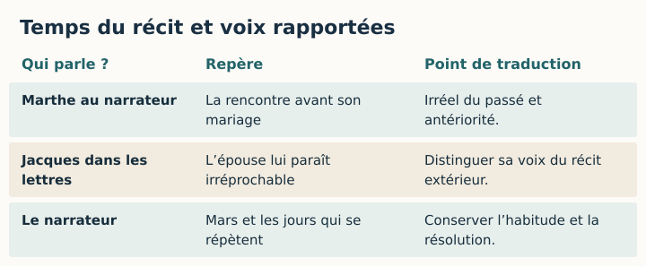

# BEL A/L — Espagnol (thème Lyon) 2019 · Corrigé brut

*Corrigé rédigé par IA, non officiel. Signalez toute erreur.*

**Rédaction** · GPT-6.2 Astra Ultra · vitesse non renseignée

**Révision (tour 1)** · GPT-6.2 Astra Ultra · vitesse non renseignée

[Sujet officiel](https://www.ens-lyon.fr/sites/default/files/2019-10/2019%20Epreuves%20de%20sp%C3%A9cialit%C3%A9.pdf#page=11) · [Rapport du jury](https://www.ens-lyon.fr/sites/default/files/2019-10/ESPAGNOL_2019_0.pdf#page=6)

Le thème espagnol de quatre heures, sans dictionnaire, est tiré du Diable au corps de Raymond Radiguet (1923). Marthe raconte ses fiançailles et le narrateur revient sur sa propre timidité.

## Proposition de thème

Marthe, que ahora me preguntaba a menudo si de veras la había querido desde nuestro primer encuentro, me reprochaba que no se lo hubiera dicho antes de su boda. No se habría casado, o eso aseguraba ella, pues, aunque al principio del noviazgo había sentido por Jacques algo parecido al amor, aquel noviazgo, demasiado largo por culpa de la guerra, poco a poco había ido borrando aquel amor de su corazón. Cuando se casó con Jacques ya no lo quería. Esperaba que los quince días de permiso que le habían concedido tal vez le hicieran sentir de otro modo.

Él no tuvo mucho tino. Quien ama siempre irrita a quien no ama. Y Jacques la quería cada vez más. Sus cartas eran las de alguien que sufría, pero que tenía a su Marthe en tan alta estima que no podía creerla capaz de traición. Por eso solo se culpaba a sí mismo y solo le suplicaba que le explicara qué daño podía haberle hecho. «A tu lado me encuentro tan tosco. Siento que cada una de mis palabras te hiere». Marthe se limitaba a contestarle que estaba equivocado y que no le reprochaba nada.

Estábamos entonces a principios de marzo. La primavera se había adelantado. Los días en que no me acompañaba a París, Marthe, desnuda bajo la bata, esperaba a que yo volviera de mis clases de dibujo, tendida ante la chimenea donde seguía ardiendo la leña de olivo de sus suegros. Les había pedido que le mandaran otra provisión. Me contenía no sé qué timidez, acaso la que se siente ante algo que nunca se ha hecho. […]

Por la noche, solo en la cama, llamaba a Marthe y me reprochaba, yo que me creía un hombre, no serlo lo bastante para acabar de hacerla mi amante. Cada día, de camino a su casa, me prometía que no saldría de allí hasta que ella lo fuera.

