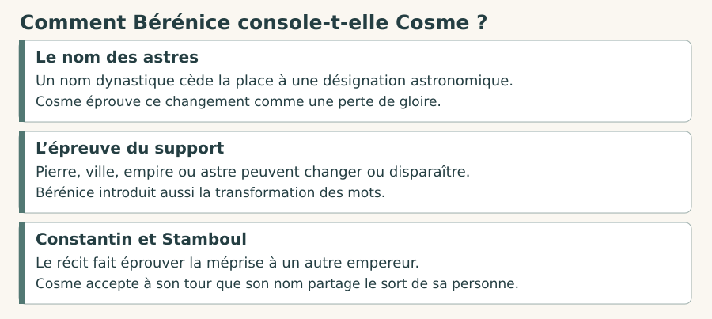

# BEL A/L — Étude de texte français (Lyon), 2019 · Corrigé brut

*Corrigé rédigé par IA, non officiel. Signalez toute erreur.*

**Lecture du rapport du jury** · GPT-6.2 Astra Ultra · vitesse non renseignée

**Rédaction** · GPT-6.2 Astra Ultra · vitesse non renseignée

**Autocontrôle** · GPT-6.2 Astra Ultra · vitesse non renseignée

**Révision (tour 1)** · GPT-6.2 Astra Ultra · vitesse non renseignée

## Fontenelle, Bérénice et Cosme II de Médicis

On donne aux astres le nom des puissants pour que quelque chose d’eux demeure visible après leur mort. Fontenelle place justement le bénéficiaire d’un tel honneur à l’endroit d’où il en profitera le moins : parmi les morts. Cosme vient d’apprendre que les découvertes de Galilée sont rarement désignées désormais par son nom. La reine Bérénice pourrait triompher, puisque sa chevelure reste inscrite au ciel. Elle s’emploie pourtant à le consoler en lui représentant ce qu’une semblable réussite vaut pour une morte. Comment le dialogue rend-il à la fois sensible le désir de survivre et plaisante la reconnaissance de sa vanité ?

### I. Une dispute sur la gloire commence comme une conversation mondaine

Le prince ouvre la conversation par la proximité d’un passé tout récent. Les nouveaux morts font circuler des renseignements sur le monde des vivants. L’invention suffit à rendre une nouvelle astronomique parfaitement ordinaire dans l’au-delà et à faire se rencontrer une reine d’Égypte et un prince de la Toscane moderne. Le premier mouvement ne prend pas la forme d’une thèse. C’est une plainte où les possessifs trahissent une conception du savoir. Galilée est présenté comme le mathématicien de Cosme et les lunes comme les objets d’un honneur personnel. La désignation fonctionnelle de satellites de Jupiter est juste du point de vue astronomique. Du côté du prince, le mot qui la présente comme une appellation trop simple lui ôte tout lustre. La précision scientifique devient une blessure d’amour-propre. D’une affaire de nomenclature, Cosme conclut immédiatement à la méchanceté du monde.

Le tour de Bérénice est bref. Son assentiment si empressé et l’ampleur du mal qu’elle semble déplorer produisent un écart ironique avec l’insignifiance du dommage. Elle peut ainsi laisser l’autre développer lui-même le parallèle qui le désavouera. Cosme raconte le vœu sur les cheveux, l’offrande au temple puis l’intervention d’un mathématicien qui explique la disparition en désignant une constellation. Au lieu de s’intéresser à ce qui, pour Bérénice, pouvait faire le prix du vœu, le retour de son mari, il expédie le conflit par une formule d’ignorance dédaigneuse. Son intérêt se porte sur la réussite de l’opération de dénomination. La désinvolture dont il souffrait lorsqu’elle touchait sa gloire devient sa façon de traiter l’histoire d’une autre.

Bérénice offre alors de donner, si la chose était possible, sa chevelure céleste à son interlocuteur. Le système hypothétique permet de n’effectuer aucun don matériel tout en éprouvant la valeur qu’il lui attribue. Elle ajoute qu’il aurait bien peu d’obligation de l’en remercier. La politesse excessive rabat la valeur du cadeau en même temps qu’elle marque sa générosité. Cosme répond en évaluateur sérieux de ce bien imaginaire : tout dépend pour lui de l’assurance qu’a son nom de vivre. La conversation galante a ainsi produit une expérience de pensée sans rompre le plaisir de la repartie.

### II. Séparer le mort de son nom, puis éprouver chacun des soutiens de la survie

Bérénice oppose le nom inscrit là-haut à la personne qui demeure ici-bas. L’adverbe ordinairement attaché au séjour terrestre se déplace avec les locuteurs. « Ici » appartient maintenant aux enfers de la fiction. Même si toutes les constellations recevaient son nom, la première personne qui parle depuis ce lieu n’en éprouverait aucun changement de condition. Le raisonnement se poursuit sur la disproportion entre la personne entière et les quelques syllabes que l’on prétend disputer à la mort. Les termes du litige et de la chicane donnent à cette tentative de grandeur l’allure d’une petite ruse judiciaire. La maxime générale surgit d’une difficulté éprouvée par un interlocuteur bien déterminé. Elle n’a pas été placée d’autorité au seuil du dialogue.

Cosme pourrait être certain qu’un nom a duré et rester incapable d’éprouver la gloire qu’il lui attribue. Le dialogue des morts rend ce paradoxe sensible à l’oreille. Il donne momentanément voix à celui qui se plaint de perdre, parmi les vivants, les signes de sa présence.

Cosme répond par le sentiment de celui qui se noie et s’accroche au premier support venu. L’image fait comprendre son désir mieux qu’une simple proclamation de vanité. Les pierres accumulées et le tombeau sont des choses auxquelles on peut littéralement s’agripper, jusque dans l’acte paradoxal de prendre le monument de sa propre mort pour un secours contre elle. Le passage à « on » donne à sa détresse une extension commune aux vivants. Bérénice en reprend le geste lorsqu’elle demande à quoi on attachera une immortalité. La durée du support elle-même est en cause. Une ville ou un empire peuvent disparaître. Le prince déplace alors sa dernière assurance vers les astres supposés demeurer toujours.

À ce point, la science qui avait fourni le ressort de la plainte devient l’instrument du doute. Bérénice n’assène pas une certitude de savante. Les tours qui rapportent ce que l’on dit des étoiles nouvelles et de celles qui s’effacent sont ceux d’une morte attentive aux nouvelles. La perspective de ne plus avoir un cheveu au ciel donne à un changement astronomique la figure comique d’une perte de cheveux. Le jeu engage pourtant un problème plus radical. Même si l’astre restait à sa place, le nom pourrait n’être plus prononcé, compris ou rapporté à la personne qui l’avait reçu. L’incertitude astronomique est redoublée par une histoire des signes.

### III. Le récit dans le dialogue fait accomplir à Cosme le chemin de la consolation

La « mort, pour ainsi dire, grammaticale » est annoncée avec une précaution qui attire l’attention sur l’invention. Il ne s’agit plus de perdre un empire, mais de modifier quelques lettres. Le nom subsiste peut-être sous une forme transformée sans garantir aucune reconnaissance. Pour le montrer, Bérénice raconte à son interlocuteur la dispute de Constantin et d’un autre empereur. Elle s’y met en scène comme passante, interrogeant les morts qui discutent. Le lecteur retrouve un dispositif à deux voix à l’intérieur de la première paire, avec cette différence que les compétiteurs s’y trompent ensemble. Chacun vante sa ville et ses trois mers. Le parallélisme des énumérations rend sensible une coïncidence topographique que les toponymes distincts masquent à Constantin.

Le comique est doublement réflexif. Un homme qui a donné son nom à une ville n’est plus capable de la reconnaître sous un autre nom. Et il en vient à reconnaître qu’il aurait pu lui laisser son premier nom, Byzance. En voulant inscrire sa gloire, il avait déjà recouvert une dénomination antérieure. Bérénice passe du récit de la dispute aux paroles directement rapportées de Constantin. Au lieu d’énoncer une leçon définitive en son propre nom, elle prête au vaincu de la démonstration le soin d’exprimer lui-même sa découverte. Cosme peut alors répéter ce geste à son tour. L’histoire enchâssée est ainsi moins une illustration ajoutée qu’un modèle proposé à l’interlocuteur pour sortir honorablement de son erreur.

Cosme a le dernier mot comme il avait eu le premier. L’affliction singulière devient une résolution personnelle d’attendre avec patience, puis une considération formulée à la première personne du pluriel. Le modalisateur qui limite un peu sa consolation conserve la vraisemblance du personnage. En accordant aux noms la condition mortelle de ceux qui les portent, sa dernière phrase personnifie encore ce qui n’est que quelques syllabes. Elle abandonne l’exigence d’exception sans renoncer à l’esprit galant. Fontenelle ajoute enfin un paradoxe dont le lecteur fait l’expérience après la réplique finale : nous venons précisément de prononcer les deux noms que le dialogue disposait ses personnages à laisser mourir. La littérature conserve un souvenir de leur désir de gloire en faisant de ce désir le ressort de sa critique.

[Sujet officiel](https://www.ens-lyon.fr/sites/default/files/2019-10/2019%20Epreuves%20de%20sp%C3%A9cialit%C3%A9.pdf#page=4) · [Rapport du jury](https://www.ens-lyon.fr/sites/default/files/2019-10/LETTRES_MODERNES_2019%20internet.pdf)
